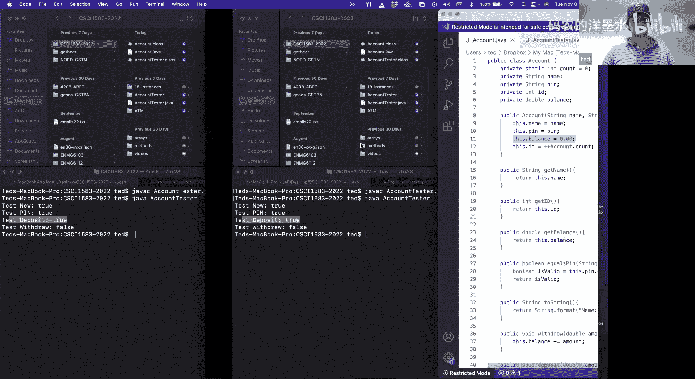
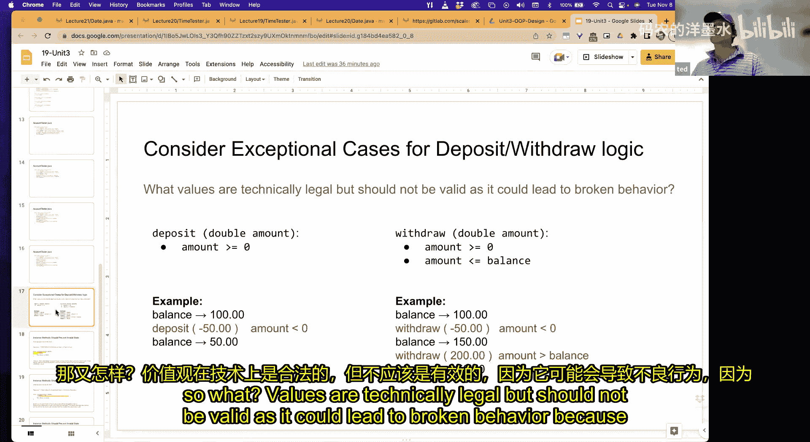
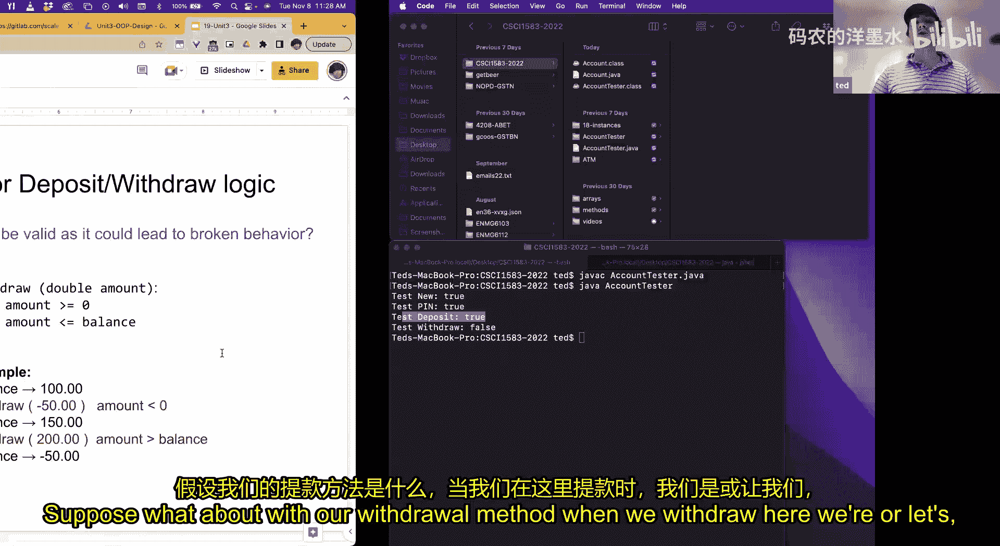
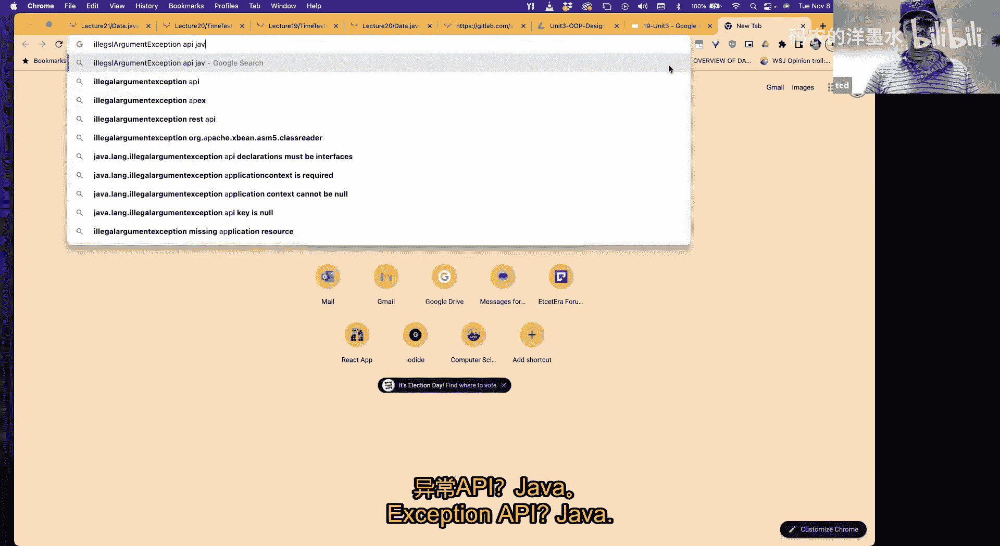
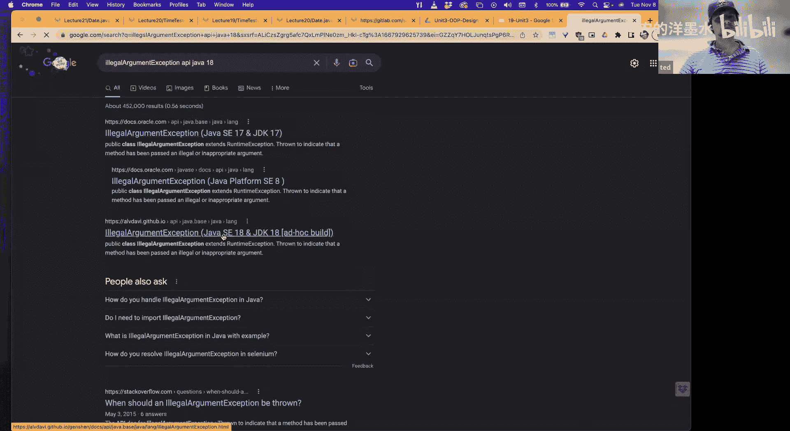
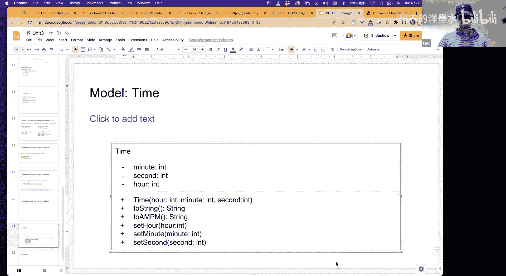

# 【全集】加州理工学院 软件设计与开发 中英字幕 1080P p23 Lecture 23 - ATM 账户 - 抛出异常 -BV1AvzCBdE7a_p23-

Great。Yes。Okay， so。Ill to have everything set up can everyone hear me。

 does anyone have any questions about what we did last class？Yeah。

Or does anyone have any questions about anything related to？

Homework or the task before we start today' lecture。

Everyone's pretty good with everything in terms of。Where do you feel like you're at？

Excellent and just to confirm the online group， you can hear me P。Excellent， okay。

So does everyone recall where we left off on Thursday？Thursday is still chapter7 isn it well。

So we're still covering the basics of objects， but the chapters are going to start bleeding together in terms of the way that the concepts are taught。

That's right yeah， so we had gotten to the point where if i'm not mistaken take a look here。

 we had defined a account class。To model an account for a ATM machine。

And so we'veve identified our instance fields that each individual account should maintain。

 so we identified a name which we represented as a string， we identified a pin task code。

 which we identified as a string we have created an ID number that allows us to。

Identify a particular account instance and then we also have a balance associated with each account。

And so those are the instance fields and just to illustrate。

That we can also pair our class with static fields with class fields we have a class that represents the total number of counts of。

Accounts。So and then we use that as the basis to generate our ID number so where our ID is just what temporal occurrence is this account created in the sequence of created accounts so the first account would be account one and then the second account would be account two and the third account would be account three the 1000th account would be 1000th right。

And then after doing that we solely implemented each of our methods and if you recall last class we started designing our。

Our software object， we started designing this account object by using a three tiered table in the first tier and the first row of it was the name of the object to we wanted to define and let's see if let's go back to that。

Was the name of the object we wanted to define in the second row was the collection of properties that we need to define that that represent this。

particular object， and then we delineate whether this data is public or whether it is private using the arithmetic symbol that we put in front of it so a minus sign represents private access。

And plus signs represent public access and then in the third row at the bottom of this we represent the set of behaviors or actions that this object supports and that's effectively the API into our object This is the the actions we can cause our object to do and we said that objects one of the powerful things about instances and using classes is that we can construct an instance it's a process that we call instantiation So when we instantiate a class it means we construct an instance and the one role of the constructor is to go ahead and define values to all the instance variables all the instance fields so that's why when we start defining our class here in terms of Java we declare all of the instance fields。

 but they aren't assigned a value。Until the constructor is defined。

 so the role of the constructor is to set values to all of the instance fields。😡。

Just like so and so here sometimes you know what the default value would be if that's the case you just set it sometimes you don't know what the default value is going to be it needs to be passed into the constructor as a parameter all right so does everyone feel confident and comfortable with those concepts。

😡，Then since these are all private they're neither readable or wriable from code outside of this class so in order for these values to be read from external classes we will create query methods or getter methods getter methods are public so that they can be called on from client code from other classes and what the get typically does is just return back the value that's held inside that instance field so here we can get the name we can get the idea we can get the balance and so that allows us to get reading access now we still don't have writing access and the idea behind why we don't have writing access is that we are using typically fundamental data types the foundational data types to represent the characteristics of our of our object right so like for instance。

 when we say。😡，Account has to have a name field well that has to be represented as either text either another object or text or a number or as a boolean right those are like kind of four options I guess you can throw a fifth option as a collection of things as well so typically there's like five different types of things something can be either a reference to another object either a collection of something or one of the foundational data types so text number or true false bullolean value。

😡，But because of that the foundational the foundational data types these very fundamental data types can very often have a larger set of values than what you are using to model that particular behavior and i'll give you an instance for that this is where we're really starting to motivate on why we don't want to give direct access to our fields we want to ensure that the state we call state refers to the set of values inside of our instance fields。

 we want to make sure that the state of all of our objects or always。😡。

Vals and sometimes you can have a legal value for say for instance， an inteature。

 but it's not valid for the way we're using it to define one of our properties。😡。

Right and so here what we were about to get into was implementing let's say so we implement it get name。

 get ID get balance equals10 and two string right and so what we were going to do was we were going to implement withdraw and deposit does everyone remember that？

It talked about being able to withdraw and deposit because that's where we're actually starting to get to interesting things with this account object。

😡，And in addition to。To implementing our account object， we just don't do that in isolation。

 we also built a tester class so as we。😡，Implemented our methods so the first thing we did was we stbed out all the methods stubbing out means we declare them。

 but we ignore giving each of the methods a well defined body， we create an empty scope of code。

 we just open and close our brackets。😡，And then if it needs to return something we return a dummy value so if it returns to boolean value we just like return false if it returns a numerical value we just say return zero if it returns a string value just do null or an empty string and the idea is that we will step through and we will implement a method at a time and then test to make sure as we implement our methods are doing their behaving our object works the way we expect to we by creating these by creating client code that interacts with them in the way that we would expect interact with it in the real application and so the motivating goal here is by the time we we're done designing our method we can hand it off to the lead software developer they can integrate your class into the software system that everyone's building out to and you can feel guaranteed that the work that you've contributed won't break the system that it'll work seamlessly as it gets deployed and inter。

😡，With the rest of the codeb right so that's one of the powerful ideas about objectoriented programming is it allows us to start defining our code into these very modular discrete components so that we each can assign like if I were the elite developer I could assign a part of the codeb to each person in this class you can work on it independently without having to get code from your neighbor and then I could bring it all together assemble it and have something that actually works right so the fact that we can work on code concurrently is a very powerful concept driven by objectoriented design principles whereas previously the techniques we would have used wouldn't work well when you have more than one person working in the same codeb right does that much make sense。

Can you explain what this means and how it's been used so that's a great question recall up we started talking about instance fields there's effectively three different scopes that variable can live in so variables can live inside of a method scope or what we'll call local scope and so oftentimes you can even nest a variable into an even deeper scope than that anytime you have a set of curly braces inside of a method that variable is going to be scope at that level as well。

 but very broadly speaking it exists inside of the method level that method is done executing its actions that variable falls out of scope and it's discarded' guard is collected thereafter after that method's done doing its work and so sometimes if you need to transfer some computational work from one method to the other you have the return key to allow for that to happen that way。

can have one locally scoped variable sent to another locally scoped source so it can be used。

After we learned about local variables because that's where we started from。

 we then learned about class variables， class variables or scope to the class itself。

 one giant limitation of class variables is that they can only have one value for the entire T of class so once it's set it has that value throughout the life for everything else inside of that application。

 so when that application refers to that class variable it's going to be the same value all across the application。

😡，Which sometimes is the behavior you want， but for the instance of starting to design accounts where you want multiple instances of a similar thing then you don't want a static variable you don't want a class variable you want an instance variable instance variables allows us to produce instances of a class any number of instances of a class and so we have to use a different keyword to access the value of a particular instance so the keyword we would use to access the class variable was the class name itself right so when I needed to access and let's go back let's go back to account here so inside of account whenever I go to access this static variable called count notice I use the class name account and then I use the dot operator the dot operator implies that the thing on the righthand side of the dot is inside the thing on the left hand side so there is a count field。

😡，Inside of the class account。😡，Now， if I want to access these instance variables。

 these aren't defined at the class scope themselves。

 they're only created when the constructor is invoked。

 so when you build an instance when you use a new keyword， invoke the constructor。

 the constructor returns back an instance of that class that you can then store in the variable。😡。

I love data to type whatever their class name is， so if my class name is account。

 then I get back an account instance。😡，Now， since I can have more than one account instance。

 I could have a million account instances， the special keyword we use inside of account to reference。

😡，This particular instances value is that this keyword so that this keyword is used inside of a class so that each instance can distinguish from other instances so again the reason why I're using it this keyword is I have two variables online nine there are actually two different types of variables the one on the right hand side of this assignment operator called name is the local variable that's declared inside of the parameter list notice I have my parameter list for my constructor here I have string name right there that is a local decor of that variable when I say just name here。

😡，I'm referencing the name that is。😡，Inside of the parameter list。

 then on the lefthand side of this assignment operator。

 I have a reference to another variable that's also called name so I don't want to access the local variable。

 I want to use the local variable name to set the instance field inside the class and since they share the same name。

 I need to use a fully qualified path of where this variable exists at。😡。

And doesn't exist in the class scope it exists in the instance scope so I can access the instant scope using the Biskey worm that's what the this does it's a special kind of pointer it's a special label that each instance has access to that's different than all the others so for instance if I create it let's go over here。

😡，Into the tester when I create this account here where the name is Joe Joey and we go into。😡。

Joe Joey getting past here well the instance field for account one is going to then reference Joe Joee so this dot name inside of account one is Joe Joey。

 whereas when I go to create this。😡，Additional alternate account instance where the name is Sue Suszy and I pass Sue Susie into the constructor。

 then what's happening here is Sue Suszy is this value。😡，In the parameter list。

 so this dot name for the account two instance references Su Suszy in number so even though they both say this dot name because they exist in two different instances。

 they are going to refer to two separate sets of values， hence the word this。😡。

This is very specific to each individual instance so this dot name can have if we have a million different account instances。

 then it can have in a million different sets of values each one self referential into itself does that help explain that。

😡，Go up。Exent does anyone else have questions related to that that can be one of the trickier things to to conceptualize is what we're actually doing with this and the important thing to remember is just recalling that each time we call the constructor it's generating in a new account instance in this case and each one has its own name and it has its own pin number and it has its own balance and it has its own。

Let's see what was the other thing pen name and its own ID number and we even tested that right isn't that something we tested when we were testing new so recall in the tester method we actually implemented somebody's out so in this tester method the first thing we did was we created a blame value just to say our test defaults to a full state。

And then we start performing our test so for instance here we created two different account instances that we are going to call account one and account two。

 then I create my expected behavior that I should get back and so I'm going to use that two string method to be able to represent the state of my object。

As text as a string so that I can use it for evaluating， for comparing for testability。😡。

And then here I'm going to set test pass if my expected value。

 which is this string name Joe Joey account ID1 balance zero is equal to the two string method output that I get from account one and then i'm also going to compare。

😡，Account two to the expected account two and in order for me to get a pass value inside of my tester method here。

 I have to pass both those taskss。😡，And then if you recall， I was running these。😡，So let's， let's。

Clear this and let's see where we last left off。So， let's。

And we see that I passed being able to create a new instance。

 I passed being able to go ahead and test my pin number。

 which was to compare a pin number to a prior to the internal pin number right everything else we return back that we decided pin numbers shouldn't be easily accessible that we can pass in an attempt and it lets us know whether we got it right or wrong。

We were able to even test depositing the value right and I think that's where we last left off and we were starting to talk about well what are potentially some of the the risk exceptional behaviors that can happen so we start to motivate why we want our。

😡，Instance variables to be private is because they represent a particular state our public methods allow us to control how that state changes so the only way that the state changes over the course of the application lifecycle is when they're called to do so by methods that we control and define。

😡，So and then we were starting to talk about， let's see here。Yeah。

 so I think this is where we last left off and so。I know we had gotten some suggestion when we go to implement our withdrawal and our deposit so I think this is what we started with right and we're like this seems to kind of work right I have a deposit。

I could pass in some amount and then whatever the balance is when I deposit I'm adding to it right the idea of depositing is I add to whatever the deposit amount is to my original balance so my balance is0 and I deposit $100 then I should now have $100 if I then deposit $50 I should then have 150 right so my balance each time I deposit more money should incrementally keep increasing。

And for withdrawing whatever this amount that gets passed into our method it should reduce our balance。

 so if I withdraw $50 and if I originally had $200 then I should now have $150 and then if I withdraw $100 then I should then have a $50 balance and my balance will constantly decrease each time I withdraw money from it right？

😡，So the question then becomes。😡，Is this a suitable implementation to ensure that our account object will always have valid states so what is a valid state for let's start talking about this like what's the valid state for a name for instance。

😡，So yeah， so probably an invalidance so let's identify an invalid state so what might be an invalidance state then？

😡，A number or maybe just something that's blank， right？

So it could be a number it could be something that's blank let's do the blank thing because that's a little bit easier to check so when we go and we set the number for instance or for the name instead of just blindly setting this perhaps I should be checking to see if its if it is has a。

Has an actual value inside of it and isn't an empty string because maybe that's what we would consider an invalid name now。

😡，I'm going to kind of so that these are the things we want to try to plan for while we're implementing and planning out our steps i'm going to ignore the name component。

 although we should protect against that because I want to I want to focus more on the other。😡。

The other。The other thing that we're really considering is balance。So。What we're about to do。

 what we're about to talk about would extend to name。

 but I don't think I want to spend the time that actually well maybe we'll say we'll circle back and we'll correct name。

 but let's talk about balance what is a valid or invalid state for balance。😡，umbNumbers， right。

 should it be any number？😡，Positive numbers， right？Like your account。

 you shouldn't be allowed to have a negative account。😡，是。Right， that doesn't。ThatFor an ATM。

 it should only be zero zero should be the bottom line right you start at a zero balance。

 you should be able to deposit money into it， but it should never be negative。😡。

Like because that will go into an invalid state in terms of the amount of money you have right you can have zero money。

 but you shouldn't have negative money， right？😡。

So what we're starting to do here is consider the exceptional cases for deposit and withdrawal logic so what values are technically legal but should not be valid as it could lead to broken behavior because suppose。

😡。

Suppose what about with our withdrawal method when we withdraw here where or let's let's talk let's jump to deposit actually let me change the order of these so I stop doing that okay so for deposit for instance。

 what is the restriction on an amount should an amount be allowed to be a negative number what happens if it is a negative number。

😡。

Yeah， then'm I'm even though I'm depositing money， if I deposited a negative value of money。

 then I'm actually reducing the amount that's the opposite effect of what a deposit should do。

 what if I tried to deposit a negative amount and withdrawal。😡。

Exactly that's like a deposit of money wouldn't that be broken in the ATM machine if I withdrew negative money and it just added money to my account。

That's probably not behavior year one right that breaks the concept， so even though fundamentally。😡。

This logic seems to work， it only works under certain constraints。

 and the constraint is that amount has to be zero or positive。😡，Because if it's not。

 if it's negative， then it allows us to do something like this， have a balance that starts at 100。

 we deposit a negative amount and all of a sudden we have a balance of 50。😡，We want to prevent that。

Let's talk about withdrawal withdrawal is even more interesting because withdrawal。

 our amount not only has to be positive， but it also has to be less than or equal to your balance。😡。

Because otherwise， your balance falls into a negative value and that should be an inbalance state for us。

So for instance， an example of this is suppose we have a starting balance of 100。

 and we attempt to withdraw negative 50。So that's a violation that creates an exceptional instance because then。

My balance， even though I am doing withdrawal actually increases。

 it goes up to 150 and then suppose that I go ahead and try to withdraw 200。

Well my balance is only 150 and i'm trying to withdraw more than I actually have。

 so then my balance would go into negative $50 so notice there are sets of values that can be passed inside both deposit and withdraw that are illegal。

😡，But it produces an invalid state in our instance。😡。

And so that's what we try to identify when we're creating our methods what are instances that client code can go ahead and。

😡，And attempt to pass into here that can cause our object to break。

 that can cause our instances to fall out of a valid state。😡。

And then we have to protect against that。So what are ways do I protect against that？

So again the goal of our instance methods the reason why we make these public is it allows us to consider these situations and then we can prevent these invalid states to occur so our first approach might be to check those values for exceptional cases and just ignore them right so let's look at deposit here suppose what i'll do is i'll say if the amount that's being passed in is less than zero。

😡，Then just return stop doing and you processing and just just return this method back to the client code and if it is not an invalid。

 if it isn't one of these exceptional cases right then it means that the amount is a legal value。😡。

And a valid value。And so then we would go ahead and apply our logic right so does anyone。

Have a perception of why this isn't the best way to go ahead and。😡。

Prevents client code from setting a deposit in a negative amount。What might be an issue？

By just ignoring actions that would lead to an invalid state。People will try it exactly yeah。

 if I give a clue right at the bottom of the slide， however。

 this is a bad design because it doesn't report to the client why it didn't work。

It failed silently and the code would appear to behave normally because it didn't error out。

 it didn't cause any issues while you were compiling so you would have done a deposit。

 you would have passed on a negative amount and it would have just it would have looked like it did something。

😡，I'm sure what I can cause is unexpected behavior because now the client thinks they've successfully done something with your object and even though you protected against the change to invalid state。

 you didn't report that the client tried to do something bad。😡，So the more appropriate。

 the better design thing to do is you check values for these exceptional cases inside of your methods and you throw an exception object。

😡，it's an exception instance to the client code and you let them know that they violate it。😡。

One of the concepts that drives your data model。😡，So here there's a special key word in Java called throw throw returns back it's a special way of returning back control to an invoking method to another invoking block of code。

 but it only returns one type of thing， so whereas a return statement has an entire。😡。

Clawuse inside of the method that is the return type。

 the throw keyword only returns back exceptions and errors。😡。

So it's a way of returning back control with information that's relevant as to why this method failed to do what it's supposed to do and the entire point of a throat is to be able to report to the client code what it had violated and you've you've been the recipient I'm sure to lots of throws from the command line right？

😡，I'm sure everyone's seen that stack of。Of information at the command line that says， hey。

 I couldn't do that because I couldn't find the symbol or I there's no index at that inside that array or the input you're trying to give to the scanner object is mismatched type like these are all examples that it's giving you back information as to why your code didn't work it doesn't just silently fail。

😡，So we can start implementing that inside of our own code base so in this example。

 we can throw a new illegal argument exception and illegal argument exception。😡。

Represents so these these these exceptions as you can see are very verse in theirre naming so in this instance it means that that the argument that was passed into this method。

😡，Is illegal in this model that we're using it。 So even though it's technically a valid value， it is。

Illegal in the way that we want to process on top of it and then inside of so notice this is a constructor we're using the new key word and then we're creating a new instance of this that these exception objects have one parameter in the constructor it's a string that is the message that gets passed to the client code so this would say that the deposit amount has to be greater than or equal to zero to alert the。

😡，Other developer whoever is trying to use your code， why you refuse to go ahead and do this deposit。

😡，So does this motion make sense to everybody？Okay， so let's actually test this out a little bit。

Okay， so right now， and again， we can test the violation。 We kind of saw the slides for that。

 Let's go here into our deposit then。And try to well， first let's implement this。

 So here we're going to check for that invalid state so if。The amount is less than zero。😡。

Then I want to throw a new。依为哥。argumentment。Exception。And inside of here。

 I will leave the message that amount has to be greater than or equal to zero。Okay。

 let's try to test this out now， so I'm going to go over here。OkayThank。这个是。Yeah， I mean。Yeah。

 so that's。It's possible probably that you could do probably even a penny， right？So。

But it's technically not invalid， even if like our very base baseline is technically we can withdraw zero dollars。

😡，It doesn't do anything， but it ends up being that edge case。But I mean， that's， I mean。

 that's a really good point when we're defining what is valid and not valid。

 it's trying to find where that boundary point is。And so maybe we don't want zero to be included in that because maybe that actually leads to really erroneous behavior。

 suppose that I mean， suppose that we do limit it to one penny that would even prevent being able to deposit or withdraw fractions of pennies。

However， maybe you want to be able to deposit or withdraw fractions of pennies I don't know。

 I guess it depends on the application， but probably in the case of ATM you don't want to be able to do that because that could probably lead to really weird behavior。

😡，So yeah， in this instance， maybe we want our base case to be 0。01。

So you have to at least withdraw or deposit a pin at a time。Okay， let's go to our actual tester now。

 so let's suppose that our tester is here for testing deposits。So let's go to account one。

And let's try to deposit now a negative amount。So let's try to deposit negative $20。

Let's so notice it's up it's it's。Valt right produces code that allows me to compile。

 let's see what happens when we go and try to run that。

And so because I've passed in a negative value here at line 46。

And I'm checking for this case where if the amount is less than zero。😡，And again， if I really wanted。

 I could you know check whatever this is， less than a penny。

Then I will throw this new illegal argument exceptions notice what happens with those illegal argument exceptions is the same thing you've seen in the past if we don't try to catch an exceptional object。

 it causes our code to fail right we've seen this。😡，But when it fails， it gives me the message me。

Strucs out some So here the Java dotland got illegal argument exception is amount is。

Has to be greater than equal to a penny and just for the purposes of the slide so since yeah。

 perfect。And then what you're seeing here is the stack of invocations that led up to this exception being for this exception to actually occur so if I traced it if I did a this is what's called a stack trace by the way。

 if I trace the set of methods at the bottom is the main method right that's the first method that got put on to the activation stack and then from the main method was the test deposit method。

😡，And that method itself called on account to do a deposit and that happened on line 38 so each time I see the number after the colon and that's the line number that's being executed so again if I go to line8 that is where。

😡，We go in account tester line eight is where the main method is。

Was being called and at what point in the main method it stopped at the instruction pointer。😡。

And then inside of test deposit in line 46 so if I go to line 46 here I see this is the method inside of test deposit that led to the exception occurring and then if I go and so here i'm passing the negative value right negative 20 and then here inside of account inside of the Po line 38 so let's go here to line 38 is where I get that exception object that's actually thrown to me and then the actual exception object is this one at the very top so if you've seen these and you haven't quite yet learned how to parseson re through it that's the step by step process to kind of analyze a stack trace。

And now we can cause those ourselves。We can cause that to ensure that if client code tries to violate our data model by passing in a value that would result in a illegal or invalid state。

 then we can defend against that。Okay， so if I want my tester to actually work though。

What I can do is I can wrap this in a troey。So instead of just allowing it to fail because now when I test this。

 I can't actually test anything else， my tester crashes so I could put this in a try。😡。

So that I can catch that。Illegal argument exception。And let's just call that E。And then here。

 let me get a string that is a。Expect it。And what number expected three， for instance？

And we'll set it to an empty string initially。And then inside the catch。

We'll take and get expected three here to be set to E。Dot。Get message。

And then we'll on our tester pass。We will check to see if。啲。oh yeah。Actually， this should be oops。

 this should be。Exception。嗯。Okay， so that'll be our an exception and then here let's create our expected。

Three as and then what was our message， let's go and grab our message。

 the message should be this one right here。I'm just so that this isn in。Parallel with the slides。

 I'll change this back。Yeah， here。F。Yeah。And then here what we can do is we can test that our。

Exception。Equals。Our expected three。Excellent， okay， so let's see， let's see what's happening here。

 I have an exception that I'm going to declare。Right here so that I have access to it outside of the Tricatch block。

😡，I'm going to try to do this。With a ballot that I know should throw an exception now the powerful thing about using a trycatch block is I can then try to catch the reception the exception and do something with it so i'm going to try to catch an illegal argument exception because that's what I expect to be thrown i'm going to label it as E so i'm declaring a data a variable cult E of that data type of that exception data type one of the methods inside of exception and we can double check this by looking at the API is get message let's do that right now so let's go to illegal。

😡，Argument。Exception API Java。

Let's do Java 18。

So we can see that illegal argument exception is inside the Java dot L package。

 which is why you don't have to import it， but there are exceptions that exist outside of the Java dot L package like for instance exceptions related to the scanner object with the inside Java do u case I would have to import those so inside of here we can see。

😡，The methods that are available to us。Let's go to get message。

So the get message returns back as string and this returns the detailed message string of this particular throw level。

😡，So again， at any time， if you want to see what you can do with an object。Inside a Java。

 look at the API， it has the collection of all the methods that you as a client code have access to。

😡，So I'm going to get that message I'm going to store it inside of the variable that I've declared on 46 here。

😡，I now that I have that， I expect that the message I'm going to get from the exception will be amount should be greater than or equal to oh let me change this back so let me make sure that this。

 yeah。😡，So I'm going to make sure that this is the same thing and then what I'm going to do is I'm then going to oh I can't do that though what I need to do is the dot equals right we need to do a dot equals on a string。

And the expected。 So we'll take the exception here。String exception string， oh and let me do this。

Let's do。Expect it。We'll test with exception。Okay， perfect。

And this is going to result in something that's either true or false。And so if it's true。

 I'm going to add that in as part of this compound assignment operator as one of the additional checks。

😡，And if it's false， then I'm going to report that it didn't work， so let's test the cell。Okay。

 let's say it's oh， inspection。Probably once you spell that correctly。Okay。Okay。

 so we will then take exception。See here。Exception， exception。

I guess what I could do is give it a default value。Okay。

 perfect click clear this and let us run our account tester and see what happens when we run this so notice I am now getting a true value here and let's actually change this let's let's change this to say。

Like we'll change the the symbol here just to make sure that this is working the way we expect it to so reile no recompile。

And we will run and now it's going to save false yeah。

 so we're actually casting this exception and getting back to this exception object， which is great。

 that's exactly what we want。So notice we can even inside of our tester， test very verbose。

Exception handling inside of our classes so we not only test to make sure the methods work in a appropriate way in a way that we expect it to work。

 but we can also test and validate and verify that when a client code tries to provide a value that causes an exception to occur we can test against that too that way we do full coverage。

On all of our methods， so both。Successful and failed attempts are illustrated， does this make sense？

😡，This is what's called defensive design or defensive programming。

 where we try to see how client code could potentially break our code and we protect and defend against it。

It makes for room a more robust implementation。Okay， so now that we have this implemented。

 let's let's do the same thing our with our withdrawal method， so going into withdrawal。

Here what what are the exceptional what are values that lead to exceptional cases withdrawals。

 do you remember what they were？😡，So if we try for an amount to be less than zero is one instance that we would state is an invalid and illegal value for that argument what's another and here let me create。

Is there another one？That's right or。If the amount。Is greater than。This balance。

What if you travel to across。Well， that's going to be handled for us automatically by the parameter that's being declared see so so that's going to lead to a syntactical error because it's going to be a mismatched data type so you won't even be able to compile your code if you try to do a string exceptions allow us to catch these runtime behaviors they're technically syntactically correct but produces behaviors that break our conceptual model of an account and those are much harder to catch if we don't use these strategies to protect against this so there's a reason why we think so deeply when we start constructing our models in terms of not only identifying what feels they should have but what feels they should have as valid sets of values and then when we go and change the state with these methods we want to protect against it so that we can maintain the integrity of these concepts。

😡，Models because again， since you're allowed to technically have negative numbers those are harder to catch and if you don't catch them。

 you get an application that looks like it's running。

 but then it goes into unexpected consequences when your mentor model and your actual implement model fall out of alignment。

😡，So we have to strive that we're very precise with the values that get saved or stored into our instances and we can do that like we have the tools to do that and we should get comfortable doing that because it's going to make your code much。

 much better in the long run。😡，Okay， so now so we're guaranteed to get a double value here and then what we know we don't want this to be that's technically it's a valid value but it's illegal for how we want to use amounts is we're going to check the invalid states the states that lead to an illegal argument and so that's if the amount is less than zero or if the amount is greater than the balance so on either of these instances this is when we want to throw back a new exception。

😡，And if we don't throw the exception， the idea is that the amount that was passed in was valid。

 it works with is congruent with what we'd expect。So throw new。Illegal argument exception。

 and here I will go ahead and pass in。猫。Has to be greater than or equal to zero。哦。And。The amount。

Yeah。Has to be less than。Balance， so here I can check for both these conditions and just make one statement alternatively。

😡，WellAlternatively， I could have checked for each individual condition and made a very specific message for each one so what I mean by that is。

😡，I could cut this and I could have just as equally， well， let me not cut that， let me copy it。

I could have checked for this one and then just done the message amount has to be greater than or equal to zero and I could have done another one that said that check the other condition and then I could have done different message。

 but I'm not going to do that I'm going to do the one check keep it cleaner so it's not a lot if checked。

I now let's actually test this now， so let's go into our withdrawal and what I'm going to do here is big violation。

Well， no， I won't do that。恐怖。Do this。just actually implementing that Okay。

 so tester pass will default to false and so instead of returning false here we're going to return the value of tester pass Okay。

 so the next thing we're going to do is we're going to create an account。One。

 and here we will create a new account and so here I will pass in the same thing let's do Joe， Joey。

Will be the name and the pen for Jjo we just the  one， two， three，4 doesn't matter。Okay。

 then once we have that in order to test。😡，In order to test withdrawal， I have to deposit first。

 right？😡，Because I needed to have a certain amount I mean I could I could get the exception I could drive to withdraw from a zero balance but I want to to usually when I test I want to test valid states first and then I go into testing the exceptional cases so let's do standard testing just to make sure that we can withdraw so before we withdraw we have to deposit so let's do and that's why we test the deposit first we want to make sure that now that we verify that deposit works that we expected to we will now use it to build withdrawal。

So here I'm going to deposit， let's say10s。Which will then allow me to withdraw 50。

Let's create an expected value of double。So our expected value is now going to be 50， right？

So now what we can do is we can say tester。Has。Is going to be assigned。

Account one dot get balance is equal to the expected value that we just did right there right and so。

Okay， so let's let's also test trying to go ahead and。Let's try some of these exceptions now。

 so let's try this exception where。你 will。Have our exception。And then we will have。Our。

Expected to value。And let's go and get this message we're going to pass， so this is the message。

I'm going to copy that string and I'm going to put this here。😡。

So i'm going to have expected to is going to be the amount should be greater than or equal to zero and amount is less than balance。

 so here i'm going to on account one attempt to withdraw。A negative amount。

Which we know should lead to。An exception being thrown。

 so let's try to catch the exception and the exception in particular will be a illegal argument exception。

 and I'll just give it the label E。So I can access it inside of my codewalk here and what I'll do is I will then save to my exception string the message。

That's there。And then I will test， I will go ahead and on my tester pass。

 I will do this compounds assignment， so I'm going to compare and add to the tester passer the evaluation of let's see my expected to。

Equals。And this exception。And then I want to do the same thing because there's two different conditions that can lead to this。

So I'm going to do another try catchbo where I'm going to do account one dot。

Withdraw and i'm going to pass in an amount that's too large right like 200 for instance that should fail because that's trying to withdraw a larger amount than what my balance currently has。

 i'll make it 2000 just to make。Let's just make it a really big number。不是。Okay。

 and then here what we'll do is we will。Catch。This， and then a illegal。Argument exception。

 I will just call it E and then inside of the exception， I will set it to the E。 get message。

 which will be the same message。As before， but I want to make sure that I receive it。

On these two different conditions。And then I need an expected value here。

 so it me actually create string。Expected three is going to be the same one here。And。

Here we will then check on our tester pass。To see if our。A expected three。Equals。

The exception that I get there now。Excellent。Okay， so let's clear this。

 Let's see if I have everything that's authored properly。

 I was able to compile and now let's run our account tester。Yeah。Absolutely。嗯。

And now you could say all of the tests that I want to run and evaluate on my class are now successful。

 so now I feel pretty confident that I've fully developed we fully modeled from from ideation until delivery。

And account。Object。Right we thought deeply about the name we thought deeply about the properties over this lecture the last lecture we thought deeply about the methods then we evaluated and it's not just it's not just that we thought deeply and implemented them we use a task driven approach to do that So as we implemented out our object we both a。

Another class with the explicit purpose of testing it to ensure that each of our methods worked the way we expected to。

 and then we can evaluate the state so that we get valid states and invalid states and we defend against that。

😡，So does anyone have any questions so like when you start designing your objects。

 this is the same approach I want you to take， I want you to test step by step while you implement it's I will say it's a little bit more work but it's worth the time investment to do that because it beats。

😡，What you always constantly should strive to do is avoid getting in a situation where you're spending your time debugging it's better to build stronger testing tools now because what it does is it makes you think very deeply while you're still in the mindset of modeling out this problem and it's going to save you a lot of headaches later on when you're trying to use these and you realize that you hadn't thought so deeply that it doesn't cause it to start breaking down inside the system and it's so much harder to fix something once it's been added to the system as opposed to when you're initially building it out。

😡，Excellent， do Zoom anyone have any questions related to this？😡。

WhatSo the throw is a special keyword inside of Java that works kind of the way that a return works。

 so recall that return。Sends back control to the method the block that invoked it so it gives back control to wherever that code was called。

 but it gives back a value and the value that it gives back is whatever the return type is so the return type is void it just gives back control if the return type is boolean in this instance it gives back a boolean value if the return type was string it gives back a string value throw。

😡，Returns back， but it only returns back a very special type of。

Value and that is an exception or an error something that's called a throwable object and the only thing that can be a throwable object are errors and exceptions so it's a way for us to give back control to client code。

😡，Without having to explicitly say that this gives back a value， it gives back a special value。

 which is an exception value， and so it allows us to let client code know that they cause our code to break in some meaningful way so the reason why we want to throw that exception the only one to throw an exception if。

😡，What has happened inside your logic caused the breakdown and we have identified breakdowns in our logic when the amount is at certain values。

 like if an amount is a negative value， then it breaks the concept of what deposit and withdrawal are or if in the case of withdrawal if amount is greater than balance then it breaks down the concept of withdraw right you shouldn't be able to withdraw more money than you have right that doesn't make sense you shouldn't be able to withdraw a negative amount of dollars that doesn't make sense but those are technically legal value so your code will compile if someone does supply a negative value or a value larger than the balance so you can't depend on compilation errors to identify that that only is going to occur during the runtime process of your application so what we do is we check for those situations that cause a breakdown and then we。

😡，An exception so that prevents the code from running the way that they expected it to and they're going to get an error message or they can try to they can try to do that they're either going to get an error message and they'll be alerted that they tried to do something that caused your code to break。

😡，Or they can try to do that call in a tribe bar， and so if they do get the exception。

 they can catch it and handle it。So does that answer your question in terms of what throw does so throw is always paired with an exception that's how we send an exception to somewhere else in the code and in particular to the client code that invoke this particular method now we've seen we've been the recipients we've been the client to exceptions before i'm sure everyone has been up to this point with the amount of coding you've done but now what we're starting to do is learn how to throw them to other client code so we're learning how to finally implement those exceptions。

Excellent， is there any other questions？Does that everyone feel is this？

Is this like on par does this feel like a good concept in terms of how we're doing this so one thing I want you to do then is。

We have about seven minutes let's let's try to do a different type of model let's try to build out a model and then we'll spend Thursday implementing that so i'm going to repeat this process that we just did with an account with a different type of object but i'm going to try to get you to be a little bit more handson with the with the implementation of it。

 so we're going to do something I think a little simpler than account。😡。

Let's jump over here and suppose that we want to。Model the concept of time。

 so let's start by building out our table that has。😡，The three tiers。What should be okay。

 so with time。The first thing we're going to do is give this object a name that we're modeling what's a good name for something that models time yeah perfect。

Okay， now we move on to the second frame right so the first row we've given a name the second we will now identify the properties that define time。

😡，define timeWell it's not yeah I mean this is a group exercise so we get to that's the powerful thing about object oriented programming you get to decide the specifications and you decide you decide specifications based off of what the application is but suppose for reference were model time the same way we model time in the real world with some with a device like what's on your wrist or on your wrist here right I like this one more because this is more classical it's analog it's mechanical right so it has one dedicated purpose we typically we have one of the classrooms too but I don't see one of this classroom so let's look at this wristwa and that models time that is that is a analog device a physical device that actually allows us to be able to track what time it is today so what properties does that watch。

We want to create a digital， we want to create an object based representation of that minutes。😡，嗯。

Seconds。Ours。So it tracks whatever the so。Theres a concept that drives time then that says we are in a given hour of the day we are in a given minute of the day and we're in a given second of a day so does everyone agree that this is a。

😡，Well defined representation for time。Al I said after a certain kind of work today。嗯好。Oh yeah。

 so so you could potentially track the day so let's say let's say that that's a could be a special watch that and and we'll build that watch we're going to lead that we。

Slowly get to the point where we will build a watch that tracks both the time of the day and then the date as well so is it a Monday or is it September or so there are more feature rich watches that can do that but would I would say if we want to model that kind of functionality we probably want to break it down into modeling just the time and then modeling just the date and then bringing those together into a special watch that's called like a date watch or date time or something that has both the time and the date and we will we will get to that point that's I really like that idea so that's what we're going to do between this the remaining portion of this lecture and next lecture。

😡，So let's focus in on time then， the first thing I'm going to do is I'm always going to find my instance fields to be private so everyone know or recall what the motivating principle behind that is。

😡，Exactly so that no other class has direct access and the reason why is that we want to make sure that our methods are the only thing that set state and we should understand why that's so important because the account class there were there was data that could cause our fields are our properties to become invalid and it would break down the logic of what we're trying to model and the same is probably going to be true with this as well so we're going to set these to private。

😡，And this is almost this is universally so you should always do this because if there is a breakdown in your objects you want to you want to know that the breakdown is happening in the object itself the objects are responsible for maintaining their own state Okay now let's talk about how we might model these the underlyinglining data that we are modeling this what is the underlyinglining data that we might use to model amenities。

😡，Yep， that sounds perfect to me and energy what about seconds？Yep， and what about hours， perfect。

Okay， so now we have defined our set of fields here now let's define what methods。

 what behaviors we might expect for our time to have so suppose that we have a constructor。😡。

And so with our constructor， we probably want to be able to pass in the hour。The minute。

And the second。And here we'll also identify what those should be。We all be integers。

And then let's say here， to pose。That we have。Our two string method。

That's going to return back a string representation this way we'll be able to test our time class as we design it to make sure that as we set it。

 as we change state of it， we can inspect it and verify that what's happening with our instances is incongruent with our plans or concepts for it。

不是。And let's also have two different types so we'll have a two string that just represents the base time and let's say we have one that represents it in like a。

Inside of like a AM PMm。Yeah。Which will also be strength。

So here this will just represent the state as whatever the numbers are。

 this will actually do the DST whether it's well maybe not daylight savings time but it allow us to say it's like 3 pm as opposed to say for instance 1500 so there are two different formats that we can report our time in so suppose that these are the methods that we have and then there might be some helper methods that we want to set up like say for instance that let's say in this particular case when we define our time we don't ever want it to change so once it's set it becomes immutable but suppose that we have these helper things inside that we're going to do like maybe a set our。

A set minute。And say a set second。And so those will be responsible for checking each one of those states。

 so this will take in。A hour that represents an integer。

 and that's where we will check to make sure that。Is valid before setting it again。

 we'll do this as a minute。 So let's take minute。 and actually we'll make these。

We'll make these possible， no reason not to。This will be an integer。

And then set second will be a integer as well Okay so this will be the full so what I have now is a full listing of the new class we're going to build tomorrow we have a name we have the fields and how they're going to be modeled and what the access level is we have at the bottom row the set of methods we're going to have their access level and the parameters that get passed in and what it returns back out what I want you to think of between now and Thursday is what are the constraints on set hour what are the constraints on set minutes and what are the constraints on set second that would lead to both valid states and invalid states what are the exceptional cases so that when we go and implement this out we can look for those exceptional cases and throw those exceptions with the message so think about that and that's where we we'll start back up next class。

Okay。

