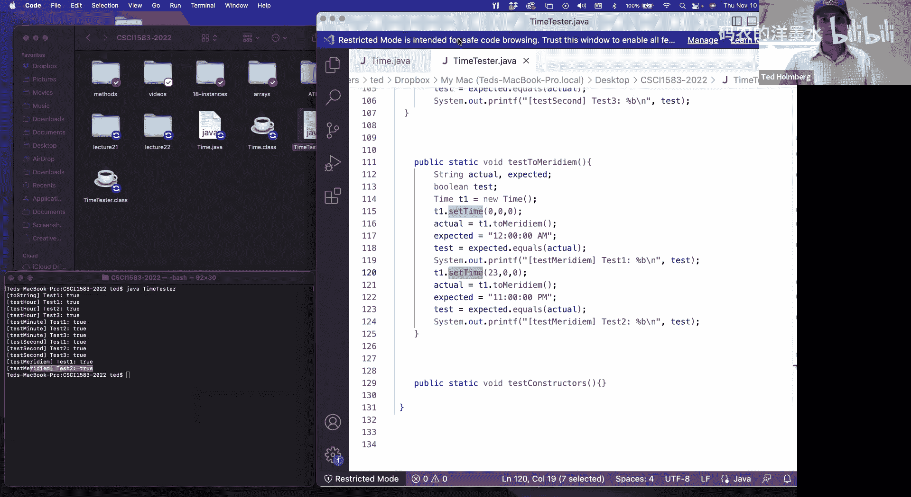

# 【全集】加州理工学院 软件设计与开发 中英字幕 1080P p24 Lecture 24 - 单元测试的时间类 -BV1AvzCBdE7a_p24-

30。

Exceent。Sure that。Except。我俾。Excellent， okay， let's see。か。

Okay perfect so it sounds like online people can hear me what about in class people yeah clearly you can hear me。

Not as much of the technological buffer between us Okay so before I start today's lecture。

 I do want to just go ahead and announce that next week we actually going to be evaluated by the AB ofccreors the ones responsible for our accreditation and so one of the things that they want to do is kind of survey and interview pools of students from vast diverse academic backgrounds and what I mean by that is they want to interview students who are fulltime they want to interview students who are parttime they want to interview students who potentially have transfer credits。

They want to into UNO so they've gone somewhere else and they come here。

 they want to potentially interview students who have started their academic career here at UNO they' like to go ahead and talk to students at the senior level they like to talk to students at like the freshman or sophomore level they'd like to talk to students who have had internships that like to talk to students who don't have internships they'd like to talk to students who are young theyd like to talk to students who are older who have families so the idea is they want to get a diverse set of experiences so I have a lot of volunteers from the hiring end of the program when Id really advocate for you to be able to possible try to make it on Monday 4 pm and be part of like the the more introductory level of the computer science interview process and one of the cool things about this is that。

You actually have the opportunity to help shape what the curriculum looks like based off of your feedback and so that puts you in a really good position because you still have a lot of the classes to take so you really have skin in the game because the accreditation board gives you the opportunity to voice whatever concerns or whatever things you want to see in the department and then they lean on the department they have they then go consult the department about implementing those changes so this is actually your your chance to affect change in the department and so I highly recommend if if you're available at that time has that everyone gone the email in terms of a in terms of being able to RSVP。

For for that。You didn't get the email as it would have went out yesterday， I think。我呢个到时。

Double check I just want to make sure this email got sent out you got the email okay so double check it should be in the email to RsVP though it's super easy it's RsV I'll show you right here on my screen it would be RsVp。

cs。uno。edu and here you'll you can answer some basic questions that effectively allow us to evaluate like the diversity of the students so that we can select as many of those different options they want us to be able to to get for them to be able to communicate with。

And so yes， please please， please， if you're at all possible tried to be a part of that many years ago when I went through the program because I actually got my computer science degree through UNO I was actually part of that student interview process a couple cycles ago so now you could you could be a part of that too。

Excellent。Yeah。So， but yeah， they want to try to go ahead and。Get about 20 people。

 20 different students to be a part of that， if possible。Okay。是。You got it perfect。Okay。

 so that said。Is there any questions about what we did last class or in lab or I think right the test two is due at the end of day tomorrow。

 so I'm assuming everyone's been working on that and not necessarily waiting all the way to the very end right？

So。Okay， perfect。Perfect i'll take it by your silence that everyone has diligently been working on that for the last week or so。

 so I want to continue where we last left off Tuesday。Okay， so on Tuesday， we started to talk about。

Modeling a second thing， so the first thing we modeled as a demo of object oriented design was an account an ATM I should be more specific it was an ATM account object。

Mos。Where we built a class that had the properties for an ATM account and then the behaviors or the methods that supported the ATM account and then those methods represented effectively that object API the way that we can interface and do things with that object inside of our software ecosystem so then I challenged I think we did a challenge on talking about demoing a second thing inside of today's class and that was does anyone remember what that was it was time right and we actually started to design out the。

I guess I should turn this on。We actually started to design out the UL diagram to represent time。

So let me get our projector on。And so if you recall our UML diagrams usually consist of a table that's three different rows。

 one column three different rows。Where at the very top row is going to be， and let's see here。

Let's go on here so。We talked about modeling a time object and we said suppose we want to model time and our software as an object model。

 the first thing we consulted with， and I think this is in the tail end of last lecture is what would our UML class diagram look like before we ever start coding anything in Java。

 we think deeply on what's going to be available to us。

In terms of properties and in terms of the public available methods or effectively the API of that object model and so we start with these UL class diagrams and that allows us to think deeply on those two different other components the fields and the methods that will be supported and the fundamental data types in the fields can be things like other objects that will have to model in the future or could be collections of data or arrays。

Within it could be like the fundamental types numbers text or bulloles and again our behaviors or methods where this object the objects API and our ecosystem so we have talked about this we said we are going to call this time and then we。

😡，On the second row here in our UML diagram， we identified that if we were to model time。

 it would be made of three distinct properties， it would be an hour。

 it would be a minute and it would be a second。😡，And our hour we decided in terms of the data type that we can use to encode a value to it to model what an hour is is an integer value。

 we decided we could also use an integer value to model a second and also an integer value to model a minute so between those three distinct individual features of time that represents enough to build a complete。

😡，Representation of time in and of itself that the same thing you'd have on a watch if you were a watch still and then the methods that we had identified was well。

 we would need a constructor。We would need the ability to go ahead and convert the state of our time instance into a string for no other reason。

 but to evaluate what it looks like so we can constantly inspect it while we're constructing while we're building out while we're testing and validating that our code is working。

😡，We decided that we needed some setter methods since they're private we want to be able to set the time to be an hour or a specific minute or specific second and here actually in this purpose I do kind of want to do something slightly different than what we did last time。

啊。So there we go。I'm going to make these private。Because sometimes you have these private helper methods。

 but we're still going to want to verify that they work， so we'll have as a public。😡。

Math it a set time that takes in a hour， which will be an end a minute。

Which will be an end value and then a second， which will be an end value perfect。

And so when we go to build our tester， because when we start。

 when we get into the phase of moving past the design of our object and we start going into the implementation of this object model into a Java class。

😡，Then we also alongside it want to build a tester。

So that we can test as we implement a method at a time just to ensure that our class。

Implementation is correct based off of our expectations。😡。

Okay so let's so is there any questions in terms of this class diagram love up to this point this UML because now at this at this at this point I'd like to start implementing our time class and actually go through the process of implementing this so here the first thing i'm going to do is I'm going to use this uML diagram as a basis to create a stubbed out implementation of our time class so that's going to look something like this。

😡，And again， what i'll do initially is i'll copy it and then we'll talk and break it down and discuss this。

 so let's go into here， so the first thing I'm going to do here is i'm going to create。

A time dot Java。I'm going to put this in here。Okay。ok听。Okay。

 so here inside of our class now we're going to start with public and I'll cut things out so that we can hyper focus on them so I start with a class definition public class time public because this class has to be available to outside。

😡，Classes inside of our Java application and front outside software objects class is just the top level keyword we use to start constructing classes we've been using that all throughout the semester the the other alternate。

😡，Top level key we've seen alongside that was enum right so here we'll give a name the same name that we use at the top of our ul diagram Okay so then after that the next thing i'm going to do is define the。

Instance fields， these instance of variables where every new instance of time that we construct will have its own hour。

 its own minute and its own second， and again we always apply the private access level to our instance fields to ensure that only the class itself。

😡，Can read and write。And then if any external class。

Desires access to either mutate or query the state of our time。

 then we provide that through public methods。😡，And that allows us to control and manage what happens inside of each time instance。

Because at this level of implementation， this is where we're going to think most deeply about this object model。

😡，And so we to we want to abstract away all of that problem domain from every other object inside of our software system inside the ecosystem of our software。

 and at the same time we want to encapsulate we want to hide all of what we're doing so that the only thing that external code needs to know about is that set of public methods that we make available。

😡，And so then the public， then the methods， the client code will just expect that。😡。

It can rely on our class to do anything that's time related。😡，And then once I have that。

 the next thing I'm going to do here is I'm going to take each one of those instance methods that are in the third row of my UML diagram and I'm going to stub those out into the class so that I know that they're there that I don't forget about anything later on。

 so studying out just means I declare them， but I don't quite implement them yet and by implement I I give it a method body。

 but I leave that method body empty。😡，So it technically is a method that's defined in the class itself。

 however it doesn't do anything when I executed now one caveat that you should recall is that so long as the return type is void。

😡，Then we don't have to put any implementation in there。

 but if there's a return type where they expect a particular type of data to get returned then we have to return a dummy value until we finally implement that method。

 otherwise our code won't compile so for instance， if you look at the two meridian。😡。

Method that return a string or the two string method returns a string both of these we' just going to return null as a dummy value so that our code is syntactically correct so that it's legal for compilation purposes and so the idea is we will slowly implement class a method at a time inside this class and we test until we are fully test it。

 we have full coverage of testing across all our methods and then we're satisfied and we can move on we would give this work to the lead developer who can then integrate this into the rest of the software project and then other people can start using it。

Okay， so。At this point， let me make sure I've set time， I've set hour， I've set minute。

 I have said second， I have two meridium and two two strings so let's test let's verify if this works I'm going to do a Javava C time and oh let's see what we got here time or only okay got two。

There we go。Perfect。So now we we were able to successfully compile I see I my I have my doc class file here。

 so that's perfect， so it's not。It's not just enough now， as I stated earlier。

 for us to start building out our time class， it's super critical if we want to do this。😡。

If we want to do this the way that an engineer would approach this problem and not the way that just a common developer would approach this problem is that we test along the way。

 we validate and we verify so the moment I create a time Java file I'm going to create a corresponding time tester。

😡，Dt Java file that will explicitly be used as an application file to pass messages to build instances and check。

😡，That all of my general case and exceptional case。😡，Logic works inside of my object model。😡。

So I don't want to wait until I build the rest of the application around this， I want to test。😡。

Each class at a time and not just a class at a time。

 a method within the class at a time and a method is the single testable unit inside of our code base。

😡，Okay， okay cancel out。 Okay， so what I'm going to do here is I'm going to create a。

So what our time tester will look like again just stbed out look like this where we will have a public class time tester this will be a application file which will build mock instances of our time for the explicit purposes of testing so I will have a main method now recall that a main method should effectively be the general manager of your application so my main method is going to call lots of helper methods that actually perform the testing and then I'm going to stub out each of those helper methods we could see that I'm going to have a helper method that's going to test the two string because before I can start doing anything else to validate and verify that my time class is implemented properly before I can test any other method I need the ability to take to display the state of my time as text otherwise theres there's no way for me to hear inside to see what's happening。

😡，So the first thing I'll do then is test the two string to make sure it's working the way I expect then we'll test the centers。

 so I'll test setting the hour， I'll test setting the minute。

 I'll test setting a second once I am confident that those three。

Setters work I will test to meriium which is an alternate way of displaying time so when I have two meridium what does that mean to everybody so we know what so we have two string and two meridium what do you think the difference is that's right exactly。

😡，So meriiddian time is AM so technically that's what AM and PM stand for。

 right anti and post meiddian。Meridian meaning the midway point。 So noon of the day。

 So anti meidian is AM。Post meriium is PMm so there are two viable and valid ways that we can articulate and communicate time as a string as as as a textual representation and see that in a universal state where we can just give the ours。

😡，From a zero to 23， a thermomocope from zero to 23。

 and then your minutes and your seconds or you could do effectively one to 12。

Excellon said we will test that and then finally we will test some constructors。

So we'll talk about that as we start to implement。Yes we'll talk about that as we start implementing and expanding out our functionality。

 so just like what we've strived to do in the past。

 which is break our code based down into modular pieces and test it a little bit down the way right like this constant iterative approach of design a little implement a little test design implement tests like a circle。

😡，That cycles back and back and back and back until you're complete we're going to do the same approach and this is going to help guide us on what we're implementing at any given time so this is kind of like our roadmap to completion and when we implement all of these testers and all of our testers say we've passed then we've gotten to the end of our journey building out this class。

😡，This approach， by the way， is what's called test driven development。😡。

Okay so the first thing we should strive to do is now build that two stringing method because I'm looking at my tester the first test method was to test the two string so let's talk about how we can actually implement that well the two stringing method should be super simple i'm not even going to implement the constructor yet so I'm going to rely on a default constructor so one of the cool things about Java is if we're building a class and if we don't implement a constructor Java gives us a constructor by default。

😡，That and so a default constructor just initializes a new instance to that class for us。

 but it doesn't set and it uses default values to set all the instance variables well let's see what that that is let's go to the instance variables what are the instance variables inside of our time class i'll actually go into the actual code oh I should also make my time tester class as well。

😡，So let me do that， let me make my time tester class and then we'll talk about the finish talking about the default constructor。

Oops， well， I'll just get rid of this。Okay， and let me get the stubd implementation of this so that oh no。

 off out。Okay， no。So。Okay， so now we have our implementation here。

 it's just our main method and then each of our helper methods perfect。Let me save that。Okay。

 so the first thing we said we're going to do is we're going start implementing this two string method So instead of return null we're actually going return to implementation now two string method is an instance method it means we're going to need a class an instance of the class in order to make calls on it now what you've seen when we first started designing our ATM account class was that we explicitly create a constructors from the Gita here i'm going to rely on a default constructor so like I said earlier if I don't define the constructor if I don't explicitly create a constructor method inside of my class Java automatically adds one for us but all it does is create new instances in the response to the new keyword hold on to the class so it doesn't have any logic to say how it should set the instance feels the instance variables recall that what a role with the responsibility of the constructor method is。

Is to construct an instance and that means it has all the logic of what a newly constructed instances instance features。

 it its instance properties， its instance variables。

 what values they should have so if i'm relying on a depot constructor what do you think the value of our is going to do？

😡，By default so when we create an integer value it has to have a value by default right before we set it it has a default value。

 where do you suppose the default value of that is。😡，Yeah， exactly， so for numerical data。

These default value from the get go of zero that's true for doubles floats and ss。

 so if I rely on the default constructors and construct an instances all three of my instance properties are integers then all of them will start as zero they will exist and they will have the default value of zero so let me extend that further though what do you suppose the default value of a boolean is。

😡，Exactly， it's going to be false。😡，What do you suppose the default value of a string is？😡。

No exactly， there's no reference yet a no reference because anything that is a reference data type。😡。

Remember what reference data type means it's some memory address somewhere else。

 if we haven't created a memory address of something somewhere else， then it's a no reference。😡。

Or what we just refer to as no。二搞。So with that said。

 that allows us before creating an explicit construct where we can start testing things out。

 so we're going to kick that can of building explicit constructors all the way to the end of this process。

😡，So。Let's go down and look at the implementation the two string method is probably one of the simplest to implement right because all it's going to do is。

😡，Worry about the logic of expressing the state of our instance as text。

So let me jump so I'm going to replace this line here from null to I'm going to return a string so the return type of string。

 and so I personally love one of the static methods in the string class called dot format because I really like formatted。

😡，strings， I like formatted print statements as well because it gives me a lot of control over say for instance。

 the amount of precision points I want to express inside of a double， for instance。

 or it gives me a lot of control on how I can represent the text in terms of spacing。😡。

So here I'm going to start with a formatted string， so recall with the formatted strings。

 I first start with a string literal that means it uses double quotations inside I can put placeholder values percent D is the placeholder value for an integer data type the D represents a decsal。

😡，Integer data type， so a base 10 number is what desimal means as opposed to binary。

 which is a base2 number， hexademal， which is a base 16 number， octal， which is a basease 8 number。

 all of these number bases you will get experience with at some point throughout this curriculum。😡。

Okay， so here I'm going to。Have percent， which is going to then line up with the hour。

 so the first thing that will print out is the hour followed by a colon。😡。

And then I have percent D here and what do you suppose just to evaluate just to make sure everyone understands what's happening。

 what is happening with the zero2。😡，In between the percent D so the percent D represents the placeholder value recall I can get formatting instructions between the percent sign and then the data type that that placeholder represents in this particular instance。

 what do you think that  zero2 represents？😡，That's absolutely correct zero two。

 the two says it has to be two digits。😡，So if the digit was singular， like say for instance。

 a single zero， then it will force it to be two digits and the zero that appears before the two is what the fill value is so if it's only a singular digit。

😡，Fill the other spot with a zero in front of it So preface it with the zero and that's what we do on clocks right on clocks。

 you can have a singular one for the hour， but there's always two digits for the minutes so we want to represent the same kind of string we'd expect to see on a clock and prefill that value。

 even if it's a zero so that it's forced to be two digits large perfect And then here I'm going to do another colon so obviously the delimiter between my hours my minutes and seconds are colons pretty common and so the third value also is going to put a zero to between the percent and D because we want to ensure that our seconds are always two digits。

 even if it's being represented by a singular digit and prefixed with a zero where we want that prefix to also show。

😡，So a representation then of our time here should be something that looks like， say， for instance。

 one colon00， colon 00， and that would be one o'clock effectively in the morning， right？😡，Okay。

 so with that said。Is there any questions with this implementation up to this point？😡，Well。

 then the next thing we would do is we would actually test this out。😡，And。So here。

What I'm going to do to test this out is I'm going to go into that test two string method that I've already stuffed out in my tester and now I'm actually going to start。

😡，Building some test implementation so let me copy this here all of the yellow is what's new inside of the slide。

 So if you use this for a reference it'll be kind of meaningful and not overwhelming Let me go into here。

😡，But let's actually I like to actually run the code and not just walk at it so i'm going to paste what's in there and i'm going to go line by line just to make sure everyone knows what's happening here so the first thing i'm going to do is i'm going to declare two string variables by the way is this the first time we've seen that we can declare multiple variables on one line。

😡，It's possible to actually， so if both your variables are of the same data type。

 I can claim string and then do a comma separated list for each variable of that type I want to declare。

😡，So here I'm going to create two string variables。

 one that's labeled as the identifier of actual and the other that will be labeled as expected。😡。

Then I'm going to create a new time instance and I'm going to invoke the default constructor so recall we haven't implemented an explicit constructor。

 but Java gives us one if we haven't done that。😡，And so it gets invoked every time the new keyword is prefaced with the constructor method。

😡，And then I will get back from the JVM， a newly built instance of time， so every time instance has。

😡，All of the instance variables so in this instance of time there's three instance properties there's still three instance variables it's the hour the minute and the second and since we're using the default constructor it'll have the default value for each of those variables so the time should be zero I mean the hours should be zero the men should be zero and the second should be zero。

😡，So then what we're going to do then is for the actual string。

 we're going to invoke that two string method and when we just implement it。😡。

And we're going to save that into actual and then for expected。

 we should expect that the default value of time as represented as a string should look like this。

 right？😡，So a singular digit for the hour two digits for the minute。

 two digits for the second colon in between us are delimiter between our minutes second Then I'm going to go ahead and I'm going to。

😡，Compare the expected value to the actual value， which means it's either going to be true or false if my actual value is。

😡，Equal to what I expect it to be here， then I'm going to display inside of this print statement。😡。

I have this string。Where I'm in the brackets illustrating what tester method I am in。

 so I'm in the two string tester method。😡，And then。

What test number i'm on sometimes you want to test multiple cases， you might test a general case。

 but you should also test each exceptional case we're going to look at that in just a moment。😡。

And then we're going to put we're going to report whether we passed or failed that test。

 if we failed that test， this is a great opportunity for us to reexamine the two string method and try to figure out why did we fail。

😡，And if we pass the test， then that means that it performs the way we expect it to and we can move on to the next method。

😡，I have a question yes why is the hour just denoted by one when the minutes could be denoted by one as well as the seconds why isn't the hour also denoted by two Well that's a great question and I would and this is a modeling thing but let me ask you if。

The bothing is valid or not， so we know that this is valid。😡。

As its time right so and here let me do this is this。Valt。Okay， then let me ask， is this valid？

And then let me ask。Is this valid？So and this is a subjective process， by the way。

This is subjective so this is based off of what we want the behavior to be but it's super important that we create a comment that defines that this is the expected behavior so look at the first can everyone see the first value do I have to enlarge this at all is that better。

😡，So here。😡，I have two digits for the hour， two digits for the minutes and two digits for the seconds。

 but now let's compare these two which one so it's this versus this。

 so this is an instance here where I have a singular distance a singular digits for the hour。😡。

Versus forcing the hour to have two digits， which one is commonly expressed for time for clocks？

Do you normally see what's on the left hand side or do you normally see what's on the right hand side？

The left hand， right， isn't it pretty common that we actually don't prefix the hour with a zero？😡。

Now it's not to say we couldn't do this。But if our aim is to model what a wristwatch might display is probably more in line with the left hand side than the right hand side。

 either of them could be valid though， but we make that decision at this point while we're defining this model。

 this method， I'm sorry this method， and when we make that decision we should make a comment to express that that is the desired behavior。

😡，Does that answer your question？Yes。😊，Excellent， okay， so。And at this point。

 there's no real way for us to set the time to anything else。

 so this will be the only thing that we tested on just to make sure it's display the way we expect。😡。

This one right here。So what's happening on line 13 is that this is an assignment operation it's not just an assignment operation。

 this is an initialization operation so we're doing a declaration and an assignment of the same line so whenever we do that we always read the right hand side of the assignment operator before we do the assignment because we have to resolve into a value and that value then gets assigned into variable so on the right hand side of this assignment operation I'm using the new keyword the new keyword is always paired with a constructor method to create a new instance of something now I haven't explicitly defined a constructor method but one thing Java will always do if we don't explicitly define a constructor method one is implicitly created for us。

So theres there's a hidden constructor where all it does is it builds a instance of time that has that contains all of the instance properties。

 so if I go back into time each instance of time would have these three properties in our instance variable a minute instance variable and a second instance variable and since all three of those are integers the default constructor would assign to them the default value that an integer can have when it's initially created which is zero。

😡，So that means at the end of this this resolve down to be a time instance so every time instance has three inner variables that represent each of its model properties each of it its individual things that it has our minute second then I can then save that now since this is a more this is a reference data type now this is now we've built a user defined type at this point。

 so when we first started the semester we were learning how to use all the primitive data types。

 now we're learning how to make our own data type the data type that we've created is of the time data type so when I create a variable I have to use the data type that I'm going to store into that variable and now I'm going to use time the actual class we've created as a valid data type for this variable and then the T1 could be anything I just called it T1 in case I want to make it T2 or T3 or T4 because it's not uncommon。

😡，When you start testing things out where you want to create different instances of things here。

 I just create the one instance though。And then so by the time this line is done。

 I will now have a reference in memory to a time。😡，Instance。

That I can refer to as T1 so anytime I use T1 access T1 I can then call those methods that are defined as instance methods within this class so one of the instance methods and the only one we've implemented up to this point is the two string method this one right here。

😡，And so that's the one I actually want to test and my test two string。

 so then on that T1 that's going to have three instance properties when a two strings it。

 it's going to then represent it as a string that should look like this。😡。

And we'll actually test that and see if that works and in fact， let's actually see if that works。

 let's compile my time tester。😡，Which you compiled fine。And now let's run this time Tester。

And we'll say that I do get a printout here and my printout shows that。

The two string I was testing two string test one for two string pass true that means that my expected and my actual were equal。

 which means that I can move on right that my implementation matches my expectation。😡，Okay。

 does anyone have questions up to this point？Did that answer your question？

Does everyone see the value of testing before we move on in our code base？😡，我他妈。就品。I time。Well。

 so we could do this one of two ways。We could of。We could have printed the time and personally inspected it but what we want to start doing is thinking of how to automate that process so instead of putting us the responsible role of displaying the state and then saying hey is this right or wrong I want the application to do that evaluation for me right so I want to take that work off of me the developer and I want whoever goes to run and execute my time tester just to see if my test pass or failed without them having to make the decision whether the the test passor failed so the idea is this is one of the really useful things about why we build these tester classes this might seem like a lot of extra work to you right now right？

😡，Like you're like well i'm building this class and then i'm building this tester and i'm going to test to install these things well it's going to it does it has a number of really good benefits。

😡，🎼As to why you should always do this the first is while you're designing and implementing each method is' forcing you to consider all the possible outcomes right so you're thinking well what if I pass this value to it。

 what if I pass this other value like what should the result be so you're thinking as deeply as possible on each unique unit problem for each thing that can happen for every given method in an object so by time you're done you've thought about it so well that if something goes wrong nothing should go wrong with it so it's a way of making your class as a valid and correct so we're evaluating it for correctness but there's a value even beyond when you initially create it when you go to share this class with someone else when you go to give your time class to another developer or more importantly the project lead you can also give them the tester class that they can run。

😡，And then they can see how to use that class in practice it's used as a proof of concept of these are all the different methods that are publicly available inside of this class and here's a demo of how they're all used。

😡，And so instead of other people who might have to just read the API and play around with your code。

 you're giving them a playground， you're giving them sample code。

 you're giving them a demo of everything this class can do so that when they start building out their own code you're giving them an actual implementable guide and that is invaluable because wouldn't you like to have that yourself when you start using someone else's code。

 not just the API just not the Java files but also some sample code that you can compare and use to model for your own use case and so again that's the really big awesome thing about providing these tests。

 it forces you to think deeply about all the outcomes that can happen with your methods but it also provides a implemented guide so everyone else can see how your methods are supposed to work they would how they could violate what your methods expect and see what exceptions might occur with them。

😡，Does that answer your question？O。Let's see here。So let's move on then， so， not there。

Let's move on then to the。So here。I've already done this right I've already executed this。

 but every time we now go ahead and implement one of these test methods in our tester file。

 we want to compile and execute。😡，And again， this is what's called test driven development。

 I build out my task， I think about how I want to test and then I run that on my on my object。

 I build an instance and I evaluate and then I keep doing that in this test based cycle。😡。

And so we consider all the general cases and all the exceptional cases while working on our methods so once it's done。

 we can move on and feel confident that it will work in our system。

 the ecosystem of our software is intended。😡，And so this process of ensuring the integrity。

 the accuracy， the robustness and the full tolerance of your software object is what will separate you as a software engineer versus a software developer versus someone who just hacks together code。

😡，So when you hear software engineering and you're like， well what's the differenceer。

 it's these design principles， these testing principles where you're constantly striving for to verify the validity and the correctness of your code base before delivering it to someone else。

😡，Okay so the next thing we should strive to do is let's implement our set hour now before we can implement our set hour recall we made those private look let's go back and double check that here notice my set hour is private my set minute is private my set second is private that means nothing outside of the class can actually call these directly now if I want my tester method to actually test set hour I needy public method to call on the instance that can actually do that so i'm going to create also this set time method that is public and what the set time method will do will be to call set hour and set minute and set second。

So let's implement that and so we can see that's all it's doing。

 so it's just kind of passing the buck along。😡，Right so here set time is going to set call the hour and set so right now this doesn't do anything still we're calling methods。

 it executes those methods， but those methods have an empty body。😡。

But that's fine because now the first thing we're going to do is we're going to implement set hour what are now when we go to implement set hour recall at this level as we implement a method at a time we have to go ahead and make decisions about what is valid and what's not that gets passed in so let's let's think about this before we take a look at the slide when we go to set the hour we're going to pass in and integer value now recall that integers represent they model a hour like the question is does every。

😡，Value of integer map to a valid legal。Representation of an hour。😡，Or is it scope。

 is there a smaller scope of integer values that properly represent an hour versus every possible integer value？

😡，So what wass the scoping， what is an example of an integer value that would be illegal to use as an hour value？

😡，25 is one zero well zero would actually be legal， you actually have 000， but a negative value。

 anything less than zero would be equal so we have a scope it has to be at least zero and let me think about this let's think back to standard time universal time let's think of universal time also sometimes we refer to as military time you have000 hours what time is $000。

😡，Yes， so that's effectively midnight right or what we would say in meridian time is midnight。

 so what would be 12。The 12 hour at zero minutes， zero seconds a would be the equivalent of0000 hours okay。

 so if0000 is a valid hour， what's the maxim hour first of all how many hours are in a day？

So we are going to recycle after you have 24 countable hours。

 well what is the last countable hour if the first countable hour starts with the zero？😡，23 right。

 so that means 2300 hours is 11 pm。And you go from 2。

300 hours to 000 hours because you're going to loop back over， right？😡，Okay， so with that said。

 we have identified general cases and exceptional cases exceptional cases in this instance is we want to prohibit。

😡，An integer that is less than zero and greater than 23 from being set as the hour right。

 because those represent。😡，Valt integer values but illegal values to model an hour properly and so we look for the exceptional cases and if they occur we throw that illegal argument exception so that we alert client code。

 hey， you violate what we consider the model of an hour。😡。

So that would look like this right if the hour is less than zero or the hour is greater than 23。

 then we will throw this new illegal argument exception and then we pass a message whenever we construct those new instances。

😡，So here， let's。Implement this。嗯。And make sure all my formattings in and so if we don't fall into one of these exceptional cases right where the integer is valid。

 but it's not legal。😡，Then we set it if it's both legal and valid。

 we set it ifs if it's valid but not legal， we throw the exception an illegal argument exception。😡。

Okay， so now after we implement this we want to test。

 however we don't want to test we want to test the general case so let's pass something that we think is valid but then we also want to test the two exceptional cases there's two exceptional cases。

 we want to test if the value we pass is less than zero and we want to pass to see if it's greater than 23。

😡，Just to make sure it's going to produce the behavior we expected to。

So the way that I could do this is inside of my test hour method。

 I'm going to set up the data I need so I'm going to create a string that's actual。

 another string that's expected， I'll create a boolean value that is my test。😡，The result of my test。

 then I'm going to create a new instance of time calling the default constructor。😡。

Then i'm going to call that set time method remember that's the public method that's available and it can take three parameters。

 the only one that we want to care about right now and the only one that's implemented is the set hour one so that's going to be the first of the parameters so here i'll set。

😡，The hour to be 12 so that would be noon and then I'll set zero zero right both of those I'll set as default folks I have to have three values past this that time then i'm going to call the two string method because that's how we can inspect the state as a string so we can see if it actually has the value of 12 and i'll save that string from my two string method to the actual。

😡，Then my expected value after I set should be 1200 hours right it should be 12， colon 00， colon 00。

 then I'll test to make sure that my expected value is equal to my actual value and then I'll print out the value of this test。

 but that's test one， is's only part of the testing。😡。

Because it's possible that I can have invalid values that i'm sorry illegal values that are passed in。

 so the next thing， the next way I would want to test this is to check to see if those exceptions are being thrown so i'm going to make a try catch squad。

😡，Inside the try catch block， I'm going to try to set to one of those illegal values I'm going try to pass the value of minus one。

😡，And I'm going to expect to catch an illegal argument exception inside that illegal argument exception。

 I'm going to get the message， the one that I passed in。

 which should be hours must be between  zero to 23 and I'm going to save that into my actual variable。

 the one that was declared all the way at the top here。

 then I'm going to set my expected string to the hours must be between 0 and 23 and I'm going to say if I did get that message back and I'm going to check and print out the result of that test here as my test two。

😡，And then finally， I'm going to test for the other side of that exception。

 I'm going to try to set the hour to 24。😡，And I'm going to expect that that should also throw an exception。

 I'm going to get the message from that exception，'m going to get the'm I'm going to reset my expected string message to be what I expect it to be and I'm going to evaluate I'm going to compare is the expected message equal to the actual message。

😡，And then I'm going to show the results of that here。😡。

So let's go ahead and implement this and if anyone has any questions。

 let me know otherwise we will test this and move on。Okay。

So we have our testing code and then what I would do is I would compile I would run my test and here oh look at this I have。

My test hour false and false in terms of passing。So let's see what's happening here inside of our implementation。

So here， if the hour is less than zero or the hour is greater than 23。

 then hour must be between 0 and 23。Oh， and look at here the problem is that the message is not accurate right this says ours with the plural let's remove that。

😡，And make sure we pass our tests the all the more reason why we want to check that all of our testing is correct and now we see that this is true。

The same is true on line 43 as it was on line 34 so we will update that。

 we will compile and now we pass all the tests which lets me know， okay。

 both exceptional cases and general cases per set hour seems to work the way I expected to it's time for me to move on to the next method。

嗯，哼。😊，So the E here so when we go to catch an exception we're gonna to see this later on in the semester when we get into exceptions。

 we could potentially have multiple exceptions to get thrown within the same method right so imagine I had an illegal argument exception but suppose I also had an array inside that method that could throw an array out of bound exception so those are two different exception objects so this here lets me declare what type of exception object that I actually want to try to catch and not just catch every exception and then the E that follows it is simply a variable name so I I could call it E I could have also called it IAe as well I could have called it exception I could have called it just X if I wanted to it's just a label。

他不就。I'm just wondering if you wanted to write in the code the difference between the choice of universal military time and standard time。

Would you write that in two separate classes would you write that inside that method of time would you write that as a case switch what would be your method of。

Well， writing that I would write different methods that actually display based off of the name so the default value that we've selected is the universal value where it doesn't mutate the state in any way just displays it as the value of the algorithm in in the second and then we've created a separate method that we haven't implemented yet that's called to meridium that will display the state of our time as an expression of an a or PMm format and if you have other expressions that you want your time to be displayed as you could probably create a method that does that so the idea is that you want to encapsulate that unit of logic inside of a method and you want to give that method a really good verbo name so people know to use that method to get that kind of behavior。

Does that make sense？So the answer is you write another method exactly the answer is always whenever you want more functionality from an object。

 you might write a method， a public method to do that and then your public methods show up as the API documentation that all other client code could read and know how to perform those tasks on your objects。

Or how to perform those requests， even I think that's a better accurate term for that。

 So you could think of the the collection of methods that a object has public methods that an object has as the set of requests that someone can。

Have it perform。So you can request for it to set the hour， you can request for it to set the minute。

 you can request for it to set the second， you can request for it to be expressed as meridian time。

 you can request for it to be expressed as standard time， which is the two string method。

So these are all requests that we ask for the instance to perform for us。😡。

When do you make the decision between？Writing another method or class。

Like we do in the homework so a class should model。

A object so when I'm designing my homework or if I'm designing an application。

 I think of the different constituent parts that might make it up like for instance I might need a UNO student I might need a UNO faculty member I might need a grade roster right I might need a account and so all of these are individual objects that then can pass information to one another through a message passing scheme through which is a method call so the way that one object interacts with another object is for to call its methods and what I mean by that is if I go back to my time tester here inside my time tester this is a class in and of itself and it interacts with a time class by building instances of time and in tall or requesting the time instance to do thing but calling。

😡，So each method is a request that that instance can now perform and so I make that that instance as feature rich。

 I give it as many methods as it needs to have to do its job。😡。

But one of the distinctions between a method which is like a action and a class which represents a collection of properties and methods is going to be just that so like for instance time has this idea that well time can be confined as a set of properties those properties are hours and minutes and seconds and then there's behaviors there's requests I want to do to those time properties those requests are modeled as my methods。

 so you decide to do a new class if you can define a set of properties。😡，And a set of methods。

Or request on those properties。😡，I select just to do a method if I already have those set of properties defined in the class and I just want to add more logic to do something with it。

 but again what we try to do is we don't want to violate the dry principle and create a lot of duplicated classes that have a lot of the similar fields actually we're going to see how we can start building inheritance hierarchies so that we can actually start using classes and deriving new classes from now we're not there yet while we're talking about that next week。

😡，Okay let's move on let's finish out building out our setters so the next thing that we would do is we're going to talk about how to implement our set minutes and here when we go to implement our set minute we're going to make the same considerations we did with set all we know that we could pass in any integer value so at this time while developing this method we want to decide what's what is a legal value for the in and what's an illegal value and we want to check for the illegal value and we want to throw an illegal argument exception with the appropriate method name in fact let me go back over here just to make sure that that is perfect。

So， I don't。And so that the codes correct， Okay， so here。

I'm going to check to see when minute is less than zero or if minute is greater than 59。

 we're going to throw an illegal argument exception where the minute must between zero and 59 and it isn't and if it isn't one of those exceptional cases then we assume it's valid it is legal and then we'll set the minute that was passed into the parameter to our instance variable so here let's go into our time and we're going to update the sub implementation with this actual implementation。

😡，Perfect and then the next thing we do is we test and we're going to test the same way we set we did with our test dollar we're going to test with the general case and then we're going to test against each of those exceptional cases so the first thing I'm going to do is i'm going to set up the date I need to test so i'm going to create a string that represents the actual state and the expected state i'm going to create a boolean value to evaluate the result of a test。

😡，And then I'm going to create an instance of time using the dip ball constructor and so initially to test that it's valid。

 I'm going to set as the middle parameter， which is my minute parameter， the value of 30。😡。

And then what I'll do is I'll two string that and my expected results should look like this。

 There's a zero value in hours because I'm not I'm not testing hours。 There is a 30。😡。

Where the minutes are at and then finally that there's a zero value for seconds。

 so then i'm going to go ahead and I will see if my expected string equals my actual string and I will print the result of that test here。

😡，But I also want to test those exceptional cases， so I'm going to create a try catch block and then inside the try。

 I'm going to try to set the time to a negative value to negative third。😡。

And that should result in an illegal argument and exception。

 so I'm going to try to catch that and I'm going to grab the message and I'm going to save that into the actual variable。

😡，And then I'm going to override the expected variable with the message I expected to be。

 and so here I think it should just be minute right not minutes let' not make the same mistake we made last time right this said here when we were implementing it。

 yep， just a singular minute。😡，And then we're going to compare those and we're going to give the result of that as my test to and then what we're going to do is we're going to test to see if we try to set it higher than 59 so we're going to set minutes to 60 we're going to expect that an illegal argument exception is going to get thrown so we're going to get a catch it and we're going to get the message from that compared to the expected message which is minutes must be between0 to 59 we're going to compare those and then we're going to test that out as the result of our。

😡，As a result of test rate， so then here I'm going to go to my time tester。

 I'm going to replace the sububout implementation of test minute with now this much more ver one。

Let's make sure that。We have。There we go， no。It's right。查 that。O Lord， all this is gal， perfectect。

 perfect。Okay perfect， Okay， so just making sure everything is in alignment。

 I am a stickler for keeping my formatting correct。 Okay， so let's save this let's now clear。

My console， I will compile and I will run my tester again and here I'm going to say up。

Let's make sure that these tests here don't have the plural of minutes。So here yep， it does。

 so let's make that say minutes and let's make this say minute and not minutes。

Let's compile let's run and now I see all of my tests are now true which means I can move on and I can now consider the next method inside of the pool of methods that I want to implement in my time class so the next one after testing is going to be set second I'm going to do the same thing I'm going to say I can take in an enterte value that models a second I have to identify when is it legal and what is it illegal so a second is illegal if it's less than zero or if it's greater than 59 on those instances that that might happen I'm going to throw and illegal argument exception where we pass the message second must be between  zero to 59。

And if it's if it's not an exceptional behavior， then we're going to assume it's a general behavior。

 so let's go here and actually。Implement our set second。And so after implementing it。

 we're going to test it the same way that we've been doing before， so here no。

So in order to test this inside the test second method in my time tester。

 I'm going to set up the initial data I need， a string that represents the actual state。

 a string that represents the expected state and a booleying value for the result of each test I'm going to create a new instance of time I'm going to call a set time but this time I'm only going to pass a meaningful value as the third parameter。

 the one that sets the seconds。😡，I'm going to set it to 30。

And then I'm going to see if my expected value of zero colon 00 colon I mean colon 30 is equal to what I actually get back from the two string method and if it is。

 then I pass test one， then I'm going to test the exceptional cases I want to test well if I do pass in a value that is less than zero do to throw an illegal argument exception so I'm going to try to do that I'm going to get the exception I'm going to save the message from that exception into the actual and then I'm going to express the exception I expected to be which should just be second no the pool。

And then here I'm going to do the same thing to test if I try to pass it to be greater then。😡，嗯。59。

So let's go and for our tester then and。Replace our tester or stub that implementation with this actual implementation let's save this。

 let's clear。Oh， thank you。嗯。Let's see what line number？95 thank you。Okay， perfect。

And we'll make sure that that's the message we have here yep。

Super important that we actually test the appropriate correct thing。Okay。

 so now let's run our tester and we can see we pass all the seconds so now we can set hours。

 we can set minutes， we can set seconds all correctly so at this point we would be able to move on from mutating the state and starting to encode the next the next set of logic we'd want。

 which is going to be to effectively implement my meridian time。

So let me implement this one last method and the next class we'll talk about explicit constructors。

 so this one's relatively simple， it's very similar to the two string method。

 but we are going to make some decisions on how we're going to express it so here notice are' going to use string。

 format and what we do to express our time as a meriian value is we're still going to have the hours。

😡，And we're still going to use colons as delimiters so the al is still only going to be one digit or two digits it doesn't necessarily be get prefixed so that looks the same now in terms of the formatted string the minutes look the same right it's just a prefixed value it's going to be value that's prefix to guarantee that's two digits and then we still use a colon and then it's the same thing with seconds so so far the only difference between my formatted string is going to be right here where a percent S where it could represent an a or PMm value。

😡，So here， the way that I can perform this is the。😡。

Meridian time is expressed as a modulus 12 so by default we thought of time as being modulus 24 right when you get to the 23 when you get to hour 23 you go back to hour zero。

 but if you divide things in half so that you have one to 12 as effectively before noon and then。😡。

One to 12 afternoon and then you have your A pm you could take whatever the hour is mod it by 12 if it's zero。

 then you set it to 12 because normally your 12 mod 12 is zero right or zero mod 12 is zero。

 but both those instances at zero00 hours or at 12 o'clock you want that to be a 12 value。😡。

And since we're modeling it by 12， every other value is going to be either one。😡。

211 so what we could then take is we could just take whatever the hours is and modify 12 so if it was 1300 hours。

 13 mod 12 is one right 14 mod 12 is two， 15 mod 12 is three。So this will define the hour we want。

 we keep minutes and seconds the same and then to determine whether it's am or PMm we just look at hours if it's less than 12 then it's a if it's 12 or higher to pm。

😡，It's that easy。So let me go ahead， implement this， we'll test it and then we'll be done today。

So here， let's put this in here。😔，And now let's test this implementation。

 so to test this implementation， we're going to go into our test2 meridian method。

 we'll set up the necessary data we need， so a string that represents the actual state。

 a string that represents our expected state， a booleing value that represents our test result and then we'll create an instance of time then we'll set our time to well we set our time to000 that's the default value。

 we'll call two meridium on it and we'll see if we hit midnight right 1200 a and then we'll test our actual value to our expected value and then what we'll do is we'll set our time to 2300 hours we'll do two meridium on that and see if that's not 11 p。

m。So let's go ahead and test this， let's grab this， let's go into our tester。

 and I'm going to replace my test to meridian here with this tester here， let's make sure that。

That's formatted correctly。Let me clear my terminal， let me。Compile up。Does it not like。嗯。

I know what does not like， we need our minute second。Our。Or there we go。

 we need to use the appropriate names for our instance variables。Okay， perfect。

 and then last thing we're going to do is we're going to run our tester。

And here we see that to test meriian on test one， it did show midnight 12 a at 000 hours and at 2300 hours it did go ahead and pass through for 11 pm so we've effectively built a really。

A pretty well defined version of time that's been engineered appropriately and has been tested fully qualified and tested so next class I want to talk about adding explicit constructors and actually what it means to override constructors where I can have more than one constructor defined in a class and that's what we're going to do with our time class so before I end class for the week is there any questions related to this or do we feel kind of good about where we're going with this。

😡，开始是。这个活动。か这さ。你懂吗？So you're talking about the dot operator so dot operator always means that the thing on the right hand side of the dot is contained within the thing and the lefthand side of the dot so so the dot operator allows me to access say for instance in this instance let me go to my time tester so there's this set time method that exists inside of the time class if I want to call the method inside the class I use the dot operator the dot operator allows me to access the method that is scoped in that class you can think of it in terms of OS level as a slash you know how if you have a directory inside of another directory and then a files inside of that use a delimiter of slash to represent the nesting structure where our nesting structures are delim using dots because slashes represent division inside a Java。

Does that make sense？Excellent， if that's the only question， great day， I'll see everyone next week。

Oh。

Yeah。