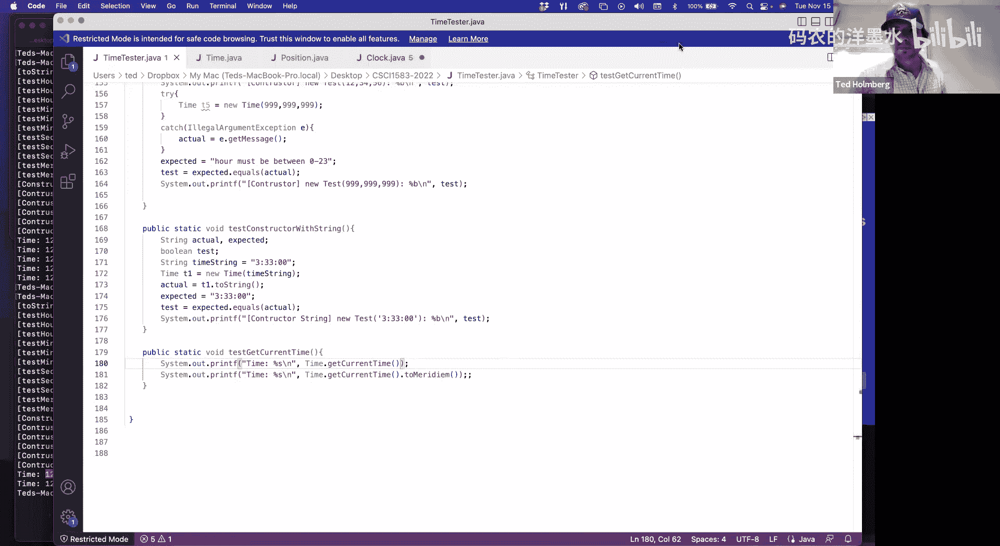

# 【全集】加州理工学院 软件设计与开发 中英字幕 1080P p25 Lecture 25 - 构造函数的时间类 -BV1AvzCBdE7a_p25-

Excellent， okay， so I think this is the lecture 23。Might be' say。Let's say actually。

 there's one I have not posted so。Let's go here， content page， yeah， so this is 23。Okay。

 so before we start today's lecture， is there anything that anyone has questions about？

Anything relevant to any of the homeworks， how's everyone doing on the homeworks by the way？系。

So has everyone successfully been able to complete at least the step by steps for homework three and homework four。

 has everyone been able to do just the step by steps for homework five？

Has everyone started at least the step by steps for homework six？

Okay so homework six is going to be based off the concepts we have been learning you'll learn how to instantiate objects and you'll build like a Dodger style game so you'll get a real sense of one of the practicalities of what we're talking about in apply lecture where during the course of the game you might have to instantiate a unlimited number of enemies depending on how long the player plays and so without the concept of instances without having a constructor this game would be impossible to encode right there's no way you could hard code enough of those values。

So it's a really fun homework it'll be I think the last homework where you actually have to provide any implementation into it because the final homework is like the capstone homework is just to follow the step by steps and turn it in but it's a big large thing of step by steps it's like double the number of steps than any other homework and that's why you don't have to do an implementation on it but it comes it brings all the concepts together and shows you how to use inheritance which we have yet to talk about and what i'll likely talk about next saw next lecture for this lecture I really want to focus in on constructs so we've seen kind of。

Primitively how to create constructors right we've seen the default constructor where if we don't define a constructor and that's what's happened in our time class so far。

 so if you recall last lecture we were working on a time class perhaps let me do a quick。

Back let's take a backup around the inspection of that。So if you recall in the prior lecture。

And we did a lot。We had this right we had this time class where we defined the properties of a time class as being broken down into minutes seconds and hours and we defined inside of the last row of this UL class diagram all the publicly available methods that other objects can interact with with the time with each time instance right and so we have time the construct。

 we have a two string we have a to meidian set time set hours set minutes and set seconds right and so we actually spent。

Well part in the pun a lot of time implementing that class right and so after each step we had built a time tester class to ensure that each one of the methods as we implemented it was fully tested and validated and verified so we slowly stepped through that process and so is there any questions related to this does I remember the source code that we had kind of s I have a question。

Yes， when you're writing the class compared to writing the tester。

 let's say that you're giving a tester like you are in lab。Can you take？

What you write in the tester as to say， I don't want this to be less than this and not put it in a tester。

 but write it exactly the same。Other than， you， the tester part in the code itself。

 would it be written the same way in the code？So。So if you so you could potentially merge your testers and your class that is not necessarily illegal in Java。

 but that's not what you want to do and the reason why you want to keep those two things as disparate classes is that the class the time class itself represents what your deliverables going to be so the time class is what you're actually going to provide as your your work as the thing that actually contributes to the application ecosystem or to the API that you're building out the tester is just to test。

😡，Well， it's sort of two purposes， it's to test。It's time class to ensure that it works the way you expect it to work。

 but it also can be used as demo code as as mock code for other developers to see how each method can be utilized inside of your inside of your class in fact if we go to the API let's go to an API a lot of times Java provides sample code in a similar way in the API itself so let's jump over here and let's pick something at random like say for instance。

 let's do string。😡，Let's pick oh， let's do string format， Java API。Let's go to， well。

 Java 1s good enough， probably haven't changed much in the last light。Seven releases。

Okay so here notice one of the things that they do here just beyond just giving a collection of methods and descriptions and the set of parameters。

 usually there's sample code that's provided in API well there's you can do better than this when you're working in conjunction with other developers you can actually provide them with your your tester files and they can provide you with their tester files so when you start to network the objects together。

 get the objects to start interacting together so that they can complete the task that the application is designed to do。

You know exactly how to call on their objects what data you have to supply into each of the methods and what data to anticipate come out of those methods without having to do the testing yourself you can run the testers then you could use their code as proxy code is is demo code for you to then go ahead and use inside of your portion of the application and so actually what might happen in industry is there's when you hit Java2 these tester files they look really verbose they look very bulky I'm showing you the way to enhance these from nothing from scratch but you're going to learn a piece of tooling so the nice thing about 2120 the next class Java2 which you'll be taking in like less than a month or maybe two months from now right so that's that like mid-january you always should be in Java too hopefully so one of the things you're going learn in that class is now that everyone knows how。

😡，To develop code， using object oriented principles。

 you'll start learning how to develop code alongside professional tooling。😡，So like we've seen。

 testing your code， validating it， verifying it is what distinguishes you as a software engineer from a software developer。

 just someone who codes who just hacks things together but doesn't necessarily care about the correctness。

😡，So there's lots of tooling to support you in that endeavor you're going to learn one tool that's called J units which is going to be a harness that sets all this up for you。

 so you create one J unit tester file and then you can put all your testers in there and then you can run it against the J unit tester and it'll let you know whether it passes or fails and J unit use a unit testing is what is used in functional。

😡，Companies。So there are companies that don't use it。

 but there is a greater sense of pain and maintainability of code if they don't use it。

 so you know if a developer a developing firm， an IT company is functional or not based off of how well they test their code before they try to deliver and deploy it。

😡，So you will learn tooling in the future you'll learn IDEs as well on things that will assist you in being able to compile and execute your code so we do all this from scratch and the intro level so that you see what's happening so it's not magicalable that you understand the concepts the step by step processes that make your code actually run but as you we start getting into more professional higher level concepts of coding we'll start abstracting some of these tasks away from you and allow and allowing some automated tooling to supplement for us you'll learn about Java docs as well which will be able to use your comments and produce the API documentation that you see posted on Oracle's webp page so there's a lot really and so to answer one of the earlier questions inside of the one of the first questions we had is like why do we use Java why is Java selling a important thing its because of the amount of the tooling。

😡，And testing that provides you as a developer to ensure that the code you deliver is correct and there's a lot of there's a lot of languages that are popular out there that don't provide that so they don't scale well。

 they're great for tiny projects like hobbyist projects， small scale projects。

 Python for instance is a language like that JavaScript。

 but once you start getting into projects that are hundreds of thousands of lines of code。

 millions of lines of code that have dozens of teams of developers on it。

 you're going to be using a language that scales well that tests well it's going to be a language like Java it's going to be a language like CSR。

Something like the Gotap framework something that's going have the tooling that Java has so I guess to answer your question after I've taken the scenic route on it there's nothing in Java that prevents you from merging your testers into the class file but typically you don't want to clutter the actual class file the deliverable with anything be what it should have so if you have a tester the concept of testing the class is a different role it's a different responsibility it's a different thing then what the actual class itself the time and class should worry about so you should distinguish what is the role of this class and it should hyper focus on that so testing itself isn't actually one of its responsibilities time itself should just model the properties of time and just the behaviors to the methods the actions we need as time instance to get back to us so if we actually want to then verify and validate it we should have a class。

Whose role is to verify and validate that particular other class does that does that make sense Michael my question really is about you know let's say。

 for example， like in the lab we have an account balance where we did the withdrawal but we did the testing on the withdrawal to not meet to catch to try and catch an invalid。

State like being less than zero and it wasn't necessarily in the deposit or the withdrawal public so let's go's go to let's go to that so just so that i'm on the same page here so we had this account class right that we had stepped through in class yes and then we had this account tester right here where we had stubbed out our testers and so let's go to the test show with the test withdrawal here's the example of the account tester you were mentioning。

And then right but I'm not writing the tester account because the tester account is already given my question is about the Java class。

Yeah，我我就。Right， so okay， so so inside so。I'm not quite sure I understand the question entirely。

 but I'm looking here at the account tester with the test withdrawal and here I see I'm creating an account instance and I'm going to test the withdrawal method here。

😡，So let's go to account I'm assuming here if I just hit up。Here， a lot of home tester stuff。

Inside of。IHang on， this thing is in my way。I wish I can just make this thing go away。嗯。Okay。

 let's see here we have yeah that。Test new test。Oh， we have all my testers did I never。

I think you go up one there。Well， did I ever implement everything in here or is this oh yeah here we go so account class account I never did test the withdrawal though did I implement withdrawal here。

Or here， yeah， here we did， this is where we talked about。Was our deposit and our。

Did I do withdrawal and yeah， the deposit。Weird， I won't see a slide for the draw。

 but I know it's implemented let's go here into our code。So that was。Yeah。Inside of。Lecture 21。H。

Okay。Yeah。So here we have our withdrawal okay， so we had implemented the withdrawal here inside of the account Java file so after implementing it I guess。

What's what was what was the question in terms of what testing are you talking about so try and catches something you'd only use in a tester it's not something that you could use in。

Writing this Java account so I got okay I got I have I understand your question。

 so I think the question is is in related to when is it appropriate to use the try catch。

Is that correct right is that something that could be appropriately used in the actual。

Well so this is at the yes， I mean you might have to use a try catch in a class that you're all through that is not a test or class this is going be the rule of thumb to try catch and let's go into our Java file here so here I'm trying to do this try catch on my account tester and I try that on instances that I know can result in exceptional behavior so we know that there's an expected behavior there's a general behavior which means when we pass data into a into a method it's going to do it's going to do something with the data we pass it so withdraw all the ideas we're going to pass in an integer value and it's going to do something inside of the account class in response to that and generally if it's an inger value which should work and then an illegal right an illegal so that's the general case in illegal cases if I pass something that's not an inger into there if I pass a string into there that's。

😡，Legal because the data type that I said had to go into that parameter is an integer however there's this exceptional type there's this type that is not the general type it's not what we expect。

 but is's not technically illegal either it's not illegal because it is an integer but it' not general because it's not a value that actually make sense inside of our internal model for account and an instance of this would be when for withdrawal' if we try to withdraw more than what our balance is right so there's certain rules certain constraints that we can define that state exceptional cases so exceptional case means it's technically legal but it produces an invalid state so we only do the tri catchch block when we're requesting something else to try to do something that can cause an exceptional behavior to occur so inside of our account we don't have to do the tri。

😡，Because we're not trying to tell something else to do something that's exceptional right we're checking to see if someone else。

 some other client code is requesting us to do something that would cause us to fall into an invalidbalance state that would cause our balance to go into a negative and we're going to say that you can never have a negative balance we're going to say that that is something an ATM account will not allow。

😡，So then we're going to check every time client code can request for our instance to change state。😡。

And if it causes us to go into that exceptional behavior instead of doing it and instead of just ignoring it。

 we're going to throw an exception object at it， we're going to throw an exception so that they know that what they did was wrong。

😡，So that they can correct their own code。So inside our class that wants to alert other client code that something can happen that's when we throw these exception objects so the instance where you might want to have a try catchtch block inside of a class you're developing is that if you were to import something let's say a scanner object and let's say you want the scanner object to read some data well we haven't explored this a whole lot but you might have already realized if you tell a scanner object to try to parse an integer and instead you supply it a alpha numeric character like the letter a it grows an exception right it's a mismatch exception isn't it。

😡，And so since that's an exception object， every time you've encountered it up to this point。

 you probably just feel all of it the same as an error。

 but what you could have done is put it in a try catch box and actually caught that exception and tried to recover from it。

 does that make sense？😡，Yes。So there are instance so I guess to answer your question there are instances where you might have to use to try catch blocks much like we did in the tester methods。

 but it's only going to be if you're the client code requesting some change of state or requesting some dangerous potentially dangerous I call it dangerous really it's exceptional some kind of exceptional result might occur from that and so if you know that an exception can be thrown you can nest your call to that client object I mean to the serving object into a try so that if it's normal like if you don't fail。

 if you give it what it expects， then your code runs as you would expect it to but if for any reason it causes that object the object you're requesting data or some change of state on to fall into an exceptional case then it will throw back an exceptional and alert you that you violated something and then you can fix it that's the beautiful thing。

😡，ButWhen that data is reported to you， then you know， hey， I can go back and I can fix that issue。

Excellent。Okay so yes， so and then after that the ATM account object that we had built we did we motivated into an even simpler state right that's when we started to design our own time class and I think we did this collectively as a class anyway we decided like what models of time and what attributes we should need and again we built that time tester。

Now the only thing that we didn't do， I think， last week while we were building out our time tester and let's just take a look at the code。

 just remind everyone where we're at with that。This is account let me close account account tester Okay so let's go to time so let's take a quick look just to make sure everyone's on the same page so we created a time class we said a time class has three instance properties one that represents the hour one that represents the minute one that represents a second we said that we have the ability to set the time where we can pass in each of those individual properties。

And then。That method will then set the hour to set them in and set the second I'll call these private helper methods。

 these private helper methods can't be invoked from outside the class so the only methods that can actually access these since they're labeled private are other methods inside of this class。

😡，But here instead hour is where we check to see if the hour that's requested for the hour to be set to is invalid if it leads to an exception。

States and if it does， then we throw that illegal argument exception and if we don't throw that then we assume that it's an integer and it's not it doesn't cause us to become invalid so then we'll just go ahead and set it that but the only way we get to this。

😡，🎼Is if we throw this and do the same first minute we saw how to do that with set minutes。

 all that with set second here so we verify and validate on every attempt to mute。

Whether it's valid or not then we also made a string method so that we can。Our time。

In a universal time， and then we also had a two meriian method。Express is our timemp PMm。Time。

 I think that's where we left off right Does everyone remember steppingping through this？

So want to do now up to this point notice we have not used any we haven't defined a constructor right we've defined a set time。

 a set hour set minute a set second， a two meidium and a two string and in our time tester we implemented this。

😡，Each step of the way， we have a test two string， we have a test hour， we have a test minute。

 we have a test string， a test second， and we have a test two meridium。

So the last thing we should do is actually start explicitly defining our constructors and then test them to make sure they work as per expected。

😡，So what did we say？Our constructors should like。Or what do you think our constructors should look like we're kind of actively developing this on our own typically also constructors go at the very top so even though all this other stuff I've been putting has been going towards has been growing downward i'm going to go to the top of my class file and right under my instance properties is where i'm going to start implementing my explicit constructors so I want to move away from default constructors I want to move away from the constructor that we haven't defined。

😡，So we're going to do public， right， we're going to do time。And I'm going to create a body。

 So this is the general。This is the general outline of my constructors right this is a stub implementation。

 so should my constructor take in any。😡，Any sets of parameters？

Should we be able to initialize a time with I mean， initialize an instance of time with a time？😡。

Because what is the default time， do you remember what the default time is？

Yeah all the since it relies on since our model relies on three integer values and we haven't stated in a constructor and an explicit constructor what those values should start as the default default value is zero so every time we create a new instance of time it's always going to start at00 zero。

 but now we can create a constructor and a construct's role。

 a constructor's job is to define how those the initial properties should be set。😡。

And it could either do it if we know that it should be the set set the same in every new instance。

 we can just hard code that right we could just do an assignment operator， but if it can be set，😡。

Uniquely on each invocation of the constructor something that can be passed in by the client code then we have to have a parameter list。

 so suppose we do want to have the hour the minute and the second passed in then I can put a parameter list in between the parentheses so let's say we can have int hour。

😡，And minute。And second。And so here in order to now notice one issue we might have is that the local variable that's in my parameter list。

 they share the same name as my instance properties but that's okay I can reference both of them simultaneously the same scope by using this keyword on the instance properties that gives me access to the instance property and the local variable at the same time so I can say this dot our so now I'm accessing the instance property of our and now I'm going to do an assignment into it and I'm going to assign it the value。

😡，That is passed into the constructor through the parameter list。😡。

And then I'll do this dot minute is assigned the minute that's passed in to the construct's parameter list and finally this dot second is assigned second。

Okay， so this represents an explicit constructor， this allows me to set my data initially。

 now do you think that this is a good approach？😡，This is technically works right I can compile and actually let's clear this let's prove that we can compile but let me I'm just based off of what we've been doing I just want to get an insight of your intuition didn't I do this correctly？

So we have a vote for yes， yes。everyone likes this Okay。

 so let me ask you in this new implementation if this would be legal or not and I'm going to do this as a comment。

😡，So new time。Stopping me from doing that I can test this right now but I don't think it needs to be tested I think seeing my code here and my constructor here illustrates is there an issue with what i'm doing inside that call to the constructor what's the problem these are not valid that's right we spent all this time creating methods that checked and then I didn't use them。

😡，I just said， and if I， so every time I mutate and that even goes down to the constructor level。

 I need to make sure I check。😡，You see how easy that is to miss， though， right？

So what would be the more appropriate way， probably？And now do you see what happens。

 now what would happen if I try to do that this line up here within this invocation？😡，Yeah。

 it's not going to work now because I'm offloading the work of setting the instance variables inside of my constructor to one of these instance methods。

😡，Which is going to be this one， which is then going to offload that work into each one of these so the actual location where the setting occurs is here。

😡，Here and here and those all of those sets， all those assignments happen behind an evaluation and a potential throw of an exceptional object。

😡，So this is the thing every time you do a mutate if you。

Identify that's important that you potentially throw。And exception objects。

 make sure that you start using the helper methods you define for that。Okay。

 so now we could potentially test this， however， what do you think is going to be the issue now what do you do you think are going to easily be able to test this？

😡，识厕房。Well， let's see， let's see what's going to happen just as a proof of concept。

 let's go to Javac timeter。jova。Oh， I got lots of issues， what do you think the issue is， let's look。

So my issue seems to be that， hey， I'm calling in every one of my instances inside of New time。

I don't have。I can't do that there's no once I've created a explicit constructor Java removes the implicit constructor so it doesn't exist anymore so now in my prior code where I was testing the time constructor with new time empty brackets right empty parentheses I can't do that anymore it tells me oh actually we require three ins there as does everyone see that inside my my console there it's saying you require the hour the minute and the second。

😡，And what I got was no arguments， you didn't get me anything。

So the moment we give an explicit constructor and if that constructor requires input then I should anticipate that in my test or I have to refactor now this is a cool thing we're going to refactor we're not going to refactor all of our tester code right what we're going to do instead is we're going to overload。

😡，Our constructor to be able to take in three parameters to take in two parameters to take in one parameter to take in no parameters so just like you can overload a method you can overload your constructors and you could do a really cool thing when you overload them you could do it in a way that you might not anticipate I don't going to show you how so let's start overloading this。

😡，So I'm going to create a new constructor that's only going to require the hour in the minute and it's going to assume that second is zero right so。

😡，What we。Two is so we're going to do public time， we're going to take in an hour。

We're going to take him。right啊。But this is only going to require two parameters and not three。😡。

Since。We already have a parameter。😡，We can use。I mean， since we already have a constructor。

 we can use our previous constructor while building this one out。😡。

So this is the most verbose of our constructors， right。

 because it sets all of the instance properties。😡，So here I can use this keyword。

 but instead of using the dot to access a variable。😡，Or a methods。

 I can use parentheses to invoke its constructor。😡。

So I can do this parentheses and then I can evoke the one that I've already implemented past it hour。

😡，I can pass it minutes。And then for second， I will just set as zero the default value does this much make sense everybody here what I did so what's happening is I now have overloaded a constructor method that can taken two parameters and then it's implemented by passing data to the other constructor。

 the one that requires three parameters。😡，I'm going to do that again。Public time。And hour。

Just one parameter。And here I'll do this。Ourour。And then I could do it either way， right。

 I can call the one I just made and pass a zero there or I can be more explicit and do that。😡。

Because now I have two methods that I can potentially call from this one of two constructs that I can call from potentially this one。

Let's do that one last time。Yeah。Here I don't want any prim I want something that is representative of what I would have from an implicit default constructor so just calling the constructor itself and I'm going to do the same thing I'll just call on this and I will pass it to that original one where our zero minute zero second to zero now I will get the exact same behavior I was already heading in my tester file but I've increased the capability of my class to construct a time instance on just an hour on just a minute on an hour and a minute or on our minute and second and now just to just to make sure that this is working before we even implement a tester is let's go ahead and see if that compiles and that should not even be in there。

😡，I'll comment that out。And there we go， that actually works。诶。

And so I should be able to I haven't implemented testers， but all my other tester code should work。

 so what is that time tester or。嗯。Yeah and yeah so all of our other our two string our set our our our minute our second and our meriian that's working like it was before so now I can create instances using any one of these so does anyone have any questions with this so this is a new novel way that we can use this keyword not only to access instance methods not only to access instance variables but also to access constructors。

系咗去洗面。In this one Well the idea here is that I want to create a constructor that can take in three parameters hour minute and second。

 which is the ones that are here right and I also want to create another constructor that is equally is viable that can take in two integers which would be hours and minutes and on the instance that I don't set a second I'm going to assume that seconds is set to zero so if I only care about starting the hours and minutes I'm always assuming that the next value then is is going to be zero I think that's how most cos work like when you set the hour it assumes that the minute and the second is zero if you set just the hour of the minute is going to assume that the starting second to zero。

So in this instance I want another constructor that only requires one integer and if it's just a one integer that's passed to it。

 it's going to assume that you just want to set the hour and it's going to then assume that the minute in the second should be zero right which is reflected inside of the implementation and then finally I'm going to offer a constructor that' doesn't require the client code to pass in anything and the client code just wants a new instance but they don't say explicitly what they want the hour or the minute or second to be。

 then it's going to be assumed to just set it all at zero does that make sense so the idea is that we give the client code a lot of variability a lot of flexibility on what the initial state of the time should be whether it should be have a specific hour minute whether it should just have a specific hour a minute where second starts at zero whether it should just have a specific hour and minute and second just start at zero or whether it just start at midnight where everythings set at zero does that answer your question。

Excellent， okay， so do we all feel good about overloading constructors now and how we can effectively use this key word in a verbosive a way as we've uncovered。

😡，Okay， so the next thing I want to do then。Is I want to。Oh， I want to test this。

Let was build a tester。Yeah， what's。Let's go into here and do the same thing we've been doing。

 so we'll do string。Actual and expected。And then we'll do a boing in value for our test result effectively。

Okay， so。Let's try creating a time class we'll call T1。That is a new time。So here。

 our expected value。Should be， and I think we have a test just like this at the very beginning。

 so I'm just going to grab that。So I'll actually grab this code and then we'll build off of this。啊。

去去去。Okay， so here I have my actual is going to be on my T1。

 and I'm going to two string that my expected is that my default constructor should result in zero hours。

 zero minute， zero seconds， then I'm going to test。Although on tests like this。

Lets be consistent there so we'll test will be the result from our expected versus our equal and then well report this as。

Constructor。And then we can even be more explicit where we can show new tasks。

And empty so we could stay what we were testing。Okay， now let's test another one。

 let's do time T2 is going to be a new time instance， but let's just try the single parameter。

 let's try passing in the value 13 for instance。And then here we can do the actual is going to be teachQ dot2 string。

My expected。Is going to be equal to and then here we'll actually produce a string that should be consistent with what we expect so at 13 that's going to be 13000000 right。

Does that look good， I mean we're live coding so please catch me if I do anything rolling here。

And then we will test this that we'll take our expected value and we will compare it with an equality check to our actual value。

And then we will do a printun so we'll go to a system。Thought out。Do print F。And here， we will do。

Constructor。And a new test in here we'll put 13 that we were very explicit about which test is passing and failing。

And then we'll say new。等讲死点。Okay， let's also go ahead and do that again， let's make A3。

Which is equal to a new time。And so here let's pass in a minute and a second。

 I mean an hour and a minute， okay， what's a good hour to chest let's keep ones that are valid for now Okay three and what's a good minute 330 33 oh that is a good one。

 I like that one。Okay， so then let's go to our actual。Will be。The T3 dot2 string。

And then I expect it。Will be。The three。33 zero， zero。Perfect。

 and we willll go to test is assigned and it will'll go to。Expect it。Dot equals， and then。

The actual excellent。And then we will print that out and in fact I'm just going to sheet here and copy this printout。

Do that here， but now I'll put three comma 33。And now we have one last constructor we have to check right。

 so let's create a T4 because we actually have four different instructors。It's a lot。And so here。

 what's a good time that we want to do let's do 12。34，56。Okay。

 here let's go to actual is equal to t4 dot。Two string。And then let's go to expect it is equal to。12。

34。56。And now was check test is。Going to be assigned the result of our expected。

Compared to our actual。And then finally。Let's print that out and here this is going to be 12。34，56。

Okay， I think that this is a lot of testing， although we should test one more thing。

 we should just test。To ensure we can't throw that invalid state， so let's go to a try。

And let's go to T。five。Is a new time。Okay， we know that's invalid， so now let's go to this catch。

Illegal。Access exception was good to an illegal。Argument exception E， just be the name。And then here。

 what we'll do is。Thereator。Our actual。Will be assigned our。Message。And then here are expected。

Will be that message。 Now， what's the message we get from that， that's。Oh my。

 it's probably going to throw on a the first one is。

It's probably going to be this one it's going to get hour first because none of them are legal so it's going to go in the order it's going to throw in the order that it occurs at right so when we going to set this it tries to set the hour the moment that's not right it doesn't even check minute in second so we're going to anticipate that this is the message we're going to get。

Again， what we'll do is no。Task is assigned。I think we've been sent to the reverse the expected。

Equals the actual。And then let's go ahead， nope。And do our point out。Perfect。

 and then here we'll put 9，9，9。9，9，9。9，9，9。Okay， so now we've tested all of the general cases for each of our constructors one with the default with no arguments。

 one with one argument of an integer， one with two arguments of two integers and one with three arguments all three integers right and then we've attempted to pass a set of values that would lead to and invalid saved so here ideally if this is correct。

 I should be able to compile my time tester and it looks like it wants the data types that's completely valid so we need to define data type time data type time okay perfect let's go back over here let's compile that compiles that's run。

嗯。嗯。And there we go， we can see now。We got all truths there。

 so now we know our constructors are well designed， they've been validated， they've been verified。

Okay， so。Next thing to do is we' almost we're almost there。

 we're almost done building what I think is a very robust time class because now we've defined our getters。

 our setters， our two strings and we've defined our constructors， let me ask you。

 can you think of any interesting constructor that we're missinging here？😡。

Or do you think we got all the we do a lot of constructors right now？Don't get me wrong。

 let's look back on this， we have four constructors， one that takes three integers。

 one that takes two integers， one that takes one integer， one that takes zero。😡，Are we missing any？啊。

😮，Okay。That is such a great question I love that question so the question is can I make one that takes in minutes and seconds instead of hours and minutes and unfortunately the way that Java works is。

😡，I'm limited based off of the number of data types so if I've already said that I have because it doesn't really know what it models when it passes in those numbers。

 so the moment I create one constructor that only takes in two integers I'm not allowed to have any other constructors that take in just two integers same thing with with the constructor that only takes in a single integer the moment I create one constructor that takes in just one integer and I decide what the like behavior for that is I can't create anymore and the reason why is that method signatures are both its name and the number and type of parameters it has。

😡，So if and so if I decide that and the method name in this instance is the constructor。

 the class name， so if I once I have it defined as a constructor I'm very limited in the number of integer types I would love to have that flexibility。

 but the JVM would't know which constructor to call when it gets an intevalue would know if that was capable whether it should be setting the hour the minute or the second but that is a good thing to understand that you are like once you've decided on a set of parameters。

 you give it a definition and then you can't have those same set of parameters again you can have another set of parameters and those parameters can vary in the quantity and of the data type。

What about this though？So so we know we probably don't need anything else with integers because we hit zero。

 we hit one integer two integers and three integers and our data model is just a three integer object right。

 but is there anything else that might be interesting？😡。

What's another way you might want to be able to set a time instance？

Let's see who's the most creative person here。Time zone so how might want to express that？

How might you express what's another way of expressing time based off of the way that we've been passing today？

What about。Let's see if anyone online， what about and hear me out here？What if we pass in a string？

Can we express time as a string？Right in fact， we do we have a two string method wouldn't it be cool if we had a constructor that we pass in a string it broke that string down into。

😡，An hour that is represented as an inger as a minute that's represented as an in and a second that represented integer。

 wouldn't that be great for the end user instead of having to parse that themselves they could just take a time that's represented as a string throw it into our constructor and our own class builds that into an instance for them that'd be huge quality of life thing for other client code so that should be worth adding let's do that。

😡，And in fact。嘟嘟嘟。Let's take a look what that might look like。Here we go。And also， let me do this。

Let me go to my time tester。这这。Oh。S that into the slide and I'll edit that later Okay。

 I want to I guess I could either walk through this now or I'll delete a line at time that I don't have to type all this。

Okay。So， here。Let's get rid of all of this。Let's start by defining a constructor just like we did before。

 now the parameter type is going to be a string instead of an inature。😡。

And here we'll represent we'll think that the string that we would get representing our time is going to be the same way we represent time from our two string method is that a viable like choice to make I think so because that would make。

😡，Our time method our time class even more powerful because we can two string it and then build new time instances based off for the string that we get back so there's some things that we want to look at oh let me throw more of this away so the first thing i'm going to do is let me get rid of these lines here。

😡，So the first thing in order to do this is I'm going to create some local。😡，Static， I mean。

 some local final constants。To represent the index of an hour in an array。

 the index of a minute in an array and the index of a second in an array。

 because the way that I'm going to， the way that my strategy for converting a time string into a time instance is that what is the delimiter between hour minute and second。

😡，Does everyone remember when we choose stream， what are we putting in between those？We put the hos。

 right？So。Java has really cool string parsing capabilities we can tell Java to look for a certain symbol whatever symbol we tell it and it can look at a string and break the string into an array of strings where at each index is what was between the value we want to split against we could that we could split on empty on like a empty space we could split on new line characters or we can split on on a colon so what we see here is i'm going take the time string that's passed in to my。

😡，Constructor， I'm going to call the split method on it， which I could look up in the API。

 but I'm just giving you a quick explanation， I'm going to split using my colon as a delimiter and this is going to give me back a string array。

😡，Where the first unit is going to represent what the hour is right it's going' if it's a valid time string。

 then it should be parsed into three units at index0 would be the hour。

 then you have a colon so then the next value at index one would be the minutes and then you have another colon so then the next value at index two would be the seconds。

 hence what these represent here。😡，SoNow these are strings。

 so remember what our data model expects to store as our minute and second our integers so the next thing we can do is we can call on。

😡，The integer class which has a static method that's called parse int parse int allows you to pass in a string and return back an integer did you implement something like this in lab。

😡，By chance， something that parsed strings into data。

 you probably did the reverse two string right where you parsed a data type and it converted back into a string for you。

 right？😡，So here integer allows us to take a string so we'll take the string in the index of hour and we'll convert that into an integer value local variable that we'll call hour then we'll do the same thing at our stringer rate at the index for minutes say that as a integer for minute and then also do the same thing for seconds and then the last thing we want to do then is to go ahead and then pass that hour minute and second to our constructor does anyone have any questions about this。

😡，So do you see how we can rely on tooling to go ahead and have even another better constructor and actually let's test this out。

Let's go into our time tester here。In task Conor。And actually going I'm going to make a new one here because that one's getting kind of big。

And I feel like I've already passed that one， so let's do public static。Void， test。Instructor。Streng。

Might even do withing。And so here I'm going to solve that， I'm going to come up to the top。

 make sure it actually gets called。Test constructor with string。

 very verbose so anyone who looks at my tester method instantly knows from the main method exactly where to go to see all of the constituent behavior that's being evaluated。

Going to go back down under here， Okay， so now let's test this out test constructor with string。

 so let's set this up。I'm going to grab the standard things I've been doing here。O。

And so let's create a， well， I guess let's create a string。Let's do a time string。

So let's suppose we have a time string that is。3。33 zero zero， I really like that time。Okay。

 so we will use that and then what we'll do is we'll create our T1。😡，Oh。

 let me declare the type T1 is going to be a new time and here I can pass the time stream because now we have defined that constructor。

Where it should go pars this and set this by inch and hour and all that other great stuff。Okay。

 then the next thing we'll do here is we will go ahead and。Test this， so our expected value。

Is going to be a。哦。T1 actual， let's do actual。The actual values can be T1。2 string。And actually。Yeah。

 that's fine。And then our respected value is going to be， well。

 it's going to be the same thing we're passing in， right？And then we all test。

Which we will take and take the expected value and check to see if it equals。The actual value。

And then let's grab disc。And print that out， say constructor。诶。String。And then， let's do new。

I we'll cheat here， we'll do the singles。Okay， perfect。Okay， let's test this out。U compileile that。

Let's run that and here we see it worked successful。That's awesome right， that's really cool。

Now we can take any time class， ask it for string， throw that in a constructor。

 and make a whole other time class。Super useful。Okay， so I'm done with constructors。

 I want to show you one last thing that what's one thing that might actually make this time class useful？

😡，What's one thing so now we can create instances of time now I actually want to be able to maybe do something cool with it what's one thing that you can't do easily in Java。

😡，Well， let me ask you if you wanted to be able to get the time while you're in Java is that easy。

 how do you do it so far， how have you learned how to do that in the lab？😡。

There's a system call right so you've certainly implemented things that can happen after a duration of time has class right。

 but how have we been doing that we've been using system， the system class。

 the system class has what kind of method in there。

It's current time milllies right what's the problem with current time milllies how is the current time expressed in current time milllies？

But let's take a look， let's take a look at this。Let's jump over to， oh， my。here okay。

 so let's jump into Jayhell really quick。So inside a J shellll。I can do system。 current。

Time milllies right and what's that give me back and notice each time I call that it changes。

So this is a great way if I wanted to get the current time from the system that's built into my system。

 although if I wanted to express that in our time model that's not very congruent right what time model is this being expressed in does anyone know。

😡，Yeah， it's a milliseconds of Uniunx epoch。And epochC means essentially the start of when Uniuchx was first created so it's like January 1st of 1970 the number of milliseconds that happened since then that's why this this is long number so we'll never live to see it have to roll over right but the thing is it always increases because that because we're always getting to be a further distance from 1970 but。

😡，Even though that's a great way of tracking the passage of time。

 it's kind of difficult to mentally think about reading this as well， this is the hour of the day。

 this is the minute the day and this is the second of the day。

 but I could express that in my time model right I can take this model and translate it into my own model。

 right？😡，And wouldn't it be more wouldn't it be kind of nice to have that functionality in Java。

 we can make our class do what Java doesn't even do like this is how Java provides us with the time。

 this is what we've been doing to check the passage time to generate things inside of our applications。

 let's update our time class to do it a little bit better。😡。

Or at least more congruent with how we think of time on a 24 hour passage and not just as something that occurs。

😡，And creates a measure of cculable difference that's what this is useful for to see how much time has has occurred since you last checked current time mill so we want to use it in a slightly different way。

 but we can take advantage of that。And we can take advantage of the fact that we can pass in a time strip。

 so let's go， let's check this out。😡，And I'm going to cut and paste this a little bit。

 so let's go to my time class。And here I'll go back towards where the bottom because it's not a constructor Well。

 actually I'm going to put this at the top because it is static I like to put my static methods actually even above my constructors。

😡，嗯。Let me get rid of this。So here notice I'm actually going to create a static method。

 what is this distinction about this about this method being static versus it being incidence？😡。

the time to。Well so the advantage of a statictic method is that I can call it from the class itself I don't have to create a new instance right so this is going to be a statictic method what's the return type of it。

😡，This is really interesting right I can create a static method that actually returns a new instance of the class that it's applying itself in。

😡，So we're going to use what's called a factory pattern， a factory pattern is。😡，A method。

 a static method in the class that can build an instance of the class itself in there so the idea is we're going to create a get current time method。

 The idea behind a get current time method is every time we call that from our class our class is going to check to see what is the current time milliseconds and convert that into hours。

 minutes and seconds。And then return that back as a time instance for us and then we can use that time instance in our application using the set of methods we've defined in there。

 so it's going to set the hour minute and seconds based off of the actual timing it is right now。😡。

So the way we can do that， but we want this to be accessible from the class。

 we want the class to make instances for us and every time we call the class and create a new instance that represents the now now time because once we have the instance it doesn't change over time it's like a timestamp。

😡，Does that make sense？Okay， so here I'm going to on string。t format。

 and so this is where it gets really weird。And let me show you what this call looks like actually。

 I'm going to show you what this looks like inside of J shell and then we'll break it down。

So we know that you have that， so look at this。😡，Can you see what's happening each time I call that？

Can everyone see my terminal so we know。Using string do format if we call system。

 currenthe mills that returns to us our Uni epoch time and then on string do format I keep telling you this is such an awesome awesome awesome static method in string here we already learned that there's placeholder values that can encode integer or floating point or boolean data into a string well。

😡，The long values have special nomenclature for time data， so if we do T so we do if we do the。

Percent sign one dollar sign TH that's already encoded in the format specifier in Uni this is a UniX thing that we're tapping into to express that value as two hour TH stands for two hour here this is two minutes and here this is two sack。

😡，So we're going to take advantage of the underlying UniX string parsing to convert this current time mells into an hour minute and second string。

 and then I'm going to grab that into a time string then I'm going to pass that into a constructor in the string constructor we just created。

😡，I'm going to save that in a local variable and I'm going to return that。

 so let's just quickly test this。😡，Not here。Do I so I'll have oh and I even have it here。

 but I'm going to make a new method here， which is going to be called。Public。Static， void test。Yet。

Current time。We'll put in， nope， at that。And here， just for this sake ofreevity since I'm running light on time。

 we're just going to print it out just and we're going to print it out a couple times here just to see。

And notice I am making this call to be static。😡，To the static to my static of class it's a static method calls so we're calling into the class and i'm going to call that so let's go back up here get。

😡，That I call it test。Get current time， so let's go down here， test。Get current time perfect， Oh， no。

 this could be a lower case。All methods should be lowercase。Save that， let's jump back over here。

 let's clear my terminal。Let's clear my terminal。Comp pileile my tester and now let's see what happens when I run my tester and here。

 well， you can see it runs it so quick it's not updating fast enough right for me to be it's running it like。

60 times a second， so i'm not I have to wait a little bit for the next second。

 but notice i'm actually getting the time that's what the time is 1216 right so i'm actually able to create time instances I can even do this actually let me do this get time。

😡，I'm going to call to meidium here and then test that to prove to you that I can make calls to this as a time object。

Call that and yeah look there we go 121652 pm 121652。

 so I've made two calls one and it uses the universal two string Oh。

 I don't know if I've ever mentioned that if I if whenever I try to treat an object as a string we don't have to explicitly call two string Java does that for us so that's the same as going two string here really just like that。

But we don't have to do that excellent so now we're set up for next lecture next lecture I want to talk about composition I want to show you how I can now use this time class that we've spent two lectures building to build something like a timer or an alarm clock。

😡，So that we can see how we can build other objects。😡。

From preexisting objects where they can contain a reference to an object and use it and add more functionality to it so in order process to build an alarm clock we need to be able to maintain the time we can now do that。

😡，Excellent and so that's what we'll do next class and then we'll talk about inheritance do you have any questions about what we covered today？

😡，Are we feeling pretty good about some of those object oriented concepts？Excellent， okay。

 I will see you all on Thursday。Oh。

