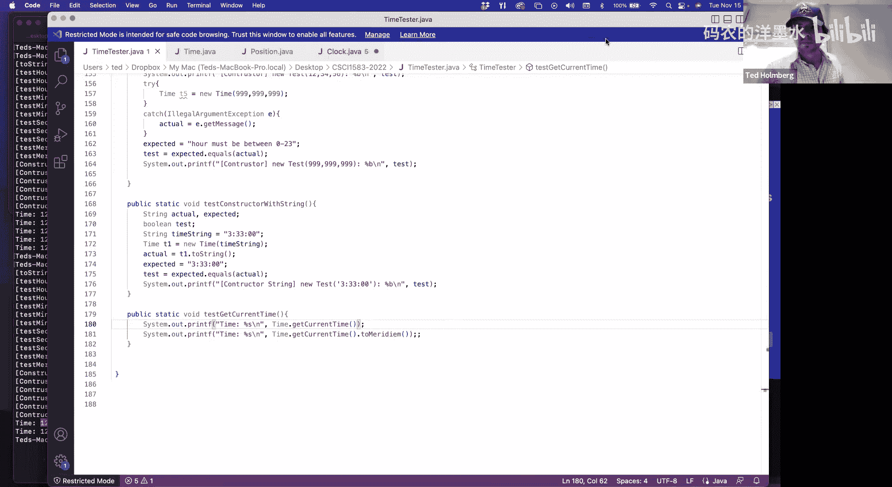

# 软件设计与开发：25：构造函数的时间类 🕐


在本节课中，我们将深入学习构造函数，特别是如何为之前创建的 `Time` 类设计和实现多个构造函数。我们将探讨构造函数重载、使用 `this` 关键字调用其他构造函数，以及如何通过构造函数进行数据验证。最后，我们还会为 `Time` 类添加一个实用的静态工厂方法，用于获取当前系统时间。

---

## 概述与回顾

上一节我们共同实现了一个 `Time` 类，它包含小时、分钟和秒三个私有属性，以及一系列用于设置和获取时间、格式化输出的公共方法。我们还创建了一个 `TimeTester` 类来验证每个方法的功能。

然而，我们注意到，目前创建 `Time` 实例时，只能使用默认构造函数（即 `new Time()`），这会将所有属性初始化为0。为了提供更大的灵活性，我们需要定义显式构造函数，允许在创建对象时就指定初始时间。

---

## 定义显式构造函数

构造函数是一种特殊的方法，用于在创建对象时初始化其状态。它的名称必须与类名完全相同，并且没有返回类型。

### 基本的三参数构造函数

首先，我们创建一个可以接收小时、分钟、秒三个参数的构造函数。

```java
public Time(int hour, int minute, int second) {
    this.hour = hour;
    this.minute = minute;
    this.second = second;
}
```

**但是，这个实现存在一个严重问题。** 我们之前精心编写的 `setHour`、`setMinute`、`setSecond` 方法包含了数据验证逻辑（例如，检查小时是否在0-23之间）。在构造函数中直接赋值，绕过了这些验证，可能导致对象处于无效状态。

正确的做法是复用这些设置方法：

```java
public Time(int hour, int minute, int second) {
    setTime(hour, minute, second); // 复用已有的设置方法，内部会调用验证逻辑
}
```

这样，任何无效的输入（如 `25` 小时）都会在构造函数中抛出 `IllegalArgumentException`，确保创建的对象从一开始就是有效的。

---

## 构造函数重载与 `this()` 调用

一旦我们定义了一个显式构造函数，Java 就不再提供默认的无参构造函数。这意味着之前的测试代码 `new Time()` 会编译失败。为了解决这个问题，并提供更多创建时间对象的选项，我们可以使用**构造函数重载**。

构造函数重载允许一个类拥有多个构造函数，只要它们的参数列表（参数类型、数量或顺序）不同即可。

我们可以创建一系列构造函数，为未提供的参数设置默认值（通常为0）。

```java
// 三参数构造函数（最完整）
public Time(int hour, int minute, int second) {
    setTime(hour, minute, second);
}

// 两参数构造函数，秒默认为0
public Time(int hour, int minute) {
    this(hour, minute, 0); // 使用 this() 调用三参数构造函数
}

// 单参数构造函数，分钟和秒默认为0
public Time(int hour) {
    this(hour, 0, 0); // 使用 this() 调用三参数构造函数
}

// 无参构造函数，所有值默认为0（午夜）
public Time() {
    this(0, 0, 0); // 使用 this() 调用三参数构造函数
}
```

**关键点：** `this(...)` 语法用于在同一个类的另一个构造函数中调用当前类的其他构造函数。这有助于减少代码重复，并确保初始化逻辑集中在一个地方（这里是三参数构造函数）。

---

## 测试构造函数

定义了多个构造函数后，我们需要在 `TimeTester` 中验证它们都能正确工作。以下是测试的核心思路：

1.  使用不同的参数组合创建 `Time` 对象。
2.  调用其 `toString()` 方法获取实际字符串表示。
3.  与预期的字符串进行比较。
4.  对于无效输入，测试是否按预期抛出异常。

以下是测试代码示例：

```java
public static void testConstructors() {
    // 测试无参构造函数
    Time t1 = new Time();
    String actual = t1.toString();
    String expected = “00:00:00”;
    boolean testResult = expected.equals(actual);
    System.out.printf(“Constructor (no args): %s%n”, testResult);

    // 测试单参数构造函数
    Time t2 = new Time(13);
    actual = t2.toString();
    expected = “13:00:00”;
    testResult = expected.equals(actual);
    System.out.printf(“Constructor (hour=13): %s%n”, testResult);

    // 测试两参数构造函数
    Time t3 = new Time(3, 33);
    actual = t3.toString();
    expected = “03:33:00”;
    testResult = expected.equals(actual);
    System.out.printf(“Constructor (3, 33): %s%n”, testResult);

    // 测试三参数构造函数
    Time t4 = new Time(12, 34, 56);
    actual = t4.toString();
    expected = “12:34:56”;
    testResult = expected.equals(actual);
    System.out.printf(“Constructor (12,34,56): %s%n”, testResult);

    // 测试无效输入应抛出异常
    try {
        Time t5 = new Time(99, 99, 99); // 无效值
        System.out.println(“Constructor (invalid): FAIL - Should have thrown exception.”);
    } catch (IllegalArgumentException e) {
        System.out.println(“Constructor (invalid): PASS - Exception caught as expected.”);
    }
}
```

运行这些测试，确保所有构造函数都按预期工作，并且验证逻辑生效。

---

## 扩展：接收字符串的构造函数

有时，时间信息是以字符串形式提供的（例如，从文件或用户输入中读取）。为了方便，我们可以添加一个接收字符串的构造函数。假设字符串格式与我们 `toString()` 的输出格式一致，即 `“HH:MM:SS”`。

实现思路：
1.  使用 `String.split(“:”)` 方法，以冒号为分隔符将字符串分割成子字符串数组。
2.  将子字符串（`“HH”`, `“MM”`, `“SS”`）使用 `Integer.parseInt()` 转换为整数。
3.  使用已有的三参数构造函数来创建对象。

```java
public Time(String timeString) {
    // 按冒号分割字符串
    String[] parts = timeString.split(“:”);
    final int HOUR_INDEX = 0;
    final int MINUTE_INDEX = 1;
    final int SECOND_INDEX = 2;

    // 将字符串部分解析为整数
    int hour = Integer.parseInt(parts[HOUR_INDEX]);
    int minute = Integer.parseInt(parts[MINUTE_INDEX]);
    int second = Integer.parseInt(parts[SECOND_INDEX]);

    // 使用已有的构造函数（会进行验证）
    this(hour, minute, second);
}
```

现在，我们可以这样创建对象：`Time t = new Time(“14:30:15”);`，这大大提升了类的易用性。

---

## 静态工厂方法：获取当前时间

Java 提供了 `System.currentTimeMillis()` 来获取自 Unix 纪元（1970年1月1日）以来的毫秒数，但这对于表示“当前时刻”并不直观。我们可以为 `Time` 类添加一个静态工厂方法，直接返回一个表示当前时间的 `Time` 对象。

静态工厂方法是一个 `static` 方法，它返回该类的一个实例。它的优势在于不需要先创建对象就能调用。

实现思路：
1.  获取当前系统时间的毫秒表示。
2.  使用 `String.format` 和特定的格式符将其格式化为 `“HH:MM:SS”` 字符串。
3.  利用我们刚创建的字符串构造函数来生成 `Time` 对象。

```java
public static Time getCurrentTime() {
    // 获取当前时间戳，并格式化为 HH:MM:SS 字符串
    long currentMillis = System.currentTimeMillis();
    String timeString = String.format(“%1$tH:%1$tM:%1$tS”, currentMillis);

    // 使用字符串构造函数创建 Time 实例
    Time now = new Time(timeString);
    return now;
}
```

现在，任何代码都可以通过 `Time.getCurrentTime()` 轻松获得一个表示“此刻”的 `Time` 对象，并可以使用其所有方法（如 `toMeridian()` 转换为12小时制）。

```java
// 使用示例
Time now = Time.getCurrentTime();
System.out.println(“Current time (24h): ” + now);
System.out.println(“Current time (12h): ” + now.toMeridian());
```

---

## 总结

本节课中，我们一起深入探讨了构造函数：

1.  **显式构造函数的作用**：用于在创建对象时进行初始化，并可执行关键的数据验证。
2.  **构造函数重载**：通过提供不同参数列表的多个构造函数，为类的使用者提供灵活的初始化选项。
3.  **`this()` 的用法**：在一个构造函数中调用同类其他构造函数，避免代码重复，集中初始化逻辑。
4.  **字符串构造函数**：增强了类的实用性，允许从符合格式的字符串直接创建对象。
5.  **静态工厂方法**：提供了一种不通过 `new` 关键字来获取类实例的替代方式，常用于执行更复杂的对象创建逻辑（如 `getCurrentTime`）。



通过为 `Time` 类完善这些构造函数和方法，我们构建了一个健壮、灵活且实用的工具类。在下一讲中，我们将学习**组合**，并利用这个 `Time` 类作为基础组件，来构建更复杂的对象，例如一个闹钟或计时器。