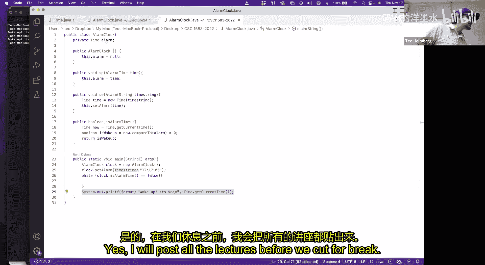

# 【全集】加州理工学院 软件设计与开发 中英字幕 1080P p26 Lecture 26 - 组合 - 闹钟演示 -BV1AvzCBdE7a_p26-

Excellent， so in today's lecture。I want to really focus in on composition。

 so composition is a concept。😡，Where we can start building。New objects。Using pre existing objects。

 so up to this point， what we've really focused on was learning to build objects。

From the fundamental data types， like for instance， when we built an account， we used strings。

 text data， we used doubles right to represent the monetary value that's held in the account。

 we used I think a string to represent the pin right but at the end of the day。

 those were all the very fundamental data types that we discussed on like the first or second day of class。

But there are oftentime where you start building out a class where。一。😊。

Makes sense to use another class as one of its properties。😡。

And that is completely totally viable Our classes can have any number of instance fields。

 any of those instance variables and those instance fields can be of any data type。

 so it doesn't have to be just a primitive data type。

 it can also be a reference data type we've already seen how it can be a reference data type in the form of a string but it can even be a user defined reference data type in the form of like say for instance。

 the account class that we built or let's say a player class that you have built or a position class that you have built。

And so I guess。The way that we usually refer to the relationship when we start talking about building a class using another class。

Especially when the secondary class when one of the when that that other class is part of the properties of our new class。

 if it's part of one of its instance fields， then we say that that a has a relationship that means that our new class has a。

Property that's defined by the other class that we're trying to use let me see if I can't give a more concrete example of this suppose that we're designing a player class what was one of the and let's see if I actually have that let's go up here so that we have something that we can actually look at。

😡，This is a really big slide deck at this point。Okay， here。

 so suppose that I have a player class here right and we looked at this。😡，Many lectures ago。

 maybe a few lectures ago， so on the player class we sat and we really brainstormed what are properties that might define a player and we said。

 oh it might be their their attack power， it might be their health power or hit points。

 it might be having a width or a height having an image that corresponds with a string having a name that applies to that player。

 but notice this one right here。😡，Even as early as back then。

 we identified that a player should all have a coordinate as well inside of the game world。

 but that the coordinate shouldn't necessarily just be， say， for instance， an X and Y。

Nummerical value， we said， oh， maybe that should be。

An object in and of itself that models what a coordinate is Now we did this a couple classes ago。

 what's the motivating reason behind using this other type of object and why shouldn't we just use the int accent Y like we've done from the homeworks previously。

😡，Like what's the advantage of trying to use another object as one of our instance properties？😡。

Like would wouldn't it be easier instead of having to build a whole other object to have something like this？

Ant X。啊 wait。X nt and Y int。What's the difference between doing this and doing this， I guess？

And is there an advantage between doing this versus this feel like the answer is reusability reusability absolutely。

 it'll actually whether it whether you recognize it or not。

 will help us withdraw and it also reduces the concerns that player has。Well。

 and let me give you ideas for that。So the first thing we start thinking about when we start modeling the player is oh there's a coordinate and that coordinate can be expressed as an XY value。

 but then we start but the moment we start thinking about that then we start should we should start thinking the next step ahead right so if a coordinate。

Is has a valid or invalid state right and actually we start jumping into places we shouldn't be going with a player。

😡，Like the moment I say a player should have a coordinate I I shouldn't have to think deeper on that I should say。

 okay I'm gonna to put that as the object and then I' use that as an object。

 but I've opened up the can of worm so to speak right so I said okay well what is a coordinate but now I'm starting to talk about coordinate related self while I'm inside the player right so then I can unpack the concept of a coordinate into player and say it's an X and Y but now what else am I unpacking what have I just unlea by opening Pandora's box well now I'm having to open up all the considerations of what is a valid coordinate versus an invalid coordinate and then the motivation here is should these be considerations I have to take up when I'm designing a player。

😡，No right a player should not be responsible for knowing what a valid and invalid coordinate is because if I do take up those problems inside a player and then I go to design a monster and I decide that a monster also needs to have a coordinate and have already unpack the logic for coordinates inside of players I'm going have to unpack all that inside of monster as well in fact everything that is going to require coordinate is now all of a sudden going to have to be responsible for checking validity stays valid stays for a coordinate or not and those none of that should be the role of player or monster or item or all these other things in fact you're going to start getting a lot of replicated knowledge a lot of replicated checks a of you're going to be violating the dry principle。

😡，By checking each individual class， whether that X and Y coordinate is valid before that player moves there。

😡，So doesn't it then make sense to encapsulate this logic encapsulation means to hide this logic to pull those responsibilities away from things like player and monster。

 pull it into a one coordinate class， let it do all the work of maintaining an X coordinate。

 maintaining a Y coordinate and then checking to see if it's if it's proper， if it's valid。😡。

And then everything else can just have an instance of a coordinate and it doesn't have to worry about any of that stuff。

 it can just know I have a coordinate。😡，So do you see the motivation and so that concept that a player has a coordinate and a coordinate isn't this fundamental type it itself is a thing that we've modeled and spent a lot of energy thinking what are its instance fields and what are the ways that we can mutate it that can resolve into both the general valid state but could also lead to invalid states and then we check against and we protected it right we test against it and then once we've created a coordinate object that we feel confident in。

We can then use it inside of player， we can use it inside of master， we can use it instead of item。

And now none of those classes have to be concerned with how it works it just knows I have a coordinate i'm going to set it in here and if that any time player tries to violate the rules for coordinate coordinate will then throw that exception to player。

😡，And then we have a nice robust software ecosystem where nothing is fragile and nothing is prone to a massive breakdown that can lead to erroneous behavior and again。

 so the idea here is a has a relationship is referring to composition composition means we can build more complex classes using smaller。

 simpler classes in this instance a coordinate is a smaller simpler class and in this player class is more advanced but it just so happens it needs to have a coordinate as part of what it itself modelss。

So we'd say a player has a coordinate， a monster has a coordinate。

 an item has a coordinate inside of our game world。

So the concept of has a that has a relationships is going to be important because next class。

 I'm going to introduce the concept of inheritance， which is going to be is a relationship。

And there's going to be questions certainlyling all the unit three tests that has you identify and distinguish the difference between a is a relationship and has a relationship。

Okay， is there any questions about that？Let's go down here and so if you recall it's good that I'm stepping through this though。

 because if you might recall the problem we've been left we've been working on for the last。

Couple of classes was designing a complete。Well defined time class and we've been kind of testing it out and we finally got to the point where we said we think it's good enough。

To start using it， so we're going to test that out we're going to test that out by trying to use our time class as a basic class as as a component class that will go into a compositeed class。

😡，The composite class is a class that could be made up of other classes or instances of other classes。

😡，So we've already covered this， what has a relationship is。

 and that we can build objects with other objects as its instance properties and we explained why。

So we can do stopwatch i'm actually going to do alarm clock。

 but I want to highlight that the beautiful thing about designing our classes is that once it's been designed to be instantiated and utilized you can start building all sorts of things from it so in examples of classes we might now use our time class for is to build a stopwatch。

Or maybe to build an alarm clock what would be the distinction between these two i'm only going to build one in today's lecture。

 but what would be the varying functionality between a softwa and alarm clock。Yes。

Aarm clock ends at some point with an alarm a stopwatch only ands when you decided does right so a stopwatch has like they built it for you to begin and then end and then be able to give you some kind of time differential between the two exactly and whereas a as a stopwat yeah that's a stopwatch whereas a alarm clock you put an alarm time and then when it gets to that alarm time it then like beeps and alerts you。

Yeah。Exactly， yeah， there there's all these nuanced references so when on the surface you're like you have these these things that are similar。

The reason why both these two things exist， even on your phone I've actually you have two different phone apps or at least a app that has two different modes that distinguishes between a stopwatch and an alarm clock and both of them are pretty critical I know I use my Swatch on my phone and my alarm clock。

😡，Regularly on a daily basis， but for different sets of tasks and they both end up using they're both enabled by time as the basic model underneath them so I think that these problems represent ideas on how great it is to start with that basic time class and then we can start building actual applications from that we can start building tools that we want to use or software that we might actually use。

😡，So in today's class， I want to design an alarm clock。

And so here my alarm clock i'm going to do what I traditionally have been doing in class before I do any coding I want to go ahead and design myumML class diagram which as you might recall is going to be composed of three different rows the first row is going to be the name of my class it it lets me know what it is i'm actually modeling the second is going to be well what are the attributes of this particular class now it was arguable that for an alarm clock you probably want to have two things modeled in there it's going to be what is the current time。

And the alarm time。So right here I just have one because I'm going to cheat I'm just going grab the current time from our time class because we create that static method right but if I wanted to make this more general you would probably have something like now which represents also a time element so that in alarm clock always knows what the now time is and it always knows what the what the alarm time is but I'm going to I' going I'm going to utilize the fact that I can always get the current time from my time class because that's how we have defined it。

Which means at any time， I just need to know what time I'm going to alarm at。

So things that we need from our alarm clock， we will need a constructor。

We would need the ability to set the alarm and there might be two ways we can set the alarm right we could set we could pass a time object in or recall that one of the constructors of a time objects allows us to pass in a string so we could potentially pass a string。

 build a time object from that string。😡，And then set that as our alarm。

We can go ahead and check is the is is it currently the alarm time true or false。

 so should we ring at this point， is it time to wake up？😡，And for testing purposes。

I'm just going to create a main method that I'll actually run my alarm clock so we could actually see what this looks like if it were an application。

 the very rudimentary application， but it'll actually work as an alarm clock Buheim we're done implementing this。

Okay， so let's start scaffolding out our alarm clock。 So let me go over here。And where is okay， here。

 you know， where is okay here。This looks clean， Okay， let's go here and here。Okay， let's LS。I'll ask。

 okay， where am I I want to go into lecture 24， so let's go into lecture。

I guess a slowercase lecture 24 excellent。Okay， so inside of this lecture， I currently have。

And here I'm going to remove。The clocks so let's see what I have in there now so position position tester don't care about that time so time is what we worked on before Let me go grab that。

 So inside of lecture 24 I have time。Yes， I trust。And let's say， oh， that's it Okay， so this is。

Let me close this。P wehelfd death。There we go okay so this is what we've already created right so we have our time class recall that our time class is made of an hour a minute and a second we have this static method that allows us to get the current time we have several different constructors this is what we spent last class really creating。

Yeah。We have the ability to set the time and then we have all these private methods that are the ones that check to see if the time is valid or not。

 then we have two methods that return the state of our time in the form of a string。

 the two string method uses universal time whereas the two meriium goes ahead and converts it into AMPM format。

Okay， so。Let's start building in a alarm clock and see if we have enough build out onto our time class to support that functionality。

So let me go over here。And let's go， let's create a new。Class oh long f， okay， perfect。

 let's go over here to where I just built this and let's open it up here。Okay。

 so what I'm going to do is I'm going to go to this slide and I'm going to grab these method names and I'm going to remember that I have an alarm an alarm an alarm in there。

 so let's do public class。Alarm clock。Perfect okay so now i've defined my class the next thing i'm going to do is i'm going to create that instance variable I'm going to go back and look i'm like oh。

 I have an instance variable that is a data type time called alarm and it's going to be private so let's go ahead and add that。

Private。time。Oh， just called alarm。Perfect。Now I'm going to have all these methods。

And let's go ahead and actually stub them out so that they' were appropriate so the first thing i'm going to do is public alone clock and notice there's nothing in there i'm going to go ahead and give it the。

Open close brackets so that it just has an empty body。Just to stub it out here。

 I'm going to go ahead and make this parameter Java compliance。

 so I'm going to put the data type in front， and I'm going to open and close。

And so here I'll make this public， and this doesn't have a return type， so I'll make it void。

Let's see here I'll make this public， I don't see a return type on the tail end。

 so I'll make this void and then I'll make this Java comp inside the parameter list by moving the data type to the front and removing it here。

And then I'll give an empty body。Excellent。And then here， I see， I do have a return type。

 I'm going to cut that。And I'm going to do public boooleing。 and I'm now we're going to give it a。

Empty body since it does have a return side， I'm going to just give it a dummy value to return。

 so let's just return false for now。And then finally， I'm going have my。Public static。Void mainine。

 And I'm gonna。Just to make this job a compliant， put my data type in front excellent。

 and I'll just go ahead and give it a bo So at this point I now have an alarm clock that I have fashioned。

And let's go ahead and just make sure that we can compile it。Yes。嗯。

And we can log okay so it doesn't have any functionality yet。

 but at least we know syntact it's correct so that's where we always want to start out is code that can compile before we start adding any logic into it。

Okay， so。Okay。Let's talk about， so let's start setting this up。Inside of a alarm clock。

We're going to state that it does not have it does not have a。It does not have a time。

 so here we'll just do this。😡，We'll just put that this time whenever we start a new alarm clock that。

It shouldn't necessarily have any time for the alarm that should be something that's manually set so when we create a new instance we'll just say okay this do time is set to null there's no there's no i'm not time along。

😡，Got to use the name of this of the variable， so this alarm will be set to know whenever we build a new not there。

 not set time。Should be in the constructor。It's cut it here， paste it where I want it。

 So every time we build a new alarm clock， it'll build an instance that canally have an alarm。

 but the alarm will have no reference。 We want to manually set the alarm even the first time we use it。

So that when we created it just doesn't randomly start beeping right like at midnight or something like probably not what you want you probably want your alarm clock to start with no reference time and the end user is forced to give it a reference time would everyone agree with that functionality？

😡，So it makes sense in this instance for a construct just to set the alarm tunnel。

Which means that the set alarm method is responsible for either initially setting or overr over writing whatever the current time that' saved in the alarm time is for so let's see there's one of two ways we can do that for this way we've overloaded this method right with two different parameters on the instance that we're passing in a time this is really easy right we can just do this。

😡，Alarm is assigned the time that's provided to it。

So notice this is how we use composition in action， right we spend all that time designing time。

 that time class， and here we're setting it into our composite class into our alarm clock class。Okay。

 another way we can do this is we can take that time string and what I can do is I can create a local variable。

 let's say I'll call that time of data type time and I'll call the constructor on time and I'm going to pass it that time string。

Yeah。time stream。开肥。Okay， so I can take the time string this passed to me。

 I'm going to use that to build a new time string and then I'm going to take that and save that into my local variable。

 I mean， not my instance variable of alarm。😡，So let me ask you this。This string here。

 is it possible that this is？😡，A string that does not represent a time string。😡。

And I'm going to try to use whatever string gets passed into this method to build a time。😡。

Do you think that this is safe for us to do because it possible to resolve into an invalid time instance by passing any type of strength？

😡，Right so I'm just because think about what we've been doing previously。

 so I have this time string and I'm just going to pass that time string to the time constructor。

 is that safe or not safe？😡，It might not be saved， like what if I pass in the string hello world？😡。

Is that a concern？What if I do pass in the string hello world to my alarm clock set alarm。

 it's going to pass that to the time constructors constructor， right？😡，Well。

 what's this time constructors constructor going to do with that string that says hellello world and not have an actual like format of time in that？

😡，Let's say， let's suppose we go into our constructor here that uses a string。Well。

 we hadn't we hadn't checked on this， but here ideally we would be protecting against that inside of our time class。

 so the idea is that alarm clock。😡，Doesn't have to worry about what's safer isn't safe it's just going to take the string and pass it to time and say here try to about to build the time off of this and if time can't build since we've already designed time so it checks to see if something's valid or not valid it would kick out an exception to this method if that string wasn't valid and then this method would instantly since it doesn't try to catch it would instantly throw that that exception to the next thing。

😡，So the beautiful thing about us putting all that exception throwing in our time classes is now every class that's using it to build on top of it doesn't have to worry about what is a valid time string or what is a valid time manager or any of that other stuff。

 it just tries to blindly do it。😡，And if it doesn't work。

 it kicks that exception up that you've already designed。😡。

Again one of the beautiful things about building using basic classes and then building on top of that because you get this cascading domino effect that so that means my implementation in alarm clock is much simpler I don't have to do all the considerations for this implementation that I had to do when I was designing my underlyinglining time class does that make sense。

😡，I don't have to double。I don't have to double my workload。Okay。

 so now I have two different methods， one where I pass in a time instance directly and another where I pass in a time string and I use a time string to create time instance and then I will set that to my alarm。

Okay， the next thing that I'm going to do is check to see if it's an alarm time。

What is how do I do that， how do I know if it's an alarm time well I can do this， right？

I can check to say I can get， let's see I can get the now time right， so I now time。Is equal to。Time。

Dot yet current time right so I can always get the current time from the static method that we've already defined in our class and then I can get this time so I can also get like my my alarm time。

😡，Right， my alarm time is just this style of alarm。😡，Okay， so I have these two two things。

 I have my alarm and I have the now time， how can I make the decision on whether I should ring it or not？

How can I have two time instances， how can I use these two time instances to relate to one another to give me a meaningful result？

Well， let's look at our time like right like what do you think like what are some what are some observations we should be able to do here now we have two time instances。

😡，Well， like what are some operations we might want to where we don't have a time instance in isolation。

 but where we have two and we want to start doing。😡，Kind of evaluations between two。

Think back to your processing operators， what kind of processing operators would it be nice to have？

To be able to perform onto between two different time ands。Yeah。

 wouldn't it be great to be able to see if one time is equal to another time？

Let's check our methods here and even on top of that。

 wouldn't it be also just as nice to be able to check to see if one time was before another time or if one time was after another time。

 so we would love to have both equality operations and comparison operations。😡。

But since we designed our time class unless we define those things in there， they don't exist。😡。

Because relational operators， equal operators， those only quality operators。

 those only work with a primitive data types because it's predefined inside of the JVM and then everything else it dependented on the user。

 the developer who designed that class to define what equality means or to define what it means to compare one instance to the other so we thought we had designed a really good time class right it had modeled the hours the minutes。

 the seconds， it had a nice set of constructors that allow us a variety of ways to build out a time instance。

 it has the ability to set a time into the time instance and it gives us the ability to express time as a string in two different ways。

😡，But we didn't add any functionality to actually compare time to another's time。

 so we are actually lacking some methods we should have in here and so one of the beautiful things about starting to build your software out is when you see these holes that might exist in your fundamentally these components。

😡，Classes that we start building now。 So you really want to think deeply about how these classes are going to be used and think about what kind of。

Operations you should be able to allow to be performed on it。

 so I actually want to expand my time class in this class to give it the functionality that a long clock is going to need to be able to perform its task because we can create two different times。

 but there's no way for us to relate them to one another and we want to start being able to process time instances together to get meaningful results to find out two times are're equal or if one time is greater than the other time。

😡，Or less than。So yeah， that brings us to the missing methods。

 show why equal methods should be included in the time class and what does it mean for time to be equals。

 show how I' compare to method。Should be included in the time class and what does it mean to compare time to one another so let's talk about this what does it mean for a time to be equal to another time since we design time what are the properties of time。

😡，Do you remember。Without having to go back to the UL diagram， how many properties。

 how many instance properties does each time instance have？😡，I can go to it right here。

What are the instance properties for a time class？Exactly， right each time instanced。

Its state is composed of three things an hour a minute and a second。

 so if I wanted to say that time instance one is equal to time instance two。😡。

What am I evaluating what since I'm the one who has to decide what equality means。😡。

What matters for evaluating inequality between time instances？😡。

What should should be equal insight each time instance when compared to another time instance。

 does our matter？😡，Is it important that the hour in one time instance equal the hour in the other time instance？

😡，Or can they be different and still be equal？Fish。They have to be the same。

because if I said times are equal and if one was 2，300 and the other was three hour three， you say。

 no， those are two different times。23 would have to be equal to 23 in terms of hours what about minutes is minute something that's critical for these two instances to be considered equal。

😡，And seconds。So all of the properties。😡，have to be equal for equality to be equal between these two instances。

😡，There are some times where some of the instance properties might not matter。

 they might not be used for your evaluation for equality bit notice determining equality is something that you have to do during your design step of your class and you have to select which of these properties。

😡，You think are critical for distinguishing between two different instances。😡，Okay。

 so let's go here then。And now let's create an equals method inside of our time so we know it's going to be public equals should return a boolean and then we will call it equals。

And so equals。I is an interesting method it' a method that we actually inherit whether we realize it or not。

 so there's a very specific way we want to write this。

 so here the data type I want to put into equals is I want to compare a time instance to potentially any other time instance。

😡，And actually， let me grab the implementation from it oh wait。Here。So。Yeah。Here， let me go to。

Actually passing an object so I might potentially want to compare to any other type of thing in Java and so like say for instance。

 if I'm given a string I'm going to say oh that's not equal because that's a string。😡。

So I want my equals method to be super verbo so if you give me an integer I can say oh that's an integer that but I should still return something true or false right so the first thing I wanted to do is see if the thing they're given me is even a time instance。

😡，So let's say this is is equals。Is equal to by default， will stay false。Away。Take this bowl in。Okay。

 so here I'm going to check if。😡，So the parameter I'm going to put in my equals is going to be of data type object object is the most generic of all types of reference types。

😡，So object is the。😡，Grandmother of all types in Java so everything is an object in Java we'll learn more about this next class when we get into inheritance。

 but the beautiful thing about labeling in a reference type as an object is it will accept anything in this parameter now it could be a string it could be an integer it could be a floating point number。

 it could be a time instance， it could be a player instance and this this allows us to actually have an quality operator that doesn't care what the data type won't throw an exception because you threw in the wrong type there's no mismatch type exception here it will take in anything and then we can compare it to give it true or false it's equal to this thing but the first thing I want to do then is check to see if it is a time instance and not like a string instance or a player instance or an alarm clock instance so i'm going to take my object。

😡，So if my。OBJ， my object。Is the instance of so there's this this new operator we haven't seen before。

 this is a binary operator。😡，Where on the right hand side， we can put a variable。

That's or a literal value of some reference type， and on the right hand side we could put a class name or a data type。

😡，And this will return true or false if object is an instance of time， it will resolve as true。

 if it's false， then it'll resolve as false， right？😡。

So notice all of our keyword in Java show up in my highlighter in my syntax highlighter as this like blue color。

😡，So now we'm going to give this a property and now we'm going to create a new。

Now I'm going to create a new。A local variable inside this if block that's going to be of data type time and I'm going to cast it。

 I'm going to say okay， let's cast this object because it's a data type object right now。

 let's cast that object into a time object。😡，Okay， so now I can start doing comparisons。😡。

So now I can check。Is。This other time equal to my current time。😡，And so here， let me do this。

 so I'm going to put as of now， my I'm going to assume my is equals is now true。

Because it is of data type time， but now I need to check the hour in the minute and the second because all I've done is check to see if the data type that got passed in is the same。

😡，So how do I get？The value， how do I get the hour， how do I get the minute。

 how do I get the second from the other time instance。

 do I have access to it from inside this time instance。😡，Well， is it my actual no？

All of my instance variables are private。Which means though even though both time instances are instances of time。

 they have their own private set of instance variables and so this current time instance that wants to compare to this other time instance doesn't have access to any of the data in the other time instance。

😡，That limits us。That's why we depend on what are called giter methods getter methods aren't just useful for other objects to access instance variables within of a class like what we've seen before it's critical for other instances of the same class to access another instances data。

 especially when we start defining really critical methods like equality operations or comparison operations。

 so we're going to need these giter methods just to access the other times values so that we could define comparison operation so let's add that in。

😡，So， oops， so if we're going to have a public。This is going to return an int and we're going to get get our。

And this is going to return this hour。We'll create a public andt get Min。And this is going to return。

The minute， and then we're going to add a public andt get second。And this is going to return。

And these are really simple to write right it's just methods that return the state of a variable。

 but now what this is going to allow me to do is finish defining my equality。

 so I'm going to say okay I have any object passed in I'm going to set is equal to false and that's the thing I'm returning if the object is an instance of time I'm going to cast。

😡，That other time so that I'm going to cast that object into a time object and call it other time。😡。

And here I'll just call it other just to just to make it a little bit less work I have to put in all myself and then the only get to set is equals to true。

 but now I'm also going to use compound。😡，Assignments is equals。

 take whatever the current value is equals to and and it along with the evaluation of this。😡。

God get our。Is equal to。Other dot get hour now I can access it so now I can access the other hour compare it to this hour and then once I do that I could have done this。

😡，I could have done this because I have direct access to inside here。

 but I prefer to use the getters once I do that because it's more consistent it's more readable so I'll get this get hour and other get our and if these are false then is equals as false right if these are true。

😡，Then the resulting value is going to be true， let's do the same thing。😡，Where。

This dot gets minute equals。Other dot get minute。And then let's do that also with。

Get second is equal to other dot get second。 Excel。 Okay。

 so now all of the things we've identified as being pretty critical。Or available to us so。

If we pass in an object and it's a time object then this results to be true。

 we cast it into a time object we set is equals to true if the hours are the same is equals continues to be true。

 if it's false it becomes false at this point if minutes are the same then is equals remains true if it's false so it toggles to false and finally if seconds are true then this remains true and by the time we're done if all those things are true that it is a time instance and it has the same minutes and it has the same hours and has the same seconds then it's equal any other result and it's false does anyone have any questions about this。

😡，So now we can compare one time to another time。And that's one way we can do it。

 But I'm going to say there's a better way。 What if for some reason your。😡。

Computer software lacked and at the moment that those two times are equal for some reason it didn't do the evaluation。

 should your alarm clock still ring if it was said for 7 a。

m and at 701 a and for some reason it lagged out at7 and it didn't go off it didn't evaluate。😡。

So if we just do an equals method。Your alarm might be set for seven and if if if it couldn't do that evaluation it'll hit 701702703 it still won't go off would we prefer to do a compare so we could say once the now time is equal to or after the。

😡，The current time。Is that what would we prefer that？Yeah， I think so， right？

So they we can also do what's called to compare to this is equivalent to the relational operators the greater than the less than the equal operations so it is very common when we start building comparison methods that they resolve in an integer value。

 so when we compare two different values。😡，If they're the same， if the concept is equal。

 then we return zero， zero could be thought of the difference between our two different objects。😡。

Yes。The value we're comparing is less than。The other value， then we would say， oh。

 that's got a negative one return to it。😡，And if it's greater than then it's a positive one。

 there's three different outcomes， a zero represents that the two time instances are the same a minus one value represents that the lefthand value。

 the initial value is less than the other value you're comparing against and a value of one represents that the current value the value that you're evaluating is greater than does that make sense。

 so let me use let me use nonnu but non complexplex data types for you to think about this if I were to compare two letters because everyone is familiar with alpha numerical ordering。

😡，We kind of used this sense this kind of comparison action for that if I were to compare B equals B。

😡，That would resolve in a zero value， right because they're the same what if I say a right。

 what if I compared a to B。😡，A is my initial value， B is the value I comparing to a。

 what should that resolve to？😡，Out of the rules that I have stated it here。😡。

So a compared to a would resolve to what value。😡，Z a compared to B should resolve into what numerical value。

Negative one right but when we look at this look at rule what we want to do is look at rule number two though。

 so if a is the x。😡，And B is the y， then a is less than B， so it resolved in minus one。😡。

So what if I flip that B？😡，Compared to a。That's going to be a positive one that represents that the B is bigger than the A。

😡，Whereas the a is smaller than the B， when it's smaller on the left hand side than it produces a negative value。

 if it's greater than that it produces a positive value。

 think of it almost as a form of subtraction against each other， a form of addition from each other。

 right？😡，So so this might be able to be expressed as。Y minus x， this might be expressed as， well。

 y minus x。Right， both of those， and this might be able to be expressed as y minus x， right？😡。

And so if this is smaller and if this is larger， that's going to produce a negative outcome。

 if this is larger and this is smaller， this will go ahead and produce a positive outcome， right？

Okay， so does anyone have questions about the concept that drives this compared to method？Okay。

 so I'm going to copy this and then we're going to walk through the code because I don't want to have to type this all out again。

Okay， so let's cut and pace as we need， so I'm going to cut and say I'm going to create now a method。

 an instance method inside of my time class that not only allows me to check equality but compare two time instances together and determine if this time instance is the same less than or greater than some other time instance。

 so I'm going to return back in integer value my integer value is either going to be zero minus one or positive one determining on how that comparison works。

😡，And then i'm going to return that result so right now i'm just going to st out that implementation so the next thing i'm going to do。

 let me cut out some more things is I'm going to build a strategy here。😡。

My strategy is I can easily do this comparison against numerical numbers and since all of my data inside of my time instances are by nature integer numbers。

😡，In fact， we can almost think of time as having seconds be lesser than minutes and minutes lesser than hours and since they roll into each each other。

 I can just concatenate all those into one big imagery number， does that logic make sense？😡。

So the first thing I'm going to do is I'm going to use strings dot format and I'm going to take the hour。

 take the minute， take the second， and I'm going to make one string on it。😡。

Where at the very left hand of the string is the hour in the mineral of this string is the minute and at the end of the string is the second。

😡，And I'm going to do that for both this string。And the other time string and I'm going to use those get hours is get minutes and those get second calls to be able to access that。

 So does everyone understand what I'm doing on line 14 to line 15 now those look like big lines。

 which relatively simple。 it's kind of like what we're doing the two string method。😡。

But without the colons in between， just so that we can build something。

That represents nothing but numbers。So is everyone good with that？Okay。

 so the next thing I'm going to do。Is I have these strings that are nothing but numerical data。😡。

I can use the integer class， it has a static method in there called parense to convert it into an integer number。

😡，So now I've turned my this time string and my other time string into this time int and another time it where one big integer number that represents the hour。

 the minute and the second now the beautiful thing about finding a way to model each of my time instances as a unit of an integer where all of the valid where all of the data properties are part of that is now I can use the primitive relational operators to see if one integer is greater than or less than or equal to the other。

 right？😡，So does everyone understand what I've done on lines 16 and 17 here？😡。

Does anyone have any questions？Yeah。So then once I have two integers。

 I can make use of primitive operators and I can say， well。

 if this time int is less than the other time int，😡，Then the result should be minus one， right？😡。

And if this time is equal to the other time， then this result should be equal to zero。😡。

And if this time it is greater than the other time it， then my result is one。

 so this follows the rules that I had shown in the slide prior。😡，The rule for when I return a minus1。

 a zero or a positive one。You know what's great about creating this method， by the way。

 if I now use the array class that we learned about back in unit2 to sort time instances。

 we now have defined a way to compare compare to is a built in method that Java looks for on comparable things so now we can start sorting time instances if we wanted to。

😡，So this has more used than what we need in our alarm clock， instance。😡，Okay。

 does anyone have any questions about these two new methods that we've implemented？😡。

Now we have an even more feature rich version of time， we can't just build time instances。

 but now we can request the state of each of the time properties。

 we can evaluate to see if one time instance is equal to another time instance and now we can compare to see if one time instance comes before or after another time instance。

😡，So let's go back to our alarm clock instance， because that's where we're currently stuck at。Oh。

So in my alarm clock。Let's put it here。So in my alarm clock on my method is a long time where we turned back a booleion。

 we could think of it as this way， we go ahead and from the time class， we grab that now time。😡。

Times。 get current time and now we have that compare so I can create a Boolean local variable is wakeake up。

😡，And take my nail time and compare it to the alarm time， and if that's greater than zero。

Then I can wake up， then I said is wake up to true。

So does anyone have any questions and we can only now do that because we've implemented the ability to start interacting to start relating time instances to one another does anyone have any questions about this does it seem obvious enough based off of the rules we had specified so now let's actually build this into an app let's actually define what we need to do in our main method and you're gonna see say our main method it's going to be very small。

😡，Because so much of this work is encoded into our basic time class。😡，So inside of my main method。

 what we're going to do is we're going to create a new alarm clock instance right we're going to call the constructor from this class。

 create a local variable that is an instance of an alarm clock we'll just call a clock。

 then well say， hey clock， set your alarm。😡，超。And you see， it's passing the time string。 This is my。

It's letting me know what parameter I'm passing in there。

 but I'm going to pass in the time string because that's easier and actually let me do。12。14。

 let's see if I can do this fast enough。Nope， we'll do 1215。

So this will be the alarm for when the class ends effectively。😡，So then while the alarm clock。

Is a long time that returns true or false right that' that's this check so until the is wake up time hits true I'm going to keep repeating this empty process so i'm going to keep running a while loop that does nothing until it resolve to be false and once it does I exit the while loop I don't get to say wake up it's this time。

😡，So let's get here， let's compile my alarm clock。😡，I don'tWhat does it not like？Time。

Cannot find symbols， Helen， oh， do I not have that inside of my time， Lord。讲。We had let me see。

 let me check my time， so I not have。Oh my， let's go get the others time。Let's get this time class。😔。

Yeah。And get our empty method。So， somehow。The one from the other lecture did not get。

I guess it was kind of towards the end when we had put that in there。

It was here get current time so let's give this method that we covered last class the very end of last class into here while it's there get current time。

Let me see what my error is here。呃 wake up。Methic， get current time， location class time。

 some messages， and make sure it's。Yeah， I mean， that looks fine to me。Let me make sure that it's。

Get current time。Claire。Let's do this one more time， okay。Oh， new time string。

 so it doesn't like this。Okay。But that should be fine。

 let's see here we have time string that should be fine。嗯。Let's do this。 Let's try one more time。

Clear this。And。Let's go here。Set this to 12。17。Always going to get your small hiccup bugs in the middle of live demos。

Okay。Okay， so now we we'll run this and ideally once we hit up there it is wake up it's 121701。

 which is what more system time now shows， but not here， I guess oh yep it was just。Led in。

From updating the time here， so yeah， that's awesome。

And actually if I run it again it's going to say its it's past that wake up time of 1217 so I'll just keep doing that and actually what I should do is once I wake it up I should reset it to just turn off after that。

那个诶前咩聊天。ExingYeah I mean I could I could do just like I did a loop here I could put a loop here actually system that out actually supports a beep too so I can I can print out like forward the forward slash007 which tells Uniix to go ahead and make a beep sound and I can make keep making a beep until the user supply some kind of input or something and so I provide a sentinel value so you could start to see I can actually make this into a real alarm clock application go off of the basis of the the time class that we've designed over the last three lectures so does anyone have any questions about this。

对。Excellent， well， I will see you， that is my entire lecture on composition。

Here I hope you all saw the value of being able to build a more complex object using a simpler object。

 but I also hope you see the value of why we want to rigorously test our simple objects so that they can be expanded without much complexity we will move into inheritance next class and then yeah we'll follow up with inheritance polymorphismism a classes and interfaces over the next three classes so excellent I will see you all on Tuesday。

😡，Yes。Yes， I will post all the lectures before we cut for break。

