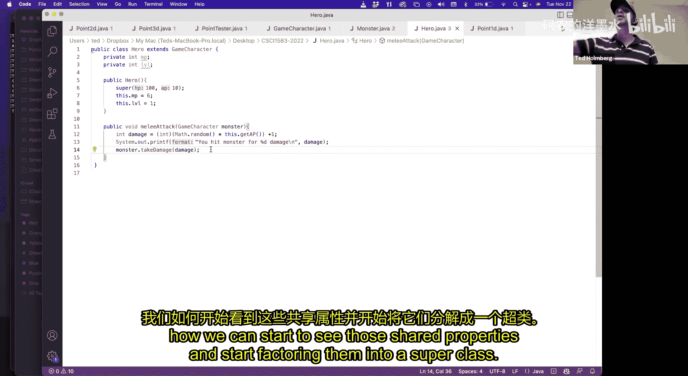
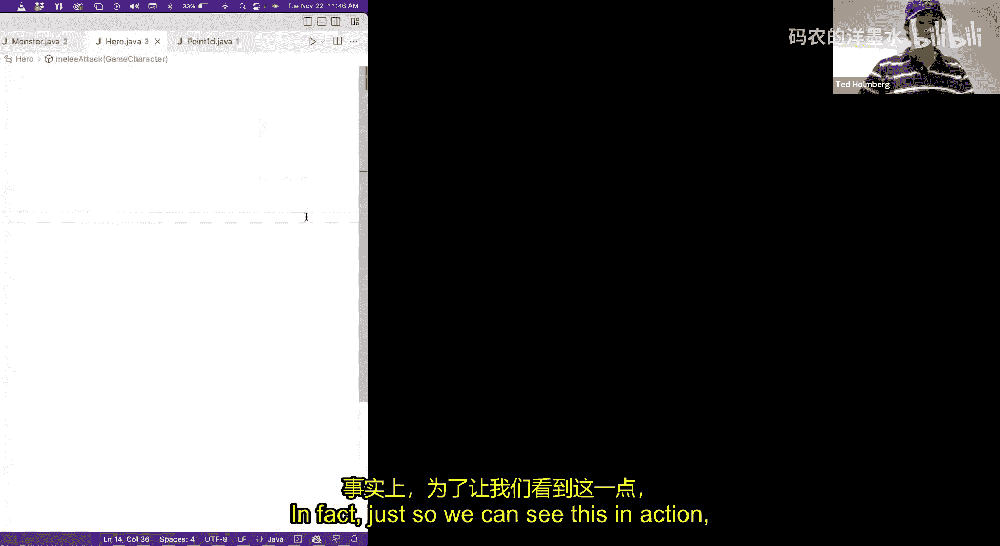
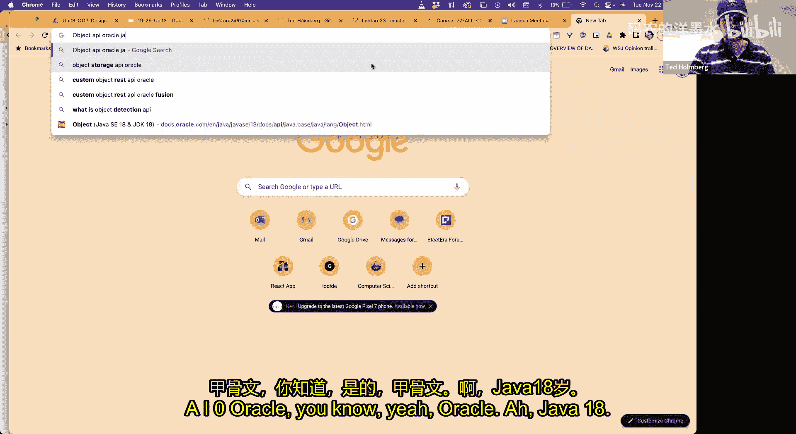
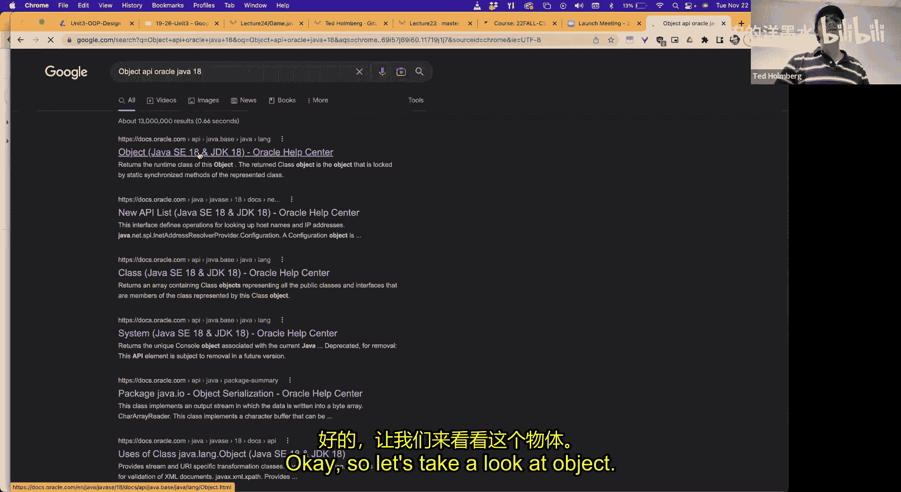
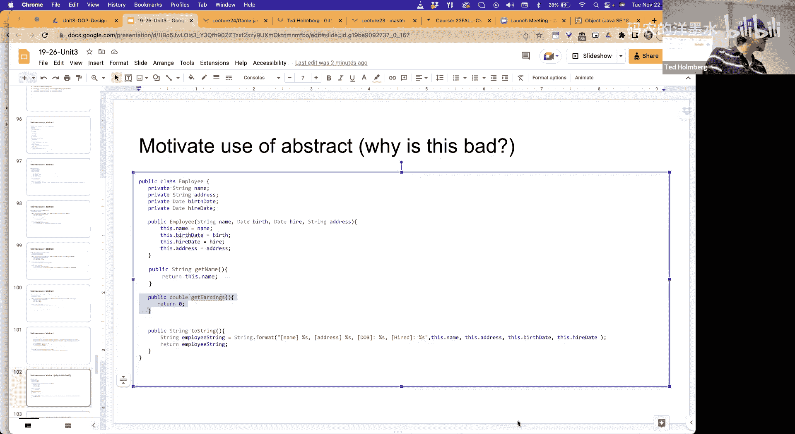

# 【全集】加州理工学院 软件设计与开发 中英字幕 1080P p27 Lecture 27 - 继承与多态 -BV1AvzCBdE7a_p27-

Okay。Today is our penultimate lecture as I understand it we have two lectures left。

 we have the lecture today and then we have the lecture next week on Tuesday and I believe December 1s has been converted into a reading day so I'm going to try to compress everything that we need to discuss in terms of inheritance and polymorphism in the next two lectures。

So we have a lot to get over to go over because I'm going to try to browse what I thought was three launches down to two。

Okay， so before we start， does anyone have any questions？

I had a question about the homework on seven I had sent you an email regarding that。

I don't know if you had a chance to see it or not no I hadn't had a chance to see it What was the the question regarding the the homework that well I had a problem with the。

Java constructor on page four it says that it's this is over equals false page five states that that same constructor is just is over equals false。

 but I don't think it has anything to do with the error that i'm getting because when I try to load that main text document I have it in the assets the platform game。

It says you can't find that， I'm getting an arrow says can't find or load that main class platform game。

嗯。Can you can you send me a screenshot of that error all through Discord and then I can go ahead and after class I can try to give some assistance on that sure so do you think that the game constructor is this。

Or。Without， without seeing it in my like right in front of me， I've had a tough bargain in it。

So just it's really easy for me to see the feedback from the JBM without that。

 it's much more like pulling teeth。嗯。I just was wondering because it， you know。

 if there was something that we needed to do more with that asset file。

 like maybe convert that TxT file into something else like an Oad or just it should work as is。

It should work everything should work as is there shouldn't be anything you have to do to refactor the files。

Excellent， okay， so we are going to start on lecture 25 so last lecture， if you might recall。

 we talked about composition composition was。It was a way for us to build more complex objects。😡。

From preexisting objects that has a relationship。Right， so for instance。

 I think we use the example of like a coordinate。诶。

Video game character might have a coordinate a video game enemy might have a coordinate the coordinate itself could be this complex thing that's not a fundamental data type。

 so we build the coordinate as this constituent class and then we build from a composite class a。

Inity and object that then relies on that other component is one of its properties where there's another way that we can build new classes from preexisting classes and that's through a mechanism that is called inheritance and it's actually one of the things you're looking at in homework7 with a platform or game so inheritance unlike composition has an is a relationship So today we're really going we're going to dig deep into what it means to haven't is a relationship and we're going to look at some of the new keywords in Java that's going to allow us to inherit from a preexisting class the keyword is going to be the extends keyword now we've already seen that this keyword that this keyword means。

It's it's a reflective thing for each instance it's like I'm going to look into my own memory address effective for what builds this particular instance to access this instances instance fields well there's another keyword that we can access called super super allows us to access properties from a parent class from a super class we're going to take a look at that this lecture as well。

😡，Then there's another thing we're going to distinguish we've seen method overloading before where you can have multiple methods that all share the same name but the distinguishing factors。

 the fact that their parameter list is different well method overriding allows us to have a method of the same name and of the same parameter sets in a subclass。

😡，Compared to a super class and we will use the subclass implementation overriding the superclass implementation we're going to take a look at that today as well。

😡，When we talk about inheritance， one of the limiting factors about inheritance inside a Java is that it's a single inheritance hierarchy。

 which means that one class is only allowed to inherit from one other class。😡。

And then we'll talk about the object type， which is effectively the root class for all other classes。

 so whether it's explicitly or whether it's directly or indirectly all classes。😡。

arere somehow connected to the object class they are a member of the object class and we'll take a look at that in today's lecture as well and finally going through this overview slide I want to take a distinction I want to take a look at how super classes and subclasses will allow us to get what's called polymorphism or polymorphic behavior。

😡，And we'll talk a little bit about more what polymorphism means it's a tricky word。

 but we'll break it down right and it'll make a lot of sense when we get there。🎼And then finally。

 I'm going to want to round up this probably lecture today talking about how we can access private values from a super class and what it means to apply the final keyword to methods。

 we've seen what it means to apply the final keywords to variables。

 but there's a meaningful thing that we can do to both classes and methods we use when we make both a class final and a method final。

Okay， so with that said， let's talk a little bit about inheritance and the is a relationship so again where composition builds classes from existing classes using them as properties and has a relationship inheritance builds classes from existing classes by extending them within is a relationship inheritance helps us with that dry design principle've we've spoken so much about over the course of the semester and so one of the things that motivates when we should use inheritance is whenever we identify that there's some commonly shared fields between classes。

😡，When we see that there're shared fields and that。

Should alert us that there's redundancies between two joint classes and we should refactor those fields out and put them in their own class。

😡，And then make those other classes， those prior classes that had those shared fields inherit from this base class。

 and so the advantage of this is that if we ever need to refactor our implementation instead of having to go into every class that has that field。

 we only have to change the one class and then the changes propagate to everything that inherits from it。

😡，There's other really great reasons we want to adopt inheritance as well that will talk about polymorphism will allow us to constantly be able to extend the diversity of our related classes out without having to refactor our codeb so what I mean by that is imagine if we're building a game and we want to have a lot of monsters and so maybe on our first release of our game we might make 20 unique monsters well we use inheritance everything could inherit off of the monster class and we polymorphicly designer game so that it operates using the inherited class the monster class for all the game logic so that later on when we go to patch the game when we do an update on the game if we want to add 100 more monsters we don't have to change any the code we've made prior to that it allows us to constantly expand our code base without。

having to constantly refactor what we've already written and as's always you're going to notice that that's going to be a big motivator about proper software engineering and software design。

 how can we whenever we take a step forward in designing our system ensure we never have to take a step backward and rewrite things we've already made so that whenever we have a new task it never has us undo things we've already done。

That'll be a constant， constant， constant theme throughout the classes you go through that relate to software engineering practices。

Okay， let's start with a basic example of inheritance， suppose I'm going to make a very simple class。

 a a class that is a one dimensional point。😡，Okay， so just like everything else。

 I like to actually run this code， so let me jump over into my。Okay， y。

 that is a thing let's jump here a last Okay perfect， so let's。Create。A 1 d， so I'm going to do 0。

1d do。Okay， we'll move this here and let's take a look at how we might model this so before I do anything before I actually cut and paste the code。

 let's see we're all on board， if I were to model a 1 d point。

 what properties do you think it would have。😡，Before I share the code。

 let's see if we can guess what it's going to look like。😡，我咪电话。

Well with a 1D point it should only have one one one access right a 2 d point would have an X y a 3D point would have an X Yz so we could say a 1D point would just have like an X position。

 right？😡，So it'll have a singular value of x， and then it'll have the ability to maybe do things with that like to set that X at a different location。

 to be able to get the current state of x or maybe even to check the distance of x。😡。

So let's take a look at what we have here to see if it lines up with everyone's expectations。

 so suppose that we have this 1 d point and we have a singular dimension。😡，Of x。

 so then we have a constructor where we can pass in X。😡，And in the constructor。

 we will bind whatever the local variable is to the instance variable。

 we'll have a getter that allows client code to go ahead and get and this particular instance's value of x will go ahead and have a setter that allows some client code to set the value of x will have a two string method that just represents the state of a 1 d point。

😡，As a string。And then finally we'll have a distance measure。

 the distance measure will take in a some other 1 d point and it'll get the itss X value。

 we get our x value and then what we'll do is we'll do the standard distance formula that you can do in a generic。

😡，Dimenssional space， but on just one dimensions， so we'll effectively just take the squared difference and then we'll take the square root of that so that guarantees that it's a positive number。

😡，Excellent， so does anyone have any questions about this does this look pretty good in terms of just defining a one dimensional point？

Pretty good。Okay， so one thing you're going to notice now suppose I want to expand this say I also have an application that doesn't just need one dimensional point。

 suppose I want to go ahead and model a two dimensional point now we have a exactly。😡。

And so let me ask you this。I can start implementing this from scratch。😡，不。😡，Is it fair to say。Oh， no。

 not that。Is it fair to say that there's going to be somewhat repeatability between a 1 d point and 2 d point in fact。

😡，Is a 2D point built off of the concept of a 1D point？😡，it's effectively like a 1 d point。

 but it has one additional dimension， wouldn't it be great if I could just inherit from 01 d and then add just the new stuff into 0。

2 dig？😡，That would save me a lot of code that I've already done。😡，Oh。And in fact。

 let's take a look at exactly what that would look like。And we will step through this code here。

 so here if I have my 2D point， I can inherit from a preexisting class using the is a relationship that means a 2D point is also a type of 1D point。

😡，Does that make sense， so all 2D points can also be considered1D points？😡。

That's what it means to be is a relationship， is that true？Yeah。

 because they both have x access if you're going to treat a 2D point as a 1D point。

 you just ignore the y。😡，Right， and then it's just an act。Okay， so with that said。

 but it's not just a one dimensional point because we've added the why。

 it has a whole other set of things it can do on top of being a 1D point so a 2D point is everything a 1D point plus a whole dimension more so。

😡，I will use the extent keyword to extend 2D。😡，From one day。

 that means everything that's inside of one day is now also inside of two day。😡。

So when I go to define my instance variables， I don't need to define the x because I already have an x。

 I get the x by inheriting from01 d。😡，When I go to declare my constructor。😡。

My 1D constructor does have a parameter， I can't construct a 1D point without supplying an x value because it doesn't have a default constructor which means the very first line of my 2D point constructor has to satisfy the requirements of its super class the thing it extends so before I can build a 2D point I have to build the underlying 1D point because that's where my excellence and then inside of the 2D point is where my y will live so you can think of it kind of like one of those nesting rushing dolls where the very base class holds some of the data and then I can build a structure around that that holds more data and then something could go behind that inhait off of that and hold more data and we can keep encapsulating data and sharing it。

😡，Between these different layers， but anything that inherits is fundamentally one of。😡。

Whatever it's inheriting from， it is a relationship。Okay。

 so we already have a get x because that was implemented in point1 d we already have a set X because that was implemented in  point。

1 d so we only have to worry about implementing the new things for  point2 d so i'm going to implement a get y and i'm going to implement a set y then i'm going to implement a i'm going to over。

😡，Ride the two string method， so remember the two string method as it was before defined in this class inside of the 0。

1 d class was just to return the value of x。😡，But when I two string a 2D point。

 I want to show the value of both x and y。😡，So over writing means I have a method with the same name with the same parameters in the subclass as it is in the super class。

 and when I call it from the subclass， it uses that implementation over the parent class's implementation。

 so it allows me to control the behavior at any level that I'm at。😡。

Whereas overloading means I can have multiple methods with the same name but different parameters。

 very different things， we can both overload and override in our subclasses。😡。

I'll give you an example of that later in this lecture。And then finally。

 I'm going to create a distance。😡，Now this is an example。

 this distance am I overriding this or am I overloading this。

 so here I said the two string I was overloading right？😡。

And why is this overloaded because if I look the name two string is the same and the parameter list is empty so it's exactly the same method what about this one distance is this overloaded or overwritten？

😡，Do you want to see the point one day， let's take a look at the point one day。So this is point1 d。

 look and the thing you're using to make this decision is the header right。

 look at the header here and then look at the header here。Is there a difference？

What's the difference？The parameter。The parameter data type is different。

 which means that I'm overloading。😡，Not overriding。

Which means that my point2D will have a distance that allows it to take a 1D point and now it'll have a distance method that will also allowed to take in a 2D point。

 which makes sense， right？😡，And then what I'm going to do is on the overloaded method of distance inside of 0。

2D， I will now do the computation where I'll get both the x and the Ys from the 2D point that was passed in。

😡，And then I'll do the same distance formula， I'll use the distance formula to compute the result。😡。

Does anyone have any questions about this so is it overrid or it's overloaded right overloaded the reason why it's overloaded is if you look at the data type that's being passed into the parameter this is a 0。

2 d data type whereas in 0。1 d it's a 01 d type those are two distinctly different data types。

Which means that 0。2 d can do the distance for both a 1D point and 2D point now。😡，So if we pass 0。

2D a 1D data type， it'll use just x， if we pass it a 2D data point。

 it'll use x and Y to compute the distance。😡，Okay， suppose this isn't the only type of point we need inside our inside of our application。

 though， suppose we also need to support 3D points。😡，Well you can see。

 we can build off of what we've already put into 0。

2 d and further extend that into a third dimension。😡，好好就 want to觉得喂 oh just want to觉得。不。

So let's go here。And create a 03D。And you can only imagine how complex this could potentially get without inheritance right we're minimizing the amount of code we need for each。

😡，Extension of this class to just be what's new about it and not reimplement everything we've done in the prior classes that's a shared responsibility。

Okay， so if we wanted to further extend this。😡，Point to have three dimensions。

 I can just make a public class 0。3D which then extends the 2D point now the 2D point has an x because it extends 0。

1 d it has a Y because it defines it itself and so the only thing I need to add in this new class in this new subclass is going to be a field for Z。

😡，So then I will create a constructor so a 3 d point can have an x， it can have a y。

 it can have a z now we're recall that we're。😡，Extending 0。2D and  point。

2 d actually requires that two parameters are passed on the constructor。

 there's no default constructor， which means that the first task that our constructor in our subclass and our 0。

3D has to do is actually invoke it has to send data to its parent classes' constructor so it can actually build。

😡，Itself and then the point2D takes a little bit of that data and sends it to its parent class right so when I build a 3D class。

 I mean a 3D point before I could do that， I have to build a 2D point and before I can build a 2D point。

 I have to build a 1 d point and the 1D point is the thing that gets the x the 2D point is the thing that gets the y and the 3D point is the thing that gets the z right so if I look at the constructor for 3D point I say I'm taking n d x y and z but I'm sending the x and y to super super is the keyword that allows me to send data to my direct parent class whereasas this is a reflective thing this allows me to access things inside this class and so that's the distinction between this keyword and the super keyword so just like I can invoke the constructor from this instance using just this and the parentheses I can invoke the parent classes constructor the superclass constructor using the super keyword and then once I pass this data in。

😡，Buildil the underlyinging 2D object， which then builds the underlying 1D object。

 I can set my own instant properties now I I am created this instance is created and it can set its own values。

😡，And then the things I need to implement that are new at this stage would be to be able to get a z value。

 to be able to set that Z value， to be able to override the two string method。

 so instead of displaying just the XY coordinate， if it's a 3D point we want to display the XYZ coordinate。

😡，And then we're going to overload the distance method。

 we're overloading because if we look at the data type。

 we see the data type for a 3D point is going to take in a 0。3D。

 which means it has a Z point so we can actually compute our distance across  three dimensions。

 but since that's overloaded a 3D point can also be used to take in a 2D point because it gets that from its parent class。

 so it just ignores a Z value to be able to produce a 2D distance formula and then it can also support a 1D because it inherits that from its parent parent class。

😡，Excellent such is everyone kind of understand this conceptually now really the big crux of this is to actually see this in action so let's take a look at one of these tester files。

😡，To actually see。What our results are。So put a coin tester here。Okay， so endpoint tester。

 this is just going to be an application file so it's going to have the main method。

 but let's see what we're doing here。 we're going to declare a variable of data type double。

To be able to get the distance at any one time I'm going to create a p1 which represents a one dimensional point and I'm just going to give it an x value of 10 I'm going to create a p2 which is going to be two dimensional point I'm going to just give it the value of x Y x of5 y 15 I'm going to make three I mean23 dimensional point so I'm going to have a 0。

3a and a 0。3b to represent that I have23 d points the first one will have an x0 y5 and z10 and the second will have a x of minus5 a y of 5 and a z of5。

😡，Here to show that these distance formulas are overloaded。

 I'm going to show that I can compute the distance on a one dimensional point and a two dimensional point and then I'm going to show you what that distance is by two stringing out。

😡，To show that ones are one dimensional， the others are two dimensional。

 but when you look at what the results of the distance。

 it's going to be in line with just using the x value。

Then what we'll do is we'll take it the two dimensional point and we'll compute the distance on a three dimensional point and that'll give us the two dimensional distance it'll ignore that Z finally we're going to test the three dimensional distance by taking our two three dimensional points and checking and evaluating the distance of those together。

😡，So let's go ahead and run this。And so that compiles well。嗯。And now when we run。

 we see for that first instance， we're effectively checking the distance between this one dimensional point and this two dimensional point。

 and since only x is used in this instance。😡，Then the distance is going to be five。

Whereas here we have a two dimensional point and a three dimensional point that means just the two dimensional portion of each is going to be used to compute our distance here and then finally we have our three dimensional point and a three dimensional point so all three of our aes right our x y and z will be used to compute our distance so you can see how fluid how powerful this is this so what we're seeing here is one of the huge advantages we have with inheritance because if I wanted to get all those overlay loaded methods in point3D without inheritance I would have had to。

😡，Add three different overloaded methods all in that one class， right the one for 1D。

 the one for 2D and the one for 3D。😡，I'd have to add all of those instance properties I'd have to add all those setters and getters you can see how this is a massive reduction of my code and for any reason if I had to update the logic in one of my parent classes that change will propagate to all of the inherited classes。

😡，So this this is a really great way of starting to think of how to design your codeb so this kind of makes an intuitive sense when I'm talking about it in a dimensional space like with points that can have like an X access a y access and a Z access right but what about other things what if we what if we move away from a numerical world and we start talking about something that's more qualitative right instead of quantitative。

😡，How might V see inheritance there， I want to show you examples。

So suppose we wanted to make a video game and you've probably already seen this if you started working on homework seven right with a platformer well the first thing you should do when you start designing your classes is the moment you see that there're shared responsibilities between two or more classes that should alert you that there is something。

😡，That is a base of those things that that is a relationship that should be modeled as an inheritance hierarchy。

So to give you a to give you。The design concept of that imagine if we wanted to create a combat game between a hero and a monster right well what are the two things that both the hero and the monster should have well it should probably be health points and attack points right if they're going fight they both need those two things so instead of individually saying that a player or a hero has a health and that a player has an attack and that a monster has a health and a monster has attack we should recognize that those are similar not only properties but similar behaviors that means that both of those characters can take damage right it means both those things should be able to get have getters to get the health points or to get the attack power both of them should be able to be observed to see if they're still alive or not。

😡，So and both of them should have a two string method that allows us to inspect the state so what that allows me to see is perhaps I should。

😡，When I start designing out my class， I see that there's this shared responsibility I'm like， well。

 that means that both monster and heroes are of the same fundamental type。

 from the same super type and so I might call that super tight a game character。

 all game characters have hit points and attack points， all game characters can take damage。😡。

And so with that in mind， anything I can put in the super class。

 I don't have to worry about in the subclass now。So here and again， just like before。

 we'll put this in code and then I'll walk through it。😡，Okay。

 so inside of here I have my public class game character here I have my two instance fields that I know is going to be shared between my hero and my monster to the hit points and attack points I'm going to have a constructor。

😡，Which is an explicit constructor it has parameters。

 no default constructor so every game character is going to require health points and attack points to be set into it and then it's going to take those local variables and find them to the instance variables I will have a concrete method for taking damage where some amount damage is passed in and it deducts that from the hit point I'll be I'll have a getter to get back the value of my hit points I'll have a getter to get back the value of my attack points I'll have。

😡，A Boolean check is alive that'll see if the hit points are greater than zero。

So if if it's zero or less then the character is dead and I'll have a two stringing method and interesting enough look at what I'm doing with this two stringing method I'm going to call on the two stringing method whatever its class it is so every every class because of all because of because of the fact that everything inherit from object object has a get class method so you can always query a class to find out what class you're currently what subclass you're currently in so get class will return what type of class this is if I put that in game character and there's a subclass that's implementing that's extending game character would actually give you the subclass of that。

😡，And then I'll also go ahead and print out the hit points on this。Okay。

 so these are the things we've identified as shared attributes and shared behaviors。

 so now let's go and see what we have to actually implement in terms of then just modeling the unique logic for a monster while monster is going to extend a game character。

 which means the only thing we care about about monsters what's going to make it unique。😡。

Because now we can focus on what makes monsters a monster and not everything that defines a monster。

😡，And again， you could see how this really ties into the dry design， but in an object oriented way。

 so here monsterster will extend that game character。

 so now it is a type of game character anytime that I need a data type game character monster is a suitable fit for that。

😡，It actually， it is， if I were to do a VenIn diagram and the Venn diagram is this is the game character。

 monster would be one thing that fits in there， hero would be the other。

 but anytime I create a data type game character， I can actually give it an instance of monster。

 I could actually give it an instance of player。😡，The thing that will make monsters unique for us is that monsters have XP value so that when they're destroyed。

 when they're slain， they will give that X value to the hero potentially when we create a monster。

 we can invoke the parent classes constructor here we're just going to hard code a value of monster。

 all monsters are going to have 80 hit points and eight attack power and then we will set the XP value to 25 after we've constructed the superclass。

 the underlining class that we're extending from。😡。

And then the method that a monster will have that a that a。And here， let's actually do this that a。

Might not be defined is actually。ThisMaybe we want everything to attack， well maybe not。嗯。你这。Okay。

 here， so I'm going to change this to game character， though。

Just highlight that hero is a type of game character。

And then we'll have our effectively a printout statement that will use the getter so this is another thing I don't have direct access。

😡，To the instance variables inside a game character because they're private recall that when I label something private。

😡，It means that only things defined in that class has access to it。😡。

Even if I use inheritance I can't from this external class directly access my the instance variables inside a game character。

 so I'm reliant on the setters and getters to be able to do that why do you think that's the case well that's the case because when we're modeling game character think deeply on how much we do our testing how much consideration we put into what it means to change the state into something valid or not valid。

😡，So we can't expect anything that's subclassing off of our class to understand the logic on how weve decided to model everything and to ensure that they're going follow the rules appropriately so we force them we force all of the subclass to use the same rules that all client code would require to ensure that the inner class that the superclass always has a valid state and that the subclass can break the superclass state so we force that idea of using those public methods for setters and getters so here I'm going to use the get AP to actually get that value until the hero to take that amount of damage and the hero can take damage because that was defined in the game character we haven't defined it the hero yet。

 but we will。😡，我 is咩 for。Well the XP would be if we were building this into a game， right。

 usually monsters carry experience point values as you slay a monster。

 it would give you its experience points and then you can level up。😡。

So each monster could potentially have a different amount of XP but since this is a very rudimentary example just to motivate the understanding of how we can use inheritance in a qualitative way and not the quantitative way that we did with like increasing the dimensionality of our space。

 I want to show that there's these shared roles that characters have that can still be kind of sequestered into a higher class and we could say well all monsters are gained characters and all players are game characters and linguistically we do the same thing linguistically we start grouping things into abstract forms for instance an abstract form is a mammal a mammal is not a concrete thing if I tell you to close your eyes and picture a mammal what are you picturing？

😡，Dog， a dog。A human。Okay all of these are instantiated instances of things that are grouped up。

 but there's no concrete version of a mammal， right？😡。

it's required to be defined by some kind of subcateorization and then I can go one step further a mammal is a more specific thing than an animal if I ask you to think of an animal you're you can give me even more options now oh it's true all these things your animals。

😡，And that is is a relationship， a human is a mammal。

 a human is an animal right and so any time I need to use an animal I could use a human anytime I need a mammal I can use a human。

 anytime I need a human example， I can use a human。😡。

So that's another idea that motivates inheritance and is the same way that we use this linguistically。

 we can use this。😡，In terms of implementing our code base and designing our software。

And that's what we're doing here with this example right we're essentially saying all heroes are gang characters。

 all monsters are gang characters。😡，Okay， so let me go here and let's actually create our hero。

I don't think yeah okay， so for our hero our hero will also be a type of game character now once we've extended all the shared responsibilities into our hero。

 we can now just focus on the things that make it different。😡。

So all heroes might have also magic points and all heroes might have a level。

And that's what distinguishes a hero from other game characters like a monster， for instance。

 then in our constructor for a hero， just to keep this as a toy example。

 all heroes will then have 100 hit points and 10 attack power。😡。

So I will then send all the data that has to go to the game character constructor before I can start implementing。

😡，The properties for this particular instance so I got to build the underlying thing before I can build on top of it once i've done that I can now define that my magic points will be set to six and my level will start at one and maybe a hero will have different attacks right now i'll just focus on creating a melee attack which will take in let's not do a monster let's do also a game character so any game character can be a subject of this melee attack。

😡，Now we'll implement this slightly different for our hero。 Our hero won't do static damage。

 Our hero will do some random amount of damage up to what their attack power is and we'll add one。

 so it to be one。😡，Two10 right so anywhere between one to 10 is the amount of damage our hero will do will report out a a some statement to the user。

And then we will tell the monster since a monster is a type of game character and all game characters can take damage will take the monsters to take that damage excellent and so here we can kind of see in a more organic way as we're defining things that have sets of properties how we can start to see those shared properties and start factoring them into a super class let's actually build an application around this in fact just so we can see this in action I'm always a big fan of seeing our code in action。

Of testing this out to see what it looks like， so this builds a quick game。So here we have our game。

And inside of our game。Okay， so inside of our game。We're going to have a main method。

 inside our main method， we're going to create a hero。😡。

We're going to create a monster while the hero is alive and the monster is alive recall those are calls we get from game character。

 so so long as those two properties are alive， our hero will may attack the monster and then the monster will may attack the hero or attack the hero。

😡，And the moment that this wild loop breaks， that means either one or both characters died。

And then we'll print out the state using a two string method or invoking the two string method by passing it here inside the strength this。

This formatted print statement。Okay， so let's run this。嗯。Oh， what does it not like？Public。

A monster aacy here。Monster。Okay， I probably need to。Member。Case matters。

 so I got to use my count case notation。And now let's run this。嗯。And here we can see our loop runs。

 our game plays， we effectively made an idle game。Right。

 we just watched the hero monster battle until one， oh， we got really close。Mineus4， we died， Okay。

 let's see， let's see if it's actually possible for the hero to ever win。No。Ah， pretty close。

 at least the monster died that time， I don't know if it's possible for the hero to win with these stuff。

Although this is a perfect illustration where you can run simulations to see how easy or hard a game is to see if it' too difficult。

Yeah， I don't know if there's any one in this。Yes。Okay。Yeah， this is a。The best we can do。

 I think is tie。Okay， it's interesting how the hero keeps coming up with negative four。Well。

 it's because it's a static amount with the monster right so with each hit it'll always take eight points off so if the hero doesn't kill the monster before it does its final blow。

 the hero will always be a minus4 because that's it's it deterministic whereas the hero's attack is stochastic。

But schastic processes are always more fun especially in games and more realistic to the way reality works That's right yeah schastic means it's probable domesticistic or it's nondeterministic so stochastic means there's some kind of random element into it and so it's important to recognize that there's schastic processes out there and there's deterministic processes and early on in your software career you'll probably focus in on a lot of deterministic analytical processes because those are easier they have known solutions but in the real world right many things aren't。

There are definite there， they have some kind of probability ascribed to them and so you want to model things more on a stochastic basis。

😡，So keep that in mind as you start to model things。

 is this thing guaranteed to always have an outcome or does this thing have a likely towards some outcome but have other possible outcomes？

And most games play off of that process like it， I mean there are some games that are deterministic chess is an example of that right checkers is an example of deterministic games。

 but many games out there are stochastic in nature they have some kind of random variability that makes you having to constantly react in a way that you couldn't predict ahead of time。

😡，Okay， let's see here， is there any questions about what I've shown up to this point？

Does this so far make sense， this concept of inheritance？

So we already talked about method overloading versus overr I don't want to spend too much time with this next method because we saw it in this prior example。

 but I'll just highlight it inside the slides here so imagine if I had a class called parent that had a oh I do want to show this so we will do this one there is another keyword we can ascribe to our to our variables so our instance variables if we do want to give direct access to our inheritant classes and that's the keyword protected。

😡，I would recommend you do not do this because it does allow direct access to your subclasses。

 which means they can violate all the work you put into guaranteeing that the state is valid or invalid but know that it is for for any reason if you need to have that capability it is possible so notice here i've labeled the instance fields here as protected that means anything that subclass this parent class will also be able to access that。

😡，Variable called Vr， wonderful name I know。😡，As if it were defined in its own class scope。

 so let's take a look at this really quick。😡，Let's go here。Okay。

 so here I'm going to create a class parent， it will have this protected instance variable called bar I will set bar to parent here。

 I will create a method called fun。I will create a method calledF that is overloaded to take an integer and then I'll create a two string method。

😡，And then in child。We're going to extend parent。And notice we're going to be able to set。

 we don't have to call the superconor， first of all because the superconstructor didn't take in any arguments。

 right？😡，So we don't have to call it。You only have to call that superconstructor inside of your subclasss constructor if it requires。

😡，Parameterters to be provided to it so here since we have protected access and since the parent classes didn't require any parameters。

 we can just set bar to be whatever we want。😡，And then is this a overloaded method or is this a overridden method。

 this one here？😡，Here， let's go back， let's look at the parent。 There's two funds here。Now。

 and there's one fun method here， is this fun method an overload or an overridden？😡。

Do you want to look at the other one again？So clearly they're the same name。

 so what's the next thing you look at？😡，The parameters， so what's this take that takes nothing。

 what about this one？So then what about this one？So that should let you know it is overloaded。

In order for it to be overridden， it would have had to either have no parameter or an int parameter。

😡，Okay， let's jump here。Perfect， and so here on my child class， I'm going to extend the parent。

I'm going to create a constructor that's going to take advantage of the fact that the parent said it's giving protected。

Is giving protected access， which means any anything inheriting from it can access that。Variable now。

 so I'm going to set that's a child。 I'm going to overload the fun method。

 but I'm going to override the two string method， But notice when I override the two string method。

 I can also use the super keyword to access。😡，The parent classes method。

So this method can rely on behavior from the parent classes method by calling super。2 strength。

So let's see what happens when we actually run this， let's grab。Let's grab this tester。

 parent child tester。So in parent child tester I'm going to create a parent。

 I'm going to create a child， I'm going to call fun on parent and to illustrate that I have all those same methods inside of my child I'll call fun on child。

 I'm going to call fun on using an integer on the parent。

 I'm going to call fun using an integer on the child I'm going to call fun on the child with a string but I'm not doing that on the parentm not doing why am I not doing that on the parent。

😡，Why can Ihy would this result， if I try to do that， why would this result in an error？

You want to see what happens if I try it？嗯。I'm going to get。

Error incompatible type string cannot be converted to an int。😡。

So why do you think it's trying to convert a string into an int？Well。

 do you want to look at the parent class again？What are the methods that are available to meet at the parent level？

Yeah it's int and it's empty remember just because it's in the subclass doesn't mean it's available in the parent class i'm only limited to the methods that are available in the parent class the entire point of the subclass is that i'm extending the functionality of the parent class so if I want to be able to call this new method fun that requires a string to get passed into it I can only do it from the class that extend it and added that functionality I can only do that from the child class into a instance。

😡，Does that much make sense？So if I remove that， then。

So if I remove this now it's legal it's based off the implementation because all of these exist inside of the parent class。

 this is the new one we put into the child class and。😡。

Let's take a look at what happens when we try to run this code now。嗯。嗯。嗯。So here we can see。

Output to what we get here here we get parent， here we get child， here we get one。

 here we get one here we get hello， and then finally when we do our two stringing method。

 this is calling the standard two stringing method， which was parent parent。

And then this was calling the super two string， so it was calling parent。

 but its value was set to child right， this dot v was set in the child constructor to be child。😡。

And then we're concatenating on top of that the actual child， So remember。

 this was what the two string method looked like。So we can， if necessary。

 access super classes methods， even if we're going to override it to get data from the superclass and then we can use it in some interesting and novel way inside the subclass。

😡，Okay， that leads me to what I was saying earlier， everything。😡。

Is an object in Java that's when we say it's an object oriented language at the so with single inheritance。

 it means everything effectively only has one parent if if everything only has one parent it means at the very topmost level。

😡，There is one individual entity， one route that everything else can be derived off of that root。😡。

Class is object so if you ever wondered why you could call two string actually let's take a look at this let's actually take a look at the object。

😡，APpiI in Oracle。You know， yeah， or。诶java诶 eighteen。

Okay， so let's take a look at object。😡。

So object is in package Java dot L recall that that's implicitly important because every class if we don't if we don't。

😡，Declare that we're inherited from some other class， then we implicitly inherit off of object。😡。

So these are all the methods that every class is guaranteed to have whether you even if you create an empty class that has no methods。

 you are guaranteed to have these because they are defined inside the object class so you have the ability to have an equals method now remember that default behavior of equals is to check the memory address of two different objects if you wanted to mean something else you have to overr it so every time we were creating an equals method in our own class whether we realize that or not we were overriding a method。

😡，Every time we were using the two string method。😡，Right here。

 every time we were defining a two string method that the reason why we always called a two string was because we were overriding the default two string that Git class math I just showed you is in every method because it's defined inside of objects。

😡，So you have。O， lod。让他调整一下。It' it turned on。Okay。So this is a good thing to know if you want to see what the default behaviors you have。

 the reason why we had these methods without having to define it is because of inheritance that was built into the language for us。

😡，Okay， to prove to you that everything is an object inside a Java。😡，Let's jump back to the slides。

Let's actually do an object tester。😡，Just to prove to you that。Okay， so touch。No。Let's go here。

So the咩。Okay， so inside of object tester， I'm going to create a main method I'm going to create。😡。

A object， the most broad of all things I'm going to define a class X。

 I'm going to define a class Y that extends X， I'm going to define a class E that extends Y'm not going to give them any implementations。

 but they exist。😡，This one， by default， since I say it doesn't inherit from anything。

Implicitly is extending object。😡，So whether I explicitly put that or don't。

 if I don't explicitly put there， this is what's happening anywhere。

 so every time you opt not to extend some other class Java is making it extend object。😡。

So i'm going to create a new instance of x i'm going to create a new instance of y i'm going to create a new instance of z I'm going to create since object is a type i'm going to create an object array now one of the restrictions of array was it can only hold。

😡，Things of the same type of it right so to prove to you that everything is an object。

 I'm going to put into the array initializer list that object instance I'm going to put into it that instance of x I created I'm going to put into it that instance of y I've created I'm going to put into it that instance of Z and look at this I'm actually going to remove this to prove that is' actually adding that extends object without me putting it there I'm going to actually put some primitive data types because a primitive data types or box into objects themselves I'm going to put an integer of 32 I'm going to put a floating point number or double actually of 1。

4 or5 I'm going to put a boolean value of true I'm going to put a string of hello and I'm going to put a character of G and all of this will actually work and then once I do this I'm going to use the enhanced for loop to iterate over everything item inside of this object array I'm going going to print it back out so you can see that everything is in fact an object。

😡，At the most broadest sense。嗯。And there we go， we see I have my Java dotling object at the memory address there。

 I have my X at that memory address， I have my Y at that memory address。

 I have my Z at this memory address I have 32， 1。45 true hello and G every single data type that we've seen throughout this entire semester is an object。

At its root。Okay， let's say here。And we already looked at the API so again this is the root class。

 you could look at the API to see typically the ones the methods we've really cared about up to this point have been the two string the equals and we've just seen the value of get class where you can be able to see what subclass something is。

Okay。For the final part of today's lecture， I want to start to motivate the idea behind the abstract keyword。

 so we've looked a lot at inheritance now over the course of the last hour or so and over the course of this conversation we looked at using inheritance from concrete classes to other concrete classes。

 a concrete class is a welldefined class， it's a class where all the methods are defined。😡。

But there might be times where you want to have a method in a class。

 but you don't know what it's supposed to do， but you want to have it in the scope of that class so that it's accessible because we noticed in the other example。

😡，With the parent child example， we had a method called food that took in a string and we couldn't call it from the parent level because it wasn't definedt so remember you're always limited to the methods。

😡，In the hierarchical chain， so everything so a child was a type of parent。

 but if I were to create a parent under the data type， I mean a child under the data type parent。

 I would only have accessible to it， those parent methods。😡，Put another way。m well。

 it doesn't work well with the point u the point that we did oh yeah。

 quite another way if I were to create。A 03D， but save it as a 01 d instance variable well actually let's do that really quick to let me motivate something so that you can see this behavior。

😡，So let's create， let's go back to our point tester。There is。Here it is。

 let's go back to our point tester， suppose inside a point tester。Let's do this。

Let's create a0 one dig。And I'll call this P3 C， well。

 P1 A but what I'm going to do here is I'm going to call a new。Point3 date。Let's give it 100。

200 and 300。Okay， so we said since 0。3D inherits from 0。2 d， which inherits from 0。1 d， that means 0。

3D is a type of 1 d point， which means I can save it in a variable that's actually data type 0。

1 d but what I'm going to be limited in is I only have access to the methods that are defined at 0。

1D so even though this is a 3D point， what happens if I try on P1a to get that z value。😡。

Let's see what happens。No， not object Tester。嗯。嗯。And notice， what does it do？

So here it says it cannot bind the symbol， we know Gi Z exists in 0。3D。😡。

But not it's not so much that I call a constructor and that its actually an instance of a 3D point。

 but when I store it in a data type of a super class。

 I'm now restricting it to only the methods that exist at that level， does that make sense？😡。

That a super important concept that's going to motivate why we need to have the abstract keyword。

Because now。I have a 3D point， but I can only treat it as if it were a 1D point。

 I can only use it to if I do get x that will work because get x is defined in 1 d。😡，Now。

 if I do this， that's going to compile just fine。😡，Okay。

 so I'm starting to motivate this idea of what the abstract is going to provide for us so。😡。

And imaginemagine。That we're going to build。AEmploy an employee。Payment system。

So the first thing we're going to want to do is is is there well we'll talk about this more more next class。

 well， I have a little bit time to kind of open up this concept。So。

Moving on to kind of like motivate this problem we're going to build out an employee system right so is there is there more than one way that we can pay an employee what are different ways we can pay an employee。

😡，Commission。Yeah we could pay employees by commission hourly salary hourly and sourly so those are probably the three primary ways so we want to have three different classes that represents an employee that is a salaried employee an employee that is an hourly employee and an employee that is a commission based employee but besides the way these employees get paid is the。

Is there information about these employees that are shared， that are similar？😡。

Oh yeah and I would argue to say so suppose we have this state object and so we'll need that to build our employees we won't look too deeply into this state object。

 but suppose in our employee every employee has to have a name suppose every employee has to have an address suppose every employee has to have a birth date and has to have a higher date so that's for shared properties that every type of employee has so our constructor then might be to go ahead and set values to all of those instance properties so every time we create a new instance of an employee we'll set the name the address the birth and the higher date and let's say we have a getter for the name and let's say that we have a two stringing methods that we can print out the state of our employee。

So now let's move on and say we want to use inheritance to build out our employee right now that we've identified those shared things。

 the things that are distinguishably different from employees。😡，Are the way they get paid so say。

 for instance， a salary employee， we only have to worry about that one field。

That relates to how they get paid。So we have a double field that is our salary。😡。

And then in our constructor， since the super class required those parameters。

 we'll take in all those parameters plus the salary。😡。

And then we'll send to the super class all the data so that the employee instance can be created and then in salary employee。

 we're just going to set the salary and then every employee。

 if we're going to create a payment system， we have to ask the salary employee。

 what's your earnings for this paid period， well， if the salary is an annual salary。

 then perhaps we divide that by 12 and then we divide that by two if they get paid every two weeks。

 right？😡，And then we'll have a two string method。Where we will print out all of the name。

 the address， everything from employee， but then we'll app on top of that， the salary information。😡。

Very similar to that， we might have the hourly employee that extends employee well the only thing you need to know or keep track of that's novel to an hourly employee is their hourly rate and the hours works when we construct construct an instance of hourly employee。

😡，Everything will be the same except for well， we're going to want the these two things the the hours worked and we actually want to also have that rate so let's also。

Copy and posta this。There we go， that's more correct。

And so the things that will get saved are going to be the things that are unique and then the get earnings here is going to be different right it's a different behavior because the way we pay a hourly employee is different than the way we play a salary employee here is the hourly rate times the hours worked and then we have a two string method and then。

😡，We haveb commission employee， which extends employee。😡。

And the thing that defines a commission employee is going to be the rate and the sales。

And so we will have our own constructor that takes in all the things you'd expect for a normal employee but also include the rate and sales and then we'll have a two string method。

 but notice I purposely forgot to implement and get earnings so I want to motivate why we want abstract so if the goal here is I want to do something like this。

😡，And this is what we'll pick up next class the goal is to build an employee tester like this where I can create four different employees。

😡，I want to be able to create four different employees， one that's a salary employee。

 one that's an hourly employee， another that's an hourly employee。

 and one that's a commission employee imagine that this is like a Starbucks。😡。

Then the idea about polymorphism is since all of my subclasses are a type of the superclass。

 it's more convenient， it's more powerful to create an array of data type employee because then I can take every one of those subclasses and I can group them together just like I showed you an object tester and then I can create this enhanced for loop and I can tell each employee regardless of whether it's a salary employee。

 regardless of whether as a commission employee， regardless of whether they're hourly employee to issue them a paycheck based off of their get earnings。

 but if I want to do that with the get earnings， where does the get earnings method that have to exist that。

😡，It has to exist in the employee level right which it doesn't and that's a fundamental issue so we'll pick up here in next week the wrong way and i'll show you the wrong way before we leave the wrong way to handle this is to go ahead and create a dummy method called get earnings and just have it return a default value of zero。

😡，Cause that now means it's in scope， I can call it from an employee array。

 I can iterate over everything that is and if it's if it's if if it get earnings whatever we've been overloading。

 I mean we've been overriding get earnings so conceptually this would work but think about why this is dangerous and I want to see if you can't figure that out for next class。

😡，And why abstract will solve this problem for us does everyone understand that question this is something I do want you to kind of think about because I think this is an important concept and I think this is a good place for us to leave off so it gives you time to mull over what the answer might be and then we could talk about it in a deeper way on our last lecture。

😡，Excellent okay， so if there's no questions， have a great Thanksgiving。

 I will see you next Tuesday for our last lecture where we will talk about abstract classes and compare and contract them to interfaces and then we'll be pretty much prepped up for the the final。

😡，I think we're in good shape。

。Oh。