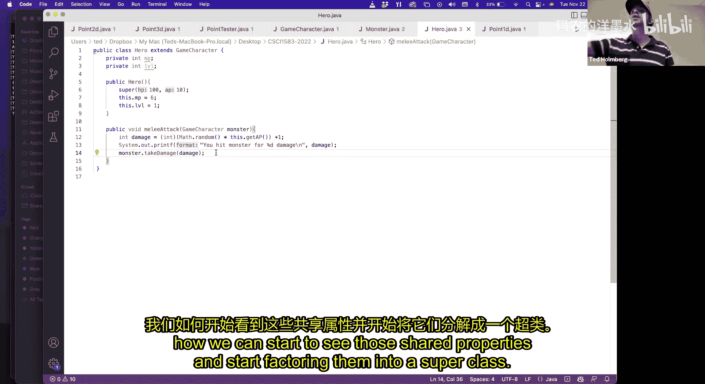
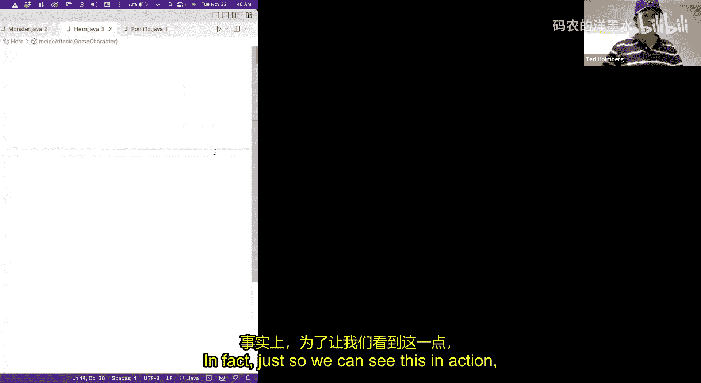
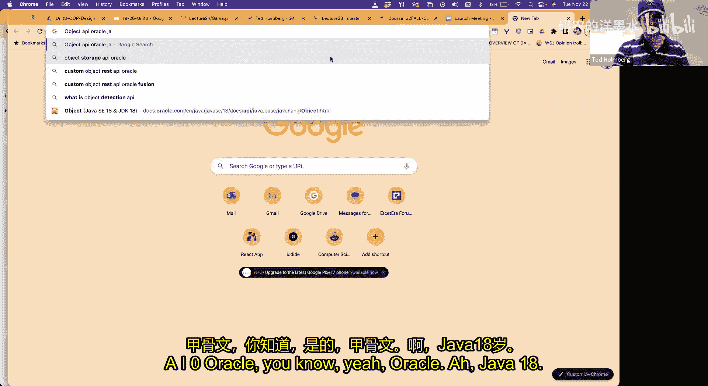
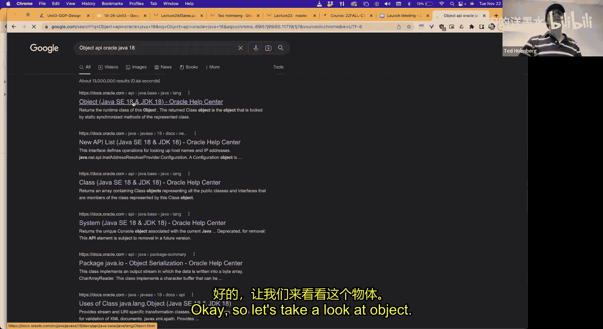
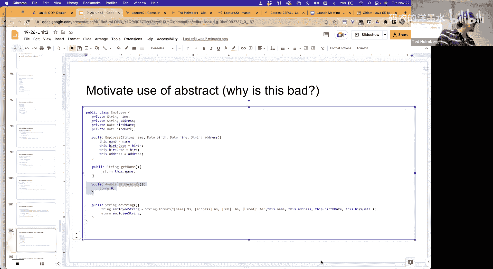

# 软件设计与开发：27：继承与多态


在本节课中，我们将要学习面向对象编程中两个核心概念：继承与多态。我们将探讨如何通过继承来复用代码、建立类之间的“是一个”关系，以及如何利用多态来编写更灵活、可扩展的程序。

## 继承与“是一个”关系

上一节我们介绍了组合，它是一种通过“有一个”关系来构建复杂对象的方法。本节中，我们来看看另一种构建新类的方法：继承。

继承与组合不同，它建立的是类之间的“是一个”关系。这意味着，如果一个类继承自另一个类，那么子类的实例也可以被看作是父类的一个实例。

在Java中，我们使用 `extends` 关键字来实现继承。当一个类继承另一个类时，它会自动获得父类的所有非私有字段和方法。

以下是继承的一个基本示例，我们从一个一维点类开始构建：

```java
public class Point1D {
    private double x;

    public Point1D(double x) {
        this.x = x;
    }

    public double getX() { return x; }
    public void setX(double x) { this.x = x; }

    public double distance(Point1D other) {
        return Math.sqrt(Math.pow(this.x - other.getX(), 2));
    }

    public String toString() {
        return "(" + x + ")";
    }
}
```

## 扩展类：从一维点到多维点

现在，假设我们需要一个二维点。我们可以从头开始编写，但注意到二维点“是一个”一维点，只是多了一个Y坐标。使用继承，我们可以复用 `Point1D` 的代码。

```java
public class Point2D extends Point1D {
    private double y;

    public Point2D(double x, double y) {
        super(x); // 调用父类构造函数
        this.y = y;
    }

    public double getY() { return y; }
    public void setY(double y) { this.y = y; }

    // 重写 toString 方法
    @Override
    public String toString() {
        return "(" + getX() + ", " + y + ")";
    }

    // 重载 distance 方法以处理二维点
    public double distance(Point2D other) {
        return Math.sqrt(Math.pow(getX() - other.getX(), 2) + Math.pow(this.y - other.getY(), 2));
    }
}
```

**关键点**：
*   `super(x)`：`super` 关键字用于调用父类的构造函数。由于 `Point1D` 没有无参构造函数，我们必须在 `Point2D` 构造函数的第一行调用 `super` 并传入 `x` 值。
*   `@Override`：注解表明我们正在重写父类的方法。重写要求方法名和参数列表完全相同。
*   重载 vs. 重写：`distance(Point2D other)` 是重载，因为它与父类的 `distance(Point1D other)` 参数类型不同。重写是替换，重载是添加。

我们可以继续此模式来创建三维点：

```java
public class Point3D extends Point2D {
    private double z;

    public Point3D(double x, double y, double z) {
        super(x, y); // 调用 Point2D 的构造函数
        this.z = z;
    }

    public double getZ() { return z; }
    public void setZ(double z) { this.z = z; }

    @Override
    public String toString() {
        return "(" + getX() + ", " + getY() + ", " + z + ")";
    }

    // 重载 distance 方法以处理三维点
    public double distance(Point3D other) {
        return Math.sqrt(Math.pow(getX() - other.getX(), 2) + Math.pow(getY() - other.getY(), 2) + Math.pow(this.z - other.getZ(), 2));
    }
}
```

通过继承，我们极大地减少了代码重复。对父类的任何修改都会自动传播到所有子类。

## 访问控制：private, protected 与 super

在继承中，访问控制至关重要。
*   **private**：子类无法直接访问父类的私有字段。它们必须通过父类提供的公共getter和setter方法。这确保了父类状态的封装和有效性。
*   **protected**：标记为 `protected` 的字段或方法可以被同一个包内的类以及任何子类访问。虽然这提供了便利，但可能破坏封装性，需谨慎使用。
*   **super**：除了调用父类构造函数，`super` 关键字还可以用于调用被重写的父类方法。

```java
public class Parent {
    protected String value = “Parent”;
    public String toString() {
        return value;
    }
}

public class Child extends Parent {
    public Child() {
        value = “Child”; // 可以访问 protected 字段
    }
    @Override
    public String toString() {
        // 使用 super 调用父类的 toString 方法
        return super.toString() + “ (from Child class)”;
    }
}
```

## Java的单继承与Object类

Java只支持**单继承**，即一个类只能直接继承自一个父类。这形成了一个清晰的类层次结构。

在这个层次结构的顶端是 `Object` 类。在Java中，**所有类都直接或间接继承自 `Object` 类**。如果你没有显式使用 `extends`，你的类就隐式继承 `Object`。

这就是为什么你的类自动拥有如 `toString()`, `equals(Object obj)`, `getClass()` 等方法的原因——它们都定义在 `Object` 类中。

以下代码演示了“万物皆对象”：

```java
Object[] objects = new Object[] {
    new Object(),
    new Point1D(5),
    “Hello”, // String 对象
    42,      // 自动装箱为 Integer 对象
    true     // 自动装箱为 Boolean 对象
};
for (Object obj : objects) {
    System.out.println(obj.toString());
}
```

## 多态性

多态（Polymorphism）意为“多种形态”。在面向对象编程中，它指的是父类引用可以指向子类对象，并且通过这个父类引用调用方法时，实际执行的是子类重写后的方法。

这是继承最强大的特性之一。它允许我们编写更通用、更灵活的代码。

考虑之前的点类例子：

```java
Point1D myPoint = new Point3D(1, 2, 3);
System.out.println(myPoint.getX()); // 可以，因为 Point1D 定义了 getX()
// myPoint.getZ(); // 错误！编译时类型是 Point1D，看不到 getZ() 方法
System.out.println(myPoint.toString()); // 输出: (1.0, 2.0, 3.0)
```





虽然 `myPoint` 的编译时类型是 `Point1D`，但它实际指向一个 `Point3D` 对象。当调用 `toString()` 时，Java虚拟机会找到对象实际类型（`Point3D`）的重写方法并执行。这就是**动态方法绑定**或**运行时多态**。

## 一个更实际的例子：游戏角色系统

让我们设计一个简单的游戏角色系统来展示继承和多态在实际中的应用。

首先，我们识别出英雄和怪物共享的属性和行为，创建一个基类：

```java
public class GameCharacter {
    private int hitPoints;
    private int attackPower;

    public GameCharacter(int hp, int ap) {
        this.hitPoints = hp;
        this.attackPower = ap;
    }

    public void takeDamage(int damage) {
        hitPoints -= damage;
    }
    public int getHitPoints() { return hitPoints; }
    public int getAttackPower() { return attackPower; }
    public boolean isAlive() { return hitPoints > 0; }

    public String toString() {
        return getClass().getSimpleName() + “ [HP=“ + hitPoints + “]”;
    }
}
```

然后，我们创建特定的子类：

```java
public class Monster extends GameCharacter {
    private int xpValue;

    public Monster() {
        super(80, 8); // 调用父类构造函数
        this.xpValue = 25;
    }

    public void attack(GameCharacter target) {
        System.out.println(“Monster attacks for “ + getAttackPower() + “ damage!”);
        target.takeDamage(getAttackPower());
    }
    // ... getter for xpValue
}

public class Hero extends GameCharacter {
    private int magicPoints;
    private int level;

    public Hero() {
        super(100, 10);
        this.magicPoints = 6;
        this.level = 1;
    }

    public void meleeAttack(GameCharacter target) {
        // 英雄攻击是随机的
        int damage = (int)(Math.random() * getAttackPower()) + 1;
        System.out.println(“Hero attacks for “ + damage + “ damage!”);
        target.takeDamage(damage);
    }
}
```

利用多态，我们可以编写通用的游戏逻辑：





```java
public class Game {
    public static void main(String[] args) {
        Hero hero = new Hero();
        Monster monster = new Monster();

        while (hero.isAlive() && monster.isAlive()) {
            hero.meleeAttack(monster);
            if (monster.isAlive()) {
                monster.attack(hero);
            }
        }
        System.out.println(“Game Over”);
        System.out.println(hero);
        System.out.println(monster);
    }
}
```

## 引入抽象类

现在，让我们考虑一个员工薪酬系统的设计。我们有不同类型的员工： salaried（月薪）、hourly（时薪）、commission（佣金）。

所有员工共享一些基本信息（姓名、地址等），但计算薪酬的方式 (`getEarnings`) 却完全不同。

一种不完美的做法是在基类 `Employee` 中提供一个空的 `getEarnings` 方法：

```java
public class Employee {
    private String name;
    // ... 其他字段和构造函数
    public double getEarnings() {
        return 0.0; // 默认实现，没有实际意义
    }
}
```

然后子类重写这个方法。这允许我们创建 `Employee` 数组并统一调用 `getEarnings()`：

```java
Employee[] employees = {new SalariedEmployee(…), new HourlyEmployee(…)};
for (Employee e : employees) {
    System.out.println(e.getName() + “ earned: $” + e.getEarnings());
}
```

**问题**：如果程序员忘记在某个新员工子类（如 `CommissionEmployee`）中重写 `getEarnings()` 方法，程序仍会编译运行，但会错误地返回 0.0 薪酬，这是一个难以察觉的bug。

我们需要一种机制来强制子类提供 `getEarnings()` 的实现，同时又不允许直接实例化像 `Employee` 这样不完整的“概念”类。这就是 **抽象类** 和 **抽象方法** 要解决的问题。我们将在下一讲深入探讨。

## 总结

本节课中我们一起学习了面向对象编程的核心支柱之一：继承与多态。
*   **继承** 通过 `extends` 关键字建立“是一个”关系，允许子类复用父类的代码，并添加或修改功能。
*   **方法重写** (`@Override`) 允许子类提供父类方法的新实现。
*   **方法重载** 发生在同一类中，方法名相同但参数列表不同。
*   **super** 关键字用于调用父类的构造函数或方法。
*   Java采用**单继承**，所有类都继承自 `Object` 类。
*   **多态** 允许父类引用指向子类对象，并在运行时调用正确的方法实现，这使代码更加通用和可扩展。
*   我们看到了如何设计类层次结构（如游戏角色、员工系统），并初步了解了为何需要**抽象类**来完善设计。



理解这些概念是构建模块化、可维护和可扩展软件系统的关键。在下一讲，我们将完成继承主题，学习抽象类和接口。