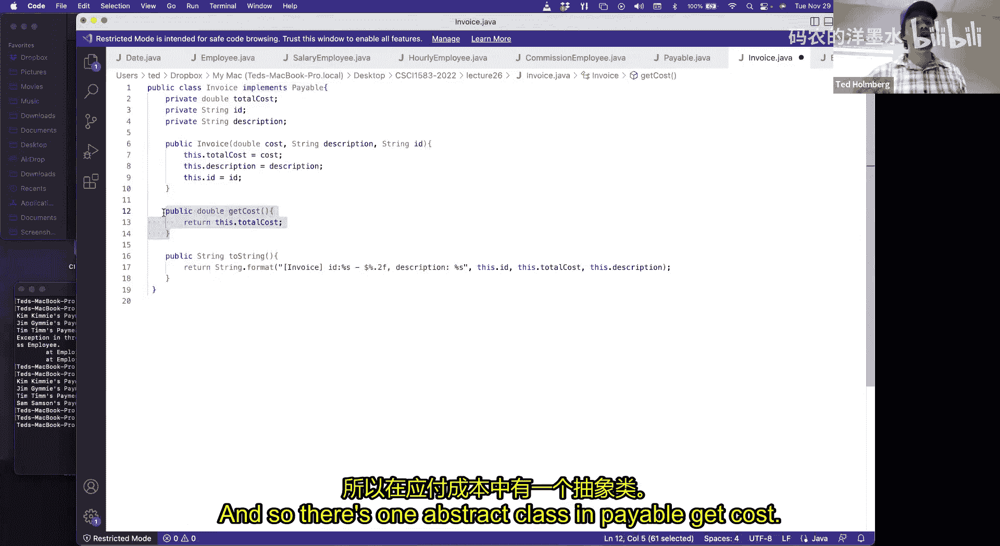
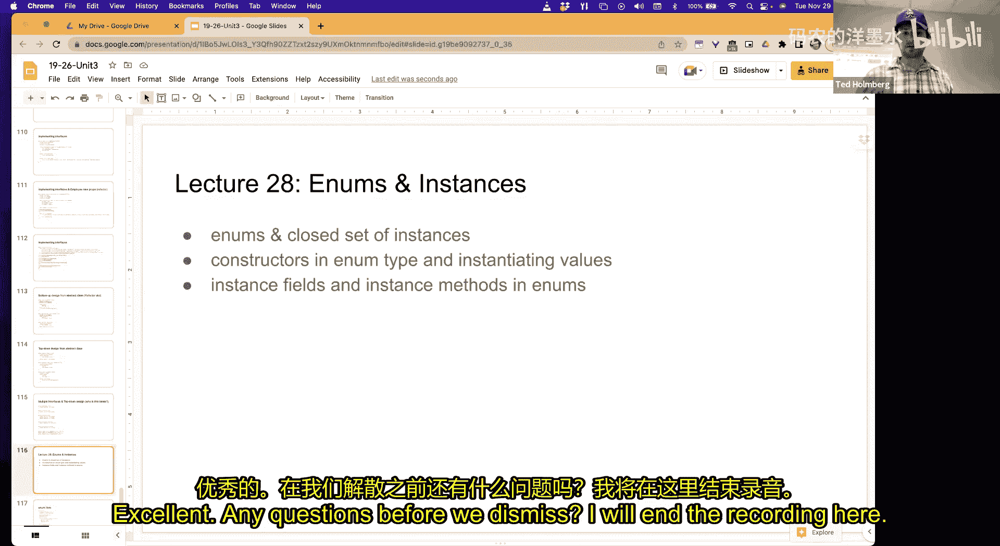

# 【全集】加州理工学院 软件设计与开发 中英字幕 1080P p28 Lecture 28 - 抽象类与接口 -BV1AvzCBdE7a_p28-

Okay， so lecture 26 today， I want to continue our discussion about polymorphism and。😡。

Classes and I really want to distinguish the difference between a couple of key concepts as it relates to inheritance and certainly this has relevance on the last homework which you don't have to audit for the homework seven is just do the instructions and turn it in but hint hint about a third of the finals based off of homework seven so don't just simply ignore it。

嗯。But I really want to go into the concepts of concrete classes versus abstract classes but also talk about interfaces versus abstract so we should have a strong understanding of all the constituent parts that allow us to start building using interfaces and classes by it's using an inheritance by the time we're done this lecture so if you recall last class and I believe this has already been published so everyone has had a chance to review over that lecture we were starting to motivate why we need abstract classes so we're going to start back from that point and we're going to remotivate that concept because that was like four or five days ago right so let's start here abstract classes versus concrete classes I want to motivate the use of abstract I want to introduce the abstract keyword I want to give you a strategy on。

When should something be abstract versus when should it be concrete and hint the strategy is given right there。

 we're going to use abstract classes when we need to group a collection of related classes together。

😡，And we'll take and look at an example of that and so I want to， when we look at abstract class。

 I want you to hold that in your mind so that when we get to interfaces。

 I want you to be able try to identify when might you use an interface and say。😡。

And then finally we will contrast between after classes versus concrete classes and then we will contrast between after classes and interfaces so let's go and actually look at a real world practical example using source code so i'm going to have some source code here don't i'm not going to spend too much time on this particular one because。

It's not relevant to the inheritance hierarchy， but I will just briefly mention it because it'll give us that composition。

So we can use both competition composition and inheritance at the same time in the same class so we can have a class that has a reference to another class remember composition is it has a relationship and we can also have a class that is a type of another class that that is a relationship so we're going to actually build a pretty well definedfined class we're going to build an employee class that uses both composition and inheritance so let's start by using one of the component classes every employee we're going to say is going to have to have a date。

😡，We'll see what that means in just a moment。But let's go ahead and just define this so here not too much time to discuss this。

 just the fact that we have this date class， a date class will have an integer array that is a days per month so we pad out month zero because that doesn't make any sense but inside this initializer list just notice that for each numbered month that's the number of days that's there that'll be used to for our modeling right so when we go to model a date all of the concerns we have is trying to ensure our data model is in a valid or invalid state and typically if we're going to do a date a date's probably gonna be very similar to a time right so remember in time we used integers as the foundational as the fundamental data type to represent an hour to represent a minute to represent a second so we can use this。

Same kind of approach if we were to model a date a day could be thought of as having a year component。

 having a month component and having a day component and each one of those on a calendar can be expressed as a number or it could be expressed as a string so when we go to select our data model here I just opted to do a number but months can be either numerical states or string states right I could say it's January or I could say it's the first month and to you you probably can translate in your mind really rapidly one to the other you've been conditioned for that so in this instance i'm just going to use a similar metaphor as what we do with time so year month day I'm gonna have a constructor that allows me to set a date it's going to take in the day the month and the year I'm gonna have all these setter methods I mean all these getter。

That are going to get back the state of any one of those attributes， get back a year。

 get back a month， get back a day， I'll have a two string that that they'll ask me to express my date as a string。

😡，I'll have a set date method which is going to be very similar principally on what we did with our set time method where it's going to take in the three numerical values one that represents the day one that represents a month one that represents the year and then it's going to call the set method for each one of those individual values and the set method that's where we're going to ensure that the value that's being passed in is valid towards our data model so here we're just going to say that in order to be a valid year it has to be。

😡，1900 right so if if it is before 1900 in our application。

 we're going to consider that not a valid year。😡，If we want to check the month rule check to make sure that the month is between one to 12 if it's not between one to 12 we're going to throw that exception right so if the month so again we look for those exceptional cases if you try to pass in a month that's zero or negative if you try to pass in a month that's 13 or greater then we're going go ahead and throw exception at that client code and the same thing with set day and notice with set day that's where we're going to use that days per month array that we saw at the very beginning we're going to pass in we're going to see in order to see if the day is valid we have to have set the month first we can only ever set the day after we've set the month but we'll use the month numerical value as an index into that array to see how many days that that month has and if it's more than that then we're going to say that month doesn't have that many days and if it's less than or equal to zero。

Then we're going to say that's not a valid number for a day on a calendar。

 so this is just a really quick。😡，Component class that we're going to use to build out an employee in our example。

😡，And it's really similar to our time class， really。😡，Okay， so now let's make an employee。

Okay and so now employee like I said， is going to use composition so right so let's say we're building a payment system for a local cafe where you might pay the manager by salary you might pay some of the workers based off of an hourly pay and maybe they have some who also work on commission based off of advertising or trying to secure like contracts with local businesses to export higher volumes of coffee so let's say there's three different payment schemes that an employee could potentially have so we're going to start modeling at our application so that we can create this payment system so that's going to be the motivation behind this example I always like to tether。

Our academic examples into like a real world type of environment。

 so here we'll create a employee class and some of the properties that every employee might have would be a name right and address。

😡，Both of those could be represented as strings and then the entire reason why we had。

Just added that date class was because likely every employee is going to have to have a birth date and also a higher date。

😡，So that's four properties that we could say are pretty critical to every employee inside of our payment system when I go and create a constructor。

 the role of a constructor is to set up and initialize an instance where it gives values to all of the instance fields all the instance variables。

 so I'm going to have an explicit constructor which means that the parameter list actually requires the code to pass in values。

😡，So here every time we create a new employee， we have to give that employee a name。

 we have to give that employee an address， we have to give that employee a birth date and a higher date and we set those values from the local parameter list。

 those local variables to the instance fields here， remember using that disk keyword。😡。

Then we'll create a giter method to be able to get the name of an employee and we'll create a two stringing method that will go ahead and just print out the state of an employee as a strength。

😡，Excellent， does anyone have any questions up to this point or does this look relatively and I can stretch this out a little bit more does this look relatively simple enough？

😡，Yeah。Okay。So。Let's start building out our inheritance hierarchy where we can start saying a salary employee is a type of employee。

😡，Because if let's see here， so let's go and create。Okay， so here we have salaryempee do Java。

 let's go over here and。Actually， it let's change this view。Icons， perfect。Okaycom。

So inside of salary employee， salary employee is going to extend employee。

 so I'm going to use that extends keyword like what we've seen in the prior lecture。

 so extends goes at the same level it's a top level keyword which means it goes on the same line that your class definition would go and here it allows us to establish a hierarchy if we can say that every salary employee is now also a employee if super class it's parent class is the employee class if super class is direct parent is no longer object if we don't say a class extends some other class and by default it is object so for instance an employee here we don't say it extends any other class so by default employee extends object and so through an indirect inheritance hierarchy our salary employee extends employee which itself extends object so a。

😡，A salary employee is also an object as well。Hence， when we said everything in Java is an object。

 which is why we always get that two string method， it's why we always get an equals method。😡，Okay。

 so in our constructor for a salary employee。😡，We're going to have to request all the data that its para class needs。

 which is an employee because remember， a salary employee is a type of employee。

 which means that if we said every employee needs to have a name。

 every employee needs to have a address and a higher date and a birth date。

 then surely when we create a salary employee， we need that data。😡。

So we're going to have that defined inside of our constructor。

 but in addition to the base data that every employee requires。

 we're also going to have this last parameter here that's going to be the salary and we're going to think of that as an annual salary and so the first thing I'm going to do inside of my constructor for salary employee is I'm going to construct the inner instance of its superclass。

 so if you could think of it as like one of those Russian nesting dolls right the inner class。

 the parent class goes inside and you build all the instance variables related to the employee class and then outside of that will then go all of the instance fields for this subclass。

😡，So here we're going to use the super keyword to invoke the constructor since that constructor requires these values to get passed in name address birth and higher。

 and then we're going to go ahead and set the one new instance variable that defines a salary employee that distinguishes a salary employee from every other employee that's going to be the salary instance field so we're going to set that in our constructor then I'm going to create some new methods that only make sense for a salary employee like for instance now we can say an employee can get earnings it didn't make sense to define get earnings inside of an employee yet because we didn't know how they got paid。

😡，They didn't have any any like income stream yet， but now a salary allows us to define a yet earnings and if our earnings is an annual salary and if this is designed to create a paycheck and you get paid every like twice a month then maybe what we can say is take this salary divide by 12 because that don't give you a monthly income and if you get paid twice a month。

 divide that by two。😡，So that's what we're going to define as being able to get the earnings for any given pay period on a salaried employee and then what we'll do is we'll also in order to be able to check the state of our salary employee。

😡，We're going to， is this overriding or is this overloading the two string method？😡。

So overloading is when you have multiple methods with the same name。

 but different parameter list overriding is when we have two methods of the same name with the same parameter list。

 but they're in the inheritance hierarchy so if I。😡。

Create a two string method that has the name two string and it doesn't take in any parameters in the subclass it's going to override the two stringing method that's in my employee class。

 which itself is going to override the two stringing method that's inside the object class。

 so this is going to be an example of method overriding。😡，And I guarantee you。

 there's probably a question related to overriding versus overloading in the final very important concept。

😡，Okay， let's see here， okay， so is there any questions related to the salary employed？好的。

Well thank you for rather than sick on all background friend。So the question was。

 why do I use return？We's our minds。啊开叫什么。关。我们在关之前面。So that's a great question。

 so the question is why am I constantly returning data as opposed to simply printing it to the console？

And it's because the console printing is not how applications typically deliver data console printing is typically for you the developer to validate and verify what's happening inside your software but if you print to the console you're not really doing anything meaningful with the data right you're just displaying it for that one small moment of time typically in our applications。

 the way our applications work especially in an objectoriented approach is that our instances talk with other instances and they talk with each other through this metaphor of message passing message passing happens when one instance invokes another instance methods right so the methods are the smallest unit of code that we've learned how to develop and these codes are called upon from from instances we construct inside of the application and as the lifecycl。

😡，our application kind of steps through multiple instances are communicating with other instances。

 objects are talking with other objects， and so when we return data。

 what we're doing is that method is giving an actual piece of data like inmemory values inside Java to some other place in our code。

😡，And so that's what really allows for message for objects to crosscomate and share data within our application so again typically we only do the console printing when we're inspecting to see if our logics correct but when our application is actually running we don't ever actually want to just print to the console because that's not how you interfaced with your end user when was the last time you've actually ran an application where it's all console driven I would wager to say most like 99% maybe 99。

9% of the application out there our event driven and window base right like every application that you use on your cell phone for instance is one that uses icons and widgets and Windows right where you can tap on something something happens in response that's not using any console walls right that's not using any system done out that prints that's using data that's getting passed around。

😡，Underneath the scenems so here we want to start migrating away from our very early days when we were kind of experimenting and using system。

 dot print to display what was happening inside of our methods to display what was happening inside of our code and we want to start thinking of that as being an invisible thing that's happening underneath the scenes and we want to start using return values when we need to send data from one place to another because again when we print it out we're not really sending it anywhere we're just displaying it。

😡，So here when when I call get earnings inside of a salary employee。

 I want to be able to request from that instance of salary employee。

 what are your earnings so that my other application。

 the one that's actually going to print the paychecks， can get that value and then put it on a check。

😡，Or for instance because we're not actually going to do the check printing inside the instance right the instance just manages the data that defines its instance fields anything more than that and it's outside of its responsibility that's a big thing I don't know if i've mentioned that enough。

😡，That guides our object oriented design principles。

 but you only put so much implementation in each object for what that object's role in the software is so again。

 if we're going to build a paycheck printer and we have salary employee it should not be the responsibility of salary employee to actually print paychecks just to manage the data for a salary employee does that much make sense。

😡，So by having this return statement allows us to manage this data inside a salary employee。

 but then give it to the appropriate object that will then use the earnings to print the pay Act。😡。

Excellent question and same thing with return with the two string here we claim we're going to return back a string so I have to do a return statement that gives me back a string value I can't just the only way I don't have a return is if it's void so that's another big thing to recall anytime you declare that a method gives back a value it has to have a return。

😡，Statement as the very last line of code in that method， in fact。

 once you have created a return statement， you can't put any lines of code after that。😡。

Because if you do， it'll never execute because the return actually gives control back to whatever invoked it。

Excellent， any other questions？Excellent， so is everyone happy with salary employees does everyone see now because of this extend keyword how salary employee is now a type of employee so everything that's inside of employee salary employee also has。

 but it also has a salary。😡，So now let's move on then。

To motivate this concept because we still haven't gone into the abstract yet， the abstract class。

 but we're going to get it there。Let's move on to the other type of employee， the hourly employee。😡。

Okay。Let's go over here， find where our employees will open up inside of our。

Syntax highlighter or text editor here。Okay。So hourly employee isn't going to be too different conceptually。

😡，With how we implement it salary employee is going to。

Have the considerations what makes an hourly employee different than just the super class employee right so every hourly employee is going to be a type of employee we're going to use that extends hierarchy this is the subclass this is the super class。

😡，Every hourly employee。Is going to have an hourly rate which we can represent as a double value and it's going to have an hours worked that we can represent as a double value if I was really stringent and if I was a good software engineer and not simply a developer when I go to set hourly rate and our worked。

 I should probably guarantee that those are positive right that those are nonneg values you shouldn't be able to work negative hours you shouldn't be able to have a negative amount to pay but I'm not I don't have that in these slides so just know this isn't what a software engineer would have developed this is the difference between a software engineer and a software developer so here sometimes there are bad coding practices in these slides I want to highlight this is one of those times you should look at the slides and see if they're consistently applying engineering principles and when you find they don't and that means you've learned something。

😡，Then you've seen even these slides sometimes aren't following all the rules that you should if you're building truly good software。

😡，Okay， so with that said here we're just going to blindly set the hour hourly rate and the hour work with whatever the value is because this we're not we're not going to update that code we want to focus in on what this lecture is going to be about concrete classes versus abstract classes here we're also going to have a get earnings so notice our get earnings is going to be defined to behaviorally different than in salary。

😡，Employee so they both have a method called get earnings now subclass are sibling classes they don't have any real direct relation between each other they share a parent which is the employee。

 but other than that they are distinct and individual classes in of themselves。😡。

Just like if I were to compare this with mammals， right， like cats and dogs are both mammals。😡。

They're sibling subclasses in the mammal categorization right there's not necessarily a shared behavior。

 I mean a shared relation between them except that they're both qualified as mammals so。😡，Well。

 my question would be given the next job， which would be commission。

You could have commission of both salary and hourly and their sibling classes。

 so would be an extend or would you also wouldn just add another。差多的。

Double add something within get earnings that would connect the class commission so since so that's a good question and so this all is one of the things that there is no truly right or wrong answer to in terms of design。

In terms of design work so typically what I would say in this instance when we're modeling an employee and then you have multiple subcategories that an employee can actually concretely be so when we say you are an employee I have an implication there that the employee has to either be a salary it has to be hourly or it has to be commission based and so what I what you should do。

😡，Is you should model all the concrete classes as sub classes to the super class so if commission employee conceptually is one of the sub members。

😡，Alongside hourly and alongside commission alongside hourly and salary then you should you should implement it even if the behavior is going to be very similar to the hourly employee and it is right so for hourly employee we have two instance fields that are numerical right hourly rate and hours worked and the get earnings just multiplies those to what you're going to notice is commission employee is going to have two numerical fields right it's going to be your commission rate and the number of sales you have and your get earnings is going to be to take the two numbers and multiply them together you take your commission rate you multiply by your total sales so logically the way we implement both these classes is the same technically I could just pass in commission rates and total sales into an hourly employee and that would produce the correct answer。

😡，But it breaks the modeling and let's say somewhere down the line we actually have to have a distinguishable difference between methods that are defined and the commission employee and methods that are defined inside an hourly employee all of a sudden we lose that flexibility so when we start planning out our software from the get go regardless of how it gets implemented we want to keep our modeling decisions as clear and as expressive as possible does that kind of answer your question no you can't extend you can。

😡，Now a sibling class can be extended into a subclass in and of itself。

 but then you would be a member of that sibling class so like let's say for instance I had an hourly employee that can also potentially have commission so I can have a commission based hourly employee so there's an hourly amount but you know if you sell like merchandise you get commission on top of that then what I could do in that instance is I can have an hourly employee then I can create a commission hourly employee and a commission hourly employee would be predominantly an hour employee so I can extend hourly employee and then I can add in the new instance fields that define the commission rate and the total sales。

😡，And then a commission hourly employee is also a type of hourly employee。

 but with the that additional benefit of being able to add commission so I could do that。

 but it's not creating any kind of connection between siblings you're just taking the model of a commission and bolting that on top of the hourly employee so you're creating a tree that goes down where it's where it has be that's right right exactly a sibling can be apparent itself to its children classes。

😡，But it cannot be there's no direct relationship from hourly to commission。

 there's no direct relationship between hourly and salary。😡，Okay， let's go to。Okay。

 so now let's go to commission and like I said before when I was motivated you didn't see it we were talking about now you get to see it here's commission employee that extends employee so these are all subtypes of employee。

A commission employee has a rate， a commission rate and a total number of sales。

 so notice these are two numerical values。We have to define a constructor so a commission employee needs all the same data and employee needs。

 but in addition to that it also needs a rate and sales and we're going to go ahead and set that and again if I was truly implementing sound software engineering principles I would validate that this。

😡，Is not negative right that this is that it has to be a positive value but we're going to skip that step to keep the code slight so we can start focusing on other parts and then i'll have a twotoring method that we can expect the state of our commission employee now notice and this is on purpose this is going to motivate something that's going to happen in the future that we haven't gotten into but I want you to recognize this now what did we not put in commission employee。

😡，That went into salary employee and that went into hourly employee this will see how much y'all have been paying attention to the implementation on the other two classes do I have all the methods a missing one right？

😡，Which one？Yeah， get earnings。Get earnings so and probably。That's not on purpose。

 probably that's a mistake because we probably want to get the earnings for a commission employee。

 but I want to motivate what happens why we use certain things in the language that will alert this to us。

😡，So no right now， we don't have a get earnings and that's purposely done to be an accident later on so that we can get more information。

😡，But I'm highlighting them， putting， I'm bringing everyone into that secret right now。

 so you know where the bug is in my logic。😡，Where there's omission that shouldn't be omitted there。

Okay， so with that said。Let's go into our employee tester。😡。

And so here I'm going to create an employee tester and then we're going to sub through this code。对。

Okay， so I have an employee tester here it is。Ws。哦病啦。Oh no， that's not quite right。

I should spell employee correctly。听。Now， let's open up the correct one。Perfect。Okay。Okay。

 so inside of employee tester， this is going to be an application class it's going to contain the main method that will allow us to construct instances of the various subtypes of employees。

 the concrete types of employees， hourly salary and commission。

 and then start making the logic that will print out the paychecks。😡。

So let's see what's going to happen so i'm going to have employee tester I have the main method。

 so the first thing I'm going to do is I'm going to create a salary employee that will refer to and our code is Kim。

😡，And then we're going to invoke the constructors so that we can actually create an instance of chem here。

😡，We need to pass in all of the different values into the constructor so Kim has to have a name Kim Kimmy Kim has to have an address one。

 two three Main street Kim has to have a birth date。Which remember is day month year， so August 18。

 1955 Kim needs to have a。Higher date， so September 9th， 1999， and since Kim is a salary employee。

 Kim will have an annual salary of 50，000。Okay， so that's going to represent our manager effectively and then it looks like we have two hourly employees so we're going to create a variable called gym that is an hourly employee and then we're going to call the constructor on gym。

😡，Orally employee， so Jim needs have a name Jim Jimmy。Jim needs to have an address three， four。

 five second street。Jim needs to have a birth date， which is going to be September 24th， 2000。

Jim needs to have a higher date， which is going to be December 12， 2012。

And Jim is an hourly employee， so Jim has an hourly rate of $15 and Jim has worked 20。

Or it has a 20 hour schedule。And then we will save this instance of Jim there。

 then we're going to have a second hourly employee inside of our fictitious cafe called Tim。

Here we're going to do the same thing we did with Jim but with all of Tim's information here we have Tim Tim the name Tim's address10103d Street。

 Tim was born July 7th， 1988。Tim's higher date was January 14th， 2016。

 and Tim's hourly rate is $25 an hour， but only works five hours a week。And then finally。

 we're going to have a commission employee， Sam。Where we will invoke the commission employee constructor who Sam needs a name Sam Samampson。

Sam needs an address 9994th Street。Sam needs a birth date of here it's going to be January 1st， 1998。

 Sam needs a higher date， December 24th， 2020， Christmas Eve。

 interesting day to hire somebody start and Sam's commission rate is going to be 25% that'll be represented as 0。

25 and Sam's sales will be 5，000。Excellent， so let's talk about polymorphism。

One awesome thing about the inheritance hierarchy， so when we use that extends keyword so that so that salary employee hourly employee and commission employee or all parts of employee what I can do here is create an employee array。

😡，And then I can put all of my employees and the motivating concept is inside my payment system here。

 I need to process a paycheck for all of my employees regardless of whether they're hourly salary or commission based so instead of having three different four loops one just for commission employees one just for hourly employees one just for salary employees that would violate my drive principle。

 what makes us what makes it better is using the super class as opposed to the subclass so I can group all of my subclass into the parent class classification of employee and now I can hold them together so here I'm going to create an initializer list and in my initializer list I'm going put Tim which is a salary employee Jim which is an hourly employee Tim which is an hourly employee and Sam which is a commission employee and they're all going be inside this employee array and what's great about that is I can。

😡，Use is enhanced for loop and so an enhanced for loop recall on the right hand side is the name of our array on the left hand side is a local variable that iterates through each element in the array and just stores as a local variable of that data type so if this is an employee array I can access each of the employees at the employee level now we've stated this before but I'm going to reiterate because it's really important when it comes to inheritance when we。

😡，When we say when we access something， when we store something at。😡，The employee level。

 at the super class level， the only methods we have available to us are going to be the ones that are defined inside the employee class。

😡，Right so so here when I iterate through each employee。

 if I want to go ahead and print out a check and let's say let's say I have let's say i'm going to do this based off of subclasses so i'm going to show you the bad way first and then we're going to motivate so one way we could do this is I could create a method and I can overload it。

😡，So here notice on line 21， I have a print employee paycheck on 25。

 I also have a print employee paycheck， both these methods are the same with their name。

 but their parameters are different， they take two different classes， one takes an hourly employee。

 the other takes a salary employee。😡，Now inside of my hourly employee i'm going to call worker。

 get earnings on my salary employee here i'm going to do worker。

 get earnings why am I doing it this way instead of just calling employee well we'll look at that at just a moment。

 but here here。😡，Notice i'm going to have two different methods I'll kind of give you the cheater answer here it's because I want to call get earnings get earnings is defined inside of an hourly employee get earnings is defined inside of a salary employee。

 get earnings is not defined inside of an employee so I can't call it from the employee level。😡。

So if I want to be able to get the earnings for the subclass and I have put it into a container that treats it as its superclass as the employee class。

 then what I need to do is cast it down。So look at what I'm doing here so I'm going to walk through for each employee。

 let's say worker inside of employees， I will see if that worker is an instance of hourly employee and if it is then I can safely cast it into an hourly employee that's what's happening in line 10 I'm creating a local variable of data type hourly employee that I'll call hourly and I'm going to assign it a casting operation where I'm going to take something from the scope of his parent class right if a worker is an employee but since I use this keyword instance of instance of allows me to get a bullying response true or false worker is also an hourly employee so it allows me to see if something at the employee level is a particular subclass so think of it as like a Venn diagram right？

😡，So our employee。Salary employee commission employee or all types of employee they can all be grouped together but sometimes then I need to make decisions related to what that subcateterorization is I can actually use instance of and take something at the employee's scope because employee could be hourly it could be commission or it could be salary right so if I want it just to be hourly I could say is the worker an hourly employee instance of and if it is also in instance of hourly employee I can safely cast it and now that I have an hourly employee I actually have access to that get earnings about it because that's where that's aing debt so does everyone see what's happening there。

😡，And so I could do this also for salary employees。😡，Right like because they're all sibling classes。

 so there's no way for me to batch this together like I did with employee。

So does everyone see this works， I can run it， but do you see how clunky this is this isn't a good solution。

 but I'm just illustrating we can do it this way， but it violates dry doesn't it？😡。

It's clear was actually tested。嗯。Oh， let's compile it。Now let's test it。嗯。嗯。Okay。

 so this actually works we printed out Tim Kennedy's payment。

 we printed out Jim and Tim Tim's payment right so。

Kim's payment got processed here Tim and Jim's here and notice we didn't print out sas because we didn't add implementation for SA so that illustrates this is working the way we expect right the ones we're checking for we send to this helper method。

😡，For hourly employee and salary employee and in fact。

 if I tried to do this for sa that would fail because Sam doesn't have to get earnings inside a commission employee。

Okay， so does anyone have any questions about this so far？😡。

Does this make sense at least we're about to see a much better way。

So what we would like to do is instead of doing all this nonsense。

What would be better is if we could do something like this if we can be polymorphic from the super class。

 just like we can group everything， just like we can group everything by employee wouldn't be great if we can also go ahead and make this an employee as well。

😡，So instead， and then we can just have the one right and if any employee I should be able to go ahead and print a paycheck for right all employees get paid right？

😡，But the problem is how do they get paid at the employee level so let's see what happens when I I just actually let's。

😡，So let's say let's just say quick update to this code all this is the same we still have Kim。

 we sell Jim， we sell Tim， we sell Sam we're going to do our polymorphic behavior where we're going to group all of our subclasses into a parent class into a categorization of data type employee we're still going to do that for loop。

 but wouldn't this make our code much nicer where we can instead of having the subclasses of hourly employee and salary employee where even though that worked。

 wouldn't be nicer just to have an employee because now look at what our logic looks like iss much simpler right but if I try to do this is this going to work will this compile。

😡，And like don't spend too much time just give me your first impression should this work it should work right it should but it's not and we're going to find out why but ideally there's no reason why they shouldn't。

Like what what we want to do is that but when I go to compile this， what's going to happen is。😡。

I get this error and what's this error， it says it cannot find symbol。

 it cannot find get earnings inside of worker。😡，Because what is worker？

Worker is an employee and I look at my method list okay。

 where is get earnings inside of employee I have a constructor I have a get name I have a two string that's the issue right the issue。

 the reason why we had to implement it that really clunky way where we had everything in an employee array but then we had to cast it down into a subtype so that we can access that get earnings。

😡，So what's a hack， let's start with a hack， what's a hack for us to be able to go ahead and get this implementation to work。

嗯。Let's see how strong you can think in terms of， okay， I'll tell you， would this work。

 I'm going to show you something complete hack， I'm going to show you why we don't do this as well。😡。

Could I do what what do we get back on get earnings double so we' we're going to create a get earnings because that's what it wants right and we know that you should never have just an employee right that every employee is really just the super class for all these other types of employee hourly employee commission employee and salary employee。

😡，But if we just define the method here and let's say give it a duming implementation。

 like just maybe it returns zero。😡，Then it's defined and then we can over。

Write it inside of each of its subclasses， so it never actually uses theing implementation that might work right？

😡，Why is this bad？Okay， hang on first， let's see if this works， let's see if it， lets me compile。

 it does。Now let's test and we'll see。Why this is bad but before I test before I illustrate Z'm going to have a guess why this is not the way we want to go with this。

 what i'm showing you is not the solution it'll work。😡，But what makes it a bad solution？

Well the subclass will override so inside of employee employees the super class and the reason why we can't call get earnings is because there's no method called get earnings inside of an employee。

😡，So what we wanted to do， so what motivated the other solution， which was this really clunky one。

 I had to check to see if each thing was an instance of a subclass and then I had to cast it and then that unlocked get earnings for me but what I want to do is have this much cleaner logic and I'm like well I can get that much cleaner logic all I need is for employee to have get earnings method inside of its scope because then at the employee's scope I can call that method。

😡，The reason why this doesn't work currently if I look at the code or I cleared it oh here。

 if I look at my old error message is that an employee doesn't have a get earnings method。

 so if I put a get earnings method and just give it a dummy implementation like you know return zero。

 that's just that's a non-meanful implementation， what we have is the expectation that salary employee which extends employee will override get earnings with its own behavior。

😡，And that hourly employee will override get earnings with its own behavior and when we call that even if we're treating them as an employee level。

 the overred method is the one that gets called so even if I have an employee variable。

 but it's filled with a salary employee， it's filled with a commission employee。

 it will use the logic from the commission employee it'll use the logic from the hourly employee as opposed to my。

😡，Dummy logic right， but why is this dangerous and remember I gave you a hint as to what we omitted in one of our prior classes。

😡，What what was commission employee missing well， let's see。

 let's see what happens when we were run this。And I think you'll remember， so here this works almost。

We have Kim Kimmy's payment as $2083 Jim Jimmy's payment as 300， Tim Timmy's as $125。

 but poor Samson here is getting paid zero why Samsson getting paid zero that's right we forgot to actually put get earnings in there and so we inherited the dummy methods that was never supposed to actually execute so now because we forgot to implement it inside of our subclass poor Sam isn't going get a paycheck。

And Sam's going to be mad at who's going to matter at all of you？

Because you implemented those payment system and you forgot to give them an earnings。嗯。Okay。

 so there's a better approach this is going to motivate。This is going to motivate。This concept。

Of abstract methods， so an abstract method is one that we know we need to have in a class in order for polymorphism to work。

😡，But we don't know how it should be defined yet。 And so we don't want to give it a body because we want to guarantee that every subclass。

😡，Imples it so what I can do to fix this is i'm like oh no you don't get a body at all I know that every employee has to have a get earnings。

 but I want that to be an abstract method。😡，Which means I can declare it。

I can declare it inside this class but I don't have to define it and so now because it's declared as abstract。

 I can call on it。😡，But the disadvantage is now that I have an abstract method。

 this isn't a concrete class anymore because to be a concrete class all of your methods have to be well defined they have to be implemented so as soon as I have at least one abstract method I have to go up here to my class and also make it abstract。

😡，And the consequence。Of making a class abstract is that I can't ever directly call its constructor and create an instance of it。

😡，I can only instantiate it from one of its children classes that do come behind it and implement that missing method。

Like get earnings in this case so I can never actually create a direct instance of employee I can only ever make an hourly employee a salary employee or commission employee but that's what we wanted to begin with right because employee kind of messing some critical information and look we do this in the real world let me go back to that example with mammals I'm going to ask you to think of a mammal。

😡，And the only thing you can actually think of are concrete examples because a mammal doesn't exist right it's an abstraction it's an abstract clustering of concrete things that are actually。

😡，Objects that are actually animals that are actually well what we call mammals like it be cats and dogs and monkeys and humans and squirrels and rats and nutrient。

 right all of those might be examples of a mammal， but we only ever used the subclass。

 the concrete class。😡，When。😡，When talking about these things right mammal is a kind of abstraction for something else。

 so the same way we think and organize thoughts in abstract ways in English is the same way we do it in code。

😡，We can never create an instance of employee now because it's abstract and the reason that it's abstract is。

😡，It's missing something so in the case of mammals。

 we might say mammals are defined by a set of shared characteristics but the reason why mammal can't be an actual animal is we might say that all mammals are have the ability to move I'm like well。

 how does a mammal move and like well it depends on what it is。😡。

If it's a dog it's going to like run， but if it's a bat it can fly right you can actually have flying mammals so you actually have to go rely on the concrete class to define what it means to move as a mammal so just like we have to rely on the concrete class the subclass hourly employee salary employer commission employee to determine how are they going to get their earnings。

😡，So is this making sense？So every abstract has to be an object。Right。

 so every abstract class now relies on some class to come behind it to extend it。😡。

And then implement that abstract。对对对。Sot wash， yeah， so if I go。So at this point。

 let's try to compile employee Tester。The try to run employee tester。嗯。

And here we're going to say I was able to successfully go ahead and print out Kim's paycheck I was able to successfully print out Jim's paycheck and Tim's paycheck and this is the behavior we want right we said we accidentally forgot to give the commission employee that get earnings so this is that safety net that a software engineer not a software developer will rely on to alert if we forgot to implement one of those key missing methods that we're defined in a parent class and when we started to。

😡，Quested out in the subclass we it's easy to miss those kind of things。

 So it's good to have these net in there that that alerts you when you're trying to compile and run your code that hey。

 we couldn't actually get a earnings for Sam。 And so it's going to let me know hey。

 there's an abstract method。 we're missing an implementation of。

Get earnings inside of commission employee。So what's happening here is。😡。

When we inherit from an abstract class， we either are forced to define all of the abstract methods。😡。

With actual implementation so it can become a concrete class so we can build instances of it。

 or we have to label that class itself as abstract。😡。

Because it inherited a method that doesn't have a behavior。😡。

Which I so my two possible solutions is to say， oh。

 this is supposed to be abstract because we don't know how to do that yet。

 but more precisely what we actually want to do is we actually like， oh。

 we forgot to implement this method。😡，Get earnings。

And so our get earnings in this case is going to take the rate and multiply it by the sales。Oh。

 I got to have a return statement in there as well。And it's so exciting。It can still extend employee。

 but then it has a consequence that we can't directly instantiate it we can't create instances of it。

 we can't call it constructor， so if we made it abstract we would then have to create some other class that extends it that eventually does implement that method。

😡，So the idea is you can only have an instance， the motivating principle here is that you can only have a method。

 I mean， you can only have an instance of something where all of the methods have definitions so that if some code comes behind you and says execute this method。

 you know what to do in response to that if it's abstract。😡，I mean。

 of course the JVMs going to crash， you haven't told it what to do。It can't assign an implementation。

😡，Okay， so now if I come behind it， that's going to catch the mistake。

 it's not going to print a zero paycheck for Sam now it printed an error so I could fix the code。

 which is what we wanted and now that it's fixed， Sam now has a paycheck。😡，Okay。

 so that is abstract classes。😡，So abstract methods are declared in a class。

 but left undefined if at least one method in the class is abstract。

 that means the class must be abstract two abstract classes cannot be directly instantiated because they are incomplete or they are not well defined。

 all the methods， local and inherited must be defined。

 which are another way of saying defined or is non-abs。😡。

To be a concrete class a subclass must extend an abstract class in order to construct an instance of it so again we talked about this linguistically with abstractions animals is an abstraction and inside of animals we have other abstractions like mammals and reptiles and things like that and then inside of there we can start actually creating concrete examples that fit into that Venn diagram。

😡，And abstract allows us to put a method in a classco without having to implement it。

 thus it allows us to get that polymorphic behavior we're looking for。😡。

Excellent and so this is just the implementations Okay so the next really big critical thing we have to talk about in this lecture is interfaces so interfaces are similar yet very different than what the abstract keyword allows。

😡，So the one big thing， and I think I've mentioned this before。

 but I have to stress it is in Java inheritance is single inheritance， there's only every one parent。

You can never inherit from more than one class so like when I had hourly employee and with the example where we had like we wanted to do a commission hourly employee I couldn't inher from both commission and hourly I would have to choose one and then add the new implementation in so'ss that's by design that we enforce single inheritance now that's going to be different with interfaces we can actually implement as many interfaces as we want so interfaces is also a way of creating an abstraction of having abstract methods so whenever I say abstraction that means I can have abstract methods so abstract classes are one way to have abstract methods interfaces are another way to have abstract methods interfaces。

😡，Is goes gets defined in the same way we would define a class so instead of using the class keyword we would use the interface keyword so there's three topleve keywords we've seen like that we've seen enum we've seen class and and we're about to see interface so the big thing about an interface that distinguishes it from a class is that an interface only can have abstract methods it can't have any instance fields and it can't have any concrete methods so we saw in our abstract class like employee it could have welldefined methods right it could have methods that have bodies that have implementation and it could have feels like instance fields like a name and address and a higher date and a birth interfaces can't have any of that and interface can only have abstract methods the idea behind it interface is it allows a collection of unrelated classes to be grouped together。

😡，Because anything that implements an interface can be considered a member of that interface we're going to see we're going to extend our payroll example so that you can understand so suppose that you produce this payroll software that we just made and it was a great success everyone was getting paychecks and they're like this is an awesome way for being able to manage everyone's payments but we want you to extend it so we can just use that as our Po system to be able to process things like receipts as well to be able to process like being able to pay for services and goods inside of the store so instead of just being able to pay the employees we might need to pay for contractor to come in and install some shelving we might have to be able to pay for our crates of milk to come in。

😡，And we want to expand our software to do that is that something that's reasonable so these are all costly endeavors to the cafe and they want you to extend your application so that it can also support these other costly endeavors that aren't just the employee labor。

😡，So everyone understands the new specification requirement。

 so let's see how we can use interfaces to still keep that polymorphic behavior we're looking for。😡。

So again I already talked about single inheritance versus multiple inheritance classes may have concrete and abstract methods and whenever I say concrete method it means it has an implementation versus interfaces which are only abstract methods okay let's create an interface like I said an interface looks just like a class who replace the word class with interface so let's create an interface and usually it's very common with interfaces to end with something like able or  or something like that but it's not necessary you can think of it as like a property that something can have like i'm flyable and walkable。

😡，Un climbmable。Okay， so let's go and create payable here。家。

And so here what I'm the goal of building the interface is in my payment system。

 I want to group everything as a payable thing， so whether this was to pay for a contract whether it's to pay for milk or to pay for my employees。

 they're all conceptually payable things but besides being payable besides being able to get the cost for this thing that has to be paid there's no other shared relationship does that make sense。

 so like for instance， we don't want to think of there's not in terms of the cafe。

 a crate of milk and the employees are only related in the fact that they both have to be paid with money right there's no other shared methods。

 there's no other shared data characteristics between the two。😡。

That is a clue to me when I should use it interface when I want to group something as completely unrelated as employees and milk crates and say I have to process them in a similar way let me create an interface that represents that these both share a quality of being payable and then in order to be a payable thing we have to define what does that mean so we create an abstract method that we don't know how to define yet that's going to be well anything that's payable should be able to get its cost so we're going to create a method inside of the interface phase payable where we know it's going to return back some money value a double value。

😡，And anything that comes behind us and implements this interface will then be forced if it wants to be concrete。

 if it wants to be instantiateated， where it actually has that method definition。😡，Okay。

 so now this is an abstraction in and of itself。😡，So now let's start using this abstraction。😡。

So let's go and create an invoice so and here we could see for interfacepas。

 we use the keyword implements。😡，Invoice。Let spell that correctly。Okay。

 so let's say what we're doing with invoice， we're going to create an invoice that's going to represent the ability to buy that milk that crate of milks。

 so let's say every invoice is going to have the following properties which is completely different as we said from an employee let's say every invoice has a cost。

 let's say every invoice has some kind of ID number。

 let's say every invoice that the cafe has to pay for also has a description that helps identify what this invoice is。

😡，So completely different fields than what an employee has we'll create a constructor that goes ahead and constructs an instance of an invoice we're going to create a two stringing method that allows us to go ahead and display the state of an invoice but remember the goal is we want to group invoices and we want to group employees into like the same container to process at the same time so that we can list the sum of all payable things so we can compute the full cost of our paycheck or whatever the outgo going cost of our cafe is so in order to do this we're going to implement that interface。

😡，And so the moment I implement this interface， that means I'm also an invoice is also a member of payable。

 which means that it inherits all of the abstract methods inside of payable。

 which means that if I want this to be a concrete class。

 it now has to implement all the abstract methods inside of payable and so there's one abstract class in payable。

 get cost， so I'm just going to return this total cost。😡。

Okay， so then let's do the same thing。Let's update employee now， so for employee， we can implement。😡。

 let me spell that correctly。Okay， implements。And here， this is a。

And it's possible that I can both extend and implement so it's possible I can have something like this。

😡，Let me do extends。Okay， so I can singlely inherit and then I can implement any number of interfaces。

 multiple interfaces are supported using commas and then single inheritance so that's completely fine okay。

😡，So here though since i'm implementing payable I either can define it here in my abstract class or i'm forced to implement it all my subclasses well i'm going to do a cheaty method here I know that the cause for any employee is its earnings and I know that the earnings is abstract already here but it has to be implemented by all the subclasses so i'm going to do this public。

😡，Double。Get cost， I'm actually going to make this concrete by invoking the get earnings method。

 which itself is abstract。😡，跨啊。What does it not like there， it cost？And yeah， this oh。

 I have to return。There we go Now we're returning。Our value there。Okay。

 let's actually test this out so that we can actually see an interface in action so let's update let's create a payment system now so we're not going to do an employee tester we're going to do。

Payment system。Okay， so in our payment system this is we want something that was similar to employee tester so we're going to create Kim we're going to create gym we're going to create ti we're going to create Sam just like we did before。

 but now we're also going to create。😡，An invoice for that milk crate where it's going to be $250。

34 it's going to be called a crate of milk and as a description and the ID number is going to be a1。

23 and so here because we now have that interface we can group things that are based off of being payable so I can create a data type called payable based off the interface name that which can be in array I can now group all these payable things。

😡，And let's say the purpose of this application is to create a final sum of everything that's been paid for。

 so let's start our sum at zero for each payable thing inside of our collection of costly things。

 let's call it method get cost the one method that's inside of payable。😡。

And add that to our sum and then we're also going to just print it out and what what are we going to print out notice we can have we could pass in as a parameter inside of our method。

 a payable thing here we' just print it to the display。

 which is going to invoke the two string method。😡，And then when we're all done。

 we're going to print out the total cost of not wages of。Tal cost of。Payables。

So let's go to our payment system。Let's compile that， let's clear the terminal let's actually run it。

嗯。嗯。And here， just like with employee tester， we successfully are able to actually derive a complete sum of all payable things。

 so we're able to group it all together， start at zero and actually get a full report for the monthly output of our cafe and we're able to do that because we use interfaces so one of the big questions I know you'll have in the final is being able to identify when you should be able to use an interface versus an abstract class。

😡，So hopefully this gives a good example now I might take the time i'm going to say now this is the last lecture i'm going finish these slides out so when this gets posted online you all have access to this video for the final so I just have a couple more slides for any reason you need to go feel free to go since we're a little bit past time but I think it's super critical that these last couple of slides are also part of this presentation。

😡，Okay， the last thing I want to highlight。Is a concept that's going to clue in how we can design our objects。

😡，Oriented models so what we've been doing up to this point is what we would consider a bottom up design。

😡，So and what I mean by that is we've probably been starting at concrete classes like， oh。

And certainly when you're building your own software you're probably thinking about this like for instance。

 let's say we wanted to build a dog for an application like let's say we're building a video game your video game is like a simulator like a pet simulator and you have dogs so but you might also have cats and you might also have like iguanas and hamsters and all in fish and all these other things so you might start at the level you're right now by saying oh I'm gonna to create a dog class and then you're like a dog has a number of legs a dog has like hair dog is alive and you might start thinking of all the properties that a dog has and then when you go to your cat and then when you go to define your hamster you're like oh oh these all have hair and there's a lot of repeated practices and so when you start seeing those you're like oh let me let me refactor my code pull these properties out of my dog out of my cat out of my hamster and then put this into a mammal class let me refactor so all that data is inside of mammal and then why。

😡，You're doing this and you're building a bird and you're building a fish you're like oh。

 all these things have is alive let me refactor this out of mammal and then put this into animal so that as you so start making more classes you can keep the all the data in one particular place so you're not duplicating your data so this is probably would you agree this is probably the way that you've probably been design your code you start with concrete classes and then you start developing your abstractions a big complexity of that is you're changing your code base a lot youre refactoring and you can't rely on these classes long term with other developers because you're constantly mutating them in order to build out your code basease so that is poor engineering practices so the way we've motivated the idea starting with concrete classes and then like evolving the concept of abstracted interfaces for you has actually taught you to design in a backwards way in a way that's not true to the way that。

Do it in industry so to design with a top down approach we' got to start it with animal and say okay。

 we're going to build this pet Sim it's going to have all sorts of animals。

 let me think deeply about what every animal has。😡，And then once I once I thought deeply about that。

 then I go down to the next level where I start really abstract and I move towards concrete I don't start at concrete and move towards abstract so you want to practice doing a top down design approach where you we start with an abstract class like animal mammal mammal and then finally。

😡，This should be dog， but whatever。Oh yeah yeah dog and then finally dog the concrete class this is the way that homework seven works however that's not the full story either the way that actual coding works is a top down design but you do it with interfaces multiple interfaces the disadvantage of this approach where let's say you have an animal and a animal then has a mammal and then a mammal has has a dog and let's say that all animal move so we have an abstract method inside of move and let's say for instance we get into the strengths the strange classification where an animal can move in multiple ways like let's say we were creating a penguin this approach doesn't support penguins。

😡，Because penguins can walk and they can swim。Right there's two ways of moving。

 so what you can think of interfaces as is as like a list of methods like an API that each method can support。

😡，So the way that you want to start building your objects out when you get to 2120 and moving forward。

 if you start following this approach， you'll be so much better in the long run。

 start identifying everything as properties like if I'm thinking about building an animal well that animal might have wings if it has wings I'm going to create an interface where I'm an abstract method called fly or I might have an animal that has bins right and so I'm going to create an interface that's fs and has an abstract method called swim and I might have an interface called bipedal which might be able to walk or hop or jump or might have quadpedal which allows me to gallop。

😡，Or I might have multipededal， which allows me to crawl like a spider or a centipede。

So notice what this allows me to do is not even start thinking of things in terms of classes but just collections of methods and then when it comes time and then I'm starting in this really abstract space then when it comes time for me to start building my application look at the flexibility I have even more flexibility than the other example I showed you here when I go to define a chicken a chicken can implement wings and legs a chicken where well this would be bipedal so let's change this to legs just so it matches so here now that means in order to be a chicken I have to implement fly and I have to implement walk hop and jump。

😡，And so this provides the best mechanism because now a chicken is something that is a member with wings and it's also a member with legs and anything that I grouped together it could be grouped into both those different groups so this is the way that you should start thinking about code if you're really going to。

😡，Be performant。And excel in an object oriented design。

 you can only really start thinking and breaking it down。😡。

Once we've covered all these concepts also notice what we're creating here are miniature APIs like the APIs we were seeing with classes that's effectively designed by interface and this is a big big solid principle in terms of software engineering anyway that is the end of our lecture for the last lecture so we have covered all the concepts that you should need to be able to be successful in the final i'll go ahead and have that published sometime soon。

😡，Excellent， any questions before we dismiss， I will end the recording here。

嗯。