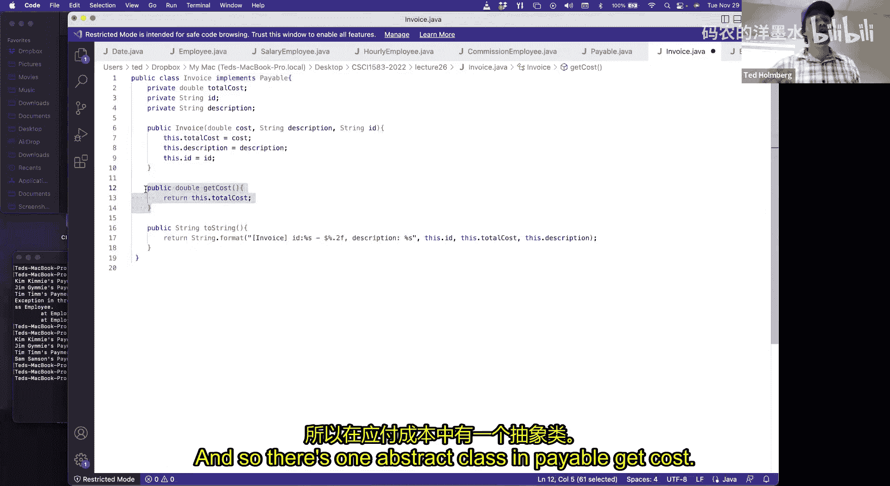
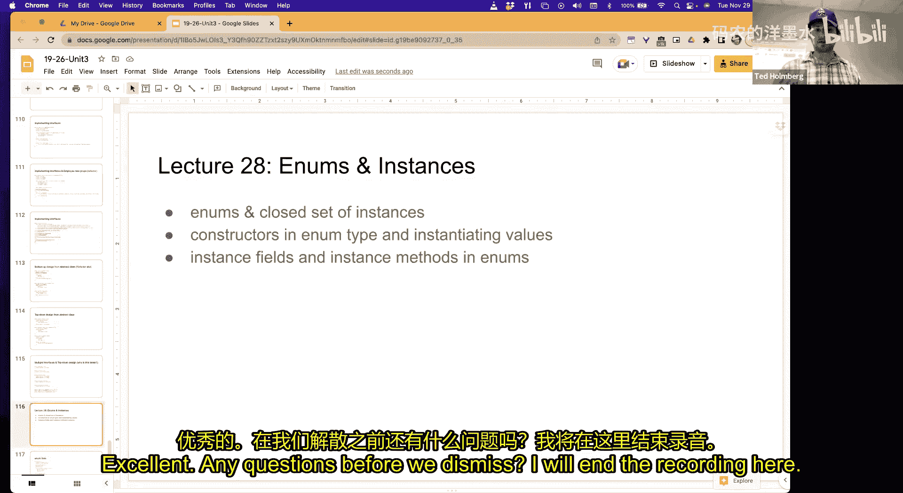

# 软件设计与开发：第28讲：抽象类与接口 🧩


在本节课中，我们将继续讨论多态性，并深入探讨几个与继承相关的关键概念的区别。我们将学习具体类与抽象类，以及接口与抽象类的不同。通过本讲，你将能够理解如何使用继承来构建基于接口和类的系统。

---

## 抽象类 vs. 具体类

上一讲我们开始探讨了为什么需要抽象类。本节中，我们将重新回顾并深入理解这个概念。

抽象类用于将一组相关的类组织在一起。我们使用 `abstract` 关键字来定义抽象类。策略是：**当我们需要将一组相关的类分组，但又无法或不希望为某些方法提供具体实现时，就使用抽象类**。

让我们通过一个实际的源代码示例来理解。

### 示例：构建员工支付系统

假设我们正在为一家咖啡馆构建一个支付系统。经理按薪水支付，一些工人按小时支付，还有一些根据佣金支付。我们将创建一个 `Employee` 类，它同时使用了组合（有一个日期）和继承（是员工的基类）。

首先，我们定义一个 `Date` 组件类，用于表示员工的出生日期和雇佣日期。这个类类似于我们之前学过的 `Time` 类。

```java
public class Date {
    private int year;
    private int month;
    private int day;
    private static final int[] daysPerMonth = {0, 31, 28, 31, 30, 31, 30, 31, 31, 30, 31, 30, 31};

    public Date(int day, int month, int year) {
        setDate(day, month, year);
    }

    public void setDate(int day, int month, int year) {
        setYear(year);
        setMonth(month);
        setDay(day);
    }

    private void setYear(int year) {
        if (year < 1900) {
            throw new IllegalArgumentException("年份必须 >= 1900");
        }
        this.year = year;
    }

    private void setMonth(int month) {
        if (month <= 0 || month > 12) {
            throw new IllegalArgumentException("月份必须在 1-12 之间");
        }
        this.month = month;
    }

    private void setDay(int day) {
        if (day <= 0 || day > daysPerMonth[month]) {
            throw new IllegalArgumentException("日期无效");
        }
        this.day = day;
    }

    // Getter 方法...
    public String toString() {
        return String.format("%02d/%02d/%04d", day, month, year);
    }
}
```

接下来，我们创建基类 `Employee`。每个员工都有姓名、地址、出生日期和雇佣日期。

```java
public class Employee {
    private String name;
    private String address;
    private Date birthDate;
    private Date hireDate;

    public Employee(String name, String address, Date birthDate, Date hireDate) {
        this.name = name;
        this.address = address;
        this.birthDate = birthDate;
        this.hireDate = hireDate;
    }

    public String getName() {
        return name;
    }

    public String toString() {
        return String.format("姓名: %s, 地址: %s, 出生日期: %s, 雇佣日期: %s",
                             name, address, birthDate, hireDate);
    }
}
```

---

## 继承层次结构：具体子类

现在，让我们构建继承层次结构。我们说 `SalaryEmployee` 是一种 `Employee`。

```java
public class SalaryEmployee extends Employee {
    private double annualSalary;

    public SalaryEmployee(String name, String address, Date birthDate,
                          Date hireDate, double annualSalary) {
        super(name, address, birthDate, hireDate); // 调用父类构造函数
        this.annualSalary = annualSalary;
    }

    public double getEarnings() {
        // 假设每月发两次薪水
        return annualSalary / 12 / 2;
    }

    @Override
    public String toString() {
        return super.toString() + String.format(", 年薪: $%.2f", annualSalary);
    }
}
```

类似地，我们可以创建 `HourlyEmployee` 和 `CommissionEmployee` 类。它们都扩展自 `Employee`，并添加了自己特有的字段和方法（如 `getEarnings`）。

---

## 多态性的挑战与动机

在测试类中，我们希望将所有员工放入一个数组中，并统一处理他们的薪水。理想情况下，我们希望这样写：

```java
Employee[] employees = {kim, jim, tim, sam}; // 不同类型的员工
for (Employee worker : employees) {
    System.out.println(worker.getName() + " 的薪水: $" + worker.getEarnings()); // 错误！
}
```

但这会编译错误，因为 `Employee` 类中没有 `getEarnings` 方法。我们只能在子类中访问它。

一个笨拙的解决方法是使用 `instanceof` 检查和向下转型：

```java
for (Employee worker : employees) {
    if (worker instanceof HourlyEmployee) {
        HourlyEmployee hourly = (HourlyEmployee) worker;
        System.out.println(hourly.getName() + " 的薪水: $" + hourly.getEarnings());
    } else if (worker instanceof SalaryEmployee) {
        // ... 类似处理
    }
}
```

这种方法可行，但违反了 DRY（不要重复自己）原则，并且代码臃肿。我们想要更简洁的多态行为。

---

## 引入抽象类和方法

更好的解决方案是让 `Employee` 类拥有 `getEarnings` 方法，但**不提供具体实现**。这就是抽象方法的用武之地。

**抽象方法**声明在类中，但留空不定义。它强制所有非抽象的子类必须提供具体实现。

如果类中至少有一个抽象方法，那么该类本身必须声明为 `abstract`。

```java
public abstract class Employee {
    // ... 其他字段和构造函数 ...

    // 抽象方法声明
    public abstract double getEarnings();
}
```

现在，`Employee` 变成了一个抽象类。**抽象类不能被直接实例化**。你只能创建其具体子类（如 `SalaryEmployee`）的实例。

子类必须实现（覆盖）所有继承的抽象方法，否则它们自己也必须声明为 `abstract`。

```java
public class SalaryEmployee extends Employee {
    // ... 其他代码 ...

    @Override
    public double getEarnings() {
        return annualSalary / 12 / 2; // 必须提供实现
    }
}
```

这种设计的好处是：
1.  **编译时安全**：如果忘记在某个子类（如 `CommissionEmployee`）中实现 `getEarnings`，编译器会报错，防止出现“零薪水”的运行时错误。
2.  **简洁的多态**：现在我们可以优雅地遍历员工数组并调用 `getEarnings`。

```java
Employee[] employees = {kim, jim, tim, sam}; // 所有子类实例
for (Employee worker : employees) {
    // 多态调用：实际执行的是子类中的 getEarnings
    System.out.println(worker.getName() + " 的薪水: $" + worker.getEarnings());
}
```

---

## 接口

抽象类解决了相关类之间的多态问题。但有时我们需要将**完全不相关**的类分组，让它们表现出某种共同行为。这时就需要**接口**。

**接口**类似于一个完全抽象的类。它只能包含抽象方法（和静态常量），不能有实例字段或具体方法。一个类可以实现多个接口，但只能继承一个类（单继承）。

### 示例：扩展支付系统

假设咖啡馆的支付系统现在还需要处理发票（如牛奶箱的采购），而不仅仅是员工工资。员工和发票除了“需要支付”外，没有其他共同点。

我们创建一个 `Payable` 接口来代表“可支付”这个属性。

```java
public interface Payable {
    double getCost(); // 抽象方法，获取成本
}
```

现在，让 `Invoice` 类实现这个接口：

```java
public class Invoice implements Payable {
    private double totalCost;
    private String idNumber;
    private String description;

    public Invoice(double cost, String id, String desc) {
        this.totalCost = cost;
        this.idNumber = id;
        this.description = desc;
    }

    @Override
    public double getCost() {
        return totalCost; // 实现接口方法
    }

    // ... toString 方法 ...
}
```

同时，我们也可以让 `Employee` 类实现 `Payable` 接口。对于员工来说，成本就是其收入。

```java
public abstract class Employee implements Payable {
    // ... 其他代码 ...

    @Override
    public double getCost() {
        return getEarnings(); // 调用自身的抽象方法
    }
}
```

现在，我们可以将员工和发票统一视为 `Payable` 对象进行处理：

```java
Payable[] payables = {kim, jim, tim, sam, milkInvoice}; // 员工和发票
double totalCost = 0.0;
for (Payable payable : payables) {
    System.out.println(payable); // 调用各自的 toString
    totalCost += payable.getCost(); // 多态调用 getCost
}
System.out.println("总支付成本: $" + totalCost);
```

---

## 抽象类 vs. 接口：如何选择？

以下是核心区别和选择策略：

*   **抽象类**：
    *   用于建立 **“是一个（is-a）”** 关系，表示紧密相关的类族。
    *   可以包含具体方法、抽象方法、实例字段和构造函数。
    *   子类使用 `extends` 关键字继承。
    *   **Java 是单继承**，一个类只能有一个父类。

*   **接口**：
    *   用于定义 **“具有某种能力（can-do）”** 或契约，可以将完全不相关的类分组。
    *   只能包含抽象方法（和 `static final` 常量）。
    *   类使用 `implements` 关键字实现接口。
    *   一个类可以实现**多个接口**。

**策略**：
*   如果需要为相关类提供公共基类，并可能包含一些共享的实现代码，使用**抽象类**。
*   如果需要为可能不相关的类定义共同的行为契约，或者需要实现多重“类型”，使用**接口**。




---

## 设计思维：自顶向下 vs. 自底向上

在软件开发中，良好的设计通常采用**自顶向下**的方式：

1.  **自顶向下设计**：从最高层的抽象（接口或抽象类）开始思考。先定义系统需要哪些行为和契约（API），然后再创建具体的实现类。这种方式更灵活，更符合面向接口编程的原则。
    *   *例如*：设计宠物模拟器时，先思考 `Animal` 的抽象行为（`Movable`， `Eatable`），再通过接口组合（`Bird implements Movable, Flyable`）来构建具体的 `Penguin` 类。

2.  **自底向上设计**：从具体的类开始编写，发现重复代码后再提取公共部分形成父类或接口。这种方式在初期快速，但后期重构成本高，设计可能不够清晰。

鼓励大家在设计时，优先考虑自顶向下的方式，多使用接口来定义行为，这将使你的代码更灵活、更健壮、更易于维护。

---

## 总结 🎯

本节课中我们一起学习了：

1.  **具体类与抽象类**：抽象类用于定义相关类的模板，可以包含抽象方法，不能直接实例化。
2.  **抽象方法**：声明但不实现的方法，强制子类提供具体行为，是实现多态的关键。
3.  **接口**：定义行为契约的完全抽象类型，允许类实现多个接口，用于将不相关的类分组。
4.  **多态性的实现**：通过抽象类或接口作为引用类型，可以编写处理多种具体类型的通用代码。
5.  **设计原则**：理解了何时使用抽象类（is-a关系，共享代码）与接口（can-do关系，定义契约），并介绍了自顶向下的设计思维。



掌握这些概念对于构建灵活、可扩展的面向对象系统至关重要。