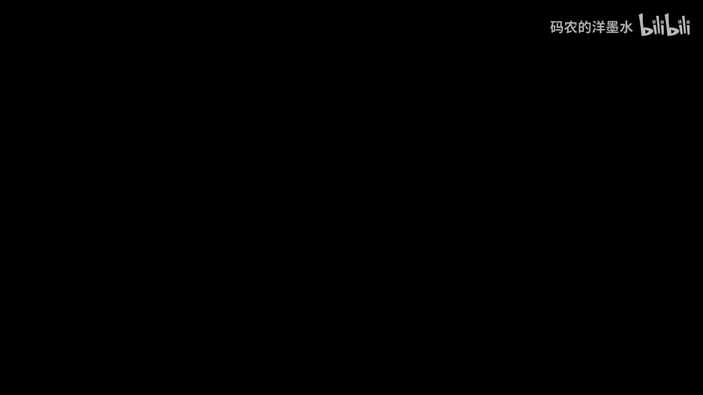
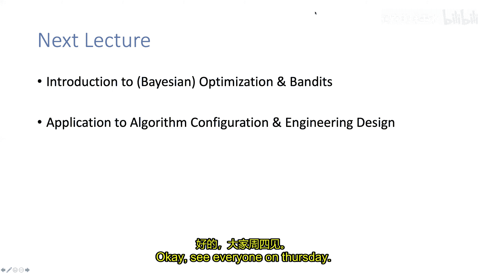

# 【全集 附课件】加州理工学院 数据驱动的算法设计 中英字幕1080P p01 Lecture 1 - 数据驱动的算法设计 -BV1CF2LBhEWk_p1-

Okay， so thank you all for coming and welcome to the first lecture of CS 159 special Tops in machine learning。

The topic of this term。Is data driven algorithm design？你不是。Okay。

 so just a few comments while we get started， as everyone is aware we are currently in an unprecedented situation in our society right now due to the current pandemic。

 COVID 9 is a massive poly health crisis hence the current situation。Obviously， everyone at Caltech。

 the faculty and the staff， we hope everyone is staying safe。

 minimizing risk to yourself and to any vulnerable loved ones that you may live with。嗯。

And you know we will be converting the later lectures into more of a discussion session。

 obviously the main purpose is to discuss topics in the course。

 papers and algorithm ideas and whatnot， but if students should choose to want you some of that discussion for broader issues。

 I'm happy to do so。The earlier lectures， the first four or five will be really focused to get people up to speed so that they can move towards a project proposal for their final project which is the bulk of this class。

 so that's how this course will be structured。So the lecture protocol something just a few things to for everyone to keep in mind。

 zoom has the option to send private messages to other。Attendees or of the conference call。

 for example， you can send a message from one thing to another saying this professor is so boring。

Keep in mind that when I'm recording a lecture on Zoom。

And all private messages are actually in that recording。

And so all the students in the class who are going to be watching this outside of the normal live lecture will see those recorded。

 so please do not send private messages to each other via the Zoom chat。

Because this is a web conferencing app， it is quite challenging with multiple people are talking at the same time。

 so by default everyone is muted upon entering the conference call。

There is a raise hand feature that I am sure most of you are familiar with。

 but just in case you're not， if you click on the participants panel at the bottom the screen of the app。

That creates a participants pane and at the bottom of the participants pane is a raise hand button if you do that I will see you raise a hand and at the appropriate time I can call you to ask a question you may either ask it by unmuting yourself if you want to have your voice recorded or you can ask by sending me a chat message。

And I'll have points in the course where I will be asking students if they have any questions。Okay。

 so some class details， I'm the instructor， my name is Zong Yu for those of you who don't know me。

 I study machine learning。I've been studying machine learning for about。

 I guess 16 years now or 15 years。We have three TAs in the class， one primary TA two secondary TAs。

 the primary Ts Jain， the two secondary TAs are How and Joe we have a course website and a piazza hopefully you're registered on Piazza most of the or all the course announcements will be happening through Piazza from NA if you have trouble finding these websites the course website is linked off my homepage so you just if you just navigate to my homepage it's easy to find the course website and from the course website you can find Piazza。

Okay so the style of this course， I know that some of you who have taken CS159 before and are taken it again。

 for those of you who haven't taken CS159 before， the style of the course is a graduate level course so the intention is to give students a broad overview of cutting edge research topics and the students will dig deep into one topic for a final project a research project if you will。

This class does assume the students are mature， so we won't be doing much handholding。

In terms of the topics。And the goal of the initial part of the course is to give you sort of a broad overview。

And the students then are expected to sort of dive deep into a topic on their own or excuse me in a group。

 but mostly independently， obviously the professors and TAs are there to provide guidance and feedback。

So the grading breakdown， so historically the class has been graded on 20% presentation。

 80% final project in previous years the presentation was a student lecture。

 so most of the lectures were done by students because of the current situation and inconsistencies in internet access and all those things。

 the TAs and I decided this year to switch to a blog post and details of that would come out in the next week or so of how to do that。

😊，And so it'll be like a presentation just a written presentation rather than a oral presentation so that'll replace the presentation portion of the grade the bulk of the grade is in the final project and the final project has a report and a presentation and we'll figure out the right way to do a presentation。

That makes sense if it turns out that a presentation is not possible for logistical reasons。

 we'll find an alternative， perhaps a blog post as well。So as I said before。

 the first few lectures will be an overview of topics and the rain lectures will be a discussion of papers and advanced topics。

 and the later lecture will typically not be structured as lectures。

 perhaps as guided walkthroughs of papers or if students have a topic or paper they want us to discuss in the class。

 we can discuss that in the downstream lectures， they won't be as structured。

St will write blog posts， discussing a topic in depth。

 we will actually provide links to skeleton code and other code that have been released on relevant topics of this course and probably the easiest thing to do is to take that code and play around with it and maybe do a few extensions。

 do a little few experiments and then write a blog post about it as an in- depthepth exploration of a topic。

Other blogs posts will be doing groups。And they will be due on Friday， April 24th。

 which is the end of the official fourth week of class。

 we are currently the beginning of the second week of class officially。So about three weeks from now。

The final project is 80% of the grid。The final project can be on any topic related to the course。

 you should work in groups。He saw did。Yes， there's a question， yes。

I know you just mut it out for a little bit， at least for me。Okay。

 sorry about that let me just repeat what I just said so the final project can be on any project related to the course。

You work in groups the due dates the proposal for the project is May 1st it's not bending binding excuse me it's meant to just simply force you to have a concrete proposal and then the Ts can provide feedback of course the Ts can provide feedback before you submit the proposal as well。

 but we will certainly provide feedback on the proposal。Presentations are between June 3rd and 5th。

 again， if it turns out that logistically this is challenging for students will find an alternative。

 but this is the current plan。And for groups with。A graduate student or a graduating senior whose term ends early in the spring。

 the final report is due June 6th。Um， for groups that contain only non graduating students。

 which are basically freshman software juniors， hopefully just softwares and juniors in this class。

The report is due a week later。So。The focus of this course is to help you do a project in rigorous algorithm model design。

嗯。This is math intensive but nothing too hard and we will walk through the relevant math in the class。

 not this lecture， but in the subsequent lectures。And given an understanding a working understanding of some algorithm or hopefully multiple of at least one algorithm in this class。

 apply it to something interesting that you might find interesting。

So one question that students often have when taking a research course for the first time。

Is what does rigorous mean？Riggorous is about being able to clearly state your assumptions。

Foralize them， state how a model or approach to developing exploits or satisfies those assumptions。

And rigorously reason about the downstream implications of those design choices。

 sometimes with provable guarantees or certains of correctness。

 but that's not strictly speaking required， you simply want to have very sound reasoning that your model is a good one starting from your beginning assumptions which could be just of academic interest or it could be inspired by a motivating application。

What makes you good final a project so sort of three categories the first is pure theory so study proof techniques try to extend prove apply to a new setting。

The second is algorithms and models， extend an existing algorithm or a model or design new one for a new setting。

And the third one is an application so you're really interested in some area perhaps you're a PhD student in let's say biochemistry you want to study algorithm design for a certain biochemical application and so how do we sort of figure out the right way to apply these methods to a new domain so any type of topic。

Any one of these will make a good final project historically most groups tend to do a mix of the second and third bullet points。

 maybe more on the second one， maybe more on the third。

 but historically a mix of the second and third， a few groups have done the first one。

Some advice don't limit yourself to the papers covered in lecture。

 the course website has a huge list of references and the TH will provide starting points or projects that part of the course website is still under construction it will be filled out by next week。

You can use collab， which is a resource provided publicly by Google to run some experiments。

 will have some collab resources available as well。So finding groups。

So most students taking this class well self organizing to groups。Having done the survey last week。

 I know that there are a significant number of students， a minority。

 but a significant number of students who are looking for groups and are looking for assistance in finding group members and we will be brainstorming ways to help people match up into groups that'll happen in the next week or so。

 if you have suggestions please send me an email with any suggestions you might have you know we are in some sense all into this together in terms of going to online classes and this will present some challenges perhaps unexpected。

 and so if you have suggestions to send me an email。

So at this time I'd like to pause for any questions if you have any questions。

 please raise your hand。Okay。Moving on。So the rest of this first lecture will just basically present an overview of data driven algorithm design。

 just a high level overview。An overview of possible applications and basically it's going to help you decide if you want to take this class I know that some students are still shopping around not sure if they want to take the class and so hopefully this first lecture will know give you enough for the flavor of the topics that it'll help you make a decision we may end a little early depending on how fast we go。

😊，So there are many real world applications of data driven algorithm design。

 so I'll start with some of the applications， so for example。

 string processing if you work in biochemistry，You will do a lot of string processing。

Such as alignment， transcriptome assembly， folding， and many many other things of that nature。

 and there are many things and many algorithms in these stream processing applications that are currently designed by hand。

 and you could imagine using machine learning to automatically design parts of them or all of them。

We have。Planning。So in planning。We have things like planning for missions like the Mars Rover。

 planning for 3D printing， how do you plan a 3D printing path because planning for 3D printing is very much more complicated than planning for 2D printing。

planlanning for conservation planning and any other planning problem you can think of they typically are lead to what are called NP complete or NP hard problems if you've taken CS 138 you should know what those are。

嗯。Or 38， excuse me。And so many planning problems are NP hardness so people design heuristics to solve them well for specific domains。

 and we can imagine using learning to automatically design those heuristics。嗯。

engineeringineer experiment design， so if you are designing some new kind of structure or chemical or even treatment of a patient。

 it typically you do this optimization process where you run an experiment。

 you measure the outcome from that you pick a new experiment to run and that's sort of an optimization process like an optimization algorithm and so you can use learning to help accelerate or augment that process。

More more applications including automatic automatic the proving automatic the improving is useful for things like。

😊，Software verification safety verification of flight systems and spacecrafts automatic therapist using it useful for various other branches of mathematics where the proofs are just very complicated but not particularly。

😊，Perhaps not particularly insightful in terms of the low level things。Auctions。

 so many complex auctions also known as combator a are NP hard or NP complete and so people use design heuristics to you know solve them well。

Probabilistic inference， if you know about deep generative models， things like variational autoenrs。

 they're actually running an optimization algorithm at test time every time they see an example。

 they actually run an inference algorithm which is solve an optimization problem and they use learning to solve that。

😊，And so those are just a survey of examples you may have your own we you know。

 if you have questions， but whether or not your're your。your problem is suitable。

 you know you can post a question on Piazza we could have a list of possible or list of possible algorithms。

 applications， and so this is just a sample I'm sure we can collect more。So now the question is。

 okay， those are a bunch of applications where people are designing heuristics and algorithms to solve them by hand。

嗯。Why might we want to do data driven algorithm design？

So here's a few places where you know it's quite natural to think about data driven algorithm design。

 this is not an exhaustive list。So many solves have tunable parameters。So， you know。

 you might have a solver and has like 30 flags and the flags all have tunable parameters。

 like how much to wait this thing， how long to run this sub moduleule。

 all that stuff to try to get this algorithm to run as quickly as possible in a huge problem instance。

Some of these solvers have like over 100 parameters and you can easily imagine that if you could just find the right parameters for this problem。

 the algorithm can run really fast， the solver can run really fast。

 but if you don't know how to tune the parameters properly the solver can run quite slow so we can use learning using a data to try to predict what the parameters are。

😊，Many solvers rely on heuristics， so these heuristics include things like a star search where you need an admissible heuristic。

Um，Tings like gradient descent with various sorts of momentum or the momentum is typically historicallyurically designed。

To try to solve some optimization problems as quickly as possible。They may work off one domain。

 but not for another and you if we just had a data set of representative problem instances of these types of optimization problems。

 perhaps we can learn a heuristic that's better than anything we can tune by hand or at least much faster。

Many solvers rely on key subrouts， so for example， some solvers require a subrout that identifies an important variable to prune next in a search algorithm。

And you can actually design use learning to design these subrouts。And so。

Given that these are places where we can do automated algorithm design from data。

You know how do we use the data to automatically specify these so these are just places where we can use data to specify and so now the question is how do we do that。

And so there's sort of a checklist。That we go through。

When we think about the most appropriate way of using data， so as many of you know。

 if you've taken CS155 and 156， you know you can't just use data in any arbitrary way。

 you have to think you have to be thoughtful that the way you're using the data is actually solving your problem。

And so that's going to be very important here because we're going to be thinking about the ways of using data to solve a very a focused set of problems。

 like how do we train something about the solver so that the solver can use that and actually speed up the solving process。

And so the high level checklist is as follows。Do you have pre collected problem instances are you collecting data on the fly？

So I'll get into more details about these meme in a second。

Do you have pre collectedlected measurements so it's not enough just to have problem instances because if you need to make a measurement of the problem instance。

 for example。I may need to run a solver on a problem and measure how fast that solver is on that problem。

Anding so collecting measurements in this sense is like collecting annotations for supervised learning。

It's not enough just to have the problem instance， we also need the measurements。

Are you learning a stateful or stateless model stateful models are ones that are being run throughout the solver process that take as input the solver's current state。

 so for example， if I'm doing a search algorithm， what's the current search tree of the solver？

A stateless model is one that simply sets some global parameters of the solver and then the solver runs like a black box。

 and I don't actually look at the state of the solver。

So just a few examples of so here's an example that's pre collected and stateful。

 so imagine that we are working with NASA and JPL。😊，This is actually a research project that Jalin。

 my student， Jalin， the headTA has been working on for the last four years。Possibly five years。

Suppose we are working with JPL and we want to design algorithms that can help spacecrafts do faster planning。

 so a canonical example of this is a Mars rover that is trying to get from point A to point B safely。

 so this is an NP hard or NP complete commory optimization problem。

And imagine that we have a distribution of such planning problems， the distribution， for example。

 can be lifted from the historical data the wrote the rovers can be lifted from satellite imagery of Mars。

 so we have this distribution of obstacle courses of Mars and that's precollected that gets compiled into some sort of optimization problem the details of that right block don't matter。

😊，For now， it's just the details of some optimization problem。And。

We apply learning to search algorithm， so we'll go into details of this kind of stuff later on the course。

 but from that we apply a learning to search which learns a research heistic。

And then we apply test instances， so a future instance， a new obstacle course on Mars。

 assuming that the training set that we've collected is representative of this test instance。

 then our learned heuristic should be able to solve the planning problem on this test instance much faster than the existing solver。

 that's the idea。And so the key idea is that we try to solve to solve an observation problem well。

 we assume the training instances are representative。We apply the train solver on test instances。

And in this approach， because we have a lot of pre collectedlected training data。

 we can utilize data hungryung approaches that have high model capacity。

 such as neural nets to really learn how to solve this problem really well。

Here's a different example on the fly stateless， so this example is taken from Francis Arnold's group at Caltech。

 Francis Arnold， if you don't know， her group works on protein engineering。😊，嗯。

And so the basic idea here is that we want to design a new protein typically mutateated from a reference protein that maximizes some function。

And so the reference protein is called a parent， the mutations are called variants， we by we。

 I mean Francis's lab， they actually synthesize the mutants， they screen them for function。

 which such as know binding affinity to a certain receptor。And from that measurement。

You collect this training example， training set， which is the input features are something based on the features and the output measurement is something based on the functional measurement。

And then we train a model and we use that to sort of iteratively guide the next step in this optimization process so this particular optimization process actually uses a wet lab in its cycle。

And it's stateless because we don't deal with anything in the let me just do some quick annotation。

 we don't deal with anything in this process， this process is considered a black box。

And so we just simply put in some parameters in the beginning。

 which are the mutants and we run this black box from the perspective of machine learning algorithm of a black box and then we get an output so this is why this is called Staless。

Okay。So the key ideas here is that the data is collected on the fly。

 so the algorithm now has to choose what data to collect。😊。

So what mutants here to screen for and because the data sets are relatively small in these cases。

 we usually train using relatively simpler models than deep neural nets and in the simplest case。

 you know if we try to do a new protein engineering task。

 we actually restart this procedure from scratch because the models are so simple they tend not to be able to sort of generalize across new problem new or related problem instances and again we'll get deeper into this in future lectures。

嗯。Okay， third example， pre collecteded stateless， so the first one was pre collected stateful。

 the second one was on the fly stateless and the third one is pre collecteded stateless。😊。

And so imagine that we have a training set of TSP traveling salesperson problems or something related to a traveling salesperson problem。

A traveling salesperson problem is something or a variance of it is something that a company like Amazon has to solve or in order to sort of do deliveries。

And in an efficient way or UPS or FedEx。And so this is an MP hard problem and or。

And there's a heuristic solver of hyperparameters that are used to solve this problem。

And then it spits out a solution， right？And imagine that we are just solving a certain distribution of traveling salesperson problems。

 not all possible traveling salesperson problems， maybe ones that， you know。

 let's say a company like Amazon may solve over and over and over again。

So then we can tune the parameters of the solver on that distribution because we have training set data from it so that at test time。

 when you have a new problem from the same distribution， the solver runs much faster。

That's the basic idea。So we tune the hyperparameters of an existing solver on training instances。

 we assume the training instances are representative， we apply the tune solver on test instances。

I'll stop briefly for questions， if you have any questions， please raise your hand。Okay。So。

Problem settings。So here we're going to look， we're going to start thinking about different ways of actually thinking about or breaking down。

 learning to optimize settings。And that are amenable to specific classes of algorithms。

And by algorithms， I mean classical algorithms。So the first one is algorithm configuration。

 which is basically just hyperparameter tuning， so here is just a screenshot of some of the hyperparameter of an algorithm for RNA for transcription toem assembly。

And this is not there's more that I that's cut off from the screenshot and so you can see there are just a bunch of hyperparmeters that we can tune for a specific set of。

Data from a targeted domain。There's continuous optimization。😊，Such as gradientding descent。

 so gradientding descent is the workhorse of continuous optimization and we can think about ways of learning something that looks like gradientding descent but is a learned algorithm。

😊，Treese or which is the canonical example for discrete optimization where there's a heuristic that's trying to figure out how to navigate this tree search tree。

 so this was done， for example， in alpha go by Deepmind when they had to navigate the game tree which is a search tree using learning to navigate that quickly to be able to find winning moves in a reasonable amount of computational time。

And then the final category is predicting substructures or instantiating key subrouts of a solver。

 so this master solver requires a certain subroutine to identify certain structure in the problem and if we can use learning to predict that so structures better than a handcrafted subroutine then the solvers can run faster or better。

So those are the four high level categories that will make up the way that I'm going to think about decomposing topics in this class。

 this is not the only way to decompose topics in this research area， this is just my preferred way。

So let's start with algorithm configuration now we'm going to go into a little bit of detail for each of those four topics。

 we'll go into more detail later on in later lectures。

 but this is just to give you a flavor of the detail technical details for each of these topics。😊。

So algorithmm configuration， also known as hyperparameter tuning in the more generic sense。

 although there are some interesting differences between generic hyperparameter tuning。

So the basic idea is we have an algorithm， I've just called the algorithm A。

 this is a classical algorithm like an integer program solver or a tree algorithm or what have you。😊。

It takes its input a problem instance the algorithm has some parameters and it outputs a solution。

We assume for simplicity here that we are solving we're going to be applying this algorithm。

 the solver to a distribution of problems， could be all the fulfillment problems that company like Amazon might need to deal with。

 it could be some sort of hardware design problem or could be a 3D printing problem。

 for a class of 3D printing instances that will be repeated throughout the lifetime of the 3D printer。

So our goal is to tune the hyperparmeters of this solver。

 which there could be many and if some solvers have as few as like three or four。

 the most sophisticated solvers have hundreds of these parameters。And so。

We're going to tune it to optimize some objective and the objective。

 it looks a lot like the stuff we see in CS155， we take the expectation over the training distribution。

And we optimize some lost their cost function of our algorithm。

So we assume we have training instances sampled IID from P of X。

 which is a standard machine learning assumption。And so the next question is。

 well what is this loss function or reward function could be。

 here we're going to do minimizations so it could be a loss function， what is it？

So here I'm plotting something that's off very common in the design of these solvers。

 which is solution quality versus running time so here lower is better so this where solution quality is measure using a cost。

So for example， the total cost of a circuit in a traveling salesperson problem。

So typically a solver has this profile which is running time versus solution quality so how many seconds or minutes or hours you're running the solver versus how good what's the quality of the best solution you found so far I the I left the units of the axis is unlabeled on purpose because it doesn't matter for the purposes of this example of course in practice depending whether the X axises seconds。

 minutes or hours or days it changes the types of learning algorithms we want to use if it's days we may want to train a neural net because the neuralNe might take a few hours the train but it be worth it if the running time is in seconds't we may or may not want to use a neuralNe。

Because training and running a neural net might just create significant overhead。

But but this is a typical profile that people look at when they evaluate how good a solver is。

So there's a few possibilities for there's a few possibilities for choosing L capital L。

 this loss function or cost function， again， everything here is a phrased in terms of a minimization problem。

 you could also phrase it as a maximization problem so you could phrase that as a reward function。

 but I'm just going to keep it as a minimization problem for now。So here are the possibilities。😊。

L could be the running time until finding the optimal solution if we have a way of checking that we found the optimal solution。

 then L is just the running time， so we want to minimize the running time of the algorithm。

L could be the quality of the best solution after a time limit， let's say 10 seconds。

So what is the best solution you found after this time limit because I have a real time application。

 it's time sensitive， I can't spend more than 10 seconds on solving this because I have to make further decisions downstream。

And and I just want an algorithm that is tuned to give me the best solution possible after 10 seconds。

A third option is area under the area under the curve。

 so if you look at let's see what open on the annotation， if you look at this guy here。

 the red guy you know you can measure the area under this curve。Which is a measure of cost。

 right lower the lower excuse me， the smaller this area is under the curve。

The lower the overall cost， so this is sort of a cost that sort of average over all the running times。

Whereas the green one。The green guy， let's see here。Oops， excuse me， the green guys over here。

 the areas， you know， all this stuff。嗯。だあ。My mouse disappear。 This is one of the。Okay， there we go。

Sorry about that so those are just different choices of loss functions that we can plug in like there's no single correct choice it depends on your application。

 but these are three that are I think pretty prototypical。

And you could try to minimize any of these three and use that as L。

So here's the basic iterative procedure。嗯。We have a measurement set， I would just call it capitalS。

 different papers called it different things。嗯。Initially， the measurement set is empty。We。

The algorithm chooses a training instance， one of the problem instances in my training set。

 so let's say I have 1000 instances of traveling salesperson。Problems。

We choose a set of training instances， capital X is a subset of the training set could be just one problem instance。

 could be the entire training set。嗯。Whi is a parameterization of the algorithm。Of the solver。

We choose a running time limit， TmX。Then we run our solver on this for every problem instance that we've chosen。

We run our solver。On that instance， with that hyperparameter。

Until it terminates or until T Max is reached， and then we just force the termination。嗯。

We take those measurements， including the solution quality。

 which I'm going to call Z just to have a completely disjoint notation so that nothing's confusing here in terms of because sometimes people call it why。

 but I use why is the solution of the algorithm。So I'm going to call it Z here。

And we add that to the measurement set。😊，And they will repeat。

We repeat from step two until some total time budget is exhausted。

 and then we have a procedure for returning the best parameter theta found so far。

So that's the basic iterative procedure for hyperparameter tuning。

So the design choices under this basic procedure are basically these three steps。

 how do we choose the training instances we want to measure。

 how do we choose the parameterizations we want to measure。

 and how do we choose the running time limit？So here's version one。

And I'm going to go take you through just a few basic versions。Version one。

 capitalLX is every training instance we're going to do is we're going to basically whatever theta we want to measure the performance of。

 we want to measure it on every training instance in our training set。

Here we're going to choose theta via random sampling。

 just choose the theta at random from our set of possible thetas。And Tax is infinity。

 so we're just going to wait until the solver finishes。Or if you can't actually do infinity。

 some really really， really big number that's arbitrarily large。So this is one choice。

 it's perhaps the simplest possible choice。And so what are benefits and drawbacks。

 while it's super simple。And because it's super simple， you know。

 it's easy to analyze theoretically and it's also easy to implement complexity implementation is very important in practice。

 so things that are easier to implement are highly preferred。😊，So it's super simple。

 which is a huge benefit in its own right。Of course there are many drawbacks for something this simple I mean this is perhaps too simple and the drawbacks are well you're doing naT trial and error theta。

😊，So it may take you a long time to find a good theta。

You're spending equal time on every training instance， which could be very wasteful。

Because you don't want maybe some instances are harder to learn about or estimate than other instances。

 but you're doing a for loop over every training instance in every round of this iterative procedure。

And a large Tm can be extremely wasteful。😊，You could， for example。

 if you have one problem instance that takes you。Just forever to solve。

 then this procedure can just block on that over and over again。Okay， version two。Aes again。

 capital X is again every training instance in my training set。

We're going to choose theta via an algorithm in a class of algorithms known as Bayesian optimization algorithms。

And again， I'm going to set Tmax to be infinity or some arbitrarily large number。

 so this is just slightly more clever than version one The only difference is in step three where we're selecting theta using Asian optimization rather than completely at random。

So what is Bayesian optimization？😊，It doesn't have to be this type of procedure doesn't have to be Bayesian。

 but it's commonly Bayesian。So here's the idea， we have some objective function that call a capital F。

😊，And our goal is to find a theta that max or minimizes this case， capital F， we could also maximize。

And we see when they could make measurements of capital F z for any theta， we can measure z。

 which is f of theta plus noise under some noise model。And then the idea。Of Bayesian optimization。

 and again we'll go into more details of this in lecture two on Thursday。😊，Is we have some budget。

 capital M。We at every iteration， we choose a theta。

We run f of theta and we take a measurement z of theta， z z sub m， which is of theta。

 and we add that to the measurement set。And that's the basic idea and so this is a simplification of the process that we described in the previous slide the simplification are that while F here is basically the expected value or the of the。

Of the loss function， let's say running time or let's say best solution after 10 seconds。

Or area under the curve。嗯。Over all the training examples。

 so average it's integrated or summed over all the training examples。

And we assume that the budget is atomic， so every time we measure a Z， it uses one unit of budget。

 even though some instances might be easier than others and take less time。

 we assume that it uses a single instance。And that's why we can reduce the previous problem。

 which I'll just。Go back to excuse me， this previous problem says going going we're going to not choose problem instances x very intelligently。

 in fact， we'll just choose every problem instance。

And then we'll set the T max to some arbitrary large number representing infinity。

 and then we'll just simply focus on choosing theta under those two simplifications when we make those two simplifications algorithm configuration exactly becomes a Bayesian optimization problem。

嗯。And it's called Bayesian because we maintain a Bayesian belief over F。

If we knew F what F was exactly， we wouldn't have to measure F。

We could just optimize for it directly， but the problem is that we have to make a measurement of F which is typically expensive。

😊，And if we have a Bayesian belief over what f is and we use that Bayesian belief to help us choose each theta。

Then that becomes a Bayesian optimization problem and we'll go into details of that in lecture too on Thursday。

 but this is just the basic idea we make these simplifications。

 we reduce it to a Bayesian optimization problem or at least a canonical Bayesian optimization problem。

So what are some benefits in drawbacks well Bayesian optimization is it's a reduction to Bayesian optimization。

😊，Basian optimization is well understood， lots of algorithms for under different assumptions。

 theoretical justifications， implementations of Bayesian optimization。

 so you once you make these two simpling assumptions about how you choose CapitalX and how you set TMax。

 then you can just plug in play with existing software and we'll point you to some existing software on the course website。

The drawbacks are well we spend equal time in every training instance because we do a for loop over every training instance every time we take a measurement because we measure the loss function。

On every training instance for every for every time we choose a theta。

 and maybe we don't want to be more selective than that。Because some instances are easier。

 harder to at tune than others。And again， a large Tmax can be wasteful， so those are the drawbacks。

Version three。Again， we're going to。Do every X'es， every training instance。

 we're not going to do anything smarter than that in the first lecture。

We're going to choose datata V of random sampling and we're again going to set team maxax is some arbitrary large number we're not do anything smarter that in this lecture。

And now the question is。嗯。I want to focus a little bit in the version three this's last point。

 which is return。The best data found so far。So in the first two instances。

 returning to the best data found so far is basically by you know， by just statistics。

 we just do some empirical statistics。Possibly Bayian statistics。

 and we have a statistical estimate of what is the best data has found so far。

If theta is a gigantic high dimensional space and you have。

 you think you can learn a feature representation that can sort of know generalize across many thetas。

 which is typically what people do is supervised learning。

Then version three basically reduces this to a supervised learning problem。

 where we train a neural net， it's in the bottom right。

 we train a neural net to the predict the cost function Z。On an x and theta。hoops。

On an exit theta and then what we do is after we train this neuralNe after collecting lots of data。

 so we just basically use U steps two， three， and four and two， three， four， five。

 and six as just a data collection process for supervised learning。And then we basically say， okay。

 what is actually we train this neuralNe， for any given instance， x。

 what is the theta that minimizes the response variable of this neuralNe under input X？

So we're basically learning a proxy of this running of this。

This optimization problem and cost function with supervised learning and then we minimize the supervised learning。

NeSupvised learning neural net for any given X so the benefits is that it's reduction is again super simple it's a reduction to supervised learning which we know how to do you can just plug and play this with ten flow or pie torch。

And additional benefit here， which is not a benefit of the previous examples。

Is that we can now choose theta depending on x， the previous example was just choose the global theta for all x for all problem instances。

 and we just committed to that theta at test time。Now for any test time problem instance x。

 we can now choose the theta depending on x so we can so for different problem instance may benefit from different hypercraameter choices and now we can do that with this approach。

The drawbacks are we to sample a lot of thes and x's， and again， a large teamX can be wasteful。

So those are just three simple versions of instantiating this basic procedure。😊。

And you may already have realized some of the big limitations of these procedures if you've been thinking about problems like this in your research or other projects。

 and you may already think of more clever ways of doing this and again we'll explore more clever ways of mis in the class。

 there's many papers that are much more clever than things I describe。

 but this gives you a taste of the types of algorithms that we'll be studying in this space。

Here' are some of empirical results of an approach called SmAC sequential model based algorithm configuration。

 so here lower is better here this is on a bunch of different optimization problems and you can see that Smack。

😊，Is able to， especially on the CX problem with CX is an integer program solver。

 the CX problem on the right one， it does much better than the other hyperparmeter tuning algorithms。

So this give you a sense of the empirical results。I'll pause briefly if there are any questions。Okay。

 oops。So the next。Problem saying I'm going to go over and the next few I'm going to go over a little bit faster is the next one is going to be continuous optimization of which gradient descent is at a prototypical example。

And so just a prelude。Some of the more advanced topics in this class will require some knowledge。

 working at least a working understanding of policy learning such as reinforcement learning and imation learning。

 and so the one slide， the summary of reinforcement learning imation learning is that it characterizes a stateful sequential of decision making procedure。

So you have the environment of the world， in this case it's the optimization problem。

And we have an agent， which is this solver， like a tree search or a graded descent solver that's trying to navigate the optimization landscape of this optimization problem。

The environment gives a state to the agent， this is the standard reinforcement learning lingo。

The state could be the current intermediate solution of this optimization problem。

The state takes an action， a local update to thecurrent solution。

 and would repeat give you the opposition probably gives you a new state。

The goal is to from this procedure， find an optimal policy。

And imitation reinforces we're learning different so far as the loss function or the objective function is different。

 so one of them has demonstrations such as from a pre existingist solver。

That we're try to simply try to imitate。In reinforcement learning。

 we have direct measurements of the environmental reward。

 which is how well you're actually solving the optimization problem。

And we optimize environmental reward。So this is basically a learning based approach or a paradigm for sequential decision making。

And in this class， we often don't need this full reinforcement imitation learning perspective for learning to optimize。

But sometimes we do， so just to put that out there。

So we could think of optimization as sequential decision making many solvers are sequential tree algorithms are sequential decision making local sequential decision making procedures。

 the greedy algorithm is a local sequential decision making procedure。😊。

Grading descent is a local sequential decision making procedure。

So we can treat these solvers as an agent or a policy where a state is some current or intermediate solution。

 and the goal is to find a state with high reward， such as a low cost or a solution to an injured program。

In other words， rather than handcrafting this local decision making procedure。

 let's try to learn a local decision making procedure。Yeah。I a question？If there's not a question。

 please mute。Let's do that。O。Okay。So let's do continuous optimization first。

 so gradientding descent as an agent or a policy。😊，So we have a current or intermediate solution。

 I'll call it theta， that's the current state， if you will。

 that's a path that's the state of the agent， we have a description of an optimization problem。

 I'll call that X。嗯。And a grade descent is basically a handcrafted policy。And so I wrote that there。

 so H。Our policy， our graded decent policy that's handcrafted。

 takes us input a description of the optimization problem and the current solution。

 and it predicts a local update。Which is， I just wrote down the gradient。With a step size Eda。So。

Gadescent is a handcrafted policy。Well gradients that can be slow。

It can be slow to converge as that people try different versions of it， ones with momentum。

 ones with other things going on。And one question is， okay。

 if we're going to be solving sort of a certain distribution of optimization problems over and over and over and over again。

 and we have a training set of these optimization problems。

 can we learn a better local update role so that at test time when we have to solve this optimization problem again from this distribution。

 we could solve it much faster。So that's the basic idea。

And so I'm going to briefly summarize two papers in this space。

 the first one is learning to Learn by gradient descent by gradient descent the authors are very clever with this name if you're interested you can click on the link at the bottom by the way if you haven't already the slides in PDF form are available off the course website right now so you can download these slides right now。

😊，嗯。So the basic idea is their application is they have a neural net that they want to train。

And gradient the Senate， let's say is too slow。And so they actually use a smaller neural net to learn a local decision making procedure to quickly train a bigger neural net at deployment time。

 there's two deployment time so normally in deployment time you train a neural net and they deploy it to make tests you can imagine a two face deployment time where I want to train a new neural net quickly for a new application and I want to learn an optimizer that can solve that neural net learning problem very quickly for a class of learn neural net learning problems。

And so you the optimizer that's a small neural net which is replacement for gradient a descent and yet this big optimization problem。

 which is basically the standard supervised learning problem of a large neural net。

 that's the way this particular paper is framing this problem。

 of course your optimization problem could be anything。

 any kind of continuous optimization problem in this case it just happens to be the supervised learning optimization problem of a large neural net。

And so one way to frame it is as follows， we have an overall loss。

 so this is the loss of this is the loss of the parent optimization problem for input instance X。

And we have an optimization procedure， I'll call that theta sub H。

 that's the optimization procedure that takes this input or description of the optimization problem x。

An initial starting point， theta not to how you initialize the parameters or your state， if you will。

 and then how many steps to run the optimization procedures， for example。

 if normally you run gradient descent for a million steps or1 thousand00 epochs or however long it is。

 TMax is just that number of steps。Of course， it depends on your batch size and things like that in normal gradient descent。

And so the update rose is the second bullet point。We have an H that makes a local perturbation to the current state。

In gradient descent， H has handcrafted to be negative eta times the gradient of L。

So but now we want to learn H as a small neural net。And I'm not going to go into the details。

 but it turns out that if you set the problem correctly。

 you can make this whole thing fully differentiable from the parent loss function to this optimizer H。

And I'll just referring to the paper for details。I don't want to go into it in this lecture。

We'll cover some of these more in week two。And so you hear just some empirical results。😊。

So lower is better and LSTM is their approach， their model class for the gradient solver。

 the local optimizer is an LSTM。And TMax was set to 100 steps， and I forget the batch size。

 but it's 100 steps subject to a certain batch size。嗯。

And now they're comparing against other solvers， and you can see that at least we measured with number of steps。

 their approach is faster。Out， sorry。One thing that's interesting and is something that will come up over and over again in some of the problems that we'll be talking about is that in this particular case。

 their LSTM， the T Max is set to 100。And then in the right plot。

 they're actually setting the Tmax at test time to 200。

 so they want to actually run their solver even though it was only trained to run for 100 steps。

They''re running it for 200 steps which is outside of the training distribution and this is an interesting experiment with the show that well okay it can actually generalize to longer horizons of local gradient update or local updates even though it's only trained on 100 so that was interesting finding in their paper。

And then here's another experiment on a bigger data set， CFR 10 or subset of CFR10。

 CR5 and CFR2 on five classes or two classes only。And what's interesting about this particular plot is the brown line。

 LSTM hyphen sub。So if you look at the right plot on CR2， so for those of you don't know。

 CR is an image classification data set where the input is an image and the output is one of 10 labels。

And we want to train a big neural net to minimize a classification accuracy。

 or maximize classification a or minimize error or a loss function on this data set。

 and so typically people use gradient descent or variant of gradient descent like atom or arms prop。

Aom is typically the most popular ones these days。哦。

And what the brown line has shown you is that in CFR2。

 they only have two labels they held out that they exclude data from the other eight labels so it's and they train the gradient optimizer。

So， they trained the learn optimizer on a different set of two labels。

 so a completely disjoint data set and then they tested it on training a separate set of two classes and so this generalization to a new data set of course the data sets are related。

But it's a new data set。And they show that their learn optimizer outperforms at。

At least measured in total number of steps of optimization。

Keep in mind that different these optimizers they have different running times。

 so because you're running a neural net every time you call an optimization step。

 each step is going to be a little bit slower than something like atom。

 which doesn't need to do that necessarily。But if you just in terms of measuring by total number of steps rather than the total running time。

 it's faster， the calculus becomes a little bit more complicated you're measuring wall clock running time。

So I'll pause here briefly if there are any questions。Okay。So。

The next paper I'll briefly cover in this continuous optimization space is iterative amortized inference。

 so this is worked by one of the TAs in this class Joe Marno。And so first。

 let me describe the term amortize optimization。So amortized optimization refers to using learning。

To predict to be able to predict the solution of an optimization problem。

 so we have an optimization problem， we solve it， and then we learn how to predict the solution of that optimization problem。

So this is popularized by amortized variation inference。For variation autoenrs。

 we're a neuralnet known as the encodecor network。Is actually learning to predict the solution of a variational inference procedure。

 which a variational inference is a very popular optimization procedure for doing probabilistic inference in deep generative models。

So this can be thought of amd optimization can be thought of as solving this optimization problem that we prescribed in the previous slides where we set TMX equal to one。

 so we only want to run the optimizer for one step and we train a neuralNe to be able to predict in one step as close to the optimal solution as possible。

Even though it's quite popular， there are many cases where this is undesirable。

 the benefit of course is its super fast， what just doing one four pass of a neural net is really fast compared to like running like you know a million steps of gradientding decent。

😊，嗯。But there's this thing called an amortization gap。And so in the bottom figure。

 you see in blue gradienting descent of a two dimensional optimization problem in。

In the red star is the global maximum and in the turquoise diamond。It's the。

It's the prediction of an amortized model that learned to predict the solution in one shot。

And it does pretty well， but you see that there's a gap and gradient descent ultimately does better。

 but it takes longer。And so there's a gap， if you will， there。

And so what Joe worked on is this thing called iterative amortized optimization。

 or in the context of variational inference， iterative amortized inference。😊，And so again。

 we're going to make Tms longer than one， let's say we can make it 10 or 20 or 50 or whatever you want it to be。

嗯。And we'll do this， we'll train a neuralnet to make these local update rules and just make a few more than one that quickly gets to something very close the optimal solution that basically eliminates the amortization gap。

And the thing that I'll just highlight in contrast to the previous thing that I talked about。

 which is learning to learn by gradientcent by gradientd descent。

 is that the form of H is a little bit different in Joe's work。

So the circle with the dot in the second bullet point is the component wise product。

So let's say theta is 100 dimensional vector， the circle dot is a component element wise product。

So H1 is what's called a masking policy， so H1 and H2 both take as input x the current theta and the gradient of the loss function。

 so H1 is a gating policy it outputs a number between zero and1。

And H2 is your update policy that predicts a new location。

So there's certain reasons why this form may be desirable。And basically it says， you know。

 if I think for certain directions， I think right now I want to stay where I am and for other directions。

 I'll just go along the direction of what H2 predicts。That's the basic idea。

And so this allows you to both this basically decouples the prediction of a step size element wise with the prediction of a direction。

And again， there's a way to integrate both H1 and H2s to make this whole thing fully differentiable from L to H。

And you can see the paper for details。And we'll talk about some of these next week。Okay。

 some empirical results， so here's just just a description of how the algorithm is running。😊，嗯。

In terms of a simple two dimensional optimization problem。

 so here in about less than 10 steps of running this iterative procedure where the。

 this pair of neural nets is predicting the optimization。

We see that we've basically closed the amortization gap， we hit the global optimal solution。

 this particular simple example。And then in the bottom right plot， you see a curve。

 which is the number of inference iterations。So the blue line is the learn model and you can see that it basically nails the optimal solution after just a few it iterations。

 like less than 10， significantly less than 10。So even though you these normal gradientding descent algorithms handcrafted like gradientcent at R Pro。

 even though they might be on a per iteration faster than itative this internet that's predicting these local updates because the internet converges so quickly in just a few update steps overall this is way faster than gradientding descent。

I'll pause briefly if there are any questions。Yes has a quick question yes so we just were talking in terms of a number of iteration steps that we take in terms of wall clock time。

 what are the actual benefits of trading a whole nother neural net on top of the one that you're training because it might be it might be too expensive why don't we see more people using these methods in practice are they're just too new？

Great great question please mut Okay， great question。

First of all I'll have two there's sort of two questions in there one is why don't we see people use this in practice and the second one is this seems too expensive to train so I'll answer the second or I'll answer the second question first is this seems too expensive to train。

And here's why it may not be depending on your application， so we assume。That we have。

We assume that we have a distribution of optimization problems that we want to solve So for example。

 let's say i'm a large company like Google。And I'm providing a service to small companies where the small company says。

 I have my own image data set， I want to learn train a  neuro on my image data very quickly。Likeick。

And Google says great， I've actually used learning to learn an optimizer for training neuralnet for image classification。

 so then I can learn an optimizer that can optimize for your small business very quickly for your custom neuralnet for your custom data set。

The learning of that optimized that happens offline。

 this is offline learning procedure that learns this neural net to try to optimize wellll for this family of optimization problems。

And then at test time， you get a single instance of this optimization problem。

 let's say I'm a small business that's training my own neural net for the first time。

And now I have a custom learn optimizer that learns much faster than gradientd descent。

So the measurement of time should be at test time， not training time。

 that's why this is called amortized optimization by the way。

Amortized optimization basically means that we are paying upfront。

So we are paying upfront in terms of time spent to learn something so that at test time we do something much faster。

 that's the hallmark of an amortization procedure。The second question you have。

 and of course this is rely on having a training set。

 you have to have a training set of representative optimization problems that you can train and amortize optimizer up front。

Before you run on a test instance， so that trade off may or not be worth it depending on your application。

If you're only got to train a nerd at once。This whole procedure doesn't make any sense if you're a company like Google。

That。That is providing a service to like you know 100。

000 small businesses and each small business wants to train their own neural net very quickly。

 then you may want to pretrain your optimizer on a family of learning problems and give that to all the small businesses so that at deployment time for them。

 it's much faster。Now the question is why aren't these things used and the answer is they actually are used。

 so in the context of probabilistic inference。W whichch in which were probabilities were the inference。

Problem compiles to an optimization problem and you have to run the inference procedure at test time for a new set of measurements of your phenomenon that you're modeling。

People use amortized variational inference all the time。So it's used。

Yeah it's basically and so that's not everything you know that that's that's just us that's just one optimization domain and so I have a feeling that you know。

It'll just be a matter of time before other domains start using this type of these type of approaches more more commonly and part of that comes in understanding the trade offs so for example。

It turns out that an iterative and probabilistic inference such as variation inference。

 this learning this gradient in descent， learning this local update rule。

 converges very quickly after less than 10 steps。😊，Even though it takes gradient descent。

 hundreds of steps。So even so at test time， it's also true that each iteration。

Is more expensive because you have to do a forward pass of a neural net。To compute your update rule。

In addition to the great in addition to the grading of their parent optimization problem。

 so each iteration is slower and it makes sense when the number of iterations you need is way fewer than than SDs Sd needs to be like you know。

SGD in this case， excuse me， since it's you know it hasn't really even converted after 300 steps。

 SGD may need to be like 100 times faster than calling this neural net in order for this to be worth it。

In order for the neural net to not be worth it and recall that in iterative in advertise inference which is very popular t maxax equals one so when t max equals one。

Then you're just writing this neuro at once， you do a one shot prediction of the solution of this optimization problem。

And in Joe's work， iterative inference TMax is typically like 10。Any other questions？Yeah。就。

It looks like a pretty clear application would be to use the iterative like variation variational autoenr plus SGD because the SGD would find the optimal solution for sure while the amortized。

Optimizer。Still might not， so are there applications where you have combined？Applications。

Great thank you please mute so yes there's a paper called semiamortized Vaal autoenderrs it's linked to off the course website that does exactly what you're saying and in particular you can think of the neuralnet as learning a preconditioner or learning some kind of approximate solution and they can use a different solver like gradient descent to fine tune the solution so people have suggested that。

😊，And the tradeoff between whether that's better or Joe's work on iterative advertising inference is better really depends on your applications it's not well understood when one is better than the other。

 but that's definitely something that one can explore so we do a one shot prediction or just a few shop predictions in your net and then we find tune new something like gradient to。

Okay， in of time， I'm going to move on。So I'm going to go through the last two pretty quickly。

So the next category is discrete optimization for tree。And again。

 we're going to go back to reinforcement learning and invitation learning as sort of a way of thinking about how to learn these solvers。

I guess let's skip these so search algorithms for discrete optimization things include like A star search rannch and bound iterative deepening and several others again these can be viewed as agents or policies making local decisions the discrete nature of these problems makes it harder to do fully differentiable learning so you need to more more leverage imitation learning and reinforcement learning to properly do learning in these settings。

So a canonical example is minimum vertex cover， if you've ever seen inger programmed， if you haven't。

 don't worry， we'll go into them in more detail in the future lectures。

 but minimum vertex cover is basically given a graph。

 find a small set of vertices that cover all the edges。

And in a cabbrina as an integer program in the middle where each XI is a variable。

 in this case binary either zero or1 so it's discrete， it cannot be a real value between zero and1。

 a state is a partial assignment is an assignment possibly partial of the integer variables and want to fight a state that's fully assigned with low cost or high reward。

I think in the interest of time， I'm going to skip the description of integer programs。Again。

 we'll review these in week two because I'm running a little bit behind schedule I'm going to skip these again I'll review this in week two。

嗯。And the high level idea is that we're doing this discrete search process through a combatorial space and people write search heuristics。

嗯。And so the question is， how do I learn to make good local decisions？

And so there are many papers that do this。All of these are linked to from the course website。

And so I'll just present one quick result， so this is a work by Jalin， the primary TA of the class。

Again， so in this case， we're comparing it's an integer program。

 mixed integer program and Grorubi is a commercial integer program solver。

And there's a budget in terms of the of the number of the size of the unique solutions that we search。

 unique states that we search in the search tree。And so under that measurement we see that a learned local search approach does better。

And again I want to come back to a previous question that was raised。

 which is you know a total running time， so this is a measurement on the search time so you know the way we measure running time is you know every time you visit a new partial solution or a state in the search tree that's a budget and this particular experiment the budget is 2000 and under under accounting that budget our approach does better so we what that means is that our approach finds a good solution with fewer steps of the search tree。

That does not mean that our approach is overall in wall clock time faster than Grrubi necessarily。

 because Grorubi might even though it has a bigger search tree。

 it might search it much faster because it doesn't need to run a neural net forward pass 2000 times in this case to to every time it needs to make a local decision so this is trade off herein in terms of how many steps to local decisions you need to find a good solution versus how long you take or how long you spend before you make a local decision。

And we'll get into this in more detail later on。嗯。Any questions？Okay。

So I'm a brief aside choice of model class so so far we've only discussed the learning procedure right we've discussed how do we set the learning problem。

 how we think about the measurements， is it supervised learning。

 is it active learning invasionsion optimization is it reinforcement learning。

 you know what's the reward function， what's the loss function。

 never we haven't yet talked about the choice of model class which is of course also very important in getting these things to work in practice。

嗯。So some common ones。That people use and again， these are things that are。

's going to be less emphasized in this class in terms of the lectures that we're going to talk about。

 but there are certain thing they're all in the details in the papers in the reference papers in the class and they are important details。

That one needs to address in order to do these problems well in practice。

 they're just for the purposes of this class less intellectually interesting。

 but it's important to acknowledge that these think these are important decisions so common ones are graph neural nets graph neural nets are very are very popular for things that look like graphs so mixed inter linear programs the graphs are the energyte variables and their constraints graph optimization problems these all can be solved well using graph neural net and the model class is instantiated using a graph neural net。

If you're doing sequential optimization， you want to keep history so if you want to implicitly learn a let's say。

 a momentum term implicitly， you could use a recurringcur nout like an LSTM for sequential decision making。

嗯。If you're doing perception， so your problem requires you to process pixels for some reason。

You can use a convolutional neuralup。If you want to use a simpler model and you want to figure out where to collect measurements。

 so like in the algorithm configuration problem， you typically or one common thing is to use Gaussian processes。

 which is a Bayesian approach。And the uncertainty is useful because it allows you to reason about where is the most useful informative data to collect on the fly。

 when you only have a limited amount of budget in terms of collecting measurements。

The first three examples are cases where you have a lot of data collected up front。

And then of course， a lot of people use XG boostoss because when you're prototyping these methods。

 you know XG boostos is much faster to train than graphph neurals， let's say。

 and so when you're just prototyping these methods。

 sometimes you just want to use XG boostos because it's just so fast。

As many of you probably realize from CS155 capital competition。Okay。

 so the final thing and I'll just spend a couple minutes on this is predicting substructures。

So many solvers are actually very fast， so I keep coming back to this over and over again in terms of empirical settings because you even though you might be faster in terms of number of iterations。

 unless your number of iterations you're taking is way fewer than number of iterations of a reference solver。

 the reference solver can still be faster than wall clockt time which is ultimately the only thing you care about and that's because these solvers have a bunch of heuristic they use more than just one heuristic and they have optimized let's say C code or even forran code in some cases。

😊，But these solvers， you know they can be reliant on key properties of the problem。

 so as long as soon as those properties aren't satisfied。

 these solvers can break down in their computational speed very quickly。

And this sort of at a high level two paradigmise。The first paradigm is the solve needs a sub team that can predict which a few key variables that are hard。

So for example， a canonical one are what are called backdoor variables。

Where these are the variables that if you set them first。

 then you can quickly determine how to set the remaining variables。

And so the reason why you want to do this is if you can predict that which variables are back dooror。

 then you order the way you order your search problem， so you always set the back variables first。

 so you only set them a few times whereas if you set the back variables last。

 you get this exponential blow up because you're setting them an exponential number of times。

So that's paradigm number one， can we predict back to our variables。

 can we learn to predict back to our variables？Typically。

 people use various heuristics to try to identify backdo variables。

Paradigm number two is predictive decomposition。So， you know， if if we can。

 if we know that the solver start breaking down after a certain problem size。

 maybe all we need to do is decompose the problem into smaller problems。

 run the solver and all the smaller problems， and then stitch the solution together in some way。

And so if the solver is guaranteed to be fast or you know you have high confidence can be fast for a certain class of size。

 then this is a good approach and then learning here is predicting a decomposition or partitioning of the problem。

And so I'll just talk about the second paradigm， just one slide。

 it's one example is called large neighborhood search we use learning to partition all the variables or any procedure to partition all the variables into a partitioning。

We freeze all the variables except for one part at a time。

 and it would run the solver on those free variables。

 holding all the other variables fixed and it would repeat。

And the learning problem is learning to predict the partitioning。嗯。

The benefits is that you leverage state of the art solvers and their implementations。

It can be competitive at wall clock time off the bat you don't have to do fancy tuning or optimization of the software yourself the drawbacks of course it's very reant on an the existing solve being good for a sub problem and being able to find those sub problems so being able to learn to predict such a partitioning。

嗯。So here's just some quick empirical results this is the last slide。😊，We have on the X axis。

 wall clock time， not a number of iterations of a solver just the thing we alternate care about the end。

 wall clock time on the Y axis some objective lower is better and you see that the large neighborhood search approaches。

 let's say the green line which is let's say the orange and the green line are using learning are very fast。

And our be a commercial solve and wall clock time。嗯。And again。

 the neuro net here is learning to predict the partitioning of the problem into sub problemsblem。

 and then we actually run grrui on those sub problemsblems。

 and then we stitch the solution back together compared to just running grrui on the whole problem all at once。

Oops， so those are the four problem settings I'm basically done with my overview。In the next lecture。

 we'll be going doing a deeper dive into things like patient optimization or related to paradigm called Bandit and looking at their application to algorithm configuration and engineering design。

I'm having this Instagram around for a couple minutes if anyone has any questions。

 but if youre going to sign off now， that's totally fine。Yeah。嗯。嗯。Okay， see everyone on Thursday。

