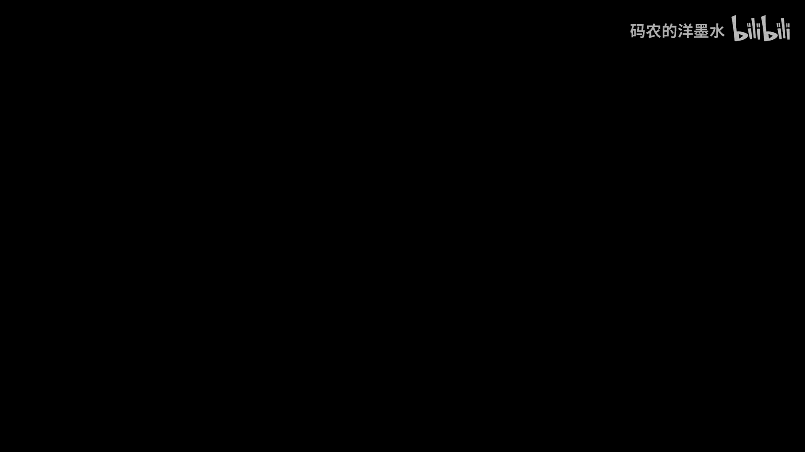
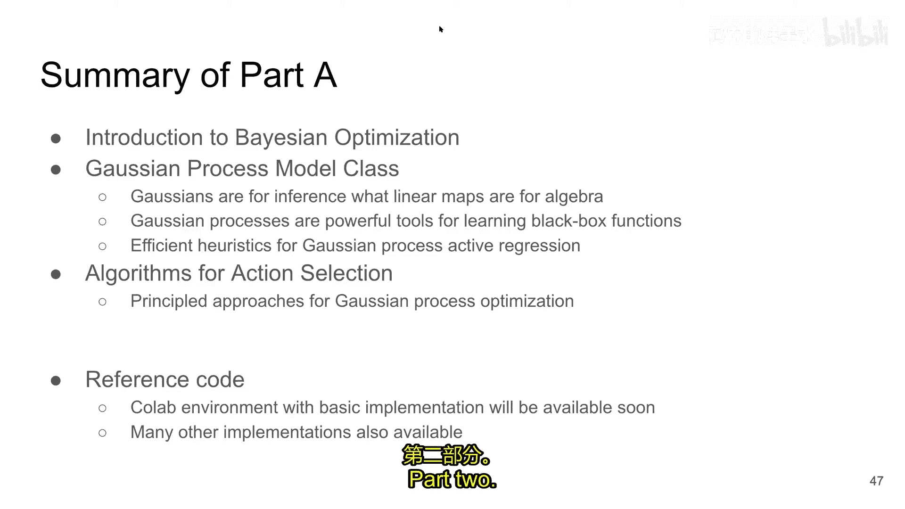
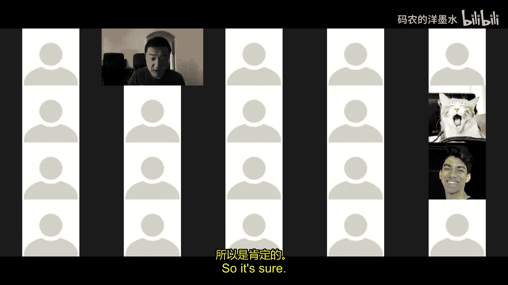
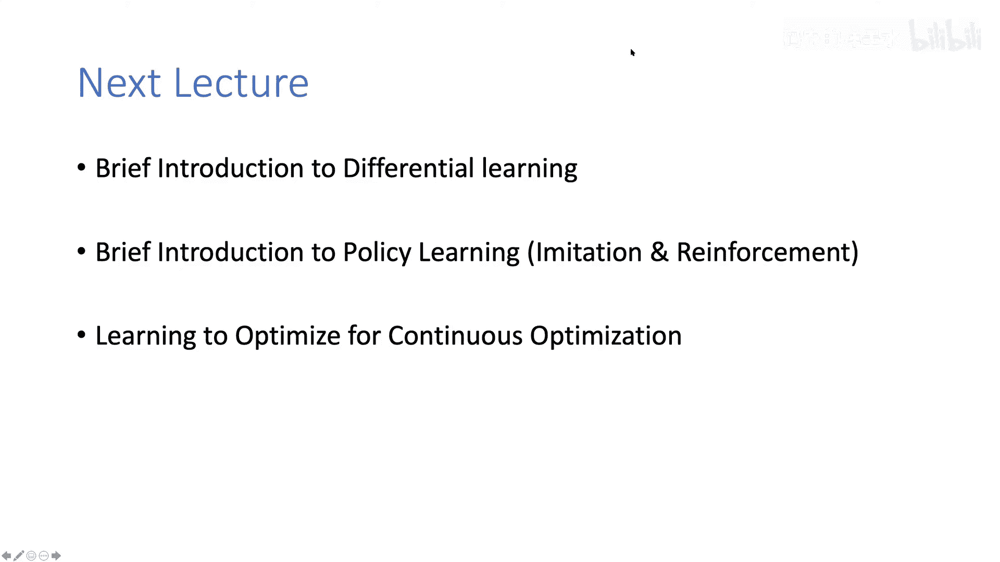

# 【全集 附课件】加州理工学院 数据驱动的算法设计 中英字幕1080P p02 Lecture 2 - 贝叶斯优化 -BV1CF2LBhEWk_p2-

Okay， welcome to lecture two of CS 159 Data driven algorithm design。In lecture two。

 we'll be going over a few topics that are going to be connected to each other。嗯。All right。

 let's get started， so we're going to start with talking about optimization in particular Bayesian optimization。

So here's the outline of this lecture in Part A， which is this part。

 we'll be doing an introduction to Bay optimization。

 primarily using Gaussian processes and discuss connections to militarylitium bandits。And in Part B。

 we'll talk about the algorithm configuration， which is one of the topics of the course and talk about versions of algorithm configuration that reduce to that can or can be framed as a standard Bayesian optimization or bandit problem and versions that are less easily framed that way and other algorithms that can complement Bayesian optimization algorithms。

 so that's going to be the outline of the lecture today。

And so Bayesian optimization is really one of paradigm the foundational paradigms that can be used to think about goaloriented experiment design。

 so classically and we'll talk about connections to algorithm configuration later on。

 but classically you can think of it as the follows， we have an experiment designer。

 classically a human increasingly an algorithm。And we have an experimental platform that one could run an experiment and measure some sort of response variable。

And so the experiment designer designs an experiment on the platform， we run the experiment。

 we take a measurement， and we feed it back to the experiment designer who then takes that measurement to then think about what experiment to design next。

And so some things to keep in mind is that this process is iterative and adaptive。

 it happens sequentially and it happens in a way where the designer is adapting to the measurements that they receive。

And。Most importantly， more this process is utility maximizing。

 which means that the goal of the designer is to find some best outcome and we'll talk a little bit more about what that means throughout the lecture。

There are many applications ranging you know this is just a sampling of many others these are some that have happened here at Caltech from designing better controllers。

 tuning the parameters controllers， designing materials and，Biochemicals and things of that nature。

So this is what Bayesian optimization looks like so it looks like the before。

There's a few things that I added， which is in the top right corner。

Which is now we have a design space and then we have this fitness function over the design space so for any for any design or experiment so capital X refers to an experiment or that the space of experiments that we can run。

And we have a fitness function that's unknown to us， but we could take measurements of it。😊。

By running experiments and observing the outcomes， so we would run an experiment。

 then we we query F of x。That's what run experiment means。And then and importantly。

 in Bayesian optimization we maintain a Bayesian belief or a Bayesian posterior over what this fitness function might be given the observation that we've collected so far。

 so capital S is the set of measurements that we've collected so far。😊。

And we maintain a Bayesian belief over what this fitness function might be。

 given the observations we made so far。And so in other words。

 we maintain a Bayesian belief or an uncertainty over the fitness function， what it might be。

 and we choose experiments to help identify the highest fitness action so the ultimate goal is to choose the experiment。

 choose the X that has highest f of x。😊，UAnd and we need to do so while not completely understanding what F is。

So here's a more formal problem setting， so we have an experiment budget of capital T where each experiment costs the same unit。

And at every iteration， little T， we select an experiment， so we select an X。😊。

We run the experiment on our platform and that in this formal of abstraction amounts to measuring a y。

 which is equal to f of x plus on measurement noise。

And we add x comma Y to our measurement set and we update our Bayes model and or invasion optimization。

 sorry what was described above need not be Bay， but invasion optimization or an optimization in general。

The goal is to minimize the。嗯。The goal is to minimize the。The what's called the simple regret。

 so F of x star is the true optimal action， so x star is the action that has the highest fitness。

An X hat of star is what our Bayesian model thinks of。

As the optimal action so we have a belief over what F might be and given our beliefs we have an X hat star。

 which we think is the optimal action under under under our beliefs。

 but may not be the actual optimal action because our Bayesian model is an approximate gives an approximation of。

Of the true maximizer， was there a question？Yeah， the start of this slide。

 you were muted for most of it and it seems to be a common experience。

So the question is about the fact that the beginning of the slides tend to be reviewed。No。

 as in we could not hear your microphone。the thisOkay， can you hear me now？Yes， okay。

 sorry about that。Okay， so just to repeat this slide。

The formal problem setting is that this is the first major bullet point。

The formal problem setting is we have a budget of capital T where every experiment costs the same unit of cost。

We select an experiment that's equal to selecting an x。We run the experiment。

 which is equivalent to running the experiment on our platform and for the purposes of this mathematical formulation。

We measure we take this measurement y， which is mathematically equal to  querying f of x plus noise。

 which is the measurement noise。And we add x comma Y to our measurement set or our training set。

 if you will， and we update our model in Bayesian optimization。

 the goal to find is to ultimately choose an X hat star。

X hat star is what we think after all these rounds of experimentation is the maximizer。

 So we have a model of what F might be。And under our model， X hat star is the maximizer。

And the true maximizer is X star。And we measure the difference in the utility between F of x star and F of x hat star。

 so what is the true fitness difference？And this is typically not something that we can measure in a real experiment because we don't know what F is。

 but we can certainly measure this in a simulation where we know what F is because we're simulating it or we can sometimes analyze this gap theoretically。

A related problem is called multiar bandits and in multiar bandits， it's the same setup as the above。

But the goal is to minimize what's called the cumulative regret rather than the simple regret。

And the basic idea is that we run this process for capital T iterations。

 and we want to consider the total difference in the fitness functions of the actions or experiments that we selected。

Versus if we knew what X star was a priori and we just ran X star for every experiment。

 so if we ran X star for every experiment we would receive t times F of x star utility。

Or as the utility we did receive， the accumative utility we receive for every experiment we ran is the sum that you see in the bottom。

 so that's the key difference。Okay， so here's a yes question。

Is there a question yeah yeah about the previous slide？

Should there be like some sort of norm for those regrets？

Because it seems like there's nothing to get it from just keep going negative with your FFx hat。Okay。

 so I。So nothing this is just a definition of regret。

What you're talking about is an actual value of this and to do that。

 certainly we need to state more things， talk about what F is， talk about the model class。

 this is just a definition of regret。I think it's like if you're trying to minimize FFx star minus FFx hat。

 can't that just go negative？F of x is a maximizer of F。Sorry， FFX star minus FFX hat， right？Or。

why can't that go negative basically if you're changing X hat。

 why can't you choose X hat to just keep going negative like if even if it's like a linear f well again。

 that depends on。That question already presupposes that question is not part of the definition of regret。

O。So this is literally the definition of regret and is your question is about compact whether or not X lives in a compact set or not。

 that is orthogonal to the actual definition of regret。Yeah。Right。

 so in practice capital X just to follow up on that question a little bit。

 in practice capital X typically lives in a compact set。

 which means it's not an open set and so the quantity that you see is typically bounded。

Let's see here Okay so here's just a concrete example of Bayesian optimization that you know has actually been used in practice as this was done by Francis Arnold's group here at Caltech。

😊，嗯。And the basic idea is that capital X is a space of proteins that we're considering。

 so we're considering a compact set of possible proteins。

F of x is some fitness function of the protein that we're trying to design。

 it could be binding affinity， it could be thermal stability。

 it could be one of a number of functions that we want proteins to have。

And the basic idea is is you know there are many details here that are very complicated from a biochemistry side。

 but from a Bayesian optimization perspective， the basic idea is we choose a protein。

 we synthesize it or grow it。We take a measurement of this protein which is the fitness which is a query on the fitness landscape and then we try another protein that's the basic idea it's a you know the real setup is much more complicated but we can think of it that way for the purposes of this class。

And the goal at the end is to find a protein that has the highest possible fitness。

 and so we can theoretically think about the difference between that protein that we found versus the theoretical best protein in the space that we weren't able to find and think about the gap in fitness there。

 at least from a theoretical perspective。I want to briefly talk about a bandit example。

 even though most of this lecture and this class isn't about bandits。😊。

Here's a band example it's about how to do a clinical trial。

 so if you do a clinical trial like a vaccine trial， let's say。

The standard way of doing a clinical trial is what's called static experiment design。

And this is very standard and basically what that means is that the experiment is pre plannedned。

So a first patient comes to us and we give this patient our experimental treatment。

And then the next patient receives the placebo。And the next patient could receive the treatment and next patient receives a plea placebo。

 so this is like a 5050 randomized trial where for every patient that comes。

 they have a 50% chance of getting the treatment of the placebo and that 50% chance is not adaptive to the measurements that we've taken so far。

So that's static experiment design。Multiar bandits you can think of it in at least in the context of experiment design as how do we adapt the experiments based on outcomes so here's a this is a grossover simplification but suppose that the first patient comes or the subject comes and we flip a 5050 coin and give this subject the treatment。

And suppose we can immediately measure the outcome， this is of course not true in practice。

 but suppose we could immediately measure the outcome and we measure a positive outcome。

The next patient comes， we give this patient a placebo treatment。

 so in this case there's two actions in the space of experiments。

And we immediately measure a negative outcome， and then the next patient comes。

 we give this patient the treatment action and we immediately measure a positive outcome。

And so at this point， we might start to think that the treatment action is better than the placebo action。

Now we have only taken three measurements。And so we don't have a lot of evidence。

 but if we were Bayesian， we might think that there was like maybe a small amount of evidence that the treatment is better than the placebo and so we might bias the coin。

 this 5050 coin a little bit more towards the treatment and start giving the treatment more often than the placebo so we are adapting the experiment based on the measurement outcomes of the experiment。

And this matters so this is a screenshot from an article taken about 10 years ago where you have these two cousins who were both afflicted with the same very lethal and aggressive melanoma。

 which is a skin cancer。And there was a drug that was in clinical trial。

And the doctors knew that chemotherapy and standard therapies did not work。And one of these cousins。

Received the treatment and one of them was given the placebo basically because it because it was a 5050 kind of or it was a static experiment design。

 so it was just randomized based on a preset randomization。U， one of these people died very quickly。

 one of these people lived healthfully for several months later due to having the access to this treatment drug。

So the idea of static experiment design is that you know。

 every the goal is to collect enough data so that we can reliably make predictions or recommendations for future actions so at the end of the clinical trial。

 I have the best information possible to treat people in the future。

When you when you think about adaptive experiment design and cumulative regret。

 which is what abandoned algorithms care about， the basic idea here is that well you know the people or the patients in the clinical trial they matter as well。

 so you know if one of the actions is much better than the other one。

 you know know we want to minimize the cumulative regret of of every patient in our study。

So that's the basic idea。Okay， so just to summarize。

The difference between optimization or Bayesian optimization versus bandits。

 it's the same interaction protocol， the difference is whether you're designing an algorithm to minimize simple regret or are you designing an algorithm to minimize cumulative regret？

It turns out that if an algorithm can achieve small cumulative regret。

 that often implies that the exact same algorithm can achieve small simple regret and the way you can see this is that you can rewrite the cumulative regret like in the bottom bullet where I simply divide in the cumulative regret by capital T so this is not the average cumulative regret so if you know standard mathematical identities and principles you know that you know if you take an average of something at least one of the things in the in the terms being average must be above average so at least one of the f of x1 versus f of x you must be above average and so if an algorithm has small gap in this bottom formula then one of the things it tried also achieve small gap。

😊，And so the final step is to show that we can relate F of x hat of star。

 which is the thing that our model thinks is the best to the one that we chose in the to the best one of the elements that are in this sum。

 and that depends on your model so you can't do this for every instance of this problem。

 but for Gaussian processes which we'll be describing later in this lecture， this is true。

 we can actually relate f of x has star， if we have a Gaussian process model of what f is to the best one in that sum。

 and therefore if we can achieve have an algorithm that achieves good cumulative regret。

 it can also achieve good simple regret。So in other words。

 algorithms that are designed for the bandit setting are often reasonable or pretty good for the Bayesian optimization setting and that depends on the ability to relate F of x head star to the best in this average。

😊，The converts does not hold， some algorithms that are designed for Bay optimization are actually quite bad for the bandit setting。

 so the converts of this is not hold。Yeah。Just because you've achieved small gap between F of x and F of x at start doesn't itself imply much about all the terms in this summation for Cuban ofgra。

The implication only goes one way。Okay， oops。As an aside。

 there's a third problem setting that fits the same interaction protocol that's called active learning yes question。

Yeah， so curious how much harder like complexity wise is the multi ambar the multi or the cumulative reward setting versus just the regular Bayesian one。

 like is it harder and complexity wise or is it the same？U。So if we use Gaussian processes， so again。

 we're just going to use Gaussian processes in the worst case， they're the same difficulty。Of course。

 we don't have to model things using Gaussian processes in which case get things get harder to it gets harder to compare them apples to apples because the algorithms tend to be very different or some algorithm where you can't find algorithms for certain settings。

 but if we use Gaussian processes， which we'll be using for the most of this lecture and probably most of you will use it for your projects。

 then they actually have the same worst case guarantee。So as an aside， active learning。

 which is the user the same interaction protocol， but the goal is to estimate this fitness function or function as accurately as possible。

 even in the regions of low fitness， so the goal is to learn a good global approximation of F of x。

So that's the key difference， but we won't be talking much about active learning。

So there were two basic ingredients to Bayesian optimization。

 first you have to specify a model class， what is the functional form of our Bayesian beliefs and given our observations or measurements that we take。

 how do we update those beliefs？😊，And the second one is the algorithm you know given a Bayesian model how do we select a new experiment so that's those are the two ingredients and we'm going to spend the next few slides talking about you know building up to Gaussian processes which will be the model class that we'll spend some time thinking about。

So。Basically we want to learn a fitness function， we want to build a want to we have a model class of a fitness function and based on measurements that we've collected。

 we want to fit a fitness function if you will。So you can imagine you can imagine you know we've taken some measurements like the ones on the figure on the right where this is a one dimensional。

 this is a one dimensional experiment design space。

 so x is a one dimensional lives in a one dimensional space that's your x axis and the fitness with some measurement noise is on the y axis。

嗯。The goal。Is again， to find the maximizer of F of x。

 so one only wants to learn the fitness function to the extent that it is informative about what x star is。

Because learning F of x is just the indirect sub is a subroutine that is indirectly helping us towards this goal。

 of course if we knew F of x perfectly we can just find X star but you know that requires actually collecting a lot of data。

 which we don't want to do。So Bayian inferencefer is something that will come up again and again in Bayian optimization。

So imagine that we want to model the value of this fitness function of n actions。

 so we're going to treat each of the actions as a random variable so F of x so here x the capital x is just the finite space of n actions。

Is this vector of random variables？And we have some measurements wide that we've taken previously。

And so the way that， you you use Bayesian methods。Is you apply Bayes theorem or Bayesian inference。

Where we have our updated beliefs， also known as the posterior beliefs of the fitness value of these n actions are。

Given our measurements by this formula， which is bas rule。So typically in a Bayesian model。

 measure we we specify a functional form of the prior beliefs， the P of the prior on F sub x。

 and we specify a functional form of the observation likelihood， given what we think F of x might be。

 so condition on F of x， what is y。So the two things in the numerator are the things that we typically specify when we do Bayesian modeling。

 so we specify the functional form of those two and then the numerator at the assuming。

 the denominator， P of Y is just a marginal of the observation likelihood and marginalized over our Bayesian beliefs what F might be。

So the reason why we use Bayesian inference is because the blue and the turquoise quantities are the ones that we typically actually manually specify when we design a Bayesian model and we use this formula to compute our posterior beliefs or updated beliefs by what F might be given observations。

So to build up the Gaussian processes we start by talking about multivariate gasussian distributions。

 Gaussian processes you can think them as infinite dimensional as infinite dimensional generalizations of multivariate Gaussian distributions we'll build up to that so multivariate Gaussian distribution is completely specified is specified excuse me by a mean vector and a covariance matrix that you see that in the top formula。

For if the variables are indial， we have the mean vector is indial and the covariance matrix is n by n。

And there's some properties that are not super important right now， such as the covariance matrix。

 we require the covariance matrix to be positive semi definite。

And what you see on the left is a description illustration of a two dimensionional multivariate a Gaussian distribution where there's correlation between the two variables。

 so the first variable and second variable they tend to be both be high or low together。

So some standard things you can do you can do marginalization so if we only care about one of the variables。

 not the other one we can just integrate out the other variables this should be review for most of you。

 but i'm just going over this just to help you set the context。嗯。So we can do marginalization。

 so an individual variable is also a Gaussian variable that's a nice property of multivariate Gaussian distributions。

Us。Closure under rules of probability， so you know if we have two variables x and y。

 let's say or x1 x2。And we assume we observe one of the variables， then the posterior inference。

 if you will， the other one conditioned on measuring the first one is also a Gaussian。

 and it's given by the formula of above。嗯。So in other words。

 Gaussians are closed under the ruless of probability and this is really nice because what that means is that if our prior on F is Gaussian and our observation likelihood。

 the P of y given f is also Gaussian， then that the posterior， P of F given y is also Gaussian。

So that's really nice。对。Oh sorry， and just to illustrate the figure on the left。

 so the two solid lines are the marginal distributions of the two random variables。

 but if we actually observe x1 on the dotted line，Then the conditional distribution of x2 is this more peaked Gaussian in the dotted line on the left。

すね。But it is also a Gaussian。Oops， sorry about that。Okay， so why Gaussian， so just a recap。

 you know it's you can apply a bunch of linear algebra operations to it and everything's closed so closure on multiplication closure on the linear maps。

 closure under marginalization， closure on conditioning， therefore closure under Bayesian inference。

Of course， nothing in the real world is actually Gaussian。And nothing in rural is linear。

But we can use Gaussians to model things in a way that helps us make decisions about what experiment are design next。

And that's the most important thing， as long as this is a reasonable approximation or model of our uncertainty。

 we can use it to design future experiments。So。Here is a bunch of measurements now we compute P we want to compute F。

If F of x is a linear function with a by offset term w1， a linear termw2。

 we could write that as phi transpose w where phi is this feature vector。

And now we have a Gaussian prior over what W is。And so P ofF takes this multivariate Gaussian distribution。

Okay。And so so what I'm writing what you're showing seeing at the bottom is the prior。

 so these are the slopes， the Ws and this is just the prior distribution of what W might be without any observations。

And then after we make some observations， y， and let's assume that the measurement noise so is also Gaussian。

 so y given x is equal to the the true w transpose phi of x plus the measurement noise that's also Gaussian。

 that's what you see in the top equation。Then the posterior inference a P of w， so W is our F here。

 given making some measurements y。Is this Gaussian distribution you see depicted below。

So the mean slope， the mean estimate of our posterior is the solid line in the middle and what you're seeing here is just the variability。

The uncertainty， if you will。什。And this is， of course。

 assuming that the functional form is this linear model with a Gaussian prior on the weights。嗯。Right。

Suppose we change our feature representation right so this is still a linear model but we just have a different feature representation and this is basically equivalent to cubic regression。

😊，So if our feature representation is what you see on this slide and we put a Gaussian prior on W。

 which is now a four dimensional vector， then this is our prior。Enough。And then if we fit the model。

 if we fit this model to the observations to compute our posterior beliefs。

 this is our posterior on what F is or the multivariate posterior Gaussian posterior on W。

Which is equivalent in this example。And then you know you can choose all sorts of。

 now we can just choose all sorts of feature representations because you know you just choose your feature representation and then you write that as a linear model with a multivari Gaussian Bayesian model of what your linear parameters are and you can specify all sorts of priors。

有。嗯。And then you could compute the posteriors。Let's just another example。

 heres it just another feature representation。And then this is the posterior。

 given that type of feature representation。You can do fourier features。

And this would be the posterior of given those measurements。I just I think this is the last example。

 this is a bell curve feature。And then this would be the posterior。

I should have mentioned that the dotted line that you see that's wiggling。Is our sample。

 so we can sample the Gaussian from this posterior distribution and the data line are what samples might look like。

Okay， so now that we've gotten to this point， a natural question to ask is， well。

 what feature representation should we use？嗯。And so now we're going to start to move towards what's going to end up being Gaussian processes。

Once we specify fee。Then we can abstractly write this multivariate normal distribution using all using the red term and the turquoise term。

 the red term is called the mean function， the mean of our distribution。

And then the turquoise function is called a kernel function。

Which measures the covariance of different points using within this feature representation。

Once we specify these two quantities。Everything that you see above。

Is not actually independent of the number of features it's it's only a function of these two quantities and these two quantities may be parameterized by a feature vector but we can abstract that out and just look at these two quantities。

And so if we use a lot of feature vectors， if we use a huge feature vector。

 feature vector that's potentially infinitely infinitely long。

 so feehi let's say phi is has infinitely many features。😊。

Then it turns out that you can actually write this covariance， this kernel function。

You see in the bottom， you know， you can write it out， you know。

 for certain choices of fee that's infinite， that's infinitely they're infinite with infinite many dimensions。

 you can write out this dot product scaled by Sigma。

 the covariance matrix as this close form formula based on exponentials。So in other words。

 even though fee might be infinite dimensional， we don't actually need to explicitly instantiate fee in order to compute the relevant terms which are the excuse me。

 which are the mean and the kernel function values。

 we don't actually need to explicitly instantiate fee in order to compute these two quantities。

 all we need is to compute these two quantities and then we can use the formula above。

And so this is one example where phi is infinitely infinitely large or infinite dimensional。

 but if you wanted to evaluate the kernel function， then it has this close form solution。

So that's the basic idea。嗯。We have these kernel functions that that can implicitly capture adopt products of infinite dimensional feature vectors。

So here's an example where fee where you have a 10 dimensional fee of a certain functional form。

And then you go up to 30 dimensional and then you go up to infinite dimensional and if you go up to infinite dimensional。

 you get the inner product of phi of X1 with phi ofxii versus p of Xj becomes takes this functional form。

And this is the posterior given those measurements。Okay。

 so now we're ready to write down a Gaussian process。

 so a Gaussian process is specified by a mean function and a kernel function。

And it is a probability distribution over functions。嗯。And it has the following property。

 which is every finite restriction of function values。

Or this is part of that this is part of the definition of a Gasson process every finite restriction of function values so if we only care about the value of f at a finite set of locations so that's that's these n locations X1 to xN so every single finite restriction of function values。

Is a Gaussian distribution， which is a multivariate Gaussian distribution with the mean function mu mu of x at those x's。

And the covariance matrix is the kernel function of those pair of x of all pairs of those x's。

So this is a Gaussian process， it's an infinite dimensional generalization of a multivariate Gaussian distribution where F is this you know F is this function that's infinite that you is basicallys where if you take just any any finite or finite restriction of F so the value of f at and any finite set of locations it immediately becomes a multivariate Gaussian distribution so any finite slice of a Gaussian process is a multivariate Gaussian distribution。

That's the definition of Gason process。And there are ways of using these kernel functions。

To then conduct posterior inference。So this is the standard formula。You can through。

 you can work it out in detail on your own time if you're interested。

 but it's a basic it follows the standard Gastian posterior conditional inference just with kernel functions rather than explicit feature functions。

 feature vectors。Any questions so far？Okay。So。It turns out that if you compute。

If you just compute the so this is this is just a bunch of math relating the posterior inference of Gaussian processes to。

L to regularize least scores regression。The key takeaway here is that compute if you take this P of F given y which and we're doing posterior inference here。

 and we take the negative log of P of F given y to something we do very often in CS155。

 when talk about log loss of max and likelihood。If we take the negative log of P of f the y。

 the formulaly we see at the bottom looks a lot like least squares。

AtLeas for its regression with a regularizer， so we regularize the F to M sub x with M is the mean function so we're regular to the mean。

And this is just basically the L2 regular。Regression。

 so basically what this is saying is that if we do posterior inference in our Gaussian process。

 the mean function， so the Gaussian process is specified by a mean function and a covariance function。

 the covariance mean function is exactly the solution to regular least squares so if we didn't care about being Bayesian and we only careed about the mean we didn't care about our uncertainty。

Then Gausian process regression is exactly least squares regression。

The reason why we want Gaussan processes on top of just the mean function。

 we want the posterior covariance function， that where the places were really uncertain。

 where the places that were less uncertain。And so that's the reason why we want Gaussian processes if we only cared about the mean we're just better off just doing least scores regression because they're exactly the same thing。

Okay， so the summary so far is we've talked about， you know。

 some properties of Gaussians and Gaussian processes。And。

And the fact that you know they're closed under conditioning。

 they're closed under all these linear algebraic operations that's why they're so convenient and they're going to be they're basically by far the most popular choice for these type of Bayesian modeling for for experiment design so if you look at the papers on experiment design listed on the course website I would say something like。

Like 75% of the papers use Gaussian processes as the model class。Any questions so far？Okay。

 so now we're going to move move on from the model class and we're going to talk about algorithms for selecting data points for experimentation and querying F。

So the first thing I want to talk about is active learning just very briefly。

 so recall that the goal of active learning is to train an accurate model of F of x globally。

And so this is the same protocol that we saw in the beginning。

 but the goal is to fit F of x accurately globally， not necessarily find the maximizer of F of x。

And the reason why I bring this up is because the algorithm that we designed for this is very。

 very straightforward， it's called uncertainty sampling。😊。

So because our goal is to fit the model fit a global model of F everywhere in the input space of that capital x。

 then the algorithm is basically saying， given my posterior inference of the mean function and the covariance function of the kernel function。

I'm just going to pick the point with the highest posterior variance。

 which is the point of highest uncertainty。And so that's what you see happening here。

 the algorithm always picks a point that has the highest uncertainty。

 which is basically the height of the bottom line to the top line， which is two standard deviations。

So this is uncertainty sampling。Okay， any questions？Okay。

 so now I'm going to move on to algorithms that actually are applicable to Bayesian optimization and recall that I mentioned in the very beginning of this lecture that many algorithms that are good for bandits are also good or at least reasonable for Bayesian optimization。

😊，And so we're going to cover very briefly two algorithms for selecting points that were initially inspired by the bandit problem。

 and so they were trying to minimize cumulative regret。

But they turn out to be also quite useful for simple regret or just finding the best experiment only。

And the first one， so this is called Gaussian process bandit optimization or also Gaussian process Bayesian optimization。

 but we're going to use the algorithms that are applicable to both。

So to think about these algorithms， we need to think about the exploration exploitation trade off。

So imagine that we've taken we have a Gasing process model with some kernel function and mean function。

And we。Have taken five measurements so far， so those are the five measurements you see on this figure and this and you're seeing a depiction of the posterior。

 so the mean function is the centered solid line and the covariance function at least is captured by the two outer solid lines which capture two standard deviations。

Which is just 1。96 times the kernel function of x with itself square root of that。So the question is。

 okay， I'm the algorithm， the experiment designer algorithm。

And I want to figure out what point should I sample next so on the one hand。

 I could sample the point that has the highest posterior mean， which is the red point so again。

 we're all we're working in one dimensional experiment spaces here。

 but in general it's higher dimensional but。In a one dimensional experiment space， about negative 4。

5 x equal to negative 4。5 looks like the place with the highest posterior mean。

So we could just sample that one。Because in expectation， that seems to be the best one。

We could sample one of the highest uncertainty like an active learning。

 we're going to pick a point where the confidence interval is the widest so that's like the blue point。

We could also pick one where。You know， the upper confidence balance or the top solid line。I highest。

 and that's the green point。So the red point is called pure exploitation where we're simply exploiting the knowledge that we have so far so the knowledge we have so far if we ignore the uncertainty is just a mean function so in expectation。

The red point is going to have the highest value under our Bayesian beliefs。

 so we're going to if we just exploit that knowledge we're going to pick the red point。嗯。

If we're trying to minimize our uncertainty about our Bayesian beliefs as much as possible。

 like in active learning， we might pick the blue point that's called pure exploration。

And the Green point is a point that tries to balance the exploration exploitation trade off。

It basically says， I want to pick a point that has the highest combination of mean plus uncertainty which is the highest upper confidence bound。

 so the green point is the point that has the highest combination of mean plus uncertainty。

Which is you can think of it as a trade off between exploration and exploitation。Oops。Something。

That messed up here， I'll fix it later。So this is the GPU CV algorithm which stands for Gaussian process upper confidenced bound。

It basically the other way think about it is optimism under uncertainty。

 sorry about the formatting issue。嗯。And see it so if you look at the formula。

 it chooses the next experiment that has the highest combination of posterior mean mu sub T of x。

Plus， posterior uncertainty， which is。You know， beta s of T times the square root of k of the posterior kernel of k of x。

So the root of a kernel function of x comma x is the variance of that point and so the screw root of the kernel function is the standard deviation。

😊，And beta sub T is some confidence interval， so if beta sub T equals， let's say 1。96。

 then this is saying I want to select the point that has the highest 95% confidence interval。

You can also choose Be equal to， you know。So you set beta to tune your confidence interval to the 99 percentile。

 95th percentile， 80th percentile， whatever percentile you want， that's how you tune beta。

And so you see in the bottom a depiction of this， so the algorithm is at every iteration。

 it takes a measurement， it does posterior inference。

 and then it chooses a point that has the highest upper confidence bound。

And so one thing you notice is that the algorithm quickly zeros in on the region in the design space that has the highest utility。

And it starts to focus the exploration around that point。Okay， so what are some intuitions？

Here's the intuition behind this algorithm。By always selecting the action or the experiment。

 what the highest upper confidence bound， which is the sum of the posterior mean plus the sum of the posterior uncertainty measured by a confidence region。

 which is a multiple of a standard deviation。We either find the measurement we get taking from querying this action。

 we either find a really high fitness action or we eliminate a plausibly high fitness action。

So this is the exploration exploitation trade off one of two things will happen we it turns out that this actually actually was really good。

or we measure and it's not that good and postor and posteriors our posterior beliefs get updated so that that part is no longer very high。

And that's the intuition about how we trade off in the exploration exploitation and if you're interested you can read the theoretical details which I won't be covering in this lecture。

The other algorithm that I want to cover is called Thompson sampling or posterior sampling。

 so the basic idea of Thompson sampling or posterior sampling is that we have this again。

 we have this posterior belief over F it's a Gaussian process， let's say。

We can not only compute the mean and the covariance functions。

 the posterior mean and the posteror covariance functions， we can also sample from this function。

So we can sample an f Tilda， which is a sample over this posterior beliefs。

And then after we draw this sample f Tilde， then we just pretend it's the true utility function。

And then we find the X that maximizes it， so that's Thompson sampling。嗯。So， you know， oops。Sorry。

 so here's a sample of so here we've taken one measurement。we draw a sample of our posterior。

 which is the dotted line， so that'silda f Tilda is the sample over our posterior and given this particular sample we choose this experiment captured by the boldface X because it is the maximizer of this dotted line。

So that is Thompson sample。Any questions so far？Okay。So the intuition。

It turns out that if you do a little bit of math， you notice that the probability under this algorithm selection。

 the probability of selecting any action x is equal to the probability that x maximizes F the true F。

So assuming that we're assuming that our Bayesian model is quote unquote， correct。

 then P of F given y is a calibrated posterior belief。Baesian belief over what F might be。

So the x we choose is the maximizer of f tilde， and the probability we choose f tilde is equal to the probability that f tilde is the true F。

So therefore， and you can make this more formal， the probability of selecting any given x is equal to the probability that that x maximizes F。

So again， even though this is seemingly a completely different action selection algorithm than the upperconence bond algorithm。

😊，We again have the same intuition。You know， we tend to sample going to we're going to either find a high fitness action。

嗯。Or we've made a big update on our posterior beliefs to eliminate plausible high fitness actions from our posterior beliefs。

等。And again， you can check the references linked to on the slide if you're interested in the theoretical analysis。

That formalizes this intuition。Yes， question。Yeah so if you find the exit maximizes for your sample。

 but it since it looks very it can be very knock comeve so can you actually find that maximizer in practice so does it work actually yeah great question so for both Thompson sampling and GPUCB。

I've completely ignored solving the AGM so there's an aG max here if you look at excuse me。

 if you look at GPU CV。There's also this aG max here。

 so this so finding the maximizer is itself an optimization problem。

 so you have to actually so the experiment designer actually has to find this maximizer in order to actually run the experiment and that can be actually very expensive computation expensive if this maximizer leads to some kind of nonconvex optimization problem。

😊，And。In most of the applications that we'll be looking at， it turns out that。

The space of x is going to be discrete。So were so。X is like a million different actions。

 so a million different finite actions， excuse me， not discrete finite。

So if x is over a million different finite actions。

 then solving this agG Max is just running a for loop。

And under the assumption that running that for loopbe is much cheaper than actually running the experiment。

 so querying a Y， taking a measurement is really expensive。

 that's the assumption and running this for loopbe is cheap。😊。

So you're right that in its full generality， solving this arc max can be computationally difficult。

And there's some approaches that deal with that。I would just say for the purposes of this class。

 let's just assume that x lives in a large finite space， so x is a million different actions。

Any other questions？Yes， question。When might you use Thompson sampling versus the other one or what guarantees does one give you of the other one doesn't great great question so first of all。

 you know since this is a sort of a sort of a survey of research class you know I do definitely recommend these the links in the bottom left these archive papers if you're really interested in really digging into the proofs so that there's both for the GPUC the developerver confidenceence bound and for Thompson sampling。

But to answer your question at a high level。Um。These days， I would say that your default。

Between these two choices， your default are probably Thompson sampling so in my experience I've done a lot of research in this field。

 I would say that Thompson sampling is the better algorithm the majority of the time。

In terms of theoretical guarantees， they have the exact same worst case guarantees。

So in the worst case， how quickly are you minimizing regret？

They have as a function of the number of experiments are' doing。

 and they both have actually the exact same guarantees in the worst case。嗯。

hi is what the proofs are about in these papers。So I would say that I would say that the majority of the time your default should probably be Tsson sampling。

 it is in practice empirically just a better algorithm。Most of the time。

But their worst case guarantees are identical that what I'm saying is more of an empirical experience statement。

There are some cases where the upper confidenceence balance are very important and you know because Thompson sampling you know is doing this thing in expectations。

 is doing sampling， and over a long enough number of iterations， you know。

 it starts to you get the same type of regret minimization as GPUCB。

 but if you really care about let's okay， so here let me give you one instance where GPUCB is better。

So imagine that like after like imagine that I have some real world situation where。

After like the first 10 iterations， I am not allowed to do anything really bad。

So let's say I'm running an experiment on a human and the human has a tolerance for really bad experiments。

And after the first 10 experiments， I'm not allowed to run anything really badly。

So I have to guarantee that with high probability， the thing I'm going to do is not really。

 really bad。So you can measure that using the lower confidence bound the lower confidence bound is saying in this case it's like a 95% confidence interval of how bad it can be So this is like the flip of the upper confidence bound。

 but it's the same idea so you can use if you want to guarantee with with like some confidence that you're definitely not going to。

m do something really bad and you can use the lower confidence bound。

 which is the flip of the Alcon bound to eliminate actions that are really bad。

So there are many robot situations where you want to add that kind of restriction to your process that sort of in addition to the very basic mathematical formulation that is being presented here。

 and when you do that， typically people use things related to a confidence balance。

But if you don't have that， my recommendation is to use Thompsson sampling。

Because empirically it tends to be more efficient。Okay and there are other approaches too。

 so if there is expected improvement， knowledge gradient entrytropy search。

 some of these algorithms are not bandit algorithms， they're only for the Bayesian optimization side。

 they only optimize for simple regret， they do not optimize for cumulative regret。😊。

So the two algorithms， constant sampling and GPUCV are initially bandit algorithms。

 so they were initially designed to optimize our cumulative regret。

 but because we'reising Gaussian processes that also implies that they have good simple regret guarantees as well。

And that's the reason why I covered those two because they're the more flexible algorithms。

 if you will， they're applicable to both bandit settings and Bayesian optimization settings。

 but there are other approaches as well， the arch link here is a tutorial on Bayesian optimization。

That covers the other approaches。So summary of the part A， part B is shorter。

 introduction to Bayesian optimization， Ga and process model class。嗯。嗯。

They're powerful tools and algorithms for action selection。

 principal approach to the go and process optimization。

 and I should mention that we will have a reference code linked to on the course website soon where we our we have some collab environments with basic implementations that we're going to put on the course website we'll also link to other implementations implemented by other people as well so that the course website will be updated quite a bit in the coming week。

Any questions so far？Yes， question is that a question yeah， so heard you mentioned that well。

 one of the drawbacks of cautiontion processes is that it's kind of challenging to choose。The kernel。

 and I was wondering what the kind of problem or what are the markers of a good problem for Gaussian processes？

It's a great question。嗯。I think to really answer that question， you know。

 you have to completely answer that question， you have to do a little bit of。

Digging into the application。嗯。So a default kernel is called the RBF kernel。

 which is just this exponential kernel function that I showed in the middle of the Part A。

 that's the default。嗯。And that's what most people start with。

As the dimensionality of of the underlying action space gets really high dimensional。

 the RBF kernel gets worse and worse， so all the examples I've given you here the action space lives in a one dimensional space and we define an RBF kernel。

 this exponential kernel over this one dimensional space。So if your space of actions becomes two。

 three， four， five， 10 dimensions， 20 dimensions， the RBF kernel breaks down， starts to break down。

So a good rule of thumb for Bayesian optimization is that the number of parameters you're optimizing is relatively small if the number of parameters you're optimizing is very large。

 you need to do extra work to really find a good kernel。

That's perhaps the simplest answer that's most useful as the first decision point。

There are other things that are a bit more domain specific。

 I don't have time to go into them we can talk about them offline or I can do you know I should also mention that you know we have four structured lectures in the first four weeks and the remaining lectures are a bit unstructured I'll probably do a poll of what people want to cover and we can do a more deeper dive into gas and processes for one of those less structured lectures if you'd like。

So now I'm going to move on to。Part two。

So， it's share。

2。Okay， so part part B， this will be shorter。So recall that we have a checklist of。

We have a checklist for our original problem of data driven algorithm design of do we have pre collectedlected problem instances。

 do we have pre collectedlected measurements or we're learning state forest stateless models？

So the example that I'm going to sort of spend the next 20 minutes or so talking about are things that look like this one。

 so we have a training set of representative problems， let's say TSP problems。

 we have a solver that can solve these comb optimization problems and the action space are the hyperpar of the solver。

And we want to tune the hyperparameters of the solver to be able to solve this distribution of problems very well。

 well it could be running time， it could be cost of the best solution given a fixed budget one of the things we talked about and then once we do that we can apply the solver with these hyperparameters to a test instance that is well represented by the training instances and hopefully the solver does really well in those test instances。

So as the key idea is we tune the hypoparmeter the resistant solver。

 we assume the training system are representative and we apply the tune solver to test。

A second example， which is actually very similar is like a hyperparameter search for deep learning。

 this is something that where Bayesian optimization actually plays an interesting role。

So we want to train a neural net that。Does well in a particular problem。

And we have a fixed computational budget。And we have choice of newer architectures。

 we have choice of learning algorithms， different they all have different parameters。

 like number of hidden layers， the momentum term and all these things。

And so these are the hyperparameter and we choose those， we run the experiment。

 which is basically running this neural network with this learning algorithm for some period of time on tensflow Pythtors and we measure the training loss or validation loss。

So's second example。And then a third example， which sort of combines， excuse me。

 which sort of combines the first two examples is， you know， we have a， we have a domain of。

We have a bunch of different image classification domains， a bunch of different training sets。

And then we have a hyperparameters， which is what we showed in the second example。

And the goal then is to tune the set of hyperparameters such that on a new image classification domain。

 we can quickly train a neural net that achieves good performance。So again。

 the use case could be like， you know I'm Google and I want to expose you know a good good hyperparameter so that if you're a small business using Google cloud services and you have your own custom image classification domain。

 I can quickly tell you how you know how how to tune things so that you know you。

You can train it really quickly with a limited computational budget。不是。Okay。

 so the key idea is we treat this solver as a black box and the action space out of these hyperparameters of a solver。

 and we measure fitness or costs that we either so cost would be minimization。

 fitness would be maximization doesn't really matter if they're mathematically identical as as you're consistent on minimizing or maximizing。

given the hyper parameter setting and given a problem instance， which is not always applicable。

So here's the basic itative procedure， you know we have a set of measurements that it's initially empty。

 we have a problem instance， so'll use that I'll use X to the no problem instance I'm changing the note that I'm changing the notation slightly so in the part A。

 I use the conventional Gaussian process notation where X is the action space。In part B。

 I'm using the conventional algorithm configuration notation where theta is the action space。

But just keep that in mind。So we choose a problem instance， which is x。

We choose an parameter of the action space， which is theta， we choose a running time。

 and then we run our solver on this problem instance until termination or running time is hit。

 running time limit is hit and then we take these measurements， we add it to the measurement set。

 we can of course choose multiple training instances， or we just choose a single training instance。

 we choose all the training instances in our training in our data set。

And then we repeat this process until the total time budget is exhausted。

 and then we return the best promises we've found so far。

And so this is just a repeat of a slide in the first lecture， just to remind you guys。

 and so the algorithm the configuration problem is how we choose these different things。

So the direct reduction of Bayesian optimization is as follows。

 so we spent about 50 minutes talking about Bayesian optimization and gas processes。

And the direct associationis is the following， so in step two we choose every instance in our problem domain in our training set。

So。We choose theta using a Bayesian optimization algorithm and then TMax is large is just some large number。

So conceptually infinity， but just some large number。

And so what this means is that every round of this whole iteration。

 you know you could think of it as a unit cost right the cost of doing a round of steps two，3。

 four and five has the same unit of cost， so invasion optimization。

 every experiment has the same unit cost， so basically steps two， three。

 four and five make it so that every round of two to five has the same unit cost。

 which of course can be suboptimal， but that's the direct reduction ofva optimization。

And so the fitness or the cost functions here Im writing as a cost function or de minimization。😊。

You know， we assume that the training set is representative of any tests we'll see at test time。

And so we want to evaluate the cost over the expected value over this distribution of problem instances。

 and so a measurement if we do a direct reduction to Asian optimization。

A measurement of the fitness or cost requires running a query， querying our experiment。

 which is in this case as a solver on every X in the training set。

So this is a reasonable fit for the second example I described。

 so this recall that this is the second example。Where we have where we want to where we only are trying to solve for a single problem instance so there's only one training set and we just want to find the neural architecture。

 we just want to find the model， the deep learning model that fits this training set as well as possible with limited with a finite computational budget。

And so here x is just a singleton set， so there's only a single problem instance。

And so Bayian optimization is actually a pretty good fit directly for this problem without any extensions。

At least conceptually。So yeah， so the direct reduction of Asian optimization。

 even more so the simplification from the second example is there's only a single problem instance so we can just eliminate step two。

Or。Yeah。Okay。Any questions so far？Okay， so the benefits is that this is a direct reduction of agent optimization Beijing optimization is very well understood lots of reference algorithms and implementations the biggest drawback here is that。

😊，TM setting a large uniform T max can be very wasteful。

 you don't want to you know you don't not not all experiments need to use incur the same unit cost。

And so here's an alternative approach that's not Bayesian optimization and I'm just going to go over very quickly so the idea is that Bayesian optimization is about choosing theta very intelligently like GPU CPU or Tmpsten sampling I'm going to present now in an alternative approach that focuses on choosing T Maxax intelligently rather than theta so we're going to choose theta very naively。

😊，And so this is the hyper band algorithm。And so I'm going to give you a simplified version of it just to capture the essence。

 so we set a computational budget K。Wch is you can think of as the current T。

Or the current total T max。We have a viable set of thetas。And for every theta in the viable set。

 we run it。We run it for oops。We want it for K time budget， sorry that n should be a K。

 I'll fix that in the that's a typo we want it for K time budget。嗯。

And then we measure the performance and stuff of the model。

Of the models trained from these hyperparameters。And then we keep a top fraction so we keep the top k over8 of fraction of the theta variable and we eliminate the rest。

And then we increase the time budget sorry sorry， there's a little bit of a typo here。

To k equals k times eta so now we increase everyone's time budget and we do this process。

Until only one theta is left。So basically each round has the same total budget。

 each round eliminates a constant fraction of the thetas。

 and then the budget per theta of the remaining thetas increases exponentially from round to round。

So that's this is the Hyman algorithm in a nutshell if there' it's a little bit more complicated than what I'm showing you。

 but it's the basic idea。So this is basically saying I'm going to choose theta super naively。

 which is the opposite of Bayesian optimization， I'm just going to focus on choosing TATs intelligently。

And so here's this sort of a qualitative description of the algorithm。

 this is a two dimensional hyperparameters for deep learning problem。

 so two dimensional space of hyperparameters， and you see here 16 different hyperparameters that they're considering and what you see in the right plot is the amount of computational resources allocated to each of the hyperparameters。

And the loss function of each of the hyperparmeters。

So is the resource is basically how long to run this particular solver with these hyperparameters。

So an interesting idea would be okay， you know， sorry， an interesting idea would be okay。

 this algorithm chooses theta chooses theta really naively， but chooses T Maxax more intelligently。

 Bayigian optimization chooses TMax naively but chooses theta more intelligently an interesting research question for a final project for example。

 would be is there an interesting way to combine these two algorithms into a unified algorithm？

So right， so just to summarize we have high dynamic range on the running time budget。

 so this hyperman algorithm is good when you have a high dynamic range on the running time budget and so you can want to intelligently set the running time budget and that's more important than intelligent choosing the parameter setting。

Another issue is that another limitation is that this doesn't model relation between thetas for example we don't have a kernel。

 so this is limited to a very moderate number of thetas， 16 in the above example。哦，O。

Okay so I'm running a little short on'm going to speed up a little bit there are other approaches that are related to this idea of choosing TMX intelligently Ill just that leave this you can check these out if you're interested。

嗯。So the last thing I want to cover in the last couple minutes。Is going back to this first problem。

Type that we looked at， which is we have a set of solver， a set of problem instances。

We have one to choose the hyperpometers to do all the test instances as representative well by the training instances。

And so I'm going to briefly cover the SmAC algorithm which stands for sequential model based algorithm configuration。

 and again， this algorithm chooses theta naively， which is sort of the opposite of Bayesian optimization and it also keeps TMax fixed。

 which is the opposite of the hyperband algorithm。This algorithm。

 the key difference between this algorithm and hyperband and Bayesian optimization is that it focuses on calibrating the fitness measurement across problem instances。

And it also tries to learn a model that can condition a problem instances if you have features of the problem instance。

 so I'll describe the algorithm in the nutshell。Will you maintain an incumbent？

Primerorization of our solver。We choose a set of candidate thetas and there's a procedure for doing that based on expected improvement。

 which is one of the Beijing optimization selection criteria。We select a set of problem instances。

 so we have a huge space of problem instances， so let's say we have a million traveling salesperson problem instances。

 we're going to select a subset via random sampling。And for that subset。

 we're going to run all of our candidate thetas on all of those subset。

We'll choose the best data as the new incumbent based on that subset。And we repeat from step two。

So that's the basic idea。And so the key difference here is and so this algorithm going performs really well。

 this is a plot I showed in the lecture one， I'll just skip over this in the interest of time。😊。

So the key idea here is that， you know。If there's high variability in problem difficulty so we have this training set of traveling salesperson problems。

 some of them might be super easy， some of them might be super hard and we don't want to actually run a for loop to loop over all of them simultaneously at every round of this optimizations because it's too expensive so we're going to subsample it every round like like likeen stochastic gradient descent right so we're going to do some sort of stochastic evaluation of the fitness function the problem is that if some problem ist a super easy and some are super hard there's huge variance there and we can sort of calibrate we can actually sort of we can align the variance by saying we're going to evaluate all of the thetas on the same subsample。

So that' that's basically the key thing that Smack is doing that in addition to this other things that we describe SAC is doing what I'm describing is an oversimplification of Smack。

 but just in the context of presenting the most unique aspect of SMack。

 given what we've already presented， that's the most unique aspect of SMack。So again。

We've talked about three things， we've talked about selecting theta intelligently。

 we've talked about selecting T Maxs intelligently。

 we've talked about select selecting how to evaluate our measurement function intelligently of this high variability in the way we can make draw measurements。

The related algorithms called algorithm portfolio selection。

 the key idea is that you can use not just the same not just two hyperparameters of one solver。

 you can actually just choose many different solvers so given a problem instance。

I can you know predict which solver will have the best running time performance on this problem instance。

 so it's like Smack and it's like these other problems。

 but the hyperpar include not just the parameterizations of one solver but a choice of many different solvers so this is like a meta algorithm that uses all existing solvers as subroutines。

But the way you way you tune this algorithm is similar。

 so this was applied to the sat problem satisfiability。

 the algorithm is called satzilla and it turned out that you know there's the satisfiability competition。

And this satzilla approach kept winning gold medals in this competition year after year after year。

 and Sazilla was actually and learning based approaches were actually banned from the satisfiability competition after 2009。

 that's how good these algorithms were。Okay， so I'm basically done recap of part B。

 Bayesian optimization is a popular framework for parameter optimization。

 many well designed algorithms。It ignores the time resource budget。

 although there are approaches that address this partially， it ignores the variability of evaluation。

 so if evaluation needs to be done over population of provinces and then that population is huge you need to subsample the variability can kill you。

 you have to be intelligent about how which provinces you subsample to control for the variability。

And Beijing physician ignores predicting parameters conditional problem instances， so for example。

 if I have features of a problem instance， I can actually predict which hyperparameter is best for that problem instance。

And that's something that you can also do as well。So any questions so far， I'm basically done。Okay。

 so the next lecture or next Tuesday， we're going to move on to a different topic of learning to optimize continuous optimization。

 basically learning a new gradient descent policy。Um so we'll do a brief introduction to differential learning。

 a brief introduction to policy learning and then dig into learning to optimize continuous optimization。

 okay， that's it。

