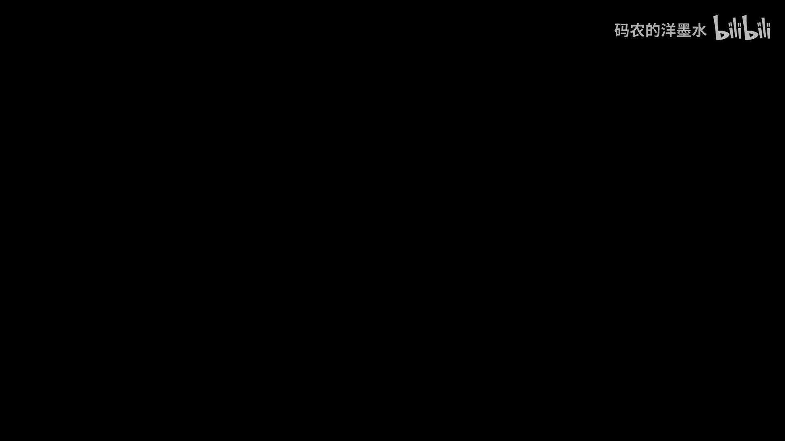
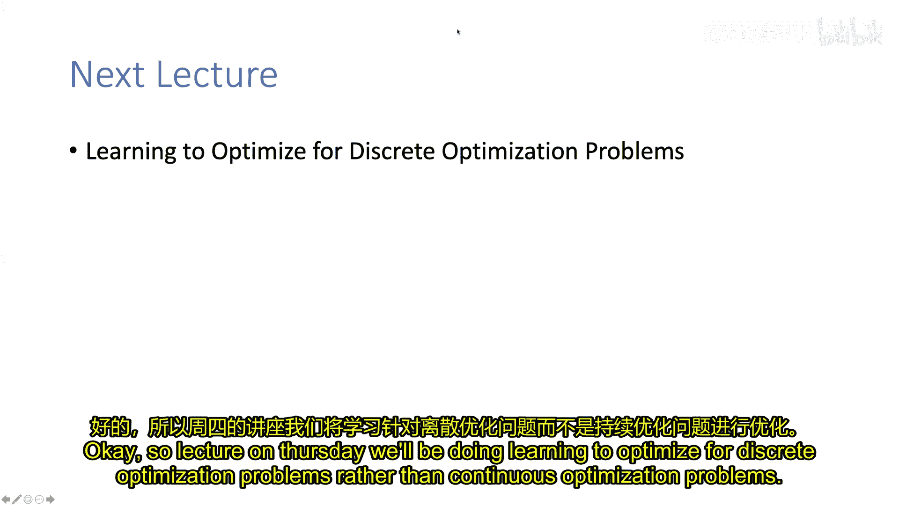
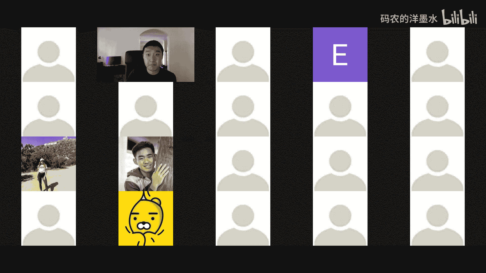

# 【全集 附课件】加州理工学院 数据驱动的算法设计 中英字幕1080P p03 Lecture 3 - 面向持续优化的学习 -BV1CF2LBhEWk_p3-

。Okay， welcome to lecture three and CS 159 advanced topics in machine learning today we'll be covering learning for continuous optimization。

So first off a few logistical announcements about the class。

 if you are looking for teammates and from the survey in the beginning of class there were several of you who were looking for teammates。

 we've enabled the search for teammates option on Piazza so you basically go to the search for teammates pin post and then you fill in the form and add a new post and there's some instructions to make it easier for us to help。

To help facilitate the search for teammates， so just please read the instructions to fill out the about me field appropriately。

Sorry， please do so by end of today so end of Tuesday， April December 14th。

 we'll be taking a look at this tomorrow。Blog post guidelines， so we've made a site for blog posts。

 we've also put a template post as a demonstration of what a good blog post should look like that's shown in the screenshot on the right。

The guidelines also have been updated on the courseRS website and the key idea is to explore a topic insufficient depth through the right egg 10 to 15 minute blog posts。

 so the template you see on the right is a 13 minute read。

And we recommend that you basically take a topic derived from a starter paper。

 there are 10 starter papers listed on the course website under blog post guidelines。

 and so these are what the TAs and I consider to be the most basic papers in this class。

 the 10 most basic papers for this class。And to understand it， you could even use an implementation。

 there's implementation linked to off the course website for code and data。

 or some of them are easy enough that you could implement them yourselves， at least a toy example。

 and to basically understand the properties of this approach and then write a blog post explaining it and again you can read the guidelines for the details and also survey possible extension so briefly read a few of the followup papers is a huge list of references on the course website to understand how to extend this approach and to basically not only understand the key sort technical concept but also the context of this approach in a slightly bigger landscape。

And this is due on April 24th， in this is next Friday， so it' about 10 days from now。Or excuse me。

 12 days from now。And it's in the teams so that you can do this as a team of three to four people。

 so you you not every one person has to do this themselves。

The Ts and I will hold office hours next week， so the details will be announced via Piazza to I'm sure students will have questions and so we'll be having offer virtual office hours next week and if you of course your needs don't fit the particulars of the office hour because of scheduling reasons we can of course find some other time to meet as well。

嗯。The last thing I'll say about this is coab， so we really recommend collLab as sort of a playground environment for those of you who are looking for a place to playground collab。

 which is short for collabatory。Is basically something that is provided by Google research to facilitate AI researchers to get started to play around with code AI code。

So it has an easy to use notebook environment everything's stored online to provide computer resources。

 there are many useful notebooks already available online that you can download made them relevant to this class。

 so it's a great starting point for those of you who are looking for a good starting point to get into the code and get things working and running and we have linked to the Collab tutorial on the course website and we've linked to example Collab notebook we've actually written our own example codeab notebooks。

 those are also linked to from the course website under code and data。

Any questions about the logistics of the class right now？Please raise your hand。Okay。

Outline of today's lecture， we will do a review of deep learning and differential computation。

 excuse me， then we'll use that to segue into learn to optimize for continuous optimization。

 which you can basically think of in a nutshell as learning better gradientding optimizers than handcrafted gradient based optimizers。

And then we'll talk a little bit about embedding differential optimization inside neural networks。

And then we'll close with a brief discussion on how to use reinforcement learning when the learning is not differentiable。

 which is most of what this lecture is about。So let's start with the first topic。

So first just a brief review， so when we're doing something like classification where we have positive points and negative points。

 the goal of supervised learning is to learn some sort of decision boundary that separates or approximately separates the positive points from the negative points。

😊，the first thing we learned in CS155 is linear or linear models。

 and this is one that we should all be very familiar with logistic regression。

 which is a linear model in this case that finds this separating boundary。

And we typically train this using。Grading disscent on log laws or cross entropy loss。

 that those two terms are basically exchangeable in machine learning。

And deep learning start to become relevant when we start to care about highly nonlinear decision boundaries such as this one。

 where we want to be able to find a function class that well approximates this red line。

 but is easy to learn。And so option one， which we also discussed at the very beginning of the deep learning lecture that most of this material right now should be just review we'll go through very quickly。

 option one is to just expand the feature representation of the raw features in this expanded form。嗯。

Or we're going to use option to。hi is use multiple linear decision boundaries to compose a nonlinear boundary。

 so we have these two red hyperplanes that are linear and we're going to compose them in a way to form this particular boundary and that's essentially what deep learning is in a nutshell。

And so one another way to think about it is by thinking about boolean operations。

 so you know if we want to implement XR。You know， both An and or。

If we think of X1 and x2 in this case as binary features， either one or zero。

 both n and or are linearly separable， there exists a linear hyperplane in this Boolean feature space that can separate n and or。

But XR is not linearly separable， but can be separated using linear combinations of an and or。

And so we can take that analogy to build a circuit with N orD and not gauge。

 which is a negation gate。And we can build this circuit that basically performs exO。

 even though each individual circuit of this particular complexity。

 just an and or cannot actually model。Exhort by themselves。Okay， so neural networks， of course。

 can't approximate circuits。And we can learn sort of functions that look a lot like you know what you see in the bottom and one thing that I want to stress is that from the perspective of this lecture and this class or especially this lecture。

We're going to think of both neural nets and these sort of circuits as computation graphs。

 so each node in this computation graphs performs a computation of some sort on the inputs。

 it produces an output for neural nets， it performs a applies a linear function on the inputs plus a nonlinear like a rectified linear unit or value。

And for neural networks and for differentiable computation graphs in general。

 the computation that we perform in each node is parameterized in some differentiable parameterization。

And therefore it can be learned via grading descent and we'll talk about that a little bit more in the next few slides。

So a deep feed forward network。Is a computation graph。

 a differentiable computation graph that is many layers deep where each layer has a set of what so called hidden layers。

Whi and each node in the hidden layer is exactly a node of computation that takes its input of stuff from the previous layer applies a linear function where the parameterizations of this computation are the weights of that linear model applies a nonlinearity like a value or a logistic function and then fits that output to the next layer。

 and this is a computation graph， and the exact formula for each layer as expressed in the bottom right corner。

But this is the way we're going to think about deep neural networks for most of this lecture as these differentiable computation graphs。

That take that where you have the nodes and the nodes are connected in a graph in a directed graph and the edges correspond to input outputs and the nodes perform some relatively simple each node performs some relatively simple。

Comput that's differentiable with respect to the parameters of the computation node。Okay。

 so one of the reasons why we want everything differentiable is that we can learn the parameters or set the parameters of this computation graph。

By differentiating。V differentialiable optimization or differentiable learning from using a differentiable objective function on the final outputs of this computation graph。

😊，In other words， we have some objective function that's differentiable like a loss function。

 so in CS135 in the deep learning lecture the loss function is typically log loss or cross entropy loss on supervised labels。

 we have a supervised training set and the loss function is defined over that supervised training set via log loss where we take the final output of the neuralNe which is a label。

 let's say one of 10 categories of an image and we compare that or distribution over those 10 categories and we compare that with a true label and we compute the log loss。

And then， you know， we that is the。That is the objective function different and and it's differentiable with respect to the output of the computation graph is the loss function is differentiable with respect to the output of in that case an image classifier neural net here we have a computation graph it's fittingtting some output and loss function is differential with respect to the output of that computation graph。

嗯。The computation round， as we mentioned before， itself is differential with respect to the parameters。

So in this case， the weights of each hidden unit。And what this means is that we can apply chain rule。

Given this global loss function， give it a differentiable computation graph。

 we can apply chain rule to perform differentiable learning of this computation graph to MA in order to learn a computation or learn a function that optimizes the objective function such as minimizes the loss function。

And after we can do Cha row， we can just apply gradient descent to learn the parameterization of this computation graph。

Any questions so far， raise your hand if you have any questions。嗯。Okay。So。

Let's think about feed for neural networks as computation graphs so you know what kind of computation can we learn or can we model in a feed for network well in some sense it's like a onepa computation a feed for neurona at least in this simplest setting doesn't maintain any state or memory you give it inputs it spits out outputs it's like this there there's no recurre is no for loops it's just it's like it's as if you were just writing code you know like line by line。

You know you could unroll you could basically write this neuralnet line by line if you were writing code and it's just there's nothing super clever about it。

 it's just lines and lines of code， no recursion， no special function calls， no for loops。

 so its I roughly call that onepa computation so that's what we can those are the kind of computation computation。

 no models that are encoded as feed4 neural nets if we think of feed4 neural nets as a computation graph。

Okay， so。Let's think about grading descent as a computation graph so now we're thinking about the we have an objective on we have some inputs which is the current state let's say let's say the state is represented by theta sub T so if in the bottom right corner each theta sub T is one of those blue points in the bottom right corner。

We have a gradient of theta sub which respect some loss function。

And then we perform some computation with these as inputs， we may not use both of these inputs。

 and maybe we'll just use one。And then we spit out an output。

mThat gets added to the current state and we get the new state。

And then this process repeats with increment T so this new state theta t plus1 becomes new theta t and gets fed back into this computation graph。

 so this is a loop or recursive computation graph。And so in gradientding descent， you。

 the computation module， G that is currently left as a black box is basically the formula that you see below。

And we can implement that as follows， so we can implement the computation graph。As follows。

 so in this case we ignore the current state in the input of this computation node that we're specifying。

 we just take the gradient， we multiply the gradient by negative eta。

 negative the step size because we the gradient descent。

And we output that and then we get a new state and then this new state gets fed back into the current state。

 both in terms of just the current state and and a grading of the current state and this whole thing loop。

So if I were to think about gradientd descent as a computation graph。😊，This is what gradientcent is。

 this is a completely hand designed computation graph。😊。

Every every piece of this with the possible exception of the step size， which you could tune。

 is sort of handcrafted a sort of in a very explicit sort of way。

Any questions so far about this concept of a computation graph？We've looked at computation graphs。

As a way of expressing both P4 neural nets as a way of expressing gradient descent as an operation。

 computation operation。Just to get you in the mode of thinking of computation graphs。

 any questions about that concept so far。Okay。So what about gradient des with momentum let's just play let's just keep thinking about these different operations or computations in the concept in the context of a computation graph what about gradient descent with momentum so here's a very very very simple version this is not one that's typically recommended but just I just use a simple one just to。

😊，Just for demonstration purposes only， and you see the equation of gradientent with momentum in the top left。

 where we take an update step in the direction of the gradient plus the momentum term。

 and then we update the momentum term with this exponentially decaying cumulative gradient。

OfFrom the past as the momentum of that's N。So this is a very simple formulation of gradient set momentum。

And you know， we can， of course。Take his input at the momentum term。And then we oops。

Sorry this should be an ad module sorry I made a slight mistake I'll change these lectures after class and update the updated slides so there's this should be adding the momentum term with the gradient term and then multiply the negative data so I'm missing a computation module here。

And then we update the we update the computational。

We update the momentum term to get the new momentum。So this would be the computation graph。

Modular that slight error that I'll correct after lecture of great intent with momentum。

And of course， this whole process repeats and so both this new state and this new momentum gets fed back in and processed as inputs to this computation。

 this still recursive idea， one thing to keep in memory one thing to keep in mind。

 excuse me is that we have this notion we have this generic notion of memory。

So if we try to abstract away what gradient depth with momentum is trying to do and just think about it more abstractly。

 we have this computation graph that's updating our new state。

 so the state theta is the thing that we're trying to optimize theta corresponds to the blue points in the bottom right in the bottom right。

Figure， while we're also maintaining this memory， there's some notion of memory of things that have happened in the past。

嗯。And so one question is， you know you， for example。

 if we can we learn a better optimizer that you know is better than a generic way of using momentum like like like the one I wrote in the figure in the diagram in the previous slide that's again a very explicit handcrafted way of maintaining memory and their memory is interpreted as momentum and it's all like very explicitly crafted。

 you know if we just have this generic notion of memory and we want to learn this computation that somehow exploits it in a way that maybe can do gradient ascent faster then these handcrafted optimizes so can we learn this optimizer so now we're trying to see how deep learning as a computation and gradient ascent type computations as a computation graph can be unified。

So now we're starting to see this unification。But any questions so far？O。

So this is learning to optimize。In a nutshell in its simplest form。And to do so with this memory。

 with this memory concept， we have to appeal to recurrent neural networks。

 so if you recall from again， from CS155， this should be reviewed for everyone。

 recurrent neural networks these neural nets that take a sequence of input and produce a sequence of outputs and maintains this hidden layer that whose values are whose values of the hidden layer。

 these orange nodes are a function of not only the current input but the output of the previous hidden layer。

And the parameters of this recurring neural net are encoded in the arrows and all the arrows with the same color share the exact same weights。

 so the computation graph， if you will， of every you column of this neural net is exactly the same computation graphs with different inputs。

So this is a recurren neural network。We can also write it in the following form。

 which looks more like a computation graph that we've seen in the previous slides。

Where in this particular case， H， this is using the notation from CS155。

 it's slightly different than notation we're using now。嗯。

H is in this case the hidden node and it depends its input the previous output of the hidden state。

 so this would be the memory term the M that we've been looking at in the computation graphs from the previous slides。

We we could also think about a recurringcur neural net as a feed4 neural net。

 as long as we have a fixed or upper bound on the number of iterations。

 we can think of them in this way， so the depth of this feed4 neuro net is equal to the number of steps which has implications for learning because。

Grading descent and chain roll get harder and harder as the depth gets larger and larger。哦。Okay。

So you the gradient descent or back propagation algorithm is called back propagation through time。

 so every output node， which is the turquoise node。

 know it gets attached with some sort of loss function and through that loss function get a gradient on what the parameter should be and then through chain rule that gradient propagates backwards through the arrows。

嗯。And this is especially relevant for the hidden the for the green arrows， which are。

Whi which is the computation of how the hidden unit of the or the recurrent units are updated over time and in this case in our case it'll be the memory units。

Okay， so learning to optimize as recurrent deep learning。So let's go back to this graph。Where again。

The new states and the updated memory gets fed back into the stuff that gets inputted back into this computation。

 which outputs an updated memory and this new state again， and this happens in a loop。I mean。

 this is essentially a recurrent neural network it's a little bit different because there are a few extra pieces。

 but in terms of the things that matter such as applying chain rule or back propagation through time。

This is essentially has the same architectural design paradigms as a recurringcurial network。嗯。

The difference is that the biggest difference between this in just a vanilla recurrent neural network is that you have this plus operation that's very explicit in the top right。

 so the output of the computation graph gets added to the current state to make the new state and one of the inputs to this computation graph is the gradient of some objective function we're trying to optimize。

😊，So those are the two things that are explicit about this particular recurrent neural network that sort of we're fixing the architecture of and everything else is just looks like a free form generic recurrent neural network。

Where the memory cell is the output of a recurrent hidden unit。Any questions so far？嗯。Okay。So。

Let's talk about differentiable learning so we have some objective function that we want to optimize。

 so this objective function is a function of theta theta is the current state of the optimization landscape。

And we assume that the loss function is differentiable with respect to theta。

 which means we have access to both the zero order and first order measurements of theta of loss function at any theta。

This is in contrast， by the way to Beijing optimization that we talked about in the previous lecture。

 where we only had zeroth order measurements of the loss function here we're assuming we have both zeroth order and first order measurements of the loss function。

We have this。Differentiable computation graph， I'll call it G。

 and G is parameterized by a set of differential parameters。 I'll call that feet。

And it outputs both this Delta offset of the state and this updated recurrent output。

And then the part that's hard coded in this computation graph is the second bullet point where the new state is equal to the current state plus this offset or update to the state。

So that part is hard coded in this computation graph。

 the rest is just this generic and differentiable computation graph。

And so we assume that the outputs of G are differentiable with respect to the parameters of G。

And we assume that the inputs of G had to French both respect to the parameter is of G。

Or maybe I wrote this backwards， the parameters of G are differentialable with respect to the outputs and inputs。

 I may have written this sentence backwards。These sentences backwards。

The the key consequence is that we can do chain rule recursively。

 back propagation through time to be able to estimate fee in a differentiable learning way。

So therefore， by chain rule。If we can compute the gradient with respect to the parameterser fee of this computation graph。

嗯。Any questions so far？嗯。Right， so this M term is the recurrent aspect that requires us to do back propagation through time。

Because M is both an output of this neural net and an input to this neural net。

So you can think of it as one of those recurrent hidden cells。In gradient insight with momentum。

 it was handcraft if to have a certain meaning here is' just some memory cell that's let up that's going to learn something useful so that this that we can you know minimize this loss function you know。

Well。Okay， so typically you fix the time horizon， capital T， so the number of update iterations。

And then we just train this we just。And then we just。

 know think of this as a recurrent neural network with some special structure。But otherwise。

 basically a recur neural network。And the loss function incurred by the predict the neural network predicts a theta sub T or predicts the neural network predicts a if you a delta sub T。

 but if you think of this add operation at the top of this as just a hard coded part of this work neural network。

 then the loss it experiences loss theta sub T at every iteration so whatever the loss function is that that step of this optimizer is the loss it incurs and we want to minimize the loss the sum of the loss over all capital T times steps that's the learning objective to minimize the sum of the loss over all capital T time steps。

Because at every time that it's outputting this status of T and we're passing that through a loss function。

And that's how we do differentiable training， it's just like a recurringcurren neural network。

At test time， you know， of course， we have this G and it's fixed and we just applied。

 we just use G iteratively just have it make predictions whereas you start with an initial theta。

You pass into the gradient， you pass in some initial memory terms， typically a random initialization。

You or some standard basic initialization， you you know you predict a new theta。

 you compute the gradient， you pass that back into the computation graph in the recurrent neural network。

 the memory gets updated in a recurrent way and then you know it's basically just rolling out the prediction of a classic recur neural network。

嗯。In the most classic formulation over a Ch network。

 this memory output M is just embedded inside the computation。

Sorry that should not be M is not hidden inside theta， M is hidden inside G。

 that's sorry that's another type of of example。哦。Recall that in lecture one， the notation。

that we used was， you know we had this theta subg， which is what we call it an optimizer。

 the optimizers G， and we have given an initial state。

 we give it the max number of iterations and the output after that that max number of iterations is this notation that we use。

Any questions？Okay， so now we're going to take that idea of deep learning and things that look like gradient in descent。

 both in the paradigm of differentiable computation and computation graphs and we've seen how they can be unified now we're going to look at specific examples of learnings optimizeim。

So let's first talk again about the one that we briefly talked about in lecture one。

 but we're going to go into it a little bit more depth and I'm going to revisit it in the context of what we've just seen in terms of concepts such as computation graphs。

So in this particular paper， titled Learning to Learn by Gring Desent by Gring Descent。Theta。

 the state， excuse me， is the parameterization of a larger narrow net。 so in this particular paper。

 they have an optimizer。And an optimize Z and the optimize Z is a large neural net。

 and optimizer is STD， it could be any one of the handcrafted grading descent gra based optimizers or it could be a learned gradient based optimize。

And the loss function that we're trying to minimize overall is the supervised learning loss of this larger neuro net。

And so it， you know， it basically is once we set that up in that way， it basically is exactly。

The formulation that we described above。I think one thing I guess to emphasize。

 maybe I should have added this in a slide。嗯。Is that。嗯。Computing。

Computing this gradient in the bottom in the bottom。

In the bottom line for learning kilobar gradientcent by gradient descent is you actually have to do a lot more chain rule。

Because theta sub T in that paper is the parameterization of a larger neural net。

 so to compute the loss of this larger neural net and to compute the gradient of this larger neural net。

 we have to do a whole bunch of chain rule。嗯。Before we can feed it into our learned computation graph。

So that's why this paper is called。Learning to learn。By gra to sun by gra to。

Because we're doing two sets of nested back propagations in order to compute the gradient of the larger neural to feed that as inputed to the smaller neural that's our learned optimizer who then uses that with its own chain rule to learn its own parameters feed。

But once you do that。You know， this is again， a plot that we showed before。

LSTM is their approach that they use an LSTM， which is a version of a recurringcurrent neural network。

嗯。On these are simple relatively simple data sets lower is better。

 this is the loss function of the larger neuralNe that's being trained with the smaller neuralNe as a learned optimizer and this is compared with various different gradient based optimizes that are handcrafted。

One thing that's interesting is that， you know， again。

 you have to set your time horizon to some fixed time horizon during training so they picked 100。

And what you see on the right figure is， well， if at test time。

 if you just kept predicting for the next 200 time steps， what happens？And so in some sense。

 you know this learn optimizer can generalize in some sense beyond its training domain。

 so even though it was only traineds at this to run for 100 time steps。

 it can actually generalize to 200 time steps。Even though it's never seen gradients inputs or states that look exactly like what it's seeing in the next 100 time steps。

Another thing to keep in mind here is that at least as a function number of iterations。

 this learn optimizer converges much faster than a handcrafted optimizer。

 one thing to keep in mind though is that you know each iteration may be more expensive because each iteration now we have to actually apply a neural net。

😊，Rather than just you Adam， which is doesn't require applying a neuro net to get the update rule。

So each iteration is more expensive， but at least in terms of number of iterations。

 this converges much faster so for example， if you look at the middle plot on MIS，You know。

 this neuro is basically converged， you know， you if you want to train something really fast。

 there neuro basically converged after about 70 iterations between 60 iterations。

 if you wanted to get something quick， quick learn， quick， quickly learned。

 it's basically converged after like 70 iterations。And you know， it's at 70 iterations。

 it's about the same performance as these other optimizes after about 150 iterations。

 so it's about twice as fast in terms of number of iterations。

So as long as this neuralNe does the small neural net that you're learned to optimize in this computation graph isn't on a per iteration more than twice as expensive。

As these gra based as these classical gradientd based optimizes。

 which perform less computation per iteration。😊，Then this is worth it。

That's the kind of thought process you need to think about。

And here's some plots from other more complicated another more complicated data called C4R 10 and subset of C4R10。

CR 10 is an image classification data set with 10 objects。

 so there's 10 categories and you take in an image you predict one of the 10 categories。

 so that's the larger neural net。And the large area has a lot of parameters。Oh。And。

And one thing that this bottom plot is testing is whether or not this learn optimizer can be used on a different learning problem。

 so one of the use cases of this type of approach this was asked in the first lecture。

 one of the use cases of this type of approach is that this learned optimizer can then be deployed can be shipped as part of let's say let's say if we're Google can be shipped as part of Tensorflowlow and if we're Facebook as part of Pytorch as one of the optimizer flags if if you look at Tensorflow and Pytororch that different optimizer flags like SD RMS Pro atom you just pick one you want to use。

You can actually pick one that's your learned optimizer and so if you're let's say a small business or a grad student and you want to train something in your domain very quickly and you think that your domain is well represented by the domain that this learned optimizer is trained on。

 then this learn optimizer should be able to generalize to your domain and train faster than a conventional optimizer such as Adam。

And that's what you see in the bottom plots where the brown line are neuralnets are learned optimizers that are trained on a slightly different training problem so CFR2 for example is basically CFR 10 but only looking at two out of the 10 classes so this becomes a binary classification problem so if you can train the brown line which is this learn optimizer on a different CFR2 data set。

So that's what it's trained on and then you could apply that test time to try to optimize the neural net of another CFR2 problem of a different subset of two classification images。

 so in some sense these are related but completely disjoint data sets。U。

 and so this is and this this shows you that if you want to learn learn is optimized to train a new neural at test time very quickly。

UOn a related but completely different data set then you know this learn optimizer can perform actually in this case very。

 very well。不会。Any questions so far？Okay， so going to the other example that we talked about briefly in lecture one。

 but just revisiting it in the context of everything we just described。

Is iterative amortized inference， so amortize optimization。😊。

Refers to a concept that's very popular in deep probabilistic models or deep generative models。

The idea is that in many deep generative models， such as autoencors。

 you need to predict inference to infer some latent variable just like any probabilistic model or just like in many probabilistic models。

 you to do some inference procedure to infer some late variables given inputs。

U and this inference procedure， if you use variational inference is actually an optimization problem。

 you have to actually run this optimization problem compute to do inference。😊。

And one thing that you can do is you can say， well， you。

 I could train a neural net to predict the output of this optimization problem and so that at test time rather than solving this optimization problem。

 I just make a prediction of what the solution is。And that's called。Amortized variational inference。

 this is popularized in the context of variational autoenrs。

And in the context of this computation graph idea， this can be thought of as basically。😊。

Running this computation graph for one time step， so T Max equals one。

And one of the issues that Joe Moreno， one of the TAs in this class noticed is that if you do that。

 then if you only run this for one time step， you get what's called the amortization gap。

 which is depicted in the bottom， where the global maximizer of this optimization landscape is the red star and if you run gradient in descent。

You get you get this sequence of blue points that eventually get really close to the red star。

 this one step learned computation graph with a neuro net that's predicting the solution of the is getting you something that's not quite at the global maximum。

So that's what's now called the amortization gap。So。In Joe's work。

 so Joe is thinking of you know how do we do this iteratively in the context of variational inference。

 which is a very different optimization problem than training supervised learning of a larger neural net。

So。De that Joe ended up using because it in part because it worked really well in his application。

Is the following？So。Instead of adding to theta， we have this gating mechanism that gates the current state and then whether to use the current state or to use the prediction of the new state and this dot with a circle is the element wise。

Is the element wise multiplication so if theta is this multidisal state space。

 let's say 100 dimensional state space。Then the circle dot is the element wise product。

So in this case， G1 and G2 are both outputting， you know， in this case。

 100 dimensional vectors and we're performing this computation on it。

So you can interpret this as saying G1 is this gating computationm。

 which says how much I want to stay at the current location versus jump to the location predicted by G2。

And again， everything here is differentiable。And G1 and G2 may or may not be a rerent known that's here。

 if G1 and G2 recurrent， thet hidden units are implicit inside the boxes of G1 and G2 rather than explicit like we saw in the previous computation graph。

嘘。Any questions？嗯。And they just give you a sense of， you know what。

You know more these other optimizes might look like this is actually a figure drawn from taken from Joe's paper the notation is different what I want you to see here is that you have these two objective functions in the black rectangles。

That is the objective function of variational inference in a probabilistic model with latent variables。

嗯。And you know， this is the full computation graph。

 including the probabilistic inference of including the objective function。

 which is variational inference， the part that we the learn optimize the part is in blue。

And so this is just showing how you can back propagate gradients to learn the parameters of the learn optimizer。

So this is just， again， you know， I don't expect people in this class don know variational inference and deepprobabilistic models。

 this is just to show you that if you can set up really complicated differentiable optimization problems and then figure out the rightway to feed gradients back into the learn optimizer and train the optimize in a fully differentiable way。

That's the essence I'm trying to convey by showing you this diagram。And so some empirical results。

 so because in this field， a variational inference。

 this learned optimizer that gets applied for one step is called amortized variational inference。

Joe calls this line of work iterative amortized inference or iterative inference。

 or where you apply this neural net multiple times。

And you see at least qualitatively in a 2D optimization problem after no more than 10 steps of optimization。

 this neural net makes some big jumps in the optimization landscape and then settles on something really close to the global。

And we can see this in these figures， so this is doing variational inference。

In this case higher is better and the blue line is the iterative is the learn optimizer that in Joe's work that basically closes the advertising gap but is still in this case orders magnitude too faster than the standard optimizer so for example rMS Pro in this case is the best performing optimizer for this particular case。

And in this case， you see that basically in terms of the number of iterations。

 Joe's approach iterative inference is about 100 to 200 times faster。

Let's say 100 times it's hard to tell by looking at this particular plot。

 but let's say roughly 100 times faster in terms of number of iterations so possibly much more so so long as this smaller this small neural net that's my learned optimizer。

G， this G。As long as running the computation of this optimizer is less than 100 times slower than the computation。

Time of RMS Prof this is a faster algorithm and in practice in this particular case Joe has verified that this approach is orders of magnitude faster and actual wall clock time than standard gradient based optimizers。

嗯。Any questions？不是。Okay。So we're going to talk about something that we didn't cover in lecture one。

 which is metal learning。Metal Learn is worked by Chelsea Finnn。

 Peter Rabial and Sergia Lavin from 2017。The basic idea is suppose we want to do sort of domain adaptation at test time so what does that mean that means that we at training time we have this distribution of supervised learning problems so we can think of these as different tasks。

Each one corresponds to a different。To a different loss function and each one is associated with a very small training set。

 although it can be big， but let's say small training set。

And then we assume that these learning problems or these tasks are related to each other。

So in the simplest form of meta learning， and it can get much more complicated。

 but we're just going to talk about the simplest form。In the simpleus form of meta learning。

 the goal is to learn this two step optimizer。Where step one is an initial guess， theta not。

And step two is we can quickly fine tune theta not to an individual task。

And that's depicted in the diagram in the bottom right， which is taken from the metal learning paper。

And so in its simplest form。This is metal learning as a computation graph。

Where we have a collection of loss functions from different tasks that's inputted and then for each of them we want to be able to minimize its loss。

And we want in this case， we're just going to take one gradient step。 so this is just one。

This is basically saying we want to estimate a theta knot such that in one gradient step。

We can get to a theta star。For that task。Of course， we do multiple gra steps， we can also learn。

 we could also learn the optimizer。In this black box rather than fixing it so here we're fixing the optimizer as standard grading descent。

 we could also learn the optimizer as a black box。We could also run it for more than one time step。

 but we also need to learn a theta not。Over this collection of tasks。

And the goal and so this is just another way of thinking about learning to optimize where the thing that we're exploiting here is that we have a family of related supervised learning tasks and we can learn a good preconditioner。

 if you will， or initializeizer fate or not in addition to everything else that we've been talking about。

And so long as at test time for our new task， our a new supervised learning problem that we're trying to optimize is related to all the training tasks。

 then this data not plus this optimized which could be learned will very。

 very quickly learn learn to do well for this new task and one of the side benefits is that it may do so in a way where the learning task or at test time has very little training data as well that says another the side benefit that that is not really the focus of this lecture。

So the benefits of meta learning is that it can quickly adapt to the new task at deployment time with possibly very little training data。

 learn to share information across training tasks for fast adaptation。

 both in terms of training time and in terms of generalization power and sharing statistical strength。

And this is one figure from their paper。Um where pretrain corresponds to a neural net that was just pretrain on all the training data and not fine tuned。

And Oracle is the ground truth loss if you had all the training data。And so you can see that。

 you know。You really can learn faster with just one or two gradient steps。Sorry， pretrain， sorry。

 pretrain， I misspoke pretrain corresponds pretrain to a pretrain neurona that then gets fine tuned in a normal way。

Whereas in meta learning。You're learning an optimizer for the purposes of fast adaptation。

An fast fine tuning。So this is in a sense， this is basically learning to fine tune to a new domain。

I's another way thinking about it， but we can actually think about it if I just go back to the previous slide。

 we can actually think about replacing。Replacing sorry sorry this portion where they learn optimizer as well so we can combine that that the core concept of metal learning with the core concept of a learned grading based optimizer we can combine these two and that is of course an interesting。

Topic for a research project if that's something you're interested in。Any questions？Yes， question。

 aid。How much work has been done in trying to understand how information can be shared among different tasks that's a great question。

Truthfully， I don't know， you know， this is not an area that metal learning is not an area that I've spent a lot of time working on myself。

嗯。I， you know obviously the intuition is that you know。

 that the training tasks have to be related somehow and the test tasks have to be related to the training task。

 obviously that intuition is there， you're asking the question of empirically what does that mean。

We're going to be updating the course website with the references with as many papers as we can find。

If you have things you want to add to the course website， just send me an email。

truthruthfully I don't know this is not an area that i've done a lot of nitty grty research on so truthfully I don't know there's something you're interested in I just I guess you know since this is a graduate level seminar project based class I guess I would just invite you to look at the references and sort of。

Look at the literature yourself。Thanks。Second question。

Yeah I think mine is similar are there some ways to test how related one problem how related your new problem is to the problems you've trained on so okay。

 so so the general way to ask to ascertain this is of course it' it's a very unsatisfactory answer is we do cross validation right we have。

嗯。A set of 100 tasks we want to figure out how related they are to each other so we're to try to we're different ways of partitioning the tasks and see what does well and what doesn't do well and from that you can you know see that oh these collection of 10 tasks are more related to each other because by cross validation they work well together and not unless so with these other 10。

So the generic answer in the absence of anything else is always different ways of doing cross validation。

 so you can do meta cross validation in some sense。

 so that's the generic answer and I know that's not very satisfactory but when we do research that's always a reasonable starting point to just get insight and intuition about the problem。

嗯。The second answer， which is not something that I was planning on focusing on。

 is that you can actually potentially do meta meta learning。

Where you have some attributes of this learning problem。

 so you can feurize your learning problem that that's possible to do。

And then you learn based on features of your learning problem。

 which subsets of the data to meta learn from。So that's another layer。

Of computation so one of the things maybe one thing to think about in this in this diagram is that this is a nested computation graph suppose we're learning this gradient based optimizer this big rectangle rectangular box in the bottom so those we' learning that as a learned optimizer and we're learning this theta not。

So this is a nested computation graph from that perspective that we're doing two levels of nested learning。

We can do a third level of nested learning where we're learning to select which training sets to learn from。

So we do with three level nested learning and if you can make that whole thing differentiable。

 then you could potentially do that。I do not know if anyone has done that。Again。

 this is not an area that I'm personally is like like actively involved in in day to day research we're going to do some more literature reviews if you find papers that are relevant please email them to Ill add them to the course website if an exploration of something like that could be an interesting research project for this class。

Any other questions？Okay， so moving on， the next two bullet points will be a little bit shorter。

Ebedding differentiable optimization inside neural networks。

So the story so far right now is that we have this optimization problem。

L and we we have we want to train an iterative optimizer like a gradient based optimizer to optimize L and we assume everything's differentiable。

And we also assume that L is completely well defined， so for example。

 when L is defined by the supervised learning loss of a larger neural net。

 then in some sense it's completely well defined and we just need to figure out how to optimize its landscape。

But this isn't always the case。So to sort of arrive at this perspective。

 let's think about an alternative perspective and so to do so we're going to look at OpNe which is work by Brandon Amos in Zel C at Carnegie Mellon。

 first appeared at ICML， I believe it was IO 2017。嗯。

So the first thing we're going to do is we're going to look at a quadratic program and so some of this may be a little bit。

Out the scope of your knowledge if you haven't taken optimization。

 so if you've taken ACM 113 this should be largely reviewed if you haven't taken ACM 113 i'm going to sort of give just give you enough intuition of what's happening and so you understand the general idea and and yeah and then we'll go from there。

So a quadratic program says I want to find the theta that minimizes this quadratic loss function。

Subject is linear constraints。So this is an optimization problem。

 if the parameters of this optimization problem， capital Q， little Q， capital A， little B， capital G。

 little C， are completely specified， this is a relatively easy problem to solve because this is a convex optimization problem is relatively easy to solve。

So now the question is。Can we learn what these parameters are， capital Q， little Q， capital A。

 little B， capital G， little C， not capital C， excuse me。

Can we learn the parameters of this optimization problem such that the solution of this optimization problem gives me what I want？

So in other words， suppose that these parameters of the optimization problem were outputs of a neural net。

So in other words。We're going to have a neural net where we have an optimization layer inside a neural net。

The actual optimization problem， so you can use an existing solver to solve this optimization problem。

 which is in this case， the optimization problem is easy once you specify the parameters of the optimization。

嗯。And so we have some input。Call it X。And we're going to pass it through， in this case。

 just a fee4 neural network。And then the outputs of the F4 neural network are basically the parameters of this optimization problem。

 and we run this optimization problem。And we get an output。Okay。So that's the basic idea。

So what are some properties of an optimal solution of this optimization problem？

So for those of you've taken， so this the general idea should should be familiar to anyone who's taken CS155 because we talked about Larians。

 this in particular is a laggrangian of QP。So I just wrote out a around。ops。

And the thing that I wanted to talk about are the KKT conditions， which are satisfied in optimality。

 so if you have the optimal solution。Of this Lagrangian that we know that these KKT conditions are satisfied at optimality。

For those of you who aren't as familiar with KKT conditions don' or it's okay。

 we can follow along without knowing the details but just keep in mind that this is loosely analogous to the optimal condition of gradient descent。

 which is that the gradient equals zero right that that's an optimality condition of gradient descent is at optimality the gradient is zero for these quadratic for this particular quadratic optimization problem with linear constraints the KKTT conditions you can think of as the analogy that must be satisfied at optimality。

Okay。So。We're going to look at just one of the KKT conditions is the simplest one。Yeah。嗯。

Just for the purposes of illustration。And suppose that， again。

 capulating a little B are outputs of neural nets。So A is a matrix V is a vector and they're out there to the outputs of a neural net。

Then taking the differential of of this。Of this constraint yields the following form。

 this is just chain rule。And without going into all the details。

 this implies that we can do the following， we can differentiate through the KkT conditions。Um。

In other words， we can characterize how the solution of the QP changes。啊。

Different in a differentiable way as in its relationship to the parameterizations of its outputs。

 which means that we can apply chain rule once we do that we can apply chain rule through the solution of this optimization problem so we let's say we've solved this optimization problem for a fixed Qq AB GC for。

We've solved this solution of optimizationization problem now we ask the question for once we solve the solution of this optimization problem。

 suppose we want to change the parameters of QQ ABGC so that its parameters change a little bit。

 then by differentiating through the KKDJ conditions we could talk about how everything changes。

And then we can apply chain rule onto the fee4 neural network part so again I'm not going to go into the details that's the basic idea。

And so if you have an optimization problem。Where you have some conditions at optimality。

 you know one question is， you know can we just like treat that as a layer of a neural net in this case it's it's not a it's not a simple layer it's。

It's an optimization layer。Any questions about this， at least at a high level？Okay。

So here's an example， Sudoku。So the input is a partially filled in Sudoku puzzle， that's the X。

 and I'll just call theta the fully filled in one just to keep the notation consistent in the lecture。

 although they call it Y in their paper。Um。So the output is this fully filled in。嗯。

Suddoku and you could pick some standard supervised training loss， they pick squared loss。

 say have a supervised training set where you want to predict theta that minimize the squared loss of the ground with the true theta。

 which is the solution to the Sudoku。And so we're going to so the prediction of theta is basically the prediction of this optimization problem subject to constraints。

And they showed in their paper。That。嗯。不死的。This， I think， is not the figure I wanted to show。

 There was， oh no， this is the figure I wanted to show so that they can learn you know。

About as well as a convolution neural net at test time。And they don't overfit。Which is interesting。嗯。

You know， accomplished learn basically treats X as an image then and then it does the sequence of convolutions over this。

 one of the things that accomplished learn may have a hard time learning。

Is you know that constraints need to be satisfied， for example。

 you know every row and every column has to have exactly one of each number that's a constraint that needs to be satisfied if you don't know if you don't know if you actually don't know that that's a constraint that needs to be satisfied。

Then how do you learn that， can you learn that implicitly inside the NeNe and that's one of the arguments for opNe they've since extended opNe in many different ways so the follow up papers you can see that on the courses website where they can significantly outperform Comp neuralnets。

But this particular figure demonstrates that they can potentially this opnet architecture is actually learning the constraints of what are valid solutions of Sudoku。

And that's why you don't see this overfitting that you see in convolutional neuralnas。

 which would be the first thing you tried， but because we're a standardner architecture。

 because you treat this as an image。So in other words。

 if you think that there are rules or constraints that govern what the solution should look like。

Then then， you know。You can learn that in the A B， G and C right A B and G and C are constraints。

 you don't allow the solutions to violate these constraints。So for example。

 learning that each row in each column should have exactly one of each number could be encoded in AX of theta equals b of x。

Implicitly， it could be encoded implicit， of course you need to visualize what the neural net is learning。

 but this is a structure that makes it easier to learn those type of constraints whereas convolution neurals is a structure that makes it easier to learn things that obey or enjoy translation and variance。

Any questions？Okay， so the final topic。Is just a very brief discussion of reinforcement learning when learning is not differentiable。

嗯。So learning to optimize in a non differentiable case， suppose we don't have access to the grading。

There are other cases where learning is not differentiable， but let's just consider this one。

Suppose we don't have access to the gradient so you know we only we can only measure the pointwise loss。

 so we can only measure what the loss is， we don't know what the gradient of the loss is。

So to recap policy learning， both reinforcement and imitation learning。

We have and this is using a reinforcement learning notation。

 so state in our case would be theta and action would be the new theta or the update to theta。

 but this is the generic reinforcement learning notation。

 the environment of the world is the lost landscape and the agent is our optimizer。嗯。

The goal is to find an agent that maximizes reward。In reinforcement that's the environment award。

 so let's say let's say we can only measure the loss function。

 we don't know its gradient so we only have zero order measurements of the loss functions。嗯。

So this is reinforcement learning。And the simplest algorithm is called reinforce。

 and there are much more complicated reinforcement learning algorithms。

 but I just want to show the simplest one。嗯。So let's be had a policy。

The outputs a distribution over actions against this policy parameters by fee。mSo， you know。

 basically if we quote we do what's called a rollout of a policy。

 then step one of the reinforced algorithm， we sample trajectories because the policy actually instead of predicting。

Instead of predicting a deterministic， instead of predicting each these output arrows of the computation graph instead of them being deterministic。

 let's say they're stochastic。😊，the output of distribution and then we sample from that distribution。

And what that means is that we can sample a sequence these trajectories。And we can measure。

The the point wise loss of these trajectories so we can measure we can measure the loss at each theta sub T。

嗯。But we cannot。Measure the gradient of the loss with respect theta。

Then by endowing H with a distribution， we can you know use that distribution to smooth out the loss。

 that's step two， so the gradient of the loss with respect to fee is the smooth version of this loss where we only have pointwise measurements of the loss function if you don't know reinforcement learning it's okay this is just this is just to get you to understand that what we're doing here is sampling and smoothing。

And then we can basically have the smooth gradient。

 we can do gradient descent on our learn optimizer who with parameters speed。嗯。

So that's the basic idea。And so in the context of learning to optimize。

 reinforcement learning can be thought of as sampling based optimization。Right。

So the types of reinforcement learning that we've heard and seen in the past like playing Atari。

 you know in the beginning the agent tries a random sequence of actions and see what a reward it gets and from that it learns how to make clever more clever sequences of actions that get high reward。

Here it's like we take random trajectories in this optimization landscape and see what the loss function is in this optimization landscape。

 which is our environmental reward， and we learn through that sampling we learn to make more intelligent sequences of optimization steps to minimize the loss。

So of course we want to make this as differentiable as possible。

 that's what the last bullet point is， but you know the assumption is that you know there's some aspect of this problem that's not differentiable if you cannot differentiate through it。

 then you can only sample it and then do a smooth estimate and do a grading of this smooth estimate。

Any questions？Okay。So just to briefly one slide talk about this paper neuro optimizetimizer search with reinforcement learning this appeared at ICML 2017 from Google Brain。

This is in a nutshell what they did， of course were their actual setup is more complicated and what they were interested in is not only finding an optimizer that performed really well。

 but also to actually try to you know maybe put a little bit more structure into the optimizer。

 even though the whole thing the policy class is differentiable and to see you know what kind of optimization rules。

Our。Are learn， so there are new optimization principles that can be discovered。

And so they had two different classes of optimizers。

And this is just showing that these optimizers outperformed standard gradient based optimizers。

And the right plot。I guess as you mentioned right here that as you move towards reinforcement learning。

Learning these optimizes start getting more and more expensive because sampling is extremely expensive。

If you if you don't have a fully differentiable problem or you're not Bayesian and using using a Gaussian process like in the previous lecture and you're trying to train a neural net with sampling it is extremely expensive so so if you are thinking of doing。

If you're thinking of doing a research project on reinforcement learning， just you know， of course。

 if you're really interested in that area， you should absolutely go for it。

 but just keep in mind that it's going to be a little bit of a heavier computational burden to do such a project。

Any questions？Okay， so lecture on Thursday， we'll be doing Learn and optimize for discrete optimization problems rather than continuous optimization problems。

That's it for today。

