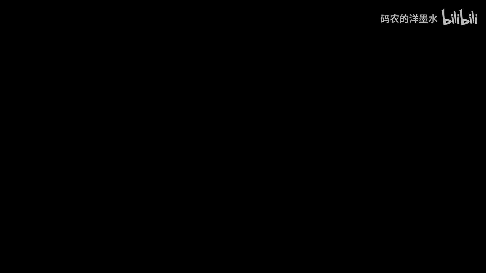
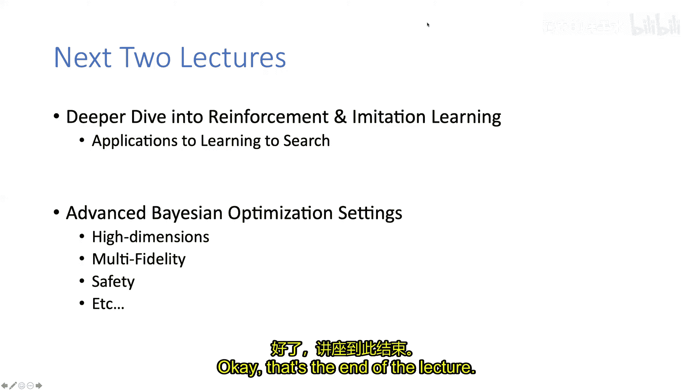

# 【全集 附课件】加州理工学院 数据驱动的算法设计 中英字幕1080P p04 Lecture 4 - 面向离散优化的学习 -BV1CF2LBhEWk_p4-

Okay， welcome to lecture 4 of CS159， data driven algorithm design。In this lecture。

 we'll be talking about learning for discrete optimization， mostly about learning to search。

So what is discrete optimization well at a high level discrete optimization is any optimization problem over a discrete space。

 so on the left you see a planning problem where it's a little bit hard to see but there's an obstacle in front of the rover in this particular scenario and the rover needs to decide if it's going to go left or right of this obstacle。

😊，And that's a discrete decision you can't really go sort of into the obstacle right so there's no way to sort of continuously map out this action space that allows you to go in between the obstacle so if you represent this obstacle as going left or right of it that's a discrete or binary choice with nothing in between。

In the middle you have a board game go and in in board games you have to make a discrete choice of what your next move is you can't really you know。

Moded this as a continuous action space because the actual game moves are very discrete and so they're not continuous nor differential。

You have classical optimization in this case， or excuse me classical combinatorial optimization。

 in this case it's a traveling salesperson。And again。

 you have to commit to a path that is a tour over the vertices in this graph and that is a discrete choice。

 there's no continuous space of paths， there's only discrete space of paths。

 and you have to make a very discrete jump from one action to the next。

And then just the fourth example and of course there are many others that I'm not describing is a memory controller if you're。

If you're RA。嗯。Is or cash， let's say， is out of memory is full and your your program requests another piece of memory。

 you have to evict something from your cache。And so a typical scheduler chooses one of the locations in the cache to evict。

 and that is again a discrete choice。And of course。

 people have thought about using learning algorithms to learn a better memory controller。

So those are just examples of discrete optimizationization problems and unlike the stuff we looked at in the previous lecture which were continuous with a continuous set of solutions。

 everything here is discrete and you have to do a big jump from one to the other。

 at least as a function of maybe parameters of a learning problem。

So there are many basic approaches this is not an exhaustive list and we're going to go over a few of the things on this slide in this lecture。

 we're going to talk about ways of formulating discrete optimization problems。

 we're going to talk about different concepts like what partial solutions and algorithms that literallyer build up a partial solution to a full solution and then there are algorithms that actually start with a full solution somehow you initialize with a full solution。

😊，And then you basically locally modify your full solution to get better full solutions。

And then there are other algorithms， other approaches that combine multiple algorithms in different phases like a first applying in a presol and then applying to a different solver。

We're not going to go over all of the things in this slide in this lecture。

 we'll touch on some more in depth in some special topic。Discussion lectures in later on the course。

 but we'll go over a few of these in an up depth so you get a sense of how these approaches work。

So first， let me talk about a partial solution even means。So as an example。

 let me use minimum vertex cover which is a very classic combventory optimization problem that you learn about。

 I believe in CS38 here at Caltech。😊，In minimum of vertex cover。

 you are given a graph which is specified by vertices and edges。

 you see an example on the right with five vertices and five edges。

 the vertices are numbered one through five。And the goal is to select a subset of the vertices。😊。

That cover as many of the edges as possible oh sorry that covers all the edges minimum ver covers the problem that selects the minimum of set of vertices that covers all the edges so for example。

 a full solution would be to select the ver would select a set of vertices one3。And four。

 because those are adjacent to all the edges in this graph。

A partial solution is to select a set one and three。

 which does not cover the edge between vertices four and five。

And the minimum full solution or the optimum full solution is one that is the smallest possible。

 so in this particular simple example the smallest possible size is three， so one， three。

 four is an optimal solution。😊，And so you can imagine algorithms that start with a full solution and then do local updates like switching up pieces of full solutions for another piece to get a different full solution。

And you could also imagine algorithms that aally build up a partial solution until it reaches a full solution。

 and that's what I mean when I say partial solution。嗯。

Theyre also known as completete versus incomplete settings or optimal versus non optimal settings。

And those happen in cases where there are multiple solutions。

But one of them or a subset of them are quote unquote best。

 and there's some cost metrics such as size of the solution。

And so a complete algorithm is one that in these settings。

 a complete algorithm is one that finds the best solution and one that typically measures how much time until finding it。

Incomplete approaches typically are framed as given a time budget， find the best solution possible。

So that's just a note about another way of thinking about how to quantify how well your algorithm is doing if you really want to find the best solution。

Then then their applications where anything less than the best solution is not good enough。

And there are other applications that are time sensitive。

 like if if I'm NASA and I'm piloting and I want to do auto navigation of the Mars Rover。

 I don't want to spend forever figuring out a plan because then I'm just sitting there waiting around to until I execute it so given a budget of you know one minute or 30 seconds find the best plan possible and then just execute it。

Okay， so let's start with talking about sort of a more generic or black box approach and using that to sort of talk about the greedy algorithm or else known as best first search。

So the generic blackB formation is very basic in its simplest form it has almost nothing to it。😊。

So in the simple form this is it in the first bullet point where we want to find this I'm going to frame this as a minimization problem。

 you could also frame it as a maximization problem and it doesn't really matter。

We have a discrete set often combinatorialally large。

 so that's what capital x is F of x is the cost function。

And we want to find an x in F of x that minimizes we want to find x that minimizes F of X。

 this is the simplest form， we can put a more structure to it。嗯。And if we have no other information。

 then this is just black box optimization， so just just to be clear that this is sort of the where we're starting from。

 we typically have more information， but this is where we're starting from。So how do we solve this？嗯。

So scenario one， again， you can frame this as either a minimization or a maximization problem as a cost function or reward function doesn't really matter。

 I'm incredibly going to switch off between referring to F as a reward function or a cost function depending on the application。

嗯。So for example in。And。In a board game， like go， at least a deterministic board game。

Perhaps we can use F ofX to model or actually directly quantify whether or not a move you make is going to be a winning move or not a losing move。

Now。That objective function is very sparse because you don't know if you're going to have a winning move or a losing move until you actually roll out a game。

And that is really， really expensive and you can't actually measure it locally。

 so that's what I mean by sparse。And so in lieu of using the true objective function， F。

We people use surrogates， right， so people say well。

The true objective function to is whether or not you wouldn't lose the game and that's really too sparse。

Within this action space or state space。And we're going to define surrogates。

And surrogates can be anything like points for achieving certain peace formations。

Points for capturing the opponent's pieces， points for you know。

Some compute a probability of winning the game， and perhaps that's something that we would could estimate from data。

So these are all very dense objective functions that you can measure， these surrogate measures。

 and then you can make these local updates that greedily maximize or optimize this objective。So know。

 given the dense surrogate， we can use a more standard search algorithm such as greedy。

That's the basic idea。So that leads us to the greedy algorithm best first search and here again I'm fming as a minimization problem you can do maximization doesn't really matter and the algorithm is very simple if we have a Ser engine I would just call it f for simplicity。

😊，Then we greedily grow a partial solution。That know in one step has the best。

Improvement in our surrogate measure。So if this is our algorithm， the greedy algorithm。

 it's the simplest algorithm we could possibly think of。Then the question is， okay。

 we're going to commit to this as our algorithm。 There's a big。

Peace in this algorithm that's typically designed by hand， and that's the surgate measure。

Can we learn a good surrogate measure such that the greedy algorithm performs very well？

So that's sort of the question and that's the first place that we'll look at the intersection between learning and discrete algorithms。

Any questions so far？O。So。I'm just going to sort of go over something pretty quick the greedy algorithm is as you can imagine it's super simple it is exactly what it what it sounds like there's nothing。

Mysterious about it。 And so there's basically two things that goes into。

Learning a good surrogate for a degree algorithm， the first one is what is your function class that what is your that you use to actually learn to estimate a good F or surrogate function and the second one is you know what is your training data。

So let me talk about the first one first in the context of this particular paper。

And for many optimization problems， they can be expressed as graphs， so example。

 minimum birthex cover is a graph optimization problem。

 it's expressed as some operation over a graph。😊，And so one model class that has become very popular or increasingly popular in the last few years is a graph neural network or a graph convolutional neural network that operates over graphs so a standard convolutional neural network operates over a square image which you can think of as just。

😊，A regular grid graph。And you can think of graph neural networks in general as some generalization of convolution neural networks。

 or at least graph convolution neural networks or generalizations of graph neural networks that look at graph structures that are not regular grid graphs。

嗯。And so I'm not going to go into details of Graph neural networks。

 but you know the basic idea was we take a graph， we use a graph neural network to map it to an embedding。

 just like how accomplish neural networks ultimately map pixels or a grid of pixels to some embedding。

And then from that embedding， we can predict。You know， what is the best node to add？

And so now the question is well what is the reward function well in the simplest case。

 what you can do is reinforcement learning， which is a sampling based approach that actually that actually。

😊，You know， samplesles a bunch of actions and measures the final reward and then uses that to learn a good surrogate of local actions that might lead to good high final rewards。

And so I just I just copy and paste the pseudocode from this paper it's pretty simple so we can just walk through really quickly this particular reinforcement learning algorithm is called Q learning it's one of the simplest ones that you can do and so this is a stochastic optimization problem so in step three we notice that there's a distribution of problem instances and we sample one problem instance from the distribution so in that sense it's stochastic。

And then step six。SoExcuse me step five is the iteration so capital T is the number of iterations of this greedy algorithm so we're going to run the greedy algorithm for capital T iterations。

Step six is the sampling part， so you notice that in step six。

 the first clause says we sampled a random node in their notation is V vertex。

To add to the partial solution。And that's the sampling part so basically what Q learning does in step six is with probability epsilon。

 try something random， try random vertex to add to add to the solution with probability one minus epsilon try the thing that we think is best so far that's the second clause that's step six。

And so this is how we collect training data because we want to be able to measure the true solution。

 the true function， and we do but we can。Do that we don't collect data and so step six。

 the random sampling is how we collect data。And then basically in step seven。

 we commit to this vertex as the next thing in the powerful solution。

 and then in steps9 through 11 is basically how you estimate learn the surrogate reward function from measuring how well you're doing on the actual problem。

So I know I went over that little fast and for those of you who are not familiar with reinforcement learning。

 you know you probably didn't get every step， but this is a pretty basic algorithm and it's basically saying we're going to randomly sample different solutions just to collect the data。

We will then measure how what we're doing add that to use that to train a surrogate and then repeat this process that's the basic idea and that's the basic idea of reinforcement learning in general。

 some approaches are more efficient than others Q learning is a pretty simple idea。

And the surrogate function， the reason why it's called Q learning is that the surrogate function。

 if you will， is represented as a Q function。Any questions about that？O。

And so here are some empirical results from the paper， they looked at three different。

Graph optimization problems， minimum surface cover。

 max cut and traveling salesperson these are different combinatory optimization problems defined over graphs。

And you see that。Their approach， which is in blue。You know tends to perform very well compared to you know other approaches that don't apply learning to do this approach。

 so one of the nice things about this approach is that training time is very expensive because' you're doing random sampling。

But。If you can train well， you've basically learned a surrogate function such that greedy algorithm works well and the greedy algorithm is the simplest algorithm you can run so at test time。

This approach is lightning fast。At test time， this approach is lightning fast because you're just doing this one pass greedy and I'll touch on this again in later on this lecture。

Okay， scenario two， which is related to scenario one， but slightly different。

The true objective function is too expensive to measure。

 so one common scenario where this happens is that querying F of x requires running a simulator。

which can be very expensive so you wont so you know even though if you can query F of X。

 the algorithm is in principle very simple， the fact that if the query F of X makes the algorithm very expensive at runtime。

Oops。And so another thing you can do， which is very related to the previous idea。

 is well we're going to learn a surrogate to predict the objective。嗯。And in doing so。

 then you we can use that as a replacement for the greedy algorithm。

 so again we're learning a surrogate such that the greedy algorithm works well using the surrogate rather than random sampling to learn a smooth surrogate learn a dense surrogate over a sparse true objective function here the objective function might be dense in the action space。

But just evaluating the objective function is expensive。

 so we're going to learn a surrogate to predict the value of the objective function and use that for for the greedy algorithm。

So again， at training time， we query the simulator many， many times， this can be very expensive。

And then because we have a dense objective function。

 we're going to apply imitation learning or supervised learning to fit the surrogate to the objective and do that to identify the best creativeed decision using the surrogate。

And there are ways of doing this that are smarter than others。So we can do smarter query。

And I won't go into the details in this particular lecture。

 Ill actually touch on this problem a bit in lecture five next Tuesday about， you know。

 if you have a good objective function，That you want to train a surrogate for because it's faster at runtime for whatever reason how do you query it more intelligently so I'll talk about this more in greater detail in lecture five but for now suppose that there's a method for doing this。

Then， excuse me， let me hide that for a second， then you can basically at test time plug in the surrogate into the greedy algorithm。

And so what you see on the bottom left is an application that I actually collaborated on several years ago where you have the simulator of trying to figure out how to pick。

A trajectory for a robotic arm that successfully reaches the target while avoiding obstacles and not colliding with anything。

And the approach is called STP， it's the thing in red on bottom on the bottom right。

 and what you see here is a comparison between STP and two less more naive learning algorithms that doesn't do smart querying of the simulator at training time and you see that by being more intelligent about how we query the simulator we can do better。

So because this is a dense measure and all the approaches do okay because the reward function or signal is dense in the action space is just expensive to evaluate。

 so if you do random sampling and you fit a function to that。

 which is what the green line is that's where regression is。

You just you just randomly query the simulator at training time and then just fit a regression function and use that as a surrogate for the greedy algorithm at test time you still do okay because everything's。

Everything is dense in the action space， but if you're more intelligent about how you query the reward function and a simulator。

You can do better so that's the basic idea and I'll touch on this a little bit more in terms of the actual sort of the technical issue that arises here in lecture five next next Tuesday。

In a more abstract way。This particular problem is not specific to this particular application。

Any questions about that？Okay， so just to summarize the simplest thing we can do is we commit to the greedy algorithm as the algorithm structure the greedy algorithm is very simple。

 if you a good if you have a good surrogate function then you greed you just greedily grow a partial solution that maximally optimizes this surrogate function and the goal then is to use machine learning to learn a surrogate function such that degree greedy algorithm performs well and you saw two examples。

😊，usingsing both either reinforcement learning where the reward function is sparse in the action space and you you have to do sample based optimization to learn a surrogate function and imitation learning where you have a surrogate you have a measurement that is dense in the action space but is expensive so you don't want to query at runtime and you want to learn a function to imitate this dense but expensive to query reward function。

I'm going to move on to a star search。So the greedy algorithm in general is not optimal。

 if you're lucky can perhaps you can learn a surrogate function that is so good that the greed algorithm basically behaves optimally。

But this is putting a lot of pressure on learning a good surrogate function。

 and in some cases that can just be too hard。In particular。

 the greedy algorithm quits after finding any solution and it doesn't do any kind of backtracking it it just keeps greedy basically means I just keep committing to whatever I've found so far and I don't ever look backwards that's what greedy means。

So what are algorithm structures that are guaranteed to return optimal solutions？

So the greedy algorithm is algorithmic structure， it's the simplest one。

 let's look at some that are more complicated and are guaranteed to return the alal solution。😊。

So again， we're going to stick with a graph based representation for this part of the lecture。

So the goal is to find the optimal path from an initial state or a node or vertex to a goal state。

And suboptimal paths， so paths that are maybe too long correspond to suboptimal solutions。

And partialial solutions are paths that do not connect the initial state to the goal state。

And state to state transitions in this graph representation indicate the allowable local modifications of partial solutions。

 so if you want to grow a partial solution at the state to state transitions。

 the edges in this graph， if you will， are the allowable local modifications to grow partial solutions。

😊，嗯。So。One idea is to do this thing called breakfast search， which basically expands a horizon。

And I believe this is a video it should play yeah I'm going to play this video so the the the start state is the star and the goal state is the cross。

And the greedy algorithm just greedily picks the next edge。

That it gets to the that gets you closest to the。To the goal state and the Bradford search expands everything on the frontier of things that might reach to goal State。

And here this is a grid world graph， so everything's in a 2D grid and the edges are basically adjacent the vertical and horizontal neighbors。

So I'm going to play this。So the grid algorithm basically finished very quickly。Oops。

The grid algorithm finished extremely quickly， it's almost too fast to see in the animation。

 whereas the Bradrenford search algorithm explored the entire frontier。

 that's what the shaded region looks like。If you're interested， by the way。

 these slides are online and you can click on the link below to actually play around with this animation yourself。

Let's try something harder， so in the first case greedy Igon actually found the optimal paths because the problem was basically trivial。

Let's find something， let's look at something where the gradient algorithm will not find the optimal solution。

 even though it's so fast， so here speed is measured by the number of vertices visited before。😊。

Before finding a solution， so the vertices visited are the shaded blocks in the slightly darker tan color and the vertices non visited are the lighter tan color。

And the frontier is the thing in blue， which are the potential next states to add。

 so I'm going to play this one。So you notice that the greed algorithm basically because it doesn't do any backtracking。

It basically tries to go towards the goal state， but then after it reaches this obstacle。

 it just basically hugs this obstacle so it reaches the goal state。

And if you commit to this as the solution， it's a suboptimal solution。

Whereas Bradford search is able to。Is able to find the optimal solution。

 but you notice that it's searched more of the state space in this particular case it's sort of the entire state space。

So this is an example where the lack of backtracking will hurt you because you just commit to the first solution you find the first full solution you find and the first full solution is not the optimal full solution。

So breakfast search。Here's how the algorithm works。You maintain what's called a PIO cube。

 which is first in， first out。嗯。And what a 50QD does is it basically says I have this queue of states。

And I have the head of the cu or the front of the queue and the back of the queue。

 sometimes people call it the head in the tail of the queue or the front or the back。

And so I always add things to the back of the queue and I always take the first thing at the front of the queue。

So I initialized the queue with just the starting state， that's step one。And then in step step two。

 I remove a state at the front of the queue， so in the beginning that's just a start state。

I add all the unvisited adjacent states to the back of the queue。

Which in this case are all the adjacent states to the start state。

And then repeat from step two until I reach a goal state。And in the simplest case。嗯。

Where all the transitions are unit cost。 So this is the simplest case where all the transitions are unit cost。

We will eventually find the best solution， so this algorithm is a guarantee to find the optimal solution。

嗯。But it is not very efficient you saw in the previous animation I know it wass a little bit hard to see because of the lag on Zoom but you can again play with it yourself that it searches a massive fraction of the state space before committing to the solution and that's very inefficient and if the state space was combatorial large in the examples that you saw in the previous slides the state space is not combinatorial large because it's a grid world but in general the state space can be massive that Breford search can take a long time before it finds the solution and that's one reason why people often prefer greedy but then greedy is not optimal。

Any questions so far？O。So this leads us to ASA search。It is also optimal under certain conditions。

And it is in practice typically much more efficient than breakfast search。

So let little X here denote the current state or the current vertex or partial solution that we're on。

嗯。And then have we have this estimated cost or surrogate cost at every state。

 so for every partial solution。Wwhich is is the sum of G of x plus H of x G of x is something that we can directly measure。

 it's the travel cost from the start state to X。So you can just sum that up over the edges that we've traversed to get to X。

And the new thing here is H of x， which is a heuristic cost that we estimate that it predicts how much cost will incur to go from x to the goal state。

Oh。And now again we'll a priority we'll maintain a queue just like in Bre search。

 but this would be a priority queue and a priority queue is not first and first out。

 a priority queue is sorted in this case by F of x so the x that has the smallest f of x gets put to the front of the queue。

 the x that has the largest F of x get put to the back of the queue。

And so the algorithm otherwise behaves a lot like breadth for search。😊。

We choose the thing at the head of the prior。In this case， it's not first and first out。

 but just a priority queue。And then we we add we look at all the neighbors of this state。

 so all the things that we can expand the state to the reachable states， if you will。

 we add that to the queue we evaluate its F of x for all those neighboring states and we re the priority queue and then we repeat this process so this looks a lot like B for search we just have this F of x surrogate to you to use the sort the priority queue。

GoodBye。So the game that we the game that matters here is H， so it turns out that if H。

Was zero if H was always zero， so we just ignore it， then this algorithm reduces the bread search。

In the case where the travel costs are unit costs。This algorithm reduces the breakfast search。嗯。

So the game that we're playing is finding good H， of course we don't know H in general or we don't know the best H in general because that requires actually solving the problem。

So people use a heuristic that's people want to use heuristics that are called admissible。

 and that's in the second bullet point。An admissible heuristic is a heuristic that under approximates the true cost to the goal。

So zero is an under approximation， so if H of x is always zero。

 that is an admissible heuristic and that's why breath first search is a special case of A star search。

😊，But in general， we can be more intelligent， we can have a smarter H as long as it's still an under approximation of the trueoptimal。

So examples in grid world include straight distance and Manhattan distance the straight distance is just the straight line distance from from the current node to the end node to here we're just doing start start state to end state that's the orange line。

And Manhattan distance is well you know in this particular representation we could only make horizontal and vertical expansions of the current state。

 so Manhattan distance is like the green line and so both of these distances ignore the fact that there are obstacles so the true optimal cost in purple you know is going to be larger than either the green line or the orange line which ignore which completely ignore obstacles so these are both admissible heuristics。

So A star search is guaranteed to be optimal if H is admissible。So B search。

 which is a special case where H of x is always zero， is optimal。

And the intuition is that as long as an Indiantuition is that H of x is optimistic。

 we're always optimistic about how good the solution is。Um the way that these algorithms work。

 the way that HR search works is that if it thinks this solution is too too expensive。

 like it thinks that the distance from x to the target state or the goal state is too expensive。

 it'll basically prune that away。Itll never that state will never reach the head of the priority queue。

 so it's effectively pruned。And so if。If H of X is admissible。

 then we will never prune the optimal solution， that's the basic intuition。

 we can make this more formal but I won't go into the formal proof。

 but this is the key intuition that basically drives the proof。Oh。

The problem with degree algorithm is that you're basically because it never backtracks。

 you know you're the thing that you're always just looking at the state that you were most recently at。

It can very easily prune the optimal solution。And you can prove that if H of x is an amissible heuristic that is optimistic and under approximates the true cost。

 you will never do that。It's a relatively simple proof。

 but I think this intuition basically conveys like 90% of the insights and the formal proof of just crossing your Ts and dotting your eyes。

And the other thing to notice is that the tighter the approximation。

 the closer the h of x is the h star of x， the true optimal cost， the more efficient a star is。嗯。

In particular， if h of x equals h star of x。😊，嗯。Then you in some cases。

 you get back the dice stress shortest path hour。And so here we see that if H of x is always zero。

Then you get this really loose approximation and A star reduces the breath for surgeon and it's extremely inefficient。

And so here's a short video， this might be a little bit hard to see over Zoom， but again。

 you can click on the link to view as well。So you see that ASA search in this case。

 this is using the Manhattan distance as the admissible heuristic from any state to the Gulf state。

You see that Astar search finds the optimal solution like Brad search。

 it's less efficient than greedy。But it is way more efficient than B search and this issue is exacerbated。

 the difference between a star search and B first search is exacerbated in higher dimensional optimization problems here the optimization problems not commmaratorial at large。

Any questions？Okay， so。H of x， this heuristic can be hard to specify by hand。

Can we learn it so that that' now we're going to transition from the structure of the discrete algorithm to where we can inject learning so that this discrete algorithm makes better decisions。

And so imitation learning for ASAR search， so this is worked by one of the TAs in the class Jain。嗯。

And there are other people who have done this as well。

 I'm just going to present some results that Jalin has worked on。

 you can also look at other people's work as well。And the key is are as follows。

 we run a less efficient optimal solver on training instances， so for example。

 we've used the Manhattan distance， the Astar search with Manhattan distance。

 at least on grid world it problems， is optimal， it is not efficient。

But once you can run an optimal solve on the training and you get this optimal solution so you can train this heuristics such that local decisions in A starAR search are optimal。

And again， you can do this， you can do this by doing some smart querying of the solver。

 so this is the same as the previous problem issue with greedy that either you can query the solver in a smart way or in a naive way。

 which can lead to different types of learning approaches。

And if you query the solver more intelligently， then you can get more efficient learning or more effective learning。

And so you see this in the。In the dive figure on the left。Again， this is just a simple maze problem。

 so the heuristic is basically Manhattan distance getting from the。

I believe this is from the top left corner to the bottom right corner。嗯。

And then a more naive meditation learning algorithm that learns this admissible heuristic。嗯。

Is the middle one， so the orange region is sorry the yellow region is the region that is explored so the smaller the yellow region。

 the more efficient the algorithm is。And then a smarter imitation learning approach that does more smarter querying of the solver。

 you can get a little bit better in this simple example。And then on the on the figure on the right。

 you just see a。And a quantitative measurement。 So the the。The smart approach。His。

Is the blue line that Jalin worked on the heuristics such as Manhattan distance is the purple line。

And then in this particular case， we're also showing reinforcement learning， which is the green line。

And you can see that reinforcement only doesn't do very well。

 I think if we ran the reinforcement learning algorithm for longer at training。

 it could probably do better， but it was just taking forever in this particular experiment。

So the key idea here is that， you， this is actually very similar to the greedy algorithm in the greedy algorithm where you're learning this surrogate function。

😊，嗯。And such that grid performs well here in ASTR search。

 the discrete optimization algorithm has a little bit more structure。

Because you have you have this G and the H and the G is typically specified。

 it's easy to specify in any particular domain， it's the H that is hard to specify。

 you can people have often handcrafted Hs for various domains and the idea here is that we want to learn this H such that A star search is as efficient as possible。

Any questions？Okay。I'm going to move on to integer programs and branch and Bo。

So an integer program and we'll restrict ourselves in this lecture and probably for the class to what's called mixed integer linear programs or MIPS。

嗯。Here the formulation again is slightly different。

 so it was a challenging to unify the notation in this lecture because all the problems typically use very different notations so just keep that in mind this lecture uses inconsistent notation throughout the lecture because different problem definitions typically use a very different notation it was hard to unify。

And this particular problem。We have a set of variables， integer variables， x。😊。

They take on discrete values。And then you have a linear objective function over these variables。

 and then you have linear constraints。And so you can and this is a very expressive way of way with writing writing out discrete optimization problems。

 so you see an example on the right we've seen this example before in lecture one well let's just revisit it。

This is on the left just is the diagram of a graph and we want to solve the minimum vertex cover problem on this graph。

And on the right， you have an inger program。Forulation that captures this vertex problem。

 so we want to find。We wantSo each x sub I corresponds to one of the five vertices。嗯。

And it's either zero or one， so that's the bottom line of the formulation in the bottom right。

And so if x of I is zero， that means this vertex is not part of the solution， if x of I is1。

 that means this vertex is part of the solution。嗯。And the objective function is to find set a solution set that is as small as possible。

 and in this particular case we noted it as a maximization problem of the negative cost。

You can also just write it as a minimization problem with the cost。

 the cost is just the size of the cover。Which is the number of x variables that are1。

But you can't just choose any vertex cover， or you can't just choose any cover。

 you have to actually cover the vertices。So that's where the constraints come in。

 the constraints say you have one in this particular formulation。

 you have one constraint per edge in this graph。So if a concern on x1 x2。

 which is the edge connecting x1 and x2 and so on and so forth。

 and you require that any solution that you output from this integer program。

Must cover every edge at least once， and that's what these constraints mean。

And these constraints are linear， they're linear operations in the variables。

 which are the X variables， so this is an integer linear program。

And it turns out that energy learning programs can express many， many。

 many different types of combtour optimization problems。😊。

And so it's of interest to try to figure out how to solve these integer programs well。

 and so we're going to be working with this integer program representation rather than the graph representation。

So another example that you can express as an integer program is these risk of aware path planning。

 I'm not going to write out the full integer program because it's very complicated。

The cost is some over travel cost of getting from point A to point B， that's a linear sum。

 so linear operations sums are linear operations。And then the constraints， you have to play。

 you have to be a little bit clever about the constraints。

 you don't want to get too close to an obstacle。So you can express the constraints in linear form by having this convex polygon that encapsulates every obstacle。

And that can be expressed as linear constraints。So that's the basic idea and if you're interested in details。

 you can click on the link on the bottom left。But that's how you would write formulate risk aware path planning with obstacles avoidance as a linear program。

So here's the general formulation of a mixeding linear program。You have variables x。

 some of the x's are。Our integers， so they're discrete。

 take they can only take on one of these discrete values。And some of the variables are real value。

So that's the thing you see in the bottom of the description， so Z。

 the double bar Z is the space of integers and the double bar R is the space of reels。

And you have a linear constraint， you have a linear objective function a set of linear constraints。嗯。

So we're not going to be working with graph representations anymore。

 we're going to be working with this representation。

 we'll assume that this representation can be used to represent the combory optimization problem or the discrete optimization problem of interest and then we'll just be working with this representation for the next part of the lecture。

Again， I'm going to go over this a little bit quickly and if you've never seen an inger program before that's okay。

 the goal of this lecture is to give gets you enough intuition。

 high level intuition about how an integer program works that if you're interested in this area。

 of course you can follow up on the papers and reference materials in the class。😊。

So again to solve integer programs just like an ASstar search you know we want some sort of admissible heuristic for integer programs so in particular given a partial solution so a partial solution is where some of the integer variables x's are fixed and some of them are not fixed so we've set some of the integer variables and the other integer variables we haven't set yet that's what a partial solution is。

So give it a partial solution。What is an optimistic estimate of the best full solution that completes this partial solution？

对么。So one way to do this is we treat the free variables as real value so the x'ste the integer variables x's that have not been set yet will just allow them to be completely real valued。

And so all the free variables are now real valued。And that means and this is a linear integer program。

 and so if all the free variabless are treated as real value。

Then this becomes a conduct optimization problem that is easy to solve。

Because the space of real numbers is a superset of the space of integers with the same range。

 then the solution of this real values optimization problem this a linear program。

Is going to be at least as good as the solution of the integer program。

 so this is an admissible heuristic because it's an optimistic estimate of the best completion of the value of the best completion of the partial solution。

And so it is your programming， this is typically called the linear program relaxation or LP relaxation。

 so some of the variables are fixed， the ones that are not fixed。

 we just allow all of them to be real valued。😊，And this is convex and because it's convex。

 it's relatively easy to solve。And because there's a minimization problem we want to and the objective function is a cost。

 we want this to be a lower bound on the original cost， which means it's an amissical heuristic。

And so here's just a simple 2D depiction of an integer program， so the cost function。

 so the space of this is a 2D integer program。The constraints are the are the。

Are the boundaries of the shaded regions， so you have these constraints， the Ax less than equal to B。

 and then the constraints on the x。And that specifies this。

This shaded yellow region and the constraints are the boundaries of this yellow region。It's linear。

 so it's a polygon。And then the cost function is the hyperplane on the right hand side with the arrow corresponds to the C cost。

 so we want to minimize the cost so we want to move towards the director of the hyperplane。

And so this is just a 2D problem， so there's two variables， x1 and x2。

 so we could just exhaustively enumerate this and we want to find the best integer solution。

 the integer solutions are are the black circles。In general， of course， with many variables。

 the number of integer solutions is exponentially large。

And you have to do discrete jumps over one or the other， but if we allowed。

All the integer variables to be real valued， then this becomes a continuous optimization problem that's convex as so it's relatively easy to solve。

 and then we can find the solution of the linear LP relaxation where all the variables are allowed to be real valued。

 and that's the red line， the red dot。😊，And the value of the red dot。Is。

Better than the is at least as good as the value of any of the black dots because you're optimizing over the entire shaded yellow region rather than just the black dots。

 so the yellow shaded region is a superet of the black dots and so the solution is guaranteed to be at least as good as any of the black dots。

So the value at that black dot at the red dot is the admissible heuristic。So。

Let's see ands see what happened here okay。So we're going to pick one of the integer variables。

And we're going to。So I'm now going to describe the branch and bound algorithm in slides in picture。

I'm going to pick one of the integer variables and I'm going to set it to one of two values。

And so by setting the integer program to one of two values， you actually you basically fork the。

You basically or sorry， let me back somebody， I misspoke。

I'm going to pick one of the integer values variables and I'm going to set it to。

I'm going to set it to say， well， x2 is either greater than five or less than5。

 so x2 is in the vertical direction， so x2 is either greater than equal to five or less than equal to four。

That's what's happening here。And if x2 is greater than equal to5。

 then you're in the top shaded region， if x2 is less than equal to4。

 we're in the bottom shaded region。And each shaded region forms its own。Formed its own subproblem。

And again， you can solve the LP relaxation for each of the sub problems and you get two amissible heuristics for the sub problemsms。

 that's the white circle and the red circle and the red circle is the one that's lower than in the white circle。

So you have two amissal heuristics， one is。One is lower the other and one is globally the bestmissical heuristic。

you continue this process where now we're going to branch on x1 in the bottom region。

 we branch on x1。Being less than equal go to six or greater than you equal to seven。

And then we solve for the optimization problem in the continuous yellow regions for both of them。

And here we see that one of the solutions of the yellow region is actually an integer value。

 so the blue circle actually it turns out that the solution of that problem is actually all the variables have integer values。

And so that is an upper bound， so that means we found a solution。

And the optimal solution that's integervalued has to be at least。

As good as the yellow as the blue line so this is this is what branch bound how branch bound works。

 we have an immiss heuristic that gives us the lower bound on the cost and then as soon as we find any integer valued solution maybe it may not be the optimal one。

 but as soon as we find any we have an upper bound on the best solution。😊。

And we continue this process。Until the blue line and the red line matches。

 and that's when we know that we have found the optimal solution。

Because the red line is guaranteed to be admissible。

And it can't go lower than it and if the integer solution you found has a value that matches the red line。

 then it must be optimal。Any questions？对。Okay， so the LP relaxation gives an admissible heuristic。

For the best completion of a partial solution， and use it to prune the search space。

In A star search we also use this amissal heuristic to select which part of the search space to expand。

 but actually this in the example that I showed here。

 we're only using this amissal heuristic to prune part of the search space so in this particular example you see those crosses with circles。

Those are all things that we've pruned because the blue line is above the red line maybe it's easy to see here so the cross you see in the bottom right is the best LP real is the best edmissible heuristic for that little shaded yellow region。

Let me annotate so you can see more clearly。嗯。So this guy right here is the immissical heuristic for the best possible solution under approximation the best possible solution in this region。

 because this value， according to this gradient， this diagonal black line。

 this value is higher than the blue value。We can eliminate or prune this from the solution space because nothing in this region can be better than the blue value because we've computed the mislocuristic for this region。

So like in A star， we use amissible heuristic to prune large part of the state space， unlike A star。

 we need a second decision heuristic to choose which variable to how to branch next。😊。

So in this sense， branch and bound is more complicated than the ASA search because we need this other decision heuristic to choose where to branch next。

Yeah。So you know how to make good local decisions， you know there are many approaches。

 this is a slide I showed in the first lecture there are many approaches。And in general。

 people prefer using imitation learning for this problem。

And you know we saw a few examples of using imitation learning throughout this lecture。

 and I want to circle back on this point。So。Reinforcement learning is more general right so if you have some objective function you want to measure and there's always an objective function that you can measure just it just might be super sparse。

In the state action space。Like winning the game， for example。

If you want to use a reinforcement learning approach。

 you're basically just trying random trajectories or random solutions。

Or sampling them and then you're through this sampling process you can learn a surrogate。

To predict which approach or which which states will lead to a high reward solution。

 so this in some sense is super general and it's but it can be extremely extremely expensive。

To train。嗯。In many cases， for these types of problem instances， we already have existing solvers。

 so we have solvers that work okay， they can find solutions。

 sometimes they can find optimal solutions， but they just might be really slow。

And imitation learning can learn to mimic the solution of an existing solver。

The existing solver is slow typically because it does a lot of backtracking。

 like if you have to backtrack a lot， then you know you're basically encounter a lot of dead ends before you find a solution。

And so imitation learning can improve the performance of the existing solver potentially。

By learning to avoid the dead ends encountered by the solver。

So you can think of the local decisions of the solver as the dense。😊。

Learning signal that you can learn to imitate。But reinforcement learning is still needed on problems where the existing solvers can even find a solution。

So you know there so even though we've talked a lot about imitation learning in this lecture and again in lecture five next Tuesday。

 I'm going to go into a little bit more details about some of the nuances of using imitation learning and reinforcement learning。

😊，嗯。But reinforcement is still needed a promise where they and Star can find a solution。

So here's just a pictoral example。Where。We have an off the shelf solver that's doing this search。

Thing and it finds an optimal solution， that's the black star or the red circle around it。

But it's very inefficient， so everything else you see that is not a path。

From the start node to this gold node， everything else are backtracks。And that ends so if we if we。

 if we somehow didn't need to backtrack at all。We can solve this problem really， really。

 really quickly。If we needed to backtrack way too much。

 then solving this problem might take exponential time because we'll end up exploring the full combatorial space of the states。

So， you know， pruning， using these admissible heuristics for pruning。

is sort of the name of the game in these different algorithms that that can find optimal solutions and but try to be as efficient as possible if have a good heuristic for pruning。

 then you can prune more aggressively and then you can be more efficient but if you can't prune very aggressively then you're less efficient。

So we have these existing solvers， they're okay， they're not great and at training time we can on a problem instance we can run that solver to get something looks like this and now after we would run the solver we noticed that well okay here are all the dead ends and backtracking that the solver needed to make。

😊，Can we use learning？To design a heuristic such that we minimize the amount of time we expand the state space that it' not lie on that red path。

So one thing is， okay， we can do imitation learning where the training signal is。

At every node in this search tree。The red note is preferred over the white note。

 so we want to learn a heuristic that is rank consistent。

With the red node being preferred to the white node at every node in the search stream。

And that's the training data we train we give to our solver to learn it better， in this case。

 branching heuristic。For branch about。So here's us an example we talked about this in lecture one。

 so we had a distribution of planning problems。Let's say of Mars， the Martian terrain。

These gets compiled to an integer program， so this is a risk or path planning problem。

This gets compiled to an injured program。We do this learning to search。

To learn a better branchching heuristic， let's say。And then at test time。

 if we have a new test problem from the same domain or distribution。

 we apply our new solver that we've learned with this learn component on this new test instance and hopefully it solves the problem faster than a conventional solver that we use to train this approach with this feedback。

 that's the basic idea。So just to summarize the key ideas。

 we train a solver to solve optimization problems well。

 it's supervised because we can run an existing solver on this training instances and then use that training data from the existing solver to train a learn solver。

And if we have a large amount of training instances， so many problem instances。

 then we could use a neurona to learn this decision heurically if we want to。

And so just to repeat again， a slide that we show in lecture one。嗯。啊。

Here we're measuring it in terms of the search size。

So the number of nodes expanded in the search tree。And so if we put a budget of 2000。

 that's you see you said on the title of the figure on the top。

 if we put a budget of 2000 search size， then what's the best solution you found after searching for 2000 states？

And you see that with a learned decision heuristic。

 we outperform the handcrafted heuristics in these existing solvers。

And the x axis is a number of integer variables going from 400 to 560。Any questions？Okay。

 so just an aside， you know， we talked I talked very briefly in the beginning of lecture about graph neural networks。

You know we can also you know people also use all sorts of features so here are two papers one of the the links are on the bottom left in the middle right that actually talk about ways of doing feturization and so you know people have studied learning for in programs for a long time and people have come up with all sorts of。

Features that you can use to help predict these decision heuristics and you can just see some of those on the left。

And again， you can also just look at the structure of the integer program and convert that to a graph。

Where the vertices are the variables and the or sorry， you convert it to a bipartide graph。

Where we're on one。Side you have the variables on the other side you have the constraints。

And variables are connected to a constraint if it appears in a constraint。

So that that you see on the top right， so this is one way of converting the integer program into a graph representation。

 then you apply a graph neural network to it。And I think that in practice。

 if you want to get the best performance you do， you sort of combine these both these ideas。

 you use these all these handcrafted features that you can feed to a neural。

And you could also convert the Injure program into a Gph neural network and then train a Gph neural network to learn a implicit representation and then basically perhaps concatenate the to。

And studying something like this could actually be interesting as a project for this class。

 you understanding how to best combine these feature representations， for example。

Any questions on that？ok啦。Okay， so I think the last thing we'll cover is again something that we talked about in the first lecture。

 but I wanted to revisit it in the context of everything we've talked about today， which is。

 you know， everything we've talked about today basically it build up a partial solution until we get to。

To get to a full solution。There are other approaches that start with a full solution and then just do like。

Sing or local update modifications of local full solutions until it reaches a full solution that's as good as possible。

 ideally optimal。And there's a few different versions of this approach。

 there's message passing approaches and there's neighborhood search approaches I'm just going to talk about neighborhood search approaches。

And one of the reasons why you there's a few reasons why we might want to do this and this is something that we。

We talked about in the first lecture as well， but I just want to reiterate it here。

One thing that you'll notice in terms of all the things that we talked about in this lecture so far is that time or efficiency of the search problem is measured in a number of states visited。

So did we visit， do we have to visit like  a thousand00 states before we found the optimal solution。

 do we have to visit like 10，000 states？What was not mentioned is how much time it took to run the local decision heuristic to make a decision about what state to visit。

So for example， if the neural net somehow is a thousand times slower。

ToTo actually make a prediction then a simple heuristic because in neuralna you have to actually in the worst case you may have to like put the data to a GPU to which we you have to transfer data to the GPU。

 run the GPU， run the neural net on the GPU and then pass solution back to the CPUU and that whole that can take you know anywhere from like。

You know， a millisecond to maybe even half a second。

 depending on how complicated the problem the neural net is you know。

 and if your local decision heuristic is lightning fast， it takes like just 0。01 milliseconds。Or 。

001 milliseconds。That even if it expands like you know。

 100 times more of a state space in terms of total running time， it might be way faster。

So the existing solvers that people have implemented can be very fast and one of the things that was maybe not mentioned so explicitly is that in all the experiments that were described in the majority of the experiments that were described in this lecture up until now。

 if you actually compare running time rather than size of the state space。

Explored as the measurement of efficiency。Then actually the existing solvers。

 even though they explore more of the state space， they're typically often faster in terms of wall clock time if you use wall clock time to measure efficiency。

So there's this tradeoff of training a large neurona to make these good local decisions。

 but then having this large neuralna take a long time to run before making a decision versus having a cheap but more naive local the heuristic that end up you end up exploring more states before finding the optimal solution。

 but each decision is made super， super quickly in such that that's still worth it。

And so one way to sort of get the best of both worlds。Is to use the existing solvers as subroutines。

And so that's what we're going to do here。We're going to basically use these existing solvers as subroutins and the way we help out the solver is we tell the solver what variables to focus on。

So for example， we can either predict which variables are hard。That's paradigm one in this slide。

And that's called， for example， one common thing is called a backdoor variable。

So we basically tell the solver， set it back to our variables first。

 and then will we use the generic solver on the back on the rest of the variables。

Paragramm two is predict the decomposition， so we break up the problem into smaller problems and we run the solver on these smaller problems。

And that's the La neighborhood search Florida。And that's the one we I'll just revisit in the context of everything we've talked about in this lecture。

So we have a bunch of energy variables。We partition the integer variables into a complete partitioning。

And then we freeze all the variables except one partition at a time。

And then we run the solver on that partition， so for example。

 we could partition the variables into 10 partitions。

So each so the solver is now running on 10% of the variables at a time。

 and it will repeat this step until some time limit or convergence criteria is met。So。

The basic idea is well we want the learning here happens or we want to use learning to predict the partitioning after we predict the partitioning。

 we just run the existing solver。Which can be very fast in terms of wall clock time。

And it should be even faster on these smaller problems。So the benefits。Of this approach。

Is that it can leverage state of the art solvers and their implementations and can be competitive in wallclo time。

 which is harder to do with the previous approaches because of implementation details often。嗯。

The drawback is relying on an existing solver being good for these sub problemsblems and is relying on being able to find those sub problemsm。

And so here's some of empirical results。😊，Where basically you do a bunch of random partitions。

 so it's like we take something like a reinforcement learning approach。诶。

Where we randomly generate partitionings and we run the solve on those partitionings and we look at how well the solution quality is and use that to train a model that predicts partitionings that's the basic idea。

嗯。And。You can look at the figure on the far right， I think this that's probably the most interesting one。

So basically， Garrubi is a state of the art commercial Integer program solver。And。

It's used as a subroutine here so we chop up the energyry variables and the small partitions。

 we predict how that partitioning is and then we loop over the partitions in the partitioning and we run gurui on the smaller problems we compare that with running a gurui on the full problem and one thing you notice here is that this approach is a thousand times faster than gurui on the full problem in wall clock time。

Which is， you know， it was actually unexpected， so this is quite interesting。

So this is just preliminary work， so this is a work by one of the Ts Join。

And so if you're interested in following up on this type of work， which I think is very interesting。

 know you can talk to Jalin for some project ideas。Any questions？Okay， oh yeah。

 I forgot one last thing this I'll make this very quick satisfiability。

I'll go over this very quickly， the details don't matter so much what you see here is what's called SMT。

which is a the improving formulation for the improving and you want to ask the question。

 know given this clause， which can have both booleanions and reelos and integers and all other things。

 you can we find a satisfying grounding of the variables to satisfy this clause？

If we all use Booleance， then S&T reduces the setap。This is often used for fear improving。

So the idea is satisfy can we find a setting of the variables that satisfies this clause yes or no？

And we do that using S&T solver。And this is what the action space looks like。

You can do various forms of manipulation of the clauses to reduce the complexity of the clauses and so you can make a decision。

 some of the action spaces look like just reformulation the problems。

 some of them will start to look like things like branch and bound。

Where you freeze one of the variables and then you find some sort of admissible heuristic on the branch。

嗯。And the learning algorithm is based on imitation learning。Um。

 you try a bunch of ways of solving the problem， and you look at how well they do and then you use imation learning to learn on that supervised signal。

And so here's just an empirical result again， this is you know I realized S&T stuff is probably quite foreign to most people in this class but maybe a few people are interested and if you're interested you can follow up on this paper on linked here for details。

But this is actually quite impressive in my opinion。

 these are approved and Sage two are two industry benchmarks for S&T solvers used for verifications。

 S&T solvers are used for software verification， for like proving that piece of software is bug free。

 which is very important for safety critical applications， for example。

 the flight controller on your aircraft needs to be verified to be bug free。And so。

On these two industry settings， industry ST benchmarks， SA2 and approve。

 you see that this synthesized strategy that uses learning to learn this decision heuristic for how to reduce and branch on make reduction in branching decisions in the solver is a thousand times faster than a handcrafted state of the art S&T solver。

And so to me， I thought this is very interesting。Oh。

So you can also use these things for things these ideas for things like they're improving。

 which is what this is about。Any questions？Okay so the next lectures for the next two weeks are as follows。

 so I should just mention that this lecture basically rounds out the core lectures。

 the four core lectures which should give you enough ideas to start thinking about which papers you want to read in detail。

 what you want to do for the blog post， where you want to pursue for your research project so this is the last of the four core lectures。

The next few lectures will take for the remainderator of the class。

 we take various formats where we perhaps go deeper into a special topic I might get some guest lectures to talk about their research and for the next two lectures specifically for next week we're going to do a deeper dive into reinforcement learning and im learning as it applies to learning to search so some of the issues that we talk about today that I didn't go into technical details of I'll go into technical details of them next Tuesday and then next Thursday I'll talk about advanced Bayian optimization settings that have been used both here at Caltech and at other institutions where we were able to use Bayian optimization to do interesting engineering design。

Okay， that's the end of the lecture。

