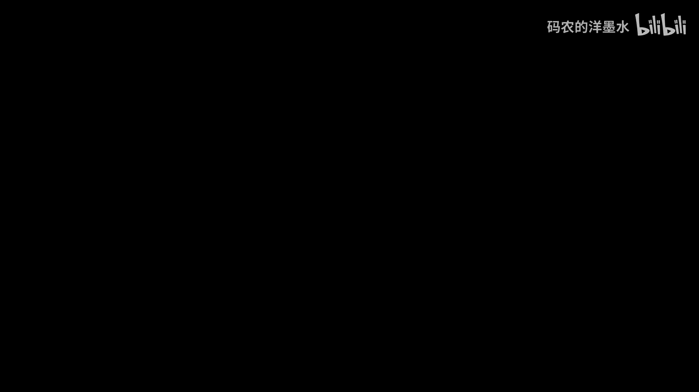
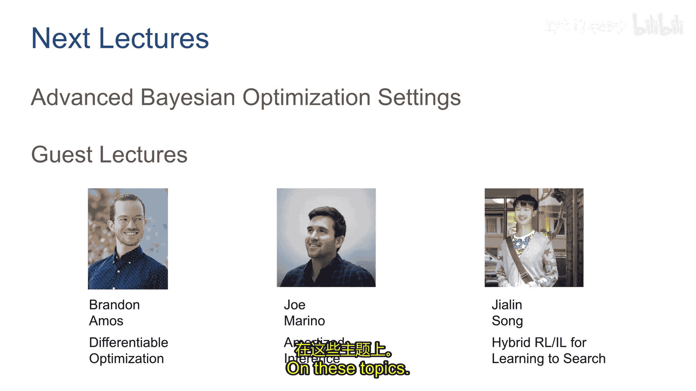

# 【全集 附课件】加州理工学院 数据驱动的算法设计 中英字幕1080P p05 Lecture 5 - 强化学习、模仿学习及在学习优化中的应用 -BV1CF2LBhEWk_p5-

Yes。Welcome to Le 5 of CS159， the Adv topics in machine learning at Caltech。

This term the advanced topic is data driven and the design。

Data Dr design has many connections to reinforcement learning and imitation learning。

 and today we'll be providing an overview of both reinforcement learning and imitation learning and talk about their connections to learning to optimize including many of the settings that we've already seen in previous lectures。

I should mention that much of the material in today's lecture is based off of two sources。

 the first one is a short reinforcement learning course taught by David Silver。

 who was a lecturer at University College London and is now a researcher at Google Deep Mind for those of you don't know。

 David Silver was one of the leading people who designed Alphago for Deep Mind that beat the Go World champion。

This material is also based off of a tutorial that myself and a former PhD student of mine taught on invitation learning at the International Conference for Machine Learning in 2018。

Both of the primary sources that this lecture is based off of are available in the link below and of course the slides to this lecture are available on the course website。

Okay， so ingredients for learning， let's just open these。

So there's four ingredients to learning for reinforcement learning and imit learning。

You need an environment， you need a policy class， you need some sort of loss function or objective function。

To characterize how well you're doing and need an algorithm that given these pieces can then learn a policy that optimizes your loss function or reward function when rolled out in your environment。

When we're doing reinforcement learning。The loss function or reward function is derived directly from the environment。

 like for example， if you're playing a game it could be whether you win or lose the game or number of points or something along those lines。

 these are things that you can directly measure from the environment for various states and actions that you do while interacting in the environment in imitation learning。

The loss function is derived from expert demonstrations so someone an expert of some kind has demonstrated what to do in this environment and you're given a collection of those demonstrations possibly direct access to a teacher but but in the simple case just a collection of demonstrations and your job is to。

Basically learn to imitate the behavior of the expert so in this particular state the expert did action A so I should design a loss function such as the policy class such that the learn policy prefers to do action A over the other actions that's the basic idea。

So given that backdrop， so reinforcement learning in a nutshell is you know。

 given an environmentalist slash simulator， we sort of use the two terms interchangeably。

 at least in the simpler settings of reinforcement learning。

The goal is to design a policy that can sample trajectories or state action pairs from this simulator and through those samples estimate higher reward actions and we'll you know get into some more details of that in a few slides。

 but that's reinforcement learning in a nutshell so you you have this environment which in this example below is a game is a race car game。

And we have states here represented by these game screens。

 so the features are derived from these images in this particular example。

 and we have actions like you know how to turn the steering wheel and in certain states keeping the steer wheel angles straight will give us higher reward because we keep accelerating going fast and that can be measured as higher reward in other states where the road is turning keeping steeringway angles straight will result in low reward because we'll fall off the race trackrack。

And so this is so from interacting with the environment we can collect these data points so in this state taking this action gives you high reward in this state taking this action gives you low reward and that's the training data for learning and from that we apply a we convert that to a loss function for learning。

That's the basic idea。One thing to note is that the the policy or the agent is doing both the data collection and the learning so the learning algorithm is both。

Figuring out how to collect the data and how to learn from the data that it collected from itself。

Whereas in supervised learning， the data is given to you exogenously typically assumed to be sampled IID from some generating distribution that is outside of the control of the agent。

Sorry skippped one slide imitation learning in a nutshell so in imitation learning we are assumed that we're given demonstrations or access to a demonstrator。

 sometimes we assume access to a simulator， although it's not strictly speaking necessary for all forms of imitation learning。

And then the goal is to train a policy to mimic the demonstrations。

 so you have these expert demonstrations of you know in each state what action the expert did。

And then this gets converted to a loss function very similar to supervised learning where the policy says it wants to you want the policy to say in this particular state。

 I want to keep the steer wheel straight in this other state I want to keep the steer wheel turn right because that's what the expert did and we can define a loss function that characterize it the mismatch between what the policy predicts at any given state versus what the expert demonstrations actually did。

And so here you may have access to the simulator， but you definitely have access to demonstrators that tell you what the correct action is for a given state。

 and so the sampling or of the correct actions is typically given to you by a demonstrator and you don't have to sample for it yourself。

Ubs。Sorry about that。So a little bit of notation， this is fairly standard notation。

 although you may see some variations you know in various papers or resources and sometimes because I'm drawing material from multiple different papers in these lectures。

 sometimes the notation is vary a little bit as well。

 but this is a very very standard version of the notation。So we have a state。

It's typically noted at S， sometimes is' noted at X。The state may only be partially observed。

 which means you may not observe the full game state， so for example， in these video games。

 you typically only observe what you see on the screen， which is not actually the full game state。嗯。

You have an action， typically noted A， occasionally devoted Y。

And you have a policy typically the at pi， sometimes no to H。

 we suddenly use H a few times in the earlier lectures。A policy map states to action。

 so it takes its input， a state and it outputs to action。

ta the subsequent theta refers to the parameterization of pi， so if pi was a neural net。

 then theta would be all the parameters of the neural net。

Oftentimes pi is stochastic or it's a stochastic policy。

 which means it maps states to distributions of actions。

 so now pi of theta of s maps to a distribution over possible actions and then when we actually take an action we sample from this distribution at this state。

We have a dynamics or a transition function which is given a current state。

 given the action taken in this state， what is the next state so if I'm in a particular place on the racetrack and I decide to turn right。

 where am I in the next timet？The dynamics is typically not known to the policy and this dynamics is basically the environment or the simulator so if you knew exactly this transition or dynamics function。

 then you would exactly know what the environment is doing。A rollout。

Is when you sequentially execute a policy starting from some initial state。

And you produce a trajectory of state action pair sequences。

 so tau in the first bullet point is the rollout trajectory it' the trajectory obtained from rolling out pi from state S not。

And it's just the sequence of state action pairs sometimes I should note that this trajectory also includes the reward so you get a state you get an action get the reward you got in that state and so forth。

 so the trajectory rollouts can also include rewards that we obtain for each state action pair。

We can talk about and this is just the next two notation is just for notational convenience。

 we could talk about the distribution of trajectories induced by a policy。Which is basically。

 you know， you do a rollout and then you look at you know the distribution of trajectories。

 we could talk about the induced distribution of states。By a policy。

Whi is just the probability that a policy will visit a state at any point in time in the rollout。

 so it's average over time。And then we have some sort of reward function。

 the reward function in this notation is typically used only in reinforcement learning because it's in reinforcement learning。

 it's often phrased as a maximization problem or reward rather than minimization problem of cost。

 although many reinforce learning problems also framen as a re minimization problem over cost。

But they're just sort of opposite of each other and in this case the reward is specified in a state action pair so in this state if I get this action。

 if I take this action it gets this reward if it's directly from the environment the actual function is not known to the policy but you can sample the reward by executing the state action pair and observing the measured reward from the environment so if I'm in game I'm in the state I take this action you know I win then that's the reward I measure。

And then the final thing is the value of a policy。That's basically saying。

 what is the expected value of the rollouts of a policy？

Oftentimes in reinforcement learning there's a discount factor， that's what gamma is。

 it's a number that's strictly greater than zero。嗯。Actually， I should rephrase。

 it's between zero and one， it's not strictly， it's not necessarily strictly greater than zero。

 it can be zero。And it basically measured how much this policy cares about the future。

When you're modeling reward， how much do you care about the future？

And the future in this case is discounted geometrically as we go further and further into the future。

And the expectation is over the randomness of the decision making of the policy and the randomness from the environment such as the transition function。

So that's the basic notation， any questions thus far。Okay。

 so we can also take an optimization perspective and we'll look at optimization perspective quite a bit in this lecture because in some sense those are the nuts and bolts of reinforcement learning and imitation learning。

So you know you have your policy or agent that's pi。

 it's taking actions and interacting with the environment in this case。

 it's getting back new states sometimes and you can also measure some sort of lost function or a reward function and reinforcement learning。

 the reward is sampled directly from taking the state an action taking it as action in the state in the environment in imitation learning。

 you get some sort of imitation loss that's derived from demonstrations from some sort of demonstrator or expert。

Right so in reinforcement learning you only measure that at time at that specific state action pair one thing that's kind of interesting is that oftentimes although not always in imitation learning the loss function is fully specified out of state so if the demonstrator said。

At this state， you should take this action， then if that's the only signal you have for learning because you're in this case。

 you're not actually even measuring reward from the environment。哦。

Then it's basically like a classification problem at this state there's one correct answer and there's a bunch of incorrect answers。

 so it's like a multi-class classification problem。

 which means that you have this fully specified loss function this for this state you know you know what the right answer you know what wrong and everything else is the wrong answer。

Whereas in reinforcement learning you'll notice that you only sampled the reward of the action you took at that state。

 you don't know what reward you would have gotten if had you taken a different action at that state。

 so in some sense you only get partial measurement of the reward function or the objective function。

 whereas in imitation learning you get a more complete measurement of the objective function per state。

And I'll come back to this issue when I talk about the exploration， exploitation tradeoff。

 but this is a fairly important point to make any questions about this at a conceptual level。O。

So again， I'm going to write reinforcement learning here as a maximization problem over rewards。嗯。Um。

 but you could also write it as a minimization problem for costs。

 which is the the the two are essentially equivalent just you know how you decide to how you decide to formulate the problem。

You， you get。In this particular way I'm writing it and I'm going to write it in a few different ways in this lecture。

 in this particular way， I'm writing it as the induced state distribution given induced by the policy。

 that's what the excation is taken over and by the dynamics of the environment and then whether this's the expected reward we get。

And find the policy that maximizes it。And in imitation learning in this particular way of framing it。

 the two objectives look basically the same， a the key difference is that we're now minimizing a loss function where the correct answer is whatever the demonstrator is doing。

 that's what a star of S is in the learning objective for imitation learning。

 that's the demonstrator。And again， note that the expectation of the state distribution is induced at least partially by our policy pi。

Whereas in normal supervised learning that we covered in CS155。

 the expectation is the distribution of the data is exogenously given to us。So。

Suppose the policy is suboptimal。Then reinforcement learning only knows that the specific trajectory that it executed in the rollout has low reward。

 it must sample more from the environment with more trajectories in order to find a trajectory with higher reward。

And this is known as exploration。Because it doesn't know what the right answer is。

 and it must try random things in some sense and measure the reward to know what is the best thing to do。

And it has to balance that between trying things that seem completely random。嗯。

But but might be good but we don't know because we never measured it versus fine tuning or you know zero in on state action repairs that seem good and just like finding tuning the actions to you know get slightly higher reward in the area of the state space that has already explored well that's the exploration exploitation trade off it's essentially the same tradeoff that we saw invasion optimization。

嗯。But now it's it's there's states involved so invasion optimization you take a single action and your rollout is over so Bay optimization and bandits。

Are basically simplifications of reinforcement learning where the length of the rollout is one。

Whereas a reinforce learning the link of Royalia is much longer than one。

 so it's actually a much harder exploration problem。In imitation learning。

 assuming you have access to an expert who can tell you what's the best thing to do。

 then the expert basically says at this date， this is the best thing you could have done。Which again。

 translates to a fully specified loss function at every state that you're collecting data for。

This is just another way of revisiting the same issue that you know we've been talking about the last few slides。

 but this is a very important concept。嗯。And so it's worth spending a few slides looking at it from a few different perspectives。

So， you know， when to use imitation learning versus reinforcement learning。

 obviously when expert demonstrations are available and reliable。

 you should use it imitation learning， when the environmental reward is hard to specify。

 like you don't even know what a good reward function is。

 then maybe you want to invest time to collect expert demonstrations even if they're not readily available。

Um，Or if the environmental reward is super hard to optimize， like it's very sparse， for example。

 although we've we've since now solved this problem， at least Google DeepMine has， you know。

 in the game of go， the reward function is that you win to lose the game。

Which is super sparse in terms of the landscape over state action pairs it's zero most of the time it's plus one when you win the game。

 it's minus one when you lose the game。嗯。One should use reinforcement learning when experts are unavailable or unreliable or highly suboptimal when there's a reward function that is readily available or easy to specify and relatively easy to optimize。

 for example， is dense in the state action space rather than sparse。And of course。

 there are many interesting research questions about how to blend im learning and reinforcement learning we'll talk about some of those we'll touch on some of those later on this lecture and we'll have another lecture that touches on them in more detail。

So this is just to sort of paint the picture of you know how we get between imitation learning and reinforcement from standard supervised learning from an optimization technique standpoint。

 so you know what type of optimization techniques under the hood do we need to solve these types of problems？

So on the left， we have conventional supervised learning。

 the thing that we cover for over half of CS155 or about half of CS155。Um if。

If the decision making predictor or policy， as we call it in this lecture is executed sequentially over states。

 then we can to a first order approximation， think of that as the optimization problem that we need to solve for imitation learning。

 that's the bottom track。On the top track we have online learning so we're collecting data on the fly we don't have this ability to for someone to give us what tell us what to do we're collecting data on the fly and we also we don't observe all the rewards for all the state action pairs。

And so we have so that's what partial feedback means and so we get to bandits when we have partial feedback on the fly learning or partial feedback online learning or we only observe the reward of the actions that we took。

Now bandits and Bayesian optimization are stateless in the sense that and that basically for the purposes of optimization means that the time horizon of the rollout is one has length one。

And if you want to maintain states， then that essentially means at least in this somewhat simplified depiction of the landscape。

that means you have rollouts of time horizon greater than one and that's how you get to reinforcement learning and on the bottom arrow if you go to partial feedback。

Where you don't know what the right answer is you only know how good the action you took at your current state。

 then at least from an optimization perspective in terms of the mathematical tools we need to solve the underlying optimization problem。

 you get from the difficulty of imitation learning to reinforce your learning。Any questions on this？

Yes， question。Are there clever ways to navigate the exploration and exploitation trade off that don't rely on Bayesian optimization？

Thank you for the question will clever is in the eye of the beholder I think maybe we' going recover a few methods later just in a few slides actually they're not particularly clever。

In the sense that they seem let me let me backtrack slightly， clever is in the eye of a holder。

The methods that we'll cover today will seem pretty basic。

Or simple nonetheless I think they are clever in the sense that you know if you make your method too complicated。

 then you it's harder to understand when it works and when it doesn't work we're going to cover some very basic methods。

That are known to be good starting points for exploration。

 and then if you have more domain knowledge， you can build upon those methods to get a method that's more efficient for your particular application。

And these methods are not。Baian optimization methods， although they are closely related。Yes。

So the outline today， we're going to go over some basic reinforcement learning algorithms。

 go over some basic imit learning algorithms， and we'll look at how to map that to learning to optimize problems that we've already seen in lecture。

Okay， so reinforcement learning。We're going to go back to this reward function formulation that I had before with this discount factor if the discount factor is one。

 then it's not discounted over time， if the discount factor is exactly zero under the assumption that zero to the zero zero raised the power of zero equals one。

 I only look at the current time step and ignore the rewarded future time steps completely。

One important notation that I'm going to add right now that's very important for reinforcement learning。

 somewhat less important for imitation learningers。

 so I didn't add it earlier in the notation is this notion of a Q function。嗯。

A Q function is specified by a policy pi。That's the superscript。

And it takes as input to state action pair。And it represents the reward function of taking an action A at that state S。

And then following policy pie into the future。In other words。

 what is the reward we expect to get if we take action A and state S and then follow pi after that？

If action A is if action A is actually the action taken by pi。Then so a Q superscript pi of S。

 comma pi of S。Is exactly the reward function or the total value function of the policy and you see that in the third line。

Some people talk about the Q function as a one step deviation。

 so we're going to take a one step deviation from policy pi and the deviation is we're going to instead take action A at this state instead of whatever action pi would have taken。

 but then we'll follow pi for the rest of time。This is an important concept because it's used in all the optimization and learning algorithms that we're going to cover for reinforcement learning in this lecture。

 this Q function。😊，嗯。Oh， sorryry。Okay， so we're going to talk。

 we're going to restrict ourselves in the context of reinforcement learning to only stochastic policies and the reason for that will become clear in a few slides。

谢谁。So if we have a stochastic policy， then we can write。

Pi of SA as the probability that the policy chooses action A at state S。

 so this is a slight abuse of notation， so pi of pi of S is the decision of the policy and pi of SA for stochastic policies is the probability of choosing action A at state S。

And this notation is very common when talking about stochastic policies。

So in order to do learning differentiable learning。

 we need to be able to take gradients and apply chain rule and all that stuff。

And so this is one thing that's often used in。Grading based learning for reinforcement learning。

 which is the so called score function for stochastic policies。

And it's motivated by this particular derivation， so if you want to take the gradient of a policy。

The first equality is just multiplying and dividing by the probability of the policy。

So you multiply for given state action pair， you multiply by the probability of taking that action in that state and then you divide by the probability of taking that action in that state。

 that's all that the first line is doing。It's just multiping and dividing by the same number。

But then you observe， okay， if we group the term as secondary two terms， if we group them together。

 that's actually the gradient of the log of the policy。

So we could write the gradient of the policy as equal to the probability distribution。

 probability weight of the policy for that state action pair times the gradient of the log of the policy for that state action pair。

😊，And this will become very convenient notational derivation when we talk about grading based learning。

Right so we're going to use this and we're going to apply you and apply chain role to basically optimize the value function given stochastic samples from this expectation。

 so we're not going to be able to of course integrate over this expectation。

 we have to sample trajectories to approximate this expectation empirically。

So let's go over two very comments， stochastic policy classes。The first one is a softm policy。

 which is very common and popular for discrete actions。And in the first line。

 you see that the probability of taking an action in a state is proportional to the exponential raise to some feature map transpo data where the is the parameters of the policy。

And the score function is in the second line。And if you recall from what gradients look like for logistic regression。

 this looks a lot like the formulation of gradients for logistic regression and indeed there's a really。

 really close connection here。And again， for deep learning this feature map fee is also learned。

 so this is the formulation that we would write for for。

For linear soft Mat policies where you hand craft the feature map。

And for deep learning fee is also learned， and the theta would just be the weights on the last layer of the neural net and feehi would capture all the weights up until the very top layer of the neural net。

And indeed， for most。Of the straightforward ways of doing deep reinforcement learning。

 we start with the linear policy that looks like this。

 and then we just allow fee to also be learned and it's specified by some neural architecture that you think is useful for this particular problem and that's how you get deep reinforcement learning。

This is part of the reason why many reinforcement learning experts in the field。

 they don't think of deep reinforcement learning necessarily as its own field because most of the action happens at this level of formulation。

And the only thing that switches from reinforcement learning to deep reinforcement learning is that this fee function is also learned and you just apply chain role。

Other experts in the field disagree， they think that deeper enforcement its its own field and so you'll see this disagreement sometimes if you sort of read papers or see talks by other experts in the field。

 I'll leave my own opinion out of it for now。Another popular policy class is the Gaussian policy。

 this is very common for continuous actions。So for any given state。

 we have a so called mean action so that that's the first line and the mean action or the average action。

 if you will， is just you know this。Some feature mapping of the state and plus a linear inner product with the parameter vector。

嗯。And a Gaussian policy specified in the second line is basically for any given state action pair。

 the action is sampled according or specified according to a Gaussian distribution would mean。

quote to the mean action and some variance term， for more advanced formulations of this policy class。

 the variance can also be learned。U as a function of some other theta vector。

 but in this particular simple case，' just we're just parameterizing the mean function。

 the mean action， not the variance of the actions。And so action distribution。

 if the action distribution given a state is Gaussian distributed like this， then the score function。

 that's the third line takes the following form。And again， for deep learning。

 the fee function is also learned and therefore the theta function， the theta vector。

 it can be thought of as the weights of the top layer of the neural net。Any questions so far？Good起。

Okay， so this is one of the most important results in reinforcement learning。

 this is the policy gradient theorem。And I'm writing it in a more informal way because there are restrictions that apply to the form of J and Q。

 so this theorem doesn't apply for all possible J and Q。mBut but you know。

 I'm going to sort of sort of ignore those conditions。For now， if you're interested。

 you could refer back to David Silver's lectures linked to at the beginning of these slides。

But this is the statement of the depositit gradient theorem， which is if I want to take a gradient。

Of。This policy with respect like the parameters of policy of the objective function。

 then it is equivalent to。The following， which is you take the expectation over state action pairs encountered by pi。

 so you roll out this current pie in the environment。

 the expectations over the randomness of the state of the dynamics or the transition functions of the environment and over the choices of pie。

And it's equal to the gradient of equal to the score function times the Q function。

And something that's really nice is that， you know this moves the gradient。

 this form is basically the form that enables us to design gradient based learning of policies and then we can think about how to make it then more efficient so we can directly optimize this via stochastic gradients。

嗯。And we've seen this algorithm before and I'll just present it again。

 I took the version that was presented in David Silver's lectures。

So this is just a screenshot of his lecture notes。嗯。

The reinforce algorithm is the simplest reinforcement learning algorithm。

 it is a policy gradientding algorithm and the key thing that it's doing let me go back to the policyit gradientding theorem is that if you want to take if you want to optimize this objective function。

 basically what you do is you roll out pi a few times to get an empirical sample of this expectation and then you compute the score function and you compute the Q function。

Or you compute the score function， you compute a value of the Q function。

Or an estimate of the Q function。And then you， and then you。

Differentiate the theta in the score function， and that's how you update your policy。

So that means we need to estimate the gradient。The score which is the score function。

 and then we need to estimate that Q function。And what reinforced does is it basically just does this unbiased Monte Carlo that does this Monte Carlo estimate of this Q function。

 that's the line that's being highlighted with the arrow， so that v sub T。

Is just looking at the trajectory rollout of the policy and then just using that as a single Monte Carlo estimate of the Q value。

And this， you can show that this is actually an unbiased estimate of the gradient。

And so this is a valid stochastic gradienting descent approach for reinforcement learning。

Such methods are known as policy gradient methods。Because they're doing gradient to set on the policy directly and the reinforce is arguably the simplest possible policy gradient method。

Any questions？So the benefits， it's simple， it's an unbiased， that's an unbiased estimate。

The drawbacks， very high variance in practice， especially for long time horizons， this Q function。

 this Q value。You have to recall that it's defined recursively over the entire length of the trajectory。

 so it's the Q value and me you just go back to the definition of the Q value。Which is right here。

 it's defined。Over the length of the trajectory so if you want to compute if you want to have an unbiased estimate of this。

 you know you have to roll out the entire trajectory to get an unbiased estimate of this of this Q value。

Because you have to take this sequence of nested samples or nested expectations。What that means。

Is that this Monte Car estimate basically by taking a single sample of the Q value has extremely high variance。

 especially for longtime horizons， this is something that does not arise in Bayes optimization and bandits which are stateless。

This is the key difficulty， one of the key difficulties。And so that you have some options。

 you could take many， many stochastic samples， you take many。

 many samples before you take a gradient step。Or you take very。

 very small gradient steps because your estimates are so noisy， so you up set alpha。

 the alpha parameter here in the gradient the step size to be very， very small。Either way。

 that means the learning is very slow because you have to do rollouts。

 a lot of rollouts of the environment in order to get this gradient estimate， which can be very slow。

Any questions about that？So the main class of approaches that people take to combat the high variance of this Monte Carlo estimate of the Q value is called actor critic。

嗯。And the idea we had an a critic is you estimate the Q function over a parametric family。

 so rather than doing Monte Carlo estimates of the Q value。

We're going to learn a model of the Q value or estimate a Q function and have that be parameterd in these days with a neural net。

So again， this is just a simple algorithm。probably the simplest actor critic algorithm， again。

 this is just a screenshot from David Silvers。Lecture notes and the key thing is that I want you to pay attention to it's not important to look at the entire algorithm the key thing is that we learn this Q estimate。

Of as a parametric in a parametric model， so what that means is that this is now no longer an unbiased estimate or typically not an unbiased estimate of the true Q value。

 but it has much， much lower variance so we get this bias variance trade off that happens in this particular case。

And then the next line is the standard policy gradient step that we saw in the previous slide as well。

 but now instead of taking this mono Car estimate of the Q value at each state action pair。

 we take the prediction of this model that we're learning。This model of the Q value。Any questions？

Okay， so there are many other policy gradientding based methods that you know look at other issues that arise。

 such as how large do you set the step size， how do you do sampling。

 how do you get more sophisticated aritic methods that even better by as various trade offs。

And many others as well， here is just a sampling of some of the more popular ones that people use these days that are fairly compatible with applying chain rule。

 I guess， for deep reinforcement learning。And there are many others。

 but I think these the methods listed here are basically enough to get anyone started if they're interested in。

Doing reinforcement learning for either their blog post or their final project。

The other method that I will briefly mention， first all， let me talk about exploration。

 this is also asked before， and then I'll talk about one more method。Very briefly。

I want to talk about exploration。We talked a lot in this lecture about how we need to sample from the environment to collect data in order to find states and actions that have high reward。

And that is the learning signal。So we're going to come back to the fact that this expectation in this reward function depends on pi。

 it depends on the actions taken by the policy to get the sequence of states。

What that means in practice is that you need a non zero probability of sampling every state。

 you cannot have a policy that puts that that you know the。

That takes actions in such a deterministic way that some parts of the state space that have high reward are never sampled or never explored。

And so some people actually think about ways of making pie more random in the beginning and then less random later on。

But that's something that you have to keep in mind。

So I'm going to close the section on reinforcement learning with one more class of algorithms called Q learning。

And what Q learning does is again， it looks at this Q function and it says。

 what if we can learn this Q function well enough？That it can be used for decision making directly。

And so that's what the first line is we suppose we have this parametric model that estimates the Q value。

And suppose that we've learned it well enough that we can directly use it for decision making。

And so give it a current state， the action we take is just the action that maximizes our Q value estimate or a Q function estimate at that state。

And so the basic Q learning algorithm is specified in below。So we have this during training。

 we have this policy that does exploration， I'll call that pi prime that's the first bullet point。

And what pi prime does is it takes the action of pi。With probability  one minus epsilon。

And it takes a random action， a completely random action with probability Epsil。

And then we roll out Pi and to collect state action or twos。

 we fit the Q function on the data we've collected， and then we repeat。

So this is Q learning or the basic version of Q learning， and here the randomness， again。

 we talked about how we need to have enough randomness in the policy that we can potentially explore every state action pair。

This type of randomness is called epsilon greedy exploration。Imp policyulsic gradient。Methods。

 the exploration is based on。You know， what the policy thinks is likely or less more likely or less likely to have high reward。

 the policy is stochastic， it's going to and it's trained in a way such that higher reward states it's more likely to explore higher reward states or states that think are high reward and less likely to explore states I think are low reward。

Whereas in Q learning， when it does exploration， it just doesn't be completely random。

So policy gradient versus Q learning， policy gradient is more general。

But typically has much higher variance than learning。

The Q function may be hard to learn well enough for decision making in policy gradient。

 at least in a critic， the Q function is learned only to weight the gradient on the policy itself。

Rather than using a Monte color estimate of the Q value。But in Q learning。

 the Q function has to be learned well enough for to be directly used for decision making both methods have demonstrated strong performance depending on which regime you're in。

And you know， you can refer to some of the references to sort of get a bigger picture of that。

And there are other approaches that we're not going to cover。

 but they're important in the other contexts， but they're less relevant except for the last one。

 bridging， reinforcement learning and mutation learning， and the context of learning to optimize。

Any questions？So now we're going to move on to imitation learning。

I think in the interest of time and running a little bit behind schedule。

 I'm going to skip this slide， this is just a video of the first application of imitation learning in self drivingiving cars from the early 1990s。

 if you have time， I encourage you to watch this video。ho。But let's just move straight into the。

Into the example。So we're going to use this race card game as an example。

 so the state is the game screen and the action is the turning angle and that we have this set of demonstrations given to us by an expert so you know someone's playing this game we're recording this person's actions as they're playing the game and we have the sequence of demonstrations of state action pairs we want to learn a policy that imitates the state action pair。

Something that I do a lot of work on in my personal research is imitation learning for sports analytics。

 so here the state action pairs correspond to locations of the players and the ball and the action are the next locations of the players at the next time step and we again get the sequence of state action pairs when we want to build policies that imitate the behavior of in this case professional basketball players from the National basketballkeball Association。

And you there are many data sources， so in an imation order you need access not just to a simulator。

 but the ability to collect demonstrations， which isn't always obvious。But in learning to optimize。

 the demonstrations come from， for example， better solvers or solvers that we can run run at a training time that might be too expensive to run at test time。

But there are other demonstrations that we can collect as well。For other applications。

And so we're going to talk about basically two types of imitation learning， behavior cloning。

 and one other type， and then I'll briefly mention the full landscape。

UI'm just this is just a recall of the notation， we have state， we have action。

 we have a policy and we have dynamics not known to the policy。We have a rollout。

 so we have this trajectory towel that's the rollout of a policy in the environment。

We also have rollouts from the expert， so those are called expert rollouts。

And then we have these notational simplifications of the probability of seeing any given trajectory under this policy and the probability of ever visiting any given state or so the probability of visiting any given state at any point in time。

 given a condition on a policy。And I'll just skip this one。So now let's talk about behavior cloning。

 which is the simplest version of imitation learning。

 and it's literally just a straight up reduction to supervised learning。So we define P star。

As the distribution of states visited by the expert。And this is averaged across all time steps。

And the learning objective is as follows， so given the state action pairs in the rollouts of the expert。

 so some expert is playing this game and we're recording all the actions taken by this expert。

Then we want to， so for all the states that are visited by this expert。

 we want to alert a policy that predicts the action that matches the action taken by the expert in that state。

That's a learning objective if you see the bottom。So what are some interpretations。

 so notice that the generating distribution of the data here has no dependence on the policy that we're learning。

The generated distribution is induced by the dynamics of the environment and by the decision making of the expert。

So what does it mean to actually learn this objective function well。

 it means given that we've imitated the expert perfectly so far。By minimizing this loss function。

 we can continue to imitate the expert perfectly。More generally。You know， in imitation learning。

 we care about the distribution induced by our own policy。

 so the states induced given the states visited by our own policy that's that's in the bottom objective。

How does the decision making of our policy deviate from the experts for those states？

Now these two objective functions are different because in behavioral cloning。

 we just ignore the fact that we care about distributions induced by our policy。

 we just say well the only data we have。And where we have demonstrated actions are from the experts。

 so we're just going to。Do supervised money on that distribution。Any questions？

So limitations of behavioral cloning， suppose that our policy makes a mistake。At a certain state。

And it decides turn to veer the steering wheel left at this particular state， which is a bad idea。

 and is not what the expert did。The new state。Is not sampled by the expert。

The expert has never seen this new state on the right。And so nothing in our training data。

Of demonstrations contains this state。And so behavioral cloning， which is。

 you know the sort of the default imitation in the algorithm because it's so simple cannot handle this very well because it doest straight our production to supervised learning。

 and it assumes that at test time， the states that we see are sampled from the same distribution as we trained on。

 which is violated here。So that's what you see in the diagram on below。

Behavior cloning makes this assumption on top， whereas in reality we get this we get this circular dependency on this generating new states。

Just like in reinforcement learning。So I'm not sure the videos will play well。

 but of course if they don't play well， you can。Watch the videos on the slides。

So this is an expert trajectory， so someone's playing the game and we're recording the。

The state action pairs。This is work by Stefan Ross， who was a PhD student at Carnegie Mellon。

Now at Waymo， I believe。hoops。是。So this is behavioral cloning trained on the demonstrations。

And then at some point， it makes a mistake because it doesn't imitate the expert perfectly and then it goes crazy because it doesn't it's encountering states that it has never seen before during training。

And that the expert has never visited during training。And it cannot recover。

So when you use behavioral cloning， well， the advantage are it's super simple。

disadvantage is that you it has this massive issue with distribution mismatch between training and testing。

嗯。And so it doesn't know how to correct for its own mistakes because it just has this finite sample of event。

Demonstrators from the expert， and that's all it knows what to do with it。

You can use it you can still use behavioral clo name one step deviations are not too bad so if the expert trajectory somehow cover the state space well enough。

That behavioral colon isn't too bad and this might be okay for learning certain types of reactive behaviors。

One should not use behavioral cloning when one step deviations can lead to catastrophic error。

 which is what we saw in that race card scenario。And also， you know。

 if you need to do you know more looking to the future than learning reactive behaviors。

But we're also going to focus on the first point where know， how do you deal with these？

Does distribution mismatch between with these one step deviations causing catastrophic error。Okay。

 so I'm going to talk about the landscape of invitation learning。

 mostly just talk about one method and then just。Ruth you mentioned the others。Um。

 there's sort of the landscape of imitation learning can be broadly broken down into these three categories。

 although this is an oversimplification。Behavior cloning。

 interactive imitation learning using direct policy learning and inverse reinforcement learning。

And they can be broken down into sort of these categories where are we directly learning a policy or we're learning some notion of a Q function or a reward function？

That's the first two columns。Do we have access to the environment？So in behavioral colony。

 you actually don't need access to the environment。

 since you're doing a straight up production of supervised learning。

 you just collect the data once from the environment from the experts。

 and you don't need the environment afterwards。The other two approaches that are more sophisticated need access to the environment。

Do you need on demand access to a demonstrator you can query？

And an interactive imation learning the answer is yes。

 and inverse reinforceinforcing the answer is no。And do you need pre collecteded demonstrations？

And behavioral cloning and enforcement enforcement。

 the answer is yes because you're not querying the expert at training time and interactive invitation learning you don't actually need a demonstration of the expert pre collectedlected because you're  querying the demonstrator at training time。

But oftentimes in practice， you do start with a set of pre collecteded demonstrations。

And then many other considerations， you know， the choice of imitation loss。

 know how do we characterize the disagreement between the policies。

 predictions and the demonstration？What happens if this policy if the demonstrator is highly suboptimal or partial。

 these are things that sort of motivate connections between imitation learning and reinforce learning。

 things that bridge the two domain transfer structure domains and so forth。

So this is behavioral colony in a nutshell we have。

The key thing here is that the state distribution is the distribution of states visited by the expert？

And this worked well when the experts states are close to pie so you can sort of imitate experts so well that this distribution mismatch is not too bad。

Direct policy learning via interactive imitation learning works as follows。

 we have access to a demonstrator。That we can query。During training time， so then we roll out。

 we roll out in the environment。And then we collect demonstrations from the expert based off our rollout。

 so in this state that our policy visited during a rollout。

 would what would the demonstrator would have done？And then we take those demonstrations。

 we do a reduction of supervised learning， and then we learn a policy。

 we roll out the environment again and we repeat。And so every time we do this。

 we require access to a demonstrator that tells us what they would have done at the states collected by our policy。

In some sense， we can think of behavior cloning as a one iteration special case of interactive imitation learning where we do this cycle once in the very beginning。

 where we just look at the expert' own rollouts。And the other classes is inverse reinforcement learning were the goals to learner reward function such that it explains the expert' behavior。

 assuming that the expert is rational under some implicit reward function。

 the goal to learner reward function that explains the expert' behavior。

 that's why it's called inverse reinforcement learning。

So reinforcement learning is given a reward function， learn a policy。

Inforcement enforcement learning is given demonstrations from some policy， some expert。

Learner Roflk that explains the decision making of that policy。

But we're to do we' going to really talk about inverse reinforcement learning much because it's less relevant for learning to optimize。

At least currently。So direct policy learning， behavioral colony is simplest example。

 and one way to think about interactive imitation learning is to at least from a theoretical standpoint is via a concept called learning reductions I'm not going to talk about learning reductions。

 much in this lecture but if you're interested， I refer you to the link below learning reductions was largely pioneered by John Langford who's currently a researcher at Microsoft research。

 and you can see many of his other work on learning reductions in that link below。

 I just want to mention that from a theoretical angle。

 a lot of this is analyzed via learning reductions。Um。

 the one step u the one step definition of load reduction is you take a harder problem and you reduce it or' probably know how to solve。

So for example。Now you have this harder problem， which where the distribution。

 the generating distribution of states is induced by our own policy。

 so theta appears in both the objective function in the loss and in the sampling distribution of the expectation。

And we'll reduce it to something where theta no longer appears in the generating distribution of the expectation because that's completely generated by the expert policy。

And so we've reduced。Imitation learning to supervise learning that's what behavior cloning is doing and one thing that's nice about this one is that you know this is literally just you know something you can just call really quickly intensor floor pytorrch。

And the question that learning reductions seek to answer is you know what does learning well on B imply by A。

 if we learn B really well， what does that imply by A？And so suppose that we get。

Suppose that you know we have a loss function that makes sense。

 so if we perfectly imitate the expert， we get zero loss， that's what the top line says。

And suppose that this supervised learning reduction。

 this behavioral cloning where we're just doing supervised learning of the experts expert data。

 we get epsilon loss epsilon is pretty small， you know it's like 0。1 or 。05。

Then if we roll out this policy。Then the worst case number of mistakes。

 assuming the length of the trajectory is capital T is t squared epsilon。Which can be pretty bad。

 you know if t is 100， this can be pretty bad。Nos。Right so。

And if we go into the setting where if we make a mistake in the wrong state。

 then the error is catastrophic。Then， you know。The actual imitation error can be very， very high。

 even though the supervised learning of just the expert demonstrations look very， very low。Yeah。

In particular， if you make a mistake at the first time step and it's a catastrophic mistake。

Then the full limitation error is basically 100%。Any questions about this？都不行。Sorry about that。

So the idea behind interactive imitation learning is that we're going to keep querying the expert as we do learning。

 so we don't just have the expert just at the beginning， we have the expert over time。

During throughout learning。And hopefully the sequence of generating state distributions converges to the one that our policy to the optimal policy that we can learn。

That's the basic idea。So again， this is a pretty strong assumption that we can query the expert at any state so that you see in the figure on the right。

 you know we executed a certain trajectory or that's the blue line。

And the expert says that at each of these states， what the expert would have done to behave optimally given the state that we're in。

There are ways to relax this assumption， of course， but in the simplest case， this is you。

 the expert is providing feedback on every state of a rollout by the current policy that we've learned so far。

And so the algorithm that I'm going to briefly describe is called dagger。

Which stands for data set Aggregation or data aggregation。

Here you can see the link to the paper on the bottom。So in the beginning。

 we start with the initial with the expert and we collect。Demonstrations from the expert。

And then we have a training data from states from the state distribution of the trajectories collected by the expert and we train so for M equals one。

 this is exactly behavioral cloning。For n equals  two。

 we roll out the policy that we learn from behavioral cloning pis sub 1。

In the environment and then we ask。The expert to。To give feedback。On every state， on every state。

And in the rollout， we asked the expert to say what would you have done in that state？

And then we train on that， that's the third bullet point。

And the reason why this algorithm is called data set aggregation。

iss that it's trained on the union of all the previous demonstrations every every so basically at every iteration of this problem we rolled out the current policy。

 we we get a bunch of trajectories， we asked the expert to annotate the trajectories for every state in that trajectory。

 what the expert would have done in that state， what the optimal action according to the expert would be。

And then we take the unit of all these demonstrations collected over all the states visited by all the previous learned policies and we tried a new policy on the unit of all that data。

😊，In other words， we reduced the supervised learning over the union of all the distributions from all previous iterations of the policy and all previous demonstrations。

So the intuition is that the way as we do this， the expert is correcting mistakes made by the current policy。

 so wherever the policy makes a mistake， you get more feedback from the expert saying that that particular action is not good and you can show and I'm not going to talk about the theory that this converges to near optimal policy。

This this very simple algorithm and dagger is one of the most popular algorithms for imitation learning for learning to optimize a lot of the methods that we see are built on top of dagger。

So is just a summary of the types of imit learning。I think I'll just move on in the interest of time。

So very briefly reinforce just to revisit reinforcement learning， inverse reinforcement learning。

The goal is to learn a reward function such that if we are if we our policy maximizes this reward function。

 so the policy so this is basically just Q learning this can also be thought of as inverse Q learning so the reward function here is basically like a Q function。

嗯。We want to learn this reward function such that behaving optimally with respect to this word function matches the distribution of policies。

 that's the basic idea。Inverse reinforcement learning is not super popular in learning to optimize so i'm just going to skip it and the reason why it's not super popular is that we typically have。

Access to a demonstrator at training time， so for example。

 we have access to like a complicated a more expensive solver at training time than maybe we don't want to run a test time。

And there also may also be challenges with being able to actually learn a good reward function for decision making。

 this is the same issue with Q learning in Q learning you have to learn a Q function good enough that you can directly use it for decision making sort of a similar issue is happening here and different applications that may be harder or easier。

是。So in the final 15 minutes or so， I'm going to circle back on some learning to optimize problems that we've already seen in lecture。

 either in lecture thus far or actually or actually problems that。

We covered in CS155 that I'm going to revisit in the context of learning to optimize。

And then we'll see how imitation learning reinforce line maps to these problems。

But any questions about im learning？O。So the first thing I want to talk about is structure prediction。

 so structured prediction is a mapping from some structured input space x to a structured output space y that typically end up and making a prediction an lower model typically requires solving an optimization problem of prediction time。

The example that we saw in CS155 is the vertuia algorithm for sequence prediction in hidden Markov models。

So that is actually a structure prediction problem。

 it's arguably the simplest structure prediction problem。

There are many other structure prediction problems that exist in practice。

 things from like natural language processing tasks like parsing or protein folding or structure prediction or planning。

 and are many there are many or predicting rankings for recommender systems， there are so many。

 many applications。Of structure prediction。But we're going to stick with sequences。

Because that's what we've already seen in CS155。So the goal is to learn a decision function。

 so when we talk about hidden Markov models we trained this model， which is very restrictive。

And we ran Rtubi on this hidden Marov model to be able to predict the optimal sequence。

So instead of doing that。Suppose that we just learned a policy that makes good local decisions for sequence prediction。

So the state is the prefix sequence that we've already predicted so far and the action is the next token to add to this sequence。

啊这。😊，So instead of running for turby， we're going to do this。So you know。

 we can do structure prediction basically as imitation learning。

 the ground truth or the demonstrations are the ground truth sequence labels。And again。

 we need to deal with distribution shifts and on what happens when the policy makes a mistake。

There are cases where we can do structured prediction as reinforcement learning in some cases we just have an objective function without labels and any labels that we get at are suboptimal and so if we have an objective function so this is often the case for example in。

And things like machine translation。Where we have this some objective function and actually optimally solving it can be hard。

And we need to sample， explore to find better labels。

And so one example of that is this paper called Learning to search Better than your teacher。

You can see the link below。We can do learning of greedy algorithms， so the example I gave you for。

For learning this sequence sequence prediction for to replace HMs。

 that's a greedy algorithm right it never backtracks whereas the material algorithm actually does a little bit of backtracking。

But in general， we can just say， look， we're training a policy that's a neural net。

 it's going to make pretty accurate predictions and so it won't need to backtrack。

And so you know let's just do imitation learning or reinforcement learning to learn these greedy greedy policies for structure prediction for those of you are familiar with some modular optimization。

 some modular optimization is optimized by a greedy algorithm。

And so we can actually use imitation learning to imitate the behavior of a greedy algorithm。

If you're not familiar with some A optimization， don't worry。

 this is just this one slide just for your reference。

And what I'm just showing below is just the reduction to supervised learning。

 so this is basically building on top of dataer。And so modular optimization is a form of structure prediction。

So。So in some sense， in the context of what we've been talking about in this class。

 structure prediction can be thought of as learning to search。

you compile the input descriptionscript of a search project problem into a search problem。

And then you train a policy to effectively navigate this search space。And the expert might be weak。

So you might need to do both reinforcement learning and imitation or blending of the two。

And thus far， the examples that I've all shown you we treated the search space as a greedy search space。

 so Pis were training a greedy algorithm to make good local decision without backtracking such that it does as well as possible。

嗯。啊。More generally we could train policies in the context of search problems where we do allow backtracking。

 such as within learning a decision module within the branch of bound framework。嗯。

And so here we have actually we do actually have a reward function。

 the reward function is did we find a feasible solution is and how good is the feasible solution？

The problem is that this reward function is very sparse。you know。

 there's in many of these common optimization problems that the terminal states where we found a feasible solution might be few and far in between。

 maybe advantage the small fraction of the total states， number of states。

 which can be exponentially large。And thestrators demonstrations are provided by an existing solver like Grorobi or a C+。

 which may be suboptimal， so you have suboptimal experts， and then you have a sparse reward function。

And so how do we and so one of the interesting questions is， know， you have these。

 you have like the worst of both worlds， you have suboptimal experts that are expensive to query because they they require solving an optimization problem or a solver。

And then you have really sparse rewards that are really that's really hard to optimize directly using reinforcement learning。

Are there ways to mix between reinforcement learning and imitation learning to sort of？

Use both of these things to good effect and we'll talk about this in another lecture later in this class。

And one thing I just wanted to circle back on is this algorithm that we talked about in the previous lecture which is learning a greedy algorithm of combinatorial problem so now we can just revisit this algorithm given all the information we've seen today and we notice that it just specifies a policy class in terms of a graph neural network。

 and then it does this greedy sequential decision making that we've been talking about so far where if your policy class or if your local search heuristic is good enough and accurate enough in many cases it suffices to just to learn a greedy policy that never does any backtracking because your policy class is a deep neuralNe and if you don't have access to good demonstrators we can just sample the reward function of the environment which is the quality of the solution of this combator optimization problem and so in this particular paper they do Q learning which we just saw before。

It's a slightly more complicated version of Q learning， but in a， in essence， it's Q learning。

So this gives you a sense of all of these methods tied together to solve these conor optimization problems。

Any questions？Okay， just one final thing we talked about meta learning we talked about imitation learning。

 people can do meta imitation learning， this is not super central to this course。

 but I figured I give it a plug because it just combines two ideas that we've already talked about。

Where if you want to quickly translate to a new domain with very few demonstrations。

 you could use the sort of meta imitation learning approach。

This is just the basic idea of skipping in interest of time。

So the next few lectures will be guest lectures， two of them by our Ts and one of them by Brandon Amos。

 so Brandon is a research scientist at Facebook research。

 he did his thesis work on differential optimizations such as OpNe and so he'll give be given the guest lecture。

Next。Tuesday， so the immediate lecture on Thursday is advanced patient optimization techniques I'll be giving that lecture and then the next three lectures following next lectures starting next Tuesday will be by Brandon。

 Joe and Jalin on these topics。

And that's the lecture for today。