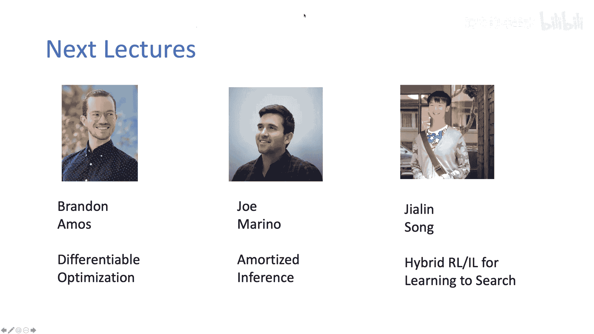

# 【全集 附课件】加州理工学院 数据驱动的算法设计 中英字幕1080P p06 Lecture 6 - 高级贝叶斯优化设置 -BV1CF2LBhEWk_p6-

Welcome to lecture 6 of CS 159 data driven algorithm design。

Spring 2020 today we'll be talking about some more advanced Bayesian optimization settings。

So just to recap。Here's the learning setup and I should mention that this is just in some sense just an optimization setting and Bayesian is because we're maintaining this Bayesian belief over the fitness function that we don't know。

So we're going an input space， let's call it x， we have this fitness function f of x equals y。

And we have this Bayesian belief over what capital F the fitness function might be given our observations so far。

And so the experiment designer。Design chooses an action in the input space， we run the experiment。

Of this action， which you can think of as a configuration of some system for the purposes of this class。

And then we get a measurement back。And then we add this data point to our training set and we update our Bayesian beliefs。

 so we update our posterior。Iith know this process repeats。

And that's the basic idea of Bayesian optimization。

And you know there's some fairly common algorithm fairly popular algorithms for solving this problem。

 such as upper confidence bound and posterior sampling。

 we'll talk about those in a little bit more detail in a few slides。

But before I jump straight into Beijing optimization。

Perhaps it's worth stepping back just briefly to talk about this type of interaction protocol so the protocol that I just described is more general than just Bay optimization it applies to essentially three types of interactive machine learning the first type is called active learning where the goal is to discover some truth so for instance the goal is to build a model of the world of the environment that is as accurate as possible。

Yeah。The second mode is what we'll be talking about for this lecture， which is Bayesian optimization。

 which is where the goal is to find the single best predictor。

 the single best action in this action space and such that the utility of this action that I commit to at the end of this interaction is as high as possible。

And the third is multiear bandits where the goal is to maximize utility over time。

 so a classical application here are recommender systems or clinical trials。

And the utility of every action that we took in this interactive protocol matters。

 not just the final action that we take that we commit to。And again。

 the focus of this lecture is on the middle column。

 but the interaction protocol that I described in the previous slide。

Actually applies to all three just depends on how you choose which x of T to you do it every time step。

Right so they have the exact same interaction protocol， you choose an action X。

 you run some sort of experiment or interaction， you get a query or a measurement of F of x possibly noisy。

 and in general this area is also known as sequential experiment design。In active learning。

 the goal is to choose this algorithm for selecting x to learn f of x as accurately as possible also so we think of that as discovering truth。

In Bayesian optimization， we want to find the maximizer。

 we want to find F of x star or find an x whose F of x is as close to F of x star as possible。

 so we only care about the best result we've found so far。

This can me characterize using simple regret， which we'll talk about in a couple of slides。😊。

And in B， the goal is to maximize the sum of of Xi， where I is or f of Xt。

 where this is the utility that we get at every round of interaction because each experiment matters possibly because they're done on a human。

And so this can be characterized using something called cumulative web。So yeah。

 so let's talk about simple regret and cumulative regrets so what I wrote in the first set of bullet points is just the basic interaction protocol。

嗯。And then the bottom two are the definitions of simple regret and cumulative regret in simple regret。

 we X hats X hat star is the action that our algorithm commits to at the end of this interaction at the end of this whole interaction protocol our organized to commit to a single X hat star。

 which it believes is the optimizer。And or is its best guess for the optimizer。

 and then we can compare at least theoretically， even though we don't know the F of x star minus F of x head star。

So that's called simple regret and the cumulative regret is you know we look at the sum of this over time。

And so you know we had known if we had perfect information。

 we would have chosen X star to every time step and received utility F of X star。

 but instead we chose some other x and receive a smaller utility and the cumulative difference is called the cumulative regret and that's the typical bandage criteria and people think about designing algorithms that can theoretically minimize these two concepts despite not knowing what F of X star is a priorityi。

It should be noted that cumulative regret often implies a simple regret。To see how this works。

 we can write the average cumulative regret so it's the same as cumulative regret which is divided by capital T that the time number of interaction steps。

 so it's the same concept is' divided just to make everything more mathematically convenient for this particular derivation。

We know that they're must out of these XIs that were chosen across the interaction protocols by the algorithm。

We know that there must exist one。Such that once F of xj。

 essentially F of xj is greaterer than the average。

 this is the standard law of averages that we learn in arithmetic。

So if you have the at least one element in the average wants to be greater than the average。

 greater than or equals to the average。And suppose we're using Gaussian processes and we're Bayesian。

 suppose that we choose X hat star at the end of this whole interaction protocol as the one that's best under the GP posterior the posterior mean。

 so F hat is our posterior estimate of F。Then we know that in expectation that。

This we know that the expectation， this guy is at least as large as the Xj that we talked about in the previous bullet point。

Because we're Bayesian， this is true。Yeah。And so we can talk about。the expected simple regret？

And because of the bullet point above where we had that inequality about x hat star versus xj。

 we can upper bound the simple regret by comparing X star versus xj rather than x star versus x hat star。

So this is just simply replacing the second term in both sides of the inequality with XJ and then using the inequality we used that we saw in the previous bullet point。

And then we simply use the observation the one bullet point above that that Xj is at least as high as its average。

嗯。And now we see that if you have an algorithm that bounds the cumulative regret。

 you also bound the simple regret， at least under a GP posterior。We're your e invasionsian？

And this is an expectation。😊，嗯。We can also show high probability bounds rather than bounds and expectation。

 but the derivation is more complicated， that this is just meant to give you a flavor of the mathematical structure that you need to sort of show that communityative regret can imply simple regret。

Any questions？O。So other things that might be interesting are things like how do we analyze convergence to X star we'll talk about that very briefly。

 but for details， please see the references。How do we guarantee side constraints like safety。

 how do we deal with corrupted or indirect measurements。

 how do we efficiently search comb design spaces， how do we incorporate domain knowledge of physics and there are many others as well and we'll touch on all of these or many of these in this lecture。

 of course the theoretical details i'll defer to the references。

 of course you're invited to check those out if you're interested in this area of research。

So let's talk about GPUB or Gaussian process upper confidence bound。

This is one of the classic algorithms， it was originally designed for bandits。

So it was originally designed to optimize our cumulative regret。

But but it's also a fairly popular algorithm for Bay optimization because it also achieves a pretty good performance in terms of simple regret。

 both theoretically because cumulative prevent upper bound， simple regret。

 and often in practice as well。And so the key thing is the first bullet point in the for loop in the first step。

 that is the GPUCB decision criteria of how to choose x sub T so I'm switching the notation and subscribes a little bit here。

So if you recall from Gaussian processes， mu sub T is the posterior mean。

Beta is the trade off factor in this case， and then from Gaussian processing again。

 sigma sub T is to posterior standard deviation。And so at every time step。

 this algorithm chooses an X to run an experiment on。呃。What's going on。

Cooose an experiments chooses the。Chooses the。Sorry about that I chooses an X to run an experiment on that balances between what it thinks on average is the best。

 which is mu of T。😊，Versus what it's most uncertain about， which is the standard deviation。嗯。

And this balancing of exploration exploit， this is a way for it to balance exploration versus exploitation。

So in other words， the X that it chooses at every time step is some combination of both having high and high expectation and high uncertainty and whichever one has the highest combination of the two is the one that's chosen。

嗯。So I'll just maybe leave this here for for a couple seconds to prove that proof with digest this algorithm This is this algorithm is。

Has been quite popular and is also the core idea behind a lot of the more complicated algorithms that we'll see later in this lecture。

Okay so let's think about what is happening here so first let's talk about confidence intervals。

 suppose I had some confidence delta such that I want to be able to define a confidence interval that contains the true f of x with probability at least one minus delta so that's the next bullet point。

 so I want f of x to be contained in this confidence interval。

 so mu of x minus beta times sigma x to mu x plus beta times sigma of x。So for example。

 if I want a 95% confidence interval， I would set beta to be about 1。96。

 this is a standard 95% confidence interval。In reality the way you select so here I'm trying to relate delta。

 this confidence to the choice of beta， which is the trade off factor that you put in of Delta。

 put in front of the sigma， excuse me。In reality this is more complicated because we need this to hold over all time steps and overall X。

 but the idea is that there's a relationship between some target confidence。

And the choice of this beta。Yeah。Now we can talk about the cumulative regret analysis。

So we can write the cumulative regret， that's the first part in the lower bullet point that the left hand side is a cumulative regret。

The right hand side， I'm replacing F of Xt。With its lower bound。

 which is mue subt Xt minus beta t Xt and system subtracting it。

 I get minus mu t Xt plus beta T sorry the survey is sigma there I apologize should I'll correct that after the lecture。

And so we know that with high probability， F of xt， which we don't know the exact value of。

We don't we know that with high probability， it is lower bounded by this by its lower bound with some confidence delta。

 so we're going to replace it with that and have this upper bound on the cumulative regret。

I apologize， it should be a sigma there it should be beta T sigma Txt I'll fix the slides after lecture。

And now we're going to look at F of x star。So for every x， we know that for every x。

 we know that we can even though we don't know it's at true value f of x。

 we can upper and lower bound it using by the upper and lower bounds of its confidence interval and so for this x star even though even though we don't know what x star is。

 we can't upper bound its value by upper bound of its confidence interval。

 so that's that's the second inequality where I replace F of x star with its upper bound。

So with high probability F of x star， we don't know what f is and we don't know what x star is。

 but for all x， we know that this it can be upper bounded by this upper and lower bounded by the boundaries of this confidence interval。

 so as a theoretical concept we can do this。And then。We observe that the GPUCB decision criteria。

 so the decision making of GPUCB is to choose the x that has the highest upper confidence bound at every time step。

 so the upper confidence bound of X star is upper bounded but the upper confidence bound of XT the choice of our algorithm。

And then we eliminate like terms， so we eliminate use of T because we have an add mu of t and minus mu of T。

 so we just cancel that out。And we get that the cumin of regret。Is upper bounded。

By the sum of the uncertainties， by the sum of the standard deviations of X of T that we choose。

So this is sort of the。The underlying one of the underlying key insights in terms of analyzing GPUB or upper conference bound algorithms in general is that if you if you choose。

If you choose。Always to be optimistic in the face of uncertainty。

 you always choose an action that has the highest upper confidence bound。Then。Your。

Cumulative regret analysis， big how big your cumulative regret is is basically upper bounded by the sum over the confidence intervals of the choices of exceptT that you choose at every time step and so long as you can bound the sum over confidence interval widths。

Then you can upper bound the cumulative regret。And I won't go into details of how to do that。

You can check out the paper for details that relies on a number of information theoretical concepts。

 but this is the basic idea。And this gives you a flavor of the types of theory that's used to analyze and understand these types of algorithms。

So one thing another way of saying this is that given a result like this。

 no matter what capital F is， no matter what X star is。

I know that I will be able to get close to it and my gap is upper bounded by the sum of my uncertainties。

拜拜。Any questions？Yeah。Okay， so just very briefly， it could be shown that the sum of uncertainties and again。

 I apologize it should be beta of T， a sigma sub T。

Is upper bounded by the maximum information gain over the T high B time steps and this is an information theoretical concept。

Um， but it just basically says， what is the total amount of information from an information theory sense？

U， that can be accumulated by running capital T， making capital T measurements over this random function。

 this Gaussing process。And the information gain varies a lot depending on kernel。

 so a linear kernel has a lower degree of freedom， a RBF kernel has a higher degree of freedom。

 which means maximum information gain is much higher。

And that's all characterized in the paper link to below。And so given these two tools。

 we can actually theoretically upper bound the cumulative regret of GPU CB。Very briefly。

 there are other algorithms such as Thompson samplingling which is becoming increasingly more popular。

 I would say that these days it's starting to become as popular or more popular than GPUCB。

And the basic idea is in the first two bullet points inside the for loop。

 that's the Thompson sampling decision。where we sample an F hat from the GP posterior。

 so we just draw a sample from the posterior distribution， and then given this sample。

 we commit to an action that is maximal under this sample。

And so this idea also balances explorationation versus exploitation because the actions that have uncertain where don where we have high uncertainty about its value。

We'll have high variance， some F hats will put a large value on that x and some F hats will put a very small value on that x。

And the actions where we have low uncertainty， but we're pretty confident it's good。

 we also have high value because it's expected value will be high。And so again。

By appealing to the fact that uncertainty leads to high variance in the sampling。

 that's how we also balance exportion adverse exploitation in Thompson sampling。啊。

The other one that I'll talk about very briefly， and this is not one that we've seen before。

Is Ma value entropy search？This is the reason why we didn't talk about this one before because it was not it's not actually a bandit algorithm。

 it was not designed to minimize cumulative regret。

 it is designed to minimize only simple regret and minimizing simple regret does not imply minimizing cumulative regret so in some sense this algorithm is less flexible if you care about both the bandit setting and the patient optimization setting。

 but this algorithm is often a little bit better in some cases if you only care about simple regret。

And the basic idea this falls， we're going to define the criteria called alpha。

And alpha is basically。Defined as the mutual information。

Alpha of x is defined as the mutual information between x and the maximum f at value of F。

 given the observations that we've had so far， so given the data we've collected so far。

 do we compute how much does each any new x take mention of that x。

 more information does that provide about what F star is？😊。

And the definition of mutual information is it's a fairly。

 it's the standard information theoreticalore definition of mutual information。

And so if you're interested in that those details， you can look at the paper linked to below。

But given this definition， then we simply choose the x that has the maximum mutual information between x and the maximum value F star。

不。Any questions？Okay， so those three are the core algorithms that we'll be building off of to look at to survey a range of more complicated settings and we're going to go through six the first。

We're going to go through the first one more carefully and then the remaining five of a bit faster。

And so we're going to be talking about how to apply patient optimization in the presence of safety or indirect measurements。

 such as preference measurements。Mix initiative where if you're taking measurements from a human。

 you care about both asking them something and then then providing feedback that's called mixed initiative。

 multifidelity， varying costs， high dimensional， Bayesian optimization。

 doing Bayes optimization in parallel or in batches， and then beyond simple Gaussian processes。

So we're going to spend more time on the first one and less time on the remaining five just to make sure we end on time。

So let's start with the first one。So this is work that was primarily done by Yan Sui。

 who was a PhD student here at Caltech working with Joel Verdick。啊。

He's now an assistant professor at Tsinghua。So the idea is that we want to the motivating application is。

 although that this algorithm is more general， the motivating applications that spark this algorithm。

This approach is treating spinal column cord injury patients。

 so on your right you see a patient who has a spinal cord injury and has trouble standing on his own and Joel Bick has been working for many years on this using these epidural electros stimulationimulation where you implant this array inside the spinal column close to the spinal cord and you try to induce electromagnetic field and and stimulation to help the patient regain lower limb mobility。

And the goal is to optimize the configuration of this array to each patient。

So that's the optimization problem。And so the loading setup looks a lot like a Bayesian optimization setting。

 can also be viewed as a band setting。Is we have this array that's and then we apply stimulus。

And then we receive response。We update our posterior and we repeat。At least on the surface。

 it looks a lot like one of these standard interactive learning paradigms。So the main challenges。

 so there are many actions。Measuring utility is difficult and we also care about safety because we're running experiments on real human subjects and we want to avoid causing them pain or excessive discomfort。

So。What's interesting about this application is that this application really showcases sort of a way to think about why gasussing processes can be quite powerful。

嗯。So what you see on the right hand side， the thing on the the bullet points on the left are fairly standard at this point and for this class。

 what you see on the right hand side is you see two configurations of the electrode array。

 so each node in the electrode array there are 16 nodes can be positively or negatively charged。

And you see the electric potential on the right hand side， and then you can actually build a kernel。

 you can build this correlation function， this kernel function based on what the these these。

These realizations of the electric potential。And you can work with domain experts to build this correlation and if you do that you can actually build a kernel function that's very low dimensional。

 despite the u despite the ambient space being much higher dimensional。

So one of the nice things about kernels is that you know you can actually work with domain experts to actually build one that actually makes sense for your application。

Which is one of the reasons why gasoline processes are so popular。Os。

So that's how we saw the first challenge。The second two challenges are the ones that we'll be talking a little bit more about in this context because they require us to go beyond the standard Gaussian process vision optimization setting that we've seen thus far。

So it turns out that it's very hard to actually measure utility so you know in the standard Bayian optimization setting。

We run an experiment in this case， we basically apply electric stimulus。

 a stimulus to the patient or the subject and then we measure a response。

Which we assume the in the basic setting is just this absolute value like how good does this feel on the scale of one to five you might imagine what is the vision optimization protocol the problem。

Is that。Me this type of response is actually very unreliable when it's a subjective human response。

If you actually measure active humans who give this kind of subjective feedback。

 they're not calibrated， you know， it's not this consistent feedback。So what？It's turnedur out to be。

 is that。IfIf you ask for preferences， so you apply two stimuli and you ask which stimulus is more preferred to the other。

It turns out that this is a much more reliable way of eliciting responses from subjective human feedback。

And so so this is the modification to the Ba optimization setting where and also bandits where instead of asking for an absolute value response。

 we're to try we're only going to measure pairwise responses。And there's precedent for this。

 so actually my thesis work during my PhD we spent a lot of time thinking about preference learning largely in the context of search engines。

 but nonetheless it's a subjective human response where if you have two ranking functions A and B。

And you want to measure from user behavior such as clicking on search results。

Which which of these two ranking functions is preferred？

The one way to do this is to actually interleave these two rankings together。

Such that the presented ranking to the user， you can trace the clicks to which ranking function owns which results。

 and you could use that as a preference response that the user prefer ranking function B to ranking function A。

So you can actually run these preference elicitation experiments on search engines。

And you can see at least on some。Test settings。That these types of preference responses are much more reliable than measuring any kind of absolute response。

For subjective feedback， such as preferences between two ranking functions。

And so that's how we're going to measure utility is via preference measurements。

 so instead of measuring instead of querying f of x。

 we're only going to query f of x greater than f of x prime or less than F of x prime。

Any questions about that？Yeah。The final thing that we'll consider is safety。So。Imagine that。

 imagine that。There's some there's a safety function and going below this safety function is not allowed if you care about safety。

 so imagine that the safety function is comfort。And going below a certain threshold on the safety function means that you're causing the patient or subject excess discomfort or possibly even pain。

And so one way to model this is using a Gaussian process。

 so we have a Gaussian process safety function。And we can and we have this threshold where we're not allowed to go below this threshold ever for any experiment。

Part of the problem is that we actually don't know the value of this safety function。

 we don't know what settings cause excess discomfort。We won't know until we try。

And so you know we've some suppose we've taken some measurements。

 so those are the crosses in this one dimensional space。

And we've measured the safety value of in this one dimensional space。And we have this uncertainty。

 this is a standard Gaussian process visualization in one dimensions。嗯。

So if we look at so let's think about the given these measurements that we had collected somehow。

 let's think about different points in this one dimensional action space that we could consider running an experiment on。

So。In the in the in this in at this point， which is where the red vertical line crosses the x axis is an action and in this action we have uncertainty right so the。

The true safety value is the gray solid line， and our Gaussian uncertainty。

 our confidence intervals with some high probability is the shaded green region。

And so the lower bound of our gaussian of our uncertainty is below the safety threshold。

So even though we don't know exactly what the safety function is。

 we know that there is some probability that it is unsafe。

Because we're being Bay and we have this safety threshold。Sorry， we have this Gaussian uncertainty。

Let's look at let's look at the action where that intersects the vertical blue line in this action。

 the upper and lower bound， the lower bound specifically of the a Gaussian uncertainty is above the safety threshold so no matter what the safety function value actually is it's definitely above the safety threshold so now we can certify that with high probability probably at least 95% or whatever your risk tolerance is that this action is safe。

Yeah。And an interesting one is this purple is where the action space crosses intersects the purple line。

 so here this action is also safe because its lower bound is above the safety threshold。

So with high probability with whatever your target confidence is that defines this confidence interval。

 this action is safe， but interestingly， it is almost unsafe and that concept will become important when we talk about the algorithm。

But any questions about this？Okay。So the way we're going to model safety is we're going to use a separate Gaussian process。

 so we have a Gaussian process of the primary utility and we have a Gaussian process on safety。

And we can take point point measurements on safety and then model the safety function as in a way using a Gaustian process a separate one。

 so now we have two Gaustian processes。So here's the full learning setup。😊。

Where we apply multiple stimuli while guaranteeing safety and then we get a preference response。

 so whichi which stimulus is more preferred。Out of the ones that were chosen。

So we don't get an absolute value and we only get a relative paralyzed preference response。

 we update a posterior and we repeat so this is the setup of this Bay optimization setting。

So I'm going to first talk about the algorithm in a cartoon caricature。

And then we'll look at the pseudo code。So we assume that we have an initial safe action。

This could be one， for example， vetted by domain experts such as a doctor in the actual motivating application。

And because were have this safe action， and we have a Gaussian process。

We have an initial safe region。So。This is the region that we know the lower bound of the is above the safety of threshold。

And so the algorithm proceeds in two stages in the first stage， the algorithm。

Tries to expand the safety region as much as possible。

So it queries a point on the boundary of the current safety region。

 so where the safety function is where the lower bound is almost unsafe。

And it measures makes a query for safety， and then suppose we observe that it's actually very safe。

Then we can now， in our posterior， we can expand the safety region。And we do this again。

 and we notice that at this part at this part， we notice that we  query the safety function and it's indeed almost unsafe。

 so the safety value is close to the lower bound。Of our Gaussian confidence interval。

 so we're almost unsafe here， so we try some other part of the safety of the boundary of the safety region where the lower bound is almost touching the safety threshold and we query it and we take a safety measurement and we notice that oh。

 it's actually very safe。And so in our updated posterior， we can expand the safety region。

And this process happens until we've maximally expanded the safety region as much as possible from our initial safe point。

And then inside this safety region that we've expanded。

 we can apply any Bayesian optimization algorithm that you want inside this region， GPUCV。

 Thompson sampling， whatever you want to do。So that's the idea we first maximize the safety region and we do so by being optimistic so so we。

And then we identified the maximal reachable safety region。

And then we we can run any standard Bayian optimization algorithm inside this safety region and then whatever convergence guarantees they have。

 we can this whole algorithm algorithm framework can inherit。

So to think about this map expanding the safety region， we can look at a one dimensional case。

Where we have this initial point that is given to us by a domain expert that we know is safe so we can measure its safety。

 we can measure its safety value as we get a measurement on the green circle。

And because we have a kernel。And our kernel has a certain smoothness parameter to it。

 we can actually do some conservative extrapolation based on this kernel。And that's the dotted line。

For those of you who want to be technical about it， this is the lipschitz constant of the kernel。

So you see on the red region below， safety that's the safety region that's the initial safety region specified by this initial safe point。

That's where the dotted lines intersect the safety threshold。

And so what you can do is you can query points at the boundary of the red line of the red region。

And measure its safety value so we can do this and we so we measure the safety values of everything along this interval in。

And then we can grow the safety region because in our updated posterior。

 we know that now that we've actually measured the safety function， we know what its safety value is。

And then eventually， if you do this， you can achieve the maximal safety reachable safety region from this initial point。

That's the basic idea。And then given this safety region， we can say， okay。

 now we want to figure out what's the maximizer。Any questions on this？

Okay so this is the pseudo code from the paper don't worry it's of course it's a bit notation heavy don't worry about that too much。

 I just want to highlight a few things。嗯。The first one is the definition of a safety region。

 which is the definition that we saw before we have this lipshi constant。Um。

 that's that's the that's defined by the underlying properties of our kernel and we have this we have a safety threshold HH。

 and then we just basically I want to define this region where this lower bound is above H。

So the goal then is to in the first stage is to maximally expand the safety region。

Where W subT is the criteria for expanding the safety region。

And it is an it is an optimistic in the face of uncertainty criteria where it's basically if this region was in expectation。

 I can sorry， in the best case scenario， if I query this point and I get a good outcome。

Then I can expand the safety region as much then I can expand the safety region by certain amount。

 and then I'm going to query the point that optimistically expands the safety region by the biggest amount。

That's what WT is。And then after you expand the done expanding the safety region you apply any standard based optimization algorithm you want。

 in this case it's GPUCB。But we could also do preference based learning where we query two points。

 where we query two points and then we ask which of two points is preferred to the other。

 but I'll defer that in the interest of time。But。Any questions on that？Okay。

 so I'm not sure how well this video will play， but this is actually a video of the algorithm in practice where it's being used to actually optimize the settings for a particular patient and this is the video of this patient standing。

I think for the first time in over two years since his injury。嗯。

So because optimizing the configuration of these devices is very hard for humans。

Because we don't have a good intuition about how different configurations affect the patient。

 these types of algorithms can be quite effective in efficiently identifying good configurations of these parameters that can personalize to individual patients。

 so I'll just play this again。都。Any questions？Okay。

 so I'm going to move on and for the remaining five topics。

 I'll spend less time than the first one just since we got a flavor of how to do this type of construction。

 we're going to move through the other ones a little bit faster。

So the next one is on personalized gate optimization， so this is again a collaboration。

 ongoing collaboration actually right now with Aaron Ames's group and Jo Bic's group where again it's the goal is to help people with trouble walking。

 but rather than doing an invasive device， we consider exoskeletons。嗯。

And so it's sort of a similar setting where we try different gates and we get feedback of which gate is more preferred to which other gate。

And so here's just a video。Of how this thing looks in action， so an algorithm is selecting the gate。

And then a subject tries out the gate， and then in this case we would try two gates and the subject would tell us which of two gates is more preferred of the two。

And so what's interesting about this particular application is that it actually that the extension is mixed initiative feedback。

So what mixed initiative feedback means？Is。The algorithm designer proposes， in this case。

 a pair of X's because it's eliciting preference feedback。But then the human。

 this is the third bullet point inside the for loop， actually provides his or her own feedback。So。

You know， for example， the human might say I think the step lengths should be longer or I think the step duration should be longer。

 so this is an application where the the human has intuition about the action space and the human can actually say you know not just。

Which of the two that the algorithm tried is better， but actually tell you。

 tell the algorithm a third point that Hiarch thinks is even better than the first two。嗯。

And so this is called mix I feedback。😊，And so just walking through the algorithm again。

 there's a lot of code here， I just want to highlight a few things。嗯。

So the box in the first box is just standard Thompson sampling for preference based Bay optimization so we're doing we're sampling a utility function from the posterior Gasian process and then when we're selecting actions by maximizing the sampling utility functions。

 so this is basically even though the pseudocode is a bit complicated。

 it's basically standard Thompson sampling。The thing that's new is that the human is rather than simply asking the human which of these points is better。

 so measuring the utility， paraing preference based utilities of the points selected by our algorithm。

The human actually gives us a new action point， a new point， not selected by our algorithm。😡。

That's why it's called mixed initiative， the initiative is not only just algorithm driven。

 it's also human driven。And another way of calling this type of feedback is called co feedback。

And so that's what makes this algorithm different。And。

And so you can see that having this mixed initiative collected feedback。Is outperforms。

Preference based only。So that these are different configurations of the algorithm， the blue line。

 the solid line is mixed initiative， the data line is only preference based。

 so only system driven elicitation of feedback。And so in scenarios the human where you're optimizing the humans and the human actually has intuition about what are good points in this action space。

Then you can actually then having the human provide those along the way of optimization and gives you better performance that's the basic idea。

Any questions about that？Yes， question。Do they treat the human input as absolute or do they include things like there's a 10% chance that they're wrong about their preference？

Okay， that's a great question so right once you start dealing with two different types of feedback。

You need to a way of balancing between the two how do I put them on the same mathematical framework and so in this particular approach and again I think there's opportunity here to sort of experiment with this。

 but in the particular approach that they committed to in this case。

 they basically translated that feedback into a preference。So。So if you if you actually， let's see。

 go here。So basically basically they translate just into a common preference that's what you see in the bullet points in the bottom so normally in preference based Bay optimization you only get the first bullet point in the feedback which is the algorithm proposes x1 and x2。

And the human says， is X1 better than x2 or is x2 better than x1？And then。When。

When the human provides feedback， we can just say， okay， well x tilda。

 which with the human variety is better than both x1 and x2。

And here we weight all of them equally in this particular setting。

 so all these three pieces of feedback have equal weight。嗯。In this algorithm right here。

 if you look at the second block， let me see if I can annotate。Annotate here。

 you notice in the green circle that we can weight the different pieces of feedback differently。

 so if if we if we trust the human feedback the mixed initiative co feedback less。

 we can weight the alpha is less than one。And this is a design choice depending on the application setting。

Any other questions？Yeah。Okay， so let's move on to multifidelity and varying costs。

So there are many applications that lead to a multifidelity Bayian optimization problem。

 I'll just motivate it from one motivating application。

 which is one that my group collaborate around with Harriet Water's group here at Caltech。

But are there many other motivating applications as well？嗯。

And so in this particular motivating application， the goal is to design better。

Light filters or basically camera sensors in layman's terms。

 so you have this filter that you see on the left。That has these different parameters such as the slit width。

 the mirror spa， the films thickness， the mirror height。

 so's there' a in total there's sort of a seven parameters of this particular filter。

That can let in different wavelengths of lights and with different signals and noise ratio。

And so what happens is that the experiment， if you will。

 is solving MaxA's equation using some finite different solver。

And then after you solve Maxwell's equation， you get the thing on the right。

 which is this transmission profile at different wavelengths of light。

And suppose we wanted to have a filter that really selects for 550 nanometer wavelength light。

Then you can look at this transmission profile， you look at how strongly it selects for that wavelength and then you look at how much it selects for other wavelengths。

 which is some notion of signals to noise ratio and you can define a fitness function based on that that's also known as a figure of merit FOM in that community。

 but we can just think of it as a fitness function。And so running Maxwell's equation can be very。

 very expensive， but that's the experiment that we run that's how we query the experiment and so we do that for every setting of this particular structure。

And so。And so the question then is well you know we don't we can solve Maxwell's equations at different temporal and spatial resolutions。

 so you see in the bottom of three different resolutions， so one anmeter of one nanometer。

 two nanometer by  two nanometer and3 anmeter of3 an nanometer third one is much coser than the first one。

And basically the computational cost of running of solving Maxwell's equations。

Scales it linearly with the resolution， so the one on the right is nine times cheaper than the one on the left。

And if we were solving this in 3D rather than 2D， the one on the right would be 27 times cheaper than the one on the left。

And we can imagine even more complicated settings where the course of resolution simulations can be a thousand times cheaper than the finer resolution simulations。

Of course， the course resolution simulations don't give you an accurate answer。

 they give you an answer that is approximate。And so the question that maybe that sort of drives this type of research is。

Do we need to accurately simulate bad structures if we simulate a structure with the coar resolution and its NW fitness function that we measure from the coware resolution is really。

 really bad。Do we need to spend the cost of running a fine grain resolution simulation on that particular structure？

And as you might imagine， for many applications， the answer is no。

And you can think of this in terms of multiple different Gaussian processes。

 so we have this target fitness function modeled by a Gaussian process and then we have this auxiliary fitness function modeled by a Gaussian process and there's a relationship between these two Gaussian processes so it's a joint multi output Gaussian process。

And its auxiliary fitness function is the fitness landscape of running a low resolution simulator。😊。

So when we run a low resolution simulator， we take samples of this blue line。

What we really care about is the maximizer of the black line and the blue line and the black line have some relationship。

 but of course the blue line is somehow biased in some way， and so it is not exactly the black line。

 but it's much cheaper to evaluate， take measurements from the blue line than the black line。

So that's a learning setup， so we have this structure in this case。

 in this motivating application it has seven degrees of freedom。We choose an x。

 we choose a fidelity level。So which fidelity want of experiment level we want to run。

 we measure a response。We update our posterior and we repeat that that's the setting here this is the standard setting for multifidelity Bay optimization。

So let me first describe the algorithmic insights in a cartoon。嗯。So for simplicity。

 let's assume we just have two levels of fidelity， so fine grain simulations and coarse grain simulations in practice you can have multiple levels。

 but for simplicity just assume it's two。So basically in the beginning。

 the high level idea is we want since we have this Gaussian process。

 we need some way of understanding the relationship between the two fitness functions。

 and so we take some measurements of coarse and fine in similar locations to be able to calibrate between the two Gaussian processes。

After we have some calibration， of course there's still a lot of uncertainty。

 but after we have some calibration， then we mostly use the coarse grain approach。

 occasionally calling the fine grain experiments just for better calibration。

And the idea here is to quickly eliminate because we have some calibration。

 if the course simulation is really， really bad。Then we know that the fine grain simulation is not going to be much better。

Even though we don't know the exact relationship， we have some calibration。

 so we can use the coarse grain function to quickly eliminate large sections of the action space that cannot possibly be optimal if you sample it using the fine grain simulation。

😊，And after that， we switched to only using defined grain simulations。

Querries in the subregion that we have not eliminated until we sort of zero in on the optimal solution。

And so this is a meta， the basic idea is to use the course level as much as possible。😊。

You periodically check with the fine level to calibrate。

And you switch the fine level only at the end at this end point where you've basically eliminated as much of the action space as possible。

 using only the course level you can use， it reduces to a standard ba optimization approach you can use any Bay and optimization algorithm you want in this final step at the end。

And so we can again briefly look at the pseudocode。So we have this main algorithm。

Where you have these two steps。Where you can either use a low fidelity or you can。

 after you've zeroed in on the high fidelity， you can use any standard based optimization algorithm you want。

And then when you're exploring low fidelity， that's the subroutine。

 this is you can basically the key thing here is you want to decide whether or not it's still worth it to run the low fidelity。

And you can measure this by some this cost benefit ratio where Lambda is the cost of running any fidelity level。

 so Lambda is higher for higher fidelities and lower for lower fidelities。

And it's based on this notion of mutual information， which is， again， this information the concept。😊。

And then based on this ratio， you decide whether or not you want to stop using this low fidelity or not。

 that's the basic idea。Again， you can check out the paper for more details。But any questions？好。

So you get results that look like this， so particle Swarm is a state of the art optimizer in the nanophoics community that Harriett Water's group often uses。

And you see on the right， I think the relevant comparisons are the red line and the blue line。

 so the blue line is just straight up GPUCV that only uses the target fidelity and the red line is the approach that you saw in the previous slide。

And he said， in the beginning， this algorithm is not doing as well。In terms of simple regret。

Because it is exploring the low fidelity and is just using low fidelity to eliminate large sections of the action space that is guaranteed to not be optimal based on just the low fidelity。

嗯。And but because it's doing that， it's not actually trying to explore to find high fidelity region in the optimal point in any way。

 but then you see this transition later on where after it's done exploring the low fidelity and limitlimining large fractions of the action space。

 then it switches over to the high fidelity one in a much smaller region and it quickly zeros in on the optimal action。

 much faster than GPUC。So that's the type of behavior profile you expect to see with this type of approach。

In this particular application， there are three fidelity levels。

And the cheapest fidelity is nine times cheaper than the highest fidelity。Any questions？ok。

So let's talk about high dimensional Bayes optimization。

So I want to talk about a dirty secret that I've mostly avoided talking about so far in this research area。

 which is discreizing the action space， so if x is already a discrete action space with then selecting the optimal action。

 the aG max， this aG max that we have to solve for choosing need optimal action basically requires running a for loop。

So you have this discrete action space， let's say it's a，000 actions。

 we have some we're doing GPUC so it mean plus standard deviation。

We just run a for loop over all the actions， compute the mean plus standard deviation。

 and choose the one that's best。In practice， of course， X is often a continuous action space。

So you have this 10 dimensional action space that's continuous。

The most common approach people do is actually discretize the action space。

 so we have this 10 dimensional action space， we discretize it or we have this two dimensional action space。

 we discretize it into 100 actions。😊，The problem。Is that you get this exponential explosion with respect to the number of actions so you know if you want to discretize so that the resolution of the discretization is very small relative to the continuous space then as the dimensionality of the continuous space increases you get this massive exponential increase in the number of actions so this discretization step is very expensive so running a for loop is very expensive as the dimensionality of the action space increases。

And this is a dirty secret in the sense that many Bay optimization approaches do this implicitly when they run experiments。

 and so the challenge is that if you want to represent this community action space with a very fine grain discretization。

😊，Then out this for loop。For selecting the action becomes way too expensive。

As the dimensionity of the action space increases。Yeah。

And I should note that this is not a statistical problem。😊，The smoothness of the kernel。

 the kernel of the Gaussian process， scales elegantly with the dimensionality of the action space。

This is purely a computational problem for selecting the Argonm。

Choosing the arc map in a high dimensional continuous action space。Is very can be very expensive。

So this is purely a computational problem， not a statistical problem。

So I want to briefly talk about a concept called effective dimension。

 so this is a work that appeared recently at ICML from Andreas Krausis Group at ETH in Zurich。

You can see the paper below link to below on the bottom right。

 and so the intuition is that suppose that we're in this high dimensional action space with a Gaussian process a big belief over a fitness function。

But suppose that there is only this low dimensional subspace of variability。

This might happen because the action space is over parameterized and because it's over parameterized。

 there's some redundancy between the between parameters。

And so there's this low dimensional subspace of variability and there's a lot of outside of this subspace in the null space。

 it's invariant。And so this is the actual definition from the paper。

And the thing that sort of is worth looking focusing on is the very last equation at the bottom。

What' basically says is this is low dimensional sub of variability and then there's the orthogonal space and basically choosing actions。

 if we only select actions along this low dimensional subspace。

 and then if we compose it with actions in this orthogonal space。

 this orthogonal space has no effect on the true fitness function。😊，Okay。And the effective dimension。

 D sub E in this definition。Is the dimensionality of this low dimensional subspace of variability？

So motivated by that definition， the authors of this paper proposed the line Bayesian optimization approach。

Which basically says。That。We choose a direction， we choose this one dimensional directions。

 so we have this high dimensional subspace， high dimensional action space。

 we choose a one dimensional subspace of this action space。

And we do standard Bayesian optimization along this one dimensional subspace。

In their experiments and in their theory， they actually choose a random direction。

 so you start with the optimal point x hat sub I from your previous iteration。

 so you start with a point X hat。And then you choose a random one dimensional line。

 a one dimensional subspace of your high dimensional action space。

That intersects at this point X hat。And then you run standard Bayesian optimization on this one dimensional subspace。

And then you get a new X hat， that's the optimal solution or the approximately optimal solution of this one dimensional subspace。

 and then you choose another line and then you repeat。Yeah。

And the intuition as highlighted in the purple text at the bottom of this slide。

 is that if we do have this low dimensional subsisive variability。Then if you just try random lines。

 one of the random lines will eventually intersect with this low dimensional subspace and once you intersect with this low dimensional subspace。

 then standard Bayian optimization along this one dimensional line will get you inside that low dimensional subspace and then you're good。

That's the high level intuition。And so in their paper。

 they applied this to optimizing the configuration of the Swiss free electron laser。

Which is used for various high energy physics experiments。

And this particular platform has over 40 degrees of freedom， has 40 parameters。

That knobs that you can tune to optimize for the pulse energy in this case。

And it's very hard for the domain experts to tune this thing and it's known that in this particular application that many of the parameters are redundant。

 so they're redundant in some way the experts domain experts are not quite sure exactly how to characterize the redundancy but it's known that the redundancy exists so there exists some low dimensional subsspace and variability and this orthogonal space of invariability so it's known to exist we just don't know exactly what it is and so they apply this line V algorithm where they choose random one dimensional subspaces on a standard Bayesian optimization approach in this one dimensional subspace and repeat。

So basically you can think of this line V algorithm it basically doing line search so line search is a very popular optimization approach where you just choose a choose choose a line a one dimensional subspace。

 you find the optimal。Value along this one gen subspace and then you choose another one dimensional subspace it's the basic it's the same idea。

And they were able to actually tune the pulse energy of free electron laser very well。

So the reason why you want to do this maybe and we should maybe come back and briefly talk about computation reasons。

 so a for loop over the one dimensional Bayesian optimization so this。

This guy right here in the green circle that I'm drawing。The arg max of this is trivial。

 right it's just a for loop over a discretization in a one dimensional subspace。

So the reason why we want to do this is because。Each aG max that we do in Bayian optimization gets more exponentially more expensive as dimensionality that you take the aG max over increases。

And so the main benefit of this algorithm is computational。

 solving this Bayesian optimization in subroutine in line four。

I's very cheap because it's only over a one dimensional action space。嗯。嗯。Any questions on that？Yes。

 question。Does this actually guarantee optimal because I imagine you could miss the。

If you don't draw the light mine。Yes， so the it。It is optimal so it's optimal under certain assumptions so the assumption one is that there is this effect low dimensional subspace so this is actually a pretty strong assumption this basically says that there is this low dimensional subspace where all the variability is so if you look at the if you look at the the final equation highlighted at the bottom of this definition this is literally saying that this is low dimensional subss of variability and if I consider actions outside of this low dimensional subspace it has no effect on the utility function。

It has absolutely zero effect on the utility function。This is actually a pretty strong assumption。

But if you make this assumption， then you get this intuition at the bottom。

 which is that if you just try random lines。You will eventually intersect this low dimensional subspace。

You might intersect it， but。Once you like there's a way to choose the lines to find the peak so once you intersect it。

Once you intersect it， you will never leave it so once you intersect it because you're doing this Bayesian optimization because you're doing Bayesian optimization here。

You will never leave this subspace once you intercept it。And。So。So yes。

 drawing those random lines so once you enter， so basically drawing these random lines get you into this low financial subs and once you enter it you never leave it because that's the property of Bayes optimization。

And then your question is okay， within now that I'm inside this low dimensional sub of variability。

 of course I'm just choosing random lines， indeed it is going to converge slower than standard Asianian optimization。

 so you're going to lose some statistical power here。😊。

It's going to converge slower but each each step of the but choosing the agonax is much faster。

 so it is guaranteed to converge is this going to converge slower in the general case。

 although in their paper they actually proved conditions showed conditions they can prove that it converges about as fast as if you can actually do the whole select over the whole action space。

But in general， you're right， it converges slower， and is still guaranteed to converge。嗯。

The more important I think question that they answered in their paper is conditions under which you can actually hit this low dimensional subspace and once you hit it。

 you never leave it because hard that's the hardest part for this algorithm， I think。Yeah。嗯。Okay。

So we also up here at Caltech applied this approach to gate optimization。

 so in the previous example that I showed the gate optimization was only done over two degrees of freedom。

And in this more updated experiment， we considered six degrees of freedom of the exoskeleton。

The pelvis pitch pelvis row， step duration， step length， max， step height and step width。

And what you see on the right is a comparison of。The cost， so the cost of solving the AGmax。

So this just gives you a sense of the computational cost of just solving the AGm。

As a function of dimensionality， if you discretize the action space。

And this is the reason why line be can be very powerful is because of this cost spent pro iteration。

So you're right that the number of iterations might increase because the algorithm is going to be statistically less efficient。

So the cost per duration is going to go way down。嗯。So depending on your application。

You have to think about you know whether or not that's worth it or not。

 so I should mentioned that you don't have to choose a one dimensional subspace。

You could choose a two dimensional substance， you could choose a random plane。

 you could choose a random 2D plane and do gasian patientian optimization or random 2D plane。

 so this algorithm。Um， you know， in this in its most generic form。

 it doesn't need to it doesn't need to be a line right you can do you can do a plane。

 a 2D plane rather than a line。So you can think about the trade off between the cost of running an experiment versus the cost of choosing your Arax。

And and so you about you can think about that trade off and maybe think about extensions of this approach from just line BO to plain BO hyper or subspace BO。

 where you choose a two dimension or three dimensional subspace rather than just a one dimensional subspace。

So that could be an interesting final project for this class， for example。Any questions？哦。Okay。

 so I'll move on to the last two， the last two will be pretty quick。Yeah。

So in many applications the experiments often need to performed in parallel or in batch so for example there are many domains that are quote unquote high throughput so for example if you want to do protein engineering。

 you typically grow or synthesize a batch of hundreds of thousands of proteins in a single batch and then you wait you know a couple of weeks or a month to get the outcome output of the experiments so in experiments that have high delay you typically do this batch or high throughput experiments set of experiments which basically means I'm running I'm actually taking many measurements in parallel at a time。

So there are basically fairly standard ways to parallelze these algorithms。

 so this is Gassian process batch upper confidence bound。

And the basic idea is suppose the batch size is capital M。

What we do is we do the standard GPUCV upper confidence bound criter。But we when we create our batch。

We pretend that we observed。The mean， so we pretend that the observation we make is just the mean value。

 and then we temporarily update our posterior and then we repeat。So that's how we create our batch。

And the intuition。Is that we pretend。That we got the least surprising outcome of the measurement。

 so then we can just really grow this batch of size out。That's the basic idea。嗯。

We can also do this for paralyzing Thompson sampling it's actually much more straightforward we just sample capital M independent functions from the GP posterior and then choose the maximizer。

Of each of them， and then we run this experiment in batch。Yeah。

So Thompsons sampling is actually naturally paralyzable because we just draw capitalM independent samples to the GP posterior。

Any questions on that。Okay， so the final thing in one minute is beyond simple Gaussian processes。

So there are many ways to do Bayesian optimization that goes beyond these simple Gaussian processes with relatively simple kernels。

I'll just talk about one briefly， which is， well， let's just do deep kernel learning。

So why not just learn a kernel instead？So for example。

 an RBF kernel that we saw in lecture two looks as follows， so we have some feature map of X。

And then we the kernel， the correlation function is this exponential。

And rather than handcrafting fee， let says learn fee as a neural network。In other words。

 fee is the output of the final layer of the neural network and if you have a bunch of data。

 you can fit a Gausian process prior with this fee to data by maximizing likelihood and the details are in the linked below。

So that's the end of this lecture， the next three lectures will be guest lectures next Tuesday will be we'll have Brandon Amos who is a researcher at Facebook research。

 his thesis work was on appNe and differentialable optimization and then the following two lectures will have amortized inference in deepgenrative models in hybrid reinforcement learning imitation learning for learning to search and that's it for today。

嗯。对。