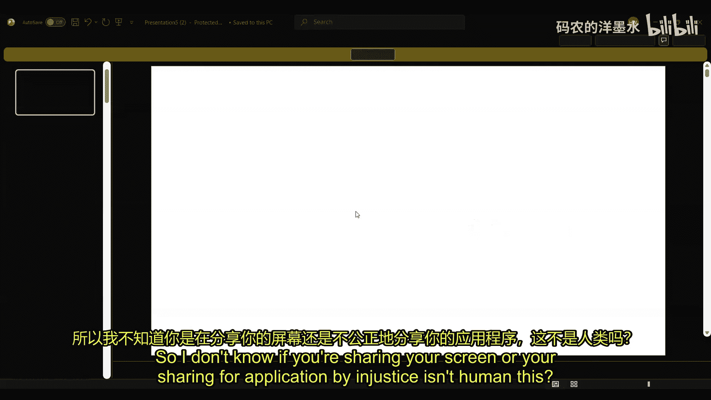
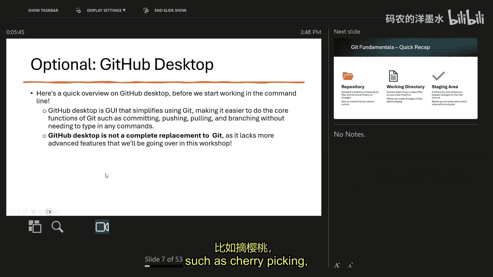
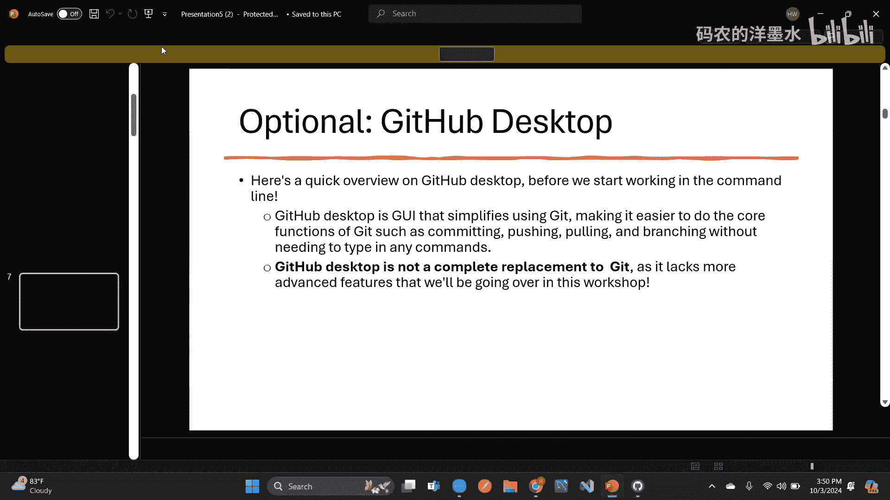
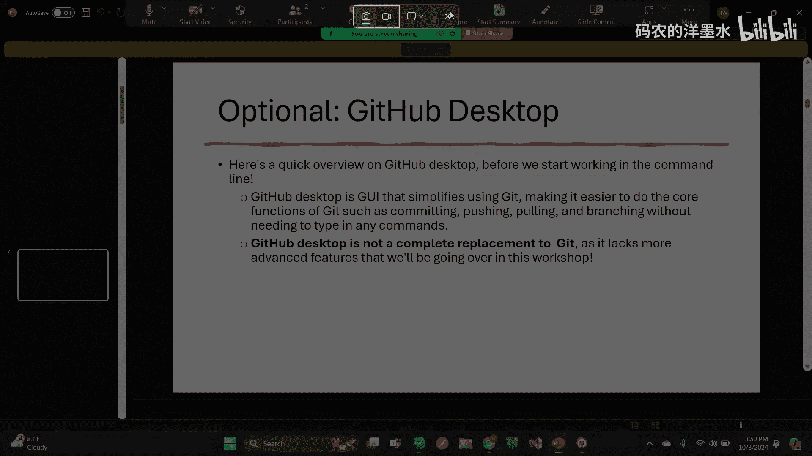
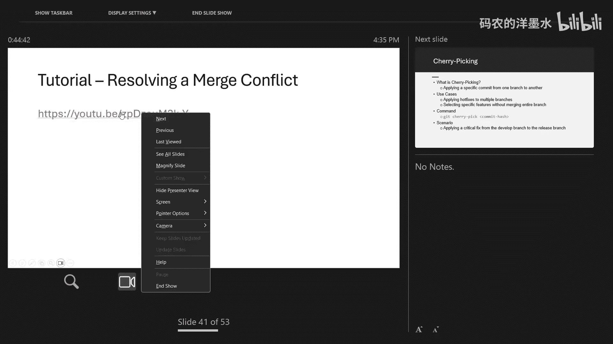
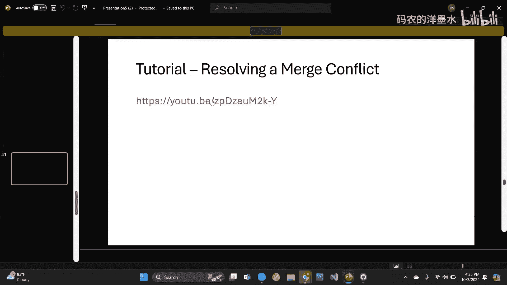
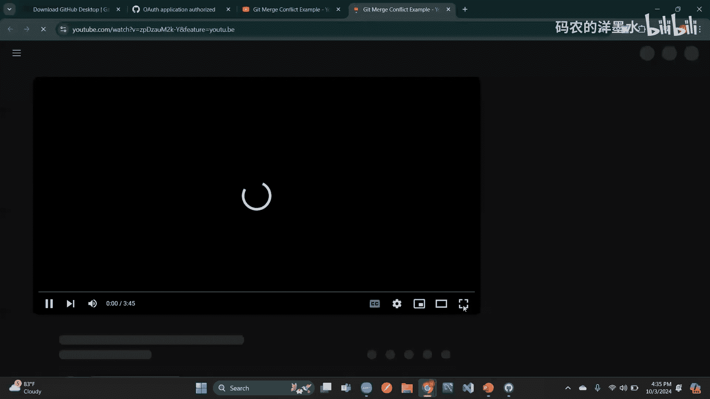
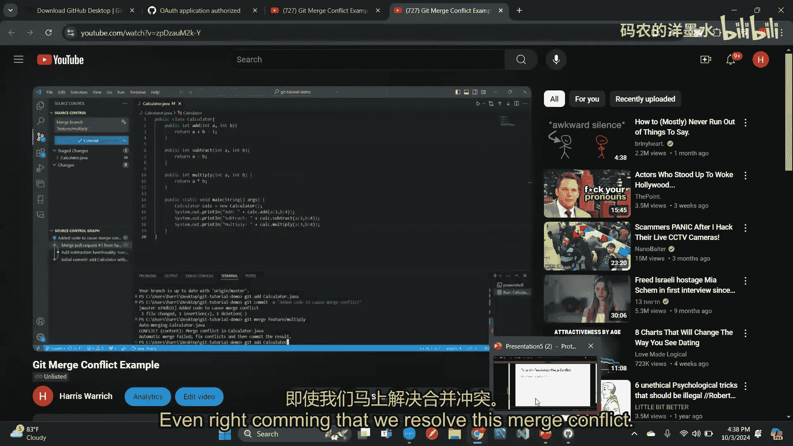
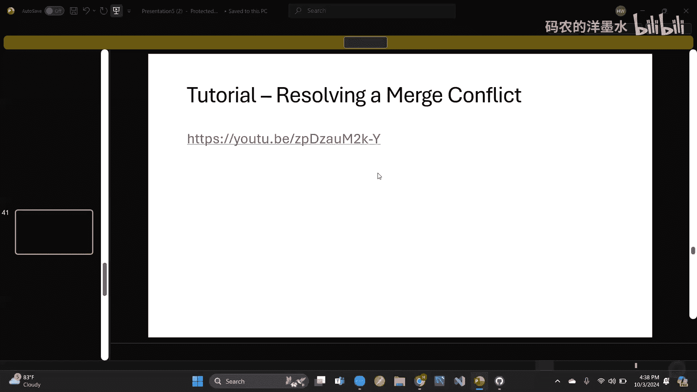
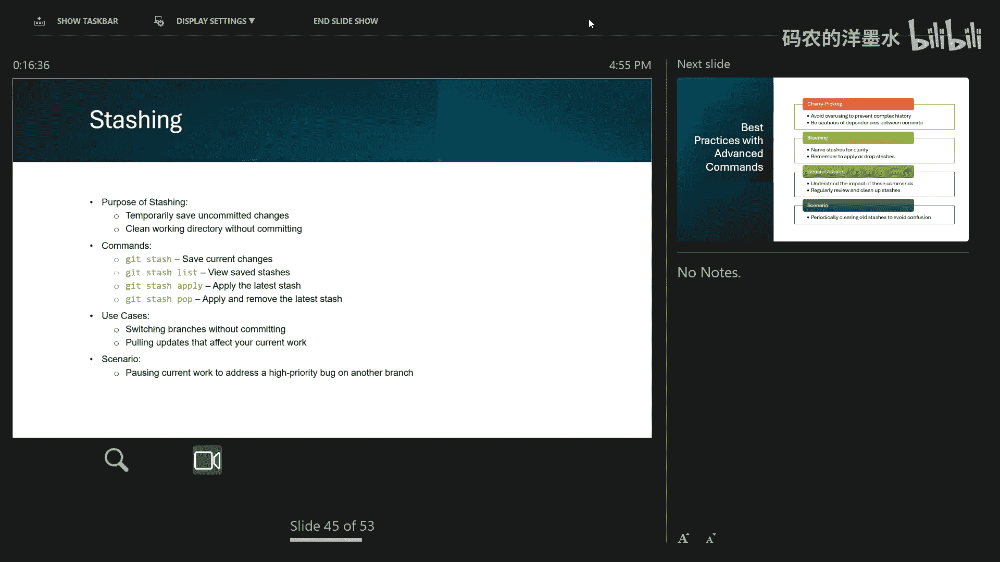

# 005：Git版本控制 🗂️




在本节课中，我们将要学习Git版本控制的核心概念、基本操作以及高级技巧。Git是现代软件开发中不可或缺的协作工具，它能帮助我们高效地管理代码变更、协同工作并维护项目历史。

---

## Git与GitHub简介

Git是一个分布式版本控制系统，用于跟踪文件随时间的变化。它由Linus Torvalds于2005年创建，最初用于管理Linux内核的开发。Git在本地机器上运行。

GitHub是一个基于Web的平台，用于托管Git仓库。它由Tom Preston-Warner、Chris Wetra和PJ Hitt于2008年创立，旨在使Git更易于访问和协作。Git是底层系统，而GitHub是增强其协作功能的在线服务。

**基本检查**：在终端或命令提示符中输入以下命令，可以检查是否已安装Git。
```bash
git --version
```



---

## GitHub基础

在深入学习Git命令之前，我们先了解一些GitHub的基本概念。





**创建仓库**：可以通过GitHub网站、GitHub桌面应用或Git命令行来创建新的代码仓库。

**克隆仓库**：可以将远程仓库复制到本地计算机。

**Fork（复刻）**：复制一个仓库到自己的账户下，形成独立的副本。这是为开源项目做贡献的常见方式，你可以在自己的副本上修改，然后通过拉取请求（Pull Request）提议合并到原项目。

**权限**：仓库可以设置不同的访问权限，例如：
*   **读取（Read）**：只能查看和克隆代码。
*   **写入（Write）**：可以推送更改到仓库。
*   **管理员（Admin）**：拥有仓库的完全控制权。

---

## GitHub桌面版

GitHub桌面版是一个图形用户界面（GUI）应用程序，它简化了Git的使用。

**核心功能**：无需输入命令即可完成提交（Commit）、推送（Push）、拉取（Pull）和分支（Branch）等核心操作。

**局限性**：GitHub桌面版并非Git的完全替代品，它缺少一些高级功能，例如我们后面会讲到的拣选提交（Cherry-pick）。

**`.gitignore`文件的重要性**：在项目开始时创建`.gitignore`文件至关重要。它可以指定哪些文件或目录不应被Git跟踪（例如编译产生的二进制文件、依赖库、本地配置文件等），避免将无关的大文件提交到仓库。

---

## Git基础概念与命令

上一节我们介绍了GitHub平台，本节中我们来看看Git本身的核心概念和基本工作流。

**仓库（Repository）**：包含项目所有文件及其完整变更历史的目录。它是版本控制的中心。

**工作目录（Working Directory）**：本地机器上项目文件的当前状态，是你直接修改文件的地方。

**暂存区（Staging Area）**：一个临时区域，用于准备下一次提交的更改。它允许你审查和控制哪些修改将被包含在提交中。

以下是必须掌握的基本Git命令：

*   `git init`：初始化一个新的Git仓库。
*   `git clone <url>`：克隆一个已存在的远程仓库到本地。
*   `git add <file>`：将文件的更改添加到暂存区。
*   `git commit -m “描述信息”`：将暂存区的更改保存为一个新的提交，并附上描述性信息。
*   `git push`：将本地提交上传到远程仓库。
*   `git pull`：从远程仓库获取并合并更改到当前分支。
*   `git status`：查看工作目录和暂存区的状态。
*   `git log`：显示提交历史。

---

## 版本控制的重要性与最佳实践

理解了基本操作后，我们来看看为什么版本控制如此重要，以及如何更好地使用它。

版本控制主要带来三大好处：
1.  **增强协作**：允许多名开发者同时工作，无需担心覆盖他人的修改。所有变更都被记录（谁、何时、为何修改），并支持代码审查。
2.  **维护代码完整性**：完整的版本历史允许你回退到任何之前的版本。它还能帮助解决合并冲突。
3.  **简化工作流**：通过分支策略高效管理不同版本和发布，并支持持续集成/持续部署（CI/CD）。

为了充分发挥这些优势，请遵循以下提交代码的最佳实践：

**1. 编写清晰的提交信息**
避免使用模糊的信息如“修复bug”或“更新”。应清晰说明**做了什么**以及**为什么这么做**。
> **不佳示例**：`add validation`
> **良好示例**：`add validation for user email input to prevent SQL injection`

团队应统一使用动词开头，如 `fix:`， `feat:`， `docs:`。例如：`feat: update navbar styling for mobile responsiveness`

**2. 进行频繁、小粒度的提交**
不要一次性编写数千行代码后再提交。应完成一个独立的功能或修复后就提交。这样做的好处是：
*   便于代码审查。
*   若需要回退，可以精准地回退单个有问题的提交，而不影响其他工作。
*   更好地跟踪进度和定位问题。

**3. 保持分支与主分支同步**
在开始工作前和工作中，频繁地从主分支（如 `main`）拉取（`git pull`）最新更改。这能最小化合并冲突的风险，并确保你的工作与团队进度整合。

---

## 分支策略介绍

分支是Git的超级功能，它允许你在独立的线上开发，而不影响主代码库。本节我们来探讨不同的分支管理策略。

**分支（Branch）** 是一个独立的开发线。

**分支的好处**：
*   **隔离开发**：安全地开发新功能或修复，不影响现有系统。
*   **并行工作流**：多个团队可以同时在各自的分支上工作（例如前端和后端）。
*   **简化合并**：功能完成后，可以轻松地合并回主分支。

**Git Flow** 是一种流行的分支模型，它定义了严格的分支角色：
*   `main`：存放可部署的生产环境代码。
*   `develop`：集成所有开发功能的分支。
*   `feature/*`：从`develop`创建，用于开发新功能。
*   `release/*`：从`develop`创建，用于准备发布。
*   `hotfix/*`：从`main`创建，用于紧急修复生产环境问题。

**主干开发（Trunk-Based Development）** 是另一种策略：
*   所有开发者都直接向单一主干分支（如 `main`）提交代码。
*   通过**功能开关（Feature Flags）** 来控制新功能的启用与禁用。
*   **优点**：合并复杂度低，分支生命周期短，非常适合持续集成环境。
*   **挑战**：需要严格的纪律、完善的测试和代码审查，否则直接提交到主干可能引入不稳定因素。

选择哪种策略取决于团队规模和项目需求。对于需要严格代码审查的课堂项目，**Git Flow** 或类似的基于功能分支的模型通常更合适。

---

## 分支的创建与管理

上一节我们比较了不同的分支策略，本节中我们来看看实际操作分支的命令。

以下是管理分支的核心命令：

*   `git branch`：列出所有本地分支。
*   `git checkout -b <branch-name>`：创建并切换到新分支。这是 `git branch <name>` 和 `git checkout <name>` 的组合。
*   `git checkout <branch-name>`：切换到指定分支。
*   `git merge <branch-name>`：将指定分支合并到当前分支。（稍后详细讲解）
*   `git branch -d <branch-name>`：删除已合并的分支。

**最佳实践**：
*   **使用描述性的分支名**，例如 `feature/user-auth`， `bugfix/login-error`。
*   **定期与主分支同步**，频繁执行 `git pull origin main`。
*   **限制分支生命周期**，功能完成后尽快合并回主分支，避免长期存在的分支带来复杂的集成问题。

---

## 合并（Merging）技术

分支开发的最终目的是将工作成果整合起来。合并就是将不同分支的更改组合到一起的操作。

**合并的类型**：

1.  **快进合并（Fast-Forward Merge）**
    *   **条件**：当目标分支（如 `main`）自特性分支创建以来没有新的提交时。
    *   **效果**：Git简单地将主分支指针向前移动到特性分支的最新提交。历史保持线性。
    *   **命令**：`git merge feature-branch`

2.  **递归合并/三方合并（Recursive Merge）**
    *   **条件**：当目标分支和特性分支都有新的提交，历史已经分叉时。
    *   **效果**：Git创建一个新的“合并提交”，将两个分支的历史连接起来。这会保留完整的历史记录。
    *   **命令**：`git merge feature-branch`

3.  **压缩合并（Squash Merge）**
    *   **操作**：将特性分支上的所有提交压缩成一个全新的提交，然后合并到目标分支。
    *   **优点**：保持主分支历史简洁清晰，避免了许多中间提交记录。
    *   **命令**：`git merge --squash feature-branch`，然后需要执行 `git commit` 来完成提交。

**合并最佳实践**：
*   **合并前审查**：使用拉取请求（Pull Request）进行代码审查。
*   **沟通变更**：通知团队成员重大的合并操作。
*   **及早解决冲突**：频繁合并，并在合并前主动处理冲突。
*   **记录合并决策**：在合并提交信息中说明合并原因。

---

## 变基（Rebasing）技术

除了合并，变基是另一种整合分支更改的方法。它通过“重新播放”提交来创造更清晰的历史。

**变基（Rebase）** 将当前分支的提交移动到另一个分支（通常是更新的主分支）的顶端，从而重写项目历史。








**优点**：产生一条直线的、线性的提交历史，更容易追踪项目进展。
**缺点**：**重写了提交历史**，不适用于已经共享给其他人的分支。

**交互式变基（Interactive Rebase）** 功能更强大，允许你在重新应用提交前编辑、重排、压缩或删除提交。
*   **命令**：`git rebase -i HEAD~n` （`n`代表要回溯的提交数）
*   **常用操作**：
    *   `pick`：保留提交。
    *   `reword`：修改提交信息。
    *   `edit`：修改提交内容。
    *   `squash`：将提交合并到前一个提交中。
    *   `drop`：删除提交。

**变基 vs. 合并**：
*   **使用变基**：用于整理**私有分支**的历史，然后再分享或合并。
*   **使用合并**：用于整合**已共享的分支**，因为它保留了完整的历史记录。





**变基最佳实践**：
*   不要在共享分支上变基。
*   使用交互式变基在推送前清理提交。
*   使用 `git push --force-with-lease` 进行强制推送时要格外小心，并提前通知团队成员。

---

## 解决合并冲突

当Git无法自动合并两个分支对同一文件的更改时，就会发生**合并冲突**。这在并行开发中很常见。

**冲突发生时机**：在合并或变基过程中，当两个分支修改了同一文件的相同区域。

**解决步骤**：
1.  Git会标记出冲突文件，文件内会包含类似 `<<<<<<<`， `=======`， `>>>>>>>` 的冲突标记。
2.  打开冲突文件，决定保留哪些更改（可能是当前分支的、传入分支的，或两者的结合）。
3.  使用编辑器（如VS Code内置的合并冲突工具）解决冲突，删除所有冲突标记。
4.  将解决后的文件添加到暂存区：`git add <file-name>`。
5.  继续完成合并或变基操作：`git commit`（对于合并冲突）或 `git rebase --continue`（对于变基冲突）。

**冲突解决最佳实践**：
*   **团队沟通**：协调可能重叠的工作。
*   **立即解决**：不要搁置未解决的冲突。
*   **理解更改**：仔细审查冲突双方的修改意图。
*   **合并后测试**：确保解决冲突后的代码功能正常。

---

## 高级Git命令

掌握了分支、合并和变基后，我们来看一些能进一步提升效率的高级技巧。

**1. 拣选提交（Cherry-pick）**
*   **作用**：将某个分支上的一个特定提交应用到当前分支。
*   **使用场景**：将一个重要的修复（hotfix）应用到多个分支，而无需合并整个分支。
*   **命令**：`git cherry-pick <commit-hash>`

**2. 贮藏（Stashing）**
*   **作用**：临时保存工作目录中的未提交更改，清空工作区以进行其他操作（如切换分支处理紧急bug）。
*   **常用命令**：
    *   `git stash`：贮藏当前更改。
    *   `git stash list`：查看贮藏列表。
    *   `git stash apply`：应用最新的贮藏（不删除）。
    *   `git stash pop`：应用并删除最新的贮藏。
*   **使用场景**：需要临时切换上下文，但又不想提交未完成的工作。

**高级命令最佳实践**：
*   **慎用拣选**：过度使用会使历史复杂，需注意提交间的依赖关系。
*   **命名贮藏**：为贮藏添加描述信息（`git stash save “描述”`）。
*   **定期清理**：定期检查并删除旧的贮藏，避免混淆。

---

## 常见陷阱与总结

在课程的最后，我们总结关键要点，并提醒一些需要避免的常见错误。

**需要警惕的陷阱**：
*   **强制推送（Force Push）**：`git push --force` 会覆盖远程历史，可能抹掉他人的工作。务必使用更安全的 `--force-with-lease` 并与团队沟通。
*   **重写共享历史**：避免对他人正在使用的分支进行变基。
*   **忽略合并冲突**：未妥善解决的冲突可能引入错误。
*   **巨型提交**：包含大量更改的提交难以审查和回退。始终拆分为小粒度的提交。

**核心回顾**：
*   **清晰的提交**：使用描述性信息，小步快跑。
*   **高效的分支**：命名规范，聚焦单一任务，频繁同步。
*   **顺畅的协作**：定期推送/拉取，善用代码审查和拉取请求。
*   **冲突预防**：提前沟通计划，频繁合并以减少冲突。

**最终建议**：精通Git能极大提升团队效率和软件质量。这是一个需要持续练习和探索的工具。利用官方文档、交互式教程（如 `learngitbranching.js.org`）和社区资源不断精进你的技能。

---



本节课中我们一起学习了Git版本控制从基础到高级的全套知识，包括仓库管理、提交规范、分支策略、合并与变基、冲突解决以及一些高效的高级操作。掌握这些技能将为你的软件工程协作打下坚实的基础。