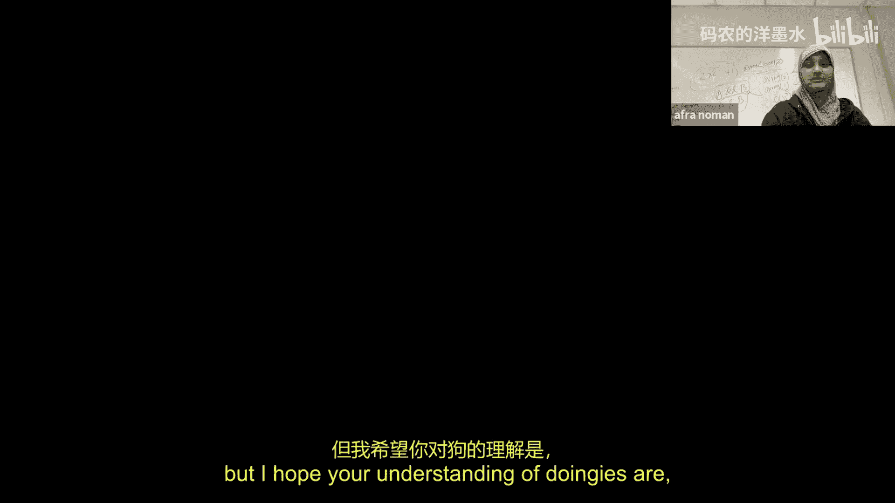
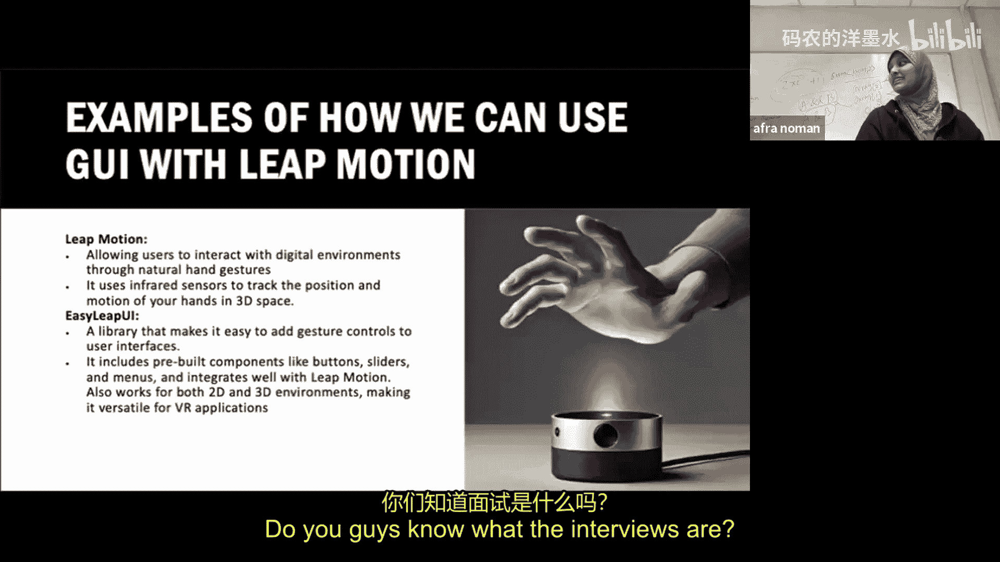
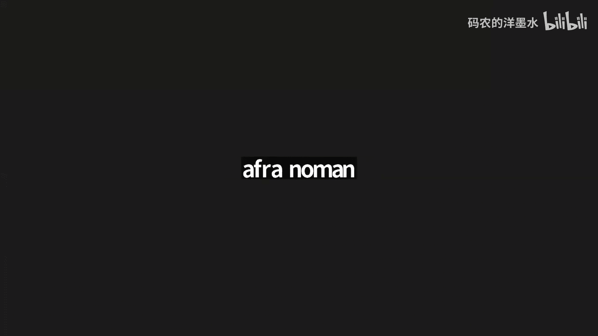

# 007：图形用户界面 👨‍💻


在本节课中，我们将学习图形用户界面的基础知识，包括其定义、历史、核心组成部分，并通过Python的Tkinter库进行实践。课程最后将探讨如何将手势控制与GUI结合。

## 概述

图形用户界面是用户与计算机程序进行视觉交互的部分。本节将介绍GUI的构成、发展历史，并指导你使用Python的Tkinter库创建简单的GUI应用。

---

## 什么是图形用户界面？🖥️

图形用户界面是计算机程序或应用程序中，用户通过视觉进行交互的部分。用户界面泛指用户与计算机的任何交互。GUI的核心在于，用户无需输入命令，而是通过点击按钮、图标或图像等“指向并点击”的界面来操作。你可以将其理解为网站或应用程序上看到的屏幕布局，通过点击、轻触和拖拽来触发功能。

例如，在一个窗口中，所有可以点击和交互的元素都被称为**部件**。

### GUI的三个核心部分

一个GUI程序主要包含三个部分：
1.  **框架**：即主窗口，包含所有视觉元素（部件）。
2.  **代码**：定义GUI功能和行为的编程逻辑或指令。例如，可以使用API连接GUI前端和功能后端。
3.  **事件**：触发特定响应的用户动作。

---

## GUI的发展历史 📜

GUI的历史可以追溯到1973年，这距离现在并不遥远。有趣的是，当时的许多计算机科学家甚至没有鼠标，只有计算机和键盘。1973年诞生的第一个GUI并未商用，仅限计算机科学家使用。

第一个商业销售的GUI由苹果公司在1984年推出，同时售出的还有鼠标。这个早期的商业GUI已经包含了菜单栏，用于访问文件、应用程序、系统功能、计算器、闹钟、记事本、控制面板等。许多这些功能至今仍在沿用。

如今，我们使用的GUI无处不在，例如智能电视的点播界面、手机、平板电脑等移动设备。视觉设计，尤其是色彩心理学，在现代GUI开发中扮演着重要角色。

---

## 如何创建和使用GUI？🔧

上一节我们回顾了GUI的历史，本节我们将动手实践，学习如何使用Tkinter创建GUI。

### 准备工作

开始前，请确保已安装：
1.  Visual Studio Code
2.  Python（Tkinter已包含在最新版本的Python中）

### 引入Tkinter

在Python文件中，通常以下列方式导入Tkinter：
```python
import tkinter as tk
from tkinter import *
from tkinter import ttk
```
*   `import tkinter as tk`：导入Tkinter并简写为`tk`以便引用。
*   `from tkinter import *`：导入所有函数和内置模块。
*   `from tkinter import ttk`：导入Themed Tkinter，它提供外观更现代的部件，并能适应用户的操作系统。

### Tkinter简介

Tkinter是Python的标准GUI库。它是一个开源、跨平台的部件工具包，被多种编程语言用于构建GUI，因其简单直接而深受初学者推荐。

一个Tkinter应用包含三个主要部分：
1.  导入Tkinter语句。
2.  创建主窗口：`root = tk.Tk()`。`root`是主窗口的变量名，代表整个GUI的根或顶部。
3.  启动主事件循环：`root.mainloop()`。这使程序进入事件循环，监听用户的交互操作。

---

## GUI应用示例 🧮

以下是几个使用Tkinter创建的GUI应用示例。

### 示例一：简易计算器

这是一个包含两个部件的计算器GUI：一个**输入框**部件和多个**按钮**部件。点击按钮，数字和运算符会显示在输入框中，并具备完整的计算功能。它还能根据操作系统切换深色模式。

核心代码结构如下：
```python
import tkinter as tk
from tkinter import ttk

# 创建主窗口
root = tk.Tk()
root.title("计算器")
# ... 此处添加输入框、按钮及计算逻辑的代码 ...

root.mainloop()
```

### 示例二：天气查询应用

这个应用使用Tkinter和`requests`库，允许用户输入城市名并获取实时天气数据（温度、湿度、天气状况、风速）。它通过OpenWeatherMap API获取数据。

应用的主要功能包括：
*   `tk.Tk()`：创建主窗口。
*   `root.title()`：设置窗口标题。
*   `root.geometry()`：设置窗口尺寸。
*   `tk.Label()`：创建标签（如“输入城市：”）。
*   `tk.Entry()`：创建文本输入框，供用户输入城市名。
*   `tk.Button()`：创建“获取天气”按钮，点击时触发查询函数。
*   `mainloop()`：保持GUI响应，监听用户交互。

### 示例三：带菜单栏的文本编辑器

此示例创建了一个带有菜单栏（文件->新建、打开、保存、退出）的简单文本编辑器。它使用`tk.Text`部件（支持多行文本编辑），而非单行的`tk.Entry`部件。

代码关键点：
*   `tk.Tk()`初始化主应用窗口。
*   `add_command`向下拉菜单添加可点击项，每个项链接到一个功能函数（如`new_file`, `open_file`, `save_file`, `exit`）。
*   `tk.Text()`在主窗口内创建一个多行文本编辑部件。
*   `mainloop()`启动事件循环。

---

## 综合应用与课堂项目 🚀

前面我们介绍了几个独立的GUI应用，本节我们将它们整合，并介绍与课堂项目相关的进阶内容。

### 综合应用：多功能程序

我们将计算器、天气应用等小型GUI整合到一个应用程序中。该应用使用不同的**框架**来切换和展示各个功能。核心代码逻辑是管理一个主菜单框架，并根据用户选择切换到对应的功能框架。

### 课堂项目：GUI测验

作为课程交付成果的一部分，我们将创建一个GUI测验程序。该程序会显示选择题，用户选择后即时显示结果。

### 与Leap Motion手势控制集成

我们的课堂项目将涉及使用Leap Motion控制器，这是一个通过自然手势与数字环境交互的设备。它将使用传感器检测手部在3D空间中的运动和位置。

我们将使用**Easy Li UI**库来实现手势与GUI的交互。这个库简化了为GUI添加手势控制的过程，并包含一些预制的部件（如按钮、滑块、菜单），能很好地与Leap Motion集成。

#### 工作流程
以下是手势控制GUI的基本工作流程：
1.  **设置**：用户准备好Leap Motion控制器。
2.  **手势检测**：Leap Motion检测用户的手部运动和位置。
3.  **数据转换**：Leap Motion控制器将物理手势信号转换为数字数据。
4.  **手势映射**：Easy Li UI库接收数据，并将其映射为特定操作（如调整滑块、按下按钮）。例如，“捏合”手势可能对应菜单选择。
5.  **GUI响应**：GUI根据映射的操作更新界面并给出反馈。
6.  **循环等待**：系统准备接收下一个手势指令。

> **注意**：由于课堂项目涉及3D交互亭，我们可能不会使用主要为2D应用设计的Tkinter，而会考虑使用Unity等支持3D GUI开发的工具。



---

## 总结与任务 📋

本节课我们一起学习了图形用户界面的核心概念、历史，并通过Tkinter库实践了创建简单GUI应用。我们还探讨了如何将手势控制技术与GUI相结合。

### 课程任务
1.  **基础任务**：访问课程Pod仓库，跟随代码创建并运行提供的多项选择测验GUI。
2.  **进阶任务**：修改提供的“多功能程序”代码，在其中添加一个新的框架，用于集成你创建的多项选择测验功能。
3.  **提交内容**：修改后的代码文件，以及应用程序正常运行时的屏幕录制视频。





如有任何问题，可以随时联系我们。