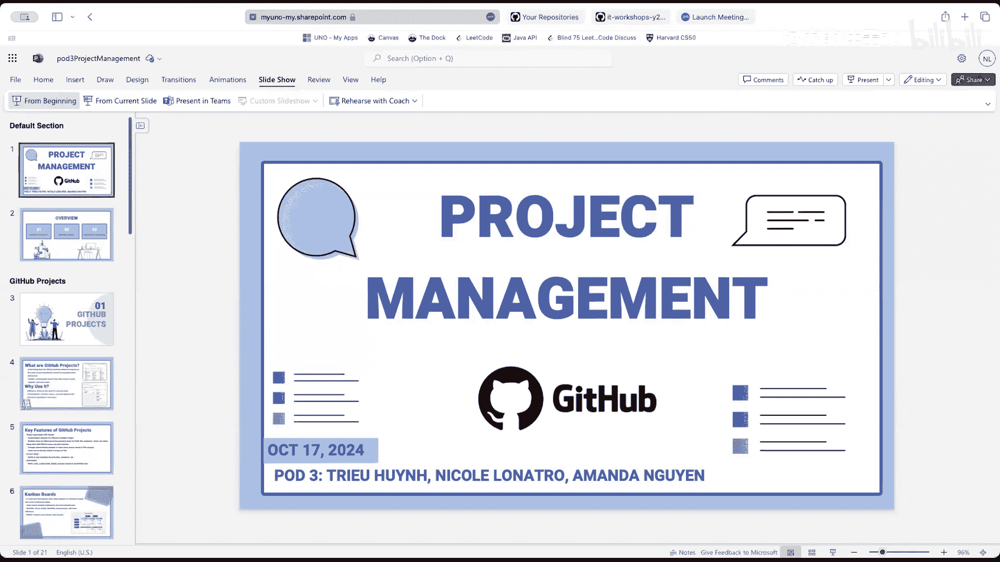
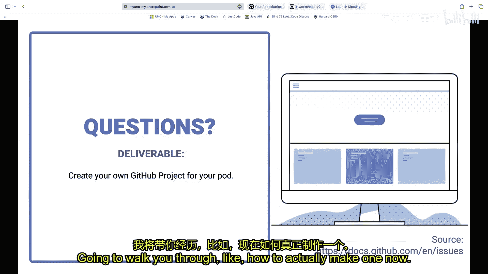
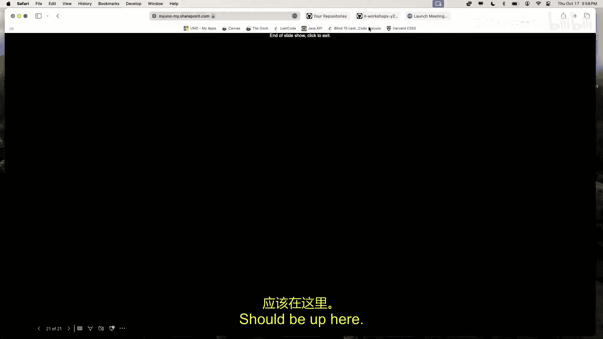
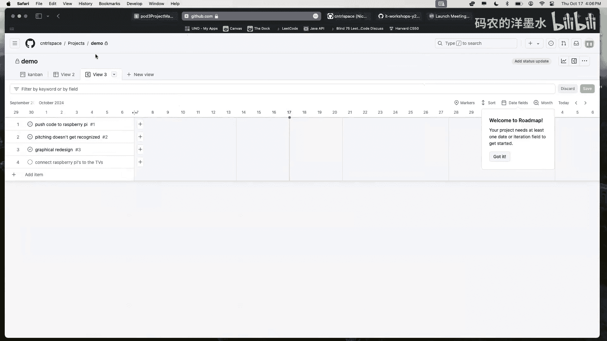
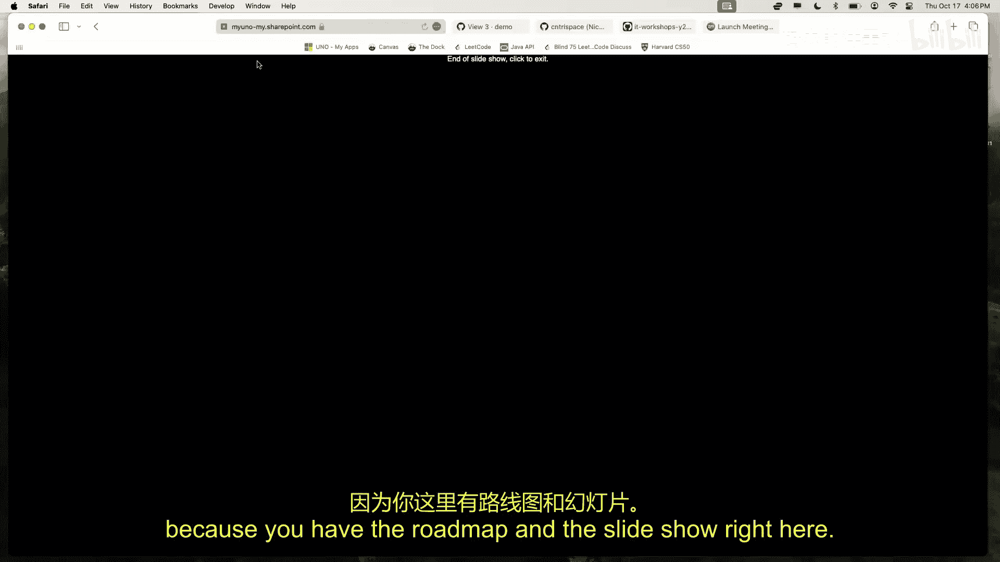
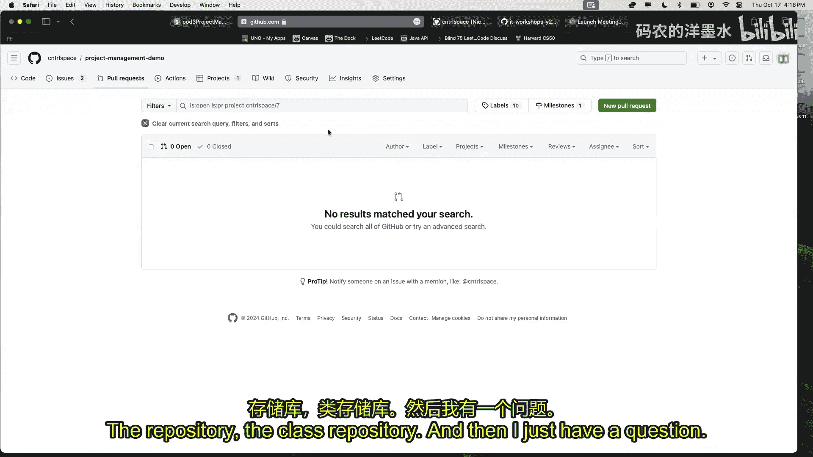

# 008：项目管理 🗂️





在本节课中，我们将学习如何使用GitHub内置的项目管理工具来规划、组织和跟踪软件开发工作。我们将重点介绍GitHub Projects和Issues，并了解如何利用它们来提升团队协作效率。

## GitHub Projects 概述 📊

上一节我们介绍了课程的整体安排，本节中我们来看看GitHub Projects。当你最初想到“项目”时，你可能会想到一个你正在努力实现的目标，例如制作一个游戏并为其创建一个代码仓库。但GitHub有一个名为“Projects”的集成工具，它围绕管理某个可交付成果的所有工作而设计。

GitHub Projects有不同的层级：
*   **组织级项目**：可以跨多个不同的代码仓库跟踪工作。
*   **仓库级项目**：适用于单个团队或单一项目。
*   **用户级项目**：可用于跟踪个人所有的项目。

它提供了灵活、可自定义的面板，帮助团队规划、组织和跟踪任务与预算，从而简化整体工作流程。

### 为何使用GitHub Projects？

使用GitHub Projects主要带来**效率**和**集中化**的优势。它已嵌入GitHub，无需使用外部软件。所有任务、议题和拉取请求都集中链接到一个地方，并与你的代码仓库相连。

### 核心功能

以下是GitHub Projects的一些关键特性：

*   **可视化组织**：主要通过看板视图进行组织，GitHub也提供其他视图类型。可自定义的列代表不同的工作流阶段，列中的卡片代表任务。
*   **自定义视图**：可以根据指派人、标签或截止日期等进行筛选和排序，创建个性化视图。
*   **与Issues和PRs集成**：当议题关闭或拉取请求合并时，看板会自动更新。卡片可以直接链接到具体的议题或拉取请求。
*   **自定义字段**：可以添加如优先级、截止日期等元数据，方便标记和描述。
*   **项目自动化**：可以设置预定义规则，让卡片在任务完成时自动移动。

## 看板方法 📋

上一节我们了解了GitHub Projects的功能，本节中我们来看看其核心视图之一：看板。看板是一个日语词汇，意为“可视化卡片”或“信号板”，由丰田工程师创建，旨在提高制造效率。

看板是一种使用列来描绘工作阶段的可视化工具。一个简单的看板包含“待办”、“进行中”和“已完成”列，但你可以根据需求自定义结构。卡片则代表具体的任务。

在看板中：
*   **承诺点**：当你承诺开始一项任务时，将其从“待办”移至“进行中”。
*   **交付点**：当任务完成时，将其从“进行中”移至“已完成”。
*   **泳道**：是一个横向分隔条，可作为额外的组织层，用于按工作类型或不同团队进行区分，有助于识别瓶颈和过度承诺。

看板的好处包括**视觉清晰度**、**灵活性**、**透明度**（所有人都能看到工作进展）以及最终提升的**团队效率**。GitHub Projects采用了这种看板风格。

## GitHub Issues详解 🐛

上一节我们探讨了看板视图，本节中我们来深入了解GitHub Issues。如果你点击GitHub左上角的菜单图标，可以找到“Issues”页面。这个页面可以显示来自多个项目的议题。

GitHub Issues是一个用于记录任务、错误和其他问题的项目管理功能。它的用途不仅限于记录错误，你可以发挥创意，用它记录各种事项。它与敏捷方法论配合良好，可以用于报告不同的状态和指标。

### 创建与查看议题

当你查看一个议题时，可以看到标签（如`bug`、`help wanted`）、指派人等信息。你也可以创建自定义标签来分类议题。议题页面集成了拉取请求信息，并且可以设置里程碑。

创建议题时，你需要填写标题和描述，并可以选择标签。例如：
```markdown
标题: 数据导入错误
描述: 从`data.csv`文件导入数据时，第5行出现解析错误。需要检查文件格式或编码。
标签: bug, help wanted
```
完成后，点击“Create issue”按钮即可。

### 与CI/CD集成

GitHub Issues常与敏捷方法和CI/CD结合，形成流畅的工作流。例如，可以设置自动化集成测试：当推送的代码导致测试失败时，系统会自动创建一个议题，并记录相关的提交和推送者信息。这有助于早期发现错误，并让跟踪提交和问题变得更加容易。

## 进度跟踪与视图 🔄

上一节我们介绍了如何创建和管理议题，本节中我们来看看如何利用不同的视图来跟踪项目进度。GitHub Projects提供了多种视图来监控任务和里程碑。





### 表格视图

这是类似电子表格的视图，设计直观，易于新手使用。你可以清晰地看到所有议题的列表及其状态、指派人等信息。

### 看板视图

这是可视化的看板视图，适合快速概览整体进展。当议题数量众多时，这种视图尤其有用。你可以通过拖放操作将卡片在不同列之间移动。

### 路线图视图

这是一种日历视图，可以按时间线查看里程碑和计划的任务。它有助于规划未来的工作安排。





### 状态更新与里程碑

在整个项目中，你可以添加状态更新（如“按计划进行”或“偏离计划”），让所有成员了解最新情况。历史更新会被保留，形成日志。

里程碑可以基于实际截止日期创建。当议题状态从“进行中”变为“已完成”时，关联的里程碑进度会自动更新，无需手动同步。

## 实践演示 🛠️

上一节我们学习了各种视图，现在让我们通过一个简单的练习来实际操作。我们将创建一个项目看板并添加一些议题。

首先，在你的代码仓库中，点击“Projects”标签页，然后选择“New project”。你可以选择一个模板，这里我们使用“Board”模板。创建后，你会看到一个基础的看板。

你可以重命名列（例如将“To do”改为“Backlog”），并修改其颜色。在设置中，可以添加项目描述、设置权限以及管理自定义字段。

现在，让我们添加一个议题。例如，议题标题可以是：“树莓派手势‘捏合’未被识别”。在看板中，你可以将此草稿卡片转换为正式的议题，并为其添加标签（如`good first issue`）和指派人。

在看板、表格或路线图视图中，你都可以方便地管理这些议题的状态。你还可以创建迭代周期，系统会自动为后续周期生成时间框架。

## 总结 📝

本节课中我们一起学习了GitHub的项目管理工具。我们介绍了GitHub Projects如何通过看板等方法帮助团队可视化和管理工作。我们深入探讨了GitHub Issues的创建、分类以及与CI/CD流程的集成。我们还了解了如何使用表格、看板和路线图等多种视图来有效跟踪项目进度与里程碑。




关键在于，这些工具非常灵活，你可以根据团队的需求创造性地使用它们，从而构建一个透明、高效的工作流，提升整个团队的协作效率。