# 009：Leap Motion 2 SDK 🖐️

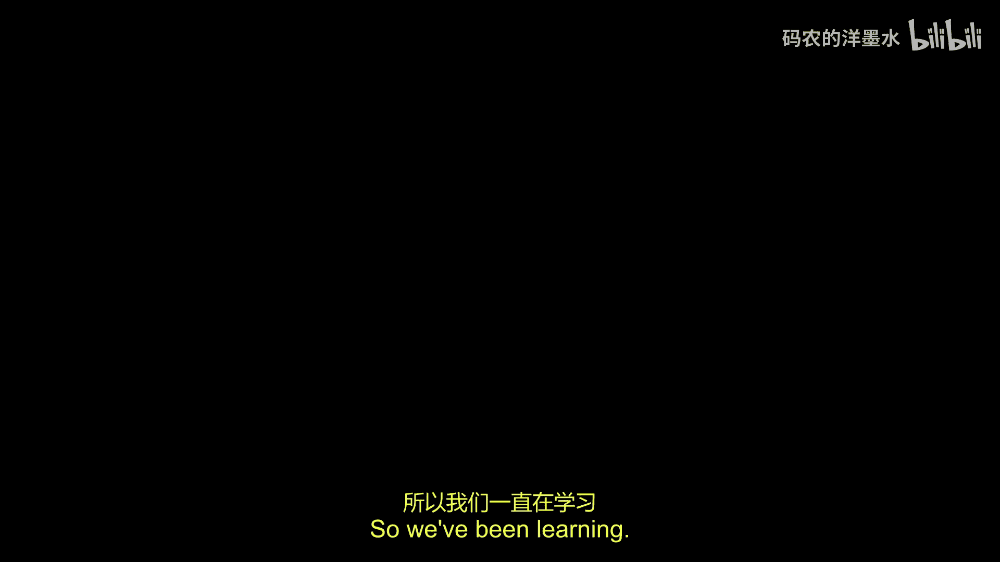

在本节课中，我们将学习Leap Motion控制器及其软件开发工具包（SDK）。我们将了解其硬件原理、软件安装步骤，并学习如何使用Python绑定进行手势追踪编程。课程内容分为三个主要部分：硬件介绍、环境安装和编程实践。

## Leap Motion控制器介绍 🎥

上一节我们概述了课程内容，本节中我们来看看Leap Motion控制器本身。

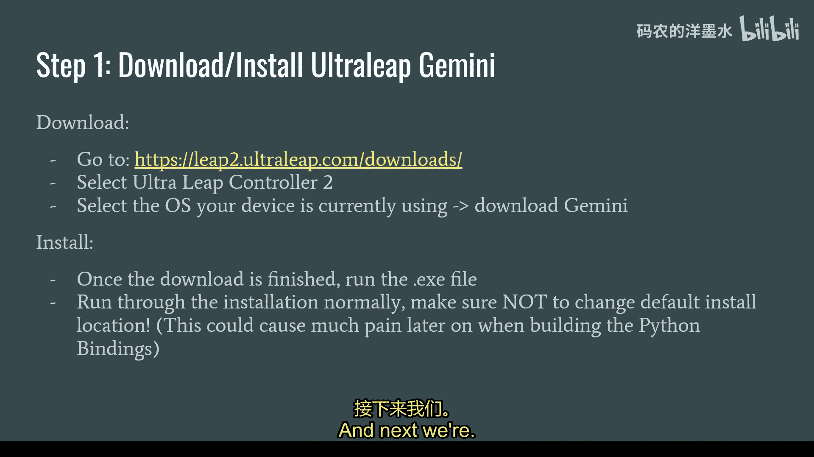

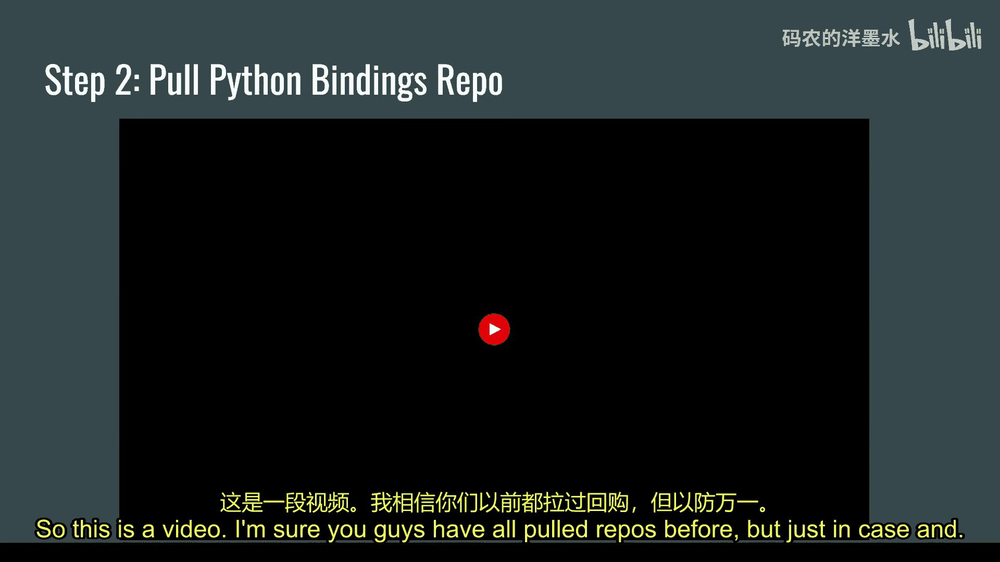

Leap Motion控制器是一种硬件设备，它将安装在我们项目所使用的显示器上。该设备通过两个红外摄像头和红外LED发射器工作。它投射红外光，并由两个摄像头捕捉，利用立体视觉成像技术来获取深度信息。

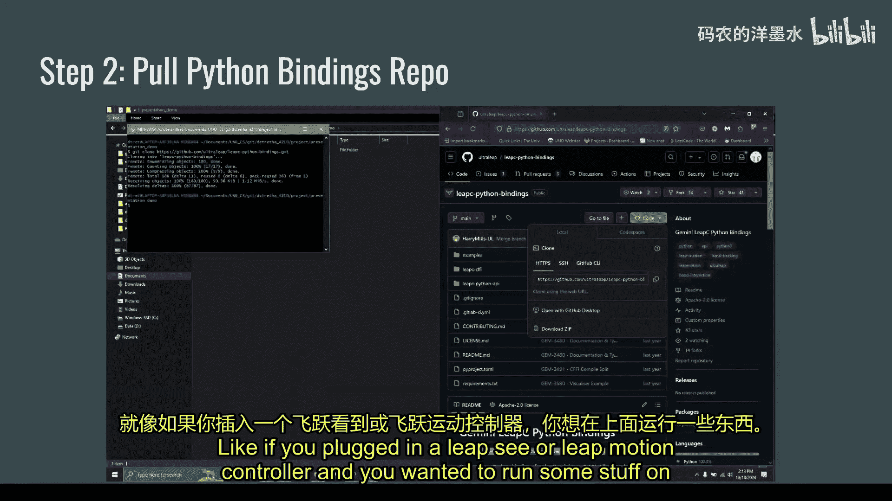

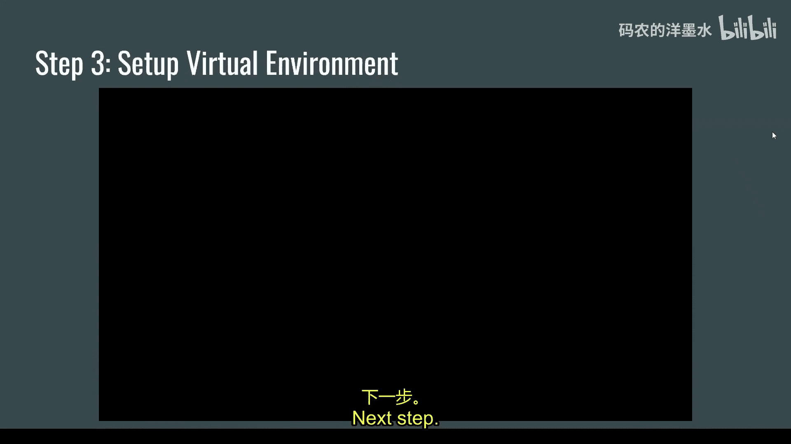

因此，它可以在摄像头前方提供X、Y、Z三个维度的精细位置数据。软件支持多种安装方式，包括朝上放置、头戴式或安装在屏幕顶部，我们项目很可能会采用屏幕顶部的安装方式。

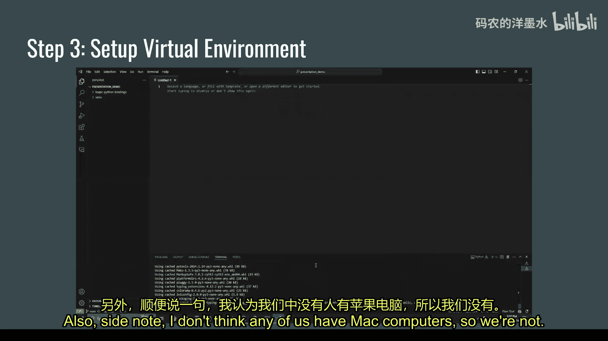

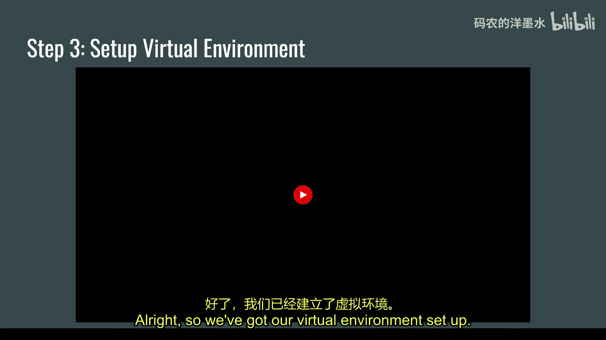

控制器内部集成了处理器，能完成大量计算工作，但这也导致其功耗较高，我们在使用树莓派时已经遇到了这个问题。

## 相关技术与SDK 🛠️

上一节我们介绍了硬件，本节中我们来看看Leap Motion提供的软件技术。

Leap Motion最新的技术是Ultraleap Hyperion。如果你使用的是Windows、Mac或X86架构的Linux系统，可以通过控制面板查看原始摄像头输出等信息。

然而，我们将主要使用Ultraleap Gemini技术。原因是Gemini是唯一支持树莓派ARM架构的版本。树莓派是我们用来控制显示器后方摄像头的主要计算机。

在树莓派上使用Ultraleap Gemini相对基础，但环境设置好后很容易使用。每个技术包（如Gemini）都包含Leap Motion SDK，其中提供了API和C语言库。如果你熟悉C或C++，使用起来会比较容易。考虑到本课程主要使用Python，我们已提前设置了Python绑定，稍后会介绍如何配置。

控制器的应用场景非常广泛。例如，可以将其安装在VR头显上。如果你路过实验室，有时会看到人们戴着VR头显使用它。另一个有趣的技术是“TouchFree”，它可以将任何显示器变成触摸屏，精度相当高。在日益增长的AR和VR领域，其应用可能性是无穷的。

## 环境安装与配置 💻

上一节我们了解了Leap Motion的基本情况，本节中我们来看看如何开始安装和下载所需的一切。

第一步是下载SDK。你需要创建一个免费账户。请注意，安装时不要更改默认安装路径，否则后续安装Python绑定时可能会遇到麻烦。

第二步是获取Python绑定。我们将从GitHub仓库克隆代码。以下是具体步骤：

1.  打开终端。
2.  使用 `git clone` 命令克隆Leap Motion Python绑定的仓库到指定文件夹。

这些步骤是为了在你的本地机器上设置环境，以便在插入Leap Motion控制器后可以运行程序。所有步骤在提供的文档中都有详细说明，你可以复制粘贴命令。

第三步是设置Python虚拟环境。我们将在VS Code的终端中运行一系列命令。首先，使用命令创建虚拟环境。然后，激活该虚拟环境。在某些电脑上可能会遇到执行策略问题，文档中也有相应的解决方法。

请注意，我们使用的都是Windows电脑，对于Mac系统的具体操作可能不完全清楚，但我们很乐意提供帮助。

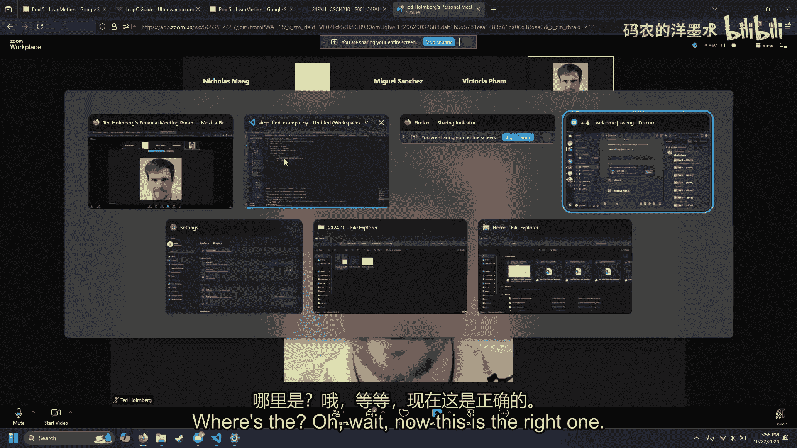

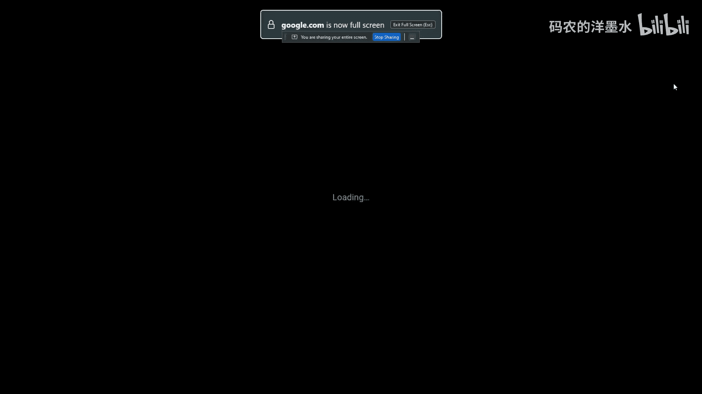

第四步是构建Python绑定。在同一个终端中，按照文档的说明逐行运行命令来安装Python绑定。这个过程并不复杂，但请确保你位于正确的目录下，并指向正确的`requirements.txt`文件。如果你不想看视频，文档中提供了所有命令，直接复制粘贴即可。

如果你更改了默认的安装目录，可能需要设置环境变量来指向正确的路径，这可能会带来一些问题。因此，建议保持默认安装路径。如果在任何步骤遇到问题，请随时向我们求助，这是一个团队项目。

安装完成后，你可以进入`examples`文件夹，运行示例程序。例如，连接Leap Motion后，你可以运行一个可视化示例来测试。

## 使用Python绑定进行编程 🐍

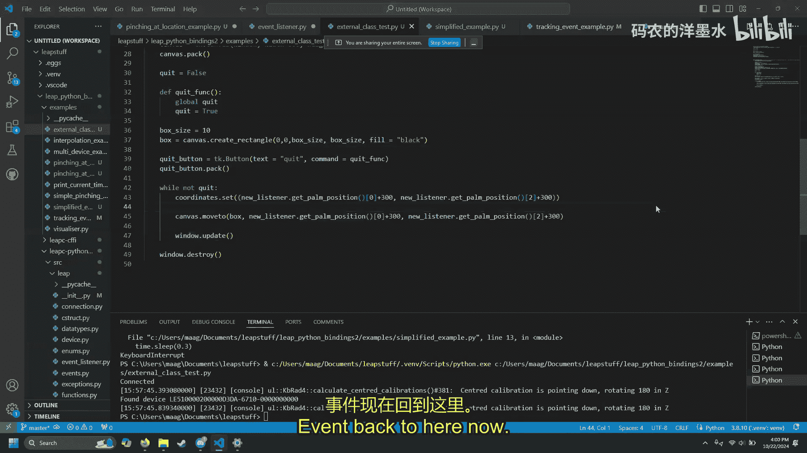

上一节我们完成了环境配置，本节中我们来看看如何使用Python绑定进行实际编程。

现在假设你已经设置好了所有Python绑定，接下来需要实际开发应用程序。我们需要了解SDK中的几个重要类，Python绑定对它们进行了封装。

最重要的类是`Listener`（监听器）。监听器继承自`Connection`（连接）类，它负责处理来自摄像头的所有事件。几乎所有你关心的操作都将通过监听器处理。事件可以是任何被摄像头记录的信息，虽然大部分是手部运动，但也包括连接、断开、错误日志等。

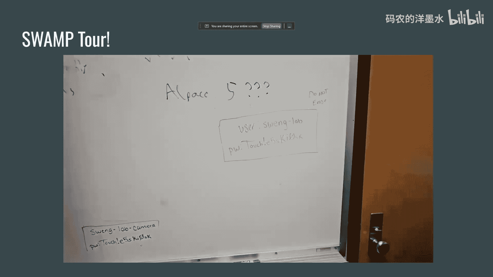

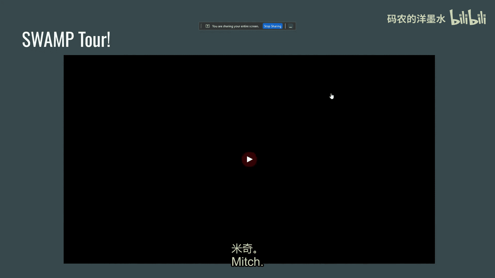

以下是如何使用监听器：

1.  首先，从我们提供的`camera_binding`文件中导入所需的模块，特别是`MyListener`类和`Listener`类，同时也要导入`leap`模块本身。
2.  接下来，设置连接和监听器类。创建一个新的监听器实例和一个新的连接实例。关键步骤是使用`connection.add_listener(listener)`将你创建的监听器添加到连接中。这样，机器与摄像头之间的连接才能将事件传递给监听器进行处理。
3.  最后，使用`with connection.open():`语句来打开连接。`with`关键字能确保连接在使用完毕后正确关闭，防止内存泄漏。在这个连接打开的代码块内，你可以编写一个循环来持续监听事件并执行你的逻辑。

以上就是连接摄像头并开始监听事件所需的全部核心代码。

我们提供了两个最重要的函数：
*   `get_palm_position()`：获取手掌位置坐标。
*   `is_pinching()`：检测是否正在做捏合手势。

下面是一个简化的示例，展示了如何打印捏合状态和手掌位置：

```python
import time
from camera_binding import MyListener
import leap

listener = MyListener()
connection = leap.Connection()
connection.add_listener(listener)

with connection.open():
    while True:
        print(f"Pinching: {listener.is_pinching()}")
        print(f"Palm Position: {listener.get_palm_position()}")
        time.sleep(0.3)
```

在这个示例中，我们每秒打印几次手掌位置和捏合状态。手掌位置返回的是三维坐标（X, Y, Z）。需要注意的是，在大多数屏幕交互场景中，你主要会用到X和Z坐标，因为Y坐标代表的是距离摄像头的深度。

我们还创建了一个结合Tkinter图形库的示例，可以让一个方块跟随手掌移动。为了实现这一点，我们需要在每次循环更新中手动调用Tkinter的窗口更新函数，因为`mainloop()`是阻塞函数。

除了上述两个函数，我们还提供了其他一些有用的函数：
*   `get_hand_type()`：返回追踪到的是左手还是右手。
*   `get_pinching_vectors()`：返回食指指尖和拇指指尖在各个轴向上的差值，可用于实现缩放等功能。
*   `get_tracking_frame_id()`：返回追踪帧的ID，可用于控制更新频率。

所有函数都有文档字符串说明其返回值和用法。如果你需要更多功能或有任何建议，请告诉我们。

## Swamp Lab 介绍与总结 🏠

上一节我们学习了如何编程，本节中我们来看看为大家准备的一个开发环境。

我们还为大家准备了一个开发环境，称为“Swamp Lab”，位于走廊尽头的352房间。这是一个供全班同学开发应用程序的场所。

Swamp Lab模拟了走廊显示器的环境，包含三台电脑、三个桌面显示器和一个电视，为你提供了一个完整的开发测试平台。每台显示器都由独立的树莓派驱动，这意味着我们可以为每个显示器定制不同的程序。

Lab内将提供签到表，请大家在使用时登记。这是一个共享空间，请互相尊重。我们也正在努力解决树莓派的供电问题，以让Leap Motion运行更流畅。

此外，我们还在Discord的Swing频道设置了一个语音频道和屏幕共享功能，方便远程协作和查看Lab使用情况。

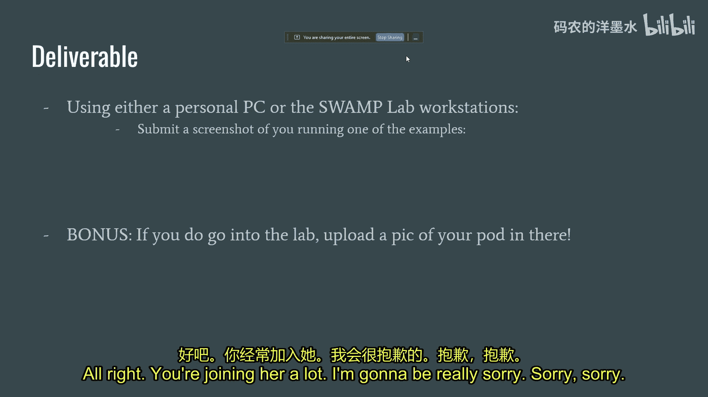

**本节课总结**
在本节课中，我们一起学习了Leap Motion控制器的硬件原理和Ultraleap Gemini SDK。我们逐步完成了开发环境的安装与配置，包括下载SDK、设置虚拟环境和构建Python绑定。重点学习了如何使用我们封装的Python绑定进行编程，通过监听器处理事件，并掌握了获取手掌位置、检测捏合手势等核心功能。最后，我们介绍了为大家准备的Swamp Lab开发环境。接下来，大家就可以利用这些工具开始为走廊显示器开发创新的手势交互应用了。