# 010：数据管理 📊


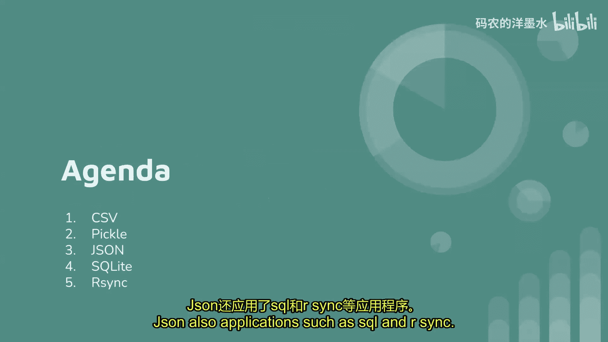

在本节课中，我们将要学习几种关键的数据序列化格式和工具，包括CSV、Pickle、JSON、SQLite以及rsync。我们将探讨它们的基本概念、使用方法、优缺点以及适用场景。

---

## CSV：逗号分隔值 📄

CSV是一种用于存储表格数据的简单文件格式。它使用纯文本，每行代表一条数据记录，字段之间通常用逗号分隔。

### CSV的结构与特点

以下是CSV文件的核心组成部分：
*   **行分隔符**：通常是换行符，用于分隔不同的数据行。
*   **字段分隔符**：最常用的是逗号（`,`），但也可以是分号（`;`）、制表符等。
*   **引号字符**：通常用双引号（`"`）将字符串类型的字段括起来，以区分于数字。
*   **表头**：文件的第一行，用于描述每列数据的含义。

CSV的优势在于其**简单性**、**轻量级**和**广泛的兼容性**。几乎所有编程语言、数据库和电子表格应用都支持它。

### 在Python中使用CSV


Python内置了`csv`模块，可以方便地读写CSV文件。

#### 读取CSV文件

以下是读取CSV文件的基本步骤：
1.  导入`csv`模块。
2.  使用`with open()`语句以读取模式（`'r'`）打开文件。
3.  创建`csv.reader`对象来读取文件内容。
4.  遍历读取器对象以获取每一行数据。

```python
import csv

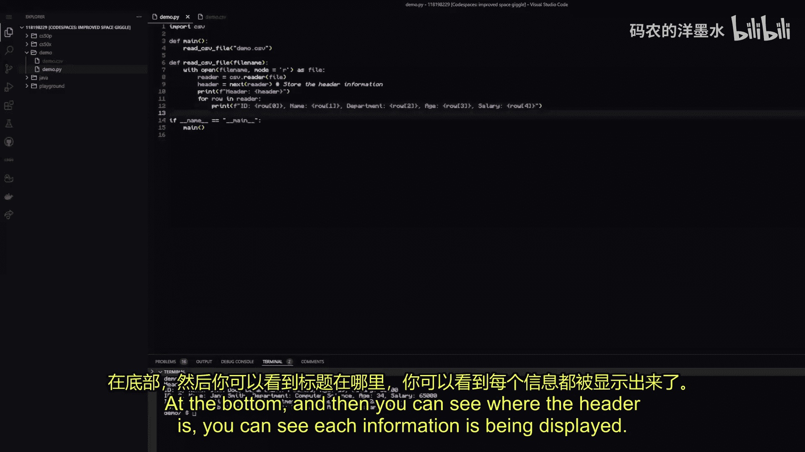

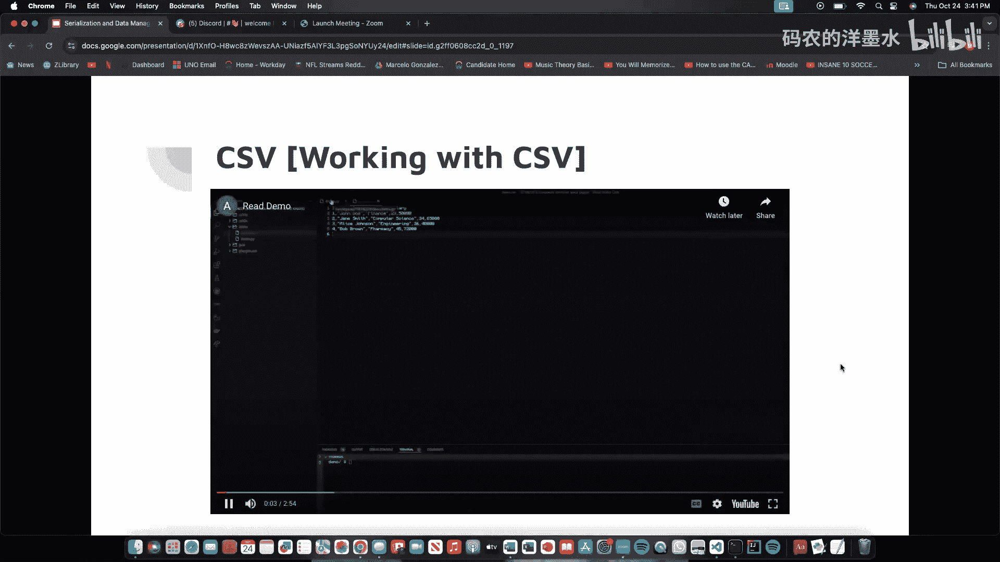

def read_csv_file(filename):
    with open(filename, mode='r') as file:
        csv_reader = csv.reader(file)
        header = next(csv_reader)  # 读取表头
        print(f"Header: {header}")
        for row in csv_reader:
            print(f"ID: {row[0]}, Name: {row[1]}, Dept: {row[2]}, Age: {row[3]}, Salary: {row[4]}")
```

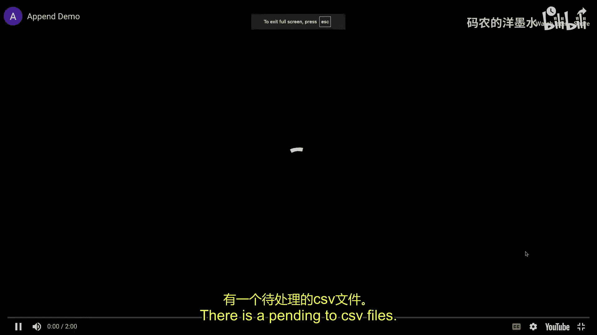

#### 追加数据到CSV

若要向现有CSV文件末尾添加新数据，需要使用追加模式（`'a'`）。
```python
def append_to_csv(filename):
    with open(filename, mode='a', newline='') as file:
        csv_writer = csv.writer(file, quoting=csv.QUOTE_MINIMAL)
        csv_writer.writerow([6, 'New Person', 'Marketing', 28, 70000])
```

#### 写入（覆盖）CSV文件


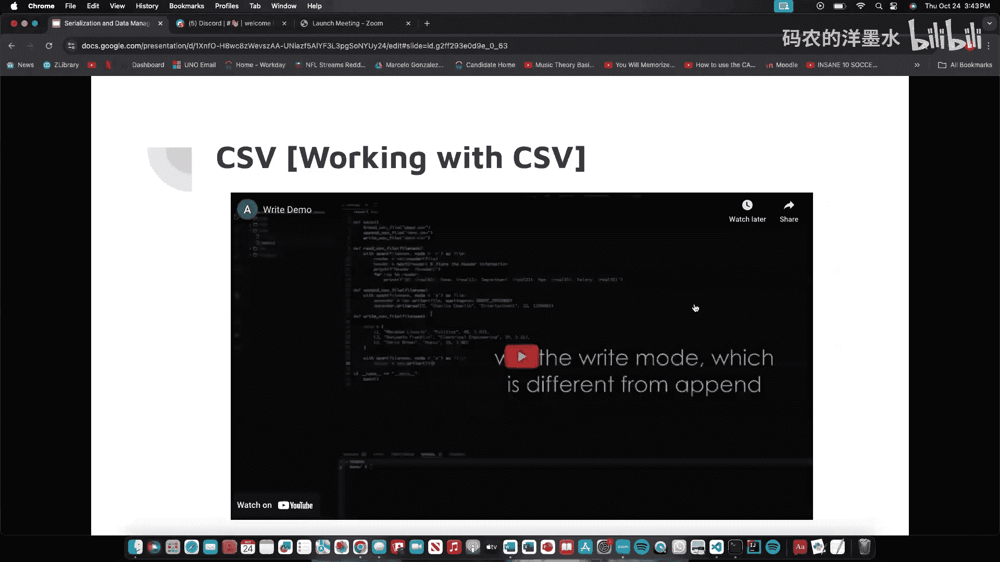

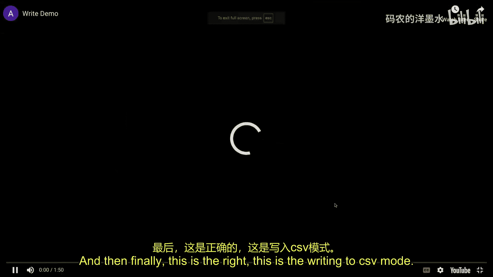

若要创建一个新的CSV文件或完全覆盖现有文件，使用写入模式（`'w'`）。
```python
def write_csv(filename):
    with open(filename, mode='w', newline='') as file:
        csv_writer = csv.writer(file, quoting=csv.QUOTE_MINIMAL)
        csv_writer.writerow(['ID', 'Name', 'Major', 'Age', 'GPA'])
        data = [
            [1, 'Alice', 'Biology', 20, 3.8],
            [2, 'Bob', 'Chemistry', 21, 3.5]
        ]
        for row in data:
            csv_writer.writerow(row)
```

### CSV的最佳实践

使用CSV时，请注意以下几点：
*   **保持结构一致**：确保所有行具有相同的列数，并使用统一的分隔符。
*   **妥善处理缺失数据**：可以使用`NULL`或空字符串等占位符，并在读取时进行相应处理。
*   **注意安全**：对于来自不可信来源的CSV文件，应进行验证和清洗，防止注入攻击。
*   **处理大文件**：对于非常大的CSV文件，考虑流式读取或使用`pandas`等库以提高效率。


---

上一节我们介绍了简单通用的CSV格式，本节中我们来看看一个Python专属的强大工具：Pickle。

## Pickle：Python对象序列化 🥒

Pickle是Python特有的序列化模块，用于将复杂的Python对象转换为字节流（序列化，或称“腌制”），也可以将字节流还原为对象（反序列化，或称“解腌”）。

### Pickle的核心概念

序列化过程可以概括为：
**Python对象** → **pickle.dump()** → **字节流** → **存储/传输** → **字节流** → **pickle.load()** → **Python对象**

Pickle的强大之处在于其**无与伦比的灵活性**。它不仅可以序列化列表、字典等基本类型，还能处理函数、类实例甚至递归数据结构，完整保留对象的状态。

### Pickle的用例

在我们的项目中，Pickle可能用于：
*   **保存和加载配置**：例如相机的校准参数、刷新率等。
*   **会话数据管理**：存储用户的交互历史或偏好设置，实现个性化体验。
*   **缓存计算结果**：将耗时的数据库查询或复杂运算结果序列化保存，下次直接加载，提升性能。
*   **进程间通信**：在不同Python进程间传递复杂的对象。

### 在Python中使用Pickle

使用Pickle非常简单，因为它是Python标准库的一部分。

#### 序列化（Pickling）

```python
import pickle

data = {'task': 'Finish report', 'due': '2023-10-26', 'priority': 'High'}

def pickle_data(filename, obj):
    with open(filename, 'wb') as file:  # 注意是二进制写入模式 'wb'
        pickle.dump(obj, file)

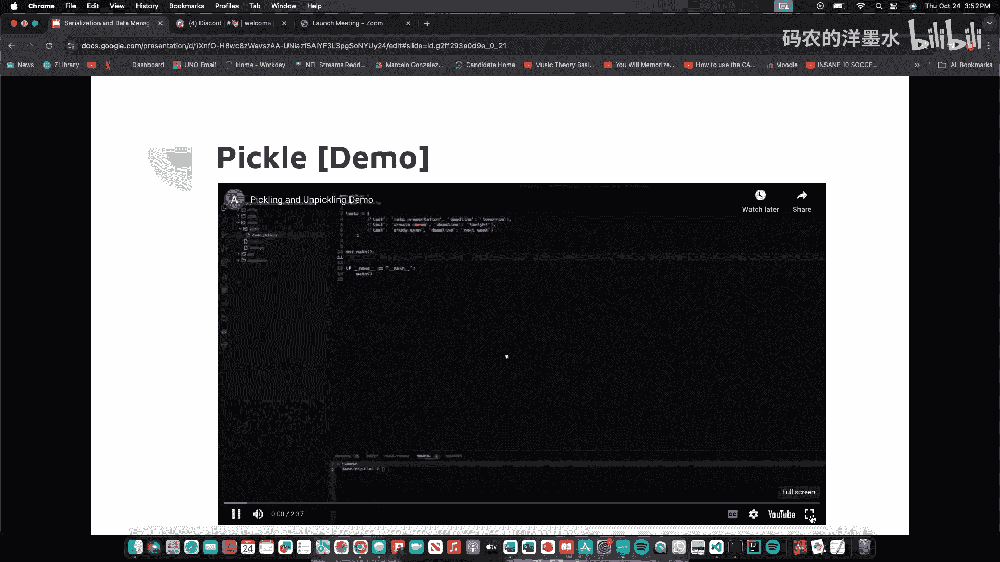

pickle_data('data.pkl', data)
```

#### 反序列化（Unpickling）

```python
def unpickle_data(filename):
    with open(filename, 'rb') as file:  # 二进制读取模式 'rb'
        loaded_data = pickle.load(file)
        return loaded_data

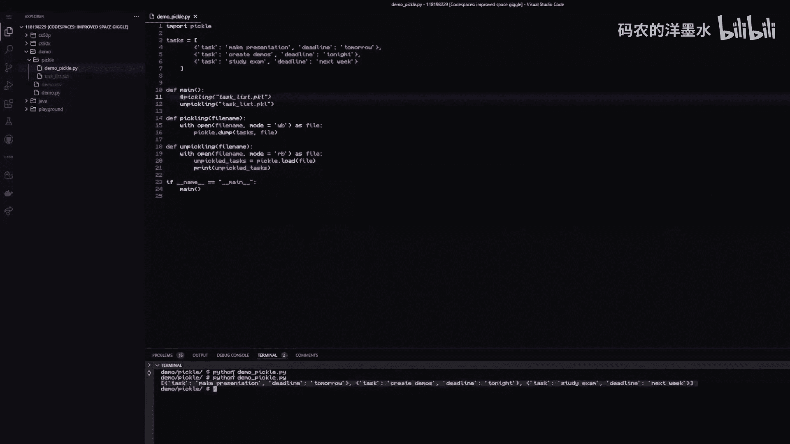

restored_data = unpickle_data('data.pkl')
print(restored_data)  # 输出: {'task': 'Finish report', 'due': '2023-10-26', 'priority': 'High'}
```

### Pickle的缺点与注意事项

尽管强大，Pickle也有其局限性：
*   **安全风险**：Pickle在反序列化时会执行字节码。加载来自不可信来源的Pickle文件可能导致恶意代码执行。
*   **Python专属**：序列化的数据无法被其他编程语言（如Java、C++）直接使用。
*   **版本兼容性**：Pickle格式可能随Python版本变化，不适合作为数据的长期存储格式（尤其是跨版本访问时）。

---

Pickle虽然强大但局限于Python生态。接下来，我们看看一种语言无关、在Web开发中极其流行的数据格式：JSON。

## JSON：轻量级数据交换格式 🌐

JSON是一种基于文本、易于人阅读和编写，也易于机器解析和生成的数据交换格式。它独立于语言，被广泛应用于Web API、配置文件和应用程序间的数据传递。

### JSON的特点

JSON的基本结构是键值对集合，类似于Python中的字典。它支持以下几种数据类型：字符串、数字、布尔值、数组、对象（字典）和`null`。

JSON受欢迎的原因包括：
*   **可读性好**：结构清晰，便于调试。
*   **语言无关**：几乎所有主流编程语言都提供原生或库支持。
*   **Web友好**：是RESTful API数据传输的事实标准，轻量且适合网络传输。

### JSON的局限性

JSON也有一些不足：
*   **数据类型有限**：不支持日期、二进制数据等复杂类型（日期通常需转为字符串）。
*   **无模式约束**：不强制数据结构，可能导致数据不一致。
*   **处理大文件效率低**：文本解析比二进制格式（如Pickle）更耗内存和时间。
*   **安全考虑**：解析来自不可信源的JSON数据时，需防范注入攻击。

### 在Python中使用JSON


Python的`json`模块使得JSON的编解码非常方便。

#### 将Python对象转换为JSON字符串

```python
import json

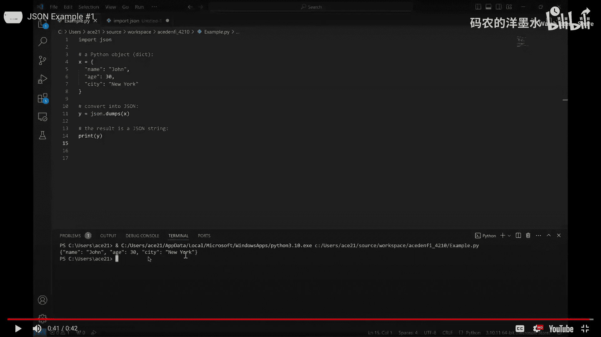

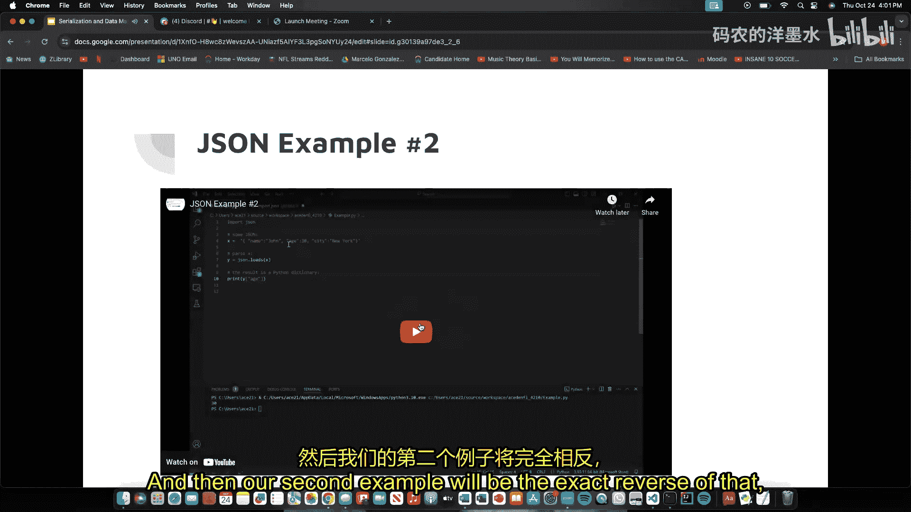

python_dict = {"name": "Alice", "age": 30, "city": "New York"}
json_string = json.dumps(python_dict)  # 序列化
print(json_string)  # 输出: {"name": "Alice", "age": 30, "city": "New York"}
```

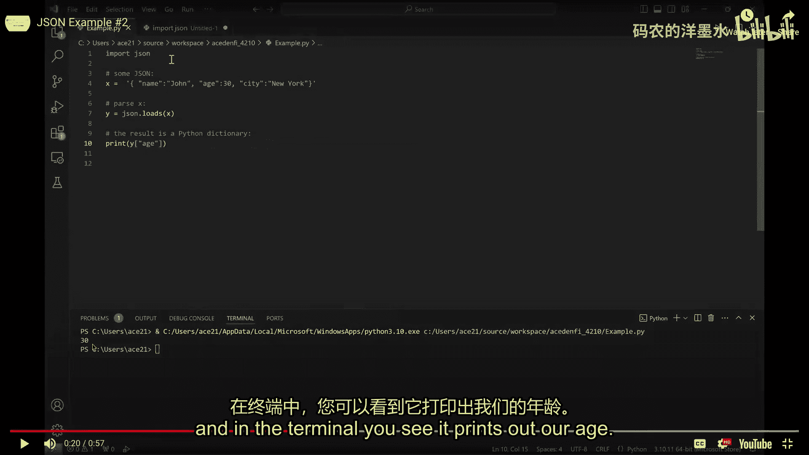

#### 将JSON字符串转换为Python对象

```python
json_string = '{"name": "Bob", "age": 25, "city": "London"}'
python_dict = json.loads(json_string)  # 反序列化
print(python_dict["age"])  # 输出: 25
```

#### 客户端-服务器通信示例（使用Flask）

以下是一个简单的例子，展示如何使用JSON在Web客户端和Python服务器之间通信：
```python
# server.py (使用Flask框架)
from flask import Flask, jsonify, request
app = Flask(__name__)

@app.route('/get_data', methods=['GET'])
def get_data():
    data = {"status": "success", "message": "Data received"}
    return jsonify(data)  # 返回JSON响应

if __name__ == '__main__':
    app.run(debug=True)
```
客户端（如浏览器JavaScript）可以向`/get_data`发送GET请求，并接收JSON格式的响应。

---

JSON非常适合网络数据交换，但当我们需要在本地进行更结构化、可查询的数据存储时，就需要数据库了。下面介绍一个轻量级的数据库解决方案：SQLite。

## SQLite：轻量级文件数据库 🗃️

SQLite是一个服务器less、自包含、零配置的SQL数据库引擎。整个数据库（包括表、索引和数据）都存储在一个单独的文件中，非常适合嵌入式系统和小型到中型应用。

### SQLite的优缺点

**优点**：
*   **无需配置**：无需安装或管理独立的数据库服务器进程。
*   **轻量便携**：数据库是单个文件，易于迁移和备份。
*   **ACID兼容**：支持事务，保证数据一致性。
*   **标准SQL**：支持大部分标准的SQL语法。

**缺点**：
*   **并发写入性能**：在高并发写入场景下可能成为瓶颈。
*   **单文件限制**：数据库大小受文件系统和内存限制，不适合超大型数据集（如TB级）。
*   **功能简化**：缺少一些高级数据库功能，如完整的用户权限管理、存储过程等。

### SQLite的适用场景

*   **移动应用**：Android和iOS应用的本地存储。
*   **桌面软件**：程序的配置、用户数据存储。
*   **原型开发**：快速测试SQL逻辑，无需搭建完整的数据库服务器。
*   **物联网设备**：在树莓派等设备上本地存储传感器数据。

### 在Python中使用SQLite

Python标准库内置了`sqlite3`模块。

#### 连接数据库与创建表

```python
import sqlite3

# 连接数据库（如果不存在则创建）
conn = sqlite3.connect('example.db')
cursor = conn.cursor()

# 创建表
cursor.execute('''CREATE TABLE IF NOT EXISTS students
                  (id INTEGER PRIMARY KEY, name TEXT, age INTEGER, grade TEXT)''')
conn.commit()  # 提交更改
print("Table created successfully.")
```

#### 插入数据

```python
cursor.execute("INSERT INTO students (name, age, grade) VALUES (?, ?, ?)", ('Alice', 20, 'A'))
conn.commit()
```

#### 查询与过滤数据

```python
# 查询所有数据
cursor.execute("SELECT * FROM students")
all_rows = cursor.fetchall()
for row in all_rows:
    print(row)

# 条件查询
cursor.execute("SELECT * FROM students WHERE grade = ?", ('A',))
a_students = cursor.fetchall()
for student in a_students:
    print(student)
```

#### 更新与删除数据

```python
# 更新数据
cursor.execute("UPDATE students SET age = ? WHERE name = ?", (21, 'Alice'))
conn.commit()

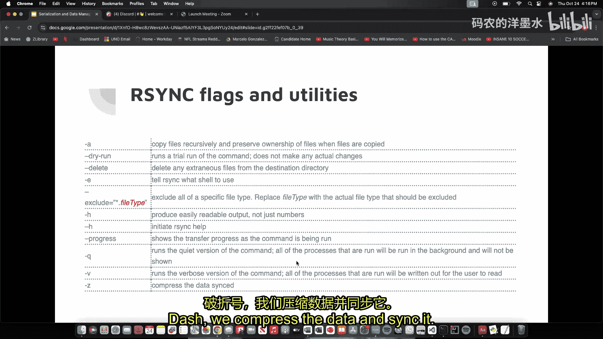

# 删除数据
cursor.execute("DELETE FROM students WHERE grade = ?", ('F',))
conn.commit()

# 关闭连接
conn.close()
```

---

我们学习了如何在本地创建和管理数据。最后，我们来看一个用于在不同位置之间高效同步文件和目录的强大工具：rsync。

## rsync：高效文件同步工具 🔄

rsync是一个用于在本地和远程系统间同步文件和目录的Linux/Unix工具。它以其高效的增量传输算法而闻名，只传输发生变化的文件部分，并支持断点续传。

### rsync的核心优势

*   **高效传输**：通过校验和比较，仅同步源和目标之间有差异的部分。
*   **断点续传**：在网络中断或故障后，可以从上次中断的地方继续同步。
*   **功能丰富**：提供大量选项用于控制同步行为，如保留权限、删除多余文件、试运行等。

### 基本rsync命令与常用选项

基本命令格式为：`rsync [选项] 源路径 目标路径`

以下是一些常用选项（“标志”）：
*   `-a`：归档模式，相当于`-rlptgoD`，递归同步并保留权限、时间戳等。
*   `-v`：详细模式，输出同步过程中的文件信息。
*   `--progress`：显示传输进度。
*   `-h`：以人类可读的格式输出数字（如文件大小）。
*   `-n`或`--dry-run`：试运行，模拟同步过程而不实际更改任何文件。
*   `--delete`：删除目标目录中存在而源目录中不存在的文件，使目标成为源的精确镜像。
*   `-z`：在传输过程中压缩数据，节省带宽。

### rsync使用示例

假设有两个目录：`/path/to/source/` 和 `/path/to/destination/`。

1.  **基本同步**（将源目录内容同步到目标目录）：
    ```bash
    rsync -av /path/to/source/ /path/to/destination/
    ```
    **注意**：源路径末尾的斜杠（`/`）很重要。有斜杠表示同步源目录*内部的内容*；没有斜杠则表示同步源目录*本身*。

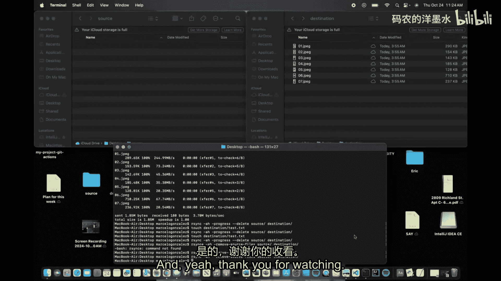

2.  **试运行并显示进度**：
    ```bash
    rsync -avn --progress /path/to/source/ /path/to/destination/
    ```

3.  **镜像同步**（使目标与源完全一致，删除多余文件）：
    ```bash
    rsync -av --delete /path/to/source/ /path/to/destination/
    ```

4.  **同步后移除源文件**（类似于移动操作）：
    ```bash
    rsync -av --remove-source-files /path/to/source/ /path/to/destination/
    ```

rsync是维护文件备份、部署代码或同步多台服务器数据的强大工具。

---

## 总结 🎯

本节课中我们一起学习了软件工程中数据管理的几个核心工具：
1.  **CSV**：简单通用的表格数据存储格式，适合交换和存储结构化数据。
2.  **Pickle**：Python专属的对象序列化工具，功能强大但需注意安全和兼容性。
3.  **JSON**：语言无关的轻量级数据交换格式，是Web API通信的标准。
4.  **SQLite**：轻量级、文件式的SQL数据库，适用于本地存储和嵌入式系统。
5.  **rsync**：高效的文件和目录同步工具，支持增量传输和多种同步策略。


每种工具都有其特定的适用场景和优缺点。在实际项目中，应根据数据复杂性、安全性要求、跨平台需求以及性能考虑来选择最合适的工具或组合。