# 012：持续集成与部署 🚀


在本节课中，我们将学习持续集成与持续部署的核心概念，了解它们如何通过自动化流程提升软件开发效率与代码质量。我们将重点介绍GitHub Actions这一工具，并学习如何构建一个完整的CI/CD流水线。

---

## 什么是持续集成与持续部署？

持续集成是一种软件开发实践，旨在通过自动化重复且易出错的任务来提升效率。具体来说，每次我们向共享代码仓库推送代码时，系统都会自动测试或检查代码，以确保它能与仓库中的其他代码或分支顺利集成。

持续部署是持续集成的另一面，它指的是将代码从预生产环境自动部署到生产环境的过程。这一步主要包含三个核心组件：将代码实际发布到生产环境、监控其运行状况以确保正常工作，以及接收关于其运行效果的反馈。

## 什么是CI/CD流水线？

CI/CD流水线本质上是将持续集成和持续部署两个阶段结合在一起。一个典型的流水线包含以下几个阶段：
*   **源码阶段**：这是触发流水线的起点，例如代码推送或拉取请求。
*   **构建阶段**：编译和打包你的应用程序。
*   **测试阶段**：运行单元测试、集成测试或系统测试。
*   **部署阶段**：将应用程序发布到生产环境。

需要注意的是，这些阶段可以根据你的仓库和开发环境的具体需求进行增减或调整。整个流程是一个循环，每次推送代码都应触发测试、构建和部署。

## CI/CD流水线的好处

使用CI/CD流水线有诸多好处：
*   **基础设施版本控制**：整个团队可以就软件发布所依赖的基础设施达成一致。
*   **更快的发布周期**：能够以更快的速度开发和发布软件。
*   **代码质量提升**：整个团队共享相同的构建和测试流程，减少了人为错误。
*   **增强团队协作**：自动化流程促进了团队成员间的协作。

## CI/CD的发展历史

CI/CD的发展经历了几个阶段：
*   **1990年代**：手动集成与测试，例如公司定期举行的“合并日”。
*   **2000年代初期**：持续集成开始被采纳，但需要在物理服务器上运行自动化构建。
*   **2000年代中期**：随着软件开发需求激增，基于物理基础设施的CI服务器面临扩展性差、维护成本高和停机时间长等问题。
*   **2010年代**：随着Travis CI和GitHub Actions等云服务的出现，公司无需再管理物理服务器，实现了更轻松的扩展和更自动化的CI/CD管理。

## 什么是GitHub Actions？

GitHub Actions是GitHub原生的CI/CD工具，它直接集成在GitHub仓库中，用于自动化工作流。我们使用YAML配置文件来定义自动化流程，如构建、测试和部署。

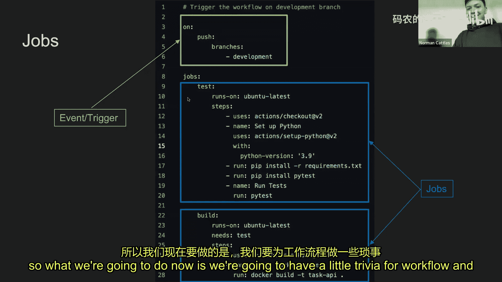

GitHub Actions是事件驱动的，这意味着工作流可以基于GitHub事件（如推送代码、拉取请求）或按计划触发。它高度可定制，功能非常强大。

需要区分两个概念：
*   **GitHub Actions**：指整个CI/CD平台。
*   **Actions**：指可在工作流中重复使用的预定义任务包，类似于函数。GitHub提供了内置的Actions，也有一个市场可以获取社区创建的Actions。

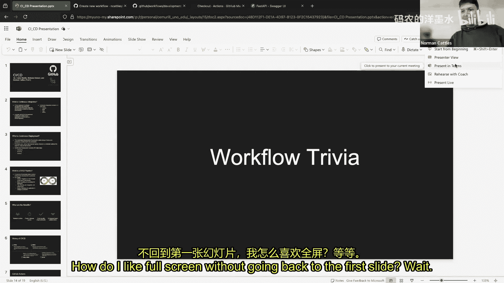

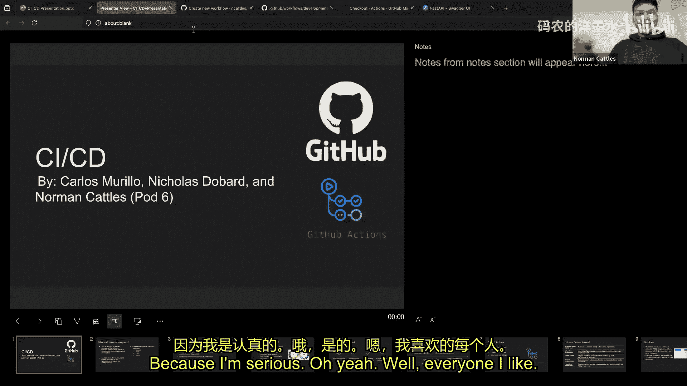

## 工作流的核心组件

一个工作流就是你的CI/CD流水线。它通过YAML文件配置，默认存储在 `.github/workflows` 目录下。

工作流包含以下核心组件：
*   **事件与触发器**：事件是GitHub上发生的具体事情（如向`main`分支推送代码），触发器是工作流中定义的条件，当检测到特定事件时启动工作流。
*   **任务**：任务是在虚拟机上执行的一系列步骤的集合。默认情况下，多个任务并行运行，但可以通过依赖关系让它们顺序执行。
*   **运行器**：运行器是执行任务的虚拟机，由GitHub提供。每个任务在独立的运行器上执行，这意味着它们默认是隔离的，不能直接共享数据。
*   **步骤与Actions**：步骤组成任务。一个步骤可以是一个shell命令，也可以是一个Action（即一个可复用的预定义任务）。

## 实践：解读工作流文件

让我们通过一个例子来理解工作流文件。以下是一个简单的工作流：

```yaml
name: CI Pipeline
on:
  push:
    branches: [ main ]
  pull_request:
    branches: [ main ]

jobs:
  test:
    runs-on: ubuntu-latest
    steps:
      - uses: actions/checkout@v3
      - name: Set up Python
        uses: actions/setup-python@v4
        with:
          python-version: '3.9'
      - name: Install dependencies
        run: pip install -r requirements.txt
      - name: Run tests
        run: pytest

  build:
    runs-on: ubuntu-latest
    needs: test
    steps:
      - uses: actions/checkout@v3
      - name: Build Docker image
        run: docker build -t myapp .
```

*   **触发器**：当向`main`分支推送代码或发起拉取请求时触发。
*   **任务**：定义了两个任务：`test`和`build`。
*   **依赖关系**：`build`任务通过`needs: test`指定依赖于`test`任务，因此`build`会在`test`成功完成后才运行。
*   **步骤**：
    *   `actions/checkout@v3`：这是一个Action，用于将仓库代码克隆到运行器。
    *   `actions/setup-python@v4`：另一个Action，用于设置指定版本的Python环境。
    *   `run`：执行shell命令，如安装依赖、运行测试或构建Docker镜像。

## 演示：构建完整的CI/CD流水线

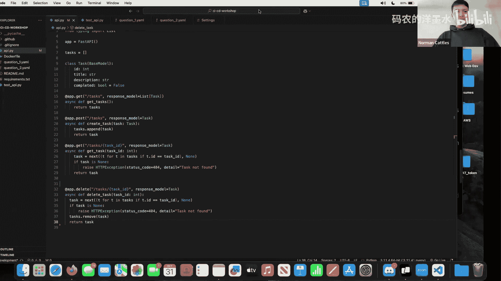

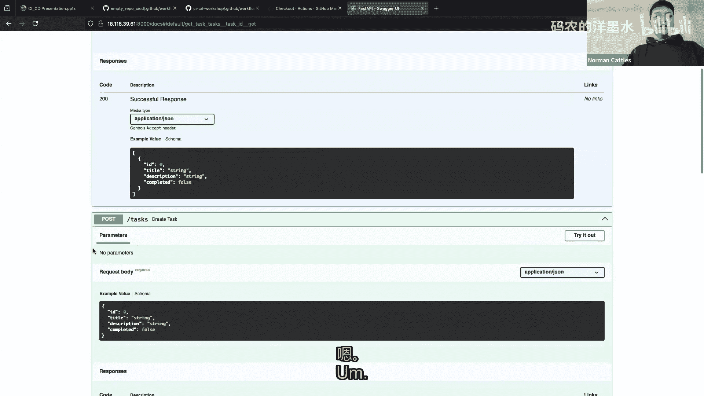

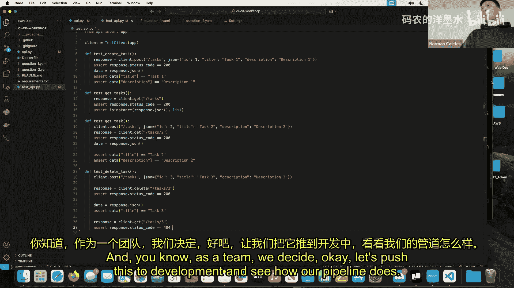

上一节我们介绍了工作流文件的基本结构，本节我们将通过一个实际演示，来看一个完整的CI/CD流水线如何运作。我们有一个简单的FastAPI任务管理应用，并希望为其添加“删除任务”的功能。

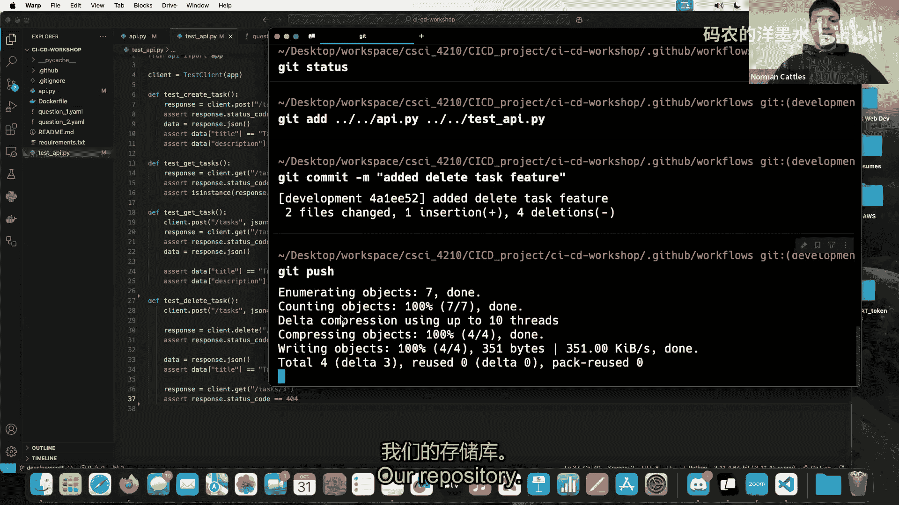

我们的开发流程和对应的GitHub Actions工作流设计如下：

1.  **开发分支**：当开发者向`development`分支推送代码时，触发的工作流会：
    *   运行测试。
    *   构建Docker镜像。
    *   自动创建一个指向`main`分支的拉取请求。

2.  **主分支**：当拉取请求被审核并合并到`main`分支后，触发的工作流会：
    *   再次运行测试（双重验证）。
    *   构建Docker镜像。
    *   将镜像推送到Docker Hub。
    *   通过SSH连接到AWS EC2服务器，部署新的Docker容器，替换旧版本。

在演示中，我们添加了删除任务的功能和对应测试，将其推送到`development`分支。工作流自动执行了测试、构建并创建了拉取请求。在人工审核合并后，`main`分支的工作流被触发，成功完成了测试、构建、推送镜像和部署到生产服务器的全过程。最终，生产环境的应用成功更新，拥有了删除任务的新端点。

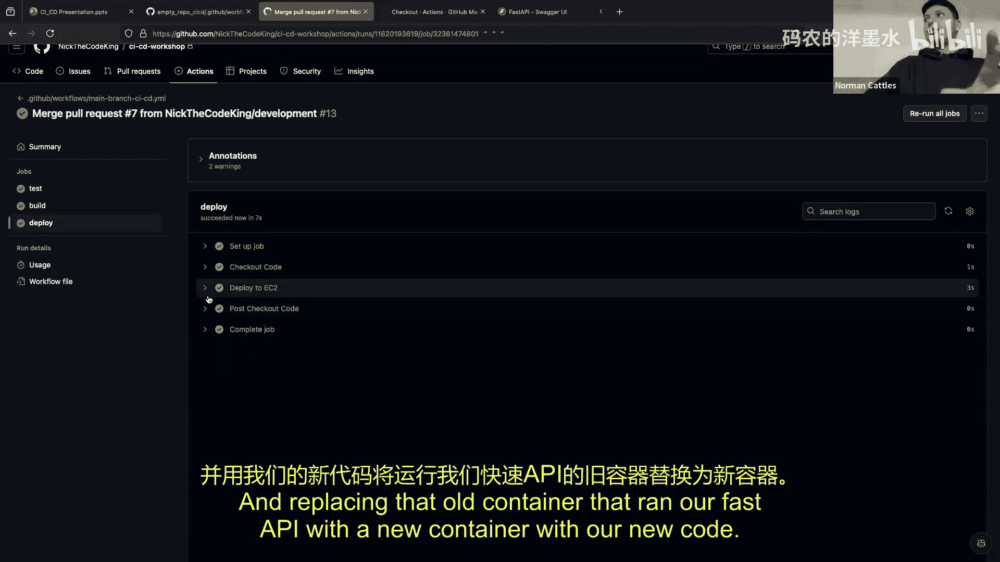

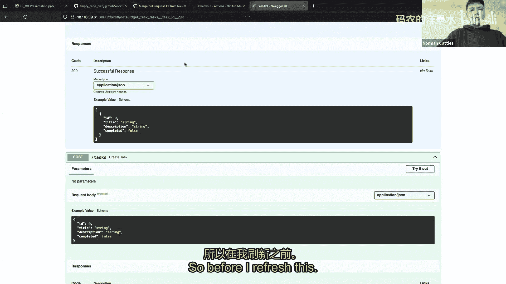

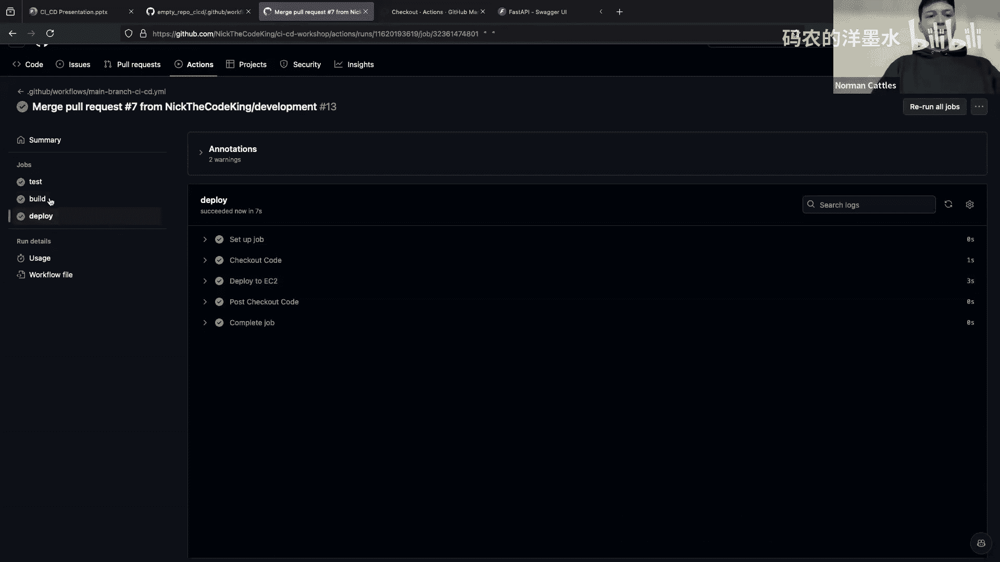

这个演示展示了如何利用GitHub Actions实现从代码提交到自动部署的完整自动化流程。

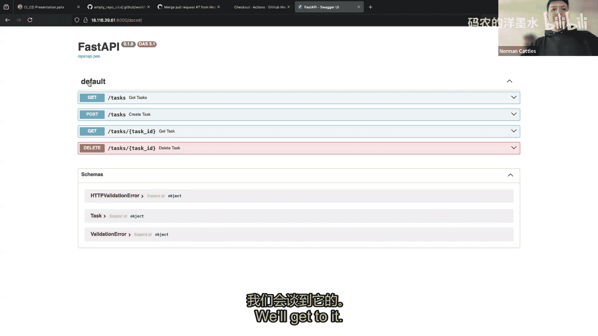

## 结合其他工具：Kubernetes与ArgoCD

在实际生产环境，尤其是像我们课程项目中需要管理多个树莓派屏幕的场景，CI/CD流水线通常会结合更多工具。我们可以设想以下架构：

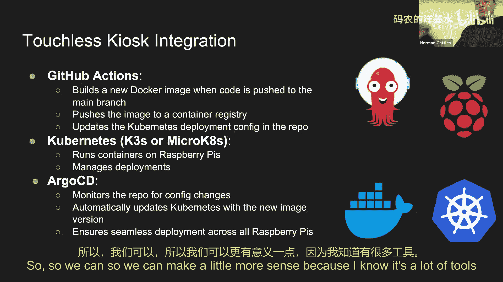

1.  **GitHub Actions**：作为CI引擎，在代码合并到主分支后，构建Docker镜像并推送到镜像仓库。
2.  **Kubernetes**：作为容器编排工具，管理部署在所有树莓派上的多个Docker容器。
3.  **ArgoCD**：作为持续交付工具，监控GitHub仓库中一个称为“清单文件”的配置文件。这个文件定义了在Kubernetes集群中应运行什么容器。

工作流程如下：当GitHub Actions更新了镜像并修改了清单文件后，ArgoCD会检测到这一变化，并自动将新的容器配置同步到Kubernetes集群中，从而更新所有树莓派上的应用。这样就实现了大规模、多节点的自动化部署。

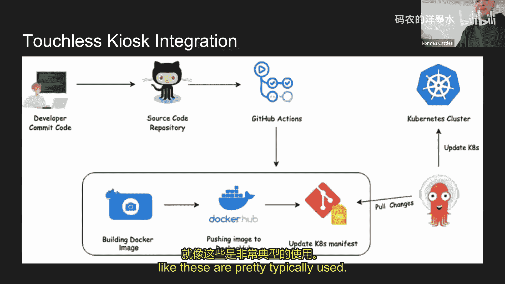

## 总结


本节课我们一起学习了持续集成与持续部署的核心思想。我们了解到CI/CD通过自动化构建、测试和部署，能显著提升开发效率和软件质量。我们重点掌握了GitHub Actions的使用，学会了如何编写YAML工作流文件，并通过一个实际演示看到了完整的自动化流程。最后，我们还探讨了如何将CI/CD与Kubernetes、ArgoCD等工具结合，以应对更复杂的部署场景。掌握这些概念和工具，对于进行现代高效的软件开发至关重要。