# 【全集】加州理工学院 软件工程 中英字幕 1080P p01 Lecture 1 - IDE -BV13ZzaB3EWE_p1-

3。

Okay， so with nothing well with no other comments， let me introduce our first pod who's going to do a workshop and we're going to do the IDE workshop so I'll just hand the floor to you。

All right， everyone， I'm Moman， so my groupmates， Omar and Leilla。

 and we did our workshop on integrated development environments， also known as IDEs。

So first we're going to be talking about what IDs， then we're going to talk about what is vision Studio code specifically。

Then we're going to get into our our tutorial。And then we're going to show some extra features on Vi Studio code。

 and then we're going to talk about why you should use Vi Studio code over other IDs。Okay。

 so what is an IDE an IDE is basically a software application that like lets you use tools for software development and it typically typically includes stuff like a code editor。

We're like writing and editing code and syntax highlighting and code completion。

And as a compiler and an interpreter， which are tools to convert code into a machine readable format or run scripts directly。

 they also have debuggs， which are ways to test and debug code by running it。Step by step。

 allowing developers to inspect variables and control flow。They also have build automation tools。

 which are features to automate tasks tasks like compiling code。

 running tests and packaging applications。And they also have version control integration。

 which are tools to manage code versions using systems like Git。

And examples of popular IDEs include visual Studio code， which we're going to talk about today。

 pie charm and Eclipse， they help streamline coding process by integrating all the tools available for a developer。

Into a single application。All right， so now what is visual Studio code specifically it's also referred to as VS code it's a free open source code editor developed by Microsoft it's highly popular among developers because it's lightweight and has a lot of extensive features。

Which makes it versatile for a wide range of programming languages and development tasks。

Some of the features， as we mentioned， it's a code editor。It has a lot of features such as Intelense。

 you know it auto completes what you're trying to type and is's very helpful syntaxs highlighting code completions。

 stuff' like that extensions， which we're going to go through a few of them in our presentation。喂啊嗯。

It's very useful for like support for additional languages， frameworks， tools， other functionalities。

An integrated terminal so instead of having to open your own terminal and you know navigating to the folder it automatically within Viual Studio code you open the terminal and it's already in the folder for your repository for your project version control it has built in support for get。

She makes it easy to manage source control and collaborate with others。It has a debugger。

Whi you can like kind of put break points in there so you can run the program。

 it stops at the break pointss and it shows a bunch of the variables and the values of those variables。

 stuff like that。Acroross platform， you can use it from Windows， Mac， Linux。

 you can also use it on different devices too and you can do it through the browser。

 you don't have to actually download them to app。And customizable， you can customize the appearance。

 the shortcuts like the high keys and the behaviors to fit your workflow。

 so overall it's highly regarded for speed， flexibility and ease of use which makes it popular for both beginners and experienced developers。

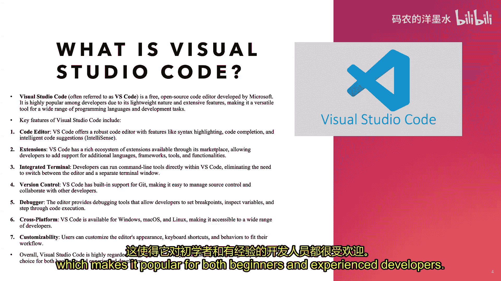

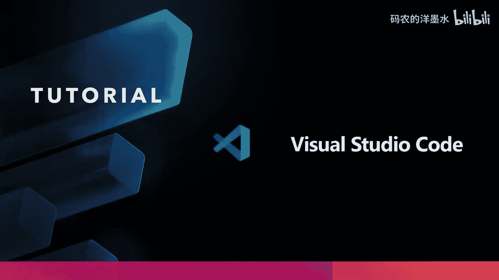

Okay。Here is our first tutorial， how to download and install Viual Studio code。Yes。

ownloadUnder Windows desktop or laptop。So。In any browser that you have。

 just search a visual Studio code。Searching up on Google Chrome。

 is the first thing that pops up visualual Studio code， official website。

 which want to click on that。 the URL is code visualstudio dot com。 It's gonna be in the。

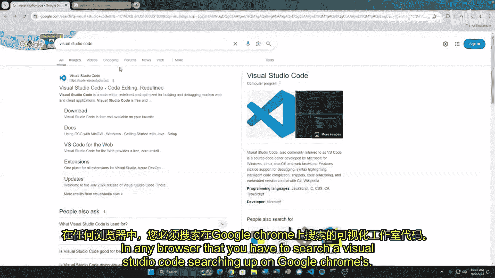

Official instruction guide。But yeah， I just want to click and download for Windows right here。

Scart downloadload。Click on our installation package， accept the agreement， click next。

 click next and then install already we have it installed， so I'm not going to install it again。

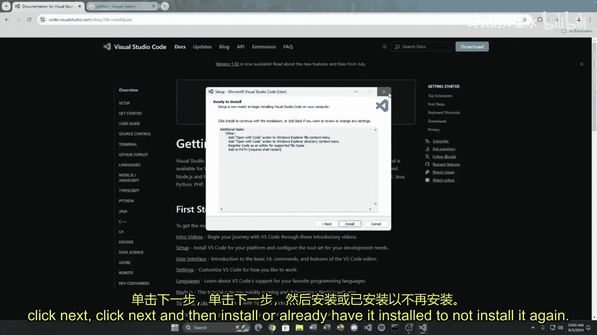

But yeah， and if， you know， if let's say if we're going to use Python。

 you want Python installed onto。Your Windows machine， so go to search a Python and Google。

And it's the first thing that pops up Python。org。I want to click on that。

 go to downloads and then download the official Python version onto your Windows machine。And yeah。

 so after you know you're done downloading Visual Studio code。

 just want to click on the visualsual Studio code desktop icon or search it up in your Windows search bar。

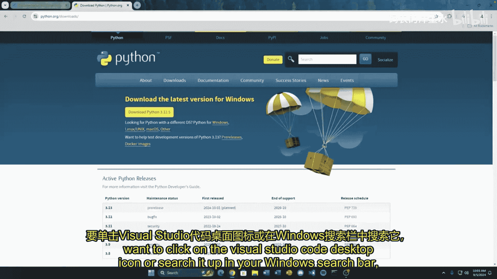

And yeah， it's the official welcome screen for the Visual Studio code IDE。

And if you want to make sure that Python was correctly installed onto here。PC。

 you can just do P Y dash dash version。You can see here that Ion version 3。12。

5 was correctly installed onto my machine。

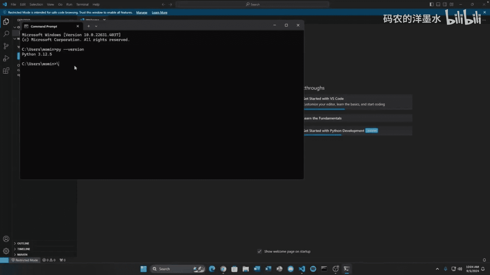

Okay so y'all see it's not so bad you just look up in windows or explore or Chrome visual studio and you download it now one thing to note we're going to talk about extensions later on。

 but you have to know that。You need to download Python。

Python itself before you can use the Python extension。

And that's what Mo said and examined during that tutorial and of course just remember， it's PY。

Hyhen hyphen version for you to make sure that you've successfully installed。Tython on the PC。Okay。

 now let's look at。How to use Python within Viual Studio code。

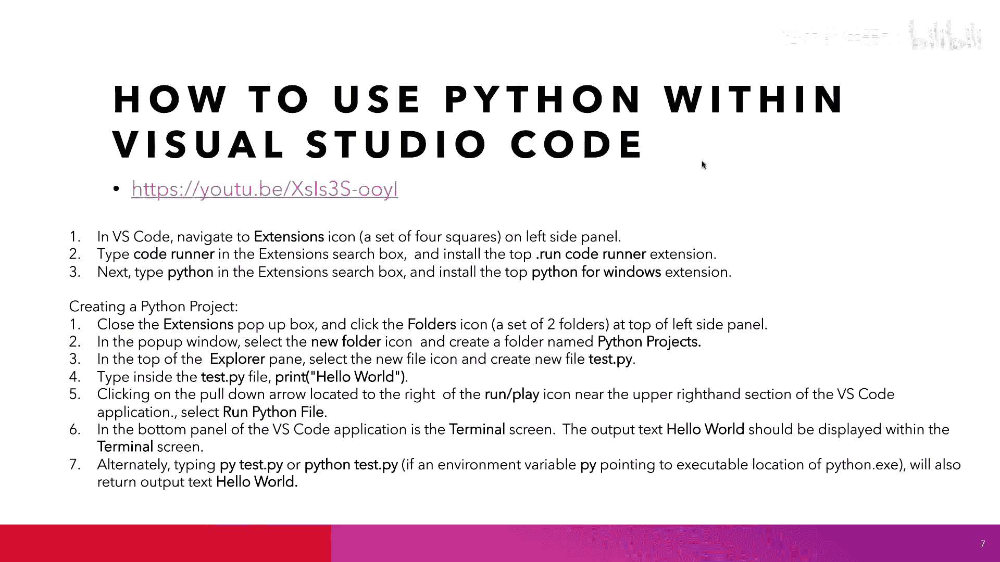

So的多よ。Okay， now let's look at， actually。Grading a pthon。Project within the visual circuit code I D E。

 So first， you're gonna want to come down here。 these little four squares at the left side bar。

 Click on that。 You w to first download the。Code runner installationulation， code runner extension。

Just want to search up code runner up here in the search bar and install code Runner this will help you run any type of programming language within Vi code easily by just click the click of a button so you don't have to type anything into your terminal so yes want to make life easier and download the code runner。

Soulation in through code and then。You're obviously going to want to。呃。

Install the official Python extension as well within digital Studio code。So yeah。

 search of Python should be the first one that pops up。

 it the official Python extension from Microsoft。com if you can want to install that。嗯。Okay。

 so now if you want to。I actually make a Python project， you know， and just click on open folder。

And let's create a new folder for Python projects。Let's name it Python？Projects。It's like folder。

And you see right here， we're now inside the Python projects folder within。That is really good I D。

 And you're gonna to click on new file。And let's call it test do。PY。So now let's type in anything。

 just type in any random code， start with hellello world。Let's print， hello。World。Save the file。

And then， yeah， so since we' downloaded the code runner。Extension。

 we can just click on run Python file。And it will run it down here， because you can see it says。

Hello world。But we can also run it terminal we。Right。py。他打牌。And it says hellello world right here。

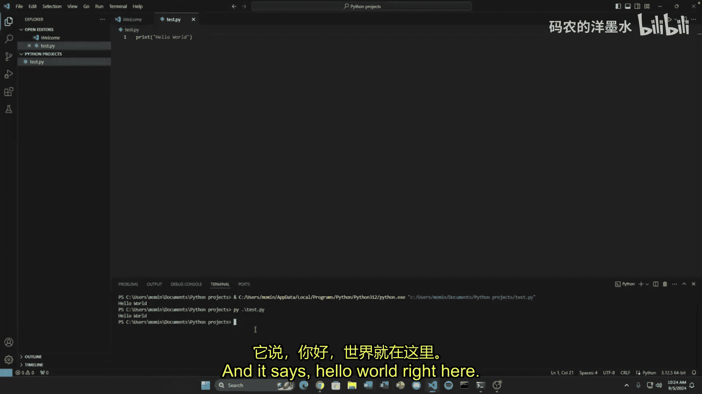

Yeah， so basically what we did in that tutorial is VS code。

 you go to the extensions icon on the left side， if you don't like running code from the terminal。

 you can install the code under an extension， just makes slice easier， you know。

 just click a button runs your code。And then obviously， you need to install the Python extension。

And then after that， you know。You want to make a Python project folder to like house whatever projects you want to make。

And then create a new file， name it whatever。And then type something in there， I don't know。

 like print Hello world。And then like I said， the code and extension on the top right。

 you can click on that and you can click run Python file that will run Python within Vi Studio code or you can go in the bottom and use the built in terminal and Vi Studio code and both of those should run and display your code and you basically do that by in the terminal and you can type PY then your file name or sometimes you can type out Python fully depending on your home system。

And yeah。Thank。So now we're going to go into a little bit of how to download and install get。

 initialize a repository and then commit in push once you have that repository initialized。

Hello guys， I'm going to be showing you how to download and install Git on your computer and then use it。

Individuals do code to commit and push and。Initialize or repository， many other things。So。First。

 you come to get hyphenness C M dot com that downloads。 I'm on Windows right now。

 but I'll just show real quick。 something about Mac。These are all the options to download for Mac。

And I have information about each of them， most of them in the。

Documentation that I'll be that will send to all you guys。

But my favorite is Xcode since you just have to use the Apple App Store。

You download and install Xcode and Gi will come with it so。是。But you can use any method you want。

 So now in Windows， you come over here， click Windows， secure you to download a little download。

I already have it downloaded， so it takes some time we do it。They can open it。If you haven't already。

ownloaded and installed it in the past。 This won't show up。

So I'm just going to go with not only showing the new options。Over here。

 I just keep all this the same。Vm， yeah， I just keep that the same。Now over here。

 let get decided to choose master branchnch， which is not what we want because。

That's how Gitthub used to be the main main branch used to be mastered， but now we want to override。

 make sure it。Go to the default branch main。So this site keep it the same， recommended。

I I keep it the same。There's two。This I would change to the middle。I keep the same， I keep the same。

That tool。I't check that。Next and。Click install by only two because I already have it installed。

But all those are like their preference， you can read them and go through each one。

 but that's usually the settings I like to use。So now that we have get installed。

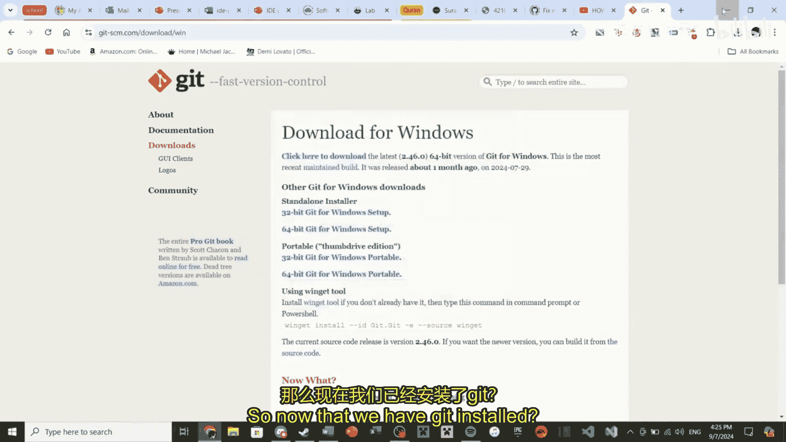

Actually， we should make sure we have it installed either use command prompts or any other terminal you have。

 I just use command prompt。Get hyp hyphen version， as I check。So if it gives you a version。

 you have it installed， if not， probably you don't， And you should try again。

Now in visualual Studio code。So to start a new project is probably how it to look most of the time when you open it。

But if you already have like a folder that you created。To start a new projects， you go to it。

 I usually。I made one before I started the video， I saved it in my programs folder。IdeE project。

 Where is it。I actually forgot to recreate it， let's just do it right now then。Ide E project。

There you go， now you can open that one select folder。So now it's open。So it's pretty。

 I have like four methods in a documentation to initialize the repository。I think， the easiest。

They just come here to source control and initialize repository。If you want to try the other ones。

 you would need。Either the code spaces extension， you you get through here or the repositories。

Extension。You can follow the directions in the documentation to figure those out。

But I think the easiest way is to do it through source control。

And now you can't publish branch quite yet because you don't have any files。So just create one。

 I'd say I DE dot pi。And about。This pi extension has to make it into the Python language that I recommend。

You don't already have it。Bringing the Python extension。

 I think we may have shown it in a previous video， but。Yeah， you type in Python and extensions。

 download't that one， it'll also bring a debugger。The reason for adding this is。So that， for example。

 I pressP， PR， it'll autocomple and have a bunch of good information for us。 So all in。

 it helps coders very much。所以啊。Now。So that you have like your own thing。

 you could come commit and push。But first， I want to create a folder for you guys cause。

You should be submitting our like final deliverable。In this repository。

 I think that would be a great plan。I just create。This folder for you guys to submit。

 I make and read me。In here。So that actually gets added to the。GitHub， you see he's turning blue。So。

 it's actually being attract。Well says on tracked， But once you stage it， it'll be tracked。So yeah。

 you need a file in a folder for it to actually go to the repository， I'll just say。This is where。求。

Add submissions， I just say that。Now， we can。Now we can commit our changes。

Put any message for you guys would be like。Just to make things easier。Its say like。

Submission by then your name。They're trying to shorten it if you have to because there's a limit to the number of letters you can use。

 but。Yeah， something like that， I'll just put initial commit for now， it's usually the first。

Kind of commit。 I like to use。They can commit。Usually after I commit。

 I'd like to come up here more actions and then push。

But it's letting us publish branch since we haven't really done anything yet。

 so I'll just click this。But the public repository， there you go。

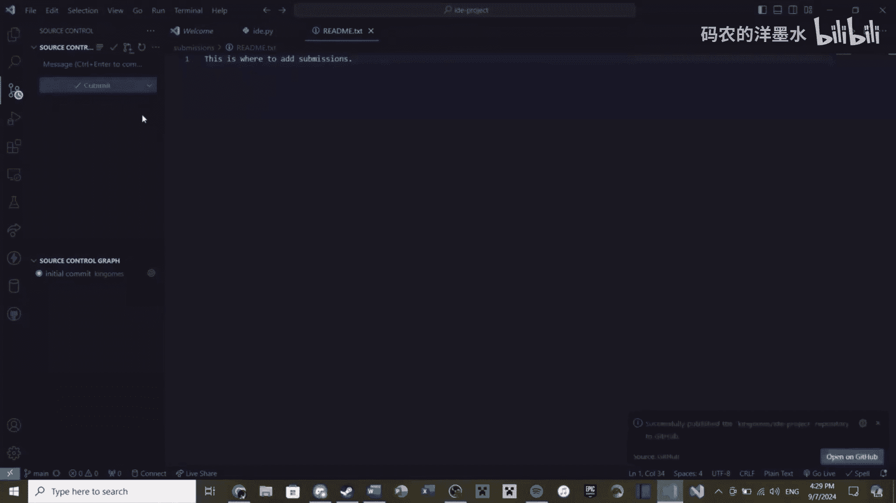

So now I've initialized a repositoryory， I'll go on GitHub。See it shows up here now。

She it has this file， you can look at it， Priello world。Has this。Yeah。

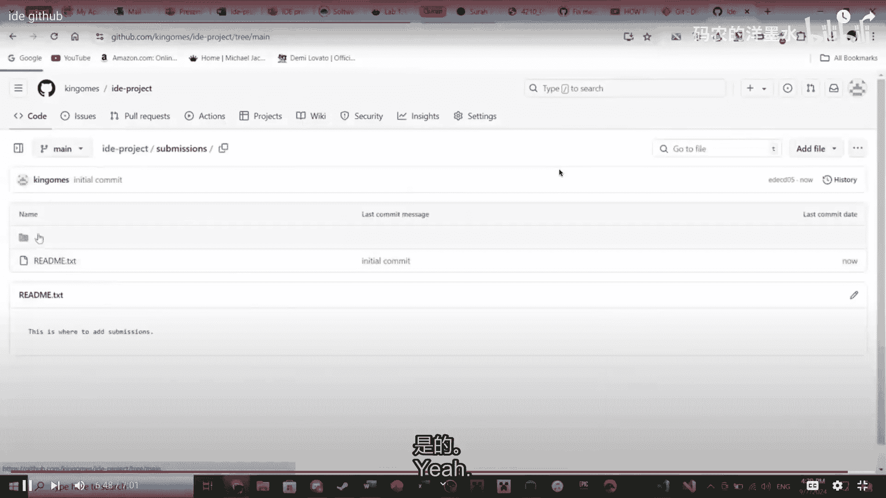

嗯。All right， so yeah， that video it basically shows first you download gett。

 you go to gett SCm slash downloads。As I mentioned for Mac。There are a bunch of options。

 The the ones I like the most are home brewrew Mac ports or。

The one I really like the most is Xcode since it's very simple you go to Apple App Store。

 download Xcode， and it'll come or get what come with it。But for Windows as I showed it。

 you click Windows and then you click download ear and there's a bunch of options I somewhat sped through them。

 but you can always like look at them more closely and just choose whatever your preferences are so yeah。

And to make sure it's installed， you do get hyphen hyphen version。And if it shows a version。

 you have it installed， if it doesn't show anything， it's not installed， you should try again。

So then you launch visualual Studio code。Another thing I forgot to mention because I had to redo the video and I forgot to redo this part。

On the bottom left there's just like your head that's a profile icon you either click back up and sync settings or sign into sync settings and then it'll give you an option to sign into GiHub that's how you really use GithHub in Viual Studio code so。

I don't know， I'll just。Yeah， it's just like on the bottom left okay， and then once you're in。

I showed it like committing and pushing， but I've seen some people have issues with， it says。

We cannot identify you or something like that if that pops up either do Gitconfighen hyphenglobal user。

 name and then your username or do user。 email and your email that you use for Github。

But hopefully that won't happen to too many people， it's kind of rare。And then yeah。

 you open the folder that you created for the project。And the way I showed。

 you click initialize repository， I also mentioned two other ones。We had code spaces on there before。

 but we actually took it out so it won't be in the documentation。

 but the other one GitHub repositories that will be in the documentation， the extensions。

So yeah the way I showed it is my favorite way to do it is click initialize repository and then it'll create it and then once you like add your files and you publish the branch then it's going to show up on GiHub and yeah to commit and push you to the。

Source control thing the the menu and then you click commit well you have to put your commit message first and then you click commit and then it'll commit and then you publish the branch to push it or you do the three dot dot dot and you click push。

So yeah， that's all about that part。Okay， and now we're going to talk about how to clone a gi repository and make a new branch。

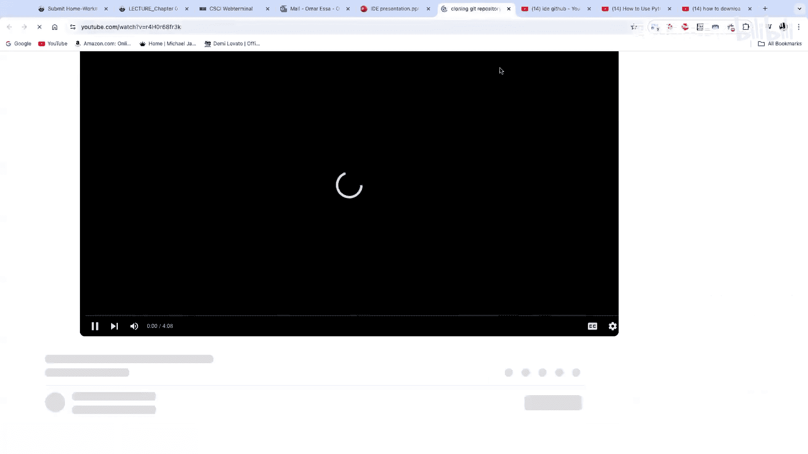

Hey everyone， I'm going to be showing you how to clone a git repository in visual Studio code and then。

Make a new branch in it。So here is the Vial Studio code welcomecome page。

 so you can just click here for clone Git repository。

But you can also just click in the search bar and go to show and run commands。

 click on get clone and then。Copy and paste the URL of the repository。 You went to clone。嗯嗯。

So press enter and then you you need to choose where you want to。Cone it in your file destination。

 I'll just do it in the Python projects I have。嗯。And would you like to open the clone reposory or you could open in a new window。

 I'm just going to click open。And now， as you can see， I'm in。Cone repository。From the URL。

 I copy and pasted。So right now， it just is print hello world in the repository in this Python file。

 but if I want to create a new branch within。If I want to work in the main branch。

 if I want to work in my own separate branch， I can just click down here where it says main。

 click down here， create a new branch。Branch name name whatever I'll call it。Back up branch。

And now as you can see down here i'm in the backup branch。

 so now I'm in my own branch so whatever I do here won't affect anything in the main branch like you can to do this if you want to if you don't want to risk breaking anything in the main branch。

But anyways， so right now it says print hell overall， I can do another print statement print。哦。Hi。

 my name is Timmy。Save the file。Then you can come down your source control。

First little plus sign right here next to changes， stage all changes。After you press that。

 then you can commit these changes into the repository， use type in any commit message and be like。

Added new line。Of code。And then I can just press commit。And then after you commit it。

 you need to publish it to the branch， I'll just do publish branch。

Not successfully committed in the backup branch in the repository。

But now if you can also do a pull request and what that does is it merges the branch you just made with the main branch。

 and you can do that。By either going in GiHub。In doing a。

Pull requests from there or easier ways come down here in the extensions。And then you can install。

The poll request。Extension。GitHub pull request as you can see already haven't installed but yeah you can install this it's from GiHub official Github pull request extension install that。

Then come back。And yeah， once you have that， you can just I had it right here， get up poll requests。

I can do create pull requests。And you can just write anything you want here in the description namem it anything you want press Cre and what that's gonna do is when you do the create pull request。

 it'll send a notification to the owner of the repository saying hey。

 I want to merge these two branches like if you're working with like your teammates or who you're creating code with and wouldn be like hey I want to merge these two branches I have some new code and they can accept the pull request and it will merge the branches together so you can just press create here just。

Sent the request。And。

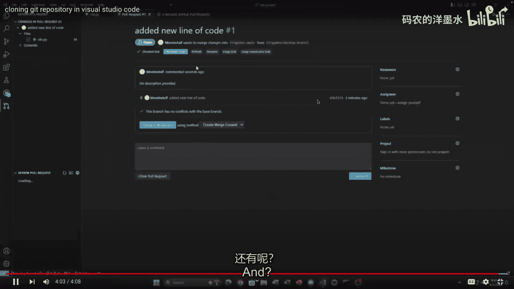

Yeah， it has no conflicts。

All right， so what you all saw was a way that you can use the Git repository， first of all。

 to clone someone's repository and GitHub and what you'll need for that is to select the clone Git repository little link and then you will go and try to copy the repository URL from GitHub into the text box and that will then bring that repository over to you but you need to select a location for that repository on your PC or wherever you're going to store it。

And then。We saw that we could also。Stay away from messing up to the main branch by creating our own branch and that was done by clicking on the little icon on the lower left hand side。

And creating a branch and you can name that branch anything you want。

 but the main purpose of that is to be able to play around and not mess up the main version that's out there for everyone。

So if you do get to a point to where you think your code is good and you want to merge it with the main branch。

 you if you don't have it already， you can install a full request extension and then just go through the steps of pulling the request you have to stage your changes and commit them and then do the create pull request and what that is going to do is going to send a message to the owner of the repository to get permission what you should check。

On when you do the create pull requests is to make sure that you don't have conflicts with the merging。

我免次。Okay， now let's watch a video on how to review and merge poll requests。

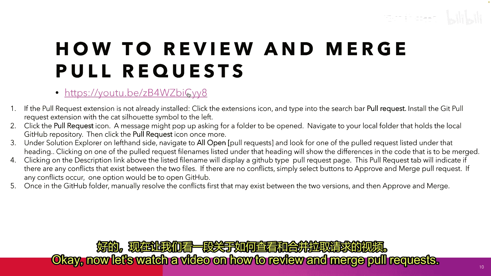

Hello guys， in this video I'm going to be showing how to review and merge poll requests。So。

We should have the extension all requests。So she get hope pull request just to add that。

Now come down here to pull requests and it shows two pull requests that have been opened by my colleagues。

 Oman and Leilla。So I'm going to open moments first。Let's see how we do this。

So it'll show like the differences between the two。And let's see the description。

It kind of shows exactly how you would see it on GitHub website。So there's no description。But。Yeah。

 we can see over here。The difference is added I my name is Timmy to come back to the pull request。

We can just leave a comment and approve it， to say。For now they just say good。Addition。All right。

 that will approve。Good addition， all right now merge the pull request。A merge committee。All right。

 so I merged it， we could delete the old branch， but for now I'm going to leave it and let's see if it actually changed over here。

It didn't might have to pull。不起。Yep， there you go。So。

That's a reason a poll interview urge a poll request， you can poll and it'll show up here。So， now。So。

All right， it'll add to the second line， this is the Le of the world。So compared to description。

So we can see the message， I added a new line of code to test this poll request out， thanks。

So let's leave a message， say the same thing。Good。Addition。Approv。And now。

This branch has conflicts and must be resolved nice。

 so we need to make sure we can solve the conflicts。

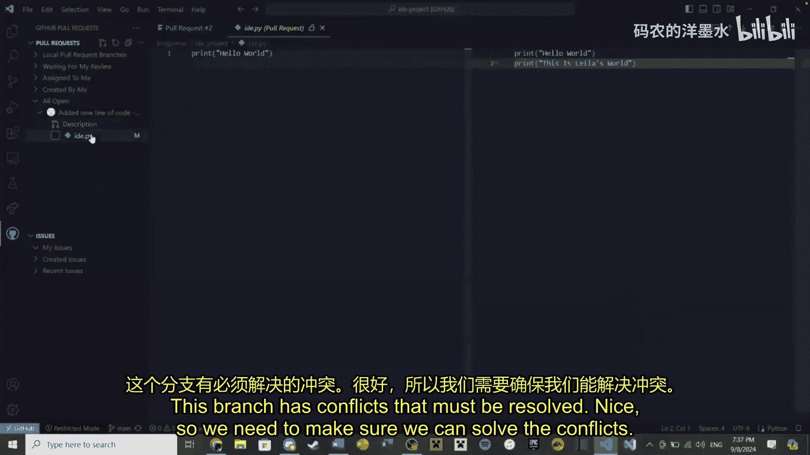

Let's see。Yourreositories。Id project。The pull request。In addition。

Use the Web editor or the command line。Itsolve conflict。

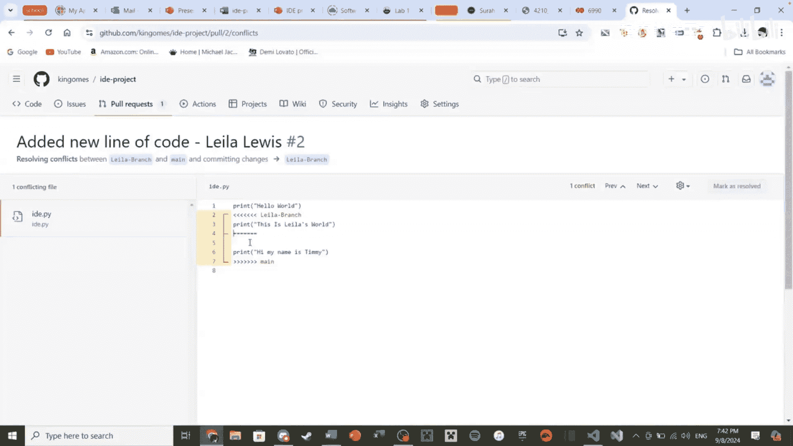

So I think this may be easier to do on the website since it's not opening。That page， for some reason。

Yes， let's do it on the website。

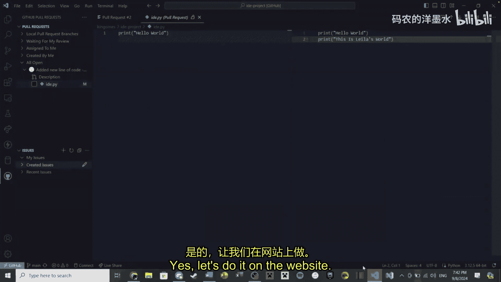

随准楼。This part。And this。Not that。This。And we'd remove this。That should work fine。Workk as a resolved。

So now， maybe if I come back here。😔。

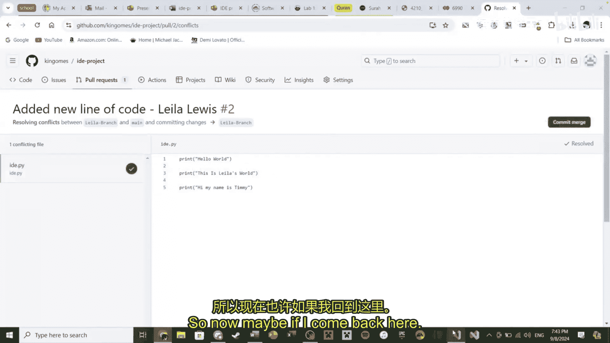

Not dead。Come back to。The description。Yeah， it's better to do it through the website to make the merge。

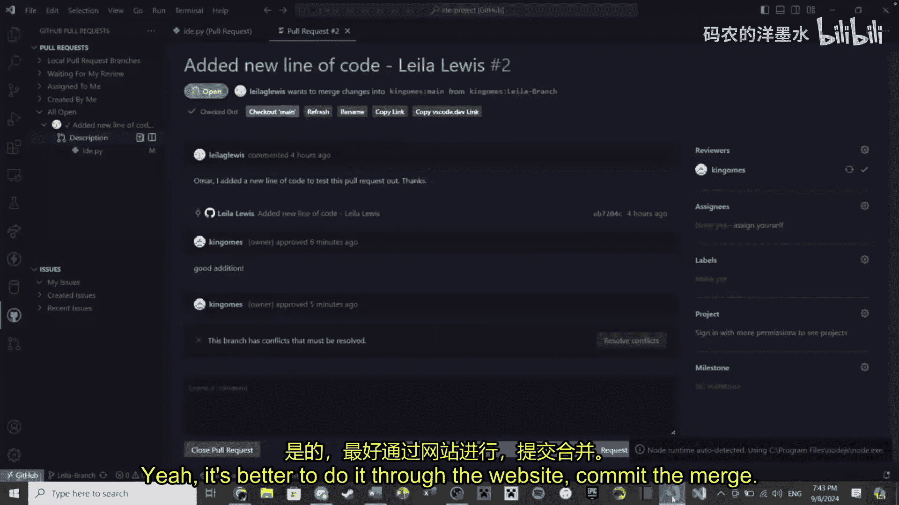

Checking for ability to merge， there you go， now merge the pull request。fer marriage。

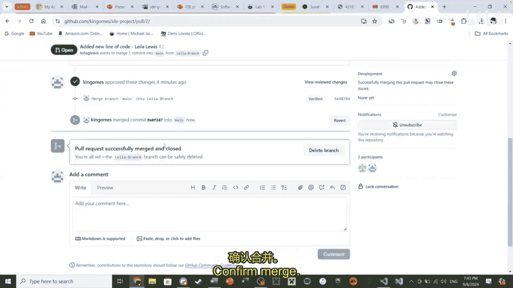

So now we've done it。Two different ways through here。And through the website。

So now if I go back to Maine。How do I get out of this？She says it's successfully。

This could have been。Let's poll and you see it all shows so that's how you do pull requests。

 it gets a bit complicated when you have more than one。

But we were able to figure it out by using a combination of visual Studio code and the GitHub website。

 so there you go。

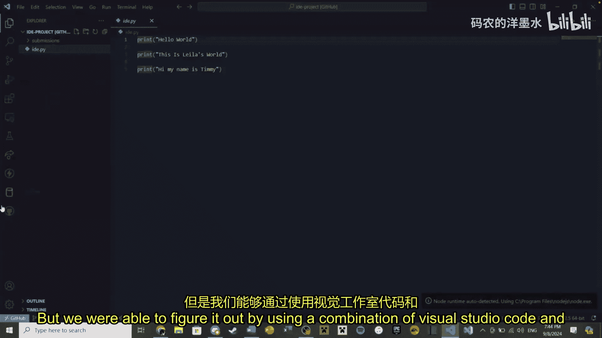

Bish。

Yeah， so what we did in that Ri。You just install the pull request。A good extension。 and then。

you want to do the pull request， a message might pop up asking for a folder to be open。

 you navigate your local folder that holds your local repository and then you click the pull request icon。

And then you and under the solution Explorer， you want to navigate to the all open tab and look for one of the pull requests listed under that heading。

 and then clicking on one of the pull request files listed under that heading will show the differences in the code that is to be merged。

And then clicking on the description link。Above the list file name will display a GitHub pull request page。

This pull request page will indicate if there are any conflicts that exist between the two files。

 as you saw in the video， one of the poll requests we did through visual Studio code and then to resolve the merge conflict we did it through the website if there are no conflicts you just simply approve and merge pull requests and if there are conflicts you go to the website then once you're in the GiU folder you can manually resolve the conflicts first that may exist between the two versions before merging。

All right， so now we go through one of the extensions， live share， it's a really useful extension。

 so here's our video about it。

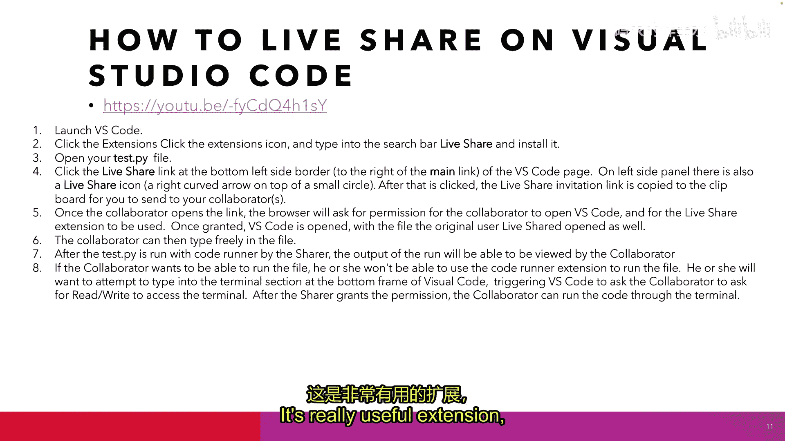

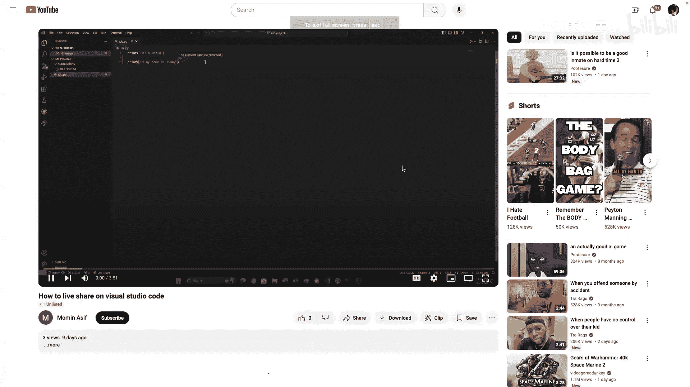

Hey everyone I'm going to be showing you how to live share your code within visualual Studio code。

 so let's say you're working with a colleague or teammate and you want to see their code while you code at the same time you can easily do that using the livesha extension。

So you're going to come down here in extensions。Search up。liveive share。

And should it be the first one that pops up？And you want to install that extension or we have it installed。

But yeah， after it's done installing， you' want going to come back to your file。

 so I have this Python file right here。And down here， I can click live share。

 There's also a live share option at the left sidebar， but I'm going to use the one down here。

Click on that。And as you can see。It says invitation link copy to clipboard。so yeah。

 I can just copy and paste this link to whoever I want。

 so I'm going to send it to my teammate Omar real quick and Discord so we can access the code and we can live share to each other。

So I'm going copy and paste the code to him real quick and discord。

And then I'm going to give them time to open it up。嗯。好的。Ohmar， can you。

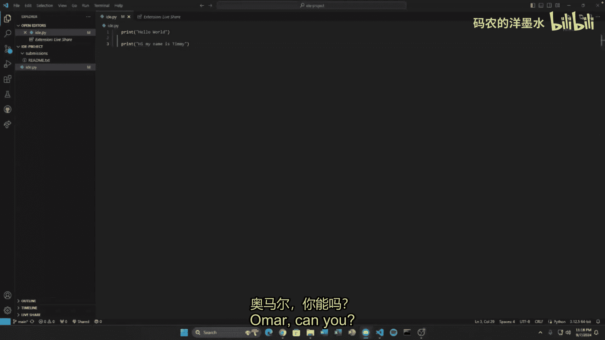

Do you see the live heremar？Yes， okay， som I'm going to show Omar's screen now。

Y if I actually clicked the link and it sent me to Google Chrome and I clicked open Vi Studio code then it asked me to allow the extension。

 the liveshare extension to be used and I clickedlo so now I'm here。

And it starts me off by following my colleague movement， I can always。Pss enter or twice and just。

T my own code hi my name is Omar I should show up on his screen so as you can see he just typed hi my name is Omar on his visual Studio code but if I come back to my own screen I can also see what he typed so yeah that's he's basically live sharing this code with me I'm live sharing my code with him I can see what he's typing he can see what i'm typing。

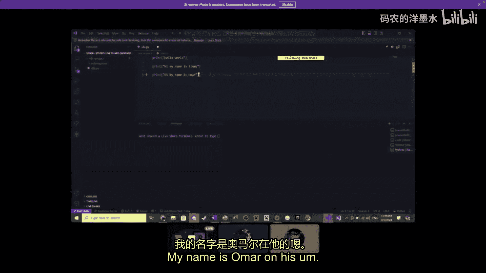

Let's try it one more time I'm going to type something and let's see if he can see it。

So I just type that print statement， let's see if he sees on his screen。And I see it， he does。

So now let's run the code and see if he can see。My terminal displaying these print statements。

 I'm going to run the Python file real quick。As you can see。

 it's running the code down here and then let's see if oh Marcy is it on his screen。

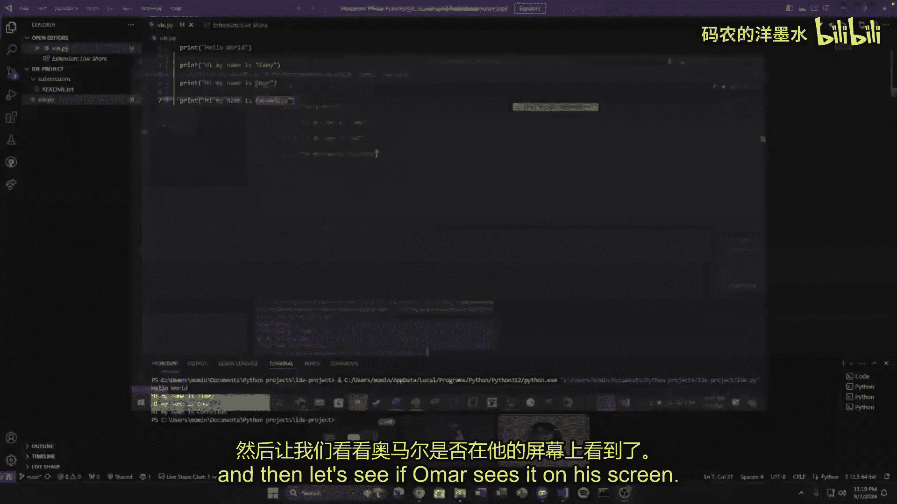

And he does。Now Omar can also run the code from his side。

 but he needs to request access to actually run the code so O I want to request access real quick。

Ope so I'm in here， I press some buttons and it asks me to request readwrite access so I click that。

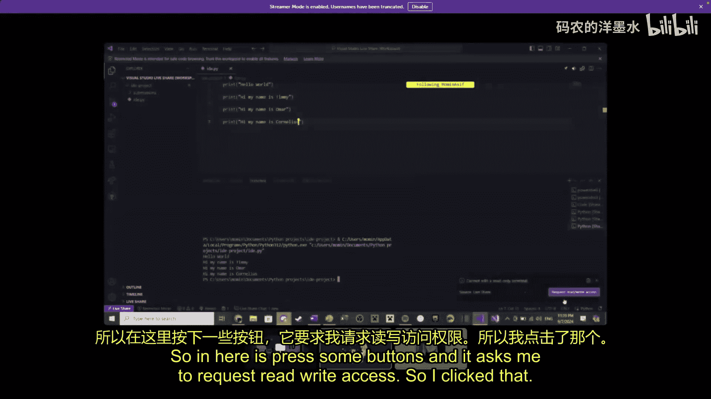

And then I just got to pop up down here saying make the terminal readwrite for everyone。

 I'm going to click that。And now let's go back to OmarR's screen。

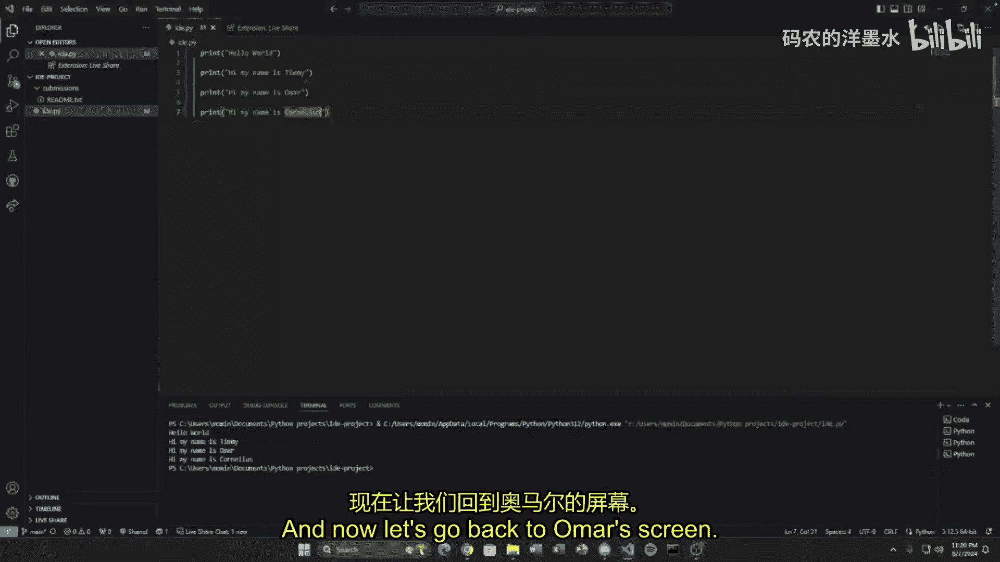

Okay， so now Omar can also run the code from his side， as you can see in his terminal。

 Omar want to run the code on your side。Right， so to run the code， you do pi， then you do space IDE。

 Pi。And it should run there you go and as you can see he ran the code from his side。

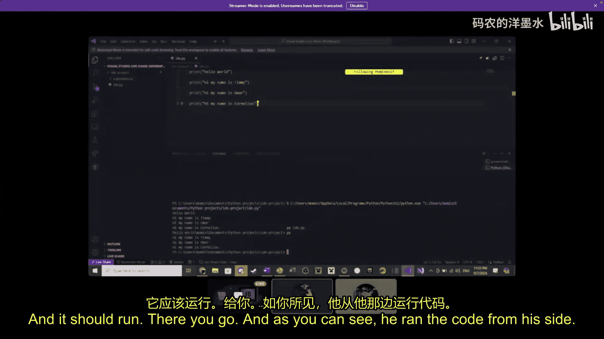

And I can also see on my side that he ran to code and soon display in my terminal as well because we have a shared terminal now。

Yeah， that's pretty much how a live sharing works in Vi Studio code。

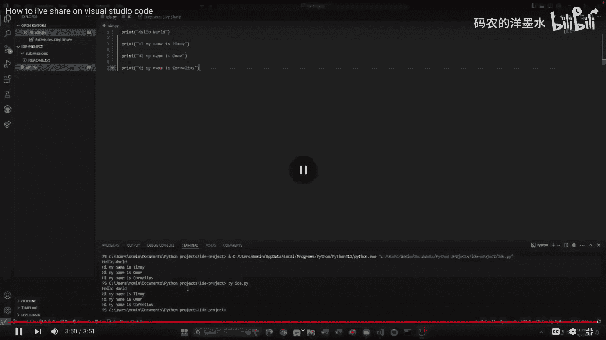

She。So yeah， in that video， we showed a little bit about the livesha extension。

You can get it the same way we've got the other ones go to extensions， type in liveshare， install it。

And then on the bottom left to the right of where it says your branch。

 you can see the button live share， you click that。

 you do start collaboration session itll automatically copy the link and then you just have to paste it wherever you want to。

 we did it your Discord。And so for the person who clicks the link it'll open visual Studio code in the browser。

 you could just use it in there， but it also asks you permission to open it in the application visual Studio code that's what I was trying to explain in the video so I got that I clicked open so it opened it in there and automatically had me following moments you know wherever he was and I could just freely type。

I could see whatever you ran。And since he can also share his terminal。

 I just kind of open the terminal and you just type in， press any buttons， it'll pop up。

 ask for or like request， read write access so I clicked that and it showed up on his screen and he allowed me to type in you know in the terminal and then I was able to run it。

There's another thing we didn't go through since our project ist need light。A website。

 but you can also share a port， so if you're like working on a website with someone else that you can share the port then you can both go to like local host call in 8080 for example if you share 8080 the port。

 so that's also really useful just for testing purposes。It's like seamless collaboration。

This is how to use Gi lens and Vi Studio code。

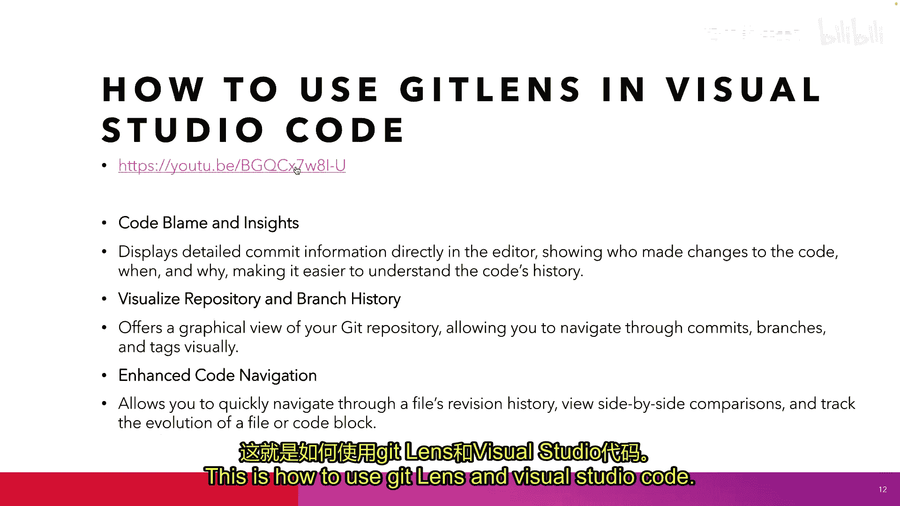

Hey， everybody， I'm gonna be doing a。Quick overview of the。

Getit lens extension within Vi Studio code。So like for every other extension。

 we just come down here in extensions， search up get lens。

And it should be this one made by Git Krackken， I already have it installed。

 would you just install it。And yes， so basically what this extension helps with is。

You can check like if you're working with a team or with other people on the same project。

It helps you keep track of who made changes and who modified what in the code。So for example。

 like right here， Gi lens is helping by showing who modified。This line of code in the project。

 so what and if I hover over this？It shows that Omar。

Merge this line of code into the main branch three hours ago on September 8th， 2024。

 and it shows a specific time。And within this menu。

It also shows many other things you can do like inspect to commit details。

 you can connect to GitHub and you can do many other things within this little menu。

Some other things you can do within GitLens is come up here and click on file annotations。

Then there's three options you can do up here， you can toggle file blame。

 which shows all the specific details about the modification on the left and on the right right hand side is the actual code。

You can toggle a file heat map。Which shows what specific areas of the project were modified the most here on the left。

And then you can also。Toggle file changes and that basically highlights all the recent。

Changes in the project。And then。You can also come down here and click on visualize commits on the commit graph and this is really helpful because it just shows like visualizes like all the modifications in one place。

 it shows a complete timeline of the commit messages， the authors， the changes， the time。

 it's just like a huge timeline you can just。Look at。 And then this is good for like。

 if you want to keep track of what happened or like you want to retrieve a lost file or a lost line of code。

 you can come over here。And then you can also click on the side here， get lens。

 you can click or down here。嗯。You can also click on get lens down here。This also shows。

A lot of different things you can do within Git lens， for example， shows a lot of information shows。

The specific line by line history of the project that shows the file history and show。It shows like。

You can come down here and you can go and search commits if you want to look for specific commits。

 so if I click on this。I can search by message， I can search by author search by file all these options so let's say if I want to search for specific commits made by a specific person so I'll click on search by author and I want to look for commits that are made by me specifically and just search for myself and it'll show。

All the commits that were made by me down here。And yeah that's a basic quick overview of Goodlands you can do a lot of things with this。

 but the main idea is it's just a way to keep track of everything within your team。

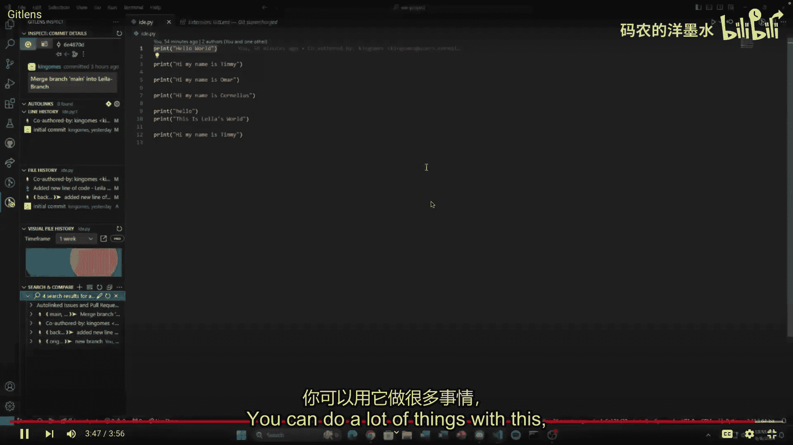

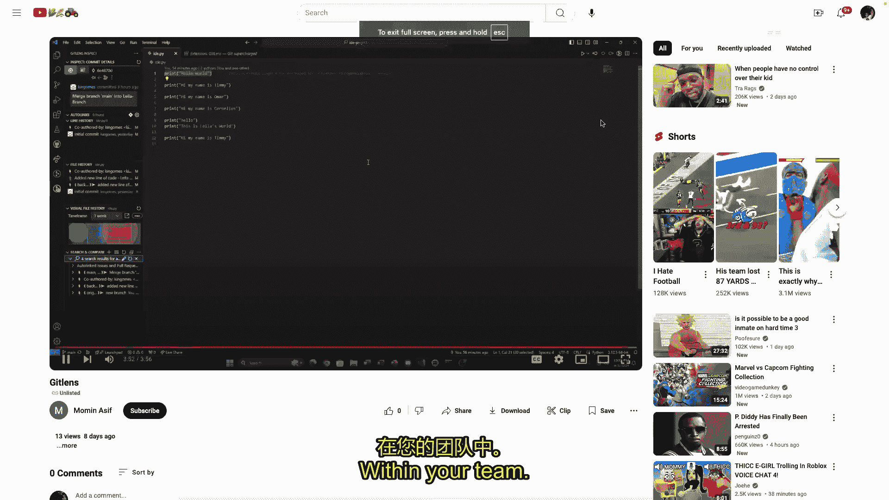

All right so I guess excuse me I guess you all can see how very useful Gi lens is once you install it you don't really need to click that icon like moment did at the end it gives you more detailed information however。

 if you just open that file you could just hover over the individual lines and see。

Basic information about who modified it when they modified and and other things to get more pointed information you could go to that file annotations icon and upper right hand corner and click on file blame so it's blaming who made this mistake or what happened but you could track who did what and you also could track your changes and then you could track it has a heat map to indicate I don't know what the colors are if it's red is that the last thing that was red purple I don't know what each one indicates but you can look that up and see which one was hit the most which line of code and then we saw the visualized commit icon on a lower lefthand side and then that way you can。

It gives you a line by line assessment of each change and as Moman said you could dig up old files that you thought you lost so that's really cool I think everybody should have saw this degree utility。

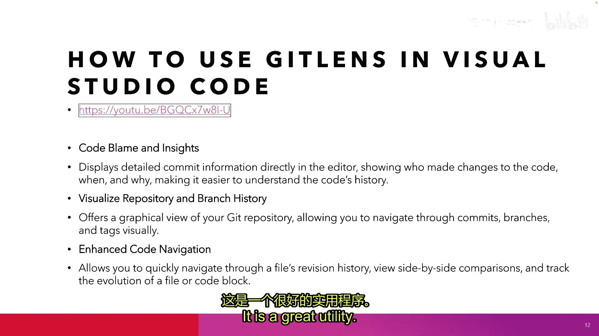

Ex。piece about the slideshow gifts。

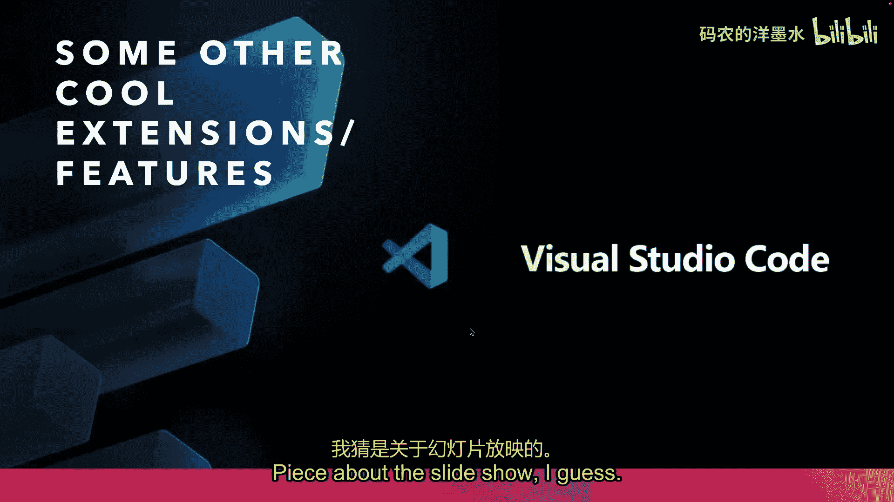

Oh gosh okay， so here's some more cool features and extensions and Vi Studio code that we didn't really feel like needed a video。

 but we wanted to show off so one extension is called GiHub Copit it can accelerate your coding productivity by providing AI powered code suggestions and auto completion。

And that reduces the time spent writing， you know your normal boilerplate code and helps developers work more efficiently。

There's also context aware assistance， which understands the context of the project。

And offers intelligent code suggestions that also speeds up debugging and implementing complex algorithms。

 there's also a learning tool for new developers。Especially those still learning or working with new languages。

 it Copit serves as a helpful guide by suggesting the best practices in writing clean code。

Another there's Trbo console log， I don't know if you could see all that。

 but generally what it does you know how you always have to type in console。

 log to debug and you just want to print a bunch of stuff iss basically like you can make a template and then you can just kind of auto complete and it just speeds up the whole process of debugging and you know figuring out what's wrong with your program。

It's basically。All right， and then here we have the code spell checker and it's pretty selfexplanatory。

 but it's very good to make your code very clean and in multiple languages it can detect spelling errors。

 so we really suggest that。Okay， this is a good one that I did and add。

I could have used this extension in my work experience because it's pretty cool a lot of times I would do。

Control all replace all and muck up my to because I didn't realize a word。

 but we'll play the video this is a video we did in P tunes。

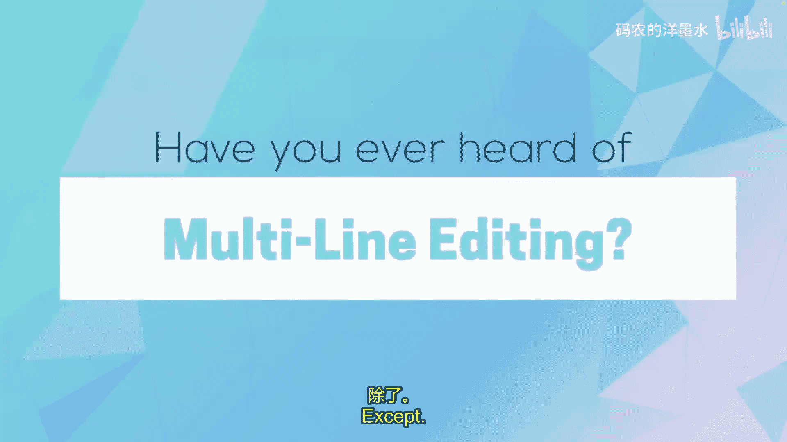

我觉边这谢这。我这是什么。😊。

。我个。拜拜拜拜拜。しい。🎼。僕の方。我。🎼。results。あ。Yeah。嗯。是什么。So。Okay， so。Okay。

 so here's some cool keyboard shortcuts that you can use the visual circuit code。

 you can use control P which quickly opens your file by typing part of the file name。

 you can do control shift plus P that opens the command palette and you can execute any command without needing to memorize the shortcuts for that command。

 you can do control plus forward slash that comments or uncomments the current line or selected block of code。

 you can do a control plus B that opens or closes the sidebar which houses your file Expr and source control and you can also do a control plus B which selects the next occurrence of the word under the curse server for multiline editing。

So we mentioned a little bit before about the positives of visual pseudo code and now we have a specific other kind of IDE to compare it with。

 which is Py charmm， so you're probably thinking why not just use an IDE specifically made for Python such as Pyhar if we exclusively use Python in our examples or why not use any other IDE in general。

 what makes VS code so special and why do we choose it？

So Py chart would be better suited for someone who develops exclusively with Python。

 however as software engineers you should be flexible with your coding languages。

You use and that's why visual Studio code is most widely used IDE among professional and casual developers Python is just a language we chose to do the tutorials with to make everything consistent。

 but in the industry you'll be using multiple languages。

So some of the things we mentioned before is lightweight fast and uses fewer resources compared to heavier IDs like Picharm。

 which makes it ideal for large projects and responsive performance。

There's a lot of customization and extensions that we showed some of them for languages。

 frameworks and tools which allows for literature customization。

 including themes and keyboard shortcuts。It's cross platform， once again， Windows Mac， Linux。

 the browser， different devices。Gt support is built in and it makes it straightforward the get can yeah get enabling you to manage repositories。

 commits and conflicts directly in the editor， but Pi charm's Git features can feel a bit more cumbersome。

Active development and community see a lot of people use it and they're constantly updating it so you always finds itors or it's like people that can help you out with figuring things out。

Integrated terminal， as I mentioned before， you should do it right in visualual Studio code and it puts you in the folder。

Wide language support， many languages， while P charms only one that's well you could use more。

 but it's mostly for Python。In Telecentense and code navigation the autocomplete can help a lot just figuring out what you want to type that kind of stuff it speeds things up。

 debugging， you can put the break points， all that stuff so you can run it， stop at the breakpoint。

 see all the variables and all the values that it's really important to be able to do that even beyond just console log and then it's free and open source it's completely free and open source Icharm it has a paid professional version and the community version it offers limited features。

So here's some of our sources and。All right， let's see who was paying attention。

 let's do with the lookahhoot。And you might want to try in this because we got permission to give you guys a $25 Amazon gift card for whoever gets first。

 so yeah， if you want to Amazon gift card you can just join this Kaooot。I'll sign it up right now。

All screen thing you could。嗯嗯。We all are trying to sleep on us。嗯谢。啊，ます。不。没有。嗯。

That music slipped my head。来。Yes。It was it？对。Why is it not doing with？It's popping up。

So every time I price escape。已经给了给大准。Are you guys ready？对。Yeah。

 I think you should be on the top right join and then you can put it bit。Yeah。我是。

Looks like a lot of you want that cards。Thank you。We going quickly。

 because we be have on attendance minutes。嗯。Goodi everyone。I。I good。But it helps。I to do this。

Some of them are easy， some of them are kind of hard， so。嗯。你问。Well。

 it looks like 20 of you got it right。Some people weren't paying attention in the beginning。

Scoreboard so far， Anthony's in first three times。Time matters soon I。嗯。

What was not one of the reasons we were this？公司。All right，4 Tim， have you got it right？

I think that one was pretty obvious。Abraham Lincoln， whatever that is， it at first。

 didn't know he was alive。What is the purpose of the command pal religion suit？Okay。不。冇仔。嗯。

Justin's in first。A you better come on？不吧。How can you install extensions and videos it's a hard one。

行拜拜。そ不个。嗯好好。Really， really。对。好，拜好。么鬼。What is a default key binding thing to open a command pallet。

 this is a hard one。And any one of these。你说一组。他不妈不。

I'll go that one's kind of hard one one of the last slides I kind of rushed over it all good。

Justin so first， okay， let's go Justin。Which of the following is the default version control assistant integrated everyone。

Okay， then。嗯。Just click。Hopefully。Yes。Which shortcut opens。

 explore a sidebar to navigate files and folder。我现在都是。な。Yeah， six of you got it already that's fair。

 that's fair。Oh whooe isn't first， oh no， Justin what happened？It's a good help how think to do。

Yeah嗯。嗯，对。没事。对。ButI here。T or false the Gold spell checkered extension was only for a。我知道。Let's go。

 guys。Hund0 percent。What is an integrated development environment？Okay。Okay。Yes。

All these make sense when only one is right。W。How when you got a read for Li vote on first。

Are the true and false request have to be approved by the repository office。我想你。嗯。All right。

 what is the primary role of the build automation tools we talked about that are integrated into the IDE？

好。嗯，行。没可有。我几。Alway getting close visual studio Co does not allow you to read。

YouGo to follow up with an easy one after the hard one。Yeah。

 it looks like Bo is running away with it， but Alex is close and second， kind it close。

What's a tool in BS To that offers intelligent code completion， suggestions and documentation as？面试现。

嗯行，你。All right you guys ready for this last question this shows who has school spirit。

 it has nothing to do with computer science， but let's see who has has school spirit this can mess up。

哦个啊我。好，不需要。怎么。对。你说。I't expect most of you to get that nice。You guys know more than I do。Oh。

 who got first？Well got third。No， no， no， first， that's third， Justin doctors。好。Goode back。

who's Justin？Oh yeah， Justin， let's go。嗯，对。第啲。我可以。Yeah。And that was our presentation。

 hope you guys learned some new stuff Does anyone have any questions？Are the I D Herew？で。嗯，喂。

Excell Bar。Great also well done work thank you。

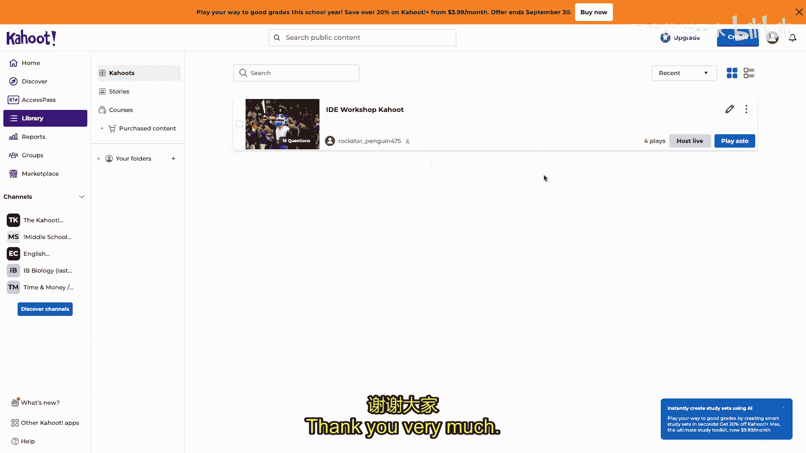

Thank you for letting me use this course and I think we've made it all the way exactly to about the end of our lecture hour so I think that was a great。

😊。

