# 软件工程：第1讲：集成开发环境 (IDE) 教程


在本节课中，我们将学习什么是集成开发环境，并重点介绍 Visual Studio Code 这款流行的 IDE。我们将从基本概念讲起，逐步学习如何安装、配置 VS Code，并使用它进行 Python 开发、Git 版本控制以及团队协作。课程内容设计简单直白，适合初学者。

## 什么是集成开发环境 (IDE)？💻


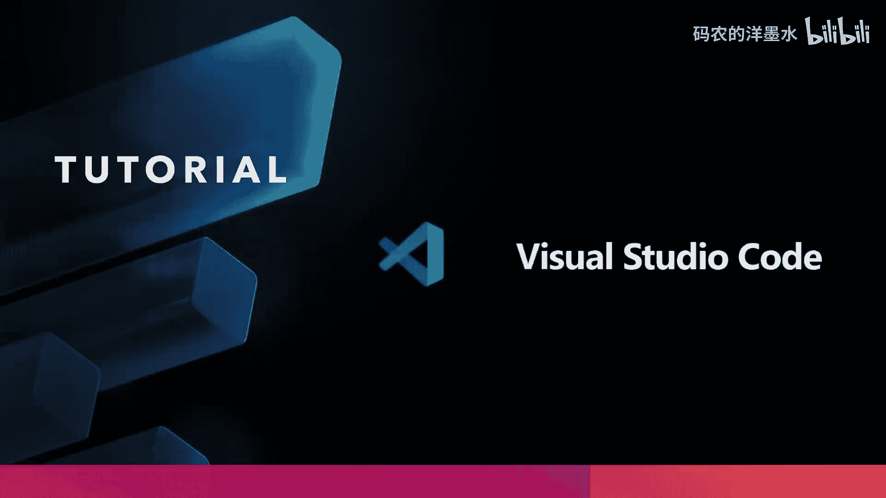

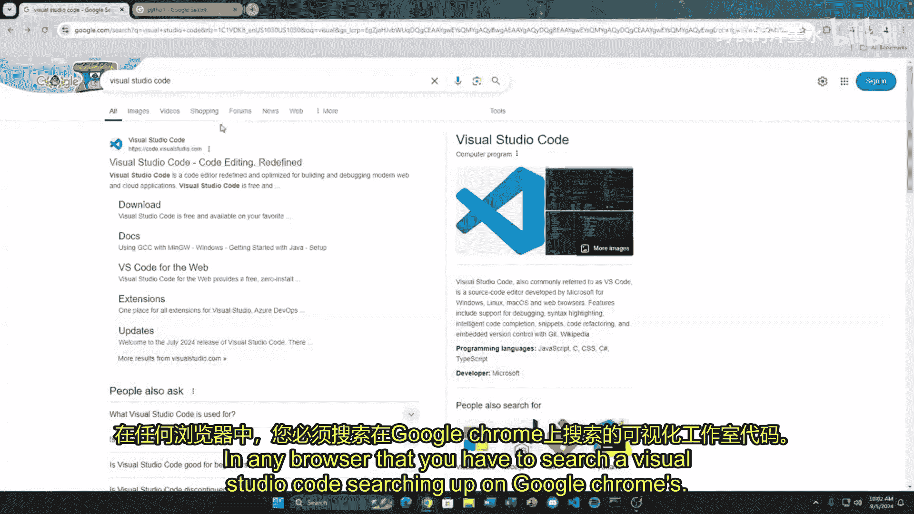

上一节我们介绍了本课程的目标，本节中我们来看看什么是 IDE。

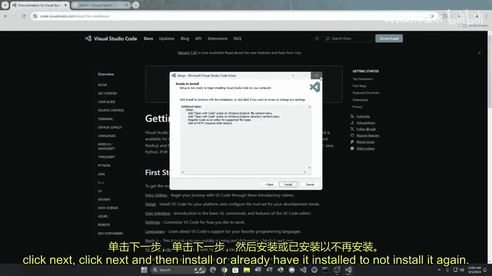

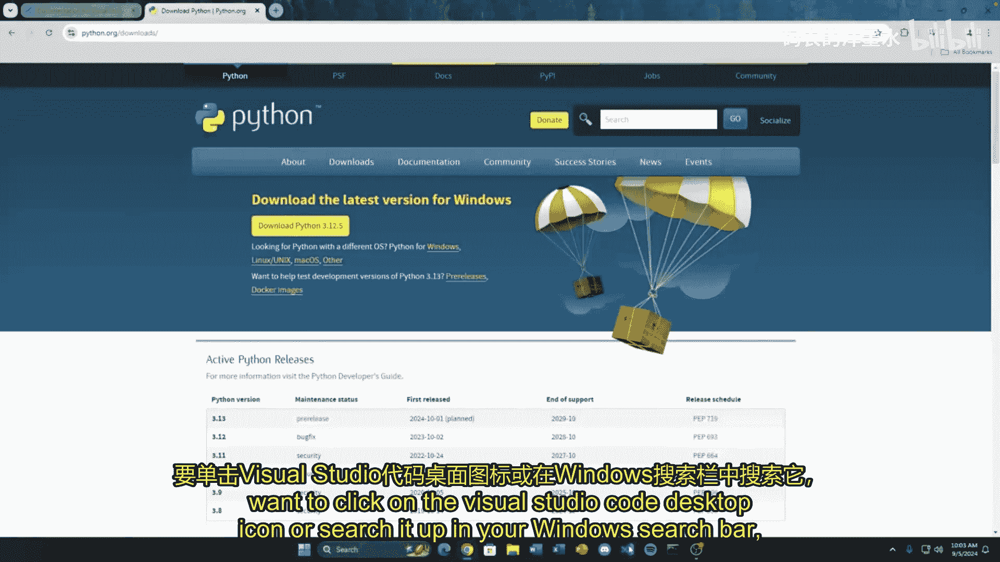

一个 IDE 本质上是一个软件应用程序，它集成了软件开发所需的各种工具。它通常包含以下组件：

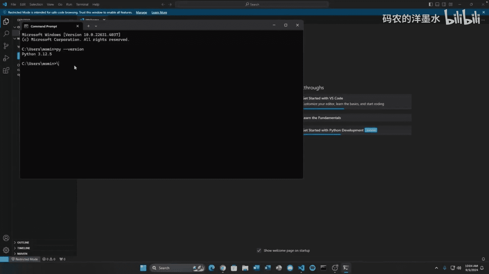

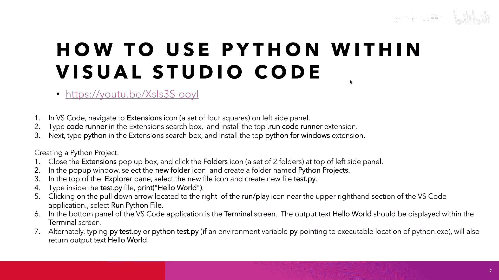

以下是 IDE 的核心组件列表：
*   **代码编辑器**：用于编写和编辑代码，通常包含语法高亮和代码自动补全功能。
*   **编译器与解释器**：将代码转换为机器可读格式或直接运行脚本的工具。
*   **调试器**：通过逐步运行代码来测试和调试程序的工具，允许开发者检查变量和控制流。
*   **构建自动化工具**：用于自动化编译代码、运行测试和打包应用程序等任务的功能。
*   **版本控制集成**：用于管理代码版本的工具，通常集成 Git 等系统。

流行的 IDE 示例包括我们今天要重点介绍的 Visual Studio Code，以及 PyCharm 和 Eclipse。它们通过将所有开发工具集成到一个应用程序中，来简化编码流程。

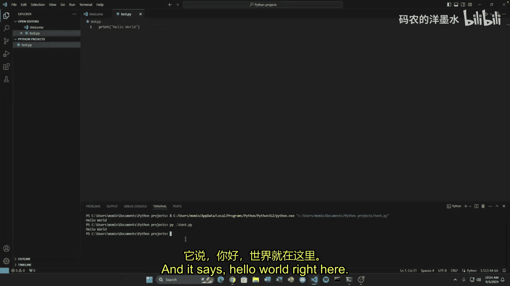

## 什么是 Visual Studio Code？🚀

了解了 IDE 的基本概念后，本节我们聚焦于本次教程的主角：Visual Studio Code。

Visual Studio Code，常被称为 VS Code，是由微软开发的免费开源代码编辑器。它因其轻量级和功能强大而深受开发者欢迎，支持广泛的编程语言和开发任务。

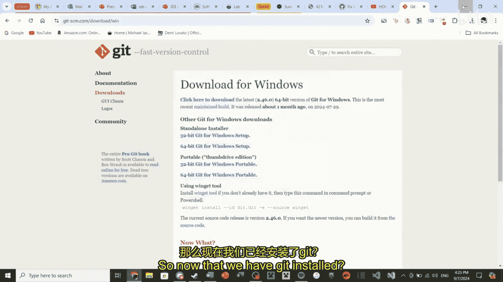

以下是 VS Code 的主要特性：
*   **智能代码编辑器**：提供智能感知、自动补全、语法高亮和代码导航。
*   **丰富的扩展生态系统**：可通过安装扩展来支持额外的语言、框架、工具和功能。
*   **集成终端**：内置终端，可直接在项目文件夹中运行命令，无需额外打开系统终端。
*   **内置版本控制**：对 Git 提供原生支持，便于管理源代码和团队协作。
*   **强大的调试器**：支持设置断点、检查变量值，方便调试程序。
*   **跨平台**：可在 Windows、Mac、Linux 上运行，甚至支持浏览器版本。
*   **高度可定制**：可以自定义外观、快捷键和行为，以适应个人工作流程。

总体而言，VS Code 因其快速、灵活和易用性，在初学者和经验丰富的开发者中都广受欢迎。

## 如何下载与安装 Visual Studio Code？📥

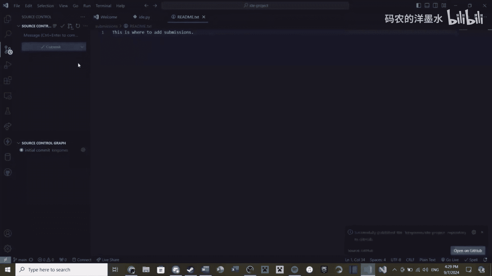

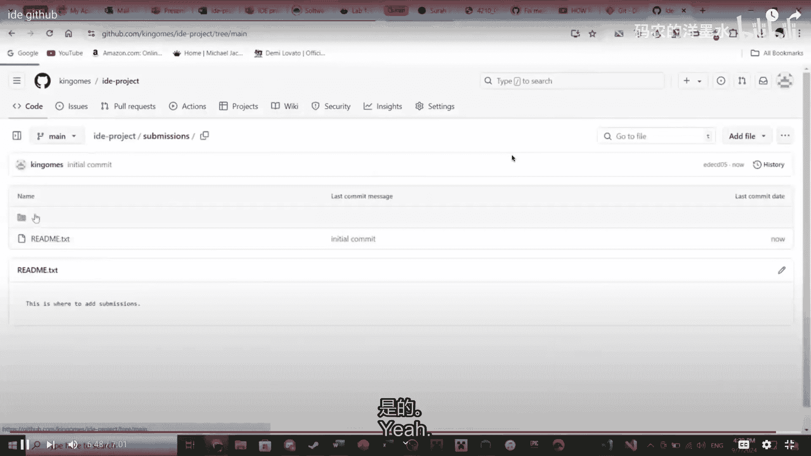

现在我们已经了解了 VS Code 的优势，接下来看看如何获取并安装它。

以下是下载和安装 VS Code 的步骤：
1.  打开浏览器，搜索 “Visual Studio Code”。
2.  访问官方网站 `code.visualstudio.com`。
3.  点击页面上的 “Download for Windows” 按钮（根据你的操作系统选择）。
4.  运行下载的安装程序，接受许可协议，并按照提示完成安装。
5.  安装完成后，可以在桌面找到快捷方式，或在系统搜索栏中搜索 “Visual Studio Code” 来启动它。

**重要提示**：如果你计划使用 Python，需要先确保 Python 已安装在你的电脑上。可以访问 `python.org` 下载并安装 Python。安装后，可以在终端输入 `python --version` 来验证安装是否成功。


## 在 VS Code 中使用 Python 🐍

成功安装 VS Code 后，本节我们将学习如何在其中创建和运行一个简单的 Python 项目。

以下是创建和运行 Python 项目的步骤：
1.  **安装必要扩展**：点击左侧边栏的扩展图标，搜索并安装 “Python” 扩展（由 Microsoft 发布）和 “Code Runner” 扩展。Code Runner 可以让你通过点击按钮轻松运行多种编程语言的代码。
2.  **创建项目文件夹**：点击 “文件” -> “打开文件夹”，创建一个新文件夹（例如 `PythonProjects`）并打开它。
3.  **创建 Python 文件**：在项目文件夹内，点击 “新建文件” 图标，将文件命名为 `test.py`。
4.  **编写代码**：在文件中输入简单的 Python 代码，例如：
    ```python
    print("Hello World")
    ```
5.  **运行代码**：保存文件后，你可以通过以下两种方式运行：
    *   使用 **Code Runner**：点击文件右上角的三角形 “Run Code” 按钮。
    *   使用 **集成终端**：打开底部终端，输入命令 `python test.py` 或 `py test.py`。

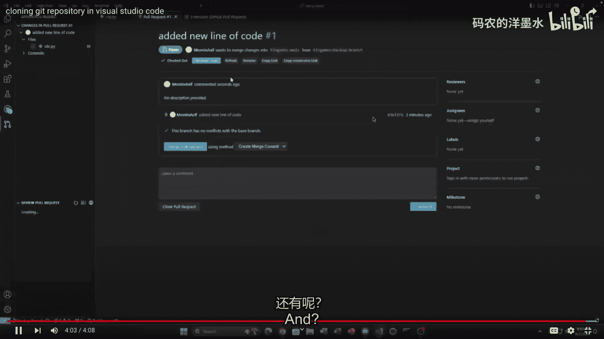


两种方法都会在输出区域显示 “Hello World”。

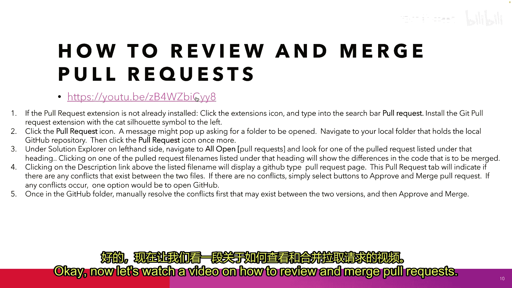

## Git 集成：初始化仓库与提交推送 🔄

现代软件开发离不开版本控制。上一节我们运行了代码，本节我们将学习如何在 VS Code 中集成 Git 来管理项目。

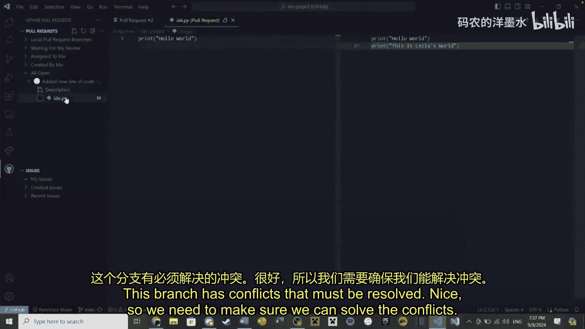

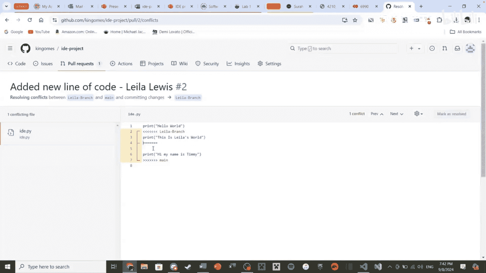


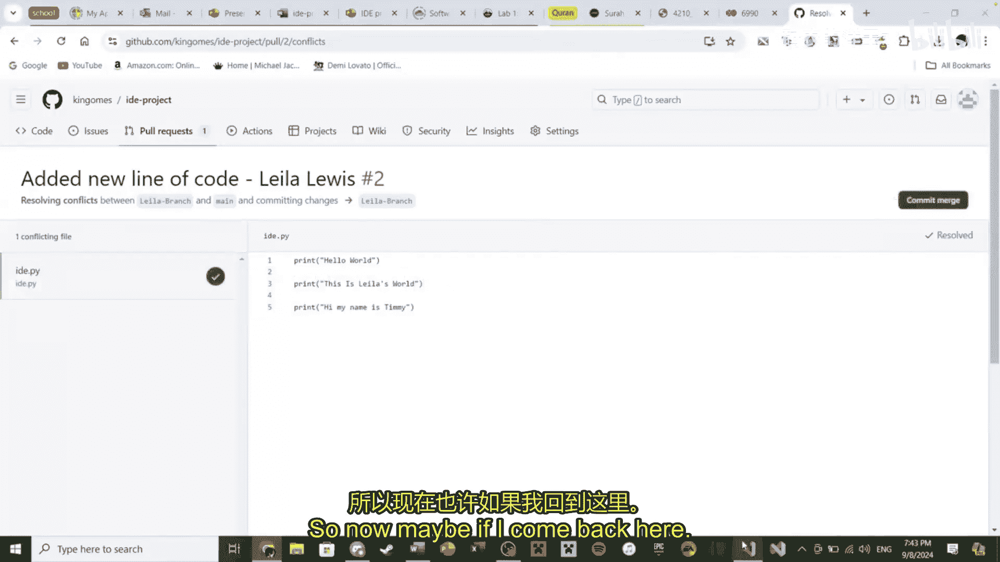

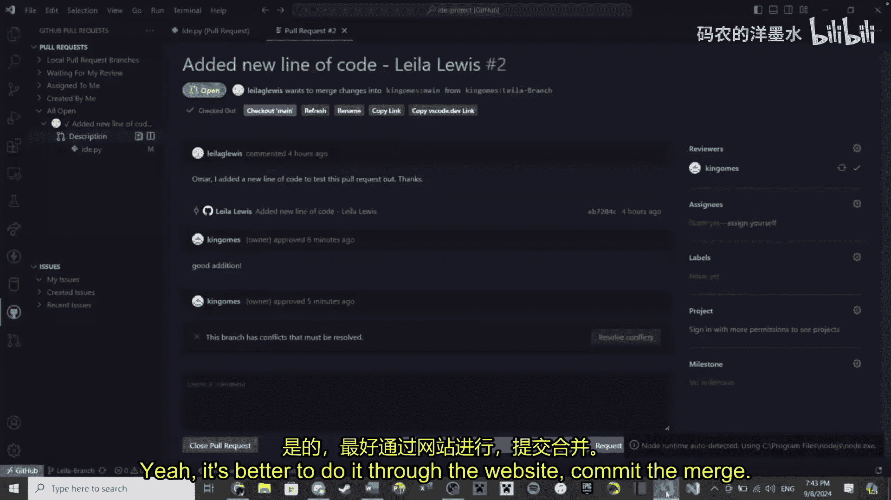

以下是初始化 Git 仓库并进行首次提交的步骤：
1.  **安装 Git**：首先，确保你的电脑上安装了 Git。访问 `git-scm.com/downloads` 下载并安装。安装后，在终端输入 `git --version` 验证。
2.  **在 VS Code 中登录 GitHub**：建议在 VS Code 左下角点击账户图标，登录你的 GitHub 账户以同步设置。
3.  **初始化仓库**：在 VS Code 中打开你的项目文件夹。点击左侧源代码管理图标，然后点击 “初始化仓库” 按钮。
4.  **创建文件并暂存更改**：在项目内创建或修改文件（如 `README.md`）。在源代码管理面板，文件会出现在 “更改” 区域。点击文件旁边的 “+” 号来暂存更改。
5.  **提交更改**：在上方的输入框输入提交信息（例如 “Initial commit”），然后按 Ctrl+Enter 或点击勾号图标进行提交。
6.  **发布（推送）到远程仓库**：提交后，点击 “...更多操作” 菜单，选择 “推送”，或直接点击 “发布分支” 将本地仓库推送到 GitHub。

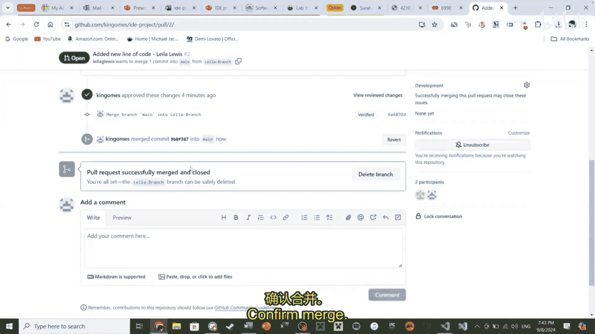

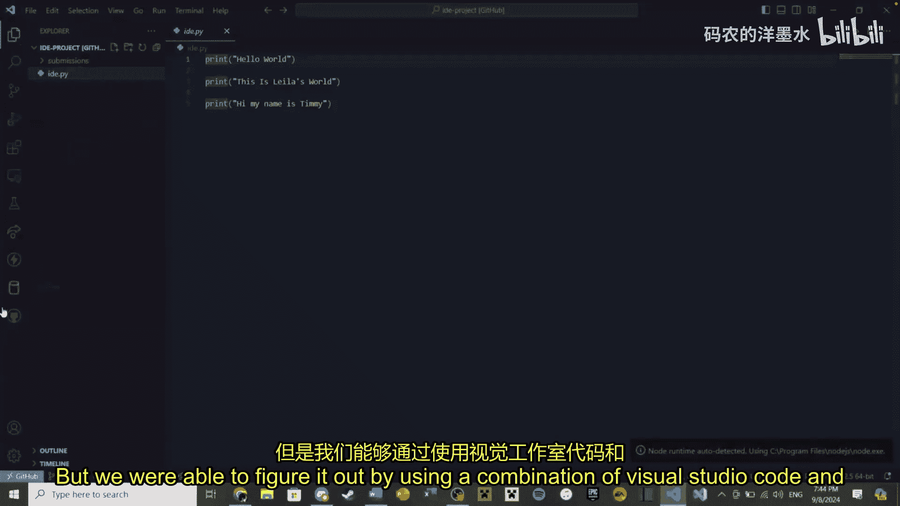


## Git 进阶：克隆仓库与创建分支 🌿

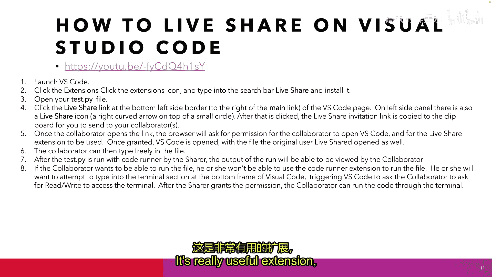

在团队协作中，我们通常不会直接在主分支上修改。本节学习如何克隆他人的仓库并在独立分支上工作。


以下是克隆仓库和创建新分支的流程：
1.  **克隆仓库**：在 VS Code 欢迎页面点击 “克隆 Git 仓库”，或按 `Ctrl+Shift+P` 打开命令面板，输入 “Git: Clone”。粘贴你想克隆的 GitHub 仓库 URL，并选择本地存储位置。
2.  **创建新分支**：打开克隆的项目后，点击左下角显示当前分支（如 `main`）的地方，选择 “创建新分支”，输入分支名称（如 `feature-branch`）。
3.  **在新分支上工作**：现在你处于新分支中，可以自由修改代码而不影响主分支。修改后，按照上一节的方法暂存并提交更改。
4.  **推送分支与创建拉取请求**：提交后，需要将新分支推送到远程仓库。你可以安装 “GitHub Pull Requests” 扩展，以便在 VS Code 内直接创建拉取请求，请求将你的分支合并到主分支。


## 代码协作：使用 Live Share 扩展 👥


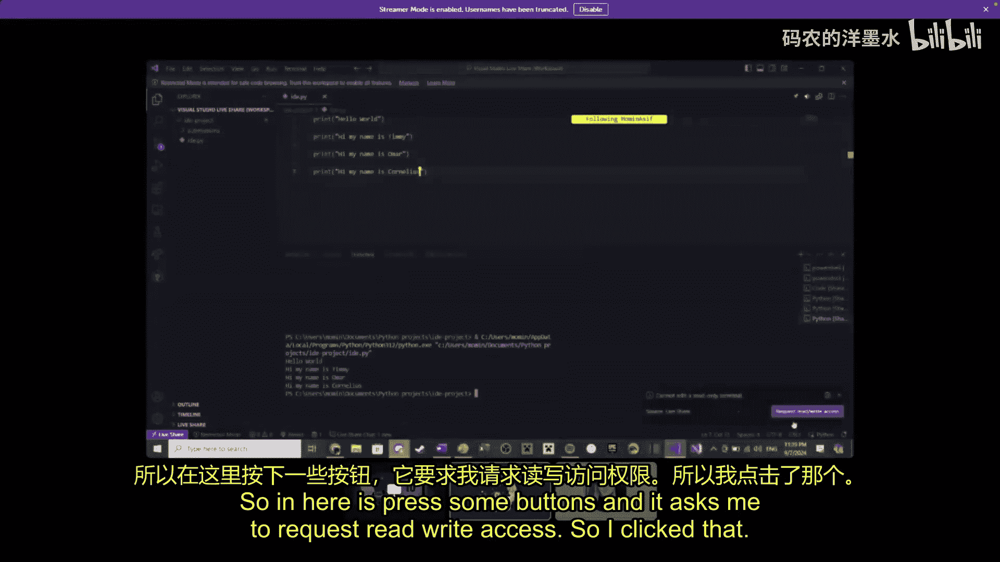


团队协作时，实时共享代码和调试环境能极大提升效率。本节介绍 VS Code 的 Live Share 扩展。


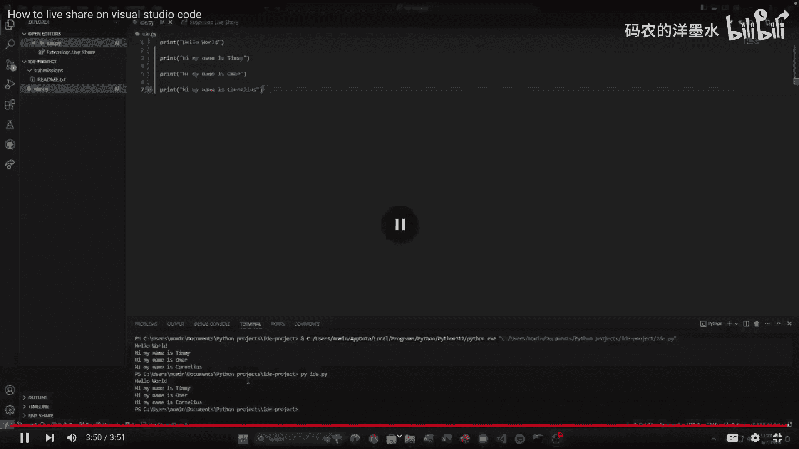

Live Share 允许你与他人实时共享整个工作区（包括代码、终端和调试会话）。

以下是使用 Live Share 的步骤：
1.  **安装扩展**：在扩展市场中搜索并安装 “Live Share”。
2.  **启动协作会话**：打开你的项目，点击左下角的 “Live Share” 按钮，选择 “开始协作会话”。VS Code 会自动生成一个邀请链接。
3.  **共享链接**：将链接发送给你的队友。
4.  **实时协作**：队友通过链接加入后，双方可以同时查看和编辑代码，光标位置会实时显示。主持人还可以共享集成终端，允许队友共同运行命令和调试程序。


## 代码历史洞察：使用 GitLens 扩展 🔍

在大型或团队项目中，追踪代码的修改历史和责任人至关重要。本节介绍强大的 GitLens 扩展。

GitLens 增强了 VS Code 内置的 Git 功能，提供了详细的代码历史洞察。


以下是 GitLens 的核心功能：
*   **行级注释**：将鼠标悬停在代码行上，可以看到是谁、在何时、因何提交修改了这行代码。
*   **文件标注**：点击编辑器右上角的图标，可以开启“文件追溯”模式，在侧边栏查看每一行代码的完整修改历史。
*   **提交图谱**：点击活动栏的 GitLens 视图或使用“可视化提交图谱”功能，可以图形化查看项目的整个提交历史、分支和合并情况。
*   **强大的搜索**：可以按提交信息、作者、文件等条件搜索特定的提交记录。

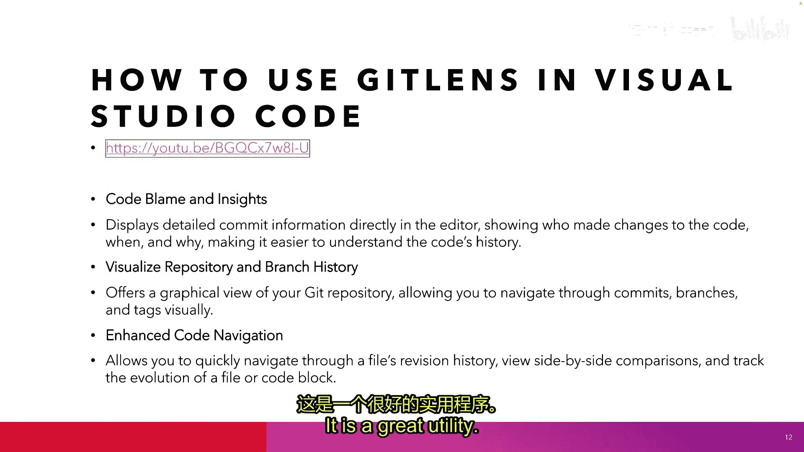


## 其他实用扩展与技巧 ✨

除了上述核心扩展，VS Code 生态中还有许多工具能提升你的开发体验。


以下是一些推荐的扩展和技巧：
*   **GitHub Copilot**：AI 编程助手，能根据上下文提供代码建议和自动补全，加速开发。
*   **Turbo Console Log**：快速插入 `console.log` 语句进行调试的快捷工具。
*   **Code Spell Checker**：代码拼写检查器，帮助保持代码清洁。
*   **实用快捷键**：
    *   `Ctrl+P`：快速搜索并打开文件。
    *   `Ctrl+Shift+P`：打开命令面板，执行任何命令。
    *   `Ctrl+/`：注释/取消注释当前行或选中块。
    *   `Ctrl+B`：切换侧边栏的显示与隐藏。

## 为什么选择 VS Code？🎯

市面上有许多优秀的 IDE，如专为 Python 设计的 PyCharm。那么为什么我们推荐 VS Code 呢？

以下是选择 VS Code 的主要理由：
1.  **轻量且快速**：相比 PyCharm 等大型 IDE，VS Code 启动更快，资源占用更少。
2.  **跨语言支持**：通过扩展，它可以完美支持数十种编程语言，而 PyCharm 社区版主要专注于 Python。
3.  **深度定制化**：拥有海量扩展和主题，可以打造完全个性化的开发环境。
4.  **卓越的 Git 集成**：内置的 Git 支持非常直观和强大。
5.  **活跃的社区**：拥有庞大的用户和开发者社区，问题容易得到解决，软件更新频繁。
6.  **完全免费开源**：VS Code 完全免费，而 PyCharm 的高级功能需要付费。

对于需要接触多种语言或追求灵活、高效工具的软件工程师来说，VS Code 是一个极佳的选择。

## 总结 📚

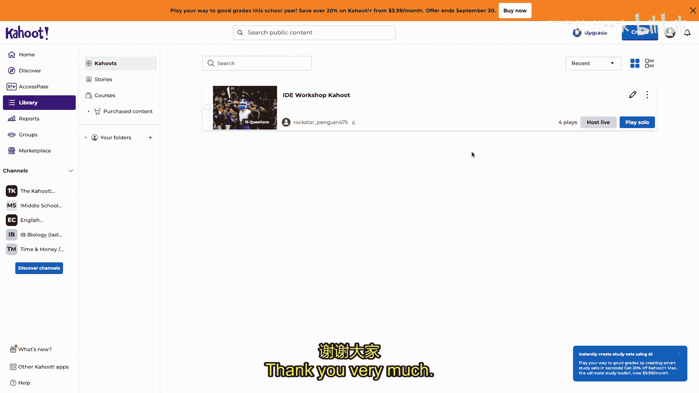


本节课中我们一起学习了集成开发环境的核心概念，并深入实践了 Visual Studio Code 的使用。我们从安装配置开始，逐步掌握了如何用它进行 Python 开发、利用 Git 进行版本控制、通过分支和拉取请求进行协作、使用 Live Share 实时协同编码，以及借助 GitLens 洞察代码历史。最后，我们还探讨了 VS Code 相比其他 IDE 的优势。希望本教程能帮助你顺利开启高效的编程之旅。