# 【全集】加州理工学院 软件工程 中英字幕 1080P p02 Lecture 2 - API -BV13ZzaB3EWE_p2-

Okay， and then we will do a workshop on fast API。So because one of our team members is missing because he has other things to do and the hurricane sort of made his schedule bit difficult。

 he recorded a video which we will watch now。嗯。Before we get to APIs。

 it's really important for you guys to understand ACP first because it's what moves modern APIs use。

So I'm gonna to explain to you guys。What HC is， how it works in this process。

So  ADP stands for a hyper text transfer protocol and it's the communication between the browser and the internet。

Now the communication is going to go through like a protocol。

 which is pretty much a set of rules on how the data is going to transfer between each other。

It's specifically designed for web pages and it uses a request Repon client serverify。

All of those H to be were。Now， when you type a left side address into your browser where you're actually doing that。

 you're sending an H request to it。So first you enter the URL in your browser。

 your browsers then I'm going to send an AC request to the server with websites hosted。

And then the request is going to go through several lines of information of the client。

 which is made up of three parts， as you can see here。

 this is the ACR request in and has these three parts。

So the first part is going to be the methods is get since。

We're trying to get the information it's also going to have the URL in the protocol version。

The header the headers just additional information for the server to know because it's helpful to it and then the body's usually empty because that's what the server is going to use。

 send us back the information。So after the request you're going to get the response now the response is also made up of30 parts。

So the first part is going to be the status line。It was going to send back the version。

 a status code， and then the status text， but the status code is pretty much the end result of what happened。

So if it's in the 200s it means it's successful， this is the 300 it's going to redirect you to a different page and if it's in the 400。

 it's going to mean it's a apply error if it's in the 500s it means that it's a server error。

And then the head is is information about the file that it's sending back。

And then the body is the actual resource of service sending back to the cloud。Now。

 after the requested response happens， it's going to be stainless and what Staless is it means is that。

Once the client sends a request and the server responds back。

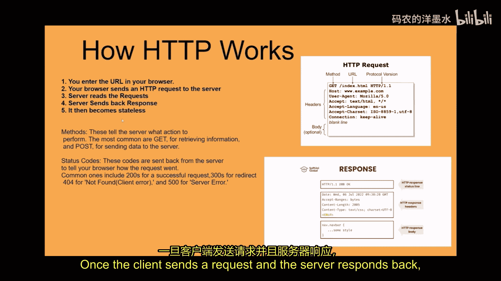

The connection is broken between the two and it's no longer maintained。

Let's not listen to the piano thing， what was that？

没对。I sure it was grown。Okay， so now。

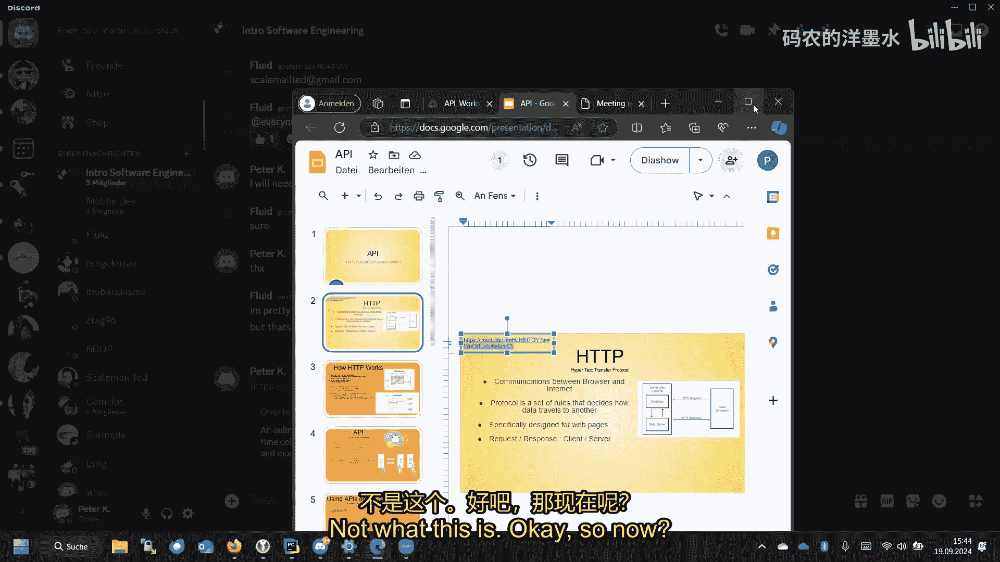

that's your part， yeah okay。That's also video yeah I just have a video of me reading it through it。

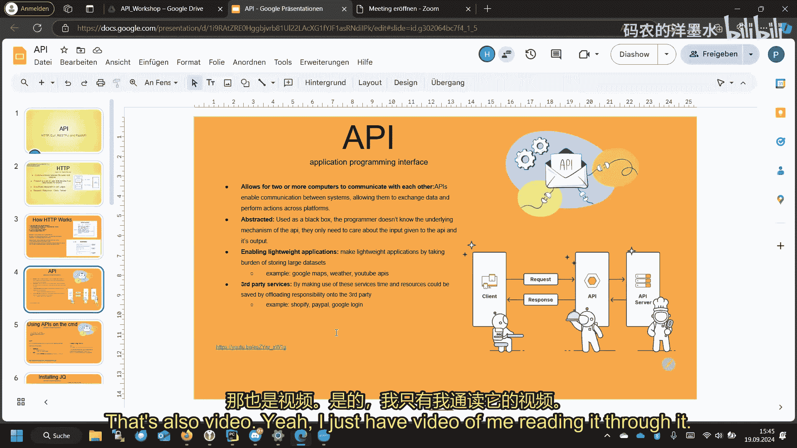

你强。

申清。APpiI to simply is a service that allows。Communication between two or more program by sending and receiving data access the middleman between the server and client and ensuring that data exchange smoothly and efficiency between them。

To give an example of using a restaurant inside a restaurant。

A customer aK and client sends a request by ordering food。The waiter， AK。

 the API received the request and relays it to the chef aK， the server。

And upon finishing that request。The chef sends back the food as a response through the waiter。

And it's the waiter's job to send it back to the client。

A pays are filled with abstraction in my mean programmers。

Don't need to understand intricate details about what's happening behind the scenes instead they just need to know how to send the correct input and manage the outputs。

A helpful analogy。Is driving a car most drivers don't need to know how the engine or transmission work they just know that moving the steering wheel with direct a car stepping on a gas makes it go。

 pushing on the brakes makes it stop Similarlyly with an API you can just focus about what you need to do without worrying about the complex processes that happens。

H the scenes。APpis are great for creating lightweight application。

By allowing the application to connect to an external service。

 they often look the tasks such as data storage and heavy computation。For example。

 an A uses Google Maps。It doesn't need to store all the map data。Inside the。

Instead it caused the Google Maps API to access the data when needed。

We keep the apps smaller fast and more efficient it is the same case for YouTube similarly with YouTube vast catalog of。

Videos is stored on YouTube servers。Your device only received a。

Seevees and click the video through the YouTube API rather than storing or processing all that data locally。

There are many useful third party APIs think of a Shopify for online stores， Paypal for payments。

Blodflare for security and Google login for user authentication。

These save developers time by integrating Readmate or a trusted services。

It's a similar logic to how a professional chef does not need to necessarily grow their own crops or raise own animals to cook a good meal instead a chef relies on suppliers that specialize in providing those high quality ingredients。

This allows this chef to focus on preparing the meals itself。

 likewise developers use their party services to streamline development。

 relying on experts in payment processing， authentication and e-commerce。

And cybersecurity so they can focus on their core application features。

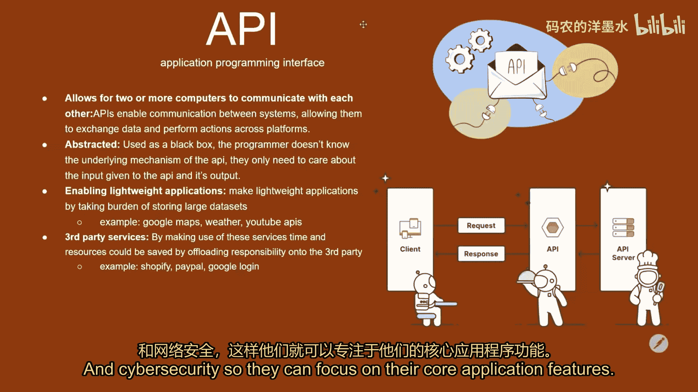

I move the soothing down somehow。Hes to drag that green bar。You can drag over。AhOkay， got it。Good。

我也是。Okay， that's also video yeah， all right。

这な。

Want to see Tim objectline， oh， that's it。

Whatす。So to run。Girl， you just need to go to the command line。

Purl is already pre installedstalled on both Mac Os and Windows like default。

 so there's nothing you need to download。So the reason why curl is。

Useful is because if you ever wanted to do a quick test。I'm quick Tess ofva。APpiI。

 you can just write a one line command。And see the， see the output。嗯，没有。And。In this example。First。

They're using。APpiI Pokemon。And this is the JSON file。Right now， it's。Very hard to read on the CMV。

You can alleviate that by trying to find a JSON formatter that would fix that for you。

一。懂。好问题。These are all the groups and attributes for of Pokemon Pikachu。

For more readable than the one on the command lines。So you should always format the results。

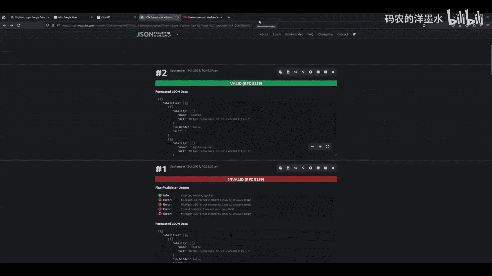

对。对4。唔ca。嗯对。That's also video， okay。马路分です咧。

嗯。到到到。嗯，没意。嗯。这。是晓的。我不是啥东过。Let's see her out is。don you just don't say I might have already muted。嗯。

Sorry。Then if you wanted to explain what you do there， okay it started from a new。So girls。Um。

 you know， like HtP and it's it's just a just a web link。Kl， you can just run。

Your HttP request like get post delete on your command line instead I don't know like writing it on a Python script so it's faster。

So usually those APIs they publish。Theres services under a certain URL and this URL you can access via the web obviously。

 and K is just a framework to use HTTP in your command line tool。Yeah in a previous video。

 I showed that it was a it was a problem because the output JSON file was hard to read there's like no indentation and JQ is going to help with that。

Oh。To install JQ。If you're a Windows user， you want to download chaco by running thatt command and your。

Command prompt and same for MA you need。O grew document well and after that just。

Install JQ using Chaka or home breww。And then after that。So we're in this command。

You see that vertical line right here？This is the same command from the Sea slides。

What it's basically doing is just taking the output to the left the z pro so it's just going to be the Json file before and it's going to。

Run it into JQ， which is just kind of format it。Fort into a readable style。

 just like I did on the web。What the agent， maybe I can find it to in the video。I mean。

 I definitely showed in running。Yeah， I saw that somewhere。Okay。

 basically here you see of the output after you。Peline that through this tool so you don't have this。

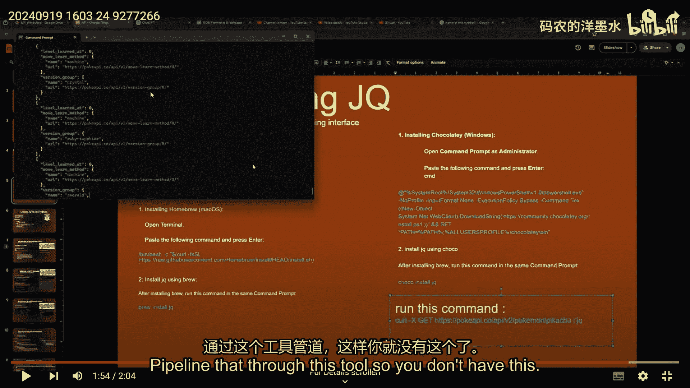

Unreadable stuff anymore。Hopefully this is the one mistake。这个。

Okay that's also your stuff that that's also my stuff So you want to go a bit yeah i've been record for for this one so if you want to run API in python you need to download a library called request it's not installed natively so all you have to do is go to your command line and。

Do Pip install requests？Okay， to get started， obviously you import requests and。

You don't necessarily have to do this， but it's a good idea to。Make an instance variable of the。

Base URL。Kind of like how does a Google。com it can branch into all these other things。

With the Pokemon API， how it works is。After there be too。The second space is an endpoint。

 there's an endpoint for like very evolution chain like a map and the second point。

 which is not necessary， but if want to specify something， for example。

On the pokeman there the spokeman 대。So if you want one this who would just show you all the stuff about videoo and you don't include it just let me give you every focus on it so we probably can just try it out right now。

And we just take。Since this is a get request， all these are guess。

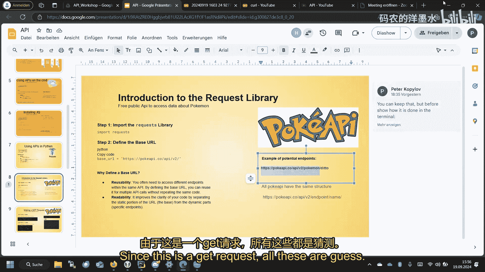

It will also work in the browser so what probably does not work in your browser is if you have to send a body。

 I will come to that later when I present fast API to you。So here if you access that。

 you will see a adjacent file of all the possible Pokemon and if you。

Let's say Pkachu apparently already access that， you see the abilities I never watched Pokemon or whatever so I probably。

No idea what that is， but it works。

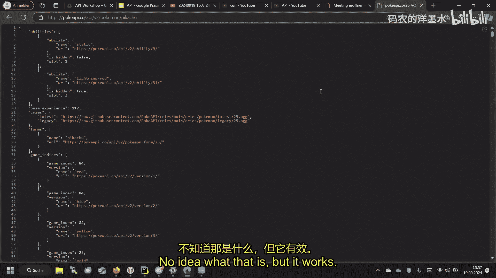

All right， there you go。Okay。After making the face throughout。So like I mentioned before。

 how the URL is structured after face URL， there's an endpoint， in this case。

 I'm just doing Pokemon and now generallym when you're name for a specific Pokemon， I can do that。是。

So the reason why I had an base URL is because I can can kind me whatever I want。Quite everyone so。

I can choose whatever like butterboat dollar didt would be status getterman it horn。对。睇下这。After that。

I didn't show it， but if you just print the response method， it would just give you 200。

 which means said。It works。And after that。You want to use the JSson file， which is。We convert。

JJson like output into Python dictionary。And as you can see。Am I just print that out？

I guess it's hard to see just pretty much the exact same outputll as curl and CB without using JQ。

Yeah。Okay。So next thing that I would want to do is。

Pas out given been attributes that I've understand。And this or Pi you。His Pox ID is 25， I is4。

 weight is 60。And this is my analysis of the Pogate H。

It''s a get only API I can't close anything beyond only you resume。Ass modular validate。Actually。

But I opened the link， shall I do enough？嗯。嗯。😊，You don't have ad block on the other browsers。啊。Okay。

Yeah。Let me open that in the other browser。

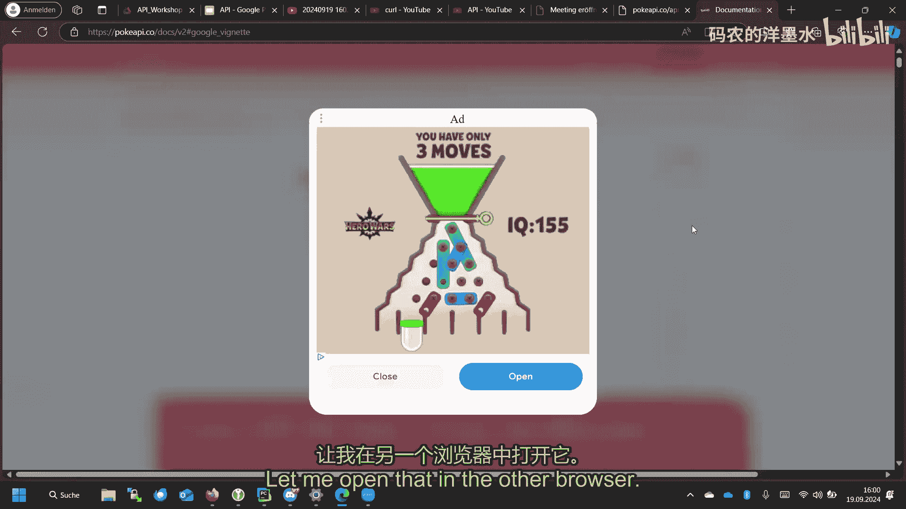

It's club greeting。

It should be better， perfect。Okay， shiting home。好。嗯。Okay， so these are all the endpoints。诶。

All the attributes。reallyally only had value within。Within that particular endpoint， for example。

 berries。There's some commonalities with like ID and name， all of them have ID and names。But。

Things like roofs。Broketime， Max harvest， natural gifts is only applies to berries。

 that's not apply to anything else。But however， berries。There is a it's a type of item right。

 so it's a child of the item endpoint as well。What is it in？And going。It's like a。It's like a route。

S shit。There's things like contest， move。So how does API is structured for the most part is。

But attributes that only really only have meaning within that particular endpoint it wouldn't make sense for move to。

To have anything to do with。But item and name。I thats nice to get。Okay。嗯 tasteか。All right。

 so now we come to restful APIs， that's again Alllan's part who is not here today， so therefore。

There we go video。Or is that thing just stop working big transfer and it is the most common API used by most mobile and web application and it's all about communication。

RestT itself is a set of guidelines slash rules that developers follow to create APIs it's not a standard or technology but a style so you may think restful API is like a software used to create APIs or something different。

 but instead it's just like a rule set so if your API follows this rule set it's going to be considered a restful API。

Now what are these rules？First， we have client server architecture。So the client and the server。

 they both operate independently。Statelessness mean which is the same thing we said with HP。

 meaning once the connection is broken between the two， it is no longer maintained。

It also has to be cacheable which just improves the performance and it has to have a uniform interface now a uniform interface pretty much means that every request and response follows the same set of rules and patterns and pretty much makes it easier for different systems to communicate with each other because they all use the same consistent structure。

So as you can see， pretty similar to HTP。Now it also does use ACTP methods which right here we have get to retrieve data post to create data put to update replace data and delete to remove data now why do we use Rful APIs First things first they are simple and standardized approach to communication you don't have to worry about how to format your data requests each time because it's all standardized and industry use。

Second， it's scalable and stateless， as it grows in complexity。

 you can easily make modifications because they are stateless and you don't have to worry about which data is in each state and keep track of that across the client server。

And lastly， has high performance。It supports caching so as the service gets more complex。

The performance stays high。They can also be used with different programming languages。

 and they allow different software systems to work together easily。

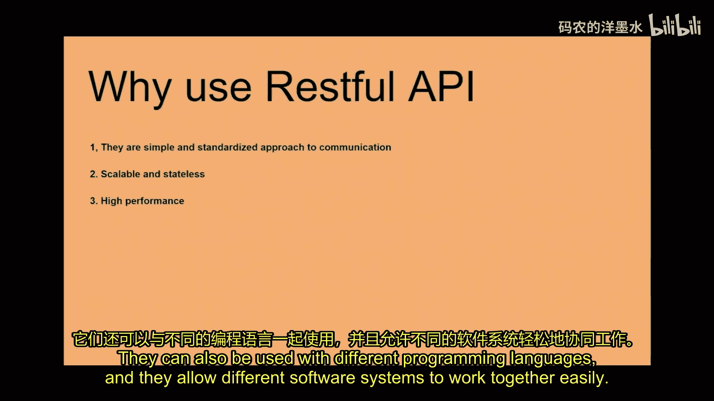

Okay。That's it from now on， we will delve into the workshop on Fast API。

And fast API that's a modern high performance web framework Okay Natasha buy an iPad yeah obviously。

I'll just close all the taps。Okay， so that's just a framework to build APIs in Python。And。

I i've been using fast API for quite some time now for two years and I love it it's amazing and it's pretty simple and straightforward there are other frameworks too like flask for example never use that because fast API always。

I can do what I need to do with that so basically what it has first of all it offers high performance I mean you can read I mean it's built on starlet and whatever whatever。

Practice it's pretty performant I never had issues with that then another another great thing what you always want to do with APIs is when you publish them you somehow need to tell other people how to use the APIs right so for that you have a documentation and all this documentation is generated automatically by fast API you don't need to worry about anything sometimes you have to like insert some certain tags or whatever to some metadata for the documentation but honestly it also works without it and it's really easy。

嗯。Then well， it's developer friendly I already told you that it's pretty straightforward once you get used to it。

 you don't have to learn another framework， it's all very pedantic。呃。Yeah， basically。

That's that's sort of it so now we can just go forward and what I will do from now on is just live code with you and show you how fast API works。

 yes。

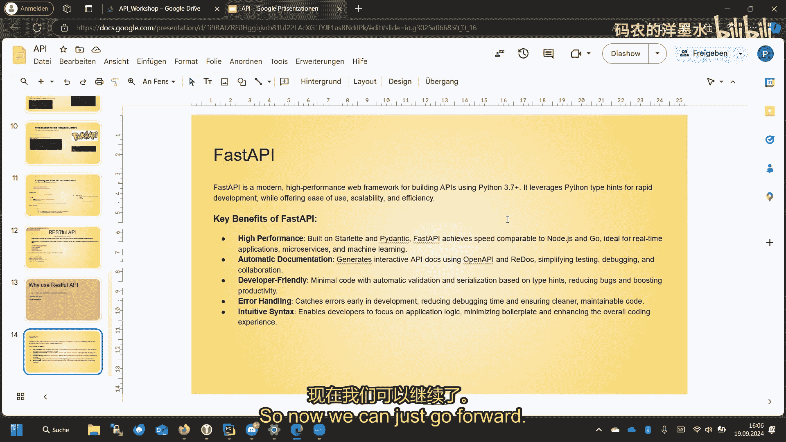

Okay， so restful API that's just。That's just a。Designed for APIs right， so what we had is。

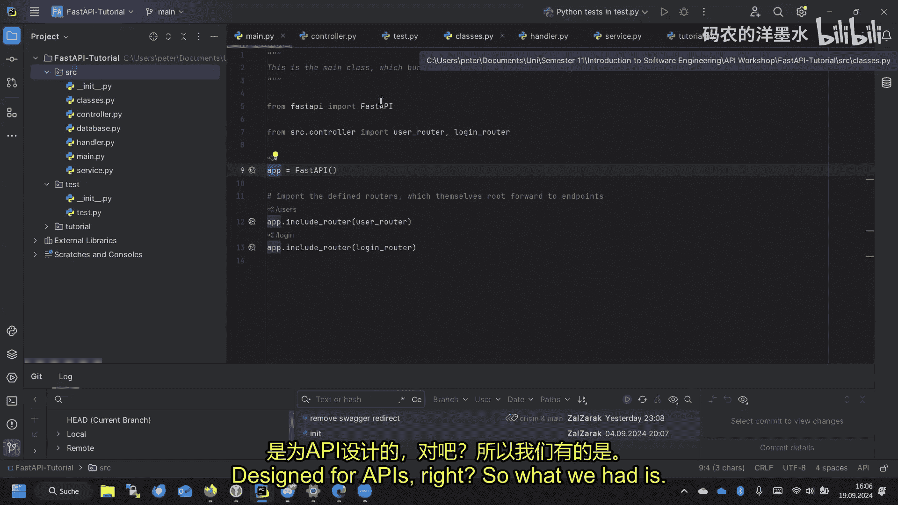

So a re API is an API which has these features， it has a client survey architecture state it's stateless cash flow and so forth and so on。

Fast API， it's not an API itself is a tool to build APIs， okay？

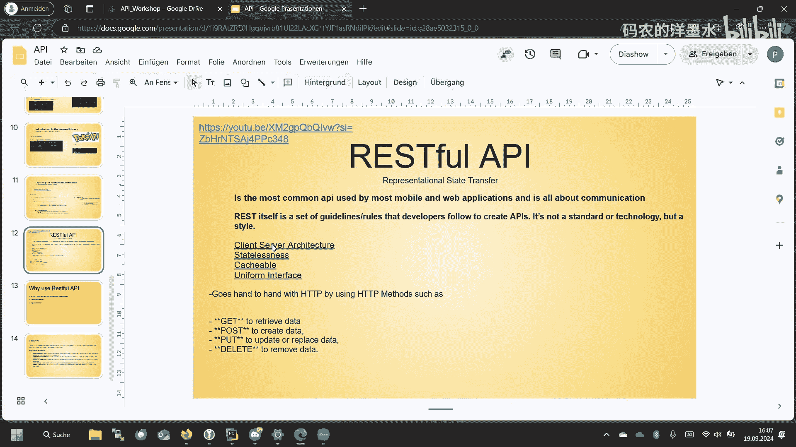

等一下。All right， so then I'll just create a new directory。Let's call it。also oh yes。

 I have it installed it's very straightforward I have it in my in our text document nothing too hard so I won't show you how to install it because it's very straightforward。

Let's call it workshop。你别嗯。And now I'll just do。And you python file， let's call it。Tutorial too。

 because I already have one somewhere else。Okay， so to start off。

You need to import fast API so that's recently quote from fast API。Import fast API， that's it。

So now you will what I will do now， I mean， it's already suggesting me to do that。So app right now。

 that's basically the main point of interaction for your API。

So everything you will do will sort of go through this app。

Now we want to create a first a root function， basically what you get if you just。

Accs in your browser like with a。Ul name and then slash and nothing else。

We could so what we first would do is do something like let's do definition root。

 new function definition。嗯。But。So okay， who of you has ever has never coded in Python before？Okay。

 one the rest is familiar with Python Okay so anyway。

 if you have any questions if I'm too fast or anything just。Ask a question， tell me to go slower。

 whatever。So what fast API always uses are so called rappers， rappers you do with with an net。

And for。In front of the function definition and what this add does is sort of it puts the function you define below and some other function right and this function。

Our stuff should be posted into will look like that it's some fast API stuff。

And you don't really need to worry about that it gets posted into some other function or whatever you just use it like that。

 So what we have here， what I just wrote is app dot get and。

lash so can any one of you tell me what that could mean？几定同。Sorry， you're getting the lymph patients。

Yes， exactly， so here I introduce a new endpoint for my API。

 which will be at the at the location slash or route。

And this will support this will be accessed by a get request we had those requests before so there are tons of requests different requests。

 the most common ones are get。P post and delete so get you want to do for just receiving some some data post if you want to create additional data。

 put if you want to modify some data which is already created and delete obviously to delete some data。

 then you have some stuff like patch and whatever， whatever， but usually you don't need that。嗯。

So and what we also need to do， we don't have to， but it would be really great is pass a async in front of the definition does anyone know what asIync does。

Yes。😊，If a super for something else to happen yes， yes， exactly it's it basically enables。

The function for those concurrency stuff。That's what fast API will use so basically you don't need to worry about that the server will be well Lisa sort of need to worry about that that we will come to that later basically what it enables you to do is if one request is stuck waiting for something else then the server can proceed doing other requests and once your first request is finished doing whatever whatever it can return back to that if you don't use this async it would just sort of busy weight and with async you can avoid that and there you will have this await keyword and then it will just passive passively await something else but we don't need to worry about that for now just remember usually like 99% of the times if you do something with fast API you want your。

Your。APpiI function to be asynchronous。Okay， so what we just will do is we will just return some sort of。

 let's say， our message。Is hello world okay， so now just now we need to launch that。

 we can launch that through the terminal。But I don't like that。

 that's why I just showed it to you one time。Let's CDd into what I。Works job， I called it。Okay。

 and now let's know if it works， we type in fast API。Developments and tutorial。2 dot die。

Let's so it works。It works so now we can access this API。Through this link here。

 it's usually on local host and port 8000。We go there and we see the message hello world。唔听。

And another great thing， usually you wouldn't do it like that because there is another great thing thanks to fast API we have automatic documentation。

 you remember and we can access this。Documentation very easily we go to local host slash docs and then we will see all the endpoints we have and this is amazing because this not only shows us the endpoints this also lets us interact with those endpoints so we can just click try it out execute and then we get the message back hello world isn't that amazing。

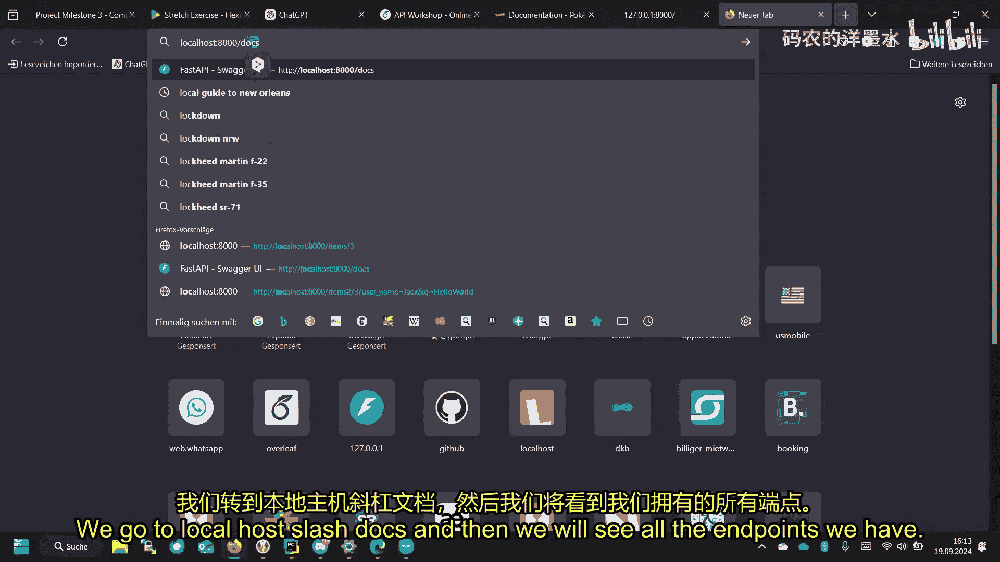

Okay。Did I forget anything the internet access yeah no okay。

 let's go forward so usually you wouldn't really launch it through the terminal you would just。

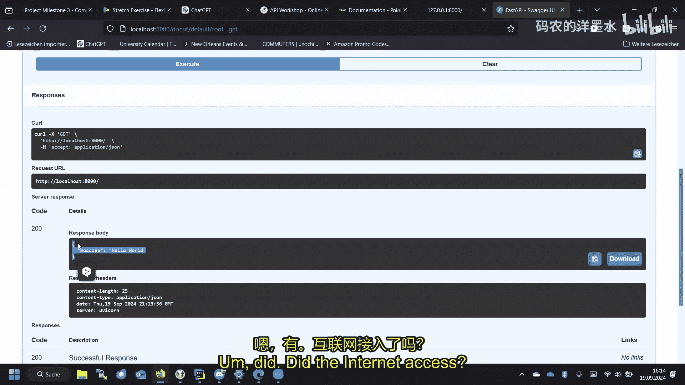

Like。对。Play it's it will be different in different IDs。

 but here in Python it's really easy you just select fast API and then you need to。Load your stuff。

 which will be here in workshop tutorial2。And it just should。Word， hopefully oh unnamed。

The Zoom thing is really annoying。嗯。Which one was it now？吓死么呀。Is it loss， it's lost probably oh no。

 it's unnamed already。Let's edit it。I can call it workshop so that I know what I'm accessing。

Workshop， okay。G， so we can just wait。Chris play and it will start up so it will be the same thing as you saw before so now we sometimes also want to give some parameters to the with the request so there are different types of parameters The first one is our so called path parameters and you will access them by just。

So let's say。You want the third user so you would draw it slash user user slash three something like that okay。

 so again， you will start with your wrapper。And he will do something like， let's say， items。

And now you do it in those， I'm not sure what what those bracelets are called， curly bracelets， okay。

 item IDd。Okay。Now you continue with your acing again， read item， item ID。

 so what what this thing will do now。Fast API knows。Okay。

 you put it in here in those curly braces so that's going to be a path parameter。

 and then you also write it in your function definition and then you can access item ID inside of your function。

And now what we can just do is it already knows what I want to do， we just return。

 return the item ID。And now， again， we can't。

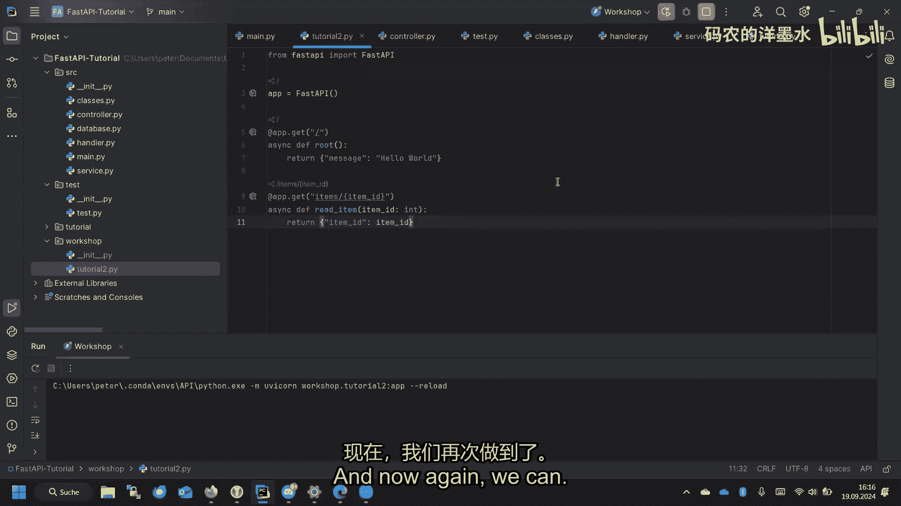

Laun it。Go to our documentation， refresh。Now we have our second endpoint there。And we now tried out。

Let's say we won five。Execute。Typearrow item ID is not interesting。

え。That's interesting。Why？Yeah。

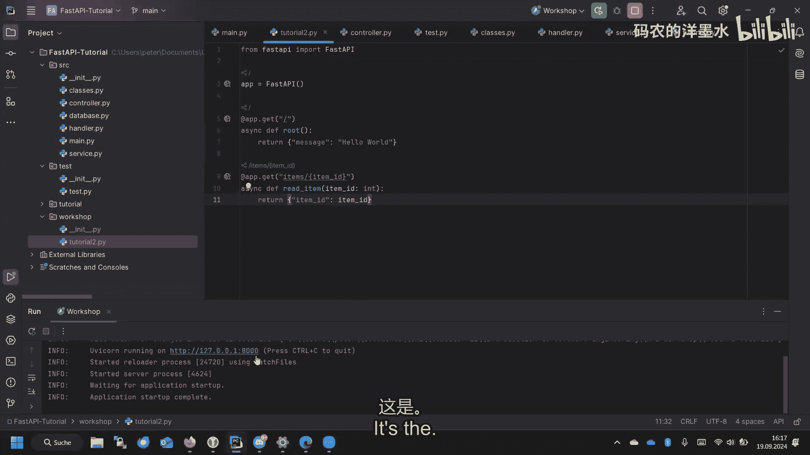

嗯嗯嗯嗯。Okay。So。自己。直接。

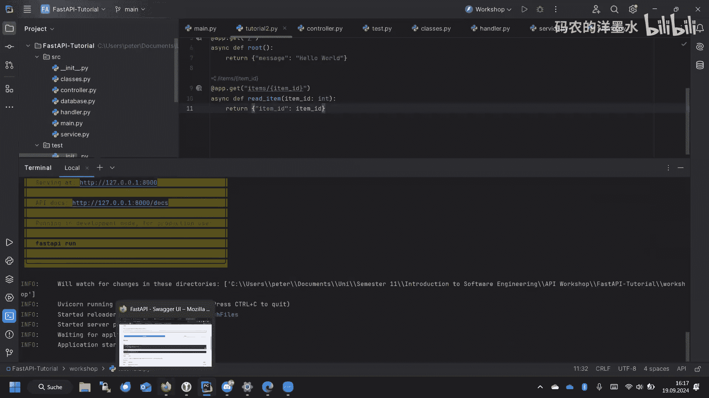

这个。It。That works。Okay， yeah， I have not provided obviously。系。Un'doing， I never had this issue before。

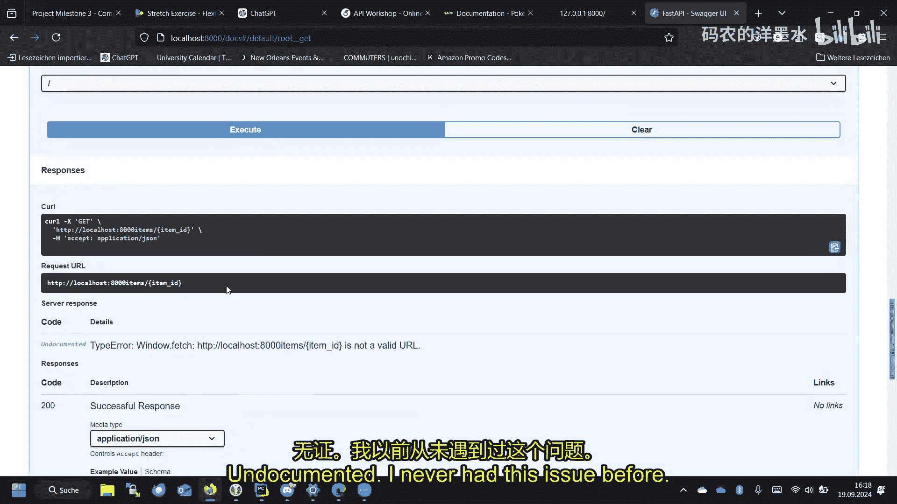

I'm sorry for that。Well， that's what happens if you do live coding。It it's true。

 I many laugh for items。Oh yeah， that's a good one。Yes。

 I think that's the error very good extra points for you if I could give you points。😀呵呵。😊。

Oh probably I should terminate the other one。And we run this one。没。So yeah， I mean。

 that stuff you have to be careful with because you easily forget like a slash or whatever and then。

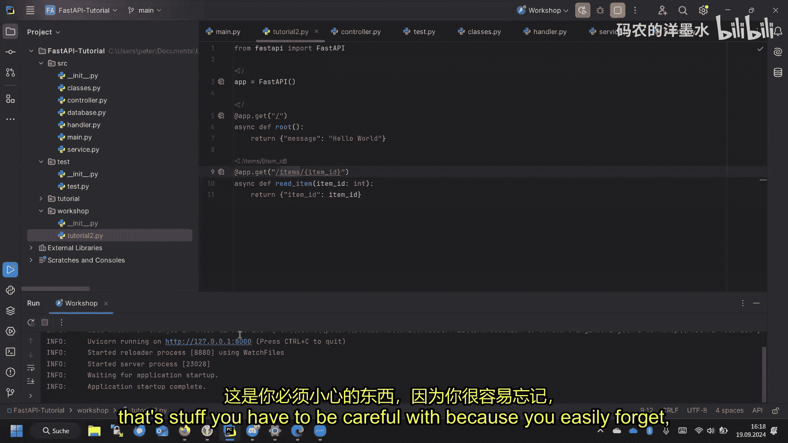

Everything is just sort of broken。So let's。Okay， now。对。Yeah， thank you so much。

 you fixed it amazing so now as you see we get item ID and with a value five back。😊。

So basically， as I told you before， you can access that through your。Website for your browser too。

So you would go items slash five。And you would get item ID5 back。So now。

We can also try and do something likeha ha ha。Would that work or would that not work？

What would we get back？Yeah， that would be great， right but？

Oh yeah did I already implement that okay yeah sorry I was a bit too fast so basically if we remove that here and we try this thing again it would just return ha ha ha ha ha okay so what happens if I input an integer here？

😊，Fast API would will automatically validate the input to be the correct type。

 so that's why I cannot inputs。Ha ha ha anymore， it has to be an integer。Okay。

 so this is also very grateful fast API because you just don't have to worry about the stuff you do。

 you just do your normal type indication thing and then it just works。All right。So。Now。

 another type of parameters are so called query parameters and those you will usually access after your URLl with a。

Question mark and then name of parameter equals parameter value and next parameter and so on so to do that。

We can just define a second endpoint。Don't get slash items item ID。

 let's call that items two because I run out of ideas。And we can do async definition res too。

 and now we want。Oh let's call I call it here read user item so let's do like that too。

 so apart from the item ID you might want to have some additional stuff。

 so like user name which is supposed to be a string。And then we can have。Some random queue。

 whatever that is。String or none。Equals none， and then we might have something like short。

And it's the rule equals false。So then we just might do some different stuff with it。Let me。

 I don't want to type everything again， so let me just c from the other stuff。T， no。

 that's the wrong one。all this part， it's not that important what it does。

 it just does something with the parameters， not super important。So。Now。

 fast API will automatically know。What is a query parameter and what is a path parameter simply by seeing what is defined as a path parameter up here and everything which is not defined as a path parameter up there is a query parameter easy enough。

So then what we also have is。Here here here you will see the difference between required parameters and optional parameters or default parameters。

 so what do you think which of those parameters are required and which are not required？

Yeah was going I was actually going to have a question Con about that is yes。

 is the wire parameter goes by depending on actual variable revenue or like how it's listed out in the definition of the question delay like our endpoint is item2 slash item I my question was going to be like how does it know which ones are？

Okay， so basically here is also why fast API is so great it basically does it for you and you just have to。

Put it in a very pantic way， so basically if you define a default parameter like none or falses。

 it is not required anymore and everything else is required。So basically。

 the convention is if you have。If you have the default parameter set to none。

 it's an optional parameter， but in the end it's the same thing。

 so in that case username and item ID are both required and Q and short are optional。

And you will also see that also a great thing。If you see here。

 it automatically reloads if I change though。

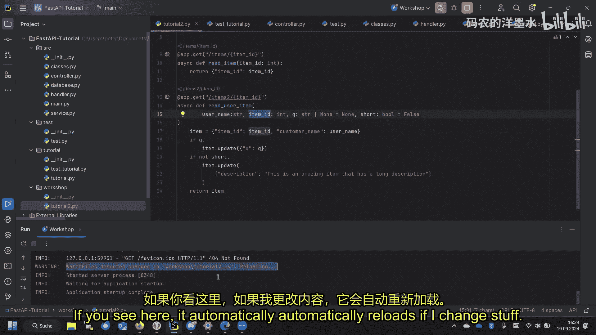

So I don't have to press。Reload again， so what I have to do is here。And now actually。

 if we open that up， we will see that item ID and username is required Q and short are not required so we can just go and try it out three。

 my name is Peter and whatever short is let's say true。Try it out。And we get something back。Okay。

 and if I do short false， then we get something else back description we get a description back。

 whatever。So to access those things through the URL， you do。

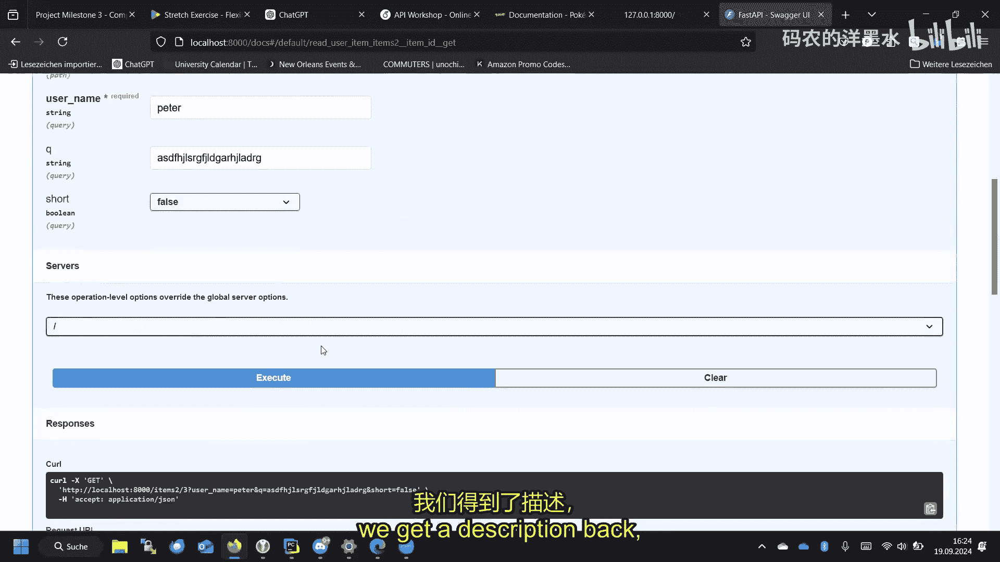

That was the pathway items two， yes， so you need the item ID three。And yeah， actually。

 let's try just like that。And there you go， a fast API tells you， hey， something is missing。Right。

 and。You need to fix that so that I believe the syntax is like kind of like that probably I'm not sure right now。

So either user name equals Peter， is that fine？Perfect。

So there you get your message back and then you can also do。Short is true。

Then you just got my name back。Amazing。Okay。Then sometimes you will also want to send。

Some additional data with you。And so basically as a client。

 sometimes you don't need to send any data， especially with get requests。

 if you just patch a resource， but if you for example， want to create a new user， you will have to。

Put in some additional parameters。And。Your API however。

 always has to send you a response body that's just how it is。And to declare a response body。

 you use so called pantic models， we'll come to that in a second。

So what I just want to tell you is don't use， don't send bodies with get requests， you don't do that。

Because that's just undefined behavior， usually you send them with post， that's the most common。

 but you can also send them with put， delete patch， just not get。

 please fast API still supports that for whatever reason。

 but it won't appear in the documentation if you do that。Okay， so。Pidantic is just a library，ops。

Like everything else。And we do from pedantic import base model So basically what pedantic does for what you can do with pedantic is sort of to。

Declare the shape of the data。And then if you do a class。

You can tell which attributes are of which type。And even if you want to some additional some additional things like the minimum length and。

And fast fast API will automatically validate that stuff for you so let's say if you have a parameter price and then you try to input a string into that。

It will not work as a fast API will automatically raise an error hey， you can't do that。However。

 fast identic is smart and if you， for example， put a string。

 just a string of the value like the character five in it。

 it will automatically cast that stuff into the right integer。Data type。Okay， so what we can do。It。

I told you we define a class and we want to have class item and to make it a pent class。

 you will inherit from base model， which we just imported before。So we want to have a name。

It should be a string， right？Then we want to have a description。hich should be also a string。

 but I want to make it optional so I make it string or none default is none so here the same as before pdentic will know。

Description is not required。Name is required， though。So then we can have。Price should be afloat。

And then let's say something like tax。Can be a flows， but。I think Montana doesn't have any taxes。

 so can be also none。So now we defined a pantic class and those pantic classes you can use as input to your API as body。

And to do that， you will。Oh， actually。Let's keep track of our items first so make a list。

Like that and now I told you don't use get。Not like。This thing here， use post。

And we just add items slash items， so asnc depth create item item items so here。

Fas API will automatically know since。This thing here， you declare that as a p class。

 it's something which will come in the body of the request。Okay。

 and then you can just do items start a pen item and let's just return。Yeah， that's it。So。Oh。

 I don't do I need to rerun that， I don't know。Sometimes you don't need to run that。

 sometimes it takes time， it takes fast API time to recognize that you did some changes。

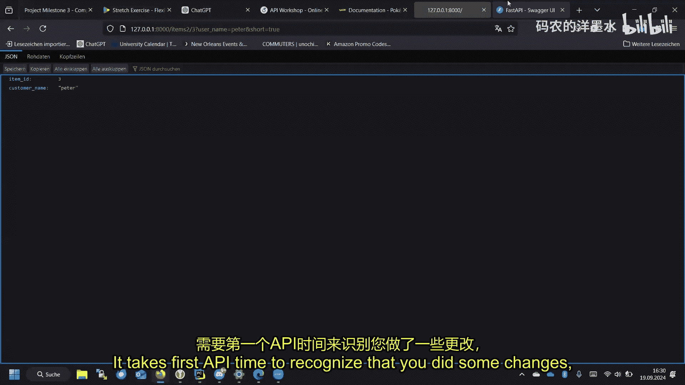

It's faster if you just rerun it。And now you have。This post method and you can try it out and as you see it looks a bit different right before you have those parameters listed here。

 but now you have a request body and。Here you see that apparently the documentation knows exactly how it should look like。

 how can that be， that's because fast API automatically puts your identity classes into the documentation and you can see them below here in the schema section。

And you will， if you expand item， you will see what it。What it's made of。So we can go with。Peter。

Doing a workshop。Rise， well let's say I cost like 100 bucks。Okay， that's a better example but。Its TV。

Which is。Doing。It's a flat screen TV， whatever。And it costs 100 bucks and has。Points。

One tax or I don't know if that goes through 0。1 taxes。诶。Okay。And we just we can just execute that。

And。Yeah， we will get the thing back Okay， so what basically。What did I tell you okay with phone？

Okay， as I told you， this data is also automatically validated right， so you cannot。

Hopefully this won't work if you try to put a string in here。That won't go through。

cesUnprocessable entity。But however， if you probably。Do a5。As a string that shall go through。

 let's see。That goes through， Okay， perfect。So。Yeah。

 I told you it's automatically inserted into the documentation。And yeah。

So yeah， as I also told you， if your parameter has a class defined。

 a identity class defined fast API knows， that will be in the body。Okay， great。嗯。

There is also way how you can just input singular types like integers into the body。

I don't know why you should do that， well some maybe to encrypt them or whatever but。

I have an example of that in my PDF， but it's not that important， so I won't share it。

Then you will also want to return something。And。We already did that the whole time。

But we never really told fast API what we return。So and to do that， we just。

Like everything else we just do return items so now fast API knows what comes back is of the type item。

And if it is not。PassL API will detect that and then raise a server error automatically so that the client won't receive any wrong data。

嗯嗯。All right。Also， that stuff， probably if I rerun it， let's see。嗯。

It should also appear in the documentation。

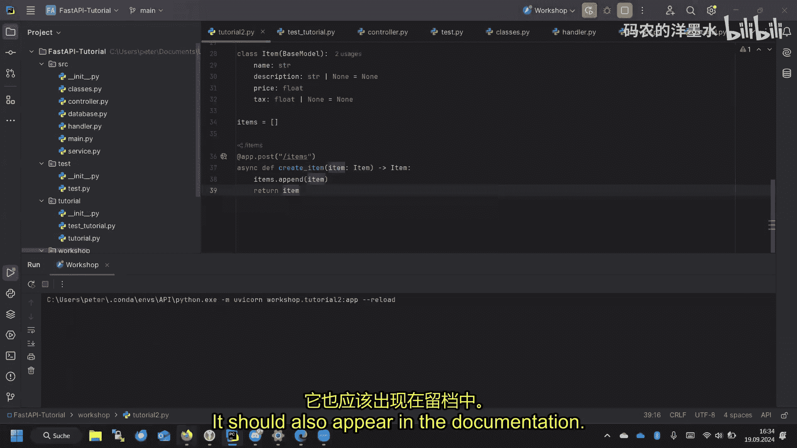

As a response type， but probably it is not because yeah， because it's the same thing。

 so it doesn't appear in the documentation as its individual thing。

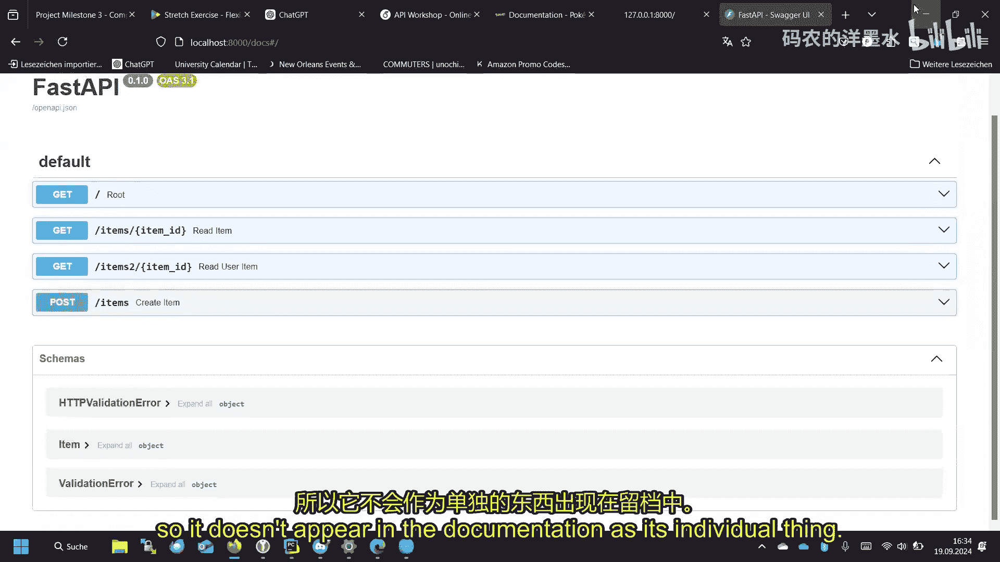

All right。And then you also have， you want to communicate to the client。

What is what something went through， something didn't go through whatever。

 and for that you usually use status codes as per default。

If you don't specify anything and it's the request is successful than the code 200 success。

 but you can also specify that so in this example。We created something so we want to use the status code 201。

To say that something was created， so we just give status code 201。

I cannot remember those status codes， you can easily look them up online or。You can also do。

Status just need to。Dot htK201 created， you just need to import that thing here。

Starlet from starlet no no no， that's something。Stus from FestA API。So that shows how it here， yeah。

Okay， so basically you do status dot and you can select here。

 you maybe remember you have created something so you。Basically go through and。So like that。

 same thing。これそ嗯。Now， then。呃。Not always will the client request something which can be done。

 for example， we don't want。200 Samsung5 Ts in our data set right so if someone wants to create the same TV again。

 we should deny that。And for that， we use。HtTP exceptions and those you also import from fast API as。

HTP exception。All right， and now'm just。Are you guys coming along， by the way？Is everything good？

Yeah okay perfect so if you have any questions to just ask if i'm too fast tell me okay i'm not usually giving workshops I don't know how to telephone if you understand stuff or not we'll give the documentation to you so as you work through the workshop if you run into an issue you can ask inside the yeah sure sure so every also all the code is on GiHub so don't worry about anything。

So let me just write some Python code here。If item dot name is。

We can also go through that then we cover some pythonic stuff。So anyone knows what。Lambda is。Okay。

 anyone knows what map is？没。Yeah。😊，啊。I feel like it was an our show。All like。Well。Just try it。

Isn't gls and Python like？function yeah's that's that's basically that's if you're too lazy to do a function definition if it's a very small function you do a lambda instead basically so what it does is it takes x whatever x is and what it returns as x x dot name so x is supposed to be some sort of dictionary then which in our case in our case it is。

Like dictionary or a class or whatever， which has the parameter name。

 actually not dictionary that would be like in square brackets and parenthesesis so it has to be a class。

And then what map does is it takes all the items。And it applies to this function to it。

 So what we have here in the end is a so， it's not specifically a list。

 but you can think of it as a list as a list of。Just names。

this list we search for the item name which we just got from the client。

 and if it's in there we obviously want to deny that and therefore we will raise an ACTtP exception。

And the status code for that is。Let's say Thor。It's not just a bad request。

We have a conflict with our database， so we do that and then we can provide a detail。

Item already exists。Perfect， and if if not， then we just append the item as always and we got that。

All right， let's rerun that。

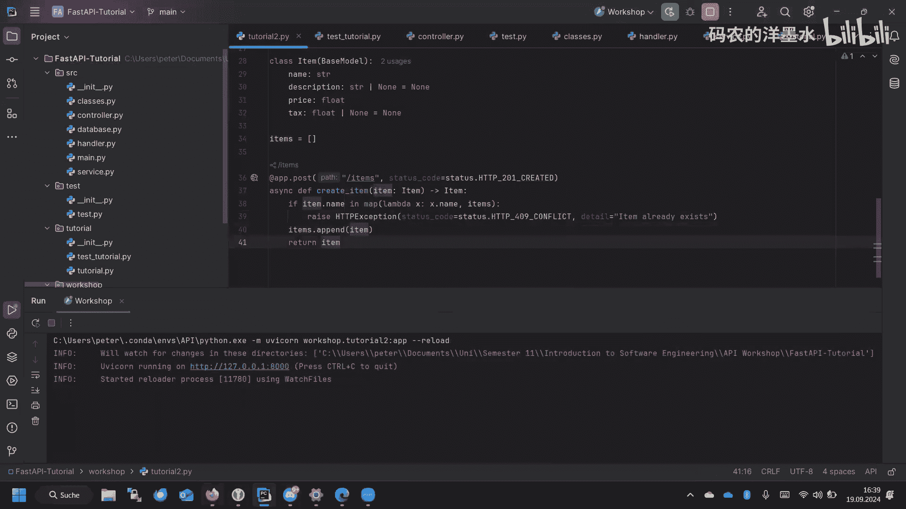

And try to create the same item again as you see it already gives me something which I could create so I just go along with that so that went through perfect。

And now I try to do that again， error conflict item already exists， you can't do that。

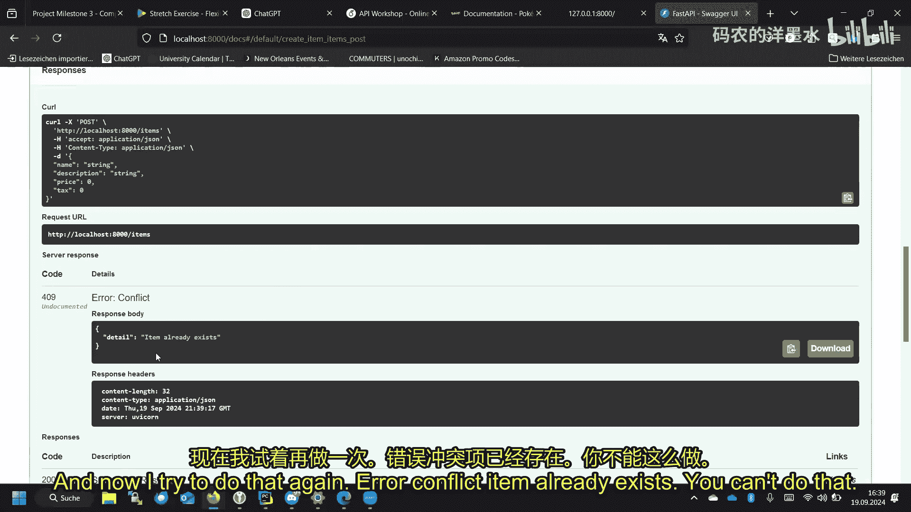

All right， then another useful thing。Which you might run into is if you have some。Long。

 if if you need to do some long processing with the request and。

You don't really want the client doesn't really need to know what the answer is。

 you just need to do the processing。Then you can use background tasks so we can just go ahead and do like some。

Generic。Requests， background task， get。嗯。Yeah， we can always provide a status quo to00 okay。

 let's cool。As definition， background task， let's go ahead。😔，With a message。SGR。And。

What's defined for now， also some sort of definition。嗯。Delayed print and。Message。

And let's say we just want to sleep for。Sometime， let's do it。I will change it later。

 but let's do it for 50 seconds now and just then print the message。Okay。嗯。Yeah。

 I need to import time， obviously。Okay， and here we just， we will just call delayed。Print。Al righty。

So now let's rerun that。

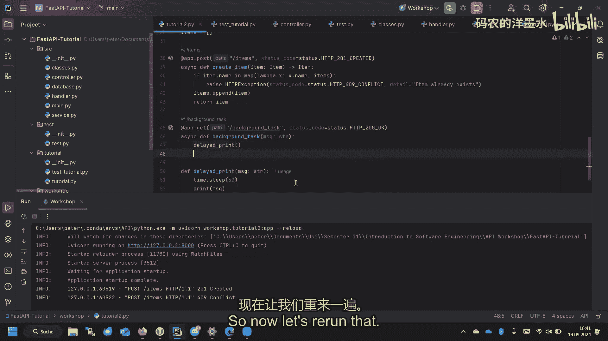

And。Right now as it is。If I will access this endpoint and click execute。What will happen？Yeah， yeah。

But。Basically， can you do you think you can access any other endpoints during that time or will the server be blocked with just waiting？

F good things。Okay， let's try it out。So execute。AhI forgot the message， okay？Haveello delayed。

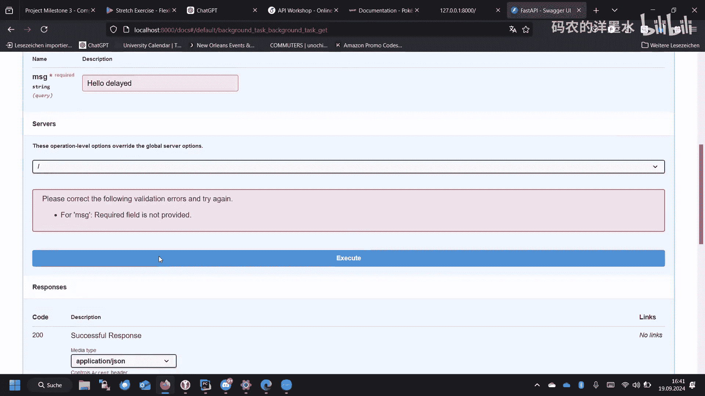

Internal server era， I forget something again。Oops， sorry。Message， that's why you complained before。

 Okay， great。Will rerun？No， okay， I'll rerun you myself。

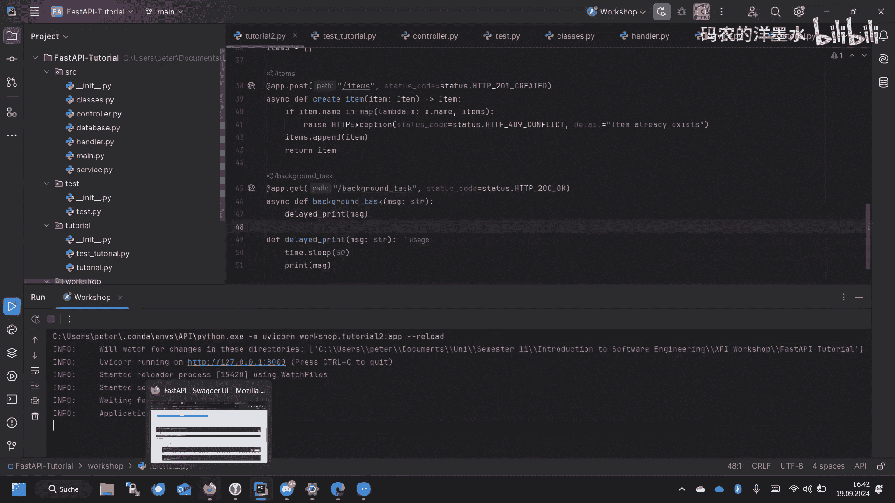

Okay， a little delayed and it's loading and loading and loading and let's try to get something else during that time。

 try out。It's loading and loading and loading the server is blocked。

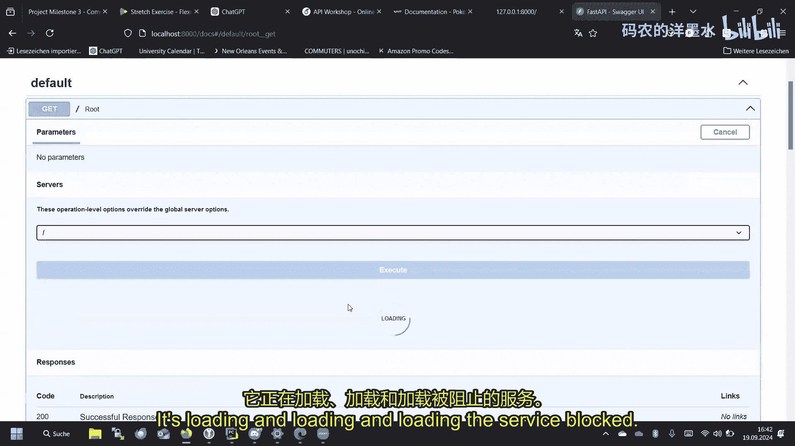

Well， that's bad。Okay， but what we can do is the following we can import。

Background tasks from FASA API。And。We just need to pass as a argument background。

Tasks as a background of tasks。And what we just do is。Background tasks dot add task， and we need to。

Pas the。We don't want to execute the function， we just want to pass the function so we do it without the brackets and then the arguments。

 which will be messaged in this case。Okay， so then we can oh by the way。

 50 seconds later it came Okay， we can cover that in a second okay。I haven't wrote it down actually。

 so whatsoever I can do it just like that。

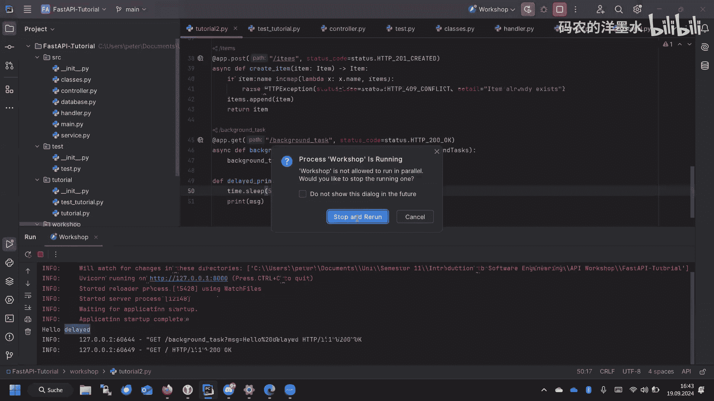

呵哼。哼。So start complete。

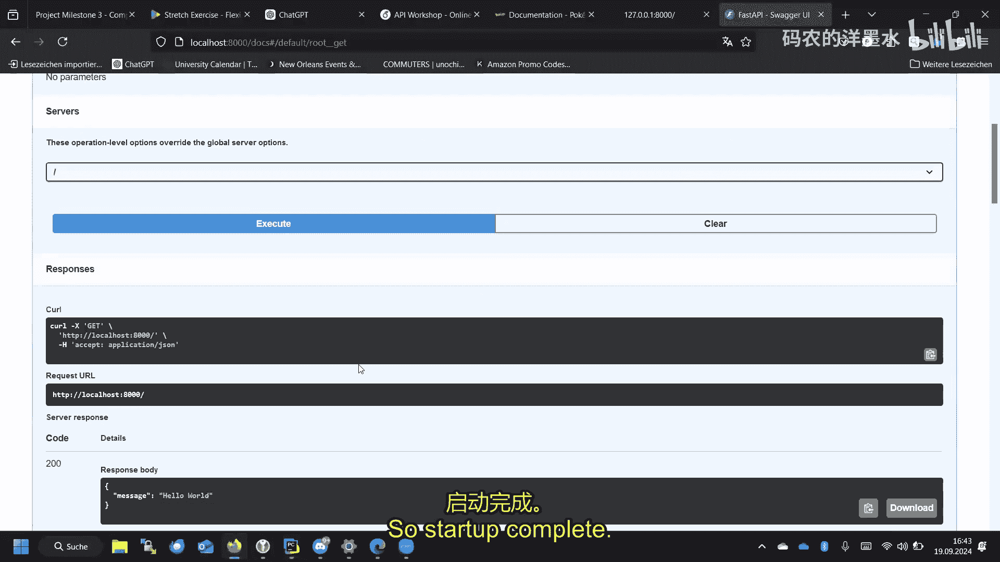

Oh yeah， let me actually do still 50 so we can just I can just prove a point。

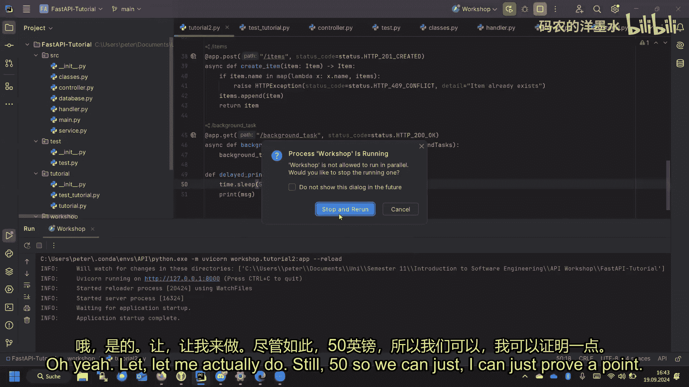

嗯哎了。All right， so same things here， so I don't need to reload。So it's already done。

 I just got tonel back。And during that time I can just while the server is working or whatever。

 I can still execute all the other endpoints and that was actually a pretty good question why can we just use the acing and actually we can。

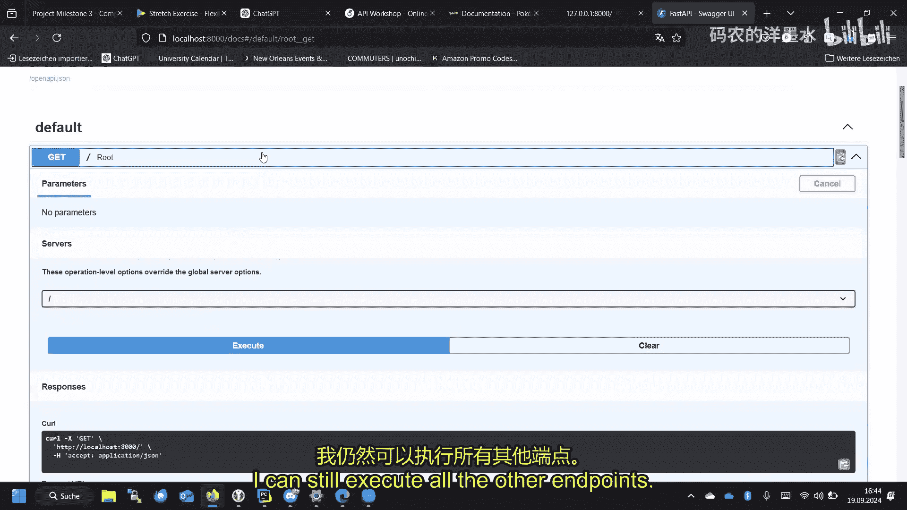

For that， we need to make use of some asynchronous stuff。So let's see if I can do that。

With just like that， Okay， so let's say。We just sort of。Copy that thing。

 let's say background task too。Okay， so。You will always want to use the awake keyword。嗯。

It's not the normal time， what was that？Asynchronous a time。

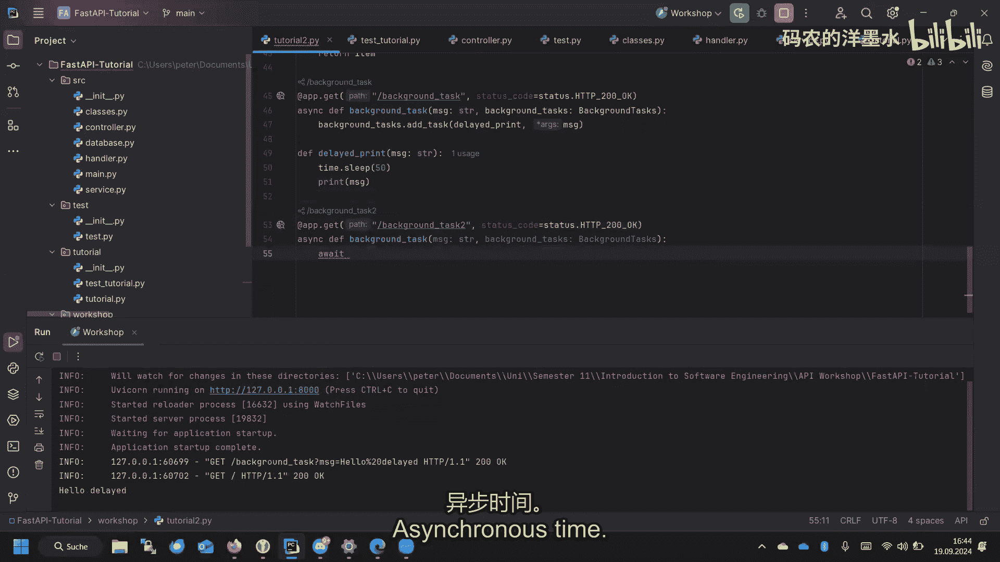

唔解。

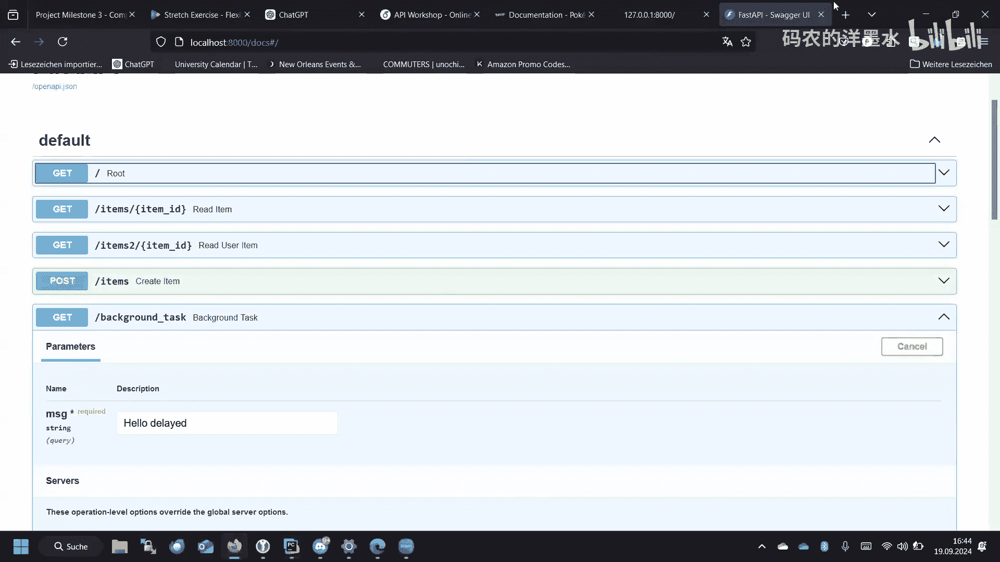

通车就是。In排yon I do。Oh wait。は。Hello。嗯。行分喂。It's time for me to know， Oh， it's down for maintenance right。

Okay， let's do the old waymin9 iPhone， all like that， oh wait time await andnouncing function。

 perfect， that's what I want。

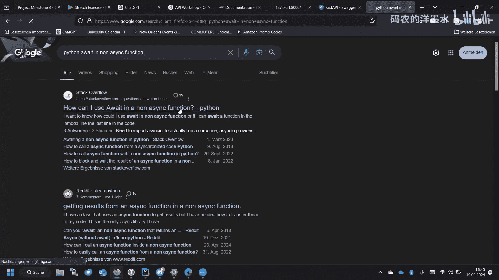

How can I use。你 think you the one。😔，Import a sink。A Sinio don't sleep Tara， there we go。

 wasn't that complicated after so we want to in a Sinchio。

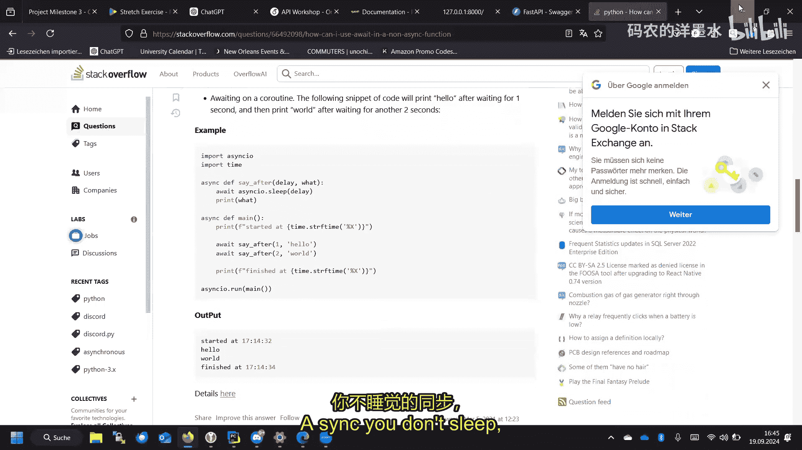

And now we can await。诶。IThank you。Dot sleep 50 seconds。Oh。

 let's just do 10 and then we just print some printed message to the console。We will't need them。

Background tasks anymore。And let's rearrun the thing。

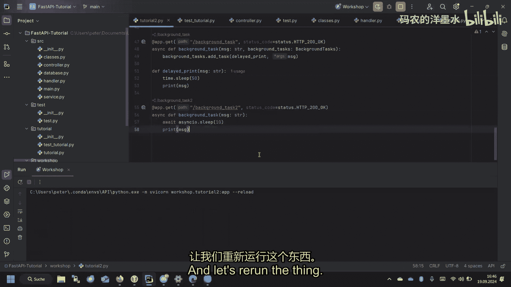

同毕。是。一个嗯个。So you have background tasks too。You can execute that。

It's loading and in that time you should be able to execute everything else。

Yes you can and this one will be will be still processing so basically now it's done and we have something printed out to our console so basically when do you want to use which basically if you have some heavy processing and you want the client to wait for the response then you would use this weight structure and if the client doesn't need the response you don't need to do the weight because why should the client wait if it's not interested in getting the response then you just go on with the background tasks。

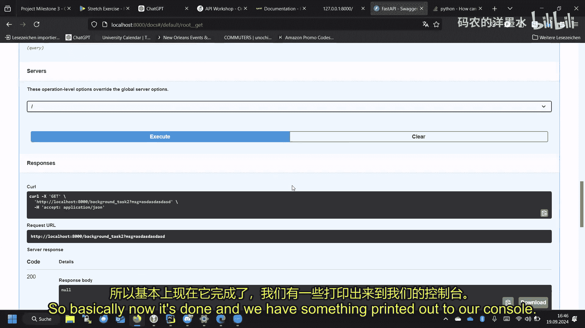

All right。And last but not least。We need to test our applications too so for that。That's， by the way。

 also how much time do I have， by the way？Maybe it very so over clean as you can get get Okay， Okay。

 so basically。 all right。Don't put too much pressure on me， please。Okay， let's do a。Tests， whatever。

Okay， it's very very straightforward so basically you need to import a you need to install some stuff。

 but I have it everything I have everything written down you do test client import test client and you want to import your。

Or actually let me just show you how I did that， but they'll need to type it。Here。

 so basically you import。You do a test client， you pass your app as argument。

 then you have a client and the only thing you need to do is you do client。

get and then type in the URL and with assert you check for the status code。

 you assert it's 200 or you assert that the response which you accessed via JSON。Brackets and the。

Item ID equals three and if something is not not right。

 then it will raise in a search and error and you will see that once you're on the test。

And the same thing you can do here， if you need to put something into the body， you will use the JO。

Arameter and with a classy we will use model dump。WellThe only thing you need to do to run the tests is basically write pi test and as long as you have named them test something。

 they will run or you are lazy as me and you just do them in here。And then it should run。

That's actually another test， so it probably was this year。

Okay well I don't have those anymore probably I was declined here but you get what what i'm saying since on' late I won't run the tests anymore but it's very serious straightforward everything is documented in the PDF and that's the workshop that excellent oh by the way by the way there is also a project which I just。

Sort of created to show you the structure of a fast API project because that's just you know how a fast API works。

 so if you're interested how you actually create a fast API project in this way that it makes sense sort of。

Separating different parts of the logic from each other then check out the code is documented i wrote down a lot of stuff so yeah that's it thank you and over this weekend i'm going to create a shared github with everyone in it that'll give you access to the kind of deliverables for each of the workshop and i'll give those from the teams that authority presented it before we kind of disclose today does anyone have any questions related to API after looking at the workshop。

Thection I think。Yeah， quick管 you decent item yeah so can we be the to that啦。

I don't think fast API isn is there for Java but Java definitely has their own frameworks to do that I won't be an expert in those though。

And of course， if you do develop any questions， you can always ask inside of their pod channel with that and so we's just we'll move on to the next set of workshop talk next you can probably I will。

Just saying you know。If I knew that you would have like would go close like 10 minutes。

 I wouldn't even。

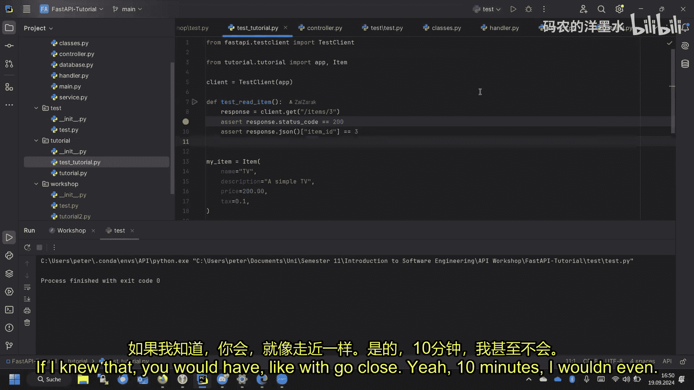