# 软件工程：第2讲：API 🚀


在本节课中，我们将学习应用程序编程接口（API）的核心概念。我们将从理解HTTP协议开始，这是现代API通信的基础。接着，我们会探讨API是什么、它如何工作，以及RESTful API的设计原则。最后，我们将通过一个FastAPI的实践工作坊，学习如何快速构建自己的API。

---

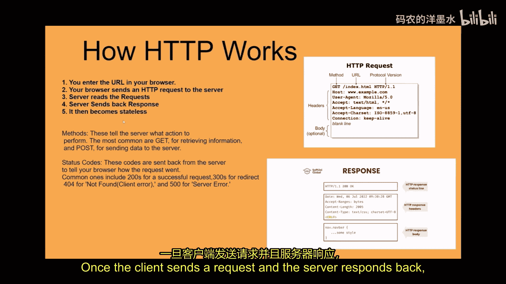

## 理解HTTP协议 🌐


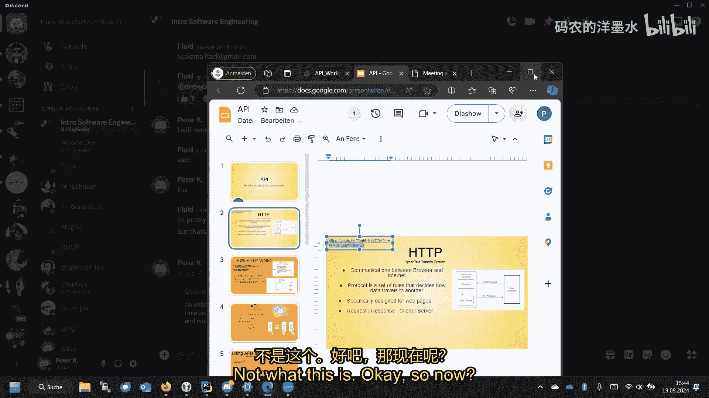


在深入了解API之前，理解HTTP协议至关重要，因为它是现代API通信的基石。

HTTP代表超文本传输协议，它是浏览器与互联网之间通信的协议。这种通信遵循一套规则，规定了数据如何在彼此之间传输。它专为网页设计，采用请求-响应、客户端-服务器的模式。

当你在浏览器地址栏输入一个网址时，实际上是在向服务器发送一个HTTP请求。这个过程可以分为三个部分：

1.  **请求行**：包含请求方法（如GET）、URL和协议版本。
2.  **请求头**：包含发送给服务器的额外信息。
3.  **请求体**：通常为空，因为服务器将用它来返回信息。

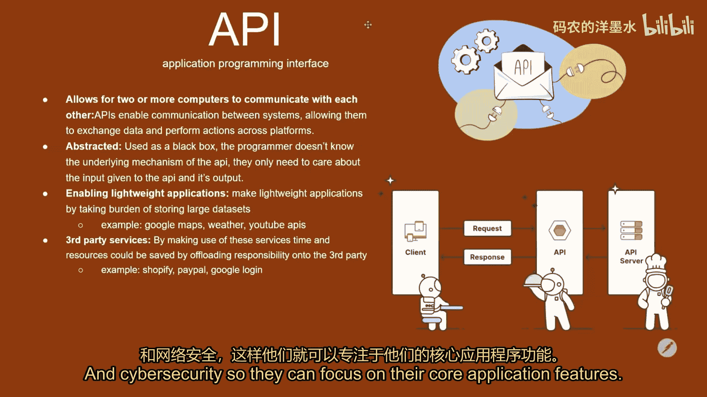


服务器收到请求后，会返回一个响应。响应也由三部分组成：


1.  **状态行**：包含协议版本、状态码和状态文本。状态码是关键：
    *   **2xx**：成功。
    *   **3xx**：重定向。
    *   **4xx**：客户端错误。
    *   **5xx**：服务器错误。
2.  **响应头**：包含关于返回文件的信息。
3.  **响应体**：服务器返回的实际资源内容。


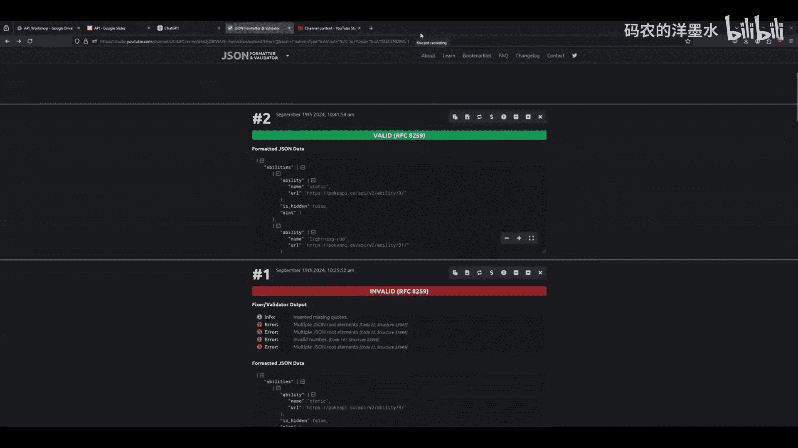


HTTP的一个重要特性是**无状态**。这意味着一旦客户端发送请求，服务器返回响应后，两者之间的连接就会断开，不再维持。

---

## 什么是API？ 🤝

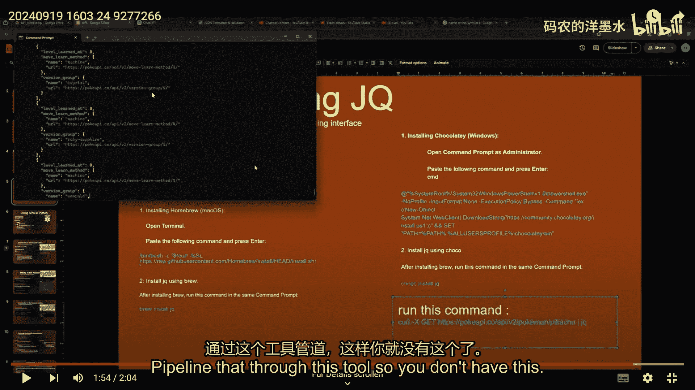

上一节我们介绍了HTTP协议，它是数据传输的规则。本节中，我们来看看API如何利用这些规则来连接不同的软件。


API（应用程序编程接口）本质上是一种服务，它允许两个或多个程序通过发送和接收数据进行通信。它充当服务器和客户端之间的中间人，确保数据在它们之间顺畅、高效地交换。

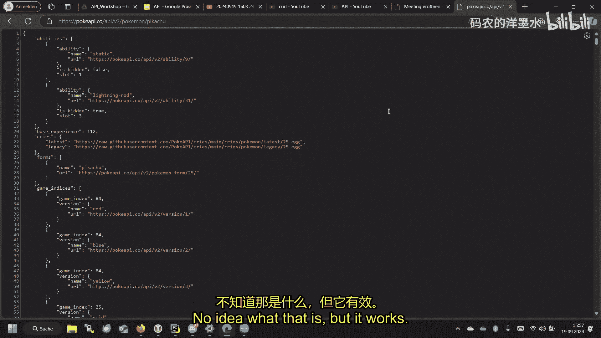

**一个简单的类比是餐厅**：
*   **客户（客户端）** 通过点餐发送请求。
*   **服务员（API）** 接收请求并传达给厨师（服务器）。
*   **厨师（服务器）** 完成请求后，将食物作为响应通过服务员送回。
*   **服务员（API）** 负责将食物送回给客户。

API充满了**抽象**。这意味着程序员不需要理解幕后发生的复杂细节，他们只需要知道如何发送正确的输入并处理输出即可。

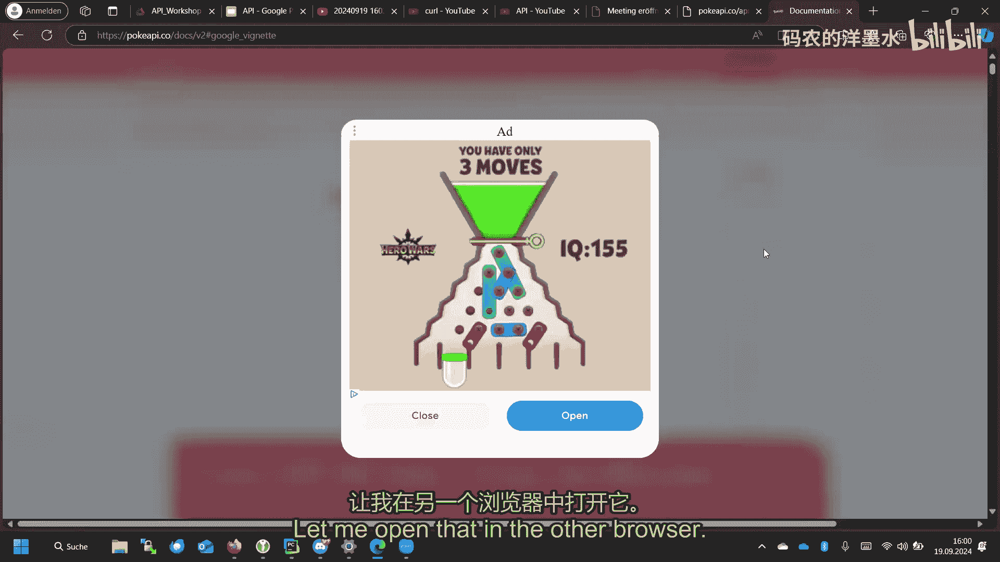


**另一个有用的类比是驾驶汽车**：大多数司机不需要知道引擎或变速箱如何工作，他们只知道转动方向盘可以控制方向，踩油门能让车前进，踩刹车能让车停止。同样，使用API时，你可以专注于你需要做什么，而不必担心背后发生的复杂过程。

---

## API的优势与应用 💡

API在构建轻量级应用方面具有巨大优势。

通过允许应用程序连接到外部服务，API可以外包诸如数据存储和繁重计算等任务。例如：
*   一个使用**Google地图**的应用不需要在内部存储所有地图数据。它可以在需要时调用Google Maps API来访问数据，从而使应用更小、更快、更高效。
*   **YouTube**的情况类似：海量的视频存储在YouTube服务器上。你的设备只是通过YouTube API接收并点击视频，而不是在本地存储或处理所有这些数据。

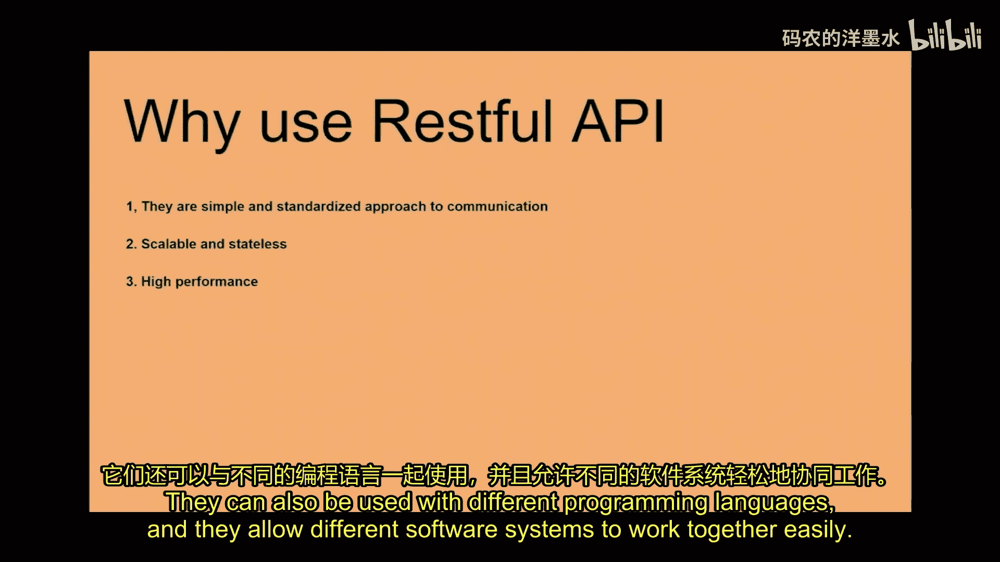

有许多有用的第三方API，例如用于在线商店的**Shopify**、用于支付的**PayPal**、用于安全的**Cloudflare**以及用于用户身份验证的**Google登录**。这些API通过集成现成的、可信赖的服务，为开发者节省了大量时间。

这类似于专业厨师不需要自己种植作物或饲养动物来烹饪美食。相反，厨师依赖专门提供高质量食材的供应商。这允许厨师专注于烹饪本身。同样，开发者使用第三方服务来简化开发流程，依赖支付处理、身份验证、电子商务和网络安全等领域的专家，从而可以专注于其核心应用功能。

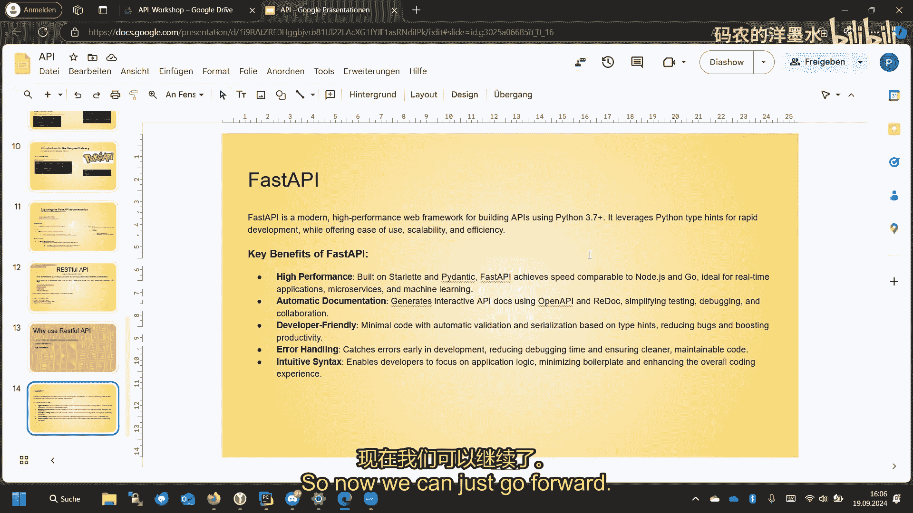

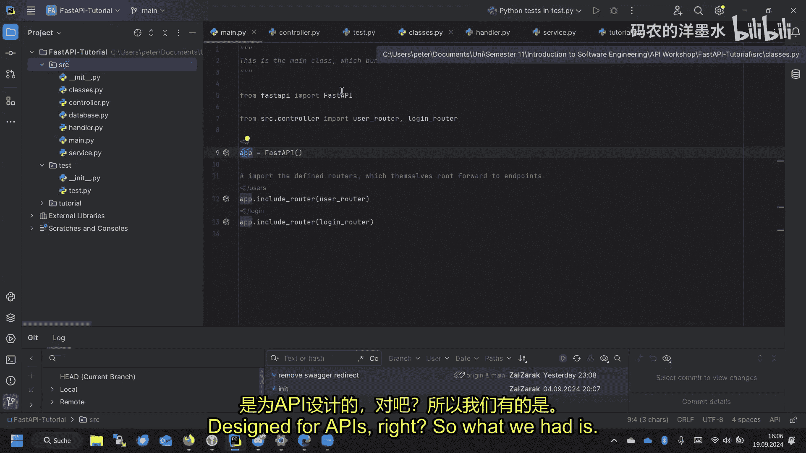

---

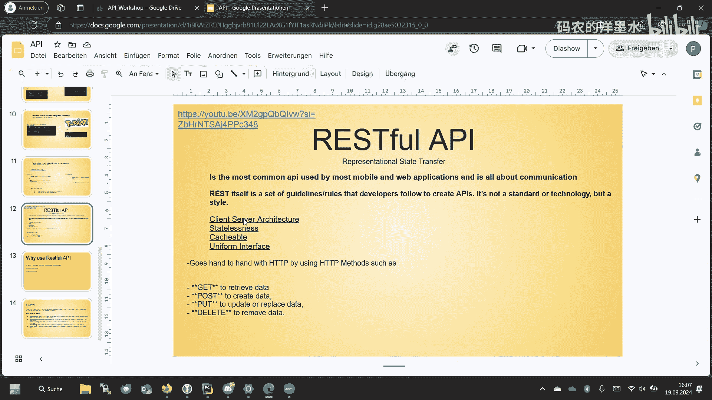

## 使用命令行工具测试API 🛠️

了解了API的概念后，我们来看看如何快速测试一个API。使用命令行工具是一种高效的方法。

`curl` 是一个在macOS和Windows上默认预装的命令行工具，无需额外下载。它的用处在于，如果你想快速测试一个API，只需写一行命令就能看到输出。

以下是一个使用Pokemon API的例子：
```bash
curl https://pokeapi.co/api/v2/pokemon/pikachu
```
然而，直接在命令行中输出的JSON文件可能难以阅读。你可以通过JSON格式化工具来改善可读性。

`jq` 是一个强大的命令行JSON处理器。安装后，你可以通过管道将`curl`的输出传递给`jq`，从而获得格式清晰、易于阅读的JSON。
```bash
curl -s https://pokeapi.co/api/v2/pokemon/pikachu | jq
```
这将会输出结构清晰、带缩进的Pokemon数据，比原始输出易读得多。

---

## 在Python中使用API 🐍

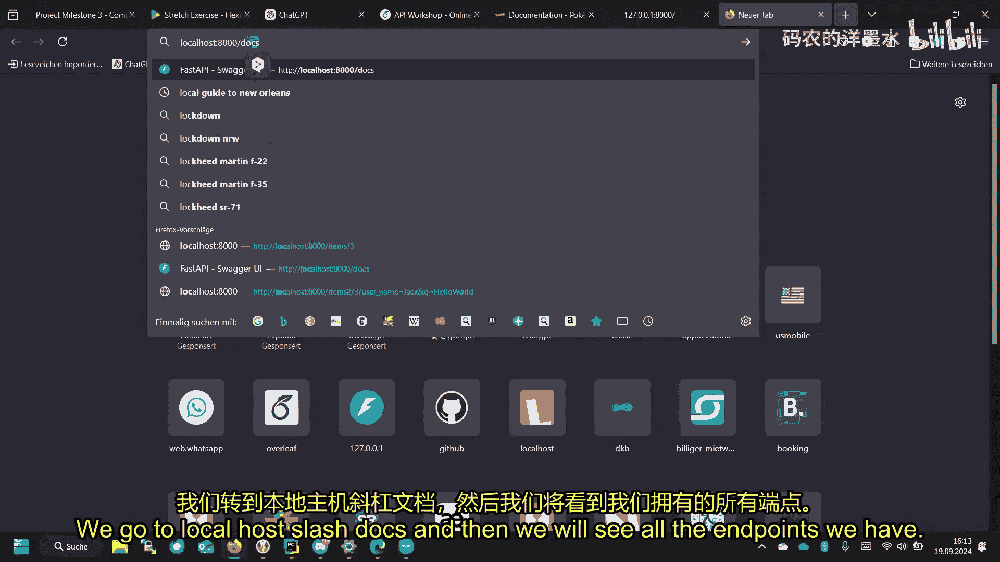

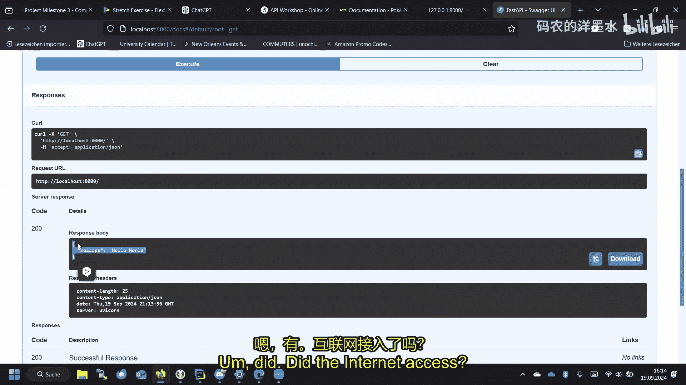

除了命令行，我们更常在编程语言中调用API。Python因其简洁性成为热门选择。

要在Python中使用API，你需要安装 `requests` 库。它并非Python原生自带，安装非常简单：
```bash
pip install requests
```
安装后，你可以开始编写代码。首先导入`requests`库，然后定义一个基础URL。以Pokemon API为例，其结构通常是基础URL后跟不同的端点。

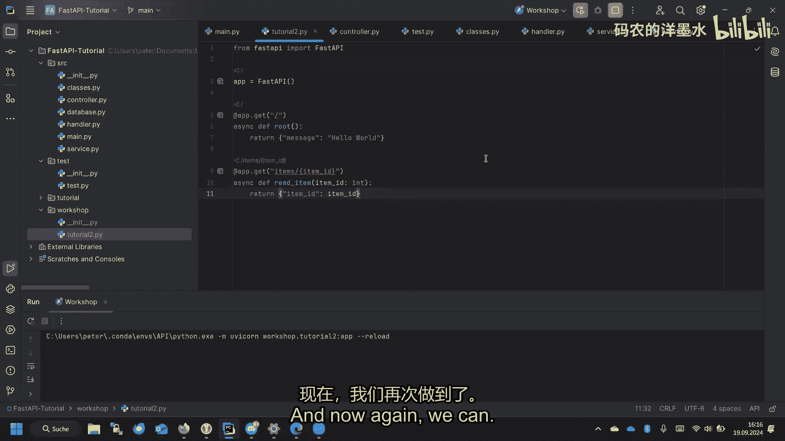

一个GET请求的示例代码如下：
```python
import requests


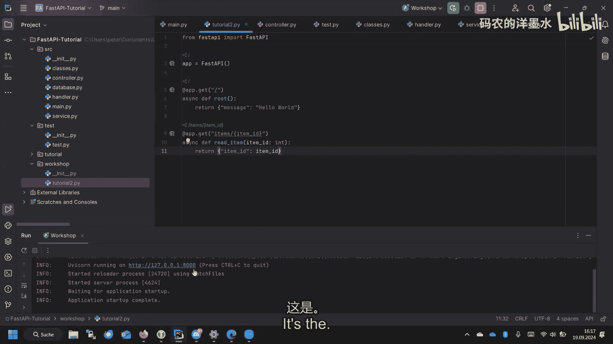


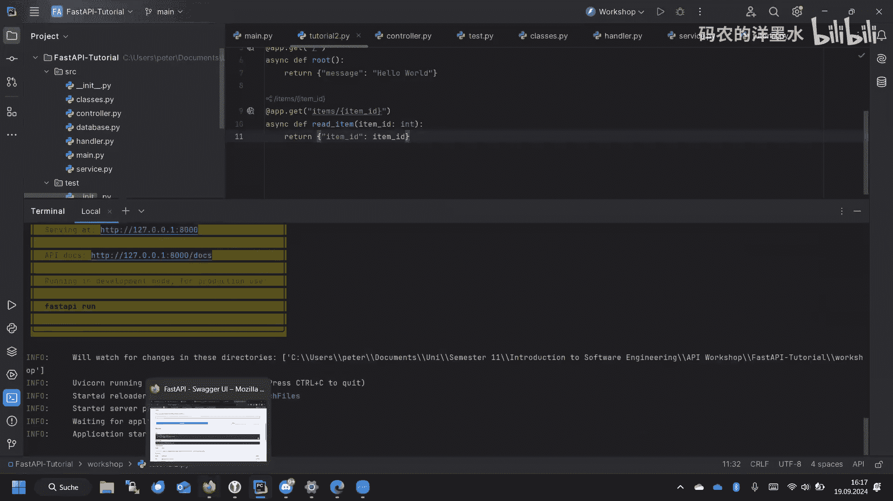

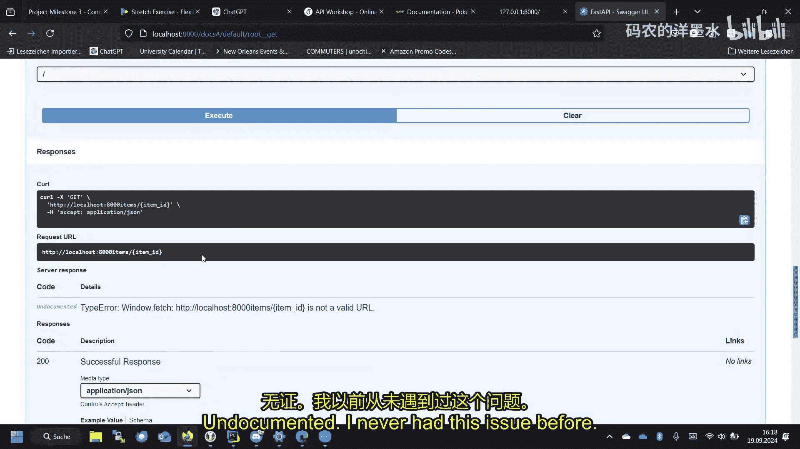

BASE_URL = “https://pokeapi.co/api/v2"

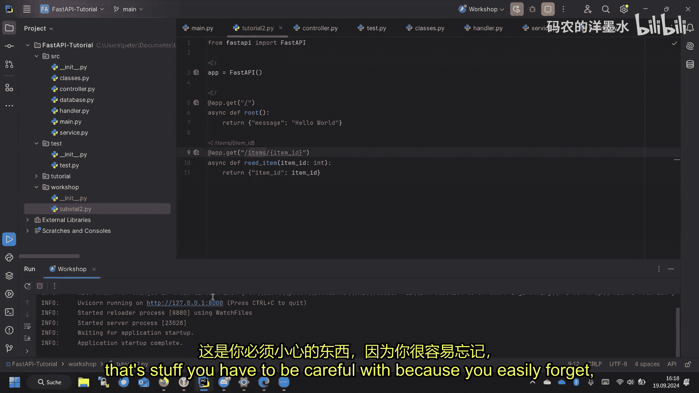


# 获取所有Pokemon
response = requests.get(f“{BASE_URL}/pokemon”)
print(response.status_code) # 输出状态码，如200
data = response.json() # 将JSON响应转换为Python字典
print(data)

# 获取特定Pokemon（例如皮卡丘，ID为25）
response = requests.get(f“{BASE_URL}/pokemon/25”)
pikachu_data = response.json()
print(f“Name: {pikachu_data[‘name’]}, ID: {pikachu_data[‘id’]}”)
```
这段代码演示了如何调用API、检查状态码以及处理返回的JSON数据。

API的结构化意味着不同的端点（如`/pokemon`， `/berry`， `/move`）拥有不同的属性。一些属性（如`id`和`name`）是通用的，而另一些属性只对特定端点有意义。

---

## RESTful API 设计原则 📐

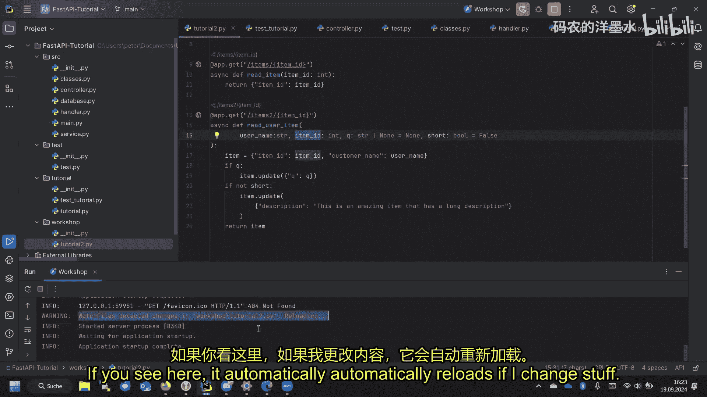

在构建自己的API时，遵循一套良好的设计原则至关重要。RESTful API就是一套被广泛采用的指导原则。

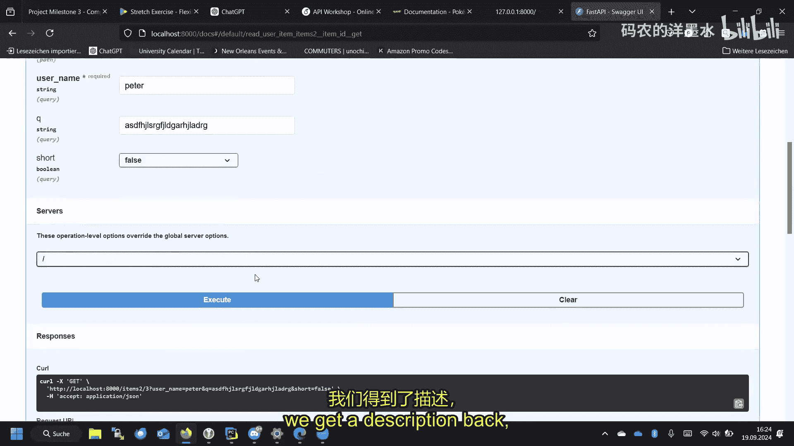

REST（表述性状态转移）本身是一套开发者创建API时遵循的指南或规则，它不是一个标准或技术，而是一种风格。如果你的API遵循这套规则，它就可以被称为RESTful API。

以下是REST的主要规则：
1.  **客户端-服务器架构**：客户端和服务器独立运作。
2.  **无状态性**：与HTTP类似，每次请求完成后连接不维持，每个请求必须包含所有必要信息。
3.  **可缓存性**：响应必须明确表明自己是否可缓存，以提高性能。
4.  **统一接口**：每个请求和响应都遵循相同的规则和模式，使得不同系统更容易通信。
5.  **使用HTTP方法**：
    *   `GET`：检索数据。
    *   `POST`：创建数据。
    *   `PUT`：更新/替换数据。
    *   `DELETE`：删除数据。

**使用RESTful API的好处**：
*   **简单标准化**：无需担心每次如何格式化数据请求。
*   **可扩展且无状态**：随着复杂度增长，易于修改，无需跟踪客户端-服务器间的状态数据。
*   **高性能**：支持缓存，即使服务变复杂，性能也能保持高位。
*   **语言无关且易于集成**：可与不同编程语言一起使用，允许不同软件系统轻松协作。

---

## FastAPI 工作坊 ⚡

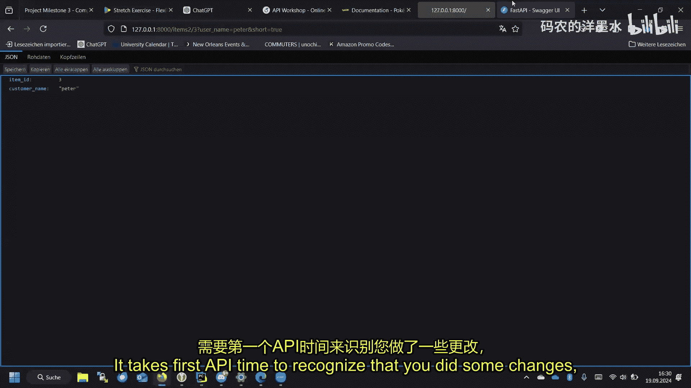

理论铺垫完成后，现在让我们进入实践环节，使用FastAPI框架来快速构建我们自己的API。

FastAPI是一个现代、高性能的Python Web框架，用于构建API。它简单直接，性能优异，并能自动生成交互式API文档。

### 1. 创建第一个端点
首先，导入FastAPI并创建一个应用实例。
```python
from fastapi import FastAPI


app = FastAPI()
```
然后，使用装饰器定义一个处理根路径`/`的GET请求端点。
```python
@app.get(“/”)
async def root():
    return {“message”: “Hello World”}
```
使用`async`定义异步函数可以让服务器在处理一个等待IO的请求时，同时处理其他请求，提高效率。

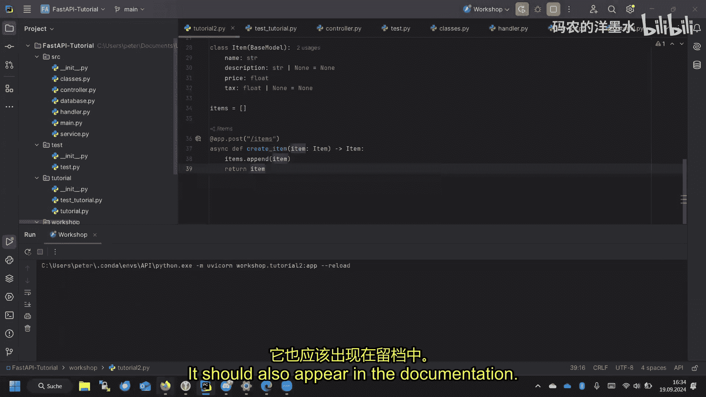

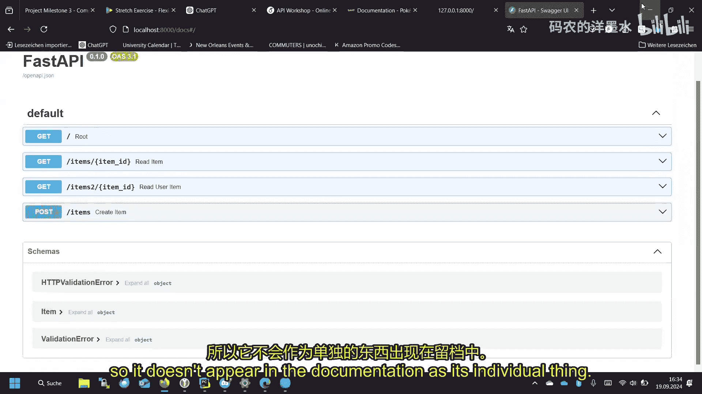

运行应用后，访问 `http://localhost:8000` 会看到返回的JSON消息。更棒的是，访问 `http://localhost:8000/docs` 会自动生成完整的交互式API文档，你可以直接在浏览器中测试接口。

### 2. 路径参数与查询参数
API通常需要接收参数。
*   **路径参数**：成为URL路径的一部分，例如 `/items/5`。
    ```python
    @app.get(“/items/{item_id}”)
    async def read_item(item_id: int):
        return {“item_id”: item_id}
    ```
    FastAPI会自动验证`item_id`是否为整数。
*   **查询参数**：出现在URL的`?`之后，例如 `/items2/?skip=0&limit=10`。未在路径中声明的函数参数会被自动识别为查询参数。
    ```python
    @app.get(“/items2/”)
    async def read_user_item(item_id: int, username: str, q: str | None = None, short: bool = False):
        # 处理逻辑...
        return {“item_id”: item_id, “username”: username}
    ```
    有默认值的参数（如`q`和`short`）是可选参数。

### 3. 请求体与Pydantic模型
当需要客户端发送数据（如创建新项）时，使用请求体。**不要**在GET请求中使用请求体。

FastAPI使用Pydantic库来定义请求体的数据结构，并自动进行数据验证和转换。
```python
from pydantic import BaseModel
from typing import Optional

class Item(BaseModel):
    name: str
    description: Optional[str] = None
    price: float
    tax: Optional[float] = None

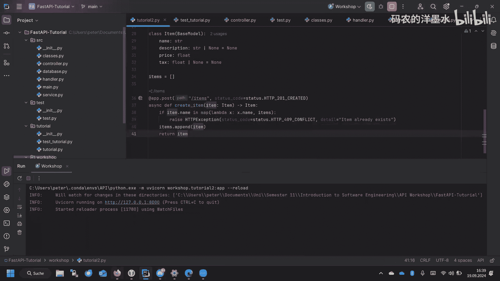

items_db = []

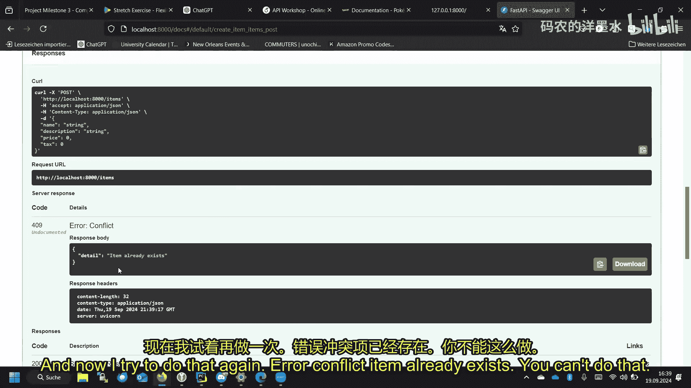

@app.post(“/items/”, status_code=201)
async def create_item(item: Item):
    # 检查是否已存在同名项
    if item.name in [i.name for i in items_db]:
        from fastapi import HTTPException
        raise HTTPException(status_code=409, detail=“Item already exists”)
    items_db.append(item)
    return item
```
在上面的代码中，我们定义了一个`Item`模型，并在POST端点中使用它。FastAPI会自动从请求体中提取数据，验证其类型（例如，`price`必须是数字），并将其转换为`Item`实例。如果验证失败或业务逻辑不允许（如重复创建），我们可以抛出`HTTPException`。

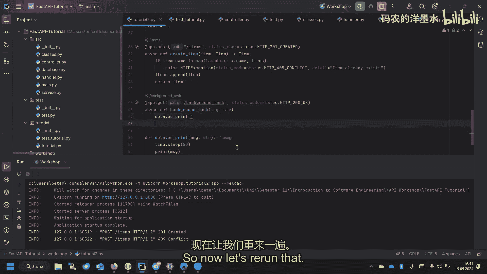

### 4. 后台任务与异步操作
对于需要长时间处理但客户端无需立即等待结果的任务，可以使用后台任务。
```python
from fastapi import BackgroundTasks
import time


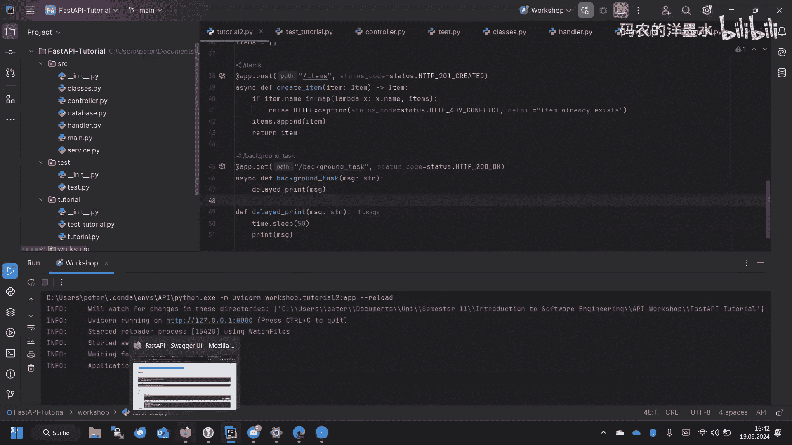

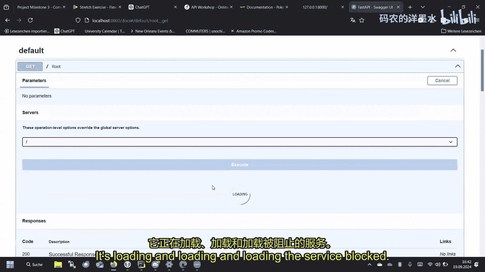

def delayed_print(message: str):
    time.sleep(10) # 模拟耗时操作
    print(f“Delayed message: {message}”)

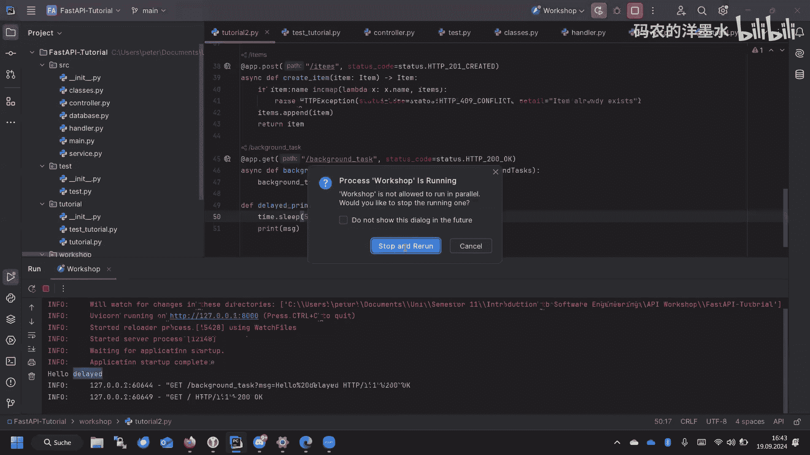


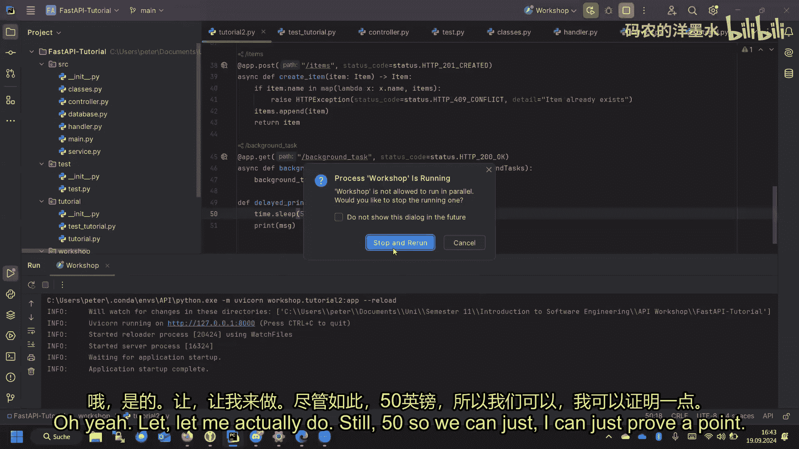

@app.get(“/background/”)
async def background_task(background_tasks: BackgroundTasks, message: str = “Hello”):
    background_tasks.add_task(delayed_print, message)
    return {“message”: “Task started in background”}
```
这样，服务器会立即响应客户端，然后在后台执行耗时任务，而不会阻塞其他请求。

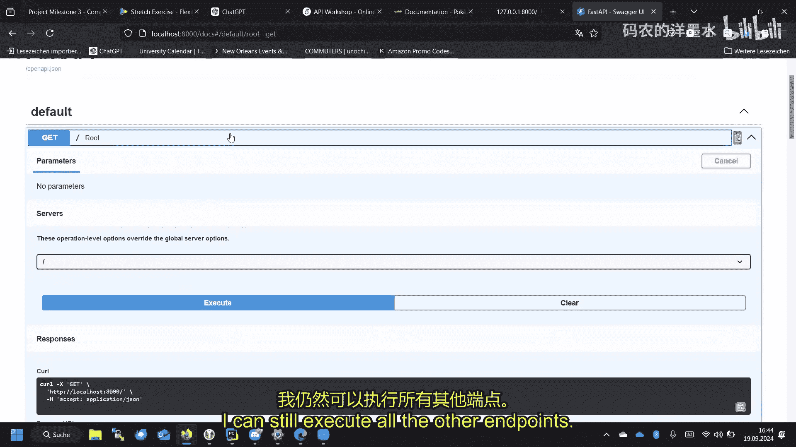

如果客户端需要等待操作完成，则应使用`async/await`模式，但确保等待的操作本身是异步的（例如，使用`asyncio.sleep`而不是`time.sleep`）。

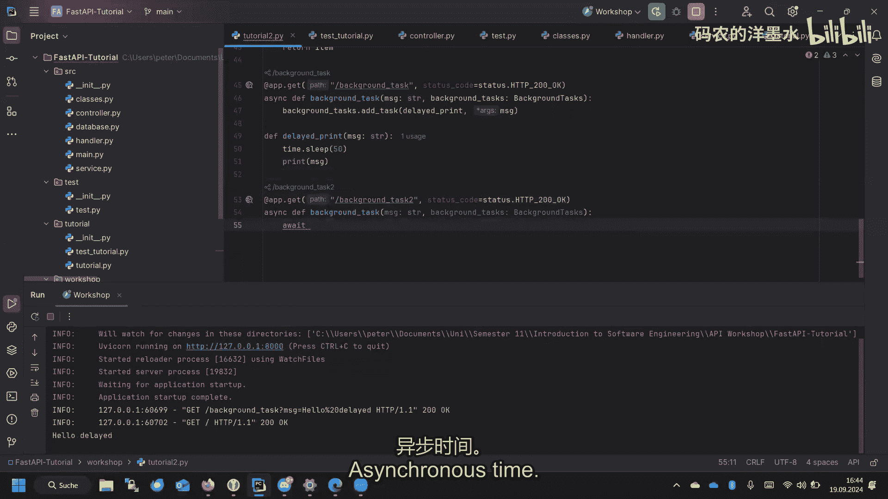


### 5. 测试API
为API编写测试至关重要。FastAPI提供了`TestClient`，使得测试变得简单。
```python
from fastapi.testclient import TestClient
from .main import app # 导入你的FastAPI应用

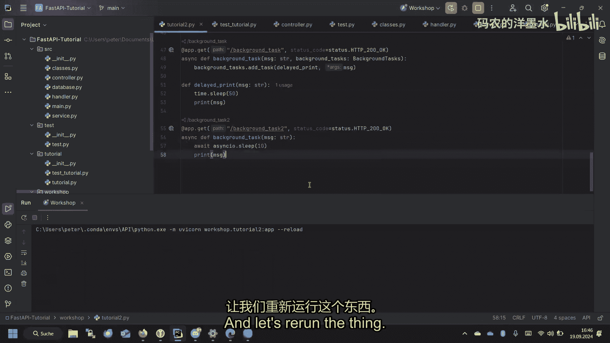

client = TestClient(app)

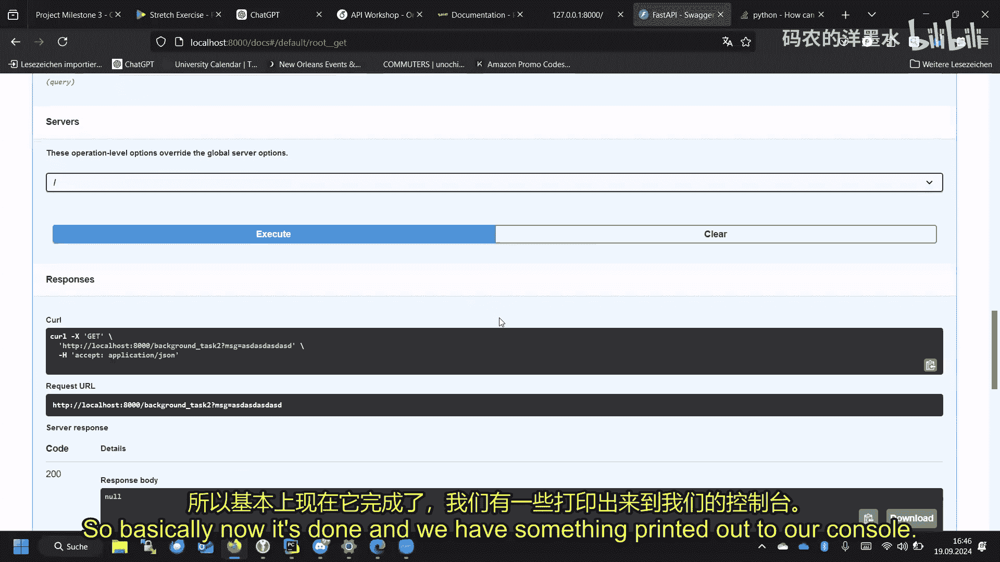

def test_read_root():
    response = client.get(“/”)
    assert response.status_code == 200
    assert response.json() == {“message”: “Hello World”}

def test_create_item():
    item_data = {“name”: “Test Item”, “price”: 100.0}
    response = client.post(“/items/”, json=item_data)
    assert response.status_code == 201
    assert response.json()[“name”] == “Test Item”
```
使用 `pytest` 命令即可运行所有测试。

---

## 总结 🎯


本节课中，我们一起学习了API的完整知识链。我们从HTTP协议这个网络通信基础开始，理解了请求与响应的过程。接着，我们探讨了API作为软件“中间人”的角色、其抽象价值以及广泛的应用场景。通过命令行和Python的实践，我们掌握了调用第三方API的方法。然后，我们深入学习了设计良好、易于使用的RESTful API应遵循的原则。最后，我们通过FastAPI工作坊，亲手体验了如何快速构建一个具备路径参数、查询参数、请求体验证、错误处理、后台任务等功能的现代化API，并了解了为其编写测试的方法。掌握这些知识，你便具备了连接不同软件服务和构建强大后端应用的基础能力。