# 【全集】加州理工学院 软件工程 中英字幕 1080P p03 Lecture 3 - 技术文档编写 -BV13ZzaB3EWE_p3-

It's on that on that。Make it sure。And so whenever you write， okay。

 I think we're getting ready to get started， our pod did documentation for our workshop。

First we are going to go over what documentation actually is。

 why it's useful and important Jenny's going to go over readme files and commit messages I'll talk about GitHub pages and wkiis and then Victoria will go over auto documentation and these are all useful documentation tools that you should be using when software developing。

So to start things out documentation is like a handbook for your program it's going to include details about your code and instructions on how to run it just details on like how to put what you did to put it together and it should have everything the person who's reading your code leads to。

Yeah， use it。Procumentation is really important because it's a way of implementing good engineering practices and design principles。

 so good documentation will provide clarity。And enable collaboration with other programmers。

 it'll make your code easy to maintain and read it can help with debugging your code if there are problems。

And also give yourself as a professional and your projects more visibility to employers and。Yeah。

 partners。So now Jenny is going to go over。Gres。So ami is an introduction to a project it communicates important information and they are especially crucial for the open source community。

Collaborating on open source projects。Readedmes can be broken up into different components and at a minimum you would want to have your project title。

 your project description， instructions on installation and usage， how to contribute to the project。

 any kind of license that you may have。Your contact information and then optionally there's like additional sections like frequently asked questions。

This is what your reads will use is markdown。So Markdown is intuitive， it's easy to understand。

It's portable so it can be used on。All kind of applications。

efficientffic it's fast to right and it's versatile so on the left hand side and the top is like your standard markdown and on the right hand side where it says extended elements that's your GiHub flavored markdown that's like works especially with GiHub read me or GiHub markdown files you can also use HTML inside of markdown files as well on GiHub。

To make life a little easier they have tools so i'll go over the visual Studio code tool as well as the in browser tool this is the one for visual visual Studio code sorry it's called markdown preview enhanced so on your right hand side you have like the code for your markdown。

And on the left hand side is what it's going to look like so as your're。

Editing the code on the right hand side it。Like updates in real time on the left hand side。

It's helpful for， of course like。Seeing what it's going to look like before you even push。

 but it's also helpful for like small things like I don't know if y'all can see but there's like a little logo。

Like alt text， there's supposed to be a picture there， but because the pathway is wrong。

 it just shows up as the alt text， which is like really helpful。For seeing before you even push it。

Yeah。This is the in browser version， it's called readme。so it's a website on the left hand side。

 you can click the different。Sections that you want and your readme and in the middle。

 it'll have a text editor where you can。Modify the text and everything on the right hand side is where it's going to update in real time to。

Okay'llate in real time。It's important to keep your read files up to date because it's going to be your first point of contact so you want it to be concise。

To the point。It'll save time for people who are working on the project with you or。

Want to contribute in some way， they won't。Have to like。Guess what the project is about or how to。

Push to it。 any of that encourages collaboration。I forgot。

 it encourages collaboration shows organization and professionalism。This is like。

What your users are going to see as well as the people who want to collaborate with you and possibly even like stakeholders and makes it easy to discover in a sense that like。

Your readme is going to have information and not everybody has a readme。

 but like your search result will show a clear read。嗯。

I have a few examples I'm just going to go over hours。

And then this GitHub link at the bottom is a repput full of other read meanss that people have made。

Yeah。

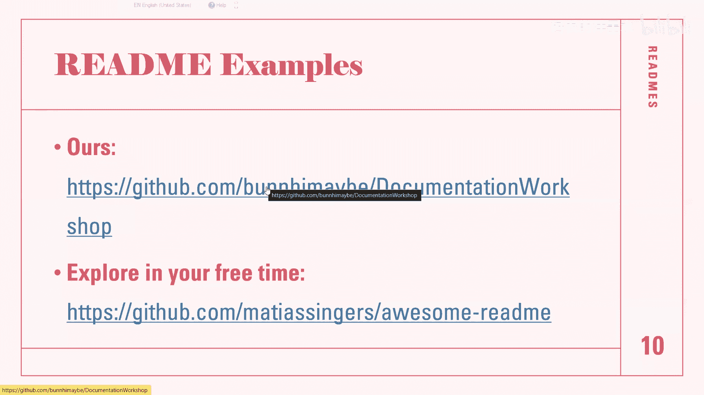

So this is what ours looks like。Sample little template logo， we have our。Our title， our description。

 we have。So we have a template for this stuff as well。So that way， if y'all want to use the template。

 you will have like the information on how to do like these little buttons and stuff。

Sample image description。How to contribute the prerequisites you need。We have a road man。Oh。Okay。Oh。

嗯，我可以。Yeah。Thank you。

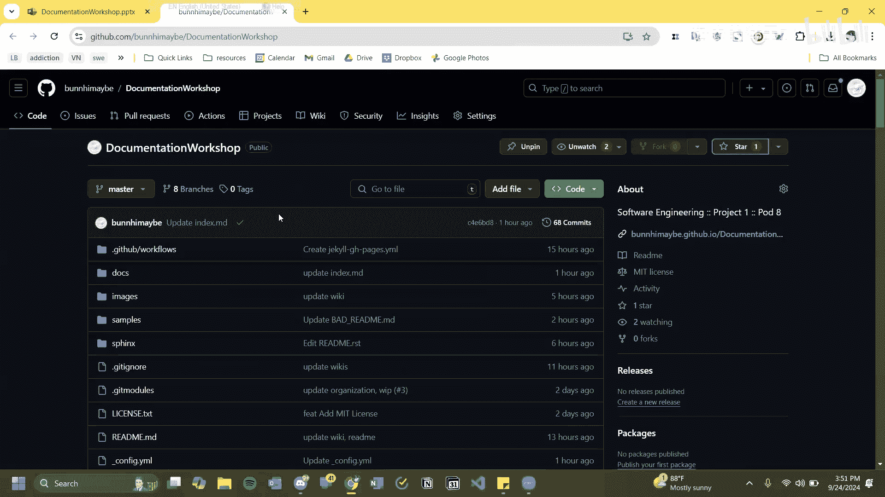

thing about that is that that goes surrendered， the markdown goes surrendered directly on GiHub。都对那个。

行行嗯。If you go back to the page control tab this is the page。

 the landing page for their GitHub project that would be publicly searchable and disposable to everyone else on the Internet。

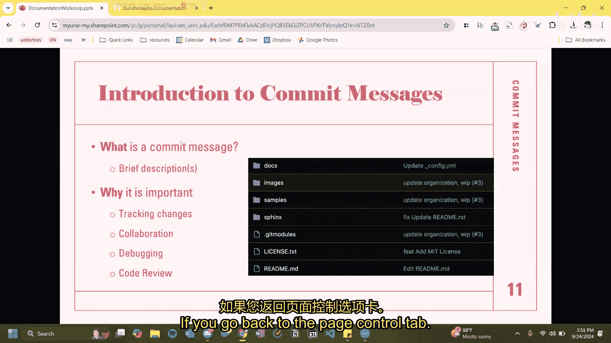

And so when we scroll down， if you have that greened。Page it actually renders all that people。Yes。

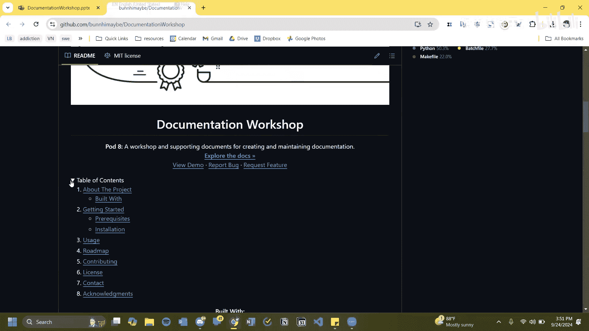

Okay。嗯，说一下。嗯。And。Okay， and so moving on to an introduction to commit messages。Yeah。

 I don't know how to make it full screen again。11。Yes。As an introduction to commit messages。

 what are commit messages exactly， they should be brief descriptions of what。

You changed in the project， so we have like some examples。

On the right hand side where it says like update。Fix feature edit。

 those are your commit messages and this is from GitHub。Why it's important to。

Have commit messages as you can track your changes over time of the entire project。嗯。

sIt makes collaboration and debugging easier because you can track down like where errors have occurred and it makes for faster code review。

Some best practices are capitalization you want to。

Have capitalization in your commit messages and you don't want to use punctuation so you don't want to。

Add periods at the end you want to use imperative action you can optionally include a commit type at the beginning。

 so for feature fix refactor doc style。嗯。It's like a summary within a summary kind of。

The length needs to be well not needs to be， but should be 50 characters or less。And。

The content should be what you。Did to the project， so if you updated the readme formatting。

Or if you added a new functionality stuff like that。

Common mistakes would be rambling and not stating。What the commit was for。

 so this is just like some image off of。Google of an example。

Like F is not a good commit message because what does that mean and the dates are not useful？

This is how I'm aware that like some people might not know how to write。Or like how to。

Do commits so this is how you would do it in VS code you want to have your。

Repo cloned locally first and then it'll give you the option to work in your repo from there once you do that then you'll go to this source controls center on the lefthand side you can write your commit message in that red box and then the commit message I mean the commit button will turn like a bright blue and you'll be able to push it directly to GiHub。

This is how you would do it in the table。It should be uniform between different operating systems like this is on Gi baash。

 but it works on MacOS as well。You'll just write get commititm， and then you'll have your message。

And so。I have two smaller points about this one if you want to this will be like your title by default on GitHub。

 you can also write a description of the commit。And if you wanted to do that。

 you could do another dash M。And then a string at the end of that as well。

 and then my second point was that this actually doesn't use imperative action it's not a good commit message so you would want to be like make make my first or made my first commit。

The Gi status at the bottom will show that it was successfully committed and then you can get push after this。

And this is how to do it in the browser directly from GiHub， they'll have an add files button。

 you'll put them at the top and then at the bottom is where you put your commit。

And the description is optional。So moving on， I just wanted to quickly share some benefits that you can get from GiHub education if you apply for the student developer p the link is down here and。

All you have to do is submit proof that you're a student and you get unlimited repositories copilot。

 which is the AI， is there AI that like helps you produce code faster and it also has a lot of courses available to for various like tools and like topics and even has like learning paths if you are interested in say like cybersecurity or being a web developer。

 it's a really useful way to learn。They also can you can also get the custom domain for it as well did you have question yeah how long does it last？

I think a year， I think you can renew it every year as long as you're a student。2。Yeah， like I said。

 the link's down here and it'll also like go into more detail about like what benefits they have。

So I brought up custom domains because GiHub offers this free static web hosting service called GitHub pages just by having an account you can make a user site like that you can use like as your portfolio or yeah。

 it's really handy and on top of that you can have unlimited。Websites for。

Repository projects and docs are down here this is an example of。

The web page for our repo that we made to。Put together this presentation， it's really bare bones but。

ItIt's neat and if you don't know any HTML it's。Really fast and easy。

 it's really accessible and you should definitely take advantage of it。

I'll show you how to set things up。It's pretty simple。

 you just have to create aository first for either a user or a project web page if you're doing it for your profile。

The repository should be named your username。github。o。

Then you'll have to clone your repository to work on it locally on your computer。After that。

 you can create some type of file when it gets when the website gets deployed。

 it'll look for like an index。htmi or a readme。md file。And。

Then you can just publish it by pushing it。Adding it， pushing it， adding it， committing it。

 pushing it。And then you can go to。Sorry。Okay， after you publish it， meaning you。Addd it。

 submit it and push the changes you'll have to go back to your browser into your settings。

 into the repo settings and then go to the pages tab。And then choose a branch and like。

Parents or root folder to deploy the website from if that makes sense so there's a gift here of me doing it i'm choosing master branch and i'm choosing you can host it from your docs or or your。

Root。Folder I just put it in docs to show that you can do that basically you just need to point to wherever your index。

htm file or your entry file is。嗯。Then。I wanted to briefly touch on like how it all works。

GHub pages is。Powered by Jekyll which is a static site generator and it basically creates a website for you really easily it's built into Github so。

You have to enable GiHub actions for it to。For you to use Jekyll。

But you can also deploy your website from a branch。

 which basically means like you can manually deploy your website。If you make。

If you have if you have code or a website and you put it in a folder and deploy。And deploy that site。

It'll only update and make changes if you add it， push it。Addd it。

 commit it and push it so it won't update automatically that that's what GiHub actions can do。

So you can't have Do Smith。You can， so that's like a file that it's like a configuration file for your website。

 like I said， so the file will be on your look。On your local environment。

 but it doesn't get updated to your repository until you push it。

So nobody like it the website won't be up to date until。You make you commit those changes。

Now I'll go over how to set it up。No。That I want。Didn I， Did I already do that， Yeah I did。Okay， so。

It's really handy to be able to make a website on the fly like that， like I said。诶。

GitHub pages is powered by Jekyll。It's actually something that you need to download and install and it also requires you also need get installed and Jele has some prerequisites which are rubby rubby gems and can news make and Gcc so that's a lot of install。

But at the same time you can make a lot of like really cool looking pages if that's too much effort you can there are actually supported themes that you can look at here。

Maybe I won't show。They supported things。Or maybe I just won't do anything。等す。😊，嗯。😊，随时。It是。

Google Chrome's just like it not has。Yes。How's everyone feeling so far about the presentation good it been informative but still is there any new things you've learned so far about the presentation like any like did you guys know about the GiHub pages or？

😊，Looking like that， are you guys going to make a GitHub page？I things about Github pages。

 there's no reason if you have a static site， which means that it's not reliant on some kind of web service or web server there's no reason why you shouldn' just not use Github pages to host for F right so there's a lot of like web hosting sites out there you can。

You can just publish your web content for free it。And so every right every project page have a。

Webage that defines it， not just a readname page， but an actual HTML embedded webage。

Yeah it looks really sleek and when you're trying to get a job or like interviewing you can just say like hey this is my website it has all the projects i'm working on on it and if it looks nice like that just increases your chances of getting hired so there's a lot of really good benefits of having your own website especially that it's free like I have a lot of friends who。

Have paid for their own domains it's not expensive， but like you could do it for free the。

Webage that I showed you earlier of our website。I can can share with you a Linked and starting to chat oneoon of one that I well。

Sure that sure so this is the website that we made I haven't really added anything to it and yet it looks clean it has a table of contents where you can like go and look at our wiki pages and。

You can view it here on GitthHub and it's using。The supported template minimal， I think。

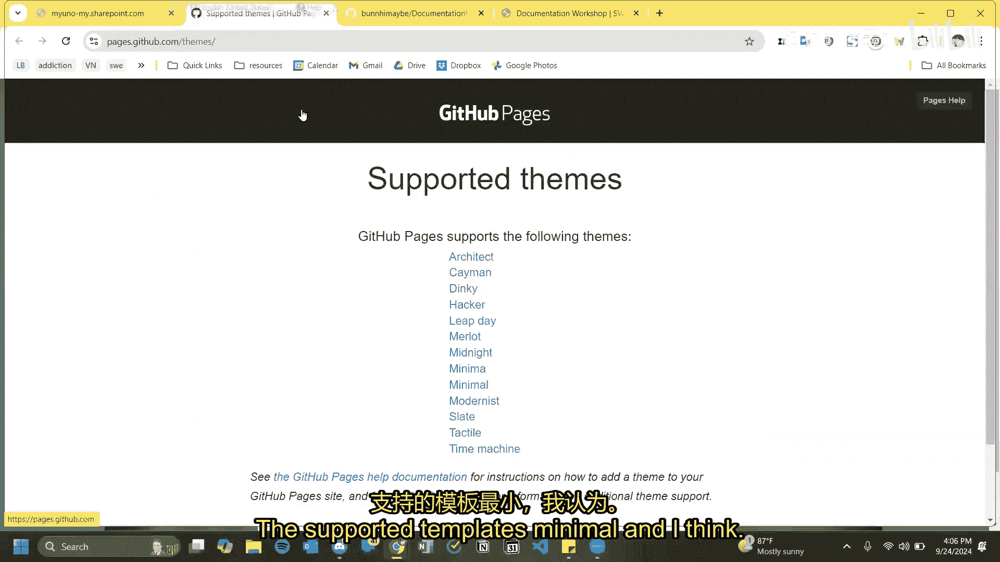

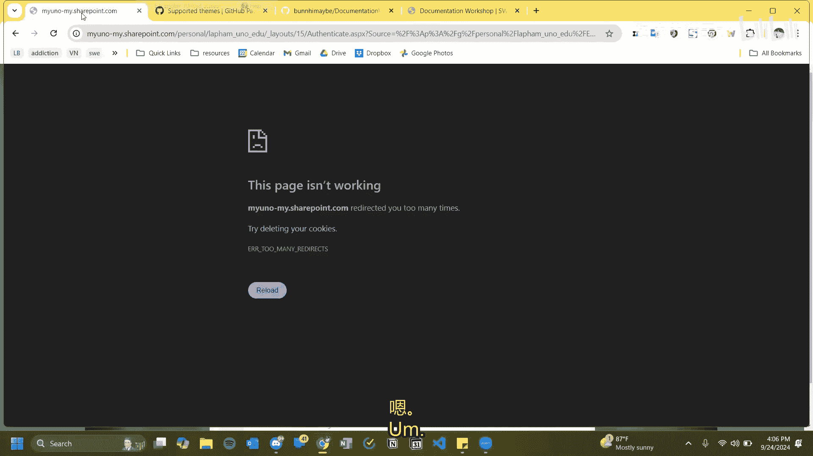

Let me reload this。嗯。Do any of you guys have your own websites？Swese， how how did you make it。

 how long did it take you？Yeah， yeah， you don't have to know any kind of web development I mean。嗯。

I got to learn a little bit about HTML by doing this just because I wanted to understand just because I like。

Wanted to do that， but there are also a lot of templates that you can import directly into your repository like the one the purple one that y'all saw before is。

Something that you could just download from the link and it gives you a zip file you。

Where is it called？Extract it into your repository and it does all the work for you。

 you just have to like edit the text in it。不嗯。You click on the chat channel just want to see another examples。

 so the one that I had built at recent jackal， I custom made a。

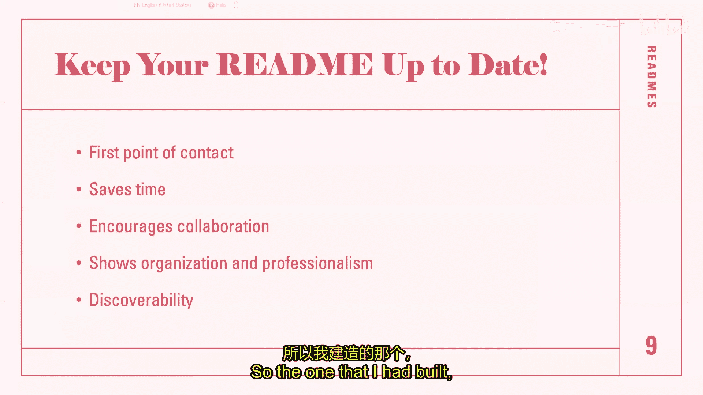

In aging0 pages a JavaScripts agency can see here， this is an example and mean if you click on game。

 yeah， if you go down the I scroll down up。Oh。Yes。And so this could be like your public facing on the page that。

Adverttiisees whatever your product is hosted through GiIub pages and you can invent JavaScript。

 CSS Sane， bootstra， HTMLL， whatever you want。This is not a template no but if you go if you scroll all the way to the very bottom。

 I don't see， I don't think I can ist broken I think yeah。不明。

But it's it's still really impressive just like from here let me see if these like links were。

One on는 cybercan。

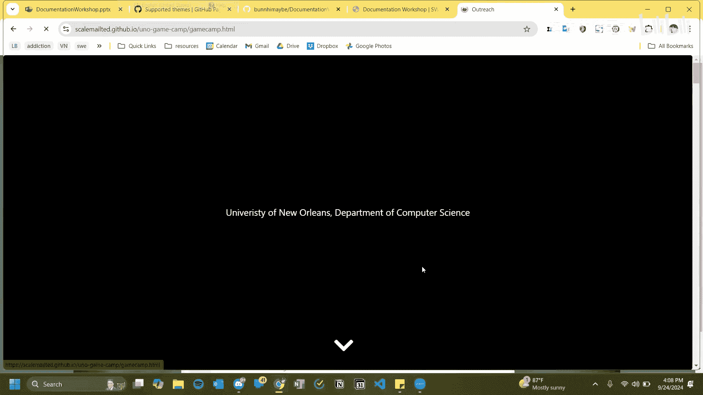

No。Thank。And。I I嗯。Yeah， it just goes to show like you can do a lot。

 you can if you wanted to learn HTML yourself， you could， it's just a useful tool。我我想想。Yeah。

I don't know if there's one exactly for i'm sure there's one for GiHub pages。

 but we also have a wiki where I。Like put all the instructions down there and I can help you in person like that's what we're here for。

嗯。So let me get back to where I was。Okay， I wanted to point out this is a Jekyal theme。

 so it's not inherently supported you would have to download JekyL to be able to use it or you can actually there's like a repo for this theme that you can。

Like clone and。Use as a template。And this was what I was talking about where you know。

 you go to this website download as a file extract it。You have a pretty website。

You can also use a custom domain。There's more information about that in the wki if you have a domain already。

 which you guys said you didn't。Now I just want to talk about some good practices for your goodth pages it should be detailed like people want to know about your project so you got to tell them like what it's about you got to sell it you should keep it up to date because if your program is broken like no one's going to want to use it it should be well structured and easy to navigate like it shouldn't be a headache to like try to click around because they can easily just like close the tab and like move on they're also like cool tricks that you can。

Like cool styling and formatting tricks that you can use if you want to learn a little bit of markdown。

 it's pretty easy。It's not super complicated at all you static website right so aesthetic static dynamic sites a static website doesn't change like no matter what computer you。

Access it from it's going to look the exact same an example of a dynamic website would be Twitter every time you open up Twitter it's going to look different because it's it like pulls different content it is like tailored to your experience or your browsing history yeah。

mW whichch is fine for like a portfolio website。嗯。So another form of documentation you can use that's already integrated within GitHub is a wki it's a section in every repository that you can use to host long form documentation。

And the great thing about this is that you can edit it completely in browser you don't have to clone it locally to be able to edit it I will say it's a lot faster if you。

Like make and's locally because you don't have to commit every single change and you can preview it with the extension that Jenny mentioned earlier markdown preview all in one。

 I think it's called this is an example of ourwiki。

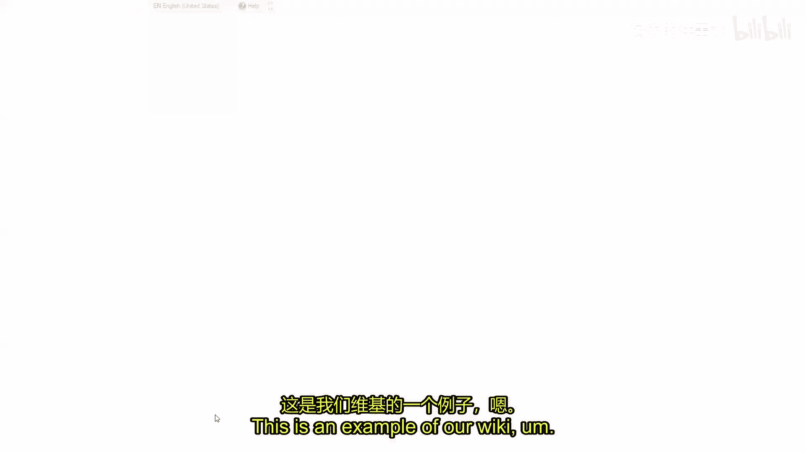

I can go through it really quick。So this is like the body of it there's a pages that lists every single page that's in the wiki along with like。

Hyperlinks to every subsection you can add a custom sidebar if you' if you wanted to do this locally you could you could clone it by like get clone and this URL in whatever director you're in。

You can also add a footer by and vote yep， okay。Not super relevant， let's keep moving。That's cute。

I should have restarted my computer。好。嗯。So I think the next slide is going to be setting it up。

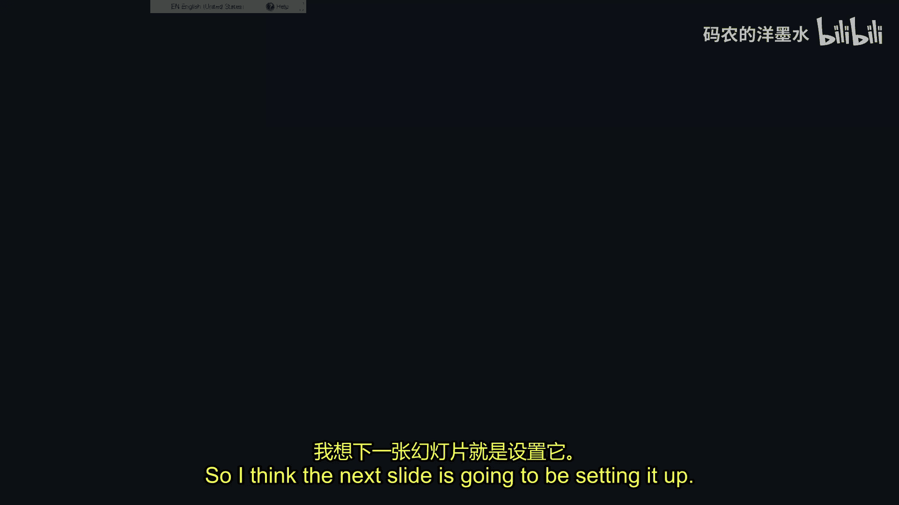

But。We are。To set it up it's even simpler you just go to the settings again scroll down and there'll be a checkbox to enable wis that's literally it then you can go to the wki tab at the top of your repository it'll because it's enabled now and there will be a。

嗯。嗯。There are a lot of detailed instructions on how to set up a wiki in our wiki so you can look at it there basically you just add your first page and then keep adding pages and edit it however much you want that's pretty much it。

Some good practices for an effective wiki would be kind of the same as the your GiHub pages。

 they should be detailed and up to date and well structured and easy to navigate use markeddown formatting to contrast like different sections and it's already in your repository。

You really shouldn't be repeating information that's already in your read me it should the information should have something to add there's this repository that's really cool that gives you a lot of tips and tricks on how to make a beautiful wki as as well as a lot of other。

Example pages that are really nice like this one。And。That's hi me sound victorious。So hey guys。

 we're going to talk about a specific type of auto documentation。

 it's basically a generator tool that can translate plain text source files if your director uses like restructure text or markdowns。

 it can generate HTMLL with web pages and PDF files and EPUub。😊。

So i'll go over how to install Spinx so the prerequisite is that you do need python versions three or above2。

7 is fine for me personally when I was downloading python I was having issues but that's because for your downloads it up in Windows you have to make sure you check Pip and your。

In the path file and for MacOS sorry for Mac OS， you would use Python 3。😊。

Once you've had that set up， you're finally ready to do your install for Spphinx。

 your for Windows your use Pip， Linux your use APTget and then for Mac your use B install。Okay。

 and then you'll set up your environment next after all your installations done so youll create a folder in your local directory and once that's created you'll go ahead and open BS Coast Studio and you'll create a Vme file。

And it's going to be readNeeds。t or ST， which is the restructure tax。

So for Marvin and the RC I made it to where it was customized to our presentation so in here I have how to set up your Spx documentation and the different files that you' will see in your setup。

😊，嗯。So it'll include your overview， your get repo， your folder documentation。

 and I added little descriptions of each of your files that you will have。嗯。After this。

 I've also set up a in visual code， a word wrapped setting so that when you are typing in your read files or anything on VS code。

 the link of your words won't go off with me。The code itself。

 and I also added the extensions Re text。Once that's done。

 you'll go back into your folder and you'll create a pathway and use the command line quote。

Pythonvnv。vnv which is setting up your virtual environment and it includes imported things such as your library。

 your packages。😊，嗯。In your packages and then next you'll also do the command sx quick start dos and it's going to actually if you want to create your source files and your bill files in separate folders or just to do your bill file and your root files and then after that it's going to ask you for your project name so it's。

Documentation and you're going to ask for your authors which is me。

 Victoria and Jenny and in the project release I just put like 0。1。

Then you want to click English digital and English and once that's all set up it's going to。😊。

opIt's going to create two files in your source folder。

 it's going to be your config file for Python and it's going to be your index or STT file。

In your config bio， you're going to have your。Your important information you're going to have your project name and the authors and everything like that plus your extensions and the theme of your。

Wepage because I decided to do an HTML webpage for your spring documentation。And then I created。

 well， this is the first main route document file that you'll see。

So this information includes your overview of your Sphinx， what it supports， some definitions。

 which is should like your talk tree， which is kind of like a table of content that goes in alphabetical order on your webage。

And you also want to include your text files and your talk tree so the next one would be usage this one really shows all information about how to install Spinx just to show like an example of how it will look like。

啊。Your next file will be your customization file so in this file I added a lot of different markups and markdowns this really shows like some of your practices that Jenny mentioned with markdowns where your text for your headers need to be the same link so for example。

 right here。可下。Your paragraph markup right here， the reason why the assignment symbol is so long is because if you were to cut it off to like four assignment symbols。

 it's going to your term rule is going to go crazy and say that it doesn't match。嗯。拜拜。😔。

Once you're finished with all of your files that you made so there's three files already。

 you want to start you want to build your HTMLs you're going to do Spx。

 buildsm HTML docsource and doc builds once all of that is done you do make HTML。

And so this is the result of it， so once all of those files have been。

Rendered you're going to do the make HTML and it's going to be on your local drive。

 but you want to be able to share this documentation with others so much like how。

Meee presented to us the GiHub page， I was able to make a repo and upload my files to the repo so this is what it looks like so this first page is your index page that I created with a file this is your usage page。

And then this is your customization page。And then on the left side， if you see the。

The the table of content is also like showing your headers。They're subheadters。

For our project specifically I know we're going to use a lot of coding so we'd want to explain what each code is so if we have a class code you'd want to create a documentation of that you also want your method you also want functions and objects these are just some examples that others have made so this ones by Lucy there's also this one。

And the spring documentationation website。And then there's another way to host your web pages that isn't just Github。

 you can also do readthe dogs， which is what。Beme that I use firstphinx and so you can create account on rethdocox and import your Git repository and clone it there and post your website that way。

And I believe that's it is there any questions about Sphinx。

 I know it's a lot of like steps and technicalities。SoI it just an alternativeYeah。

 so it's it's it's definitely good for like。When you have like a big project and you want to show off your project and with how we're adding so many different。

Parameterters and classes and methods for like our upcoming projects。

 we'd want to have all that listed instead of。Instead of like everywhere。

 it's kind of like a Java dogg， but it's with article， but this is more of like for documentation on。

Spin I on a Python everything。嗯。In。😊，So。Thanks Victoria out of documentation it is really cool and it looks really good it saves you a lot of time to so。

😊，Yeah， if you have questions about setting it up definitely ask us。

 but to end our presentation we wanted to have like this little silly activity and look at this。

Read me and we just want to ask you what you think of it。

 and what makes it good or not good and how you can change it。

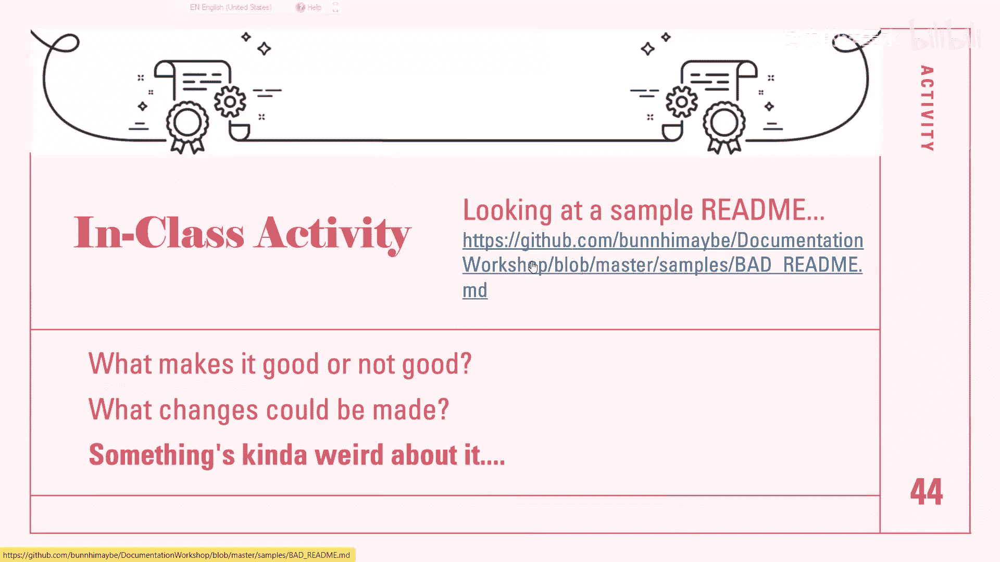

Yeah。So。Here we are， we have a read me it says。Be in venue news summer my page web and Jimal Robert Jim theissance。

And then。And then。We have the project title e description。

 the installation usage and the contribution。What's wrong with this so far like what do you see are the errors of this practice？

没呀嗯。😊，Different， yeah。Absolutely， yeah， you don't really know like you can't even see like what the project even is when it's called yeah。

 just a broken image link。我我睇过。Yeah， yeah。Hey， hey， hey。I mean， I don't know how。

You aren't going blind from the normal that flash blinding is like a thing silly。Yeah。

I was going to actually。I was actually going to have like， I had this idea to do like an ARG。

If you guys know what that is。Yeah it's an alternate reality game so I would I said in the presentation like something's kind of weird about it and I was going like have some clues and then you had to figure out like it points to a website and then the website and some cool stuff but I didn't get to do that but I still hope you enjoyed the presentation。

😊。

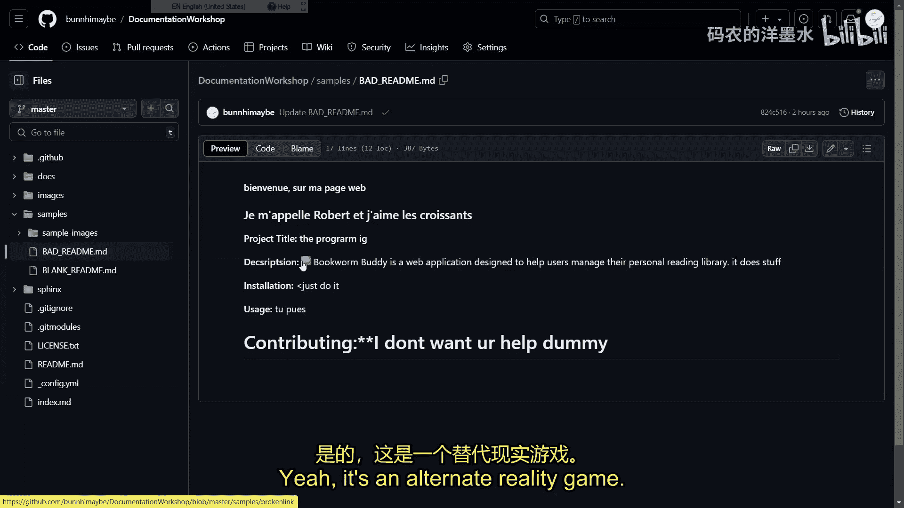

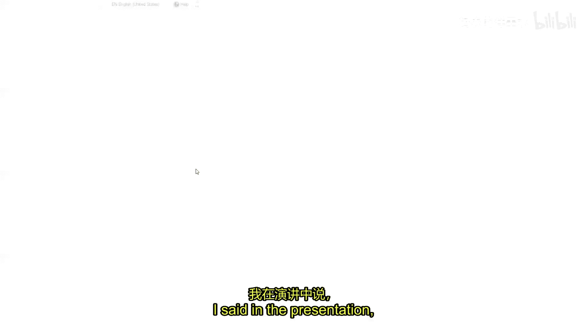

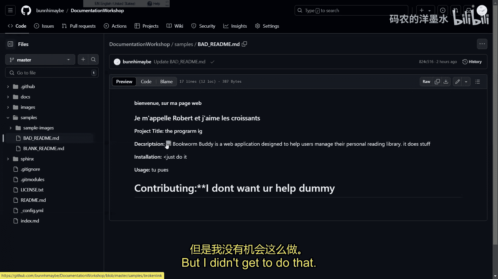

That was helpful and we can absolutely help you with making your own website。

 we can make our project website look really pretty and then finally the deliverables that we ask of you to give to us part of project two。

We just want you to make read me， a nice looking readme or a user web page or a project page or a project Wiki。

For each one of your pods， like there are three of you guys in each pod。

 you guys only have to do one。And hopefully it'll be a lot of fun。I had a lot of fun with this。

 even though。There's no choice for yeah， you actually you so because first Spinx I use。

 I didn't use Jekyll， I actually deployed it from the branch and did a thought way so it doesn't like auto update or I didn't use any of their themes so definitely let me know if you're using Spphinx and I will help you because that's exciting。

I mean， down the line， like when we have like longer。

lararger scale projects you're going to want to use auto documentation it's just like where we're at we don't have any like big projects like that it's a lot to set up I know gave you a lot of headache you want to look at some demo other projects that are out there to see how about。

Like auto documentation books on that if you go it to pip。org and it on show it's。H heY heI。

嗯 p y e r。你点快。That's effectively when you have hip， which is like store on。

Package manager for Python today you can install of like elior you can come here。

And kind of explore some of these so for instance， maybe do pi game presence Py， GA， they nu pie or。

嗯可以。Yeah yeah， select first one there。And you'll see you can kind of explore and see all the documentation here that we can auto generate。

And use。I then they have the various topics so where you been explore。Excellent， do pie game go back。

 I think this is the version of Pi game this sounds important and can make pie and game together。

And yeah， and see， that was。So they'll also give you the updates on here。

 presumably if we want to install make our code available for the。

It all the documentation would be available to here so we can actually make our code publicly expposable and searchable as well if we create like APIs that are cleaning up that other people can importance their environments in here so click on all the topics for instance。

And here you can start to save the separation of all your code。为什这。

So we you want to kind of explore what other projects look by the building。What very you。Stinks。

 yeah， they probably use sink。Yeah。I think advance learn these tools。

 this is what's actually like you to go ahead and create the documentation that you would use as a developer to learn how to use any thoughtful someography。

It a good job kind of touching on how documentation permeates across and his hydr from as micro level as like the gate。

Amit messages all the way out towards the user facing agents。Does anybody have any questions？

Commonments， feedback。Concers， concerns， admiration。I would just say something that。

You discussed early on on about their commits and I just know some specific companies or team but they will have specific commit messages based on the project。

There's like large scale or whatever， so I feel like that's also interest in whatever your work。

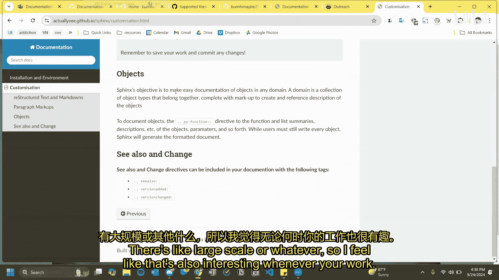

Whatever to like ask for that as well if they you。Yeah， yeah。

 commit messages make it easier to track like what went wrong and what happened so you can see our commit messages here。

Feel free to play around with our。Repository and use it as a guideline we also have samples in here I can。

Upload those templates that I was talking about， but Jenny has this blank read me that you can use for your project。

Read me。Yeah， we can show our user profiles because， you know， when you like。😊。

You can customize it a lot I have like a little gift here and。

And to clarify these are also reasons they're just the user profile instead of a project so this is GiHub profile you load into your profile is really nice Yeah the way professional looking absolutely and like I said you know when you're trying to get a job and talking to employers like they're going you're going to stand out if your profile looks clean and professional rather than somebody who's like you know doesn't have anything on it doesn't have a picture of them doesn't like you don't have any information about who they are and like I even have my website linked here which is empty and broken but it's there。

That's it。Excellent thank for any of you who are interested in learning more about HTML and CSS or JavaScriptscript I can make off in workshops if I have available budget class so all of that I have prerecorded online and available play list i'll highlight the ones that I think be interesting if you wanted to learn more where you go to kind of build out your own kind of project in a guided step by step way yeah。

嗯。😊，Awesome。Okay。Yes， really。😊。

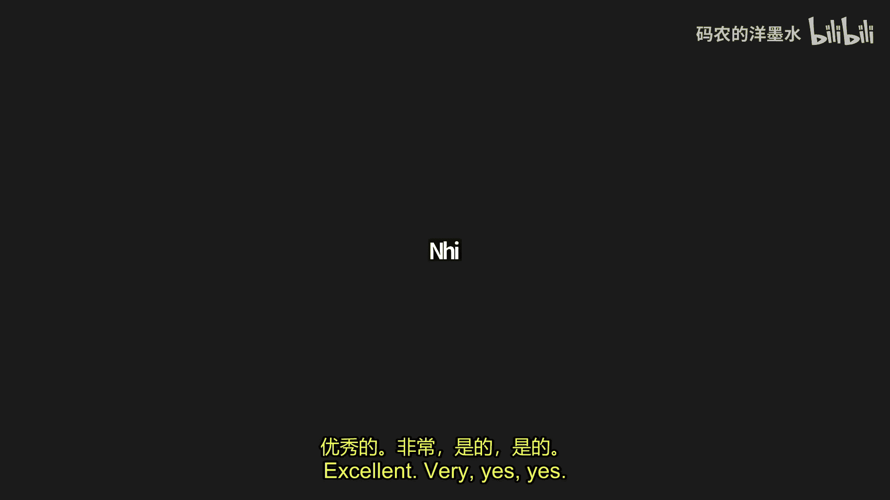