# 软件工程：03：技术文档编写 📝

在本节课中，我们将学习软件工程中至关重要的一个环节：技术文档编写。我们将探讨什么是文档、为什么它很重要，并详细介绍几种实用的文档工具，包括README文件、提交信息、GitHub Pages、Wiki以及自动文档生成工具Sphinx。

## 什么是文档？

文档就像是程序的“使用手册”。它包含了代码的详细信息、运行程序的说明，以及如何将各个部分组合起来的细节。一份好的文档应该包含阅读者理解和使用你的代码所需的一切信息。

文档之所以重要，是因为它是实现良好工程实践和设计原则的一种方式。好的文档能提供清晰度，促进与其他程序员的协作，使你的代码易于维护和阅读，有助于调试，并能提升你个人及项目在雇主和合作伙伴面前的可见度。

## README文件 📄

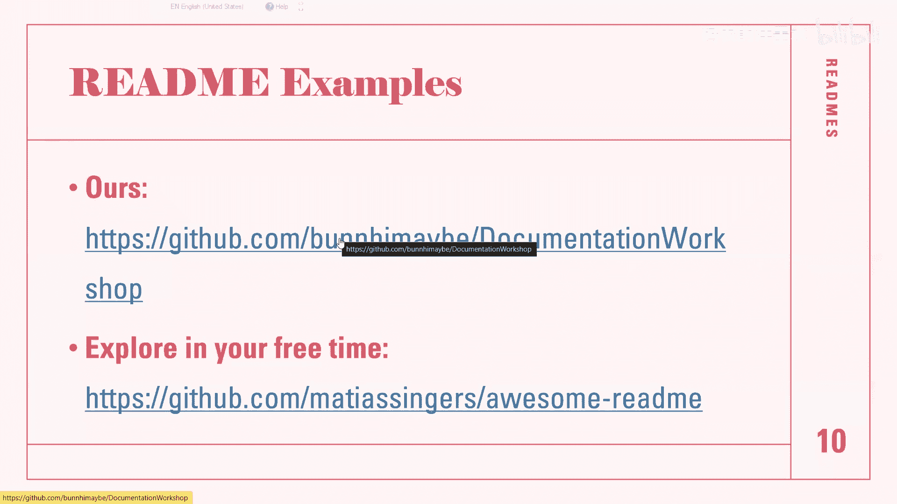

上一节我们介绍了文档的基本概念，本节中我们来看看最基础也最常见的文档形式：README文件。

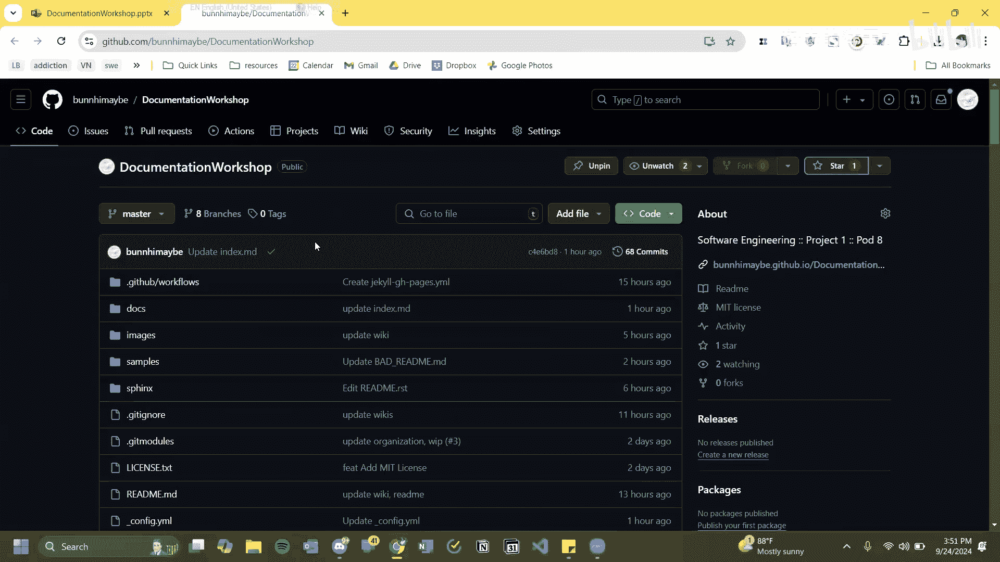

README文件是一个项目的“门面”，它向用户和协作者传达项目的重要信息，对于开源社区和协作项目尤为关键。一个完整的README文件可以包含以下几个部分：

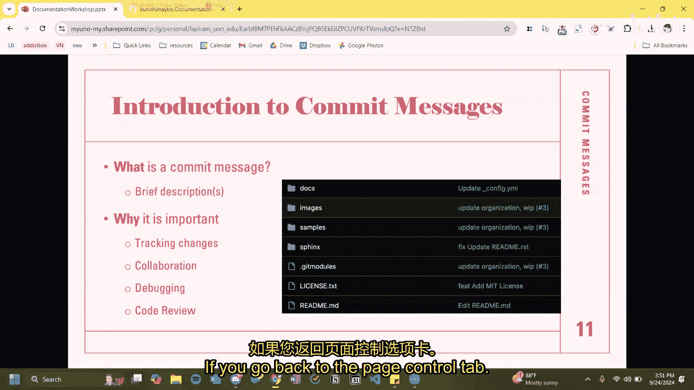

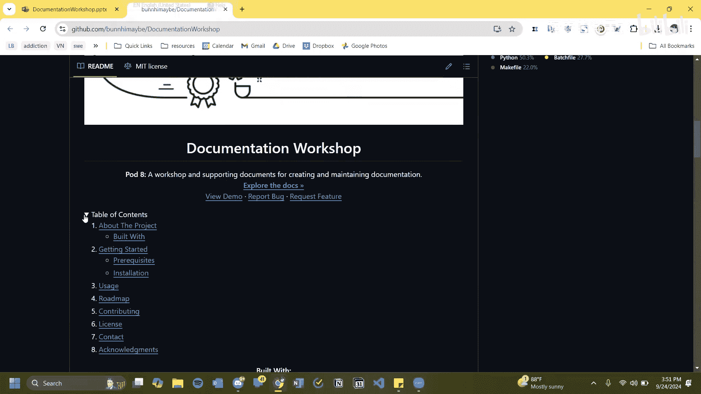

*   **项目标题**：清晰的项目名称。
*   **项目描述**：简要说明项目是做什么的。
*   **安装与使用说明**：如何安装和运行你的项目。
*   **贡献指南**：其他人如何为项目做贡献。
*   **许可证**：项目采用的开源许可证。
*   **联系信息**：如何联系项目维护者。
*   **可选部分**：如常见问题解答（FAQ）。

README文件通常使用Markdown语言编写。Markdown语法直观、易于理解、可移植且高效。在GitHub上，你还可以使用GitHub风格的Markdown（GFM）或内嵌HTML来增强格式。

为了编写方便，可以使用一些工具。以下是两个实用的工具：

*   **Visual Studio Code扩展**：如“Markdown Preview Enhanced”，可以实时预览Markdown渲染效果。
*   **在线编辑器**：如“readme.so”网站，提供模块化编辑和实时预览。

保持README文件的更新至关重要，因为它是项目的“第一印象”。一个简洁、准确的README能节省协作者的时间，鼓励协作，并展现出项目的组织性和专业性。

以下是一个README文件的示例模板，包含了标题、描述、徽章、图片和清晰的章节结构。

## 提交信息规范 💬

了解了项目级的README文档后，我们再来看看代码级别的文档：提交信息。

提交信息是对你在项目中具体更改的简短描述。它们记录了项目的演变历史。使用规范的提交信息非常重要，原因如下：

*   **追踪变更**：可以清晰地跟踪项目随时间的变化。
*   **便于协作与调试**：能快速定位错误引入的位置。
*   **加速代码审查**：让审查者一目了然地了解更改内容。

以下是一些提交信息的最佳实践：

*   **使用大写字母开头**。
*   **不使用句末标点**（如句号）。
*   **使用祈使语气**（例如，“Add feature”而非“Added feature”）。
*   **可选的提交类型前缀**：如 `feat:`（新功能）、`fix:`（修复bug）、`refactor:`（重构）、`docs:`（文档更新）、`style:`（代码格式调整）。
*   **长度限制**：标题行最好在50个字符以内。
*   **内容明确**：清晰说明本次提交做了什么（例如，“Update README formatting”）。

一个糟糕的提交信息例子是“F”或仅包含日期，因为它们没有提供任何有效信息。

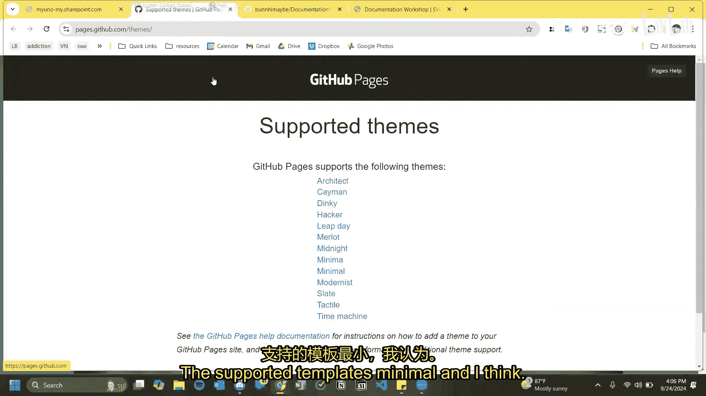

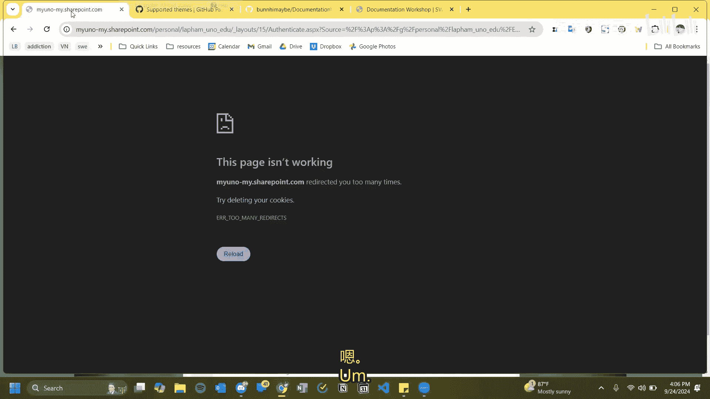

你可以通过多种方式提交代码：

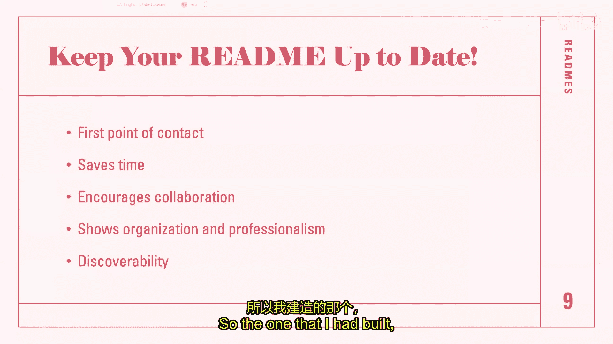

*   **在VS Code中**：在源代码管理侧边栏中输入提交信息并点击提交按钮。
*   **在终端中**：使用命令 `git commit -m “Your commit message here”`。如果需要添加详细描述，可以使用 `git commit -m “Title” -m “Description”`。
*   **在GitHub网页端**：通过“Add files”按钮上传文件，并在底部填写提交信息。

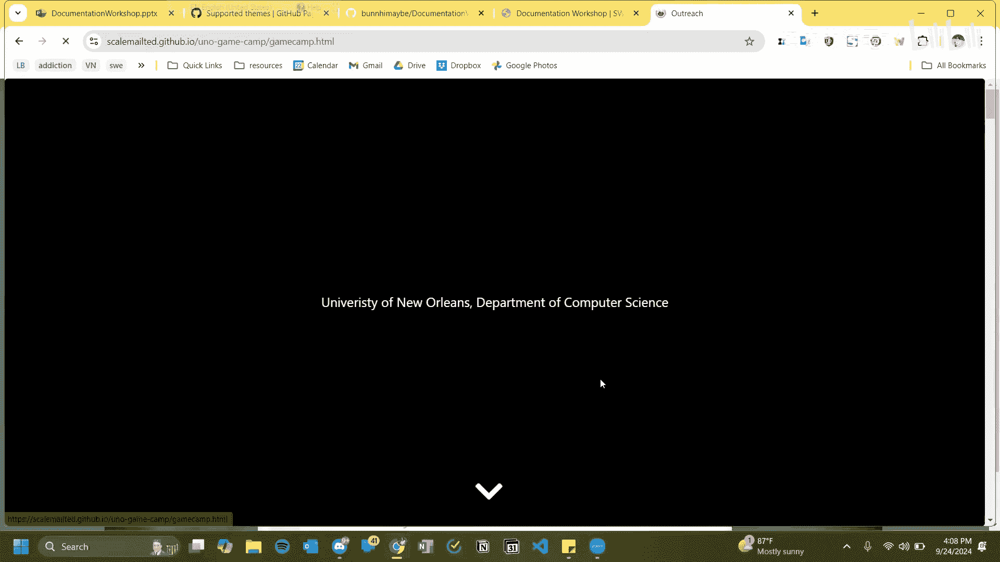

## GitHub Pages 与静态网站 🖥️

在掌握了代码层面的文档规范后，让我们把视野扩大到项目展示层面，看看如何利用GitHub Pages创建项目网站。

GitHub Pages是一项免费的静态网站托管服务。每个GitHub账户都可以创建一个用户站点（作为个人作品集），并且每个仓库都可以拥有一个项目站点。这对于展示项目、创建在线文档或作品集非常有用。

设置GitHub Pages非常简单：

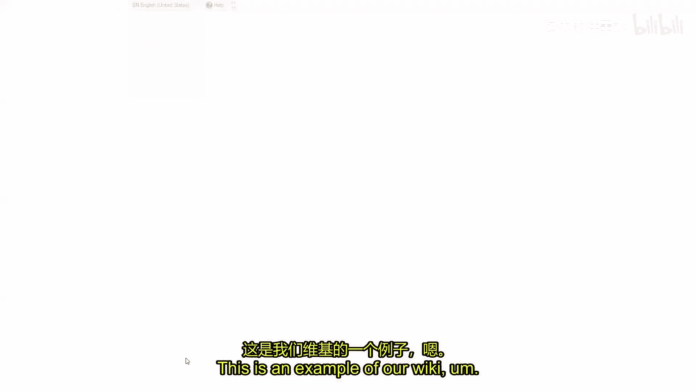

1.  **创建仓库**：对于用户站点，仓库名必须为 `{用户名}.github.io`。
2.  **克隆仓库到本地**。
3.  **创建入口文件**：例如 `index.html` 或 `README.md`。
4.  **推送代码**：通过 `git add`, `git commit`, `git push` 将文件推送到仓库。
5.  **启用Pages**：在仓库的“Settings” -> “Pages”中，选择源分支（如 `main` 或 `master`）和文件夹（如 `/root` 或 `/docs`）。

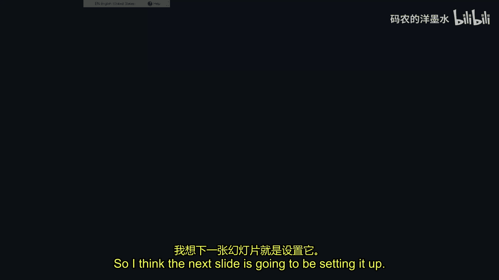

GitHub Pages由Jekyll驱动，Jekyll是一个静态网站生成器。你可以选择使用Jekyll主题（需要本地安装Jekyll环境），也可以直接上传自定义的HTML、CSS、JavaScript文件来构建网站。网站内容只有在您推送更新后才会重新部署。

创建GitHub Pages网站的好处包括：免费托管、提升专业形象、便于向雇主展示项目。网站应做到内容详细、及时更新、结构清晰、易于导航。

## 项目Wiki 📚

除了独立的项目网站，GitHub还提供了一个内置的长文档管理工具：Wiki。

Wiki是每个GitHub仓库的一个独立板块，用于托管详细的、结构化的文档。它的优点是可以在浏览器中直接编辑，无需克隆仓库到本地（尽管本地编辑配合预览工具效率更高）。

一个典型的Wiki包含主页、页面列表，并可以自定义侧边栏和页脚。设置Wiki极其简单：只需在仓库的“Settings”中勾选启用Wiki选项，然后就可以在仓库顶部的“Wiki”标签页中开始创建和编辑页面了。

有效的Wiki应遵循与GitHub Pages类似的原则：内容详实、及时更新、结构清晰。应使用Markdown格式化来区分章节，并且要避免简单重复README中的信息，而应提供更深层次的说明。

## 自动文档生成（Sphinx）🤖

对于大型项目，尤其是包含大量模块、类、函数和参数的Python项目，手动维护文档非常繁琐。这时，自动文档生成工具就派上用场了，Sphinx是其中非常流行的一个。

Sphinx可以将用reStructuredText或Markdown编写的纯文本源文件，自动生成美观的HTML网页、PDF等格式的文档。

安装和设置Sphinx的基本步骤如下：

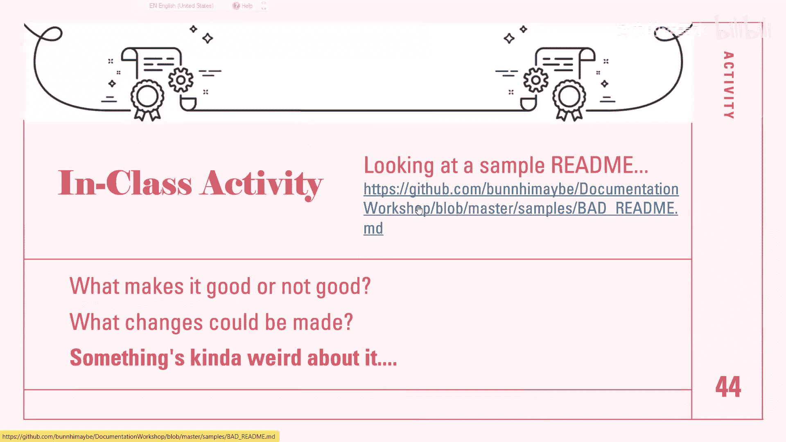

1.  **安装Python**：确保已安装Python 3.x，并正确配置了pip。
2.  **安装Sphinx**：通过pip安装：`pip install sphinx`。
3.  **创建文档项目**：在命令行中，进入项目目录，运行 `sphinx-quickstart` 并按提示配置项目名称、作者等信息。
4.  **编写文档源文件**：在 `source` 目录下，用 `.rst` 文件编写文档内容。`index.rst` 是入口文件，可以定义目录树。
5.  **配置`conf.py`**：在此文件中设置项目信息、扩展（如 `sphinx.ext.autodoc` 用于自动从代码提取文档）和主题。
6.  **构建文档**：运行 `sphinx-build -b html sourcedir builddir` 或 `make html` 来生成HTML文档。
7.  **托管文档**：将生成的 `build/html` 目录下的内容推送到GitHub Pages，或使用专门的文档托管服务（如Read the Docs）。

Sphinx生成的文档专业、结构化，并且能自动生成API参考，非常适合大型开源项目。

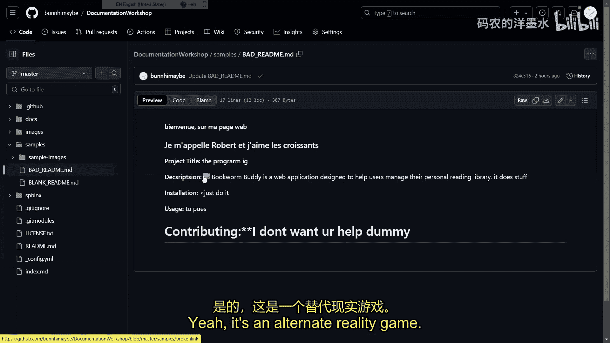

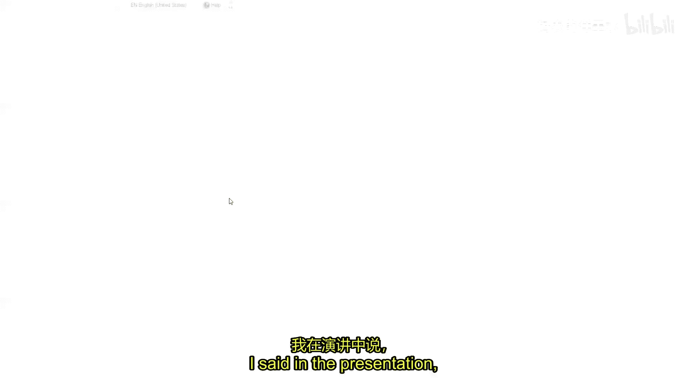

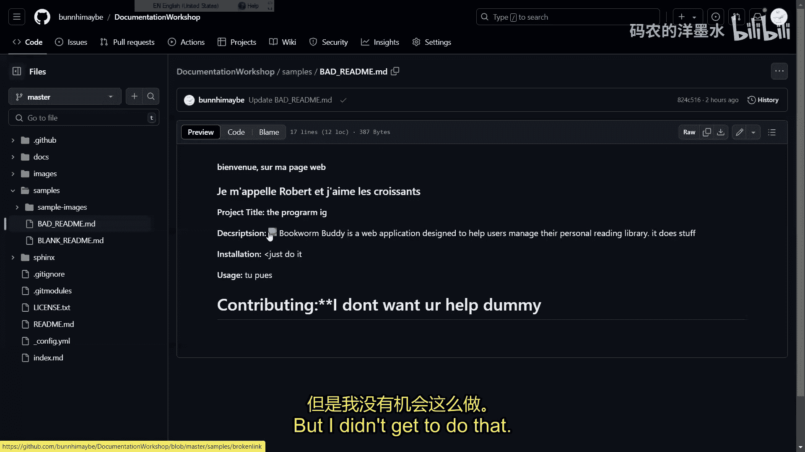

## 实践练习与总结 🎯

现在，让我们运用所学知识来分析一个反例。请看这个README文件，它存在哪些问题？如何改进？

*   项目标题和描述毫无意义。
*   图片链接损坏，无法显示。
*   虽然结构章节存在，但内容空洞或错误。

通过这个练习，我们可以巩固对优秀README标准的理解：**清晰、准确、有用、美观**。

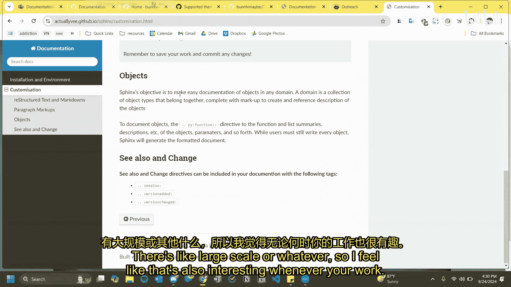

**本节课总结**
在本节课中，我们一起学习了软件工程中技术文档编写的核心内容。我们从宏观的文档概念出发，深入探讨了：
1.  **README文件**：项目的门面介绍。
2.  **提交信息**：代码变更的微观记录。
3.  **GitHub Pages**：项目的静态展示网站。
4.  **项目Wiki**：仓库内置的长篇文档空间。
5.  **自动文档生成（Sphinx）**：适用于大型项目的自动化文档工具。

良好的文档贯穿软件开发的各个层面，从细微的提交信息到面向用户的完整网站，它对于促进协作、保障项目可维护性以及提升个人专业度都至关重要。请务必在你们的项目中实践这些工具和方法。

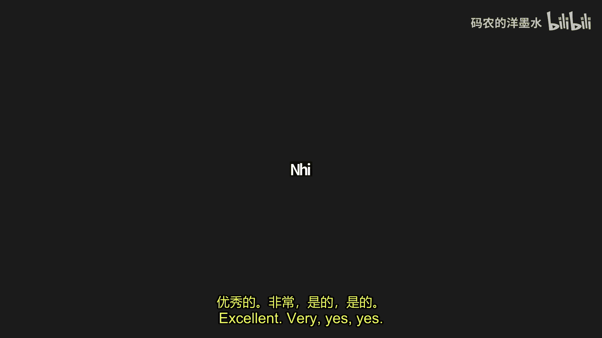

