# 【全集】加州理工学院 软件工程 中英字幕 1080P p04 Lecture 4 - 软件测试 -BV13ZzaB3EWE_p4-

Okay， so whenever you're ready。All right。Very ready。

Hi y'all my name is Justin that's Zola Ne Muhammed over there and we did testing tools at the start of the workshop everyone。

呢这个环俾。왜。So before we start like the presentation， I want to ask like， why you touched your code？Well。

 unit testing could help ensure every part of your code course is intended。

 robust testing could help prevent unexpected errors。

 and test driven development could help create guidelines and goals。

For your code to me and red green factoring could optimize performance。 so I feel like。

Like we all know why like here， I highlighted all the the buzz words for all。

I feel like we all know why we need to test， but a lot of us still don't test our code so I'm going to do a little survey we all taking a。

21，220， And we got。Used a unit before right so who here has used data unit since that class。

HaveWe got one dude over there， two dude。All right， I'll make the question easier for now。

 we has used any testing tools since that class。B you。

So I'm like y'all I don't use my I don't use testing tools， so I got a little personal anecdote of。

Me not using testing tools and it like kind of bitiding me in the butt。So。

Ted assigned us the testing tools and I remember or all of us were remembered。 I was like， damn。

 testing tools was like。The tool I probably used least。

And so I was working in on a Python project actually。

 about like a couple days after we got assigned testing tools。

 it's just a little discord vit where you can play like connect four。

And the last thing I to implement was。A function to check if you want or not。

And so I was feeling pretty lazy， I mean， I've been working on this for a while。

And already did already implemented it in Java for another class networking。

 so I just kind of copied it and pasted the code over。changenge its like。

Pythonics syntax and stuff by the way they test it， you know I use like for it to test it。And。

I just brought the bottle live and I was playing my girlfriend。And she one and this is LCD。嗯。

So can't see how she beat me。呃。You got to connect for wrapping around the board。So。

If y'all worked with Python， you'll probably know that。I's a thing called negative indexing？

So general the negative indexixing isn't a thing。For Java。

 I use this try catch block to catch the negative index。I just pass it on。

 but in Python it's not an error so。To try except locked in and catch it。

And I lost so my first game in。Good embarrassing， so I hope that kind of inspires y'all to use testing tools。

So for our project， we mainly use P test and this is basically just showing you what we use and how to download it。

For Windows and Mac， you just。一得拍啊。This is showing you how you download it， p install。

 and then package name。You put pie test pie test mock faker pie test BDD depends on which one you want to use I think you guys should just download pie test to begin with and see how it depends on what you need it for。

But it's just two lines of code， you copy and paste and then just put the package name that you need and p install。

Thatch that should be the installation it's pretty easy if you guys need any help。

 we can help you in the Discord。To install if you guys are having any issues。

Before I kept going with this。There is another thing because it happened to me when I was actually doing this project。

In case I you don't have pie。Inam。In your computer， like a it's like a package management package。

There is a way to actually be able to download it。I will post them later because I have all the instructions so I didn't have it right here。

But I have it。So the main purpose of un test is。It's like is the codes and like an independent variable like。

It's mostly。For the。你就 say嚟。you want to make sure like a God is working like a calculation is working。

 like you will be able to I'm sorry。Okay， you will be able to actually。Like with you code。哦。

Just give me one second， I'm nervous。嗯。With。With。Let's just say you have an addition abstraction like somethingese。

Like unit test will take each of those line codes that you have to test put it like and separated it like even is on the same file on the same testing file。

 but they are like each code will be separated from one to another。

So in some way that makes it easy like because you're able to see which of the lines is where you are having the mistakes and which one is not。

嗯。Integration tests。Is。Is when we have different parts of the cone。嚟噶。

Like that need to interact with one another。Let's you say。

 I on that top of my code I'm talking about。I don't know， like its certain behavior and then。

I need another like testing， I need to test that behavior but with different variables。

And with different like， you know， that I need that first test that I thought like that I used。

To be able to actually complete the rest of the test。Yeah。I really love milk at all that。

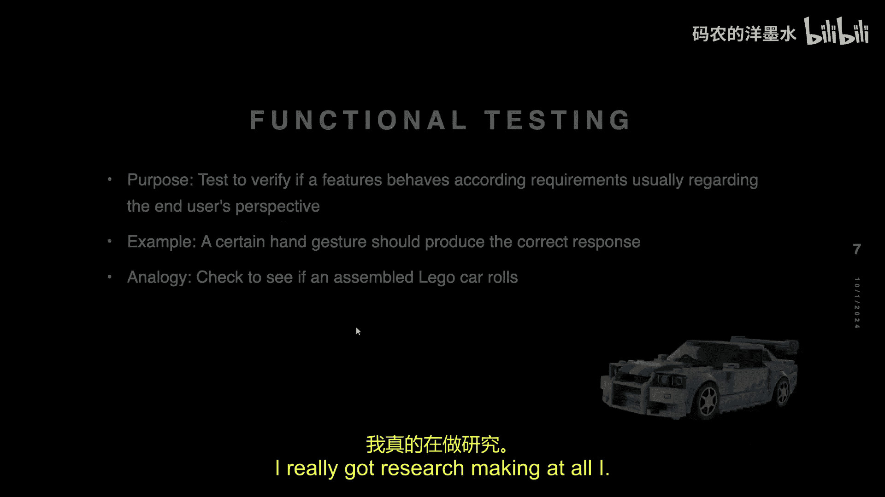

Oh。And go over integration tests again。W the the powerPoint size嘅。

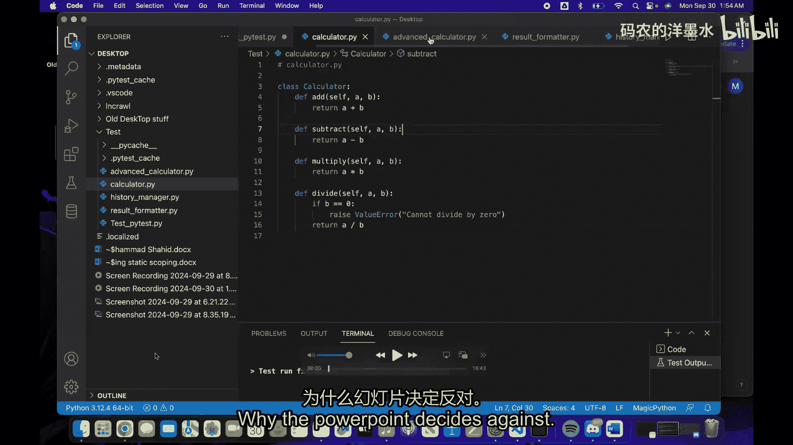

我们的宝会。

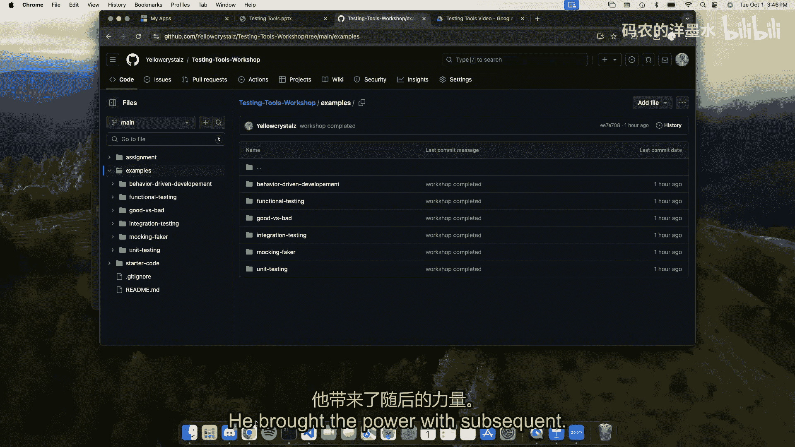

So I did integration testing in code and I'm going to show you guys how it works。

But let me go back through integration again。For the reason I used integration testing and my practice was because。

I made a calculator test。I made a couple functions for it history calculator result。

 and I wanted to make sure all of that work together and。If I would use it in anything。

 it would work together and I wouldn't have any errors。

Usually you can use integration tests for APIs to test if if you have consecutive APIs。

 like four or five APIs running at the same time to test if their connection is working together。

Which is really useful。

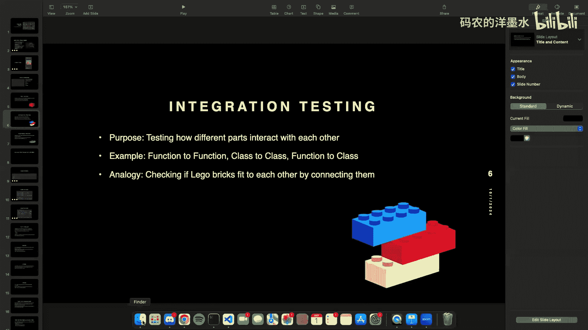

Other than that， I will show you guys my coatd hair。So basically。

 what I started out with was three Python files， calculator， PI， advanced calculator。

 which just gets scared or square root。And then。A result。放心。啊嗯。

Pie test is very similar to J unit testing。Where all you have to do is pie test a picture and then just skip a little bit。

I don't want to take too long on the video because it's 15 minutes， I'd rather explain it as I go。

So first you just set up your。We very both。The first test I did was basic test basic operations and making sure everything runs together。

With basic operations I left out the events calculated with the square root。And。

It's a lot like J unit testing were use assertt。And here I use assert equals。For the result of。The。

 the formatted result。To make sure everything just comes out as it's supposed to come out from the formater。

嗯。嗯。And then I'm using the， I'm going to do the same thing with the history function just to make sure the history function is running correctly。

Because。I mean。It's just useful。It same thing， a。Very simple， the same thing as J unit。

 but just a little bit different because Python was having a lot of issues with Python because was so used to Java that I kept putting semicoons that I had to do this video three times because every time I would run my code。

 I would I would have error saying you can't have a semico in here， you have a parentheses here。

It's very buggy。But at the end of the day， I got it working。

I did the same thing with the advanced operations。 It's just I did two separate tests。

 and both of them just test every aspect of。the calculator functions that I had and made sure they work together。

 which which integration testing is。Mainly used for it。In advanced function。

 I left out the regular calculator because we' were just going to get the square root and get the history and the formatting for that。

This is what I liked about pie test a lot was the fact in J unit testing you have to type in jar and just dash and。

It just gets a little annoying but with pie test， all you have to do is pie test and then you're the name of your file kind of like when you're compiling something in Java。

It's pretty。 it's a lot simpler。 I like Pyth's a lot more because J unit。

 the thing that always kept me from using it was because it just。

It's to sin to everything just on it is just a little bit more confusing it just seemss a little bit more of a hassle to do。

But pie test， it was a lot simpler。 It really isn't an install， and。Work very smoothly。

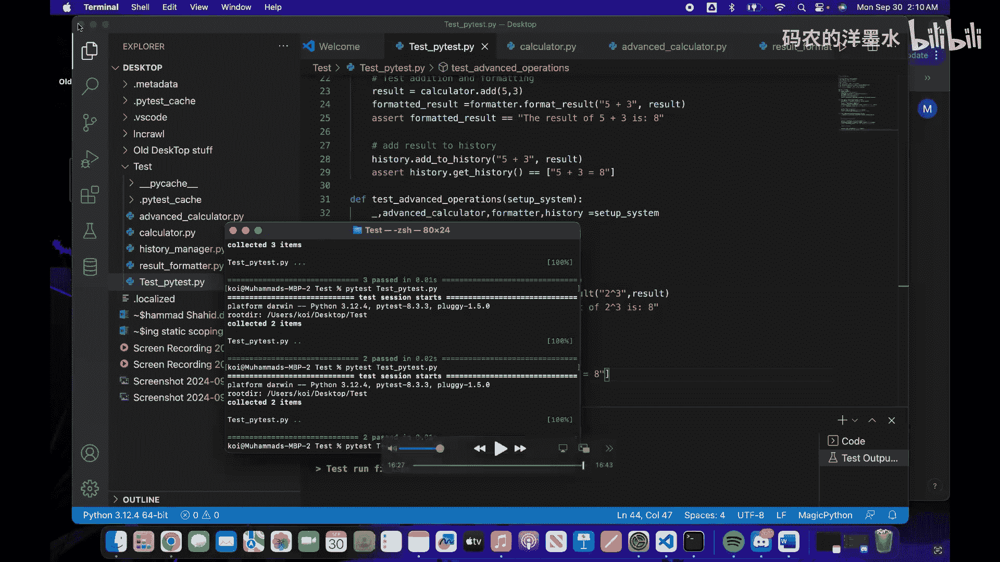

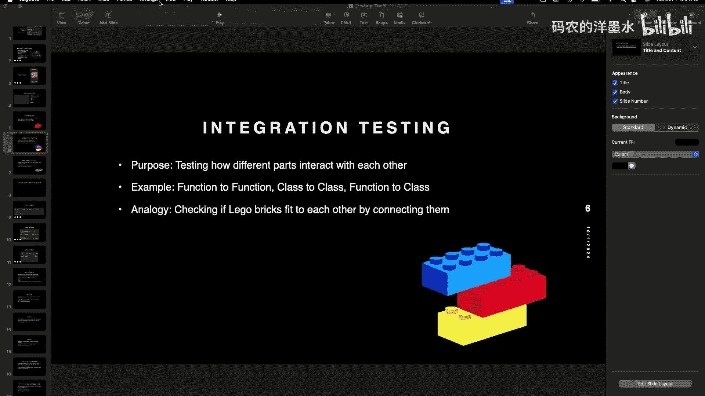

So functional testing is kind of the last layer of testing so theJ unit as the smaller unit of testing you have integration。

 which is a step above that， you have functional testing， which is kind of the highest level。

So going out with like the Lego analogy， if unit testing is like。

Quality insurance for a single label piece and。Integration testing is checking if the legal piece is connect with each other。

 functional testing will be checking if like a Le car rolls or something。And in our case。

For functional testing， we'll be testing if like 10 motions。

Activate like the correct response or not， some other forms that functional testing could be like API buttons on websites。

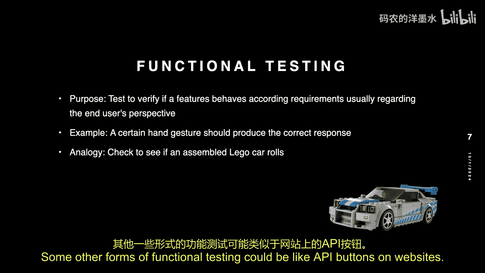

And I' shared a little video for y'all。走。I just kind of copied this talking out from Muhammamed and Za。

Thanks to y' all。I copyied this as API thing from the API team， so。Thanks for that， y'all。And so。

Here I'm just supportinging pie test and from。Im import the API now。From。Fast API。

 fast API has this thing called a test client。 So that's what I'm importing to kind of。

Host your APIs in a low of my test file。And the test client runs on ECTP XO。I have to import that。

You set up a client with a test client and you。Pass on your API。

And here I'm just listeninging the you。呃，The add function。Use client I get。打是。

Director he filed or pathway。Which is。是拉瞎还是拉虾？And they pass into parameters， which is。

In a dictionary or JSO kind of format。So here I'm passing in 10 for A and five for B。

And here I'm just asserting。Grabing Jason from the response。

And seeing that it matches this key value here。Which is P someal 15。Which 10 plus5 is 15。

 so this should pass。It does。Here啊。I of skipped all over for you so I dis subtract multiplier and divide as with you just。

Coffee based and teaching a couple words， so。I look it out for now。

 and I'm just going to implement the dividebe by zero function。Yeah， so divide。you pass in zero。

It should throw the HTP exception， so I just need to。Check for that。Its copy and pasted that part。

 change to5 to0。The statusus code should be 400， so I'm just testing that if it's 400 here。

And then I'm saving the error message to error message。Sub aplanatory。

And then I'm just checking if error message equals connect divide by zero。And they should all pass。

And so one more thing you can do with a I test is instead of writing out like all your research statements。

If you want to test like multiple values， you could use something called a parameterization。

 so let me show you that here。wi发。The decorator。Iest。 mark Arize。你か能。ItKind of a string formater。

That's what。This is A B。On my result。And then you pass in a list。U to both。

So the first value of the supple is。Liked to a， the second value is linked to B listing we out the way。

 and then last value is linked to result。So I'm just looking three twoables will probably three test cases。

And then I got to pass in a B and result to the function。

 and I got to change all of these hard coded values into variables。

And here you can see that ad is tested three times。And I didn't have to repeat any code。

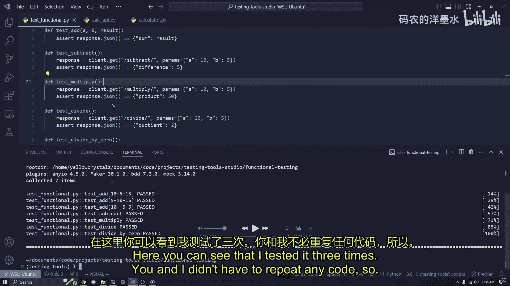

啊， niceイス。So we kind of show came a little bit about pie test。

 but I'm guessing like some of y'all still have questions about it so。

Can have a little activity for y'all so I'm going to show two examples of like assertion code。

 when it was going to be good， one of those going to be bad and just time to pick out。

Which is good and which is bad sos the first example。Okay。Whobody thinks example A is bad。Or good。

And here thinks example P is good。嗯。Ax is right， example Bs is good。

So the reason why example A is bad of it's kind of hard to read like everything's in what's line like example B is like。

Laid out a lot more so you to kind of。See like first lines for ads second lines for subtract so usually it's better to like write multiple assert statements just so they're easier to read so second an example。

Here here thinks example eight。你实紧。And here at takes example B is good。廿出嘅。

Yall right example be is good so kind of lie to y'all multiple the multiple assert statements was not the the correct one mostly because the first two they're not really checking anything like if I'm checking if the string is I like ducks then it's obviously not going be none then is's always not going to be an empty string so it's just making like a bunch of clutter that you don't really need to do so this shows。

Not to make like useless assert statements。And I have this last one。

Everyone takes an example A is good。Here a take example please good。one person in the back。Well。

 example a is good。Mostly because。This kind of goes back to like the first point where you kind of have everything on one line。

 so this brings out a principle in testing it's called AAA or a range act and a。就。

This is kind of small so it's kind of maybe like a little overkill I would probably do like example B from time to time。

 but like for bigger like test cases you want to first arrange make your objects and stuff。

Set your variables to certain like numbers， then you want to act， which is you know。Functions。

 calculations， whatever， and then we finally assert。对这是个 showcase色 that。

And now we go on testing doubles。啊。Y'all probably don't know what testing doubles is。

 but I'm sure y'all coded before y'all have made some kind of pseudo mock test so what they are is their stands to simulate external system or dependency。

Or you so you don't have to like implement like all of it like if you made like a function and and you just made it like print this function works or something then you made a testable for it and some examples of that are you know。

To be mimicic or APIs， databases and functions。They're used a lot in unit testing。New testing。

Compared to like the other three， you really want to like an isolated environment。

 so test doubles help create that isolated environment without。

Hide me to like making it from scratch and some of the most common test levels are。

Marox is part of the testing doubles。It normally。It pifies the behavior by imitating a component。

So the ultra component is not need to be used normally one when we like heard these the fer that you know。

Is exactly what it comes to the mind。We take we have a test or we have a code in a specific library we want to test it。

 but we don't want to actually like change anything marks。

What what is is for the mostly to check the behavior it doesn't check functionality or anything till like that it doesn't check if the code is correct or incorrect it is check if。

Ever if it， if it is。You know， like。Like if pass， if it's for example。

 if it's an assertion or something like that， like like it pass。

 it move like that is it doesn't check the numbers， it doesn't shake the time。

 it checks just that it' working。And it doesn't matter。Like。Anything else。

 it just checks if it works or not。Um。Example as is on the slide is。

Instead of calling like I send an email， it would like you create a mock object。

That those the same thing with the same parameters that will verify the behavior。

Like focus on asserting calls and arguments。Stop。The main purpose is simulate behavior returning predetermined outpost of responses in this case。

 this test。It will have like you use when you have a specific value and it to come like with。

With like with a test， it doesn't matter how like you do it。

 you will like the reach value will be always the same。That is determined。

Like this is useful to actually check the functionality of the test。If it's。If it's working， we not。

It's good for when you have， you know， like。Oh my god。It is good for them。

This is another another thing， I'm sorry， like this is another test like double。

This is another is the same thing like it will it's like a copy of the main code and it will check if。

 you know， if it's working or not whether like it's good。

When you need to put different leggan numbers。Like like to make sure that the test will come back correctly。

 if there is a mistake or not。On the other hand， fake is also a double。But。It's mostly use。

When you have a huge range of inputs。And you need to make sure that like doesn't matter one number or what you insert on that input。

The like the code will be working correctly it's not like a。It's not like， for example。

 like stop that we are already so that has fixed values this one is random it's not like。

Like one number two like let's just say like the lottery like something if you're going to like something like that you have real values because when you are fake the first thing is well it's a fake thing no it's real values is used at it's a large。

Like a large numbers of those value， those that one is useful。When you need to know。

If the code would be worked with any leg kind or any size of input。嚟噶。

Fakes our simplified version of the real thing。Us in a way。Like a lightweight implementation， yes。

 normally。It's also good to be used when the library of the you know。

 the main code is too large or is too slow。Like， like fake， we hope you actually too。

Test that to make sure that it will be okay， that it will function， that it will pass。

The fake that stored in memory， used solelyllmenly for testing in purpose。As I said。

 like it's no a specific， you know， but there are no specific values， they have random values。

 so it's mostly like that's exactly what they are for like specifically for testing purpose。嗯m。

Use as a simplifyplified replacement， as I explained before， yes。

 is normally used when you have you know a huge code or。Like something that is too heavy too slow。

To be able to do actually。Wn it。Best set ofmonishment。

The purpose is ensuring the right data is being used for testing by mimicking reward data。

Quiring volcanic data can be time consuming like it's true。Like taking weeks months yeah。

 that's true if like normally when you like need to do something。

Like if you have the values and if you had like。On hand， what you have to do， or at least part of it。

It would be always， you know， faster and easier to actually go out and look for things。

Because always and every day， every time you make a test or something like you won't be right all the time。

 you will be like making mistakes and trying to rectify the more data that you have。

 the more you have to organize and the more organize。Your data is to actually rectify those mistakes。

Ts like faker can generate。Viotypes of fake data in seconds。And it's not this fake data is real data。

 it's just that it's like it's random， it's like no with a specific number， no with a specific value。

 no with a specific like characteristic would be just random it depends on your code when you're pi down the baker。

What you asking for if it's an integrate it will be like you will always have to specify it。

 I don't know like from one to 100。That's how fakeker normally is， you know， like how it works。

And of course， that doing this will speed up。Like you know。

 like acquiring the data on the organization。Yes mind dear。嗯，那さ。は。

Well another principle of testing is test driven。知到了没？

This is kind of the testing that you learned from 2120。Basically。

 you just write your test first and then you write your code。This way， your test kind of。

Shapes and help guide guide your code to like the correct functionality。

 So this drives design and code quality by ensuring tests are written before the code。

And a principle of this is ready created in a factor。So red just stands for write a test。

So if you wanted to write。Calculator app。Sometimes you would write or like， you know。

 two plus two equals four。啊。If you divide divide by zero， catch like an exception。

In green stands for right just enough code to pass that test。So you only care about。

Like optimizing your code or anything you just want get。The MVP out there。

 the middle and viable product just to kind of pass all the tests and then once you kind of pass all that test。

 then you start refactoring it and start optimizing。

Maybe add some list comprehensions if you're using Python。嗯。Another。

Prciple of testing is behavior driven development， so B， this was a little more interesting。

So the way it works is。There' language called jerkkin。And it's written。Pretty much any language。

 English， French。Finish。あの。What the tooling does is it takes。

Your jerk file or your your feature file and it turns it into test for you so this way。

you're a software engineer or。All the insurance tester or a statecor or if you have like no idea what like kind of code at at all。

 you can kind of read this feature file and it's written in a way so anyone can understand what's being tested and the features。

And I got little showcase for。

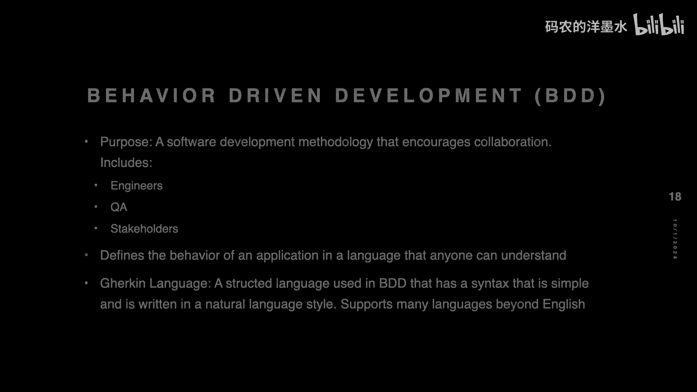

So here I'm just using the calculator code。And then。All their German languages written in the file。

With the file extension dot feature， so here I've calculated that feature。

 it starts with feature and in the name of your app。And if you end that。

 and so scenarios that are just。It's kind of like test theses， but they call them scenarios for all。

Behavior group development。Do we're testing adding two numbers together。And， if you can see。

The key words were this language is。Highlighted in purple。

If I didn't want to like use English and I' want to use Spanish or something occupy。

Change this to Spanish and it will still be able to recognize it。

Now the statement given I have a calculator。When I add a。They1 of five together。

Then the result was 15， so。Should be 15。😊，So I'm going to use a tooling called PT dash BDD。

 which is just a plugin for PT that helps with behavior driven development。So basically。

 what we're just going to do is。Kind of pursese this。This feature file and test cases。

Which I'm going to show off right here。TheFirst thing I do is import pie test because it's a pie test plugin。

Get from P test BDD unaving scenarios。Given when and then。And also the parer。

Then I'm just reporting the calculator class from calculator。

And the scenario function from a PyBD is just reporting all the features and all the scenarios from that feature。

Here I'm using the decorator given。And here it's parsing the text， I have a calculator。

And I'm making the target fixture calculator， I'll explain now。

Why I made a target fixture calculator and what that is。So， basically。问 test啊哔哩哔哔。

See the text are given。I have a calculator it's going to do this specific function， which is。

I return calculated？I did that。When。And I'm going to use a parsel for this。

I could probably hard code。I had two numbers 10 and five， but I want。I want to be like modular。

 so instead of hard coding like 10 and five into the personr I。I use a。Li curly brackets。就。

A colon D just refers to whatever is in this this slot right here is decimal。do same thing for B。

And you do say anything on my current picture， which I shall explain soon。

So basically whenever it sees。This string after when。I add a number and then I add a B number。

To call a dysfunction and so I pass calculator to it。Which is grabbing from this picture it out。

Calculators returning。And I pass A and B to it。And I just test A and B。

Or I just return calculatedalculator add A and B。Which is going to be returned to this result right here？

Which I'm going to pass to the final function。I'm just doing the same thing。The decorator then horse。

Here I'm just parsing down expected results。Which is gonna be a。

And here I pass results from this add function。And I pass expected results。And here says I'm。

Asserting the results with the expected results， I don't really have to make another target fixture。

Pass on this check result。Which is why。I don't put it there here I'm testing it passes because。

The test result should be 15。And T plus5 is so here I just wrote。

All the other scenarios tracking two numbers is written in the same kind of formatting。笑。

You explain a scenario， describe a scenario， and using these keywords。

You could write like any kind of text afterwards as long as you parse it correctly， the high test B。

走。Just copy and pasteed the most of it。They are copy and pasted。

Lsa does attract multiply and divide functions。And here they all return results。So check口咗。

I then it passed。

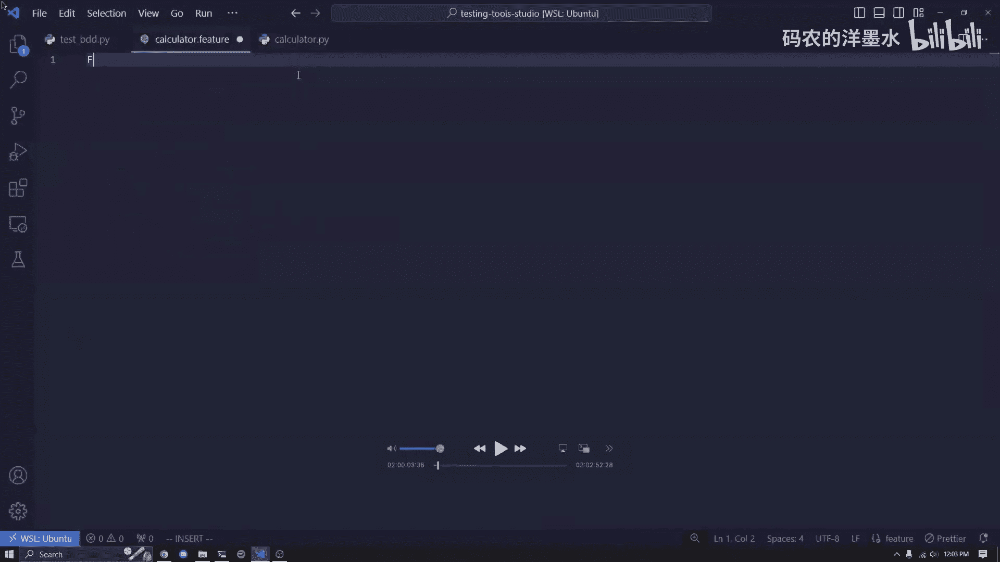

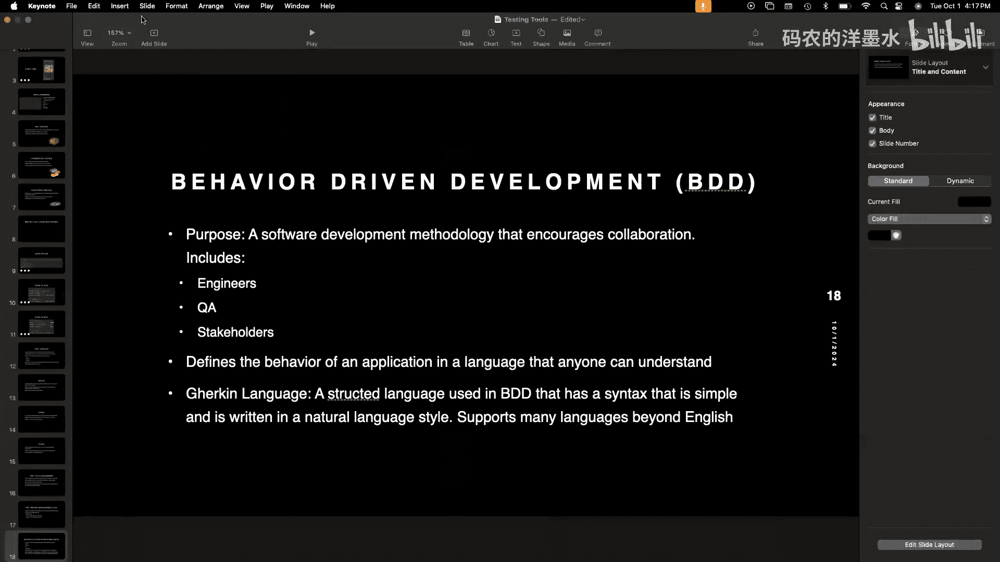

So a really cool thing about this things。哦。If you're like， you know。

 anyone without any col knowledge， you could write kind of that file up and then a software engineer would parse that for。

And y'all could like communicate and work with each other。

 I know like the tech industry feels like you kind of have to be tech literate。To kind of like。

Be a stakeholder and like suggest ideas。 I know like weva her like the stories of like。

Investors like wanting crazy like。Applications and stuff and this kind of helps bridge the gap between the back end and the front end。

 I guess。So I have an assignment for y'all just。Ill write two unit tests or two integration tests or two functional tests in name。

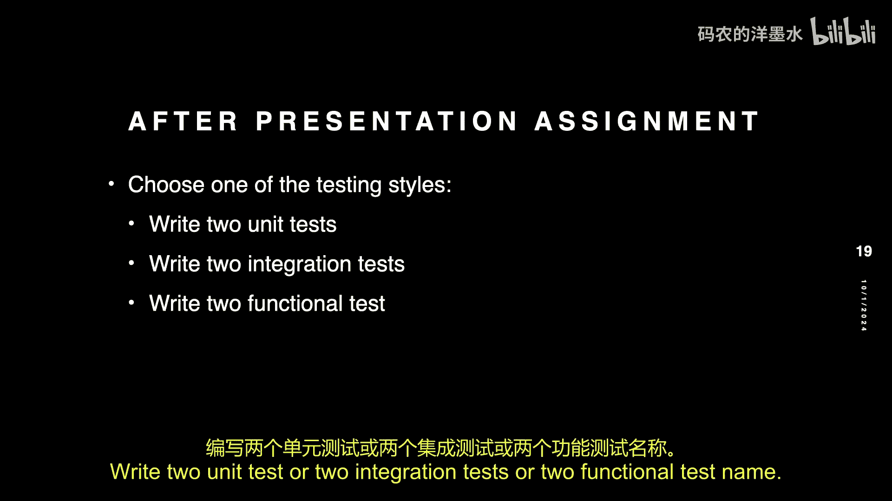

As a starter code forre all， I'll just be explaining that。

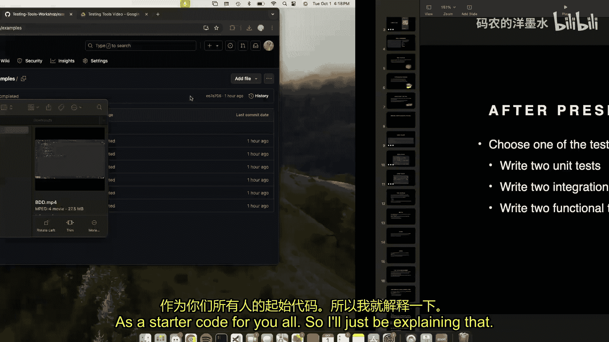

That's in our GiHub repo on their assignments。So you got the help class right here。

 so your withdrawal。呃 my I to account deposit。I check your ballots。Then a level up， I have bank。

不 hell了。Bridge is like the integration gap， so it integrates with account。

And here you could create multiple accounts and you can。Grab an account with a get account。

And then a little step above that is the bank API。Which allows you to。When I heard like this code。

 but you can communicate over the internet， but for this code did。You can't， You got to use。 I mean。

 you don't have to use a test， but。As what I'm kind of expecting y'all。Here's the important imports。

So in order to install all of this， you need to at least a Python version 3。8 or higher。

Then you install PyT test with this command。Fast API with this command and then HtPx with this command。

And then you could really choose your level of。Where you really want to test so if you want to do like unit testing you try to just focus on accounts。

 you want to do integration testing you probably do banks and accounts and then if you want to do function testing you would。

那不咧。The whole API and run with it so ironically。I didn't test any this code， though。

If y'all find like any bugs， then it's kind of like no treasure for all。

Really doing some testing out there。

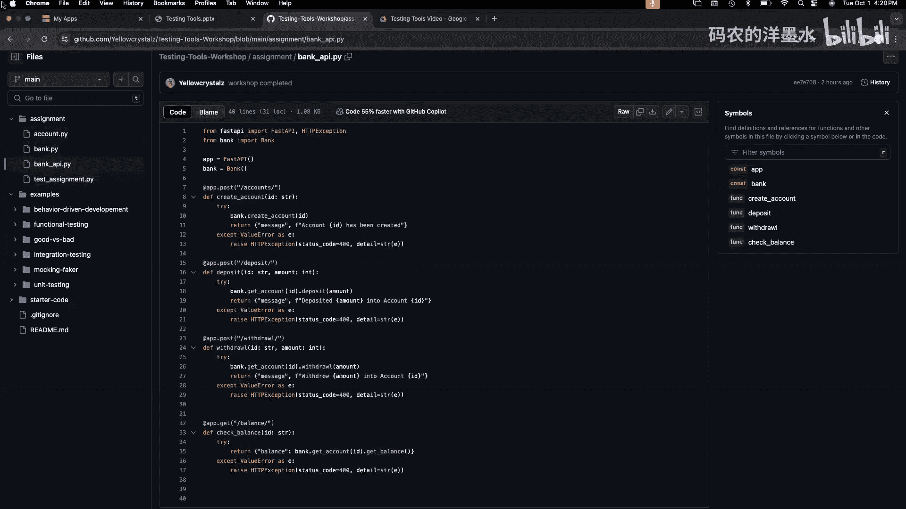

我'这。😊，Any questions？So what's the distinction between mockth data and fake data？The moretta is。

Both of them are laid out。Like they the similarities I'm going to tell you one similar the and then answer your question。

 both of them are kind of like a copy of you know， the library of the code。

 the original code that you are working at。Morgan。Is。嗯m。What it does。

 what it checks is the behavior of the test of the function， it checks if it pass。

 it checks if it you know like kind of the functionality of the test。

 but it's not hurt like it doesn't check how long it takes it doesn't check like like any value unless you put value。

 it won check any value which would you check if it works or if it didn't work。

Fker is is real value that you are expecting a value like like the result of the function。

 the difference is。I faker like it doesn't check functional it doesn't check of course。

 if we check if it passed or didn't pass or it's mostly。to check if you with a certain value。

 you get the results you are expecting because normally Fer is use like when it's a really large code。

 itll really large library a really large like you know like main like that is too big to be actually tested because it would take too long or it would take like it would tell you if it's working or not because it could just you know skip it and don't tell you if you have a mistake on that code。

I figure it would take the value， like a range of value that you actually ask him to。

 like between Cheron 10 or between 100 to 5000。So when might it be a good idea to use mos versus fakes？

嗯。Ms， are we using on unit tests。Thankss， I will use it on。less you say。

And the like presidential elections that you would like that you have like， you know。

All the US is since votinging and you need to actually make sure that， you know。

 like your state is like， you know， like it will tell you like how many like with a random like number。

 how many like went to thatation。But as I said。You know， like。Fakker is for the large leg code。

Like mos， it doesn't matter like if it's large or small。

 and just check if it passes or not if it works not。That。Okay。

It's likely over the course of the semester that you will all have to， for instance。

 mock data because if another pod hasn't delivered something that your code base is going to require in terms of being able to produce a solution。

 you lock the results for your own evaluation until you can integrate their code with your code。

Just think that wasn't clear or not。Also， does anyone else have any questions about any of the kinds of testing。

 human testing， functional testing integration testing？嗯。我送 like and得嘅好。Oh， I closed it。

But on our GiHub， I like starter code if you like want to rewach a video and follow along with me because。

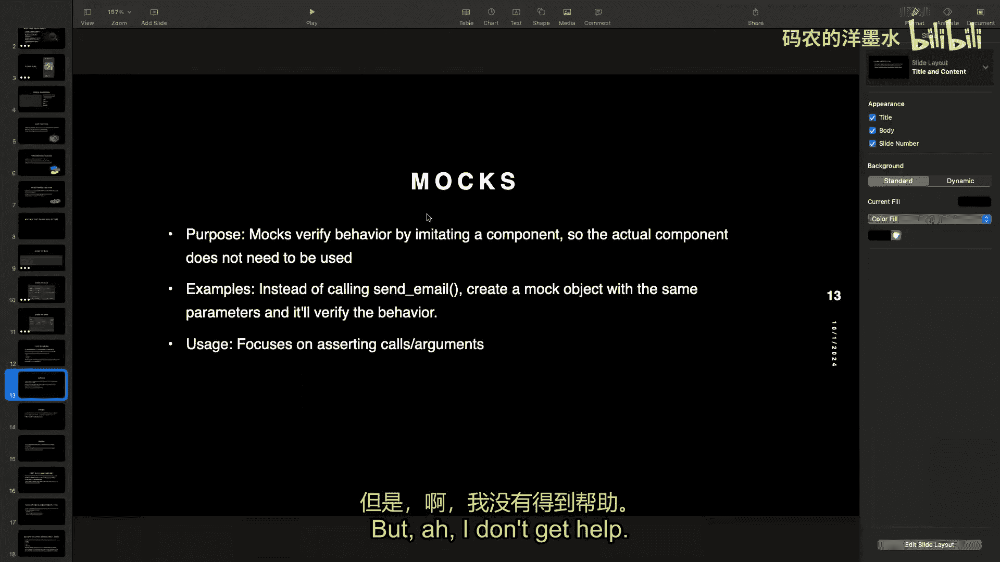

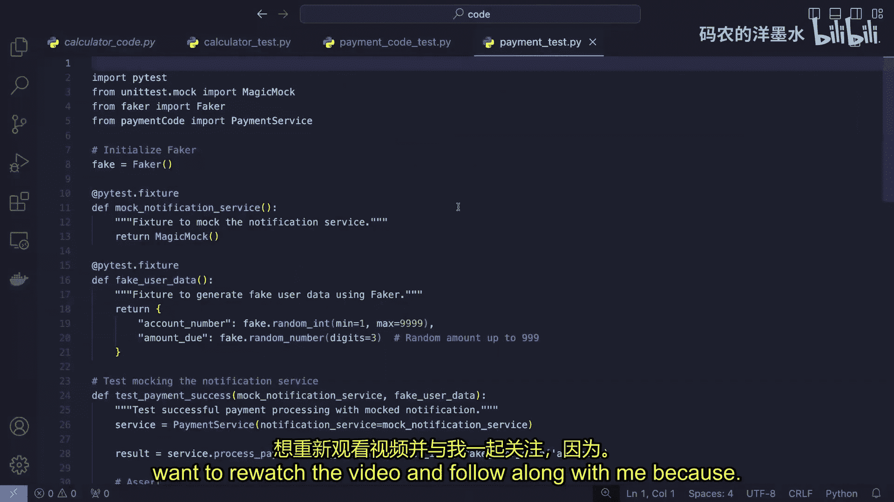

I kind of like skipped through it and just。Kind of like copy and pasted the bunch so if you want to go back I provide like start code and I provide the final result so if you want to compare and for Tra those two have it on our GiHub。

Okay。本金。

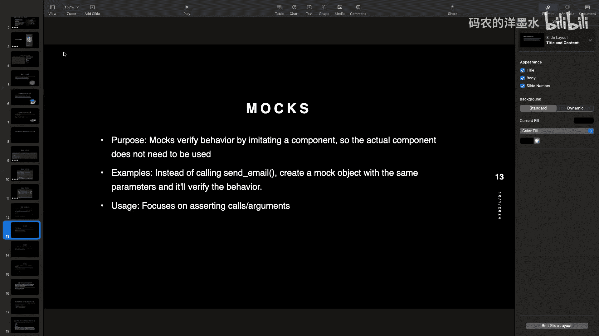

嗯，对。

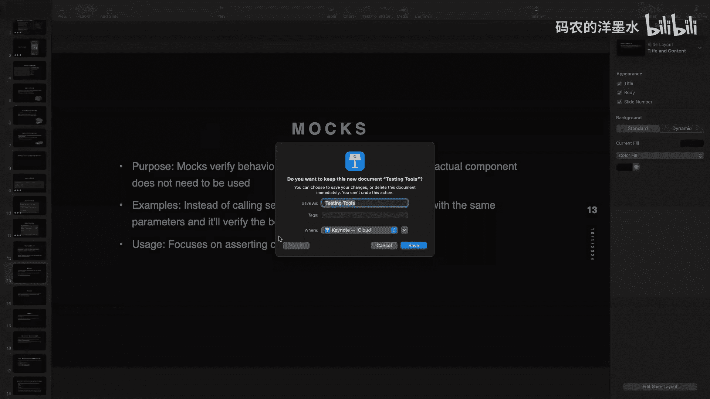