# 软件工程：第4讲：软件测试 🧪

在本节课中，我们将要学习软件测试的核心概念、不同测试类型以及如何使用 PyTest 等工具进行有效的测试。我们将从单元测试开始，逐步深入到集成测试、功能测试，并介绍测试替身、测试驱动开发和行为驱动开发等高级主题。

---

## 概述 📋

软件测试是确保代码质量、防止错误和优化性能的关键环节。通过编写测试，我们可以验证代码的各个部分是否按预期工作，并在代码修改后快速发现问题。本节课将系统性地介绍测试的层次、工具和最佳实践。

---

## 单元测试

上一节我们概述了测试的重要性，本节中我们来看看最基础的测试类型：单元测试。单元测试专注于验证代码中最小可测试单元（通常是函数或方法）的正确性。其核心思想是将代码分解为独立的模块进行测试。

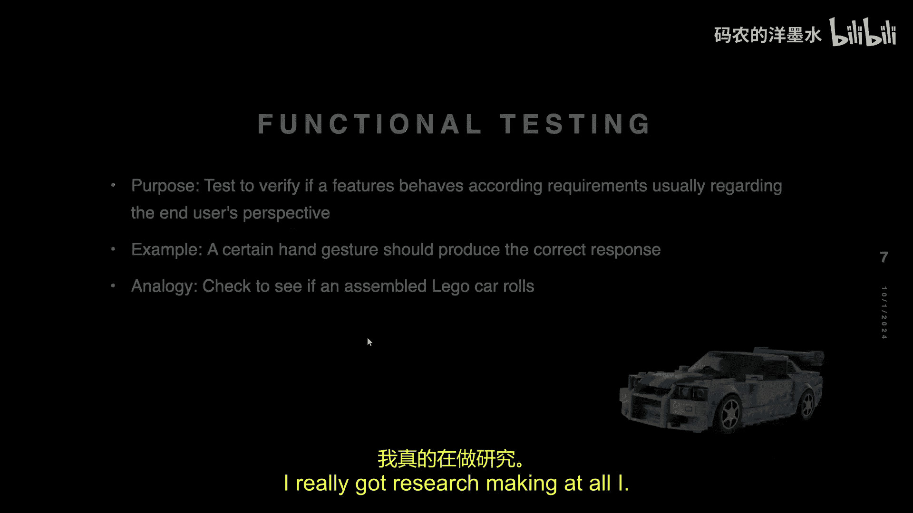

单元测试的主要目的是确保每个独立的代码单元都能按预期运行。例如，对于一个执行加法运算的函数，单元测试会验证其输入特定参数时是否能返回正确的结果。

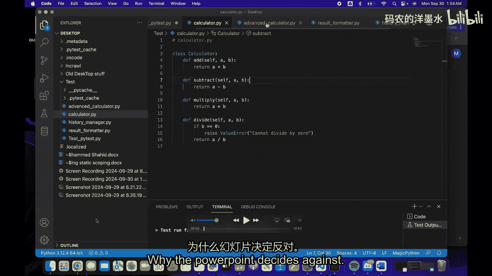

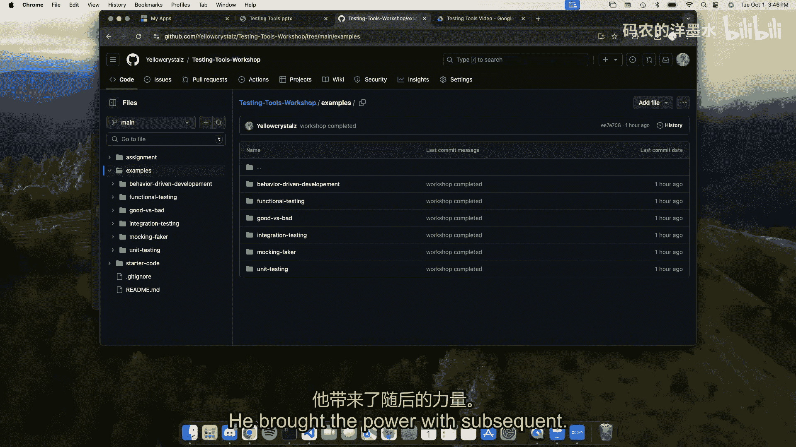

以下是使用 PyTest 编写的一个简单单元测试示例：

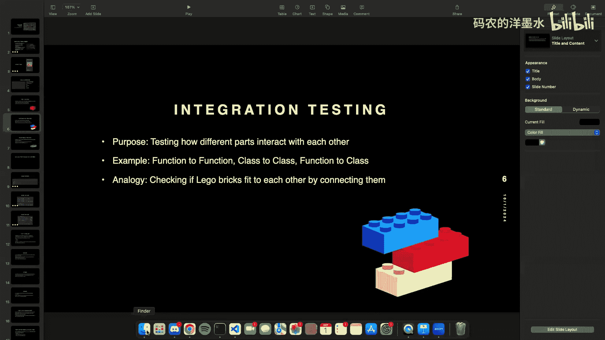

```python
def add(a, b):
    return a + b

def test_add():
    assert add(2, 3) == 5
    assert add(-1, 1) == 0
```

在 PyTest 中，我们使用 `assert` 语句来声明预期结果。如果断言失败，测试将不通过。

---

## 集成测试

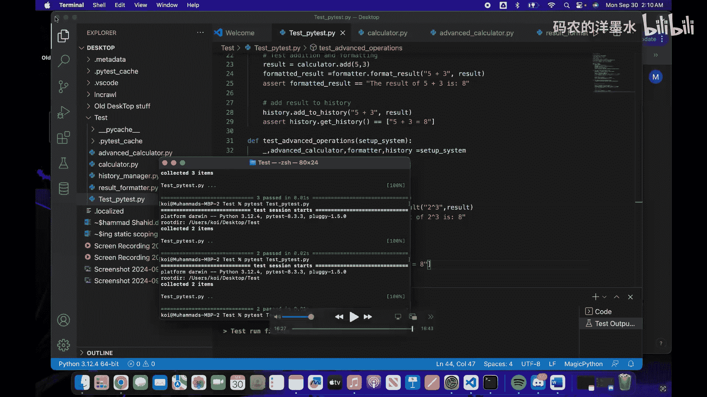

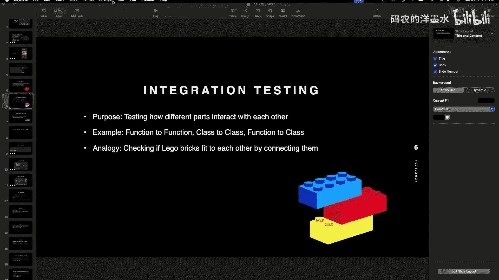

在确保各个单元正常工作后，我们需要验证它们组合在一起时是否能协同工作。这就是集成测试的目的。它关注不同模块或组件之间的接口和交互。

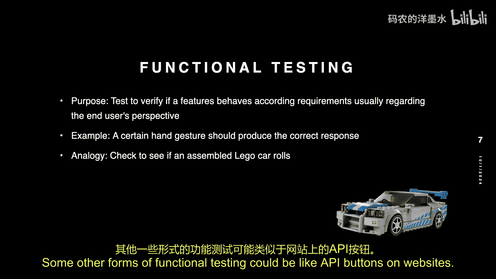

例如，一个计算器应用可能包含独立的运算函数、历史记录功能和结果格式化功能。集成测试会检查这些功能组合使用时，整个计算流程是否正确。

以下是一个集成测试的示例，它测试了计算器多个功能的交互：

```python
# 假设已有 Calculator, History, Formatter 类
def test_calculator_integration():
    calc = Calculator()
    history = History()
    formatter = Formatter()

    result = calc.add(10, 5)
    history.add_entry('10 + 5', result)
    formatted_output = formatter.format(result)

    assert result == 15
    assert len(history.get_entries()) == 1
    assert formatted_output == 'Result: 15'
```

集成测试对于验证 API 连接、数据库交互等场景尤为有用。

---

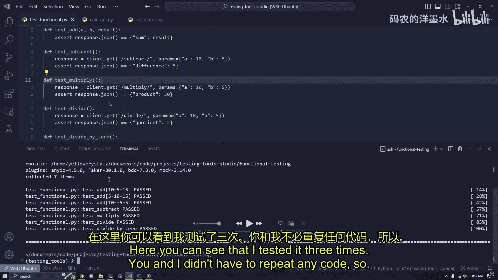

## 功能测试

单元测试和集成测试关注代码的内部结构，而功能测试（或端到端测试）则从用户角度出发，验证整个软件系统是否满足业务需求。它是最高层次的测试。

用一个乐高积木的比喻来说：
*   单元测试：检查单个积木块的质量。
*   集成测试：检查积木块之间能否正确拼接。
*   功能测试：检查拼好的乐高模型（如一辆车）能否正常滚动。

在 Web 开发中，功能测试可能涉及模拟用户点击按钮、填写表单并验证页面响应。

以下是使用 PyTest 和 `TestClient` 对 FastAPI 接口进行功能测试的示例：

```python
from fastapi.testclient import TestClient
from main import app  # 你的 FastAPI 应用

client = TestClient(app)

def test_add_endpoint():
    response = client.get("/add?a=10&b=5")
    assert response.status_code == 200
    assert response.json() == {"result": 15}
```

这个测试发送一个 HTTP 请求到 `/add` 接口，并断言返回的状态码和结果数据符合预期。

---

## 测试替身

在进行单元测试时，我们经常需要隔离被测代码，避免受到外部系统（如数据库、网络服务）的影响。测试替身就是用来模拟这些外部依赖的对象。

以下是几种常见的测试替身：

*   **Mock**：模拟对象的行为，用于验证交互（如某个方法是否被调用、调用参数是什么）。它不关心功能实现。
    ```python
    from unittest.mock import Mock
    mock_email_service = Mock()
    mock_email_service.send_email.return_value = True
    # 测试代码会使用 mock_email_service 而不是真实的邮件服务
    ```
*   **Stub**：提供预定义的固定响应，用于模拟特定输入下的输出。
*   **Fake**：一个轻量级的、功能简化但可实际工作的实现，通常用于替代缓慢或复杂的真实依赖（如内存数据库）。
*   **Faker**：一个生成逼真假数据的库（如随机姓名、地址），用于在测试中快速构建测试数据。

**Mock 和 Fake 的主要区别**：Mock 主要用于验证行为（是否调用了某个函数），而 Fake 是一个实际可工作的简化实现，用于模拟功能。

---

## 测试驱动开发与行为驱动开发

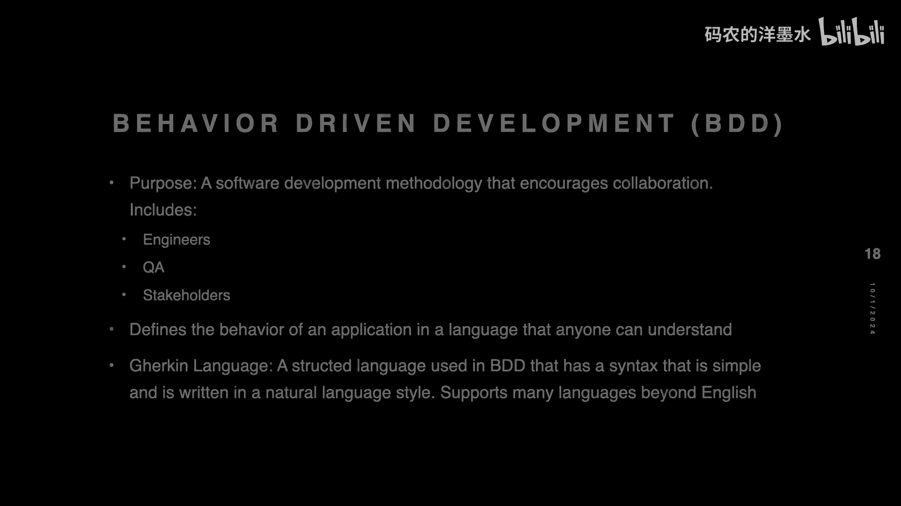

### 测试驱动开发

测试驱动开发是一种先写测试，后写实现代码的开发流程。它遵循“红-绿-重构”的循环：
1.  **红**：编写一个会失败的测试（定义需求）。
2.  **绿**：编写最少量的代码使测试通过。
3.  **重构**：优化代码结构，同时保持测试通过。

这种方法有助于提升代码设计质量和可测试性。

### 行为驱动开发

行为驱动开发是 TDD 的延伸，它使用一种近乎自然语言的领域特定语言（如 Gherkin）来描述软件行为，促进开发者、测试者和业务人员之间的沟通。

一个 Gherkin 特性文件示例（`calculator.feature`）：
```gherkin
Feature: Calculator
  Scenario: Adding two numbers
    Given I have a calculator
    When I add 10 and 5 together
    Then the result should be 15
```

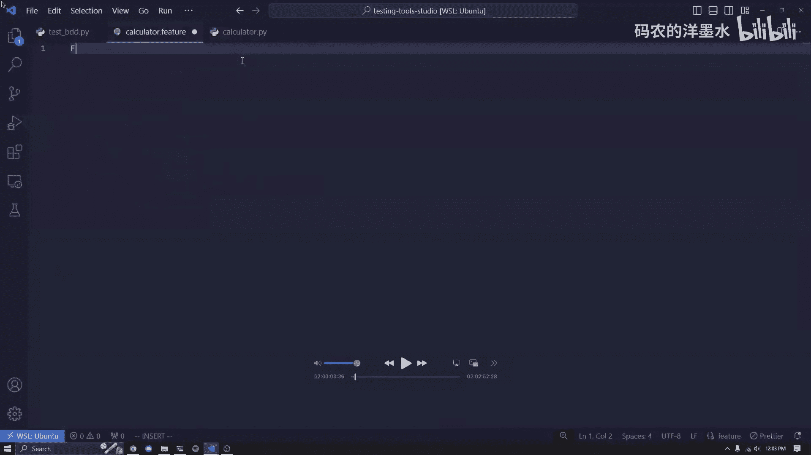

然后，可以使用 `pytest-bdd` 等工具将这些描述解析并转化为可执行的测试代码。

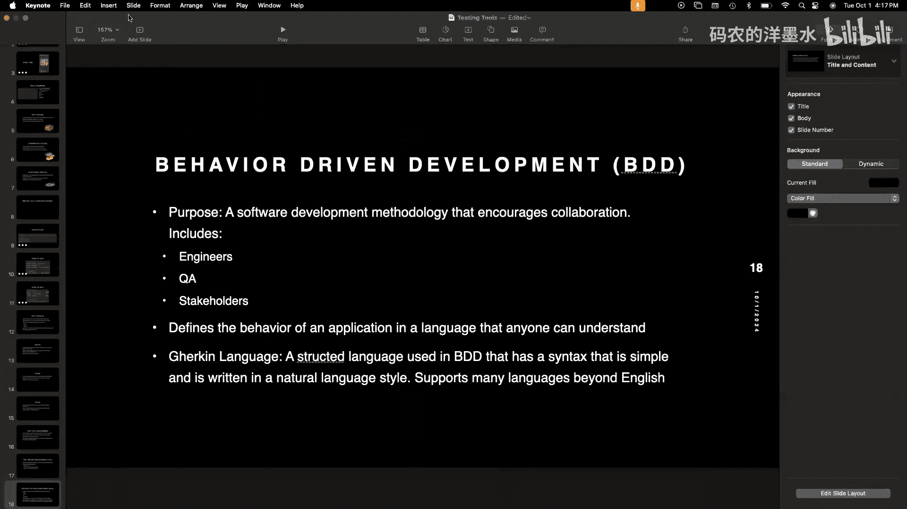

---

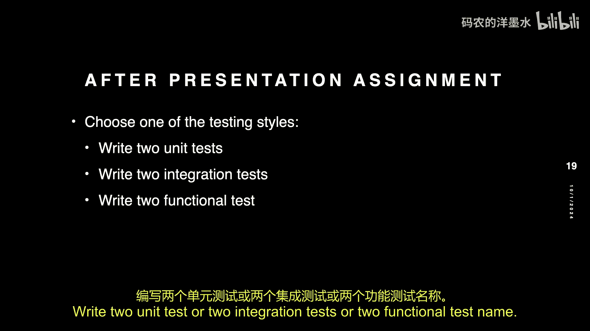

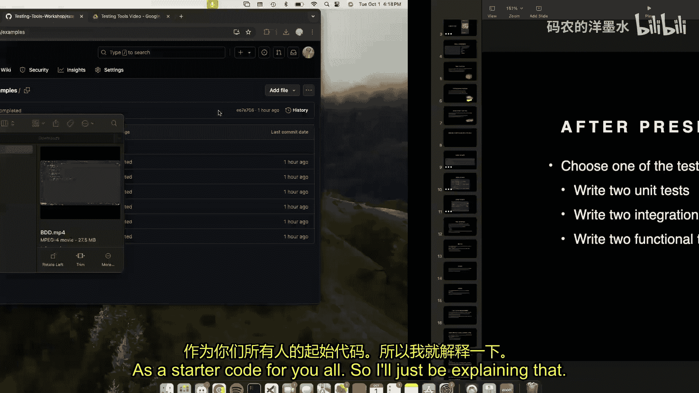

## 测试代码编写建议

编写清晰、可维护的测试代码同样重要。以下是一些核心建议：

*   **保持测试独立**：每个测试应设置自己的环境，不依赖其他测试的状态。
*   **命名清晰**：测试函数名应明确描述其测试的内容（如 `test_add_positive_numbers`, `test_withdraw_insufficient_funds`）。
*   **遵循 AAA 模式**：组织测试逻辑为 **准备（Arrange）**、**执行（Act）**、**断言（Assert）** 三个阶段，使结构清晰。
*   **避免过度断言**：只断言与测试目标直接相关的内容，无关的断言会造成干扰。
*   **利用参数化**：当需要用多组数据测试同一逻辑时，使用参数化测试避免代码重复。

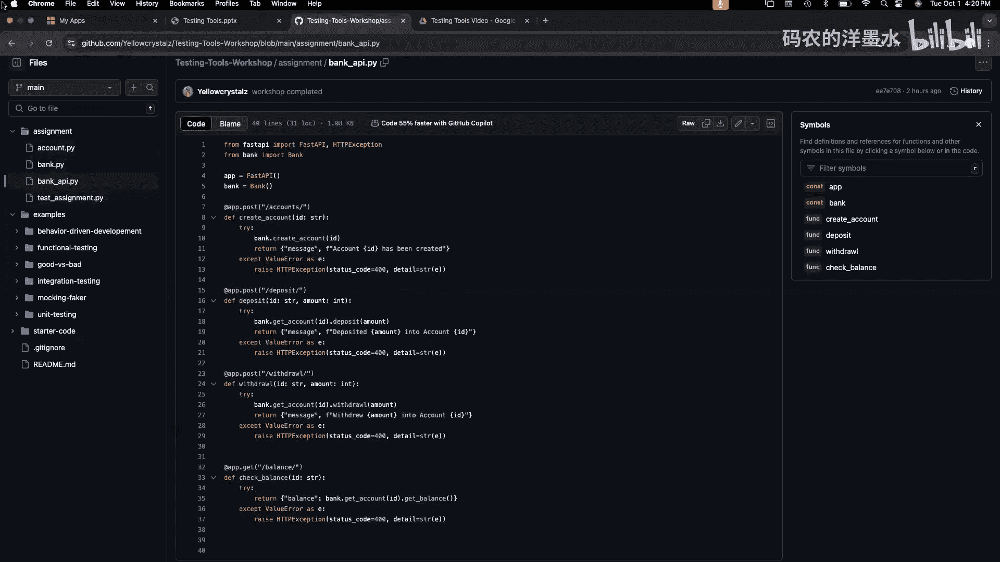

PyTest 参数化测试示例：
```python
import pytest

@pytest.mark.parametrize("a, b, expected", [(1, 2, 3), (5, -5, 0), (100, 200, 300)])
def test_add_multiple_cases(a, b, expected):
    assert add(a, b) == expected
```

---

## 总结 🎯

本节课中我们一起学习了软件测试的多层次方法：
1.  **单元测试**验证独立代码单元的正确性。
2.  **集成测试**确保多个模块能协同工作。
3.  **功能测试**从用户视角验证系统整体行为。
4.  **测试替身**帮助我们模拟外部依赖，实现隔离测试。
5.  **测试驱动开发**通过先写测试来驱动设计。
6.  **行为驱动开发**用通用语言描述行为，促进团队协作。

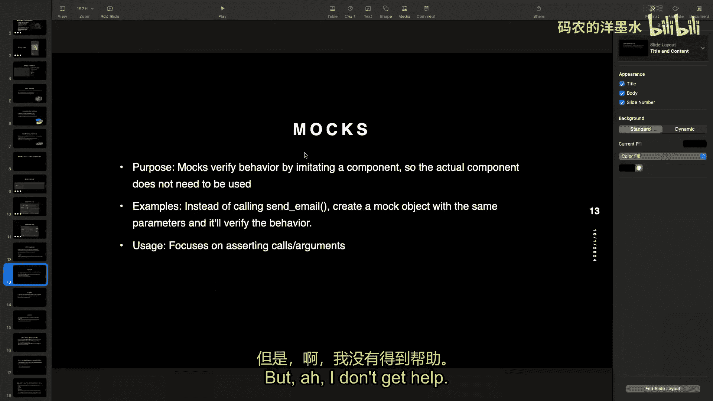

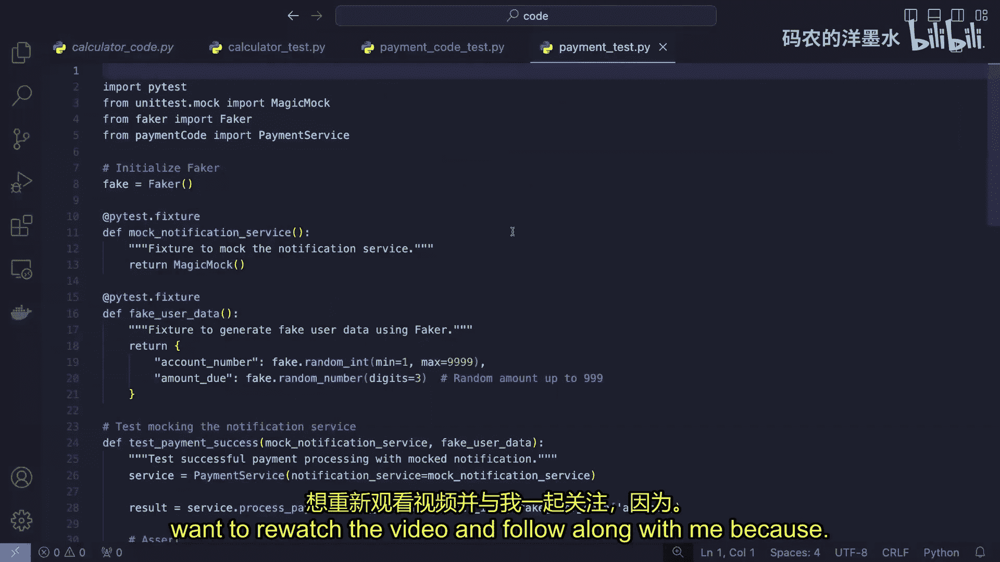

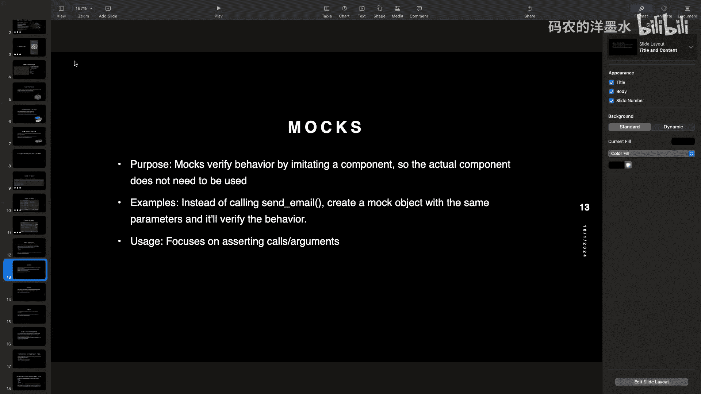

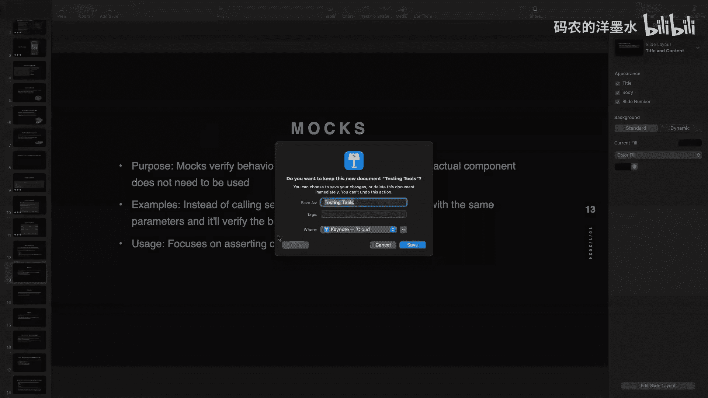

掌握这些测试理念和工具，能够显著提升代码的可靠性、可维护性和开发效率。实践是学习测试的最佳方式，建议从为一个小功能编写单元测试开始。