# 【全集】加州理工学院 软件工程 中英字幕 1080P p05 Lecture 5 - Git版本控制 -BV13ZzaB3EWE_p5-

Go to enter presentation。

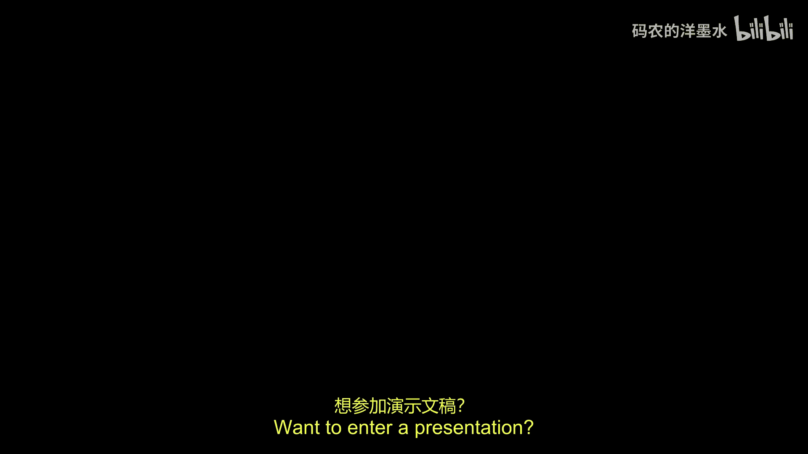

So whenever you're ready， you can go ahead and I fine。I want to enter representation mode。I 11 in。Oh。

ItThere's no real。没题。Do you know how to enter full screen on your for of presentation。

 I'll try this but play。right next to you？Over there there go， there we go。Yesep。

Now I'm just getting a white screen on my Zoom just know so I don't know if you're sharing your screen or Q& sharing for application。

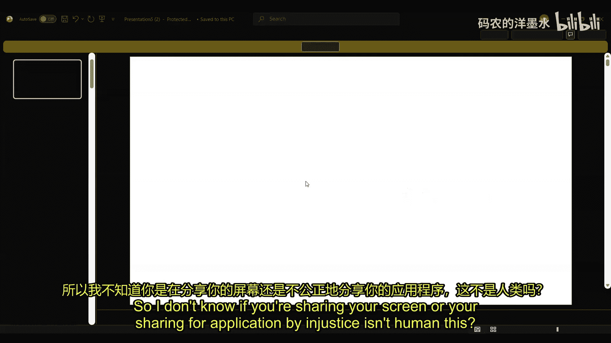

that fix it。All right so I'm Harris， this is Eddie and we'll be presenting on version control specifically get。

Yes。Canly。Okay， we'll be going through the agenda first。First things first。

 we'll be going over the importance of version control and the best practices。

Then advanced branching strategies。Emerging techniques。They're basing， resolving conflicts。

Advanced G commands and techniques。Best practices and pitfalls。

 and then we could also go through interactive tutorials。Now， first， let me just。

Give off a brief historical introduction to make sure that we know that， you know these are。

These were tools made by real people。So Git was first founded in 2005 by Lenus Torvalds and it was originally made to manage development of the Linux kernelel and GitHub was founded in 2008 by Tom Preston Warrner。

 Chris Wetra and PJ Hitt， and it's built to make Git more accessible。Now GitHub， what are they？Well。

 Git is used to track changes and source code or any files over time。

 and it runs locally on your machine。And GitHub is a web platform for hosting Git repositories and it's online and accessible from anywhere used for collaboration and management。

 and I just wanted to point this out because this was confusing when I first started learning Vi control a while ago。

GitHub are not the same thing Git is the underlying system。

 underlying control system and GitHub helps make that system more accessible。

So a basic setup just in case for those who have their laptops。Or。

For those who have the laptops or personal laptops。

 whether it's Mac Windows you could open the terminal or the command Pro and just type in gett dash dash version just to see if you have get installed I'm pretty sure you do。

 but just in case。And。You could also for those who haven't made a GiHub account you could make it one right now and optional which this could be really useful you could also download Gitthub desktop it's very convenient and simple to use it basically has the core functions of a lot of the stuff we go over but。

Just to make sure y'all know that we'll be working through the command line interface through this lecture we'll be speaking we'll be going over commands that you'll use directly through。

For Git in this lecture， so Gitthub desktop is not a replacement for these for Git entirely。

 but it's something that's very that makes Git more accessible and easier to use。

So first let me just go over the GitHub fundamentals very quick。

 so before we go over Git a basic setup creating a repository through GitHub。

 it can be created either through GitHub website or the GitHub desktop app and it can also be created through through Git。

And there's also an option of cloning repository through GitHub because we have to remember this is just a website。

 a web app that hosts Git repositories that's the main reason。That's the core function of GitHub。

And we have this concept of forking it's making it's being able to copy a repository for your own。

That is。Your own personal copy of the repository that doesn't affect the main repository at all it's making changes through your own repository of the Git project and this is how people make contributions towards open source projects you would you would copy the repository to your own computer you'd have your own personal repository and you could make you could either make changes to contribute towards the open resource project you could make a pull request see if your changes would be approved or not and there's also just the ability to make changes for personal use maybe you just want to copy this repository and being able to just mess around with it or make changes on your own for your own personal device and there's also certain permissions you could give to people。

such as the read access type， people that can only copy or read in from your repository this is a write access type where people can write to the repository make changes。

 there's the admin which can do which has a lot of control over the repositories is a maintainer。

 which is also something that we participate in with the capstone in GiHub， which has。

Which is access type for a specific repository and there's a collaborator which can also read and write。

Now let me just go over Gi Hub desktop right quick since I mentioned it earlier and it's it's something that's really accessibles something that's really convenient here's a quick overview。

GitthHub desktop is a guI that simplifies using git making it easier to do the core functions of git such as committing pushing pulling and branching without needing to type in any commands GitHub desktop is not a complete replacement to gi as it says as I said earlier as it lacks more advanced features that will be going over in this workshop such as cherry picking I can also。

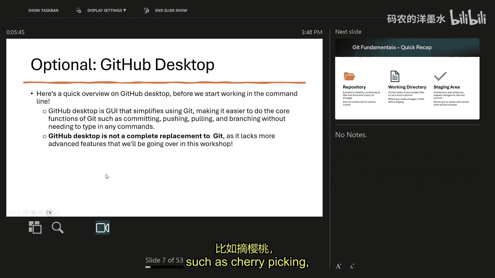

Pull up the Gi desktop app just to show y'all the interface。Thank you。

Drctor Ted you see on zoom Github desktop yes okay so just to go over here this is a desktop tutorial a repository。

 this is how Github desktop looks like when it's installed in your device you can see right here like we've gone over like also the documentation team has gone over you can make。

Comments about what exactly you're trying to push into the repository you could。

Give a description a summary you can commit it before it completely pushing it to the repository there's a history which is easily accessible you could see all the history of the repository all the changes that were made you could see right here。

You could fetch origin so you could pull or push anything that's going to the repository and also you can make a new repository add local clone repositories and I just wanted to point out when you're making a new repository this could be done to get or Giub desktop there's something called to get ignore it and I think it's really important like one example is when I was using when I was trying to make a game in unity a long time ago and I was collaborating with people in this。

I guess。In Xbox game camp， it was in high school a while ago and we were trying we're collaborating through GiHub and。

There was this little accident that happened we never actually did it get ignoring anything so every time we tried to push or pull any changes that we made it would leave this huge file and we didn't know exactly what we were doing I was just learning Viin control then but it's really important that you do this at the start of your at the start of your project。

But yeah， that's a Gitthub desktop， it's just really easy to use and it's something that's could be nice as a beginner。

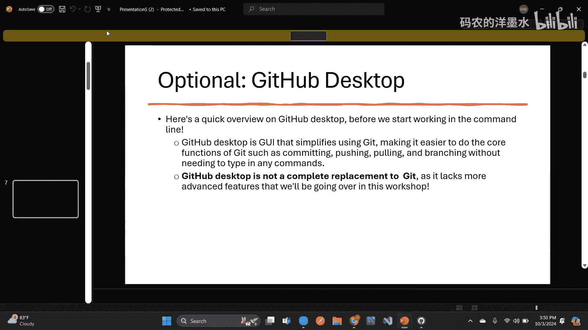

嗯。

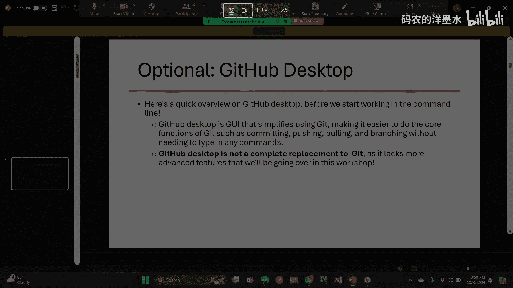

不是。Okay， let me go back to you let saying。All right， so let's cover the get fundamentals again。

 so a repository， so a repository is a project directory which contains all of the files and the entire history of changes that were made in that repository and it's basically your central hub for version control。

A working directory， a working directory is the current state of your project files on your local machine。

 and it will be where you make these changes to the files prior to staging those changes。

Then the staging area is a temporary area where you can prepare changes for the next commit。

 this will allow you to review and control what you will be including in your commits。

So let's cover these basic commands that most of us probably already know。

 we have Git and it which will initialize a brand new Git repository and then we have the clonelogne command which will cologne a repository that already exists on local machine。

 we have Git addd this is where you can stage the changes that are ready to be committed。

 we have get commitmit dash stem which is saving the age changes with a descriptive message so basically here we're just saying what changes we made in a very descriptive manner which we will get into later gett push which we'll upload our commits to a remote repository。

t pull which fetches and merges changes from a remote repository and then Git status you can basically check the status of your working directory and staging area to see what's actually included what's not included and then gett log which just shows you the commit history。

So why is version control important so the three reasons why it's really important to learn and get really good at version control is' because it enhances collaboration。

 it maintains the integrity of our code and it will streamline our workflow。

So how does it enhance collaboration， it allows for multiple developers to work simultaneously without the risk of overriding each other's changes。

And then it also allows us to track what changes were made， when they were made， who made them。

 why did they make them？Which is。Basically， every change is recorded with who made it and why。

It also provides us with the ability to commit code reviews。

 which will facilitate reviewing code changes prior to them being merged and ensuring that everything is up to date with our standards and is working properly。

Because we don't want to just be the only person we're doing the code。

 we want fresh eyes to look at it and make sure that it's functioning well。

It maintains code integrity again through version history。

 it allows you to revert to previous versions， say we're making a calculator app。

 somebody adds a function to do addition but they they don't account for integer overflow so we want to make sure if they push that that we're able to revert and so on and so on and it also helps in resolving conflicts which we will get into later where we can have merge conflicts where people are editing the same file in different branches。

And it streamline workflow by managing different versions and releases in an efficient manner。

It has continuous integration and continuous development support。

 which a tech workshop will be presented on in the future about and then branching strategies this will allow us to organize work through branches that are for different features。

 different hot fixes and it's just a great way to organize our repository。

So some best practices when you're submitting code。

We want to make sure we have descriptive commit messages normally where we might be used to working on a project by ourselves where we can just make abbreviations make something and we assume ourselves to know that but now we're working with multiple people。

 multiple teams we want to make sure we have standards and we want to make sure these commit messages are as descriptive as。

We want to clearly explain what changes we made in this committee and we also want to。

Give motivation as to why we made these changes so one example is instead of a commit messaging add validation you should update it to the add validation for user email input to prevent sQL injection you see the differences there it's much more descriptive and whoever's reviewing the code whoever's looking at the history they have a better understanding of what's happening and why it's happening。

We always want to use commands such as fix add update there are even many more that well get into and we want to make sure these are consistent we don't want one person using one person of commit messages one。

看 of way。Example so example would be like adopting a team standard we want component we want to hatch and then there's an example UI update NAvbar styling this will make facilitate this will facilitate code reviews faster it will be easier to look at our history look at what changes are made so basically everybody will be on the same page at this point。

And then we want to make sure we have frequent commits。

The last thing you want to do is write 2000 lines of code， go to submit it。

 and you have a bunch of resolutions that you need to solve。

And we want to commit small and logical chunks of work out there in the real world。

 a lot of companies， they advocate small PRs， they don't want 1000 lines of code being submitted because this will take forever to review you don't want your manager spending a day reviewing your code nobody wants that so for example we want to commit after completing a function or method and testing it we don't want to go add 10 functions submit them and then leave them up for review。

And this will also allow for easier reverts in the future in case our master branch runs into a problem so we can revert a single commit that introduced above without overriding other changes that we made。

And this also provides for better tracking， as I said before。

 because it enhance our ability to track progress and identify any issues that arise。

And we want to make sure our branches are always updated you don't want to get into you don't want to start working on a file work on a file for three four days without doing pull requests my advice would be to pull as frequently as you can always pull。

And this will make sure that our branch is always current and up to date。And then yeah。

 it'll minimize the risk of merge conflicts and it'll ensure their integration of our work with the team's efforts。

So let's get into some dangers of improper gate usage the three dangers are merge conflicts the risk of overriding work and losing code and history so merge conflicts they take a lot of time to resolve usually and resolving conflicts they're oftentime time consuming and frustrating we don't want to spend our entire work they trying to resolve a conflict that we could have prevented in the first place by using proper standards of version control。

And then also risks above， so we have a00 lines here。

 we have a thousand0 lines here we're trying to merge them and resolve these conflicts。

 we may mess something else up in the progress in the process of doing this。

Just like we might be able to， for example， my override work。

 be careful using get push force as if can erase other people's commits。

And we want to make sure that we're pulling these changes because failing latest changes will cause conflicts。

It most definitely will all of the time if you if you're working on a file for three days and you haven't pulled there's like 80% chance that it's going to result in a conflict because somebody else may be working on that file too。

And this， again， will result in loss coat industry。嗯。

Okay so now we'll go over to even mentioning branching and branching so let's go over branching introduction to branching what is a branch it's an independent line of development and its purpose allows isolated development without affecting the main code base now let's go over the benefits of branching isolated development safely developed features or fixes such as working on a new login feature without impacting the existing login system it also gives a parallel workflow multiple branches enable simult work different teams working on frontend and backend simultaneously and simplified merging easier integration of changes when ready such as merging a completed feature branch back into main。

So get flow the transfer ruless， we could go over。The the ruless that what exactly happens when you're doing branches is there's the main branch。

 which is the production ready code， it's something that Harris mentioned。

 you should always be pulling from and it's essentially the main the main branch were of the project。

And then there's the develop the integration there's the develop role which is the integration branch for development then we have our supporting branches。

 the feature branch which is created from develop we have release branches。

 prepare for production releases which prepare for production releases。

 we have the hot freak branches which are immediate fixes to the main branch and we have guidelines。

That we use。Such as the stable main which keeps main clean and which keeps the main branch I'd like to say when I'm mentioning main it' the main branch which keeps the main branch clean and deployable we have pull requests which used for me to facilitate reviews and another guideline is consistent workflow following the model to ensure team alignment and a use case which is a use case and example is coordinating multiple releases with overlapping development cycles in a large project yeah so basically getflow is a strategy on how we are going to incorporate these branches into our workflow and after this will dive into another type of strategy which is trunk based development so trunk based development is。

We have a single branch， we don't have a developed branch as well。

 but all developers will commit to name or trunk。And we use feature flags in order to enable or disable features。

 so some advantages of trunk based development over GitF is there's less merg complexity because we have shorter lit branches and then it's ideal in environments that are using constant integration because it promotes frequent commits and testing but some considerations is that trunk based development requires heavy discipline this is a model that's usually used when you have a lot of senior engineers on a team and not a lot of junior engineers。

It needs robust testing and code reviews and another consideration would be its potential instability because direct commits to the main branch can introduce issues if everything is not properly managed。

So the use case， when you want to use trunk based development is in rapid development environments where the continuous deployment is practiced。

And here we have kind of a。A graph to pick the changes differences between trunk race development and get flow。

 does anybody spot any differences that they want to mention？嗯。😊。

All our branches yeah yeah longer branches and get flow you see how we have a developed branch in this meeting so where we're developing our features and in trunk based we have these shorter web branches and the reason for that is because we're committing to maintain or confrequently so。

Who thinks that the trunk based development model would be better for our class and project？嗯。嗯。Okay。

I agree we we don't want to commit ama or chunk frequently at all。

 we want to use pull requests and integrate code reviews and we want to follow this model。Yeah。

So now we'll go over some commands in terms of creating and managing branches。

 we have the list branches， which is just simple gi branch。

 we have create and switch which is get checkout dash B and then branch name we have switch branches。

 which is get checkout branch names leap branches。Get branch， you know。

 dash well the most important thing is that。So we make sure we remember the concepts of what exactly branching is these commands。

 you don't expect neither me or Harris expect you to memorize them。

 there's something that you could always reference either through cheat sheets or through the slides that will be was posting in the Git repositories。

 but they'll be here and if you ever need any help you can ask me or Harrisris。

So let's move on to the next slide， here's a branching tutorial Harris made about that I will show some examples。

Okay， so。We're doing first we have a simple calculator class year。

 we have an initial commit with our addition method and now our stakeholders they want a subtract method I don't know why but they want a subtract method added so let's develop this subtract method using branching。

Ignore to attackoo there is a lot of that reason。So we're in our repository reef。

 we're going to be use funding。Is this I kind right here。嗯。嗯。嗯嗯对。没。ing our first。

 remember what we emphasized earlier elder tax stops emphasized we want to specifically permit messages to the cycle we。

So we're discing this as a national permit。I mean the calculator with a additional functionality。

Okay。Okay， so we met no changes。嗯。So now we're creating a new branch for the CU feature which if we want to language is subtract that we're going to check out and create a new branches and get check out the past new features last contract track。

 notice the name we want to be our of that we're regarding feature andit feature track。

We're going to go ahead and create our batch subtraction method here。嗯。各位诶情况。嗯。嗯好。

Now we're done this future。We haven't really tested it as we should。

 but we will do it in for environment now we're going to go at NSD use changes at Calc thatjabo。嗯。

Now we're going to commit this。Dosing the same。Think my support as attraction functionality。嗯。

Okay know we've had that。Yes。Now we're going to do them get loggged。So to see our gift status。嗯。

And now we're going to wrap our representation of where it all looks like。对谢。嗯。嗯。Okay。

 look get into the next slide。And they said like， here， I just wanted to point out。嗯。2。4号。Right now。

We're going to go ahead and check out past well see upon5 our original Tsatpi Valley there that she down there。

Then also so that's kind how you can sell which branch you are currently are on now we're going to sort that and see that try question that what we can fit in there。

We can go as the cycle tract traction method is there and you can see on the bottom that we are now electricity that tractors as over if can go to the that is to still have ground so we can see that we have horizontal mass bottom maybe we have the same branch on top of the and click on can see the initial competitors that we need then then if we just track the chain that we have be level。

Mline using Git log online graph， or you can just look at it in the source control panel。

 which may be easier because it is a better depiction。没有。没。Okay。

So now after checking out those commands we have， we have our initial graph under left。

And our goal went on the right， does anyone want to take a guess on how we can go from the left to the right using our get commands？

嗯。This is two lines。Give you a hand。Anyone？明该是嗯明该认。

No we're not merg just yet good guess though so first we want to create this new branch don't we so how can we create and switch to a new branch what command would that beH get yep new image right and then we'll have that new image there and we'll be on new image now so how do we get it to drop one level down。

ItIt's not a branch command in specifically it's just the regular committee。Commit， yep。

 do a get commit。And they'll take us from the left to the right and these graphics are actually from a resource that we'll recommend to you all later。

 which is learn get branching。It's a great resource。

 that's literally how I got a good idea of versus and control myself。

Okay so we'll go over now the best practices in branching I just like to point out that you know it doesn't have to be like complicated project you can do something simple as a calculator and still see these concepts such as branching any concepts in version control and it's important just being able to practice。

Practice these commands， practice， reinforce these concepts。

And as it'll be useful as it's hard to retain things without exposure to it so now we'll go over this slide so number one use descriptive branch names as we mentioned before it's really important to be descriptive you want to make sure that you have something that is able to describe exactly what you're doing an example would be featured slash user authentication but fix log and error it's straightforward it's explaining exactly what you've done。

And then we have another point clarity indicates the purpose of the branch， like I said。

 you want to make sure you're very straightforward， you're very clear。

 you're very exact in what you've done to。It's something that。

Has a effect that's outside of code that's outside of program， that's an important thing。First。

 as Harris mentioned， such as code reviews such as your manager。

 making sure you don't want your manager to take up too much time review your code number two。

 we have regularly sync with main with the main branch。

 we want to make sure we pull frequently to make sure there's no we avoid conflicts we avoid merge conflicts。

And as mentioned this as in another point， conflict minimization。

Now we could go on to our third point， limit the branch lifespan。

 frequent merges merge back to Maine when tasks are complete。

 you want to make sure you merge frequently， you want to avoid drift keep branches from diverging too much。

 as we mentioned before and as we keep mentioning it's important to keep keep make sure to keep pulling and keep merging branches make sure they don't diverge too much number four you avoid long liveve branches。

 you want to make sure to avoid integration issues。

 long liveve branches increase merge complexity and as。In a lot of computer science classes。

 we want to make sure we avoid too much complexity in our code and things even like version control。

 we want to avoid stale code， risk of code becoming outdated。And number five。

 here's a use case an example， mergging feature branches into the developed branch after each sprint to keep integration smooth。

Now let's start with。What exactly is merging we've been talking about it it's combining changes from one branch into another it integrates different lines of development it's important because it helps with collaboration it merges individual contributions it。

It helps incorporate new features into the main code base and it ensures everyone is working with the latest code this is core function of get this is。

Why we're using Gi， it to be able to collaborate more easily。And here's another use case an example。

 it's bringing a completed and in testedest feature into the main branch for release。

So now let's go over fast forwardward merging， fast forwardward merging moves the branch pointer forward to the latest commit and occurs when there are no divergent commits between branches。

 characteristics would be when the history remains linear and it's easier to follow and a command example is get merged feature branch and a use case would be a fast forwardward merging。

 a small update when no other changes have occurred。And that we'll go over recursive merging。

The definition for that would be a standard merge creating a new merge commit。

 it's used when branches have diverged。Characteristics would be。It preserves history。

 it keeps the individual commits and it reports the merge event。

 a command example would leak merge feature branch and a use case would be merging a feature branch。

 a feature branch into Maine after both have new commits。And now we'll go over squash merging。

 it combines squash merging combines all commits from a branch into a single commit。

 it merges into mainine while keeping history clean and advantages for squash merging。

 it helps with a simplified history it reduces clutter from multiple commits and it's easier to a feature if needed。

 a command feature， get merge squash feature branch it's followed by gate commit， another command。

 in the use case would be merging a branch with many microcomits into a single commit for clarity。

Okay， so let's get some participation here again， so one of these depicts a squash merge and one of these depicts a standard merge。

Who thinks U wanted is a squash emerge？Anyone？Okay。Who thinks it's a standard much？Okay， yeah。

 perfect， so as you can see here， we just it。So the squash me we have these three branches that have many different units so we're going to squash bills and some commit put here and as you can see and that's what we were talking about it keeps a very linear history compared to a standard merge which depict depicts like that where be have features and we could and new move and where pushing name there。

So that's much easier to view， but again， they both have their own purposes。So here we have。

You all requests？So。We can see here as well on Gitthub， we can check out our crashes。

But there we have our massive branch， which has our initial committees。

 and they willll be know that we have our subtract feature that we added。

Here now we're going to go ahead and merge， so first we want to make sure we do fish requests。

 which actually is depict in this video on both brancheses。

So then we go to the thing has can wait there， but instead we want to go to poll request。

 you want to create a new folder request。We selected our branches here to compare。

And we select a master there and you can bring one green feature slice of chat with it。

G does it changes。So we'll go ahead and take that folder request。

We' want to make sure we add a descriptive description here whenever we call or and want to be as descriptive as possible without over excited。

 we want to still keep some abstraction there。So in I' understand saying we added incentives and correction and functionality here。

 I'm not assign any reviewers， but normally like in our pods you can assign your other two pods to review your code to the central don't push code without review please。

When you can sign all the criteria here I just assign it to myself。

But normally get said this is a smart doac and there's no。

Conlict that we have to resolve here if we will simulate one or maybe do all the conflict in the future。

 we'll simply just overmer our classs and we'll looking at our merge。Okay。

 so it tells us how poor request emerge flows and now they also gives us option during this branch。

 which is what we should do because we want enjoy longwood branches it's served。你听到。你个。对。Okay。

So here again after were going back instead our repository we're going to go ahead we're going to switch that semester from up feature branch and here we want to make sure we pull again we pull these changes we just made or else if I go back and start working on code and submitted we're going to have a merge conflict and then there you can see the GiW graph there where we have our initial committee at the bottom we have our our feature subtract branch where we added our subtract functionality and then there we can see our merge full request it all us where it was from and we can see that we have completed merge and it looks just like that graph we what said earlier so that would be a standard merge or squash merge。

我知。Standard yo。Okay， here we go again。So here on the left。We just have a main branch。

 you want to create a new branch， you want to merge it。Any idea how we can accomplish this？No。

It's kind of similar to the last one。No need to overthink it。okay。

 so that'll be that'll be our first anda， were going to go get checkout。Dash the bought fix， okay。

 so I would created that。And now。Kind of similar to the Alaska。

So now we have that branch what do we want to do with it we want to make a commit right because we can't merge without creating that commit first so we'll go ahead and make that commit so now it looks like that graph we had previously but now we also want to add a feature to Ma or at a commit there so how can we do that so right now we're currently on our bug fix branch you see the star on main there the started on bug fix and we end over with a star on main so what's that kind of giving you a hint to here。

没题。Not merge yet because we want to go back to mainine and make a commit as well and then merge it right so how can we do that Okay yep we'll go get check out mainine and then we will。

Do what they create a commit I think I heard somebody say that we'll create a commit and then what can we finally do？

嗯。Yep we'll merge budget the boom there you go and it seems confusing at first with the graphs and everything but once you really start looking at it it's kind of the same thing as before and we're just adding another commitment and we're just purging it so good job。

Yeah。I guess if confused on why we need to go back to a new。

After creating that and can the way that question we state the questions Okay so what was question again I'm be confused on why we have to go back to the main bridge and so why we have to go back to the main branch and commit before finally merg its just because in a way we have we have to commit there the way this is is we have another commit on we want to move main further now so that's the reason why we merge it so you see how before we start with two commit we end with live so this is the initial the other commit we're creating on main we're creating on bug because when you create it bug will just end up here'll just on C1 as well we're creating that new commit and we're dropping it down there and then we're going switch back the main and drop a commit there and once we're there we can merge and will create that in that second graph。

He agree。So we are never aware we gone we wouldn we wouldn't because basically see4 and then we that would be to merge right there yeah exactly。

OkaySo now we go over best practices in merging number one， it' always to review before merging。

Make sure we ensure code is tested and meet standards， and we make sure to review changes always。

 you use pull requests for peer news。As shown， we want to make sure we add reviewers before making any pull requests and number two。

 we communicate changes， we make sure to notify our team， we inform others about significant mergers。

 we want to make sure for those who paid attention during the documentation workshop we use detailed commit messages and we're mentioning it right here we want to make sure we're clear and all the messages that we sent that we're giving the exact purpose and we want to make sure we don't as mentioned before we don't just wait to make a commit。

 we want to make we want to be able to commit frequently。And number three， resolve conflicts early。

 we want to merge often， we want to incorporate changes from the main regularly to avoid conflicts and we want to be proactive。

 we want to address conflicts before merging。And number four we want to document merge decisions we want to make commit messages that explain the reasons for the merges and we want to have merge policies that follow team guidelines these are things that are really important outside of just programming that we have to understand it's really important that we know this。

As a team and number five a use case and example is scheduling merges during low traffic periods to minimize disruption and the reason why we keep on saying all frequently so another thing that relates to that is you don't want to work on multiple files over multiple days because the more files and work on the higher chances that somebody else is working on that file because most likely to not we're not going to have enough files where everybody is working on and one and on but we want to minimize the time you spend on multiple files because it's just going to make it more complex for you because these files are most likely going to have changes in those two days and then you have three files that need a。

Resolve mer con， which again， takes a lot of time that we could just simply avoid by following this best practice。

Now we could go towards understanding rebasing the topic what is reate what is rebasing it moves your branch to a new base commit and it reapplies commits on top of another branch and benefits to this are it creates a clean straight line history and it simplifies logs it's easier to follow to project progression then it shows before and after diagrams of branch histories and an example of rebasing is updating your feature branch with the latest main changes before merging。

So let's go over interactive rebasing its purpose is to edit， reorder。

 squash or drop commits it's clean it cleanups it cleans up your commit history before sharing。嗯。

Command for rebase is kit rebase dash I head。Oops。N where n is the number of commits。

An options for rebasing is to pick to keep the commit as is， rework， change the commit message， edit。

 amend the commit， squash， combine with previous commits and drop。

 remove the commit and a use case and example for interactive rebasings combining several working in progress commits into a single meaningful commit。

So here we have an interactive rebasing tutorial， I wasn't planning on including this。

 but I kept on messing up the tutorial somewhat where I had to drop commits the point where I was like。

 let's just show how this works。So。And we're basically going to drop with commitment。

So we're going to use that function based s and now we are applying to commit hash and the way of doing this is to disc over here and copy our commit I。

Or anything we want to。It me。呃其他的。So one way you can get the cement ashes through the source of kill crack。

 or you can also get it using the bed log。And we're going to use the so we here we want to drop。

The utmost， the toptmost coming so we're not going to copy that one we're going to go ahead and copy the commit ID of the one that comes before it。

So that's what we're doing here， my gosh。是以。对。But the dash on matrix to interactively facing them as well once we。

By the demand policy and what happens， so when we go ahead and copy it and say this is up a demo editor。

And。We can decide to order over filess， everything we see our south andmost one is there and there's only that one。

 so we're going to go ahead and change the pick to a drop showing that we want to drop this commits。

But we're going to go out and she sets their job and should we save our buy as when we hopefully you see that commit straw。

So rebasing versus me let's go over the pros and cons of each so rebasing the pro the pros is you have a cleaner linear history it's not going to be as complicated as merging is where go from here to here to here here it will be very linear we'll show an example of that which results in an easier navigating ability so the cons is that it will rewrite your history which is not ideal for branches that are shared。

For me， the pro is that it preserves a complete complete history and is very safe for public branches。

And the cons is that it can create a complex history within many merge commits。

 so they kind of like they have kind of opposite pros and cons。So once you useb。

 rebase will be for private branches prior to sharing those branches and from merge will be for integrating branches that are shared。

Right。Okay， now we can go over the best practices in rebasing。

 but I just want to add a point it's just。All these things such as rebasing and branches they all have their use case all they're all just a tool and a toolbox that we all use and it's just like you know to give an example maybe like data structures we want this toolbox that we have and they all have their own specific use cases they all have their moments where they shine the best and that's why it's important to go over all of them so now the best practices in rebasing number one do not share do not rebase shared branches to avoid rewriting history others depend depend on and we also want to use interactive rebase to clean up to tidy commits before pushing want to force push carefully use get push force with least to prevent overwriting others work and we want to communicate team to communicate with the team to inform team members when rebasing and force pushing。

We have another three tutorial。对。So here we。Got another request most share that apparently they wanted a division branch now we're going to go ahead and create the new branch get check out that we we shouldt be getting more comfortable with that so now we' switched and created the huge left by branch。

So let's go ahead and add a simple division method， have or。we should be logged in as well。

So allging this we're going to use reb and we'll see how differs。

We can go and stage these changes do。Go ahead and pray to commit again with a de of commit the surgeon and we keep on emizing with that it's very important。

We're going to go ahead and say that we had our position functionalityity here。have that to go ahead。

Check out our master branch。Support it isな。I scratch ever that it does not exist Cha。Yes。

You can go ahead and add a same figure as well that wherere click on this instructionion。嗯。嗯。

Now we're going to glad to say it needs changes this well。This branch。That is Laura。P。Okay。

I see how you see the after along and care。我你咩。LetGo ahead。So back to our individual branch here。

Okay， that one doesn't have those track audience with missing。

Now we're going to go ahead and do face May。嗯。SoMaly。

 that's why I didn't have theater boom we have our correct we didn't see the linear history。

History of squareier is not like the me press leader。It's depicted on the bottom。

 so we've gone ahead and add that emotionalality to there through a simple rebase。

Okay so we have another one of these one graphs so we're starting again with the same start state that's our goal state。

 so how can we accomplish this without merging but and re based。

It's very similar to other ones again。So let's start by creating our bug branch， right？

So get check out dash be buck fix we're going go ahead and do that listen next anyone wants to take a guess commit yes perfect there we go so we commit it and now what we're going what are we going to do we're going check out me and then from there yep make a commit and then anybody else wants to give it a shot。

Check out bug fix。And then what was this d about what were going to do。

 we're going to rebase say y exactly there you go and you can see here same thing as the other one。

 but we're changing the big base to emerge and look at the difference in the graph as you can tell the other one was diverging。

 it was a little confusing to look at right， but this one will be have a straight linear of your history which is where big basease will provide to us。

AndNow we can go over detecting conflicts when exactly do conflicts occur。

 during merging orbasing when changes overlap， conflict indicators could be Gi reports conflicting files。

 files contain conflict conflict markers， and a scenario of a use case would be to developers modify the same liness and a file on different branches。

So。Manual conflict resolution， here's some steps to resolve。woWouldd be to open the conflicting file。

 decide which changes to keep and remove conflict markers。

 we could use visual Studio code built in merge conflict tool。

 and it gives us options to accept current incoming or both changes and after we resolve the conflict。

 we could stage the file， hit add， we could use the command， hit add a file。

 to continue the merge or rebase。So now we can go over the best practices for conflict resolution number one。

 communicate with the team， coordinate on overlapping work communication is going to be really important。

 we could resolve conflicts promptly， avoid leaving conflicts unresolved。

 we can understand the changes， review both versions carefully。

 and they can test after merging ensuring code functions correctly。

So I know other groups have covered this resolving a merge conflict。

 does anyone here feel uncomfortable with resolving a merge conflict because if you are we can continue Ed with this tutorial if not I don't want to make it super repetitive and teach how something you'll already know。

 so let's use a share of pants。Who feels comfortable resolving a me properly？All right。

 tutorialtor it is。嗯。

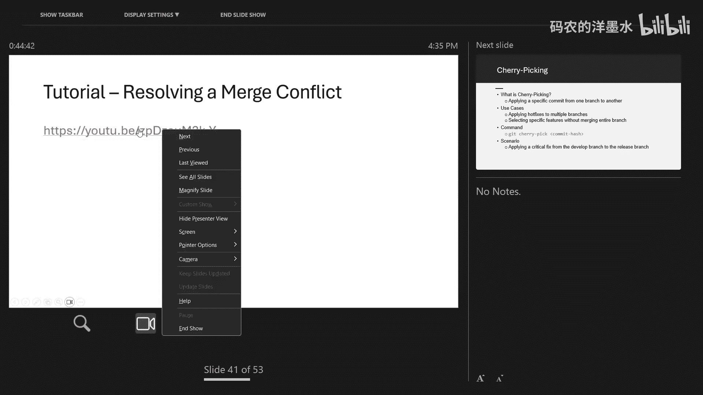

ち。

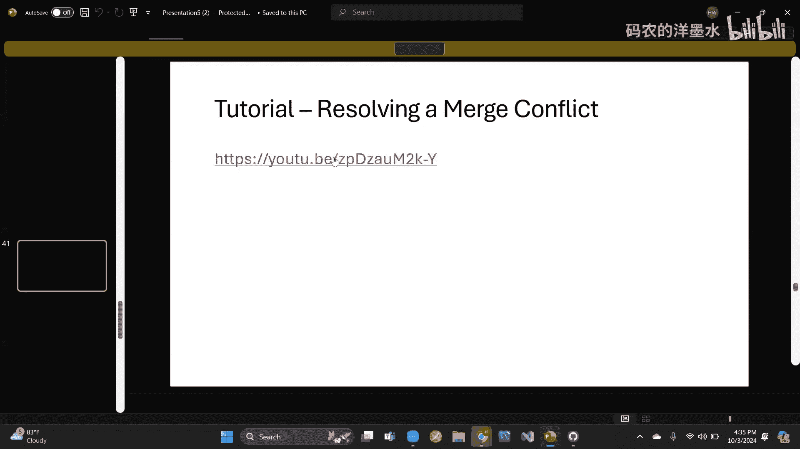

Yes。

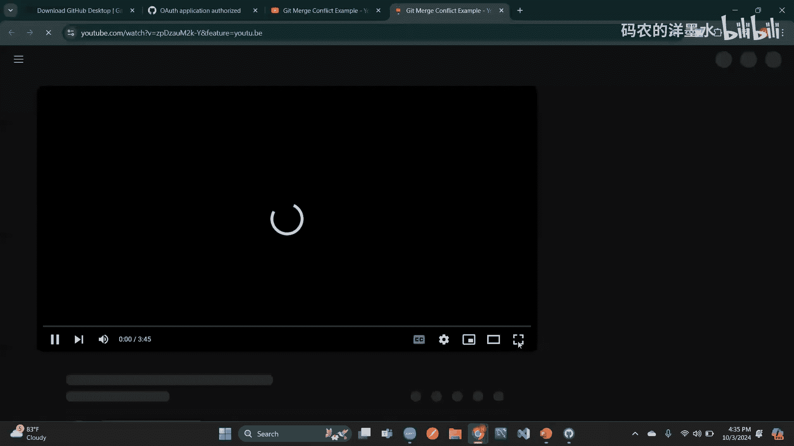

So。不可能。Of courses not very。All right， so here we're just going to create another feature creating a all one because currently we need that calculator as well。

So we're going to go here and order to that add。We're just going to change a line of tool add methods。

 maybe this one， minus one， we're going to switch back to that grant we're going to change list until and so this is or what's very trivial is's not we to be creating a regular merge population。

嗯。No。A'm going to add this change that we made in the2 team but I that Katrina added to minus1 if you you note of that that's what's going to come under this electronicly。

So now we're going to go ahead and this message。Okay。So again， we added our multiple functionality。

Okay you。嗯。唔。We go ahead and check out our massive branch again and here we're going to make the conflicting change that will also cause the branch likely。

We're going to go here with the at a pleasant。Okay， we got that。是你。And go ahead make these changes。

 they change at well。嗯。嗯。Now we're going to go ahead and try emergency feature here。when we go that。

 we can see。Right here that we have。Conflict here in our feature slash multiply there minus one。

 but there we have a plus meeting so normally when it's not the same line gets hard enough to figure out and solve the complex itself。

 but the reason why I've found the same one is to make sure that we have to manually resolve this。

So we'll go here。We can see that our head has that changed and that so now we're opening up the escode。

 we can just resolve this conflict here。So here we'll have some tools to changes on each side and reducing set changes on future slide multi。

What we can a variable case we're smuggling so they'll change it when to say that we don't want to set changes so we're not even doing anything there。

So that means that we've accepted the changes from multiier， but not the ones from our master branch。

So if we do that， they seeing that when we have minus one instead of plus one。

 we have minus this put and we'll be accept it。So now after doing that。

 we'll just simply add and submit these changes send。Thatancy。

Then we been even write a commit saying that we resolved this merge con。

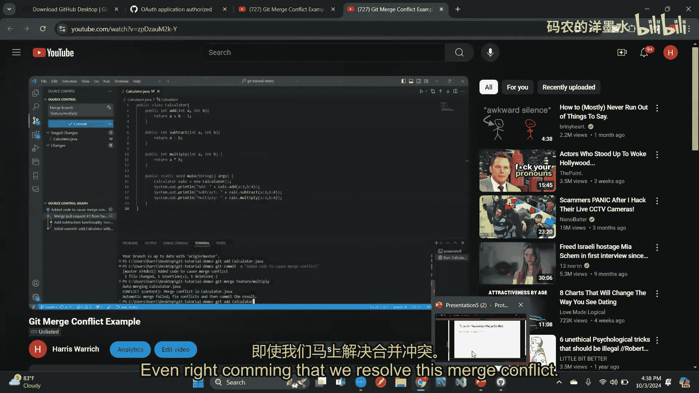

嗯嗯。

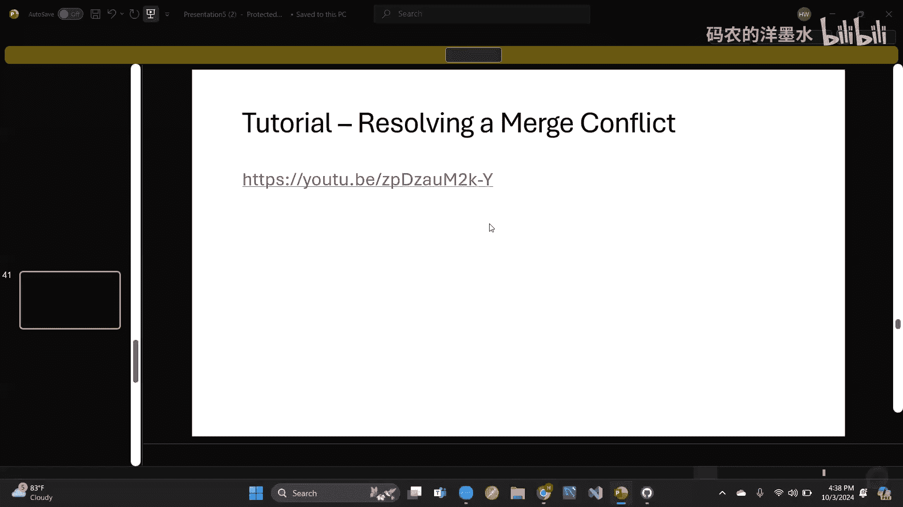

The。嗯。Yeah。So now we're going to get into some more advanced pictures， which。

What we've covered before is 90% of what you this is just the extra 10% that can make it workable even better and even faster and even more efficient so what is cherry thick cherry cherry thick basically applies。

From one branch to another branch。And then the use case for this usually is to buy one hot bricks in multiple branches this way we don't have to copy in past or code every time that we can just simply use cherry pig's help pipe。

 all these branches。And we can also use this to select specific features without merging the entire branch so the command for this will just be simply get cherry pick and we're going to use our commit hash here just like we did in interactivelybasing so a scenario where you'd use this is again applying the critical fix from the develop branch onto the release branch。

But。And here we have it。It's such a sense for because we're going to have another one of those graphs。

Hope here we not create a new patient。And it's going to be a hot book store of life。

So we're going to check this out。😔，Created。对。We savings exchange scheme as well。嗯。

Anyments under message are holding that the United States of 5 by zero。诶讲咁你啲思考咧。

Now we're going to copy through this。嗯系。明确的这子。So answer that。

Moments we have a regular artist with the other received。他分都系需。开始。

Now please Im sure you think depends that help actually tell please。share there。

We have our committee ID back。You can see how good that in your history or apply different ver or without having threebates。

O。It less' complicated。It's one command。So we have this graph on the left。this not goal。

 you're on the right。Don't ever think it。Look at the difference here， what are we trying to add？

And what are we trying to cher that？嗯没。We're just going to use our cherry pick command here nothing else。

We're going to use our tu to command to take us on that now。

We're trying to share the best secret node to that yeah， yeah， what else？C4， what else？

C7 right c3 c4 c7 that's the command right to get cherry picked c3 c4 c7 and things is from that and that again this is a more advanced command is not。

Really essential to know， but it can insert a situation。

Now we could go over staing I've had to be a bit more quick since we're really a long time so the purpose of stashing temporarily save uncommitted changes it cleans working directly without commiting some commands are get stash which saves current changes get stash list which it's for viewing save staes get staash apply。

 apply the fastest apply the latest stash and get stash pop apply and remove the latest stash some use cases would be for switching branches without committing pulling updates that affect your current work and a scenario would be causing current work to address a high priority bug on another branch。

So some best practices with advanced commands， cherry picking as we went over is to avoid overusing to prevent complex history。

 be cautious of also remember to be cautious of dependencies between commits。

 we have stashing which name stas for clarity， remember to apply or drop stashs。

 we have some general advice to give， we understand the impacts of these commands and we regularly review and clean up stashs and the scenario that we could give is periodically clearing old stashs to avoid confusion。

So a recap of best practices is just to review what we've gone over before， commit guidelines。

 as we keep saying， we want to use clear and concise messages。

 we want to commit logically group changes and want to avoid we want to avoid large monolithic commits。

We also have some best practices for branch management we want to have consistent naming conventions and we want branches to be focused on single features or fixes we want to be able to make sure we push。

Frequently。We push and pull frequently and for collaboration we want to regularly push and pull changes we want to code review and we want to make sure we have code reviews and pull requests and we also have conflict prevention。

 we want to communicate plan changes and we want to merge frequently to reduce conflicts。

And some potential pitfalls yeah we'll just kind of skip over to just the time just because we if you go a little bit over we can keep continuing to report if people need to leave okay that perfect the tail end of this because this has been a veryful presentation I think I would think power has been critically important for you to get so I think perfect yeah we only have like three four slides anyways to take we need to leave the get to finish up you only have five more slides left。

Going from the slides of force pushing so potential pitfalls it can overwrite others work we could use this command force with leash to mitigate risks and rewriting shared history want to avoid rebasing branches others are using another potential pitfall is ignoring merge conflicts which can introduce bugs and always resolve we want to always make sure we resolve conflicts carefully there's also large commits which is hard to review into bug we want to break we we want to make sure we break into smaller manageable commits and a scenario of a potential pitfall is losing work force pushing without team communication we want to focus on avoiding large commits again we want to emphasize that because out in the real world companies like Google Microsoft their guidelines literally include to push small changes one at a time and to never push like two under liness of code through under liness of code Some companies yeah they'll let you push 2000 liness of code they'll review it in 10 seconds and then production will break so we're going avoid that。

I just want to make sure you always avoid complexity， so key takeaways。

Advanced Git skills enhance collaboration it improves team efficiency and it reduces errors and conflicts best practices are essential we want to prevent potential pitfalls and we want to maintain a clean and reliable codeb continuous learning is powerful we want to make sure we keep exploring its features to make sure we succeed as a team as a class and the final thought mastering get empowers us to build better software together we want to make sure we master get something we'll be using throughout our careers and we want to make sure we can use as much and as efficient as we can like for example out in the real world we'll use Java TypeScrib rovi all these languages but we're always going need a knowhe and control software so keep learning this keep developing your skills we have some resources here in case you want to learn more we really recommend reading over the documentation and guides' going to the official Git documentation and come along with a book recommendation。

I really recommend the second one learngi branching a lot of those diagrams will be very familiar to you as they were from there it's potentially what we use in order to develop an understandings that we could present courses and videos YouTube channels you can find anything on YouTube I think we all know that by now so keep learning look up YouTube videos。

Uude me Coursera， they have advanced extensive courses all the way from beginner Git all the way to super advanced Git。

 so that's great and then of course community and support stack overflow always for questions and the GitHub community for collaboration。

So let's get into what our deliverable would be will be so basically we just want to create a simple application like as you saw we did a little calculator it doesn't have to be anything in advance just a few lines of code want to make sure that we're creating branches in order to develop features emerging branches using rebasing。

We want to create a work on the feature brand， for example。

 feature whatever awesome feature you're working on and then we're going to add this new content or features to this project lead this branch and they're going to make at least two commits with clear and descriptive messages。

AndThen we're going to go ahead and simulate changes in the main branch we'll switch back to May。

 we'll make different changes that could potentially conflict with those we made and then we'll commit these changes with an appropriate message and then we'll go ahead and merge these branches while also resolving conflicts you can read through this further and we laid it out so basically all you have to do is kind of follow this and you're good to go。

And then you want to make sure we have an example of rebasing in there。

Take a user rebase in thequi of history on your feature。

 you can perform an interactive rebase kind of like what we showed to maybe drop a commit reorder commits an open manner and then make sure your commit history is clean that it's logical。

 it's easy to read。And then go ahead， you can experiment with this no committed changes。

 we didn't really show a tutorial but you'll notice that if you try to switch branches while working it on one。

 it won't let you it'll let you it'll inform you that you need establishsh these changes so make sure you do that and then you can go to that branch work on it。

 go back to the one new stashed and then retrieve and apply those changes and work on it more and then eventually merge it you can try to cherry pick up commit from another branch and then finally you can push your work into the repository that's created for this class and that' be it for deliverable we have YouTube most of the tutorials go over how to accomplish this so that would be my advice to you。

And that's it， so it's time to get going， thank you'all。

repository you can just do that in whatever repository that Ted has made and if you don't have to create any new repository just go right in there。

That's anybody has any questions。Yeah， I guess there's a good trailer when the front mustusaches。

 yeah。Our stash is saved with the myths， like' say for example， I stash something。

 I rose another branch， I go back that one， lose when I commit on the branch that I stashed on is that stash saving in the mi soly。

So basically whats stashing is， yeah， you kind of just save the changes。

Let me repeat the question too what was it again so I guess i'm trying to our our statute stayed with the commit so you wanted stash changes prior to the commit so basically the way it works is we make some changes and all of a sudden something broken master we have to go we have to go apply a hot fix it won't let us switch and it will tell us that we're going to be at risk of losing our changes so all staing will do is save those changes and then you can go back after you've made that hot fix you can go back into there get those changes that you made before and then you can afterwards you can go ahead and submit that I'm not sure if it shows up on the repository is that I don't believe it does yeah。

YeahYeah， if I'm wrong， but I don't think as。Those dashing， yeah so this basically。

Here's our slide I see like we can remove so like I guess you apply those basically'm not exactly sure on that we didn't dive too deep into dashing because I think the main idea you really only want to use it to just save your work and return to it later to kind of pick back up on it i'm not sure if you want to elaborate on that。

Don not mean that's good explanation session allows you to kind of work and like a tiner in both space and then you might have to maybe you want to go ahead and pull the most recent updated code and having to necessarily affect the reR yeah exactly so the commit history isn't really like the main idea there is really just about quickly savingaving changes and then returning to them to continue working on it。

It's also something that's a lot of these features that we went over such as dashashing is included in GitHub desktops。

 it's something you can see through the GuUI you don't have to work through the command line。

 but it's also important to reinforce these topics。

 these concepts through the command line but a lot of it is also simplified through GitHub desktop if you want to try that dashing is also in GitHub desktop so you can just if you want to just mess around with it you can download it。

The use cases I think are very insightful here sometimes go in instance where you want to go ahead and like publish your changes。

 but maybe there's other changes that are relevant and so you might satur changes this so that you can update your local repository and so you satur changes so they do that yeah。

As just as simple as it sounds， you just take your work。

Yeah it's definitely not as complex as the other ones where we have complex graph and depicted or anything I mean the interesting thing about it is that you have like your local state of your your remote state of your a beautiful thing about purchasing has to matter those two things separate yeah I' yeah yeah no problem。

不。嗯听。polls conflicts yeah yeah yeah definitely that's why we want to pull often so we can avoid it so say you're working on a file like for example。

 where we created that conflict where're adding that ad method I change one line here but prior to me merging somebody else has merge a change in that file as well on that line so when I go to get poll if I don't pull often and I don't do that it definitely cause a conflict。

I don't think it might seem tedious， but pushing off and it's always the best choice。

 even if it's just like the function might seem I't think one more。

I guess this is more question like from such sharing the。

 but I know you say may because that also needs to coffee。Yeah。

 you do you do want to push as often as you can because you don't really want to create a commit when you're not really ready to push it out yeah。

 so my recommendation would be commit and push often。嗯。Any other questions？

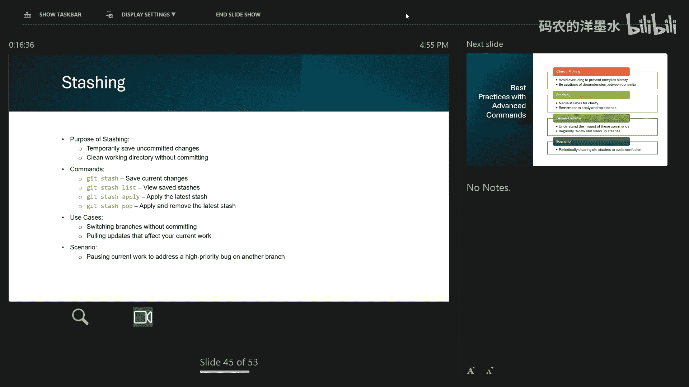

We'll go ahead and stop sharing。嗯嗯。