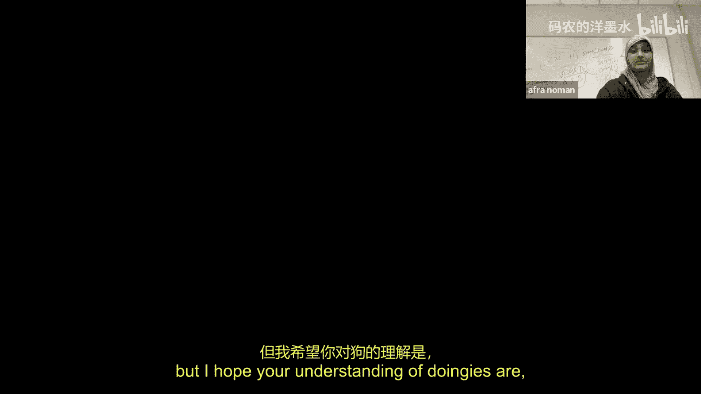
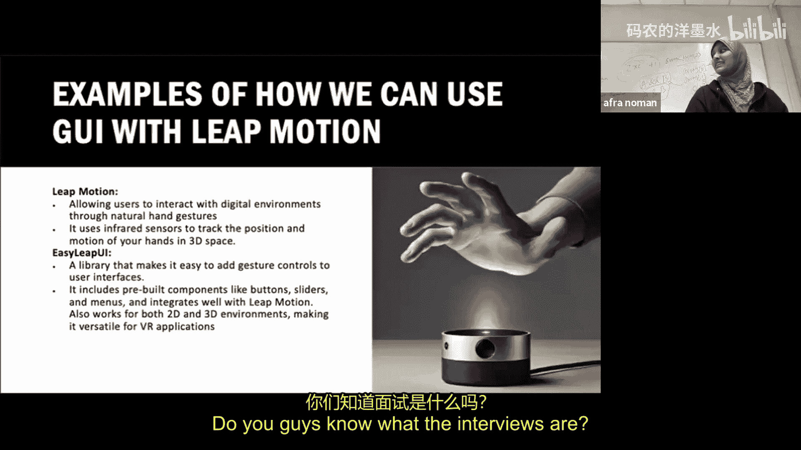
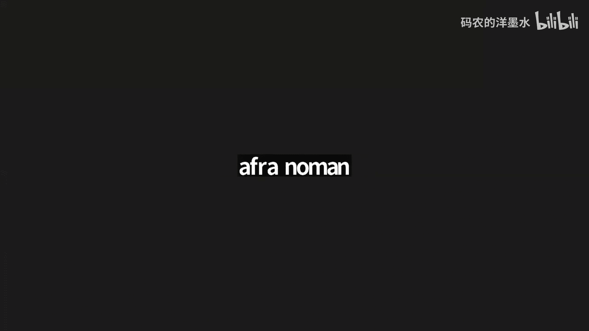

# 【全集】加州理工学院 软件工程 中英字幕 1080P p07 Lecture 7 - 图形用户界面 -BV13ZzaB3EWE_p7-

All right you guys today we are going to present about Gui development and design i'm Kaylee Bgeron this is I'm Aroman'。

All right， so first we're going to get started off with if you guys can just raise your hand if you've ever used a goI before。

😊。

Okay， now just raise your hand if you ever created your own goingie。Okay， okay。

 so next we're just going to get into what is a gooeI because a lot of you guys have probably or almost everyone has probably used a gooI first and second of all。

 a lot of you guys have probably created and developed your own goois and you don't even know it yet。

😊，This one。对。Okay。Yes。P。All right so what is a GuUI so GuI stands for graphical user interface it's the part of the computer program or application that you interact with visually just to start off also UI user interface just you interacting with the computer just basic understanding so instead of typing command you just click buttons or icons or images sort of point and click interface think of it as the screen layout you see on a website or application where you can click tap and drag things around to make things happen。

😊，So。For example， on here， as you can see， these are all gos within one window or screen。

 so all of these are considered widgets that you can all click and interact with。

So just a little bit more into it as well there's three main parts of a GuI the frame。

 the code and the events the frame is the main window that you're seeing here that contains the visual elements which are widgets and this point of view。

 the codes the programming logic or instructions that the define the functionality and behavior of the GoUI for example。

 one of our presentations was about APIs so to connect the front end of the GoUI to the back end of the functionality you can also use APIs for that function as well and the events the actions that trigger the specific responses so taking it back。

The history of Goies so it goes back to 1973 which honestly isn't that long ago。

 which is crazy to think of people being in school for computer science at that time and the fact that a lot of people and computer scientists didn't even have mouses or anything and only computers and keyboards at this point so in 1973 the first GuI was created but it wasn't used commercially only by computer scientists and not going to bore you with all that but to get into the fun stuff the first commercially sold GuoI was sold by Apple in 1984 which also wasn't that long ago and also sold was a mouse。

😊，And as you can see， this is an example kind of of what the first commercial guI looked like。

 so with the help of。Park research Center they were able to collaborate and get information to create this and another fun fact is that the first mouse was created with wood so in case you didn't know that thought that was crazy but as you can see there is a menu bar to access files app system features a calculator alarm clock clock notepad control panel etc which a lot of these features we still use today。

 so although we've developed a lot of ways and。😊，There's so much that we have learned and done at this point we're still using a lot of the features that were created when goies were first sold commercially。

So for example， some of the Gooies that we use now consist of your smart TVs point and click interface also your mobile phones or any mobile devices your iPads tablets etc。

 this is what it looks like now so we developed a lot visually into the psychology of it all visual walls were a really big thing so all the colors that you see play a big role in gooeI development as well。

嗯。Yeah。😊，So now how to create and use a GuoI I'm going to pass it to offer Okay so we're going to be creating GuIs using to Kter and to get started we want to make sure we have visual studio code and Python we should all have BS code because of the other workshop that introduced it to us we should also all have Python installed and Tiinter comes with Python so it comes with the latest three versions so if it's not installed there's like a command you'll find in our documentation that'll help you install it。

And then when we're building the Python file， these three import statements are going to be like the most important and like what you'll usually see in a Ti kindter application so first we'll import to Kter and abbreviate it as TK so it's easier to reference and then will this from T Quiter import asterisk it imports all functions and builts in modules and then TtK we import it it's a themed to Kter which gives you more modern looking widgets and like it adjusts to the users' OS like it helps with all that。

And so small intro to T Quiter， it's the standard GuoeI Library for Python。

 it' open source and a cross platform widget toolkit utilized by various programming languages to construct GoUIis and it's really straightforward so it's highly recommended for beginners。

The three main parts of a toquiter application is going to be again the import toquiter statement and then root equals Tk。

tk that is what creates the main window where all the graphic graphical components will be root is just a name that you can make it any name and so like it since it represents the window。

 most people will usually call it the root as it's like the root of。

The wholegui or like top because it's the top part of the application or just window and then rootot dot main loop。

 it enters the main event loop so that an event triggers whenever a user interacts with it。

And so this is a simple calculator GuUI， this has two widgets the entry widget right here。

 and then these buttons right here。We play it。You'll see clicking on the buttons enter it into the entry widget。

And then。It works like a calculator。And then you'll see it also。

Like you can copy and paste whatever you want into that entry widget and。

It has all the functionalities of a calculator and it can also be changed into dark mode because like to kindter works with your。

O。And then this is some code， so as you can see we imported TK and TTK。

 we didn't import like all the functions because it's a pretty small application so we didn't really need it。

But yeah， this is where the evaluations happen， this is where we create the main window and we title it calculator。

Yeah，'s about it。对。Hi， I got to talk about another symbol Gu application bill using the Quita library in my time。

 This is where the wt application that we can。We can reach and display the weather。

 the like weather data from any city in the world。We will use the Quiinto library lab。

Let let display the weather laptop and we use we some library in library in the k we use video see we will use some phone in in the k library in Bong。

For to create the main window。To create a man without。Look。

To create the main window for the for the who we will use。

Ty do sun in the the main window allow the allow us to add the gles。For example。

 label title and person for the main window， the second function root dot title IU set the title for the main window and another function root dot geometry idU the dimension for the main window。

This function here is introduce you the pre the label for the main window。 we can see。

The level enter city for， for the main window。And another function is that we see a T dot entry to re the text entry for allow the user to input the city name here。

And I move to another phone we on say that the， the fu to read the button， the button get where。

When now the user click on the get weather button to get greater information。

And another function is that。We we see we， we also use label functions here to get and display the the live weather data information。

And the last function is main loop the when when we stack the main loop we will use keep the Gu more responsive and ongoing listen to the user interaction just apply when the user click on the button。

Click on the button or input out the city name in the text entry file。We okay。

 I will go to them more about the weather wishes。好似唔好少点。Okay。

 I will I will input the C name here and get the where button。We can see the current temperature。

 humidity， weather and wind speed。 and when I input invalid city name。

 we will with the a notifications and。Or maybe we missed the city name。 We also get a notification。

The live weather that will use the application will use the weather open map API to get the live weather data from the internet。

We will move you another example for women。Thank you。All right。

 and now we just have one last beginner friendly goI example， so this one。

 as we were showing you with apple's firstberry。Goi example gooei commercial computer sale that they made。

 they also did a menu bar。 so this is just a simple。

Example all right so this one also has a text editor as well。

 so whenever you first initially open it it creates a text editor。File， so now you can save it。

 so this is me saving it to our files。And then after it is saved， I'm just going to。Create a new one。

 and just add。Random test data into it just to show you that whenever you open up that file that you just created。

 your data is still going to be there from the file that you just saved。

And then also showing this very simple and then when you exit it just exits Okay。

 now to get into the code also。You've seen examples of this as well。

 but just as A was saying whenever you open it， if you see in my code， she used roottk。tk。

 but for mine I did use window to open up the text editor GuI。And。As you can see。

 mines titled menu bar example， the TK。tK initializes the main application window。

 the add command adds clickable items to the dropdown menu。

 they're each linked to a function like for my new file creation open file， save file and exit。

The TK text window method creates a multiline text widget inside the main window where users can write or edit the text and then also as offer mentioned the main loop starts the guI event loop and makes the window responsive and enables to user interaction so these are just very simple Python VS code examples。

So I know just to go back， the first initial question that I asked was how many of you guys have used to GuUI？

And have your answers changed since you're more familiar with what Agui is I know we had like very few hands that weren't raised。

 maybe you guys just didn't want to participate but。

If you have a phone or a computer or anything you have used a goUI before。

And now to get on to our presentation， our example of what your'。

Project will be on for our goI presentation we will be creating a quiz goI right before we get into that。

 this is another application which takes those smaller goUies and puts them all into one application so。

If you'll see like this， it starts out on one frame with a menu with like getting to choose which application you want to use and you can use all of them the same。

Mmmm。喂。And。So。But that'ss pretty simple and so the basic difference is that this application uses different frames to like open up to different applications and so while most of the code is like similar from the other applications。

 this is like the code to where we like show the main menu and like the different applications and then this is where we。

Open the window。 And like， we tell it which window to open to， which frame is the main frame。

 And like there， we customize that frame。 and like what buttons lead where。Yeah， and so。

So this is the end of our simple GoeI beginner instructions。

 but before we go on to a little bit more advanced GoUI tutorial。

 did you guys have any questions or comments concerns what made choose？Well。

 mainly because I know Dr。 Ted kind of gave us set tutorial so we were kind of just trying to link everything together between the VS code。

 Python and。Yeah， we know we're going to use Python for like the class。Project son。

And they also just have like the built in packages with signature nature as well。So， this is。

Part of our deliverable， we're going to be creating a gooey quiz。

We'll just watch the quiz for a second can anyone answer this question though which is not a main part of a GLE program？

I believe it's widgets。Should play hold on。我不可以。Yes。O shit。你。Well let's just watch the quiz。Well。

 the first Ge was created in。Recorrrect。What was in use before gos？这。Yes。And Gui stands for？

Perfect and you'll see it displays the results and it quits after you hit okay。And so。

Before we get into what you will be delivering， we'll talk about how this is going to help with our class project。

We will talk about how we can use with lipos on。Firstly， we will need to understand about the lippo。

 what lip lippo and ear check hand check device that allow the user to interact with the。

With the digital environment via natural hand gesture。

It will use sensor to check the hand movement and position of the hands in 3D environments。

And we we will use easy easy Lib U library to to interact。

To interact with Gui via lip motionen controller and。If so。

 it what is easy Lib UI easy is easy Lib UI in a library make it easy to get to gesture control to user a interface it also includes some pre component like a pattern slider menu and integrate very well with lip motion。

Why why we use easy Li UI library to to interact with Google because there are some benefits。

 firstly。I lift U I library in very simple process for interaction with Gi and it also include some pre component。

To to interact with the glos and controller and。Easy live U library also work for tall chill and3D environment。

And next， we will。We will discuss about the workflow。

 how to easily lift UI library to work weekly more。

This flow represents how a hand gesture to is capture by the lip and controller and processed by by easy Li UI library and。

A result in interaction with G。For the for the for the first step， but we stack here。

 we we will set up the lip motion controller and and the user is ready to inter interact with the system。

And the second step in hand gas your detective， when now wait。

The hand gesture here is just about the hand movement and position of the hand。呃，We not。

When hand when hand gesture is detected， this signal will will send you the lip motion controller。

And more than the step3 clip motion controller will get this that will get the physical hand gesture signal and translate it to the digital digital data and on this digital data will send you the easy Li UI library to process it。

Its easy easy leave U library will use will will take the data and map about this data into the specific action just like adjusting out the the slider or pressing a button。

At the laptop。Easy Lib U I will analyze the the gesture data to figure out what kind of interaction the user is attempting to。

 to do， for example， when when the user make make the pinch。Make the pinch up。

It means that that the user want to thrown down the menu。Or the user want to select the menu。

And I move you the next step。The the the good the good will check the the u i。

Checkicker the action you are 11。 and after that， the。

The group will respond to comment based on the user interface。And the second step here is laptop。

The U I element respond respond action association with the user。

 the user of handkecher such as when when the user pinch pinch the button over the。

Pinch the menu over the button。 It mean that。The the U I will respond to the button acting like press。

And the end process here。It will。The the goal is ready for the next。

 the next action from the user interface。This is a flow check is leave U library to work with Li controller so to interact with the Gu。

And， we will more now。Okay， so like I said， we're probably not going to be using toter for the class workshop because it's mainly for 2D applications versus。

The 3D kiosk we're gonna have so but to enter a really good introduction into Gos and like building your own so for the deliverable I want you guys to go to our pod repo and then go through the multiple choice quizzes code follow along and create it on your own make sure it like works and everything and if you have any questions about that you can contact any of us and then also look into the code for the application。

With all the small languages like the calculator function， the weather function， etc ce and。

Add in a frame for the multiple choice quiz where it display it displays the results。

 So you're going to add in another frame。 So you're going to rework that and modify that code。

And for what you'll be submitting is the modified code and a screen recording of the application working。

嗯。That's。Any questions？我都不认识。Yes， okay， so the application you made。

All the functionality that you have for like the calculator。

 the weather app is that all provided just by the T control the libraryberry yes all the widget so like if we like the opening the file saving the file and like。

Interacting with like the weather API that's all been you enter。

The weather API it's mainly like with the help of to enter。

 but like the Ma API was just inserted in there and like。Yeah。So like for the calculator Gui。

 we used to kinder's entry widget and button widgets and like for。

For the functionality yeah and like the the what is it that one called menu bar gui you'll see we didn't use the entry widget。

 we use the text widget because the entry widget allows one line of text versus the text widget allows multiple lines and writing whatever you want。

So like it's mainly about like exploring and working with the code yourself and like。

Learning what each function does， what all the different methods are。

And another like fun fact for people who， for example。

 how the documentation presentation they mentioned a portfolio website even and they also mentioned if you're creating a portfolio website。

 you can do it through something like Google sites which doesn't require any code。

 you can still add those components and goI features without having code。

So that's also another fun thing like that itself is a goy because you're interacting with it without having to code in。

Any other questions I know that was pretty shortly。

 but I hope your understanding of Goies are well rounded I have a question obviously I mean。😊。

Kind of answered before why you chose Python and the Kter。

 but did you look at any of the other GuI libraries out of there， you know。

 was there anything else under your shortlist of what you maybe could have chosen or would have chosen or was it a pretty easy choice？

I think it was pretty easy because like。We were learning about gooyies ourselves at first and everywhere we talk about like use tocan use tocan because it's like especially toantther with Python and they're very close start yeah but another one when we were looking into the leap motion 3D features。

 a lot of them did discuss unity as well has a lot of built in components for creating goos implementing that as well。

And I know Python has like pi cute ear simple gooei yeah so it just really depends on how complex or what you are trying or just personal choice。

question you guys have a link to that leak motion you live stuff this where we the lead motion yeah have like where did you think again wherever you got this information？

For the previous slides。Yeah。'。😊，Yeah， we're going to open put all the comb in the GithH。

works personally it' just line just a you might remember if you go searching for them again sure you're find like one or two。

T scared。Yeah， what was it that you confused audience the they so can I ask the what interviews should I stop sharing。

Has anybody done there？So everyone before I end the recording。

 is there any final questions you wanted to deliver？No， looks good， okay。

 I'll got an end of the recording then。

