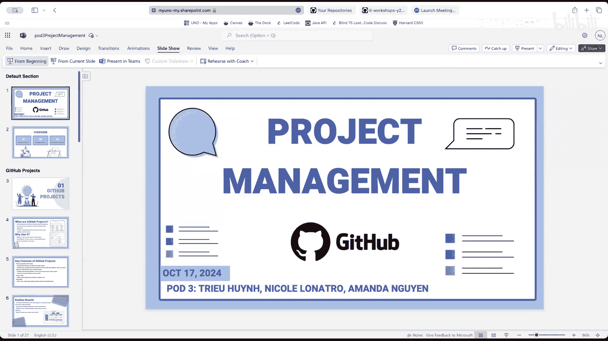
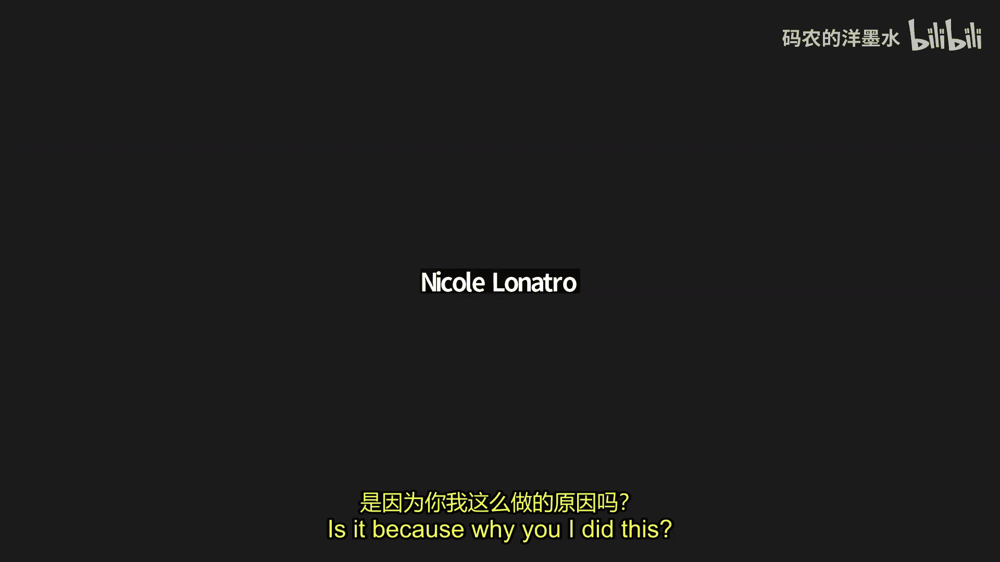
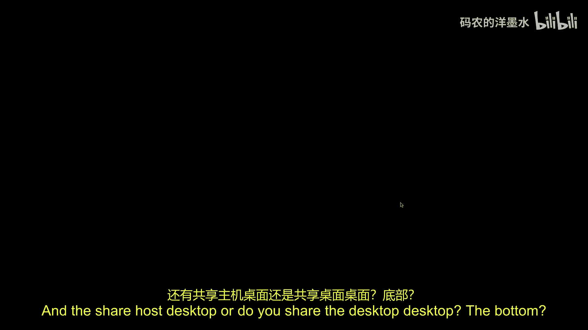
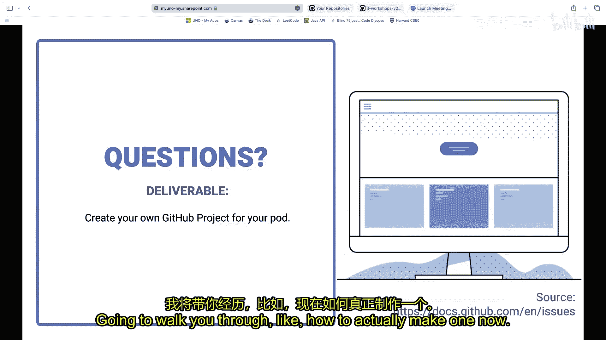
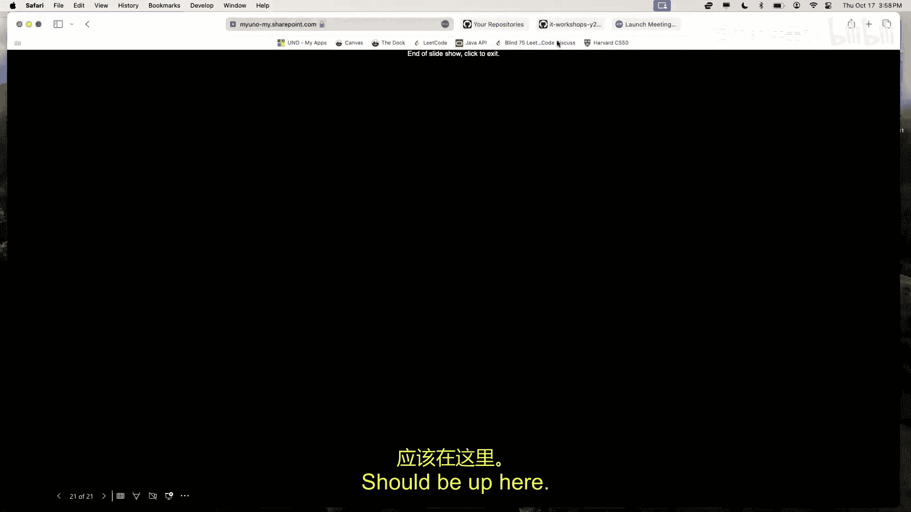
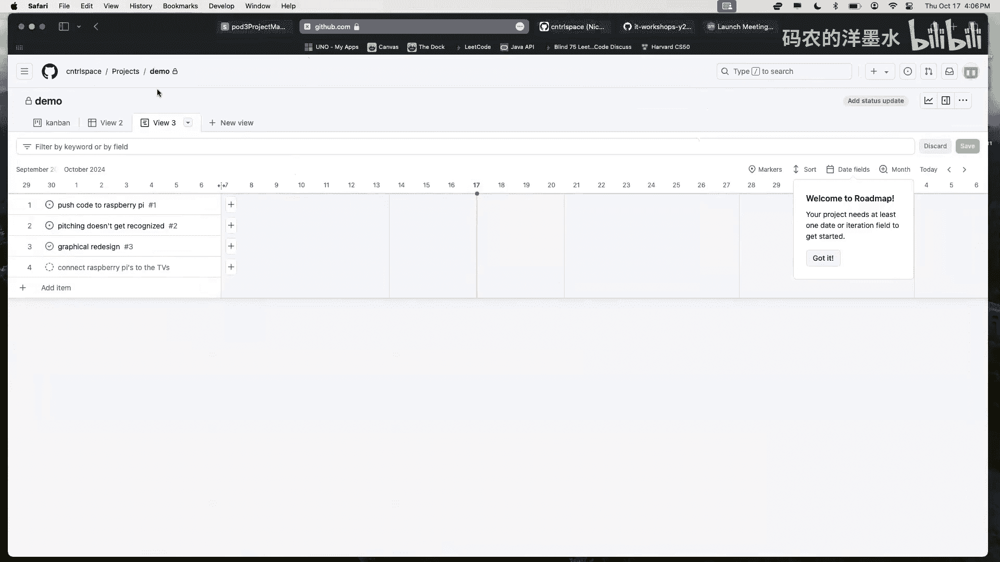
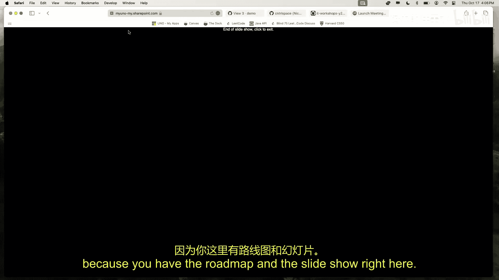
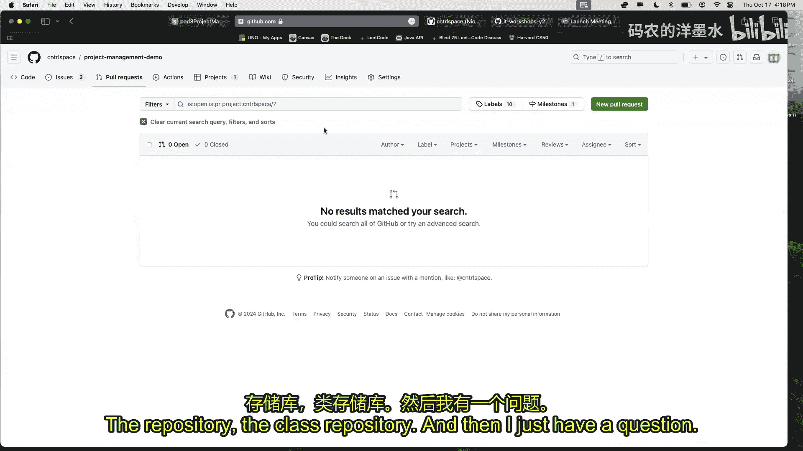

# 【全集】加州理工学院 软件工程 中英字幕 1080P p08 Lecture 8 - 项目管理 -BV13ZzaB3EWE_p8-

Okay。Okay， hello， we're pod three and we're doing project management and my name's true。

 this is Amanda and that's Nicole。😊，And before we start， I'm a little bit sick。

 so if I start coughing and dying， I apologize in advance。So just for a quick overview。

 I'll be talking about GiHub projects and giving you like a rundown on that and then it said yourre awesome from chair's paused。

😊，对。Was that Oh I did pause， I'm so on your prior。Maybe try to unshare。

I did this。

Can you do your whole screen？对。Is it so past。thank。

I just have a black screen as see if you can see Australia。我好。is this up here。R share is green。

 Do a new share。And then share your host desktop desktop desktop。

Yeah， I know Im hear。Okay， thanks so yeah I'm going to go over Gitthub projects and then we're talking about GiHub issues in more detail and then we're going to kind of tie all together with progress tracking at the end。

😊，Soick projects so when you initially think of a project you're probably thinking of like a goal you're actually working towards so let's say you want to make a game and you make like a repository for that that's what you're probably thinking of but GiHub actually has its tool called projects that's integrated and it's revolve around managing all the work across like some deliverable and there's different levels to it so you can have like an organized。

诶。Organization level project。In which it'll actually track your work across like several different repositories。

 which is pretty cool and then there's also just like repository level projects if you just have like a single team or you're working on one project。

And then there's also just like easier level ones if you want to make your own project and like。

 let's say you're tracking like all of the projects you've ever made。

And it like includes like flexible customizable boards that allow teams to plan organize and track tasks and budgets helps with like project management and streamlining like your general workflow so just to give you like a quick glimpse on the right our pictures of what a project board would look like。

😊，And why should we use it efficiency and centralization which kind of like tie in together。

 so if you're using projects it's already embedded into GitHub so you don't need to use like external software。

And then again， everything is centralized， so all of your tasks issues。

 pull requests are linked into one place and again they're all connected to your repositories。

And then I'm going to go over some key features really quickly so you have visual organization with boards we're mainly going to use something called like Kenmen boards for our class but GitHub offers other types of views as well。

And I'll talk about that more in a little bit， but there's customizable columns which represent like different workflow stages。

And then within those columns， you'll have cards which represent your tasks。

And then for those boards， you can also have your own views。

Based on like whatever filtering or sorting you want so you could do it by like assignees so who you have assigned to one thing or labels。

 you can make your own custom labels， which makes it really customizable and flexible and then you can also sort it by like due dates if you want to see what's coming up next。

Another thing is integration with the GiHub issues in pull requests so changes are automatically updated to let's say you like close an issue or you merge your pull request if you're looking at your board it should reflect that and then a cool thing is that you can link your cards directly to like issues your pull request so it'll like show up and then you can click it and it'll take you directly there。

Another cool thing is custom fields， so you have the ability to add metadata like priorities。

 deadlines， again， anything you really want it to be。

And it's good to have like tags on things or little descriptors and then you can again sort things by those labels and another thing is project automation so based on a set of predefined roles that you're creating you can have it so that cards are like automatically moved when you are done with saying。

Task。Okay， so this is what a camemen board looks like and camemen this just is just like a Japanese word for like a visual card or sorry。

😊，So it's a signboard or a visual card is what it means and it's created by a Toyota engineer。

To basically boost like manufacturing efficiencies since they work like with vehicles。

And what it is is a visual tool that depicts work using columns represent stages。

 as you can see in the picture， a simple board would have like a to do column in progress column and a done column。

 but you could really do whatever you want with that it just depends on how you want to structure it。

And then again， there's like the little cards here， which represent the tasks。

And just to go over the picture really quickly， a commitment point is just like the point at which you commit to a task so you'd move it to like to do to in progress。

And then delivery point is like the same sentiment， you would move it from in progress to done。

And then。You have a swim lane which you can think of as like an extra layer of organization basically and it's like a horizontal bar and you can separate it by like I guess types of different works or like different teams if you have multiple teams working on one board。

And it can help teams identify bottleneck and over commitments so let's say you have a team that's been in like in progress for a while you can check in on them being like okayy what's going on and see if you can help them finish their tasks and some teams will have it to that they're in progress column is limited to a certain number of tasks so they're kind of forced to finish whatever they're working on before they can move on something new。

嗯。And then benefits of this is like visual clarity since everything is laid out really nicely in an easy to understand way。

 flexibility again with all like the custom labels you can do。

 transparency since let's say this is organization level again。😊。

You can literally see what everyone's doing， who's assigned to what what phase they're in and then all of this kind of links together to boost like overall team efficiency since it streamlines your workflow pretty much and then again GitHub projects uses the style of boards and yeah。

I'm going to show you like the other。Okay， cool I'm going to show you like an alternative view。

 which is like the list thing to show you kind of just how it works Okay cant full screen it but you have like your issues on the left and then I think that's a pull request。

your status and assignees and they have it set up so like whenever you make a new issue。

 it's labeled as a feature and then they went ahead and make that its own view which is really nice so whenever you create an issue it's like automatically just here。

And you can see this one doesn't have anyone assigned to it so they can go ahead and assign someone there。

And then if you actually click on it。It takes you to this。

And then this is like a little description and they have a link here that takes you to like another word。

 which I'll show you in a little bit。And then on the right hand， you can see like assign signese。

 labels， again， this is labeled as a feature and then the status。

This is just in planning since they haven't done anything with it。

 and then they're gonna to click on。The link。And this is like another view again showing like how flexible it is so they have this split up by area。

 so design， storage， media support connections。And then to add tasks or items you kind of type them in。

嗯。Okay， yeah， she is typing it in and that's kind of like the intent of it is like jot down notes since to be like。

 here's what I'm going to do。And then these are called drafts and then once they're like more officialized。

 we can create them and turn them into issues， which you would just do by clicking the drop down here and then clicking convert to an issue。

and then this is just like another view which is their Ken been board and instead of like to do in progress done they have it split up by iteration so 123 and then。

To actually move it， you can physically like drag it and then if you like see here it has like the status and the name of the task。

Instead。o。And here she's going to hiddenden fields and showing like the links pull requests。

And then you see that it makes it visible。And if you click that， it'll just take you directly there。

 which is really nice doing it。嗯。Okay， so for best practices， it's good to collapse your issues。

And so even smaller issues just for like management and it allows team members to like break on tasks in parallel since they're working on like multiple different issues。

 which ultimately will build up like the same larger issue。

And then it also leads to smaller pull requests， which are easier to review as opposed to like if you give someone like a huge chunkup code to work on and then you tell them to merge it and it's just a large thing to look at。

Another thing is communicating so GiHub issues and pull requests have their own built in feature so you can like add mentions to people and discussions or something。

You can assign people tasks to be like， hey， this is what you're doing。And then sorry。

 you can also link resources or like contact info to people or sources that like they can reach out to if they need help。

Another good thing is using descriptions， so。Every project board has like a readme。

 which supports Markdown， which is cool。YouCan add like images and stuff if you want。

 And then it's good to just have like a description there so people know like what they're working on。

 how to use different views and stuff。And then there's like the actual project descriptions those go like under the actual tasks like you know like what you're doing extra info resources。

 stuff like that， and then it's good to also keep your statuses up to date so like there's no miscommunication and everyone knows who's doing what at what time。

And then lastly is views。So you can use views to see your project from different angles so let's say you're filtering by like status see all like the items you haven't started so then you can like kind of run through those one by one get them done or you can group it by priority so if you want to see all your high priority tasks you can again run through those first before you get to like the lower priority things and then you can even set it to like easiest earliest sorry earliest target ship date so which you need to do most immediately you can work on that before you move on to things。

几见。I you guys earlier， my name is Amanda and I'll be talking about GitHub issues。

So what is Github issues if you were to just look at your Github and go to the top left on the hamburger icon。

 I'll show you like。Here on the screenshot is issues use click that and then itll pop up this page so just to clarify this can have issues from multiple projects too was kind talking about it。

 one team could be doing multiple different projects right or you could be running like test production and like your deliver you're ready to deliver stage or whatever right。

So what this basically is is a project management feature that logs tasks， bugs and issues。

 and you can kind of use it to also log other things as well。

 you can be as creative as you want with it。It's not only for errors and bugs only。

This is good this project management goes really well with agile mythology she kind of touched on it a little bit so how she was talking about。

You have teams that are in progress on stuff and sometimes they go to testing that can be part of sprints。

 which is in agile mythologies， which is basically like。

You're going to go work on this these task in your backlog for two weeks or whatever。

 usually sprints are at least two weeks long。And。If， you know， at the end of that sprint。

 things are going well， you move on to the next stage， which could be production or testing。

And that also ties in well with continuous integration and continuous deployment。And also。

 you could use this to report different statuses and metrics。

So this is how you would view an issue I just made like an example issue just saying like oh let's just pretend I'm a junior developer I don't know what's wrong with the code it's not working I'm just asking for help so it's not even an error per se it's more of I don't know what to do and I'm just kind of putting it in the log for everyone else to see to。

So。You can see right here we have a label called bug and help wanted so。

These are labels that GitHub already has you could also just add custom labels as well whenever you go to make your issue。

 so let's say you want to label something as testing you can make that label and label it as that。

You know， and that helps to categorize issues and make it easier for whoever is leading or managing your project to go ahead and assign those issues for other people to。

Finish or fix to do。This enables easy access and organization。

And another thing I'd like to point out is there's poll request kind of true as touching on a little bit too on her con style view。

 they have all that stuff here as well for issues。And this can be integrated into GitHub projects。

We have milestones as well。 so like for this class， let's say， for example。

 we want to have multiple milestones to say。Mta one is when we did our first。Well。

 our first milestone， we call it milestones。 So you could set milestones in the dates， which Nicole。

I'm going to show more of later。And so this is what it looks like when you go to create a issue and。

So right here， I just I've labeled the title data error。

 let's just say I'm doing Python or something and I'm trying to preproces some database or something。

For just for example， I wrote a description as saying that data is not properly being pulled in。

 I'm not sure what's going on， right？And so I say I want help wanted as a label unless's just for project。

 as I was talking about， you could put it into whatever you want。

 which that goes into the creativeness of it。And so。

Once I finished that there's I kind of blocked it with this picture。

 but there's a button down here that's says create issue， just click that when you're done。

And on the right， that should be how it views。And so let's say I go to help myself here and I figure out what's wrong。

 I need to reinstall the data from cargo because I just didn't have the data。

And then I could set it as complete， so when the issue is complete， you can kind of just ignore it。

 but you could also save it to look at later just so that whoover' is managing your project and just see like。

 oh， this person fixed this issue and then you could just keep moving on。

So just to talk more about CicCD， it's often combined with agile pathologies and that creates a workflow and just kind of makes your。

Your project more streamlined and so managing issues。

 improving collaboration and something called automated integration testing， which basically is like。

 let's say I push code that makes a new button or something like JavaScript and I make a new button and I push that code。

Or I change a button thats are existing。I might have an integration test that presses that button and sees if that button works like let's say。

 I'm uploading a file with it or something。So if that test fails， whenever I push new code。

 it will pop up in the issues list and then it will log the commit and the person who pushed whenever push or merge happens。

And in order to do that， you would need like a script or you could find software that does it as well that integrates with GitHub。

 so that's very helpful that lets us catch bugs early。And helps us just stay on top of things when。

 you know， when there's errors because you don't want to find out。

You made a button 50 commits ago and then 50 commits later， which could be two weeks later。

 It's not working。 You don't know why。And so yeah， that just makes tracking commits in hers easier。

Okay， so I'm going to be talking about progress tracking and mostly going to focus on， you know。

 how to use GiHub projects and issues to monitor tasks and。

Drack milestones so that everybody's up to date。So GiHub projects this is what it would look like I made this demo just based off of everybody's workshop so I put everyone's。

You know， like workshop titles into it and made them into issues。And。You can see here。

 these are the issues。You can assign people to them， so for project management I signed myself。

And then you can also put the status of it you can see that we've done seven we have one in progress right now and then we have four more to go and then with the workshop date you can make iterations so I made I made them one week long and I only had to do it one time and then it automatically did the rest for me so that was really cool。

So in GitHub projects you can do like three different views this is the first one。

 it's a table view it's like your typical spreadsheet view and they designed it to be like this so that way it's intuitive and it's very easy for people who've never seen it before to just start working on it。

This is the other view that Tru was talking about， this is the board view。For me， I prefer this。

 in this case with the workshops， we only have 12 pods。

So it's really easy to see you know like what's what we have left to do what's in progress and what's done。

 but when you have hundreds of issues this is a great way to just look at an overall picture this is the board view the Kanban view。

And then in this view， you can also。Well this is just a picture but when when you're in the actual project you can just drag everything like you know what's to do you can drag into in progress done so again this is very intuitive this is the third view it's a roadmap view it's kind of like a calendar over here we have October 24th and I made the milestones you can see in the green I made the milestones actual dates that the pods are going so today the 17th were going and then you can see on the 22nd pod5 and then 24th pod C will be going and so on sold forth。

So this is another good view to， you know， just to look at them months ahead and what you have upcoming。

And then oh yes here for the whole entire project you can add a status update so that everyone gets updated that's in the project and at first I made this project off track because of the hurricane we are a little off track and then so if you just click on it you can add。

To make it back to on track。 So I add an update here。

I redid the target date and then I put it back to on track。

 so this is really helpful so everybody knows exactly what's going on in the schedule。嗯。

And then once you save the update， all the past updates stay there， so it keeps a log of everything。

Which is very helpful。嗯。And then so for GiHub issues。

 you can get to it in two ways the first way is if you directly click on the issue when you're in the project view。

嗯。show that you guys that right now。And when you click on the issue it oh it doesn't pause when you click on the issue it brings up this detailed view of the issue and you can put in like descriptions or add comments and you can put assignees to it over here I believe you can do up to 10 assignees yeah and once you assign people to it they all get subscribed so everyone gets notified when anything happens so here you can see like I。

Added it this issue to the workshop project demo， I converted it from a draft to an actual issue。

 I signed it to myself so everything is logged this is just like a really good way to keep track of everything again。

And then the other way to get to GiHub issues that Amanda was talking about is if you just click this little circle button at the top。

It gets you to every single issue that you have that's open or closed。

So these are all the open issues that I have， which in this case is just everyone who has not finished their workshop yet or hasn't presented yet。

You can directly click on it to get to the details of the issue again， this is just so helpful。

And then if you go back to issues， you can create milestones on this page and for the milestones themselves。

 I just made them into the actual due dates。And the great thing about it is when you move an issue from in progress to done。

 it'll automatically update the milestone so you don't have to update both of them just update one and it syncs to everything。

 which is great。嗯。And yep， it's pretty much all we have。嗯你。

I know all keep you like how actually make one no。

Should be up here。

嗯，Yeah。Okay， so。First should you go to repository。 I'm just gonna to make one and call it。嗯。Yes。

Project management。还是跟真。 okay， and then yeah可。And if you go here。

 you'll see projects has like its own tab， which kind of looks like GitHub issues。

And then if you click this， you can see you can link it to different repositories if you want。

 but we're just going to be making a new one。And these are just like the feature templates。

 which are。Like different versions of basically the same thing。And if you are in an organization。

 you can have like your own template that you made， but we don't have that。 so yeah。

 we're just going to use a board。嗯。人你咪得。And then once you create it。

 you'll see that it already gives you like a basic kmen board。冇有嘅。

And then you can rename this to whatever you want。 I'll just keep it as demo， and then you can also。

Rename the views to。Something descriptive。I'll just put Cam Ben for now。嗯。And yeah。

So if you go over here， shows you like settings。And you can name it and add a short description。

 and if you do the read me， you would add that here。

And then whoever like owns the whole thing can like set permission nexes here if they want to do that。

诶。And then here you would add like the actual field。

 so right now we have to do it in progress or done if you want to like change the name of that or the color for the description。

You can do that there， or add something。How dot you。All of them willll call it backlog。Make it red。

 Tell us。嗯。The外个。Okay， save and that should show up here。

And then if you want to like look at all the fields and stuff。

 you can do that different ways to sort it。Yeah， okay。This tags on this right。

 I think youre going tags on to this。So we're going to do like a little exercise。

So I hope you guys participate so we're going to add like issues。

 does anyone have a good issue like a first issue？It could be theoretical。

 just like something that hasn't happened yet， but you could just assume like make up a。

Fictionary issue。I have a theoretical read one。MaybeMaybe there's an issue this push start going to the raspberry5 that council。

So fishing coats are raspberry。P IPI。It's a good one。Yeah it's right there。Oh。你Yeah。

I think that's how well。Okay， so right now it's a draft all you have to do to make it an issue is you just click the little three buttons and then convert to issue and you click on the repository that we had made。

Which was。Demo， was it this one？Ill just click that one。And then here。

 so you can see you click right on it， you can see all the this is the issues like details page。

You can assign it to people， assign it to myself， you can add labels so it makes it easier for people to。

Like find tags so。You can make your own labels or use one of these。So。Good first issue。Oop。Okay。

And then this is what I was saying where you can like drag and drop them into。You know。

 the different categories。And then you can also see it in a table view here it's really easy you can just put in like what would be an next good issues it's really like a Excel file。

Gests don't get right。Gs。Pension。Oh pinching。Yeah。或非常这记。See， so it's like really easy to add tasks。

I mean， the most tedious part would probably be just like converting them into issues。

Going one by one and just making them issues。For your pest control， click all of them。

 know them at the same time。Oh can that they're just in draft， like a draft。Task or issues。You看。嗯。

So again， here， really easy， you can put them into the different statuses。You can add a field。

 that is what I was talking about， the new field。Im's say like。I wait。

You can make an iteration so you can say it starts today it's every two weeks you save and create it this is the current and then it just gives it to you for all the other ones so you don't have to like keep typing it in。

Over and over again， which is really nice。H developments day。You can just look at in the。

In the field settings。好。No， I just created it。Yeah， yes， yeah， like I did like a two week iteration。

So I think the biggest thing with this is that it can be as powerful。

As you want it to be as long as like， you know how to use it creatively， you know。U。

so you can access those issues so this is Kanban so you you see she added the stuff over here yeah she had changed the status right so in Kanban we can see that theyre tag in progress done to do backlog。

So are there different boards that you can see besides online that's the road for you Yeah there was roadmap that's what Nicole showed earlier in the slidess certain。

On the Roadstone view， where's the slide？The slidedeshow。

A roadmap sorry yeah because you have a roadmap in a slides right here Oh yeah， sorry。

嗯。What it is。落纳表本。So Nicole was talking about this earlier， so you can see the dates here too。It's。

This is not video， is it？😔，You can just create， we can just create a new milestone。Wches。Yes。

No not on combine unless you click click on it directly on the issue and then you can see it in like。

我不。This one this is just a table view yeah so regarding your question if you wanted to see milestones on conban well i've seen done like when i've worked with teams is that their zero board or whatever will have。

Mile 1， milestone 2， milestone 3， and then they'll have a backlog all the way behind it。

 And basically， what the leader will do is drag task into the milestone that the team is working on。

So say can you go to combine real quick and then I'll just kind of yeah。So for example。

Here we'll say a muscle of one like another like Bing and then he they'll have muscle two and then what they'll do is they'll drag from the backlog pass into the mouse and then they'll send people to do。

So let's say milestone1 is our two week sprint and if we're done with that milestone and then we're moving on to milestone too。

 we just want to move mouse usually what teams will do is move milestone1 somewhere else because they're already done with the tasks。

 but they'll leave it there as like a history。what they done。

So like as Nicole said it's as powerful as you want it to be given how creative you get with it so that's like a common practice people do those they will set different weeks or milestones for them time and you what know I have before yeah it's it's really easy to follow along with I would say it's like Nicole said the word intuitive it's very like beginner friendly。

So have you explored other project management applications？And if so。

 like why you answer a question we stayed so Okay me personally I've worked with teams and that teams also has something really similar to the board view。

 which is basically a combine board as well that's what I have experience with and know of you guys I haven't like I think the main thing is that it's already integrated within GitHub and you're already going to be Giub it's just really convenient starting there and like。

Cious of they built in like priority like this attaching priority to chests and Gitthub。

 or do that be like a label？You could create the label yeah。

 so like as we said as creative as you want to get yeah so plus yeah， yeah。

What were you talking about before the questions are no？and also I think for part two。

 we were supposed to like put your interviewees in the board and I did make like a basic board on our repository so if you want you can start doing that where you could like space it up。

Yeah， this is all in the project section again Now Github also has a different section just for issues。

 Is there any yeah correlation where you can do anything from issues you So this is Nicole's issue view right now。

 This is like some of the stuff we've added right we added pinching doesn't get recognized so like we could click on this right。

And then this is the issue view。You could integrate this。 Well。

 this is already integrated with a Github project。 so you don't have to do anything。

 And I see that's in the top name you right the second element。We have code and issues and yeah。

So like， let's say。Ted worked to reply to the pinching， not getting recognized。 he gives advice。

 saying to look over。Just your controller or something。Let's just say， for example。

This is what Ted said and then let's say Ted assigns that to one of the paws that are responsible for the gestures you could just go up here。

And assign assign it for now we' just assign ourselves， right？And then as a label。

 we would label as a bug。We could add to it。We can add a new label， like we can add。

This could be a pot3 issue right for pot  three， I think right okay。

 we'll just say it's a pot3 issue for now。Go back。Then let's say this is part of our。

You a milestone girl。have to create the one。So this is part our milestone one， was subject to that。

And then if we had like the repository， for example， just put it in testing for now。

 let's just say that's what we're coding our raspberry replies on。We just do that。

And then you would look for your branch， let' say off branches pod three。

 and then we would just add that。And then so we when we go back。

 it would show all the information and then if we were like as a class as a whole。

 if we were all looking at issues。We could just organize it by what's assigned to us right so if it's for pod three then we could filter it out to just only look at pod three since everything else is not our problem at the moment。

But if there's anything else we could help with。We could simply just click on it and just comment on it。

An idea how to fix a bug or like a solution that you might have to fix it。And like I said earlier。

 usually if there's an issue with a commit， you could label the commit。

 you can automatically get the commit labeled onto it。And that way。

 if other people are looking at your code， they could easily just go back to that commit and look at it rather than。

 you know。Going out to you and being like， hey， can I see your laptop。

 I need a so can look at the code you can just go back and look at the commit like really easily。

Is there any other questions regarding anything one word was i'm sorry is there a way to group issues together so if it's like。

For example， connecting the arrest very whatever to the ts and that consists of like five different things you need to do as a way to group those issues together you think great sub issues within the issue so that way。

Like the overall issue， I guess that's like the first tag that you would hit and then when you open it。

 you can see all the stuff issues in it。That would also come down to how your team wants to organize them as well sometimes you might want to make that a different task or you might want to specify those into different tasks if they can be like split apart。

Worked on separately。What if you have two developers who's put down the same issue？

Is there a way to go ahead and then link one issue to another issue？That's a good question。逃げてた。

You not a do。Oh by the way， if you go to an open repository and if you have an issue with code that you pull from GitHub you can help the developers by putting by declaring the issue on their repo and that'll appear for them and they can actually go ahead and handle that issue so keep that in mind now that you see how this works this is on all GitHub repositories so yeah if you if you give any problem with any code this is where you go able to get it fixed put an issue before I watching what wanted to yeah so you help contribute is the improvements of their code fix。

you are a stakeholder。Oh my god， we did not set up any or false。

 we would have to make a forward it was。嗯。Okay， so basically if you wanted to link issues together。

 you could link them to a poll request and then we would kind of have to。

Push something to have a poll request， but you can take the poll request and then go back to here。

 I think。 and then you can。Link them， you can link them with a pull request over here。

You put it in the branch， and then。You are able to be put it in the same project。

Initative link together。Excellent。So just about of curiosity。

 how many people in this room have been like an internship opportunity where they had to use a project management tool like this？

And so just just to do a quick poll like so you said you hadt used teams wasn it yeah we used teams and it had a board on it I know other teams in the same institution had life。

Giro just just the poll is that was that pretty consistent with your experiences and interns I know they also Ive touched on like a service now integration as well that was like an addd it's really nice how Github just integrates this as a part of their their package of delivering your ability to collaborate together Well the cool thing is is withro you can connect to Github and like geo branch there to have to issues and stories and that's all connected to your ID too which makes it a lot better as well。

Have you guys ever used good bucket though？😊，それ。没表情。只不会把代啊。

So our deliverable is just to create your own project and。Yeah。

 create your own project and also create like four issues。

And then just like send us a screenshot of your project。

And then we'll upload that to the GiHub and I' go and hear that that's going to be your submission you're deliverable for this。

Will that be just to create your own project and make。

Like four issues and then we'll walk you through how to make your first issue and then so really just make three issues。

And then we'll put that into our。The repository， the class repository。

