# 【全集】加州理工学院 软件工程 中英字幕 1080P p09 Lecture 9 - Leap Motion 2 SDK -BV13ZzaB3EWE_p9-

So。

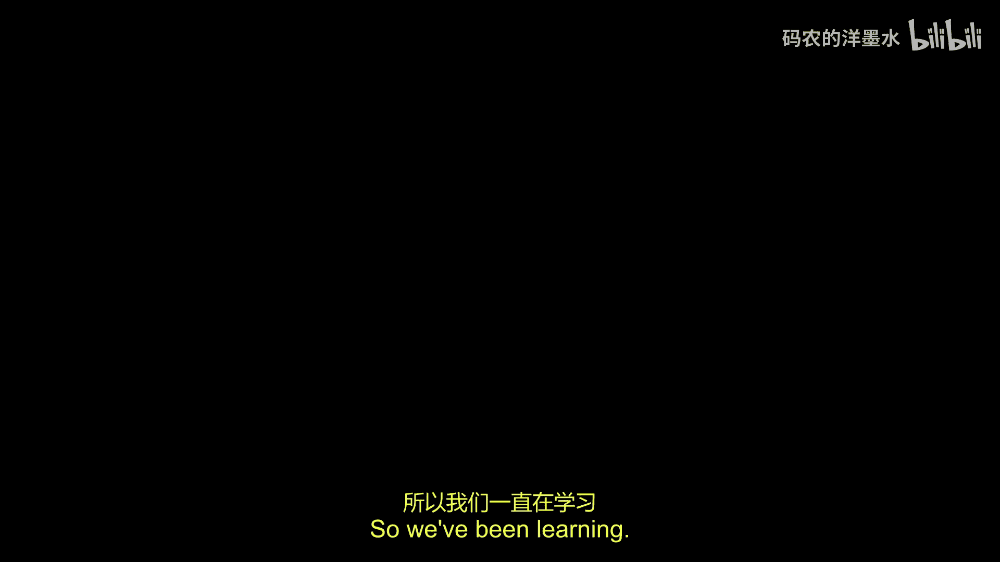

Okay。In case you didn't know。Hey everybody， we're pod five on Mitch， this is Nick and Dan。

Leap motion and leap motion SDK， so we're going to talk about leap motion and you。

spins all right we're going to have we're going to break this down into three parts i'm going to present the first part Dan's going to take the second part and we'll finish it up with Nick on the third part。

So we're going to talk a little bit about。What the leap motion controller is。So。

One of the couple pieces of hardware that we're going to be dealing with this project is the actual leap motion itself and that's this device bus right here so this is what's going to be physically mounted to the monitors that we're going to be working with。

How this works。It's basically just two cameras， infrared cameras。

And then LED infrared emitters and so it just projects infrared light two cameras picks it up and because its two cameras it uses stereoscopic imaging。

 which then gives us depth so you can。Control with it。Fune granularity positional data and X， Y。

 and Z in front of the camera and it does give options in software to allow it to sit facing up。

 sit head mounted， or on top of the screen， which is probably what we're going to end up using for。

 I would imagine。It does have embedded processing in it so it does a lot of the work on it it is pretty powered hungry which we're running into with the raspberry pies。

 but we'll go into that a little bit。嗯。ですよね。All right。

 so there's a couple a few technologies that Le motiontion has their most recent is Ule Hyperion so this is the actual controller of technology if you have a Windows or Mac or a X86 Linux you'll actually have a control dashboard you'll be able to see the camera at the raw camera output and everything the one that we're primarily going to be working with is Ultrale Gemini。

空。And the reason for that is， well it's the only one supported on the arm architecture of a raspberry Pi。

 and if you remember raspberry Pis is the primary computer that we're going to use behind the monitors to control the cameras。

So ultraally Gemini， it's fairly basic on the raspberry high。

 but easy to use once the environments set up。嗯。The package with each of the technologies like Jamini is the RE Motion SDK。

 which includes the API RE Cs。It is C， if any of you are familiar with C or C++。

 it's fairly easy to use the， but considering this class is going to be using Python。

 we did go ahead and set up Python binding， which we'll go into a little bit later on how to set that。

Uses of the controller well， I mean there's a lot， you know， mount the VR headsets。

 if you actually walk by light lab， sometimes you'll see people in there with them on their their VR headsets using them。

And interfacing with your PC that one of the technologies that make motion has is touch free that is。

Very interesting how that works and it actually it works very well at turning any monitor into a touch screen。

And it's。It's pretty precise。And I mean， endless possibilities。

 the uses of this in this ever growing AR and VR landscape is they're becoming more apparent。So。

Yeah now we're going to go to Dan so yeah we've covered a little bit about the leap a little bit of how to use the leap but now we're going to get into getting started installing downloading everything so let's go to the next one step one we're going to download it and I'm sure you guys have downloaded stuff four if we're this far in this course。

But yeah， so youll probably have to make an account once you get up there。

 but it's free and it shouldn't really。Be much one note。

 make sure you don't change where you're installing it because when you're installing the Python lead binding later。

 it could。Resulting in some pain。And next， we are。

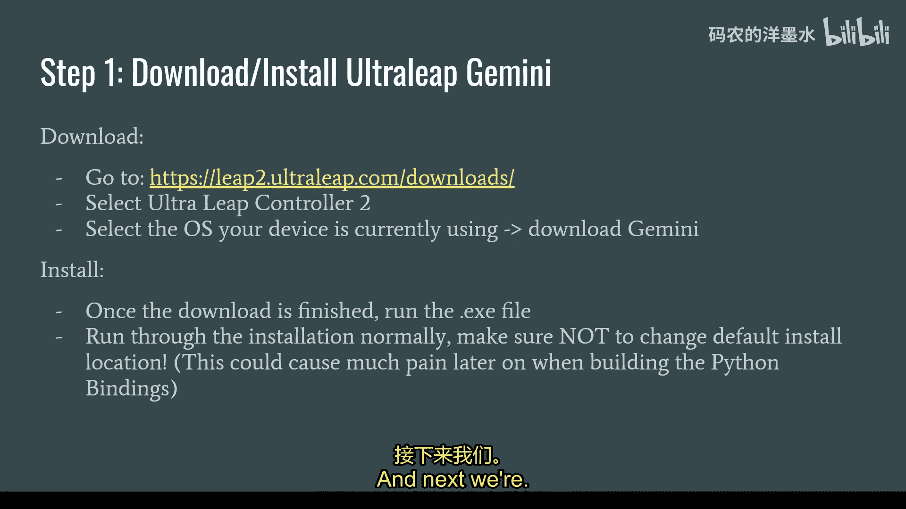

Yeah。So this is a video， I'm sure you guys have all pulled reos before， but just in case。

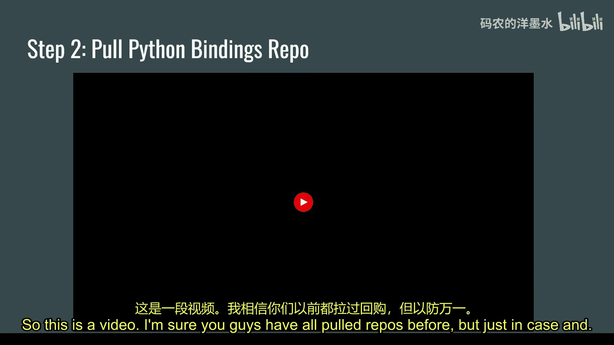

And。All of these videos， everything that is done in these videos is provided in document。

 so if you're wanting to glaze through these and you can just want to copy and paste that is also up。

There as well。Are there items in the GitHub？That's that are the documents on the GitthHub。

 the I pushed the on last night。Should be good yep， there's Ley python bindings。

 just clone it into a folder。And this is just to get set up on your local machine so you could run。

Like if you plugged in a leap seat or leap motion controller and you wanted to run some stuff on your local machine。

 these are the steps you're going to go， you're going to want to go through。

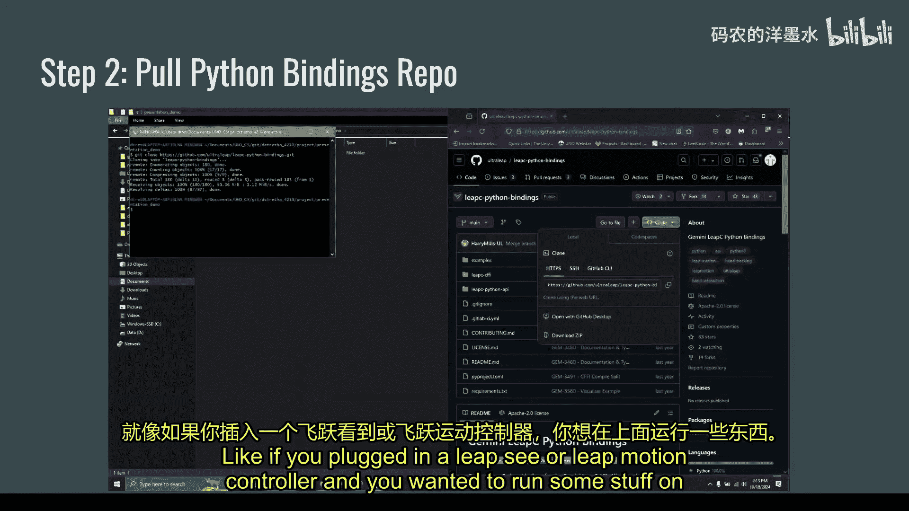

All right， so we've got the Python bindings。Next step。

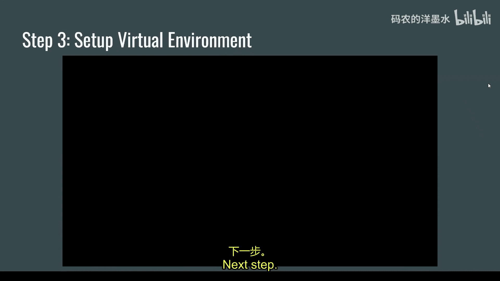

Setting up your virtual environment。So we're going to open up VS code and in the terminal there we have lots of commands to run。

Yeah。And all these are in the document yeah all of these are in the document just make sure you're in the right directory I didn't realize how tiny the text would be so I apologize。

你去搞一下。Yeah， so here we're just type typing a command to set up that virtual environment and then thinking。

All right。Next， we're going to activate it。There might be an issue。

 I ran into this issue with like execution policy on my computer。

 so there's also documentation on how to adjust that and then re it so you can activate your virtual environment。

Also， side note， I don't think any of us have MA。

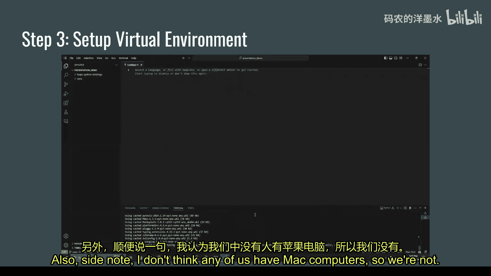

Computers， so we're not。We don't know 100% how to do it， but we're absolutely happy to help you。

All right， so we've got our virtual environment set up。

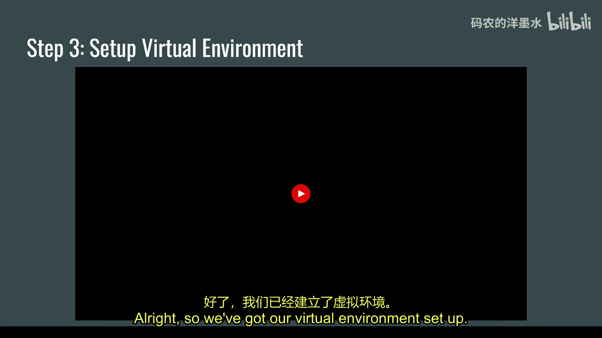

Next， maybe。Maybe we're going to build the Python bindings。All right。

 so in the same terminal that we were in。It showinghow you here that if you want to read through the documentation。

 this is the file also has all of you。Comds。嗯。Here。I will go line my line。

And install the Python windings。嗯。Yeah， nothing really。

Too crazy make sure if you're out of directory， you need to point which folder requirements or whatever file。

You're using。Other than that， it's pretty， pretty easy。 also if。don't want to watch the video。

 we have it on documentation。Copy and paste works just fine。

I imagine this is also on the GiHub Read me file for the lead emergency file yes。Okay点。And then。

Super interesting it's fairly straightforward if you do end up altering directory locations that's when you run into the need for environment variables and stuff to point it correctly because it defaults to specific paths so that's just something to keep in mind which you you can do if you want I personally wouldn't recommend that I have run into many many problems because I thought it was fancyancies fancy and I put it at SDK in a difficult and I was supposed to be and everything was supposed to run off of that and I deal with a bunch of environmental doesn't help those help like doing if you must but you're on your own basically。

If if you run everything in the default directory like it's it's made to it'll go just fine if you need any questions。

 if you any help just come knows we'll help yet yeah。No。

 there's a lot of areas in this whole process where， you know， something could possibly go weird and。

We encountered lots of that so please we'll share in the pain this is a group project for sure is。嗯。

So yeah， we're still finishing up installing here。Getting to the good stuff， yay， be done。So now。

If you want to go into that examples folderer， you can pull one out， I pulled one out into the root。

嗯。My mouse was giving me problems。This example folder comes with the Python it's like you're going to it's going to come with that。

Okay。I know。Yeah， I started this video to use a camera and alas， I did not have a camera。

So I committed to the bid。😀Yeah。Yeah。And yeah， you can just go over once you've got your lead plugged in。

See a little visualizer sample here。Maybe， yeah， thumbs up。All right。So that concludes step 4。

InsteadInstead of a Halloween profit， a very， very humbling photo of me。

Is this actually from the from that is from the motion we were like we should put something here we just took a screen。

All right so next my friend mag will take hi i'm my friend mag this is the part where I'd tell you how to use them so now that you have hypothetically all of the python binding set this is the part where y'all come in because y'all going to actually have to be developing stuff using this our app that we're going have all the how the hallway。

So there are important things that you need to know that are also in the Le E SDK themselves that the Python binding kind of interprets which are a few important classes one。

 and I have them in a specific hierarchy here one is going to be the connection itself the connection itself is treated as a class that everything done inherits from the listeners specifically are inheriting from the connection class and you can see I stard the listener class because that's like 99% of the class that you're going to be worried about the listener is a thing that actually handles the events from the camera everything everything single thing that the camera sees the events hand motions connection events disconnect events errors。

 everything on that is going to be handled through the listener and you're going be grabbing through the listener that's the most important part you're going to be doing the listener class itself a lot and that's that's pretty much what it's called and of course with the way Pythonher in this work you can call the class anything but it's essentially just called the listener class。

And events as you see here is just anything at all logs by the camera that doesn't just have to be hand movement。

 although it absolutely is hand movement， of course that's going to be most of what you're dealing with。

 but it also includes stuff like connection disconnect logs。

 that's going to be stuff like other camera events like if there's some sort of error。

 a bunch of different transcript stuff you can get stuff like a serial number from it etc cea。

 et cea。Events is like a whole thing and you can see here this is just from。

The one of the Python binding examples， you can see they start。

 don't worry about connection just yet。You start with a class listener right here and it just little says base class custom listeners to connections fair enough and then they have defined on event and so they have an event class of event pass through and you can see and what that defined oneven function does is it's called every single event which 99% of the time is going to be every cycle because event like I said could be almost anything so every single time some event happens through the camera that function is designed to be called so what you can do is you can override this listener class with your own and override this oneven function with your own oneven function to do something you want per event and that's mostly how you're going be handling 99% of all the stuff that you're doing Now what specific types of events so there are there's what lot you can see here they came up with a bunch of different functions that you can override whenever you。

And the full list is here， you're not going to worry about in most of these。

There are some ones that you get to be worried about more of them like for example。

 event type connection that's just on a convection connection event if you want to tell whether or not the camera is connected obviously it's kind of important that just will fire off on any con connection event and the most important one is going to be。

怎会。You see tracking。Tracking right thank you on tracking event right here obviously a y'all like us that's going to be your most important event because everything tracking related is stuff the camera is literally seeing and stuff that we're going to be using to do our things。

😊，Um but。If you see here， this is one of the actual examples that it has you can see here that they start with a myclass listener right where they make their own listener class and then they define an on connection event like I said they override that on connection event that was in the original Python bindings and then they just have it to say print connect just so you the code or no hey this thing's connecting properly and then the actual juice is well they have on device event to just to print the serial number and stuff in case something happens et but more important thing is going to be the start of this on tracking event right you the single。

Pointer。No， okay， oh well。You can use your mouse so I see your mouse yeah。

 but also there was like a laser pointer that's a bit more and whatever it yeah that's how Power pointin。

So you can see here they overrid their own tracking event function and this is where most of the juice is going to be they have and I move over here。

They printed the event tracking frame ID and I'll explain this a little bit later。

 but the tracking frame ID is essentially just the frame number of whatever is's tracking so this is going to continuously go up all the time and that's for you to keep track of frames and keep track of the camera's notion of a passage of time essentially and they have okay forhand and event dohand okay we're dealing with custom data types now sure events do hands there's a hand dot type apparently and ID okay do palm。

position。x it's a lot it's a lot there's a lot of different custom data types defined by these Python bindings。

Luckily。I made it so you don't have to worry about it。Introducing mags， Python binding writings。

 what I did for you is I condensed all of that into a few easy to use functions where you don't have to worry about custom data types。

All you need to do literally this， this is literally all of the functions that you need to set up the camera。

 that's it。And I'm going to show you how to do it。So step one。

 we're going import what we need you see here I have the name is actually different it says camera binding stop high because I literally renamed them but that five minutes before class so that's going be it's not pinching at location example because that a horrible awful name so I renamed it camera binding so don't use that use camera binding because that's a bit more in depth and camera binding is a file that's not included in just the base Python binding that's a file that I made for y'all that's going be included we have that up in the Github or we will have that up in the Github very soon so that and I'll tell you what other files to get as well from the Github from our Github。

That's not included in just the pay pathython finall sign that's something I made so you're going to import that file I made and then specifically you're going to import from that file。

My listener and listener look at that so listener class snap again。

 and then you're also just doing an important leap itself because you would have to do that anyway。U。

Step two once you import all the stuff you need you need to set up that connection that I talked about earlier and also the listening class the listener class so you see here I just made a new listener as we all know i'm pretty sure we mostly know how class in here this works and I made a new connection and this important step right here this is the only thing one of the two only things you need the connection class for and this is why a connection above listener you're going to do a connection do add listener and then the listener you just made and what that's going to do is the connection that forms between this machine and the camera is going to add this listener that's able to detect and pass on events that's extremely important you need to do that or else it won't be able to detect any events and it'll be useless so。

Make sure to add the listener you create on the listening class that you imported from step one。

Into that connection that you make here。嗯。And once we do that， step three， you are going to。Open没。

And then I put it specifically with here， because if any of you have dealt with stuff like files before in Python。

 you use the with key， you use the width。Keyword has the right word specifically so that whenever you're done with the file it knows to automatically close the file that's what the with keyword does it's the same kind of thing here so that whenever the connection you're done with connections for whatever reason and it terminates early it automatically knows to close the connection just to prevent any kind of weird memory leaks etc cetera。

 et cetera it just good practice。嗯。I that's literally it and then everything else here you see I have just like a simple while loop here that runs forever as long as this program stays running within this connection do open you are connected to the camera and you can listen for events and you can do whatever you want and that's it。

It's that simple。So yeah， go ahead。Oh yeah。嗯。Here are the two most important functions that I made that we're probably going to be using let's just do them what get palm position I wonder what that does。

Step two is pinching again I wonder what that does and you can see right here I will actually because I think the next one is to oh yeah here we go so I just have a very simplified example over here and I'm actually going to show this work。

What think for them。I so you can see I did everything here exactly what like talked about and then I have with connection not open and then just while true I have it printing is pinch and not yet palm position and wow would you look at that it's that easy now you not only have the coordinates that it detects your hand is or rather and what specifically your palm because it does actually track individual joints look into that a bit。

But you also have whether or not it detects your pension。

And I just chose pinching because a there was already an example included about pinching and the actual findings themselves and B。

 it was just I don't know， I thought it was an easy way to like click or something if y'all want to do that。

 we can discuss more options later， but I just does seem as fair to me。

That's all you need literally that's 90% of what you need and then of course you can do your various guy stuff here should you choose to and。

I believe I can show a live example here。Let us。おことね。Is it getting ready。I just made it for that for。

 thank you。Do I stop sharing， I guess so then。今も都じ。No I'm going to screen share。S screen。

 I'm probably just going to share。By whole entire screen because that ought just be easier。Well。

 I guess， oh， that's scary， okay。You see everything I've go。Okay。So you have here。

 this is just the same thing that I just ran on here， except this is hello。Andre the camera。

This guy's a camera， he showed it to you earlier， but how the only difference is actually plugged into my computer。

And if I'm going to run this right here， we're going to watch it and not work。

Oh it's working look at that so i'm just moving my palm in front of it and it's automatically grabbing the palm position I just have it sleeping every 。

3 seconds so it doesn't span my console and if I start pinching it's going to hopefully work look at that。

And our am and it and I pinch again and it's true， look at that actual magic。But。With 13 at most。

So I don't know if you saw earlier， I think I have the。

The event oh no that's the event listener tracking event example here we go yeah before you would have to do like all of these and it would just print the hand example itself and you would have to like override my listener class to find different events thing no you don't have to do that anymore I fixed it。

嗯。Very we， okay。And then next up。Wheres the oh wait， no， this is the right one。

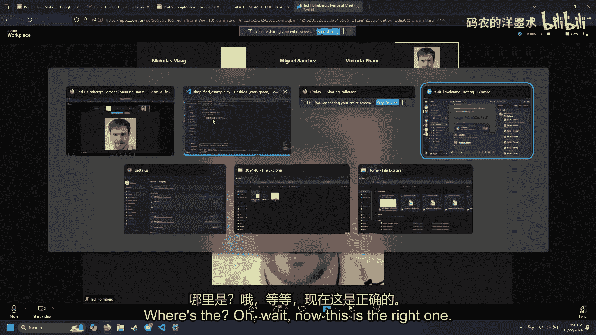

AhNo no spoilers。O。

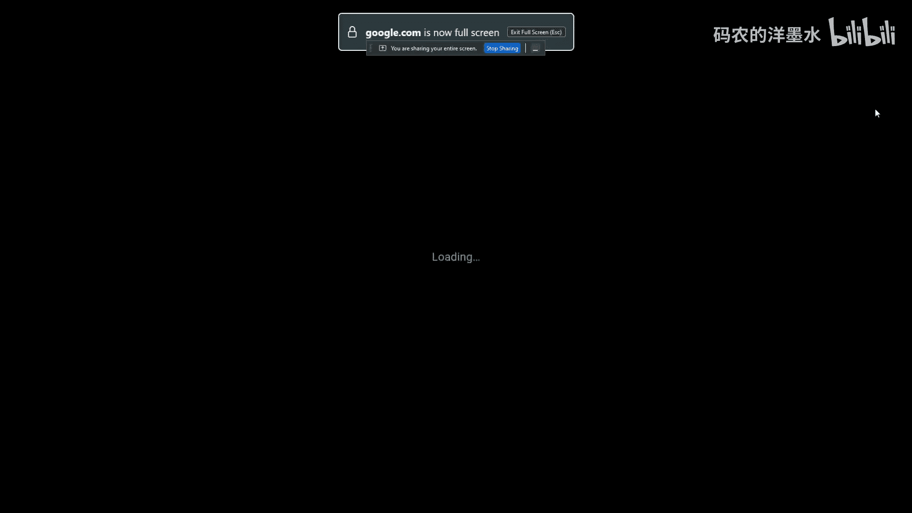

And then I also made another example where I think the Gy people talked about T cancer， come？

Who was a good y'all talked about tea Okay so I I wasn't there for that。

 but I heard about it so I was like maybe I shouldt incorporate tea and we're doing a graphical program anyway so I was like maybe I should do it so then I did it now you have no excuses I actually made it working and。

😊，Again I have this on here we can just test this very easily and again both of these examples I made are also on the GiHub or will be on the GitHub very shortly so y'all can if y'all want to run this on your own machine just follow all the steps we talked about before plug in one of the cameras we got in the swing lab which we're talking a bit and then you'all you can run。

Where is it？Is it oh， I think it's called external class test on my thing。

 ignore that it has a better name， I promise cursor， yeah。嗯。

I think this is the right one look at that， Okay， so I'm point of the camera I'm moving my palm around。

 look at that。Where exactly as you'd expect， it's a little bit finicky in terms of positioning because I just kind of like half past that。

 but you will be able to actually do it once we start setting the whole thing out。

 but is working exactly as expect。Moving around it's pretty smooth this thing runs at a whopping 120 FPS so we can have some pretty damn smooth move man if y'all how to do it correctly it's like shockingly smooth so。

Now you know and the only the only difference I' all need to worry about for actually having that update while like a T cancer thing is running for example。

 we don't have to use T cancer of course we can use whatever we want I' just use T cancer as example let's see here so here is my main loop to keep the program running right and I have the coordinate set at the top and I have the box moving to the palmm positions and notice here I have get palmm position zero which returns X。

And get composition two， which returns Z。That's very important y'all need to know the difference obviously attracts 3D space and X。

 Y and z coordinates， but consider that X， Y and z goes like this。X。Why。They。

So you're not going to worry about the Y coordinate most of the time because that's actually the depth from the camera。

 so 90% of the time when you're going to be wanting to do like positional stuff in space on the actual screen。

 you're going to be using X and Z。Why you only want to do when you want to do shenanigans with death which you probably good。

Just so y'all know if you do something with x and y and you're like。

 why isn't this working it's probably because you're doing stuff in X and Y。So just as an FYI。

So again， and then you have I have here window。 updates。

 the usual teakiner way to do it is just to do main loop， I think window。main loop。

 something like that， but I specifically have a function to update it once every cycle because I need to to do stuff in between each update like updating the position et cea。

 et ce， et cetera， and as she might have talked about teakiner。main loop。

Is a blocking function so once you run main loop that's it nothing else after it's going to run so that's why I had to update manually every cycle just so y'all know。

back to here now it's very nice Oh and then those aren't the only two functions I made I also made them work。

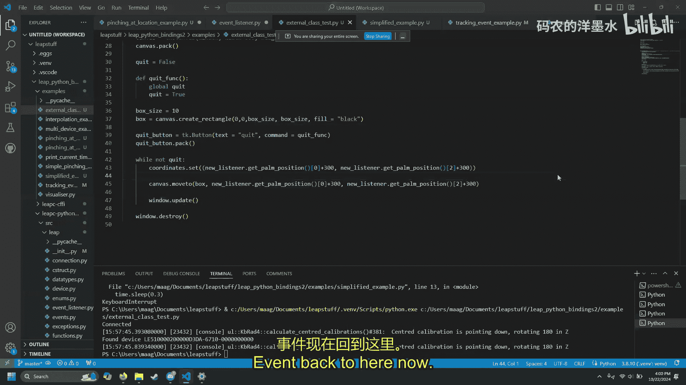

For whatever reason if you need them they're not as important。

 but good to know that they exist and I do have documentation for all of these by the way。

 like all of these do have do types， they do have a little bit of paragraphs explaining what they return and how to use them so if you're ever confused look at that and if you're still confused talk to me。

For then we have get hand type which just returns what hand is tracking left all right very simple we also have something called get hching vectors。

 which is a little bit more complicated。Essentially the way that it tracks ping。

Or the way that it tells whether or not you're pinching is by subtracting and getting the differences of the positions between the tip of your nextle。

And that's up of your thumb exactly so when I say get pinching vectors what I mean is I'm getting or I'm returning the differences between the tip of your index and the tip of your thumb from every axis so like the difference between if I have my thumb and my finger like this it would return turn the difference between the X axis the difference between the y axis and the difference between the Z axis。

So when you' gonna to use that probably never but if you ever needed it it's there maybe you want to use a cool zooming function where people go and it goes wow and it expand something like that that's exactly what that's for if y'all ever want to do that it's not necessary probably won't use it but I expose it for y'all just in case some other stuff oh yeah get trapping frame my sync。

That's just a tracking frame that I' talked about in case y'all ever want to do it。

 like if you only wanted how to update every other tracking frame for some reason if you don't want it to be super smooth。

And I have the difference sinks here don't worry about it I don't feel like explaining it just do sync please do tracking frame my theses it's better it's you'll maybe run into problems otherwise。

And then yeah， that's that's。That's sudden actual drop cream size again don't worry about it if you are curious about it I will happily explain it to you my throat is getting hose and it doesn't matter that much so don't worry about it。

I think， oh yeah， and there's also a test function I included it just so you can run it and then see if it works if it prints out something yes。

 you did it。I think that's it for me， go next slide。

Oh yeah there's my email if you ever can't reach me for whatever reason and you're trying to do something with this and you're like wellow I can't figure it out mom me we can time to me et cetera I's the pod specific channels as well that's true yeah please please we are pod five we are pod5 so if you ever have any questions about anything and don't feel like reaching us individually please please leave a message on our public chats you。

S on the hallway loud yeah， somebody somebody will answer you yeah and I think that's it for me All right。

 so finally。We've also been working on something else and that is our swamp lab。So as you can see。

 in room 352 at the end of the hallway。We have a little。Surprise for our class。

 a place for all of us to work on。Our app and yeah， software， agile modeling and prototyping。そそ。

And now we have a little tour for y'all。原告方。Sorry about my finger。We decided to wait on。不。My phone。嗯。

嗯。只是提。

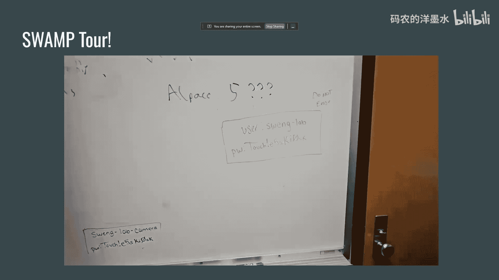

Yeah。That's our super high level editor version。And then。Mitch。

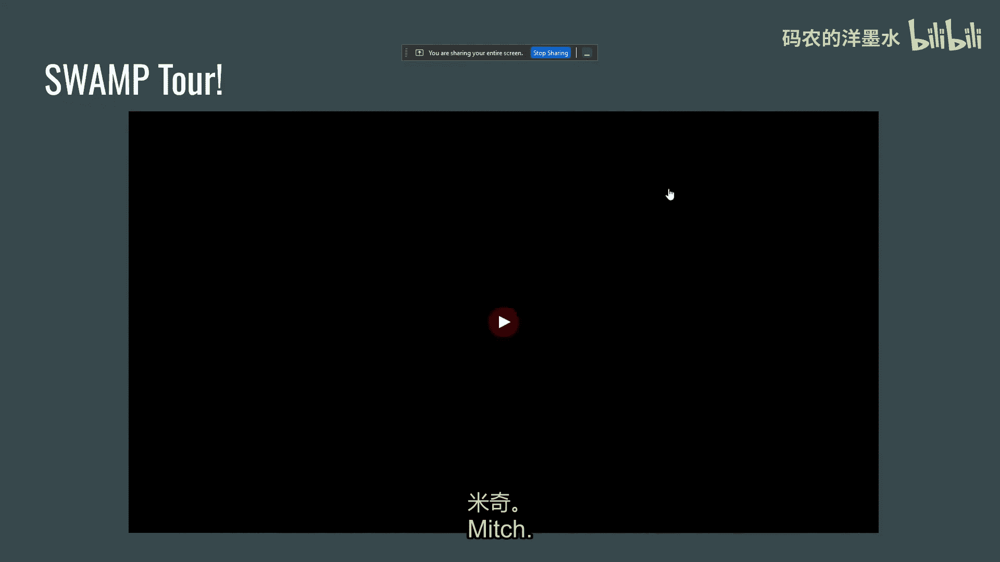

Got us set up on the raspberry Mitch and mag， both got us。嗯。Well， maybe。Yeah， so。嗯。啊。

All of this will be documented and of different as well。Yes。嗯。You have to do that， by the way。

 in order if it's work， please activate it。🤧哎。ItIt was a rush job think what 10 minutes we just got raspberry ponds working with Le soup today。

😀嗯。😊，嗯。And then that's Nick's cursor example。这个。Okay。Yeah。Yeah。嗯。一起。So it's yeah。

 they will be there for you。You have you have。嗯。So it can be mounted at various locations you just have to specify where it is again we're probably going to be using it in the the screen top。

Moode with the raspberry Pis， we are currently working on getting better powers。

ide to them with the current power supplies we have they're restricted so they barely run the camera that's why it was really laggy right there。

So we're working on getting those I think they'll be in a couple days or so and then yeah and we'll have them but they are it is functional now with with the swamp lab we will have a sign up out sheetet on the door please feel free to sign it out and use it it should be completely simulated environment to what we should we expect with the hallway monitors so for three computers plus that our three desktop monitors plus the TV to give you guys you know a development environment。

So yeah， samp samp lead and finally I think we。Oh， yeah。😊，坚是。嗯。What was questionYeah。

 you could that that's definitely a use case for sure using。

Using a sign out sheet is one of the use cases for the raspberry oh yeah absolutely。

whichch like y'all can y'all can just start building。

 if y'all can figure out like how to actually set up a go for that for sure。

 we can just make one of the things be a sign up sheet the nice thing about this this model in particular since each one is running a different raspberry pie is that we can have different specifications for each monitor if need be like it's not the same program running off of five different monitors it is in fact five different instances。

 which means we can have different specifications。Per TV。

 if maybe be which one of the that being said don't on them， don't mess up the base environment。

Because again， the Gemini is very in the SDK， they're very particular about where things are placed。

 so we've taken a lot of time to get everything set up to get the environment variables set up correctly so that you know minimum viable product you guys can go in there and just start using the camera and build on top of that so。

You've brought up a good point too now that we have a brand new samp lab in support of the class。

 you can potentially develop software for the TVs in support of the new software engineering lab and there might be new use cases that you can now think of adding on other things that you might not have considered but I'll just throw that out there right now since it's on the top of my head is potentially a discord bo that connects between the departmental discord and the TVs as well。

Speaking of discord speaking of discord， yeah， so you me put it up there put yeah put it up there but the lights's off right now。

 but we went ahead and。If you go on Discord on the swing channel。You will see a voice channel。

Feel free to join it and share that screen I thought one of you were on earth。

This isThis is what yeah， which if some of y'all joined about like an hour an hour and a half fish ago。

 you would have seen me and Mitch work in it that was you that was you that was you that was us when we we saw you working on there we were like that is this guy watching us yeah。

 no we have you see。😀Yeah。Obviously the idea get in the lab is that each pod to kind of preserve the space have access to the raspberry pos have access to the late motions。

 but it's resource kind of limited right you can only have one lab and we have like 13 different pods so at any time you can reserve this space but you can also just see what activity is there to see if it's open or say would being them。

I mean， you're being watched right now。是么。So that's there too someone's there there's a in there you want code you're like hey。

 try to run。😊，Wait， doesn't audio work through the TV？It doesn't work for you。Oh that's true yeah。

 but okay， these cameras do audio， but that okay， so that camera doesn't record audio。

 but out of the TV does have audio so you could be like hey， idiots and they will hear you。

They just can't talk back to you， which means you're in a great position。okay。

 so that's that can you please mute， can I be it can I mut Thank you Yes。

 no that's infrared just because the lights are off there right。

 but it's you will see color you will see color once it's like there just isn't light so。

Are deliverable。It's that do that and'm I'm assuming Ted will be willing on this if if you actually。

嗯。Oh you change the bit okay that's yeah so I just like you know some sort of proof that you're running one of the examples in the swamp lab if you want you can run it on your own machine you can get that working that'd be awesome so that you could take it home and do whatever you want Also as another bonus just like a little extra bonus points take a fun picture with your in the lab sign up there you'all have to emrass too also with with a swamp lab again it's you know we put a lot of work into getting it getting it up and running but if you have any recommendations or any ideas for it it's in kind of the bare bone status now you know it is a living document so to speak so it definitely can be improved。

And I'm glad you said that also just as an FYI for the Python binding binding。

 oh but the Python binding binding is I made as well。

 if you have any suggestions or if you want something specifically to be exposed because you have some ID。

All right， that's enough of that Yeah， good if you need if you want。嗯。All right。

 is execution legal yet， no， okay。That's fine。Um if y'all have anything specific you want to be exposed maybe as an idea if you have something specific talk to meum no promises。

 but I'll see if I can make it happen and these are instances where we can start creating tasks that pod five can take on Yeah like maintenance tasks of the yeah that's the kind of work that we're going to be seeing。

才。Right for for the entirety rest of the semester， this is what we are going to be doing with specifically your environment。

 your testing environment， your coding environment。

 the things that you are using so the driver is right so if you y'all have any problems with any of that come to us we'll see we'll talk it out we'll work with you。

All right we purposely made this relative way it's 44 where's a constant 45 okay we made this relatively short on purpose so that y'all can ask a lot of questions because this is really important because this is where we're going to be going forward with for the rest of the semester so if you have any questions comments concerns feel free to air them are points I can show you。

Yeah。Control panel oh yeah， so what was asked is a beautiful question。

 which was how many points does the camera look at or controller or track at once where the I can't see on this time is this thing right？

Control panel。All right， watch and see the magic unfold。It does， as you can see。

 it hits basically every joint， every flex point。It is a little affinnicky because of course it is。

But like you can see sometimes attracts the secondhand sometimes it doesn't。

 but that's why I specifically limited like the Python bindings the OG Python bindings can track and deal with two hands at once I specifically limited what I did to only one hand because that's simpler and it is kind of fannic gate track and two hands at once if y'all really really really really want that I can see if I can find a way to implement two hand tracking。

But again， no promises because it'ss the camera itself is much more finicky with your hands it's possible。

 but it kind of sucks but you can see it's it is tracking。

It is tracking the finger joints pretty well if slap right's there's a hand ID that you can actually talk about or not talk about that you can actually track in the thing you see how they different colors that's how you can tell if I was two hands for a second。

Yeah， anyway， I hope that sets it out。But yeah， I hope that answers your question。It's the power。

 the amount of power that this thing has when it works it's pretty it's pretty shockingly good it's pretty good it's pretty accurate like every individual joint you can access in some fashion I know I didn't make a way to do that but like if you want to override the function and do your own stuff you're more than welcome to you absolutely can。

Just you know I don't throw this out there， but if any of yall are interested in JavaScript。

 there is a website soet server with that unless to use JavaScript the other is and I can work with any team that wants to use JavaScript as close to Python to get that option。

Oh， by the way， I don't know if you told you we did manage to get yourself running too yeah。

 your yours is open running。Did you have a question you need this this camera for the we were thinking this isn't set yet but we were thinking about making a checkout system no promises you know we'll see about that later but we do have each of the cameras I did。

Thinking of maybe making a checkout system I don't know if I'll do it I don't know we'll do that we even have we even have extra raspberry pie but we're still figuring out how that works I don't know if we fully very that's the problem200200 0 fair comes this and a that's why we have the samp everyone has 247 access samp will never be locked right you don' po at any time you want to at 3 a on a Sunday that's fine just please respect if other people have it signed out you know you can always talk with another po and see if we can swap and but if people have it signed it is a small space repeat that does it gets a little hot and it getsed're working on the we've gone from you know binding programmers to HF。

We've done so much working on this please workshop is I want everyone to kind where the lab is at yeah we will have a miniature field trip over to that obviously we can't fit all of you but we will all of that so sign out sheets on discord or interesting there's no real way to block out times on discord so we could do that where you could put like the time slot but then people just need to make sure to read ahead and make sure they're not over a good schedule I mean for Noah works I've looked my I mean there's there's event bots like crazy but nothing for basic blockouts you could write something real quick。

Wechedul we figure something out like the that we're going to have a paper sign up sheet its just like a prototype thing but we're absolutely we're open to expanding have yeah whatevers we're going old school with the sign right now it'll be cute I think the best is your your idea with the you know using this technology to then。

Supplement the swing lab and doing a sign out on that that would be really cool to see eventually something else good。

This promise uses some neural network。So I actually looked into that。And the answer is。

Sort of it's more complicated than just using a neural network like there for sure is is some sort of model that they've generated that they're using here。

 but it's also just straight up like excuse me they're also just straight up using like manual levels differences and and and things like that that won't that you wouldn't see from some kind of generative model。

It's partly neural network I don't know the full details if you are curious im happy to research it because i'm curious myself I didn't go full depth into it but。

Really。呃还有候俄斯就是。Oh yeah， basically the same things。A you running而。3070 and was incredibly slow。

 so really， I was amazed by the performance because I was getting。Maxal问进。WWow。

I wonder it wasn't like generating a model real time， was it？

It was just using a model I already had right Okay。

 I was going to say if it was generating model in real time， that's why。Yeah， oh that that sucks。

 I no， that's interesting。 you know what it was called。

The whole camera system and everything is called。Well， what was the system called the whole thing？

So I have a entry。Until you sense camera。I think the biggest difference is that open only it runs in RGB data and this one probably depth right because this is a stereo a stereo camera and that helps a lot the fact that it stereo cuts down a lot of the middle work that you would have to just assume which was stuff like an only word yeah that's interesting I'm going to have to look into that。

那天我不是K。Yes。Okay。Well， I mean， maybe， I mean， Ive prone camera， I don't know。

Pro check the specs but this what they're playing with right now is actually really good kind of observation because one thing that you're going to want to get a good grasp of is what distance away from the camera do you have to be or to reliably to get input and we're going to want to know that but when we mount those onto the monitor to know how close our users are going to have to be。

So these are all going to be things that we're going to have to pay attention to since anyway。

 interface system with this device。Was exampleAt least motion 2。

AndI'll just state that I want to say that the first approach came out I think around 2012 started to working。

 so this is about a technology that。Is about a decade old and it's been kind of evolving over the last decade。

 Good note about that if you're ever trying to figure something out in you end up on forums reading about it。

 make sure to look at the comment date because you going down grab it holes like oh that's how you do it it's like from 2011 and they've streamlined all of that since then so you had leap motion and you had ultra haptic ultraptic and they merge so their both two kind of supplemental hardware for like the kind of Vr like kind of emmoed detection space and so they became ultra leak they they merge that's when they kind of lost the2 it's a new and improved version of the original leap motion with better cameras and that's the newer version of the driverss much more perform than the leap one。

ThreeThings really interesting， but only what someone does。Yeah。

 when Ge and I only works on Python so we can't use hyper windows so we can always put a windows on the we want to play around with that doing。

Yeah final note about the camera， it gets very hot， but that's okay。

 that's by design so you're ever feeling it。I mean。

 it gets hot it does for such a tiny thing just out of curiosity does anyone have any 3D printing experience？

No。the only reason why I ask is another one of the tasks that might be outsourced to one of the pods might be to create a amount for the TV I'm so glad you brought that up in absence of that we can just。

I mean， we can， you know， yeah for。But if nicer to have like an amount you will have our gratitude because they do they have external message you know。

 did you see any have I don't even I did find they make the TV for the touch list that we probably order on its own but if they have if they have G code files for those you just print them out that I'm saying that could be a task as well someone comes across some some G code files or for designs for that let me know and then we can print them we do desperately need we're about to duct tape them for you it's not going look pretty do that。

Yeah。😊，Yeah， no it's it's whatever will work really I think haven't had time to look into it so you come across something。

I mean， they're not a lot of weight so we can really come up with something fairly easy to get them out。

I going to mention Giub GiHub organizations， there's a way to add teams。

So that way we can assign she was talking about how there was a GiHub teams feature where we can have an add different teams and we can use that to help schedule tasks and whatnot similar to what the project management people we're talking about too we can use that to schedule tasks and potentially as a signup sheet as well so we'll definitely way to keep that in mind going forre we're going to figure out something it's probably going to be GiHub related I don't know if it'll be discor related'll see but probably GiHub for sure well come with well cook something up。

In general assigning passOh right， yeah that would be a perfect thing for assigning pass nice to have it all spot yeah yeah because everything's going to be on the good anyway。

 so absolutely plus。AnythYeah， before because if y'all don't have any questions。

 I have 10% better on the watch， okay？We did it， well， mostly， we're almost done。All right， you。

It' going to be really， sorry， sorry。

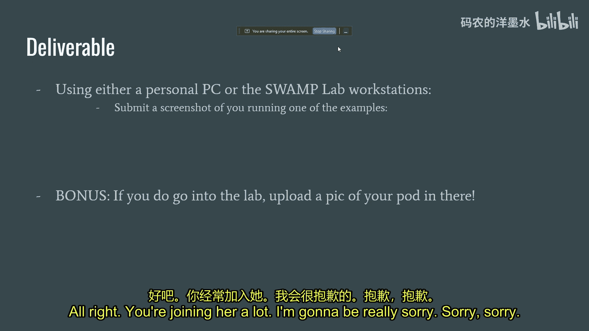