# 【全集】加州理工学院 软件工程 中英字幕 1080P p10 Lecture 10 - 数据管理 -BV13ZzaB3EWE_p10-

All right， get started all right， good afternoon everyone， are we not on Zoom？

文讯嗯。大。

That's good。😊，Go， no。try that try just a whole desktop stop。嗯。But now。能你这我调一下。Oh， there we go。

 I sure right。Allright。Let's do this。You got it okay， got it all right good afternoon everyone。

 we are poty and we got the workshop for serialization and data management。All right。

 first up on the agenda， we're just going to be going over some data serialization formats such as CSv。

 JSON， also applications such as SQ light and R syncnc。And I'll start us off with CSv。

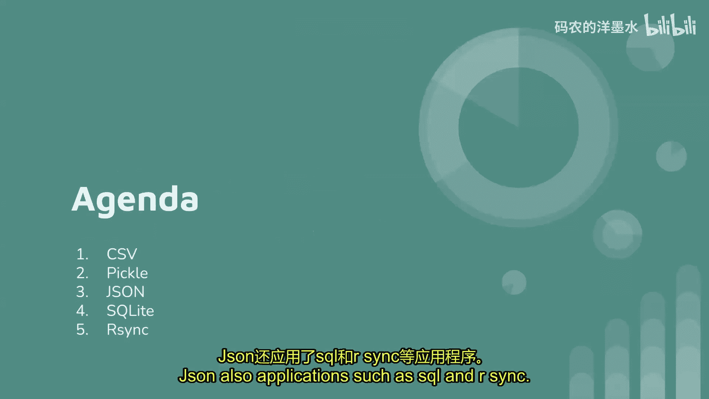

Now CSV that stands for comma separated values， it is a simple very simple file format used to store tabular data oh wait let me see let me see if I can move this covering some parts able to select an option minimize top minimize up the top gotcha。

All right， it's a very simple thought format use to store tabular data such as databases or spreadsheets into a more plain text format right each line in the file let me just show you for reference。

Each line in the file represents some row of data at the very top， weve got a header。

 which you know signifies what the data underneath it represents such as ID names， departments。

 ages and salaries。And this format is particularly useful for representing more simple relational data right key reasons why you would want to use this is very simple。

 very versatile and very lightweight because CSv is a very simple format that stores data in a more structured way using rows and columns and also using the commas。

To separate each line of data or each part of data。

what makes it versatile is that it doesn't impose any specific data type on the values and this flexibility allows for CVS to represent everything from simple text to numbers。

 dates， and even more complex data， which can be interpreted differently based on whatever application you're using or how you want the logic to perform with it。

It's compatible with most coding languages， databases， and spreadsheet applications。

Because most languages support some sort of library for it。

 or there's some person out there way before us that made something that could work with CSV。

It is a very， very widely used exchange format because， yes， like I said。

 it was used by every other coding language， every person before us has made something for it。Now。

 this is a very simple example of what a CSD Bible can look like。

And the CSV file typically would contain some sort of line dilimiter。

It's not explicitly said in this picture， but there is a new line character at the end of everything thing。

Which showed that each row is its own form of data。There's a view de limiter。

 which is most commonly used as a comma， but it's not limited to and could include some sort of character such as the Pi character。

 the semicolon character or the colon character， and that's just used to separate the data from each other。

There's also a quote characters， as you can see with the names like John Doe。

 Jane Smith and the departments such as F and computer science。

 there are the quotes that signify that it is a string and not an integer like something for age where it says 29 or 34。

And optionally， most CSV headers。Most people would not include a header， but for reference。

 I would include headers because it just makes it easier to see what each data means and what it relates to。

😡，Its very simple to use CSV for Python because it is typically an RE preinstled package with Python and all you need to do is put one line of text at the top of your file that says import CSV。

Right。Oh， is the video' not showing on there it is。Yes。Start the video。

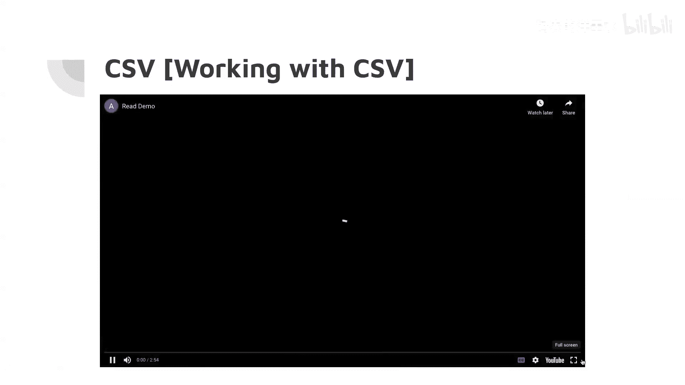

All right， as you can see， I have that very simple CSV file consisting of just the names， ID， ages。

 etc。And right now I'm just typinger boilerplate Python stuff like defining my main function as well as initializing statements。

嗯。All right， so right now I'm defining my read underscore CSV file function。

 which will be using a string parameter that is the name the CSV file that I want to read。没有。

So this is the simplest way to open a file in Python by using with open blank as file。

 it removes any unnecessary steps because in Python you need to first open the file。

 read whatever you want to do with the file， and then close it afterwards。

 but using with will just get rid of all the unnecessary steps of opening and closing in one go。

You can also see that in my initial with open statement。

 there's a file name underscore mode with R that's just for the read mode。And for every reader。

 you need to create a csv。reader object in order to read the file。

That's just me printing out the header just so you know what。

Information I'm dealing with in the CSV file。嗯。This right here， in this case。

 because I know what the CSV file contains， because I'm the one who created it。

 I know exactly where each index for each piece of info is at and I'm just going to be printing each row out one by one with their ID。

 their name， their department， their age， as well as their salaries。

And then I'm just going to be running。At the bottom。And then you can see where the header is。

 you can see each information is being displayed。

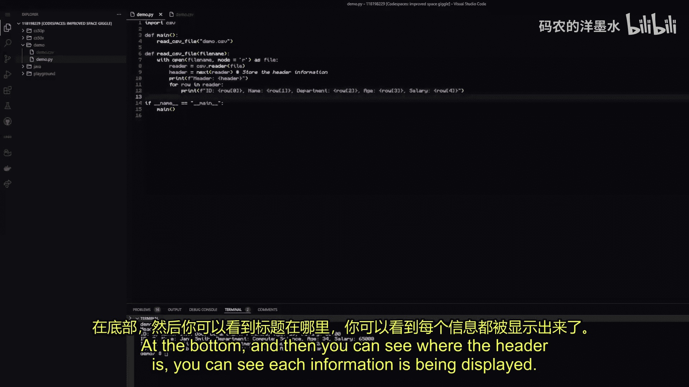

There it is。嗯。Now with reading CSV， there's also a pending CSVO。

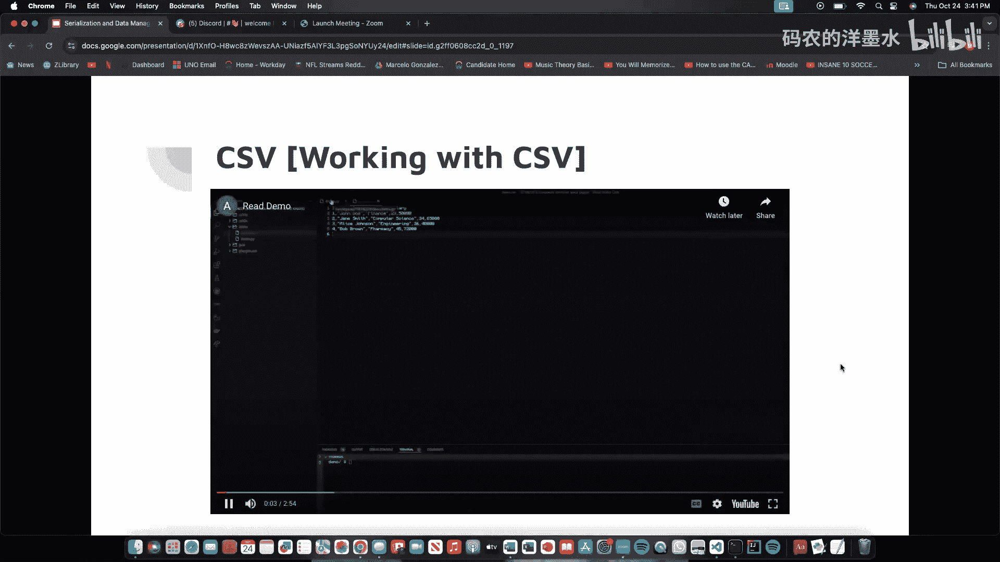

There is a pending to CSV files。

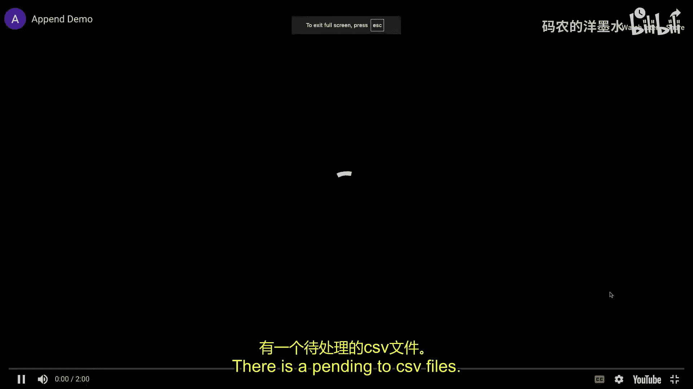

Same as before we had the original CSV file that I'm working with。

And then I'm just defining my append CSv file with a string parameter of the file that I want to read。

And you'll see there's a new letter in the mode that I changed， which is A， which is the append mode。

 and this just adds onto the end of the file。And then you'll notice that I'm adding an additional parameter into my right。

Write a function and these are concept that include something called quote all quote minimum etc cea。

 and this basically means that for every string that's MIC has we there's some sort of way that I could like interpret that。

So in this case， I'm using quote strings to put quotes around only the strings and none of the integers or any of the numbers。

嗯。This is a new command called right row and this just adds whatever I put inside of that to the end of the file。

So in this case， I'm adding a new ID， a new name， a new department， a new age， and a new salary。

And once I run the command or once I run the file。I'll go back to the CSV file and you'll see at the very bottom that's where it got attended。

 the new information that I added。

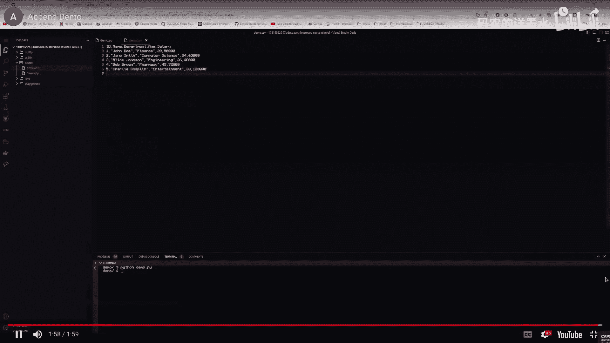

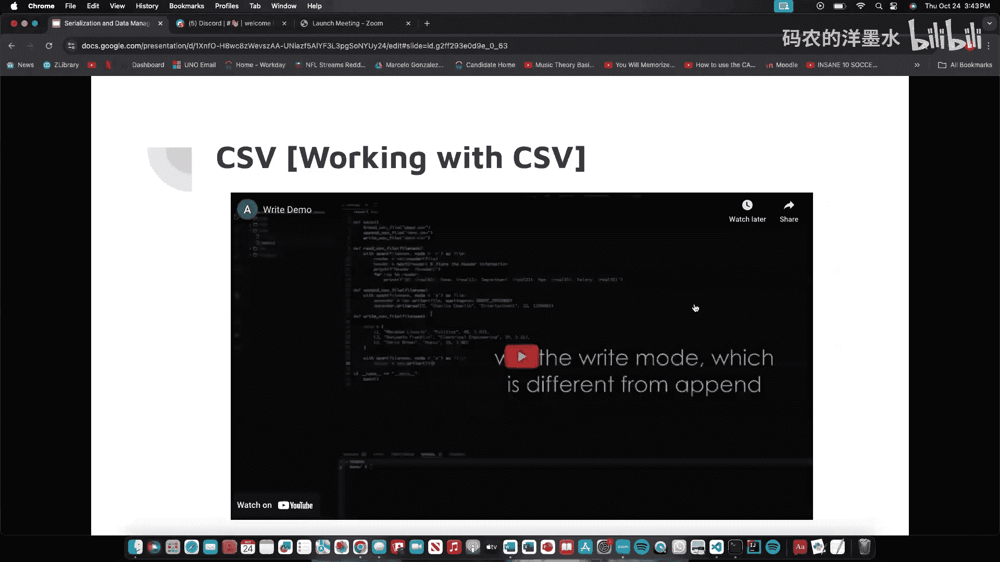

And then finally， this is the writing to CSV mode。

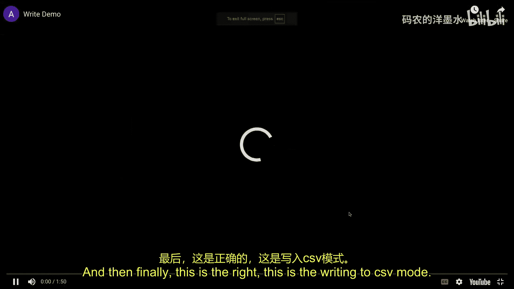

Same as before same CSV file right now I'm defining again my right CSV file function。

With the same parameter of the file that I want to write to。

This one here is just random information that I just wanted to add。

I just didn't feel like typing it out and wasting everyone's time。So W is the right mode。

 which is different from the pen， the reason is different from the pen because with the pen it adds to the end。

 the right trunncates the file， meaning it will just erase everything in that file and start from the beginning。

 rewriting everything。嗯。Here I'm just writing out the row。Or the header row， sorry。

As you can see I use different parameters， I use ID name。

 major age and GPA to like represent a more student type of like file。

And here I'm using the same quoting parameter where I would just put quotes around the strings rather than the integers。

And for each row inside the data file or a data dictionary or list， sorry。

It was just right out the room。I'll run the file。And then once I go back to the CSV file。

 you'll see everything has been replaced with everything that I just added。

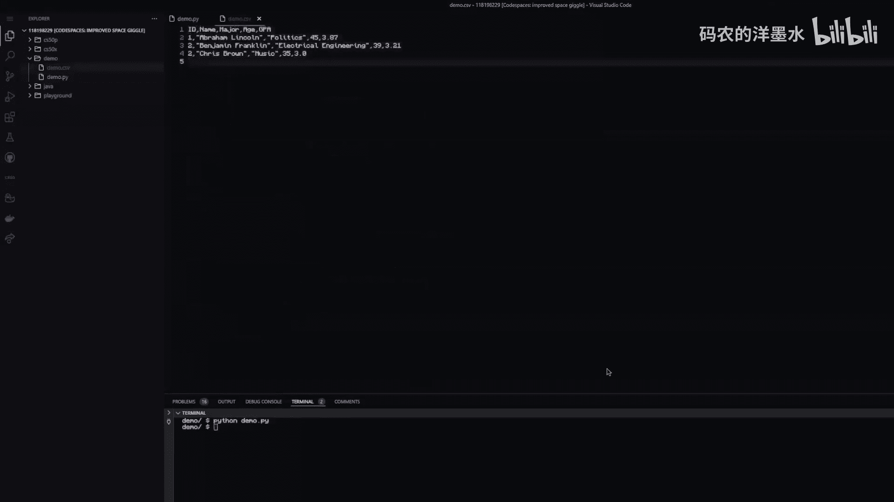

right。Thank。Now this is a more advanced example of CSv whereas this one。

 instead of using like CSv dot reader， you could use something called a di reader。

 which would allow you to。Purposely get and like purposely get a string of text so for instance。

 if my title was maybe like published date I can get that exact。Aart。

Take the date and turn a more turn it into a date time object。

 which is a different data type than integers strings。

 which means that CSV is able to use more advanced。

 more complex data typess rather than the more simpler ones。嗯。Best practices for using CFV files。

 using consistent structure， meaning。You just have a more table like structure， you have your header。

 you have the information， put commas in between， separate。

 make sure you use consistent like characters instead of switching up from commas to colons to semicoons。

 use the same character in between everyone。Handling missing data properly。

 I didn't put this in the thing， but there's a certain data type called null that you could use to put in missing data per se。

 so let's say there was a student that didn't have a student ID yet。

Instead of putting just white space there， you could put the null type there。

And that will handle it more properly。Pairgramm coding。

 more secure data handling and more efficient large file handling。Now。

 the second thing I want to go over is Pickle， which is a Python library。

Now pickle is a python specific serialization format that implements protocols for serializing and decsalizing python objects now serialization basically means pickling but so I'll use it interchangeably but that's what I mean Pickling involves converting a python object into a more by stream。

An example is like a pickle a cucumber， you can slice a cucumber into many pieces。

And you're basically representing those slices as bites。

 so you just have one entire bite stream of cucumbers if that makes sense。

That's the example that I came up with， at least。But this includes not only simple data types。

 but you can use more complex custom classes or recursive data structures in pickling。

The pickle module recursively traverses all objects and encounters and it translates this into a serialized format that could be written to a file and transmitted over to a network。

Now deization， that's unpling。On Pickling converts that by stream。

And turns it back into a Python object， and this process recreates the entire object structure and it maintains the references between objects to accurately restore their original relationships。

And then I have a little graphic at the bottom for you to see you will take an object into a by stream。

 pass it to whatever you want， and then if you want to unpickle it。

 it turns it from the by stream back into an object。

Now pickle is absurdly powerful when it comes to Python since it provides unmatched flexibility。

Using pickle means you're allowed a high degree of flexibility。

 especially with serializing more complex data types。

 not only can you serialize simple data types such as list dictionaries， you can also use。

You can also serialize more complex structures like functions， classes or instances of classes。

It also offers preservation of object states。Now you have to keep in mind that pickle isn't storing data。

 it is literally capturing the entire state of these objects， and that means that the attributes。

 methods and even the states within methods will be saved and can be restored。

And it also provides rapid prototyping because of the ease of saving and restoring states of Python objects。

 this allows for this fast flow of prototyping where us as developers。

 we can serialize and decialize the data in between iterations of our code。

 which can speed up the testing and development of more complex data or more complex functions。

Now there's some use cases that we could use in terms of our class project， for example。

 we could save and load configuration settings， we can use pickle to serialize configurations for things like the cameras such as like calibration data or refresh rates。

Resolution size， right？We can also。A pond system startup for like the kiosks。

We can unpickle configurations and have it more ease of startup with these predefined settings。

We can also have it used for session data management。

Now I don't know exactly how the kiosk will operate with multiple users。

 but one particular use case that we can use is that we decide to somehow assign students with their own like personal accounts or something based on their student ID or student cards。

 we can personalize their kiosk experience by pickling and unpling their interaction histories or their user preferences in between their log sessions。

They also cache frequently access data now applications often involve repeated execution of costly operations such as large database queries or complex calculations。

 and pickle can just serialize the results of these operations and allow them to be saved and quickly retrieved。

 thus optimizing our application's performance。This would just reduce the load time and improve user experience by avoiding repeating processing。

And just as I said before， pickle can reduce the workload and operation has to do by avoiding repeating processes。

And distributing objects across Python processes will。Well， more than likely。

Our kiosk system will work under one， like。Distributed system。

 meaning they'll share information amongst each other。

 so Pickling will just make it easier for those files and that data to be sent across different systems。

Same as CSV to import the Python package for pickle。

 you just need to put one line of code at the top of your thing because by default it should be already preintalled with Python。

 so you just need to put import pickle at the top of your file。嗯。

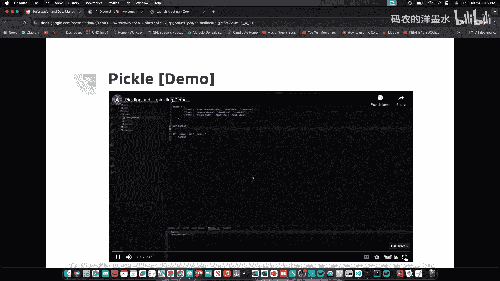

Not at the top I just have。Like a task list of source。

Just something that will say this is this and it's due this day。

I'm just defining my pickling and unpling functions using a parameter。

 a string parameter of the file that I want to pickle to。嗯。

You'll see that I use a different mode here， WB adding a B changes the mode to work with binary because piling if you remember converts an object into a by stream so you would need to use binary here。

 so this would just basically be right in binary。Pickle is very simple to use because you only need to remember this line of pickle。

 pickle。dump where x is the file or where x is the data that you want to pickle and Y is the file to which you want to pickle to。

This is now the unpickling。Unpickling function。对。This uses RB。

 which means read and read from binary if you could interpret it as that。

And here it's an unpickleling object。You would use pickle。

t load where x is the pickle file that you want to unpickle。And here I'm just printing out。

The tests from the data above。When I run the function the first time you'll see in the top left that there is now。

A pickle file。That appears in the same directory of the file。And at the top。

 I'll just uncomment that one line and comment that line to unpickle。

And then you'll see that it printed out。My task list。

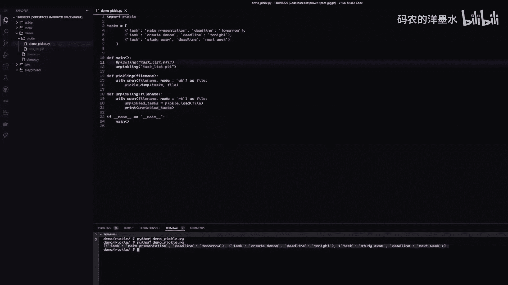

对。Now， there are some drawbacks with pickle because for as powerful pickle is there are。

There is something that prevents it from being a universally used tool。First of all。

 there is malicious code execution because one thing to be aware of is that pickle has no like system in place to determine whether or not a pickle file is pickled with malicious intent。

So it will when no questions asked， unpled the object that you give it。

hich could prove to be disastrous if someone were to， for instance。

 infiltrate our system with their own pickle file that has malicious code that will probably print our system or reveal sensitive information。

Now we should only unpickled data that strictly comes from us the developer since we know specifically what we're working with。

 and we should also ensure that if we were to pickle data。

 we have a way to secure that data between us because if it was public。

 there would be unauthorized mayhem that we would have to deal with and that sucks a lot。Now。

 limitations for pickle is that it is specifically Python。Pickle is inherently Python specific。

 which means that the serialized data cannot be easily used with other programming and languages。

This means if our application were to deploy the use of multiple other languages such as maybe Java。

 that the pickle file and the pickle data would not be able to be translated across and used with the other languages that might need that data。

It is also not suitable for long term storage。Because the pickle format is not standardized and it may change in between Python versions。

 and this lack of standardization can lead to compatibility issues which would make pickle unsuitable for long term。

 where data might need to be accessed by different versions of Python over time。

And now I'm going to send it off to someone else because a great alternative to this would be JSO。

I will be taking care of the JSON part of the presentation and so JSON what is it JSON is a lightweight data interchange format that's easy for humans to read and write and also easy for machines to parse it's based on a subset of JavaScript but it is language independent meaning it can be used with most programming languages it's a popular data format used in web development data analysis and software engineering。

So JO， what it isn't though is it's not a document format， like a text file。

 it's not a programming language on its own and it's not a markup language like markdown and also it's not too overly complex to understand the syntax。

So why would someone want to use JSON JSON's easy to read and write because of its clear structured and lightweight syntax。

 it's essentially a collection of key value pairs similar to dictionaries or objects in many programming languages。

JSON is not tied to any programming language， it is supported natively by many languages including JavaScript。

 Python， Java， PhP， C sharpp， and others。This makes it an ideal choice for data interchange seeing systems written in different languages。

JSON is most commonly used a format for web APIs when exchanging data between web applications and servers。

 such as sending or receiving data from restful APIs。

JSON is typically used because it's lightweight and can easily represent the complex data structures needed for interactions。

JSON's lightweight nature means that it doesn't carry unnecessary tags or formatting like XML does。

 this reduces the size of the data payload making it ideal for transferring data and web applications。

 especially when dealing with bandwidth constraints。

So some weaknesses of JSON would be its limited data types。

 JSON sports basic data types like strings， numbers， Booles， arrays and objects。

 it does not support more complex data types like tus or binary data directly。

 you need to convert these into a support format before you serialize them。

An example here is shown that dates must be often converted to strings in this format when using JSON。

 you can't use in traditional date format。Lack of schema， JSON does not natively enforces schema。

 which means you can have inconsistent data， it doesn't enforce strict data types so errors can arise when expected data types are not adhered to。

Note not ideal for large data structures， JSON becomes inefficient for very large data sets because it is text based and not as compact as binary format like pickle or protocol buffers parsing and niipulating large JSON files and memory can be slow and memory intensive。

And JSON while widely used for data transmission is vulnerable to security issues when dealing with untrusted sources。

 for instance， JSON data can be easily manipulated and may be used for injection attacks if not properly sanitized。

Some use cases for JSON like I mentioned is data exchange and APIs JSON is the de facto format for data exchange and restful APIs because it is human readable。

 lightweight and works seamlessly with JavaScript， it's commonly used to send and receive data between client side applications like web browsers and servers。

In our example here， we have using JSON to fetch user profile data from a server using a RE API。

Their use cases can。Our configuration files， storing structured data， client side， data storage。

 logging events in structured systems， and no SQL databases for semi strings。

And so we have an example here。

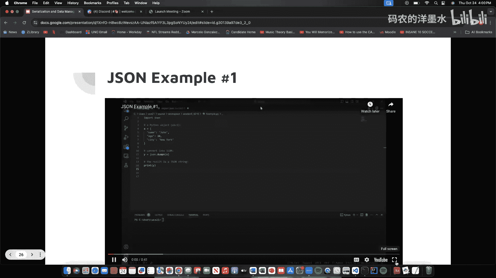

没是。You're supposed to be sound， Yeah， no，'re supposed to be sound。No我。Okay our library。

Sounds like going through zoom thats coming out of the laptop。Just full blast time yes。Okay。

 today we're going to doing a very， I'll just explain it I'll just yeah。A simple tutorial。

The example shows a simple tutorial on how to take a Python object and transform it into a JSON string Python makes it very easy because they already have support with a JSON library so first you would import the library up at the top and then initialize any object then assign it to a variable。

After that you would run the dump function from the JSON library and that would convert it into a JSON string and then you print out your result and down in the terminal you can see that it spits out our JSON string。

嗯。Down here。

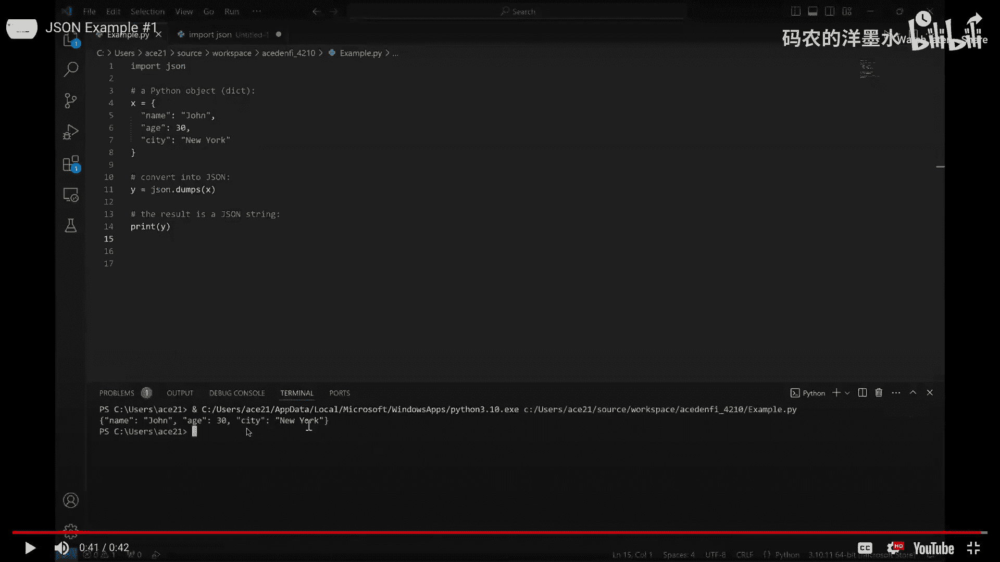

And very simple， very easy， very simple example， but it can also be done on for a larger scale。

And then our second example will be the exact reverse of that showing how to take HJson string and make it into a Python object。

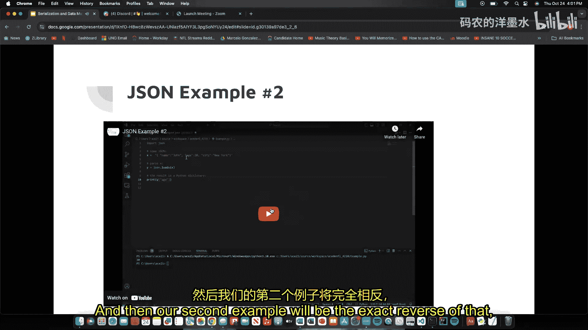

So up at the top， you know again， import your JON library。

And then you would take your JSON string and assign it to some variable。

And then after you would run the loads function from the JSON library and print out what the print out what the what returns from the loads function and your result will be。

Our function wants to print out the age from our JSON string and in the terminal。

 you see it prints out our age。

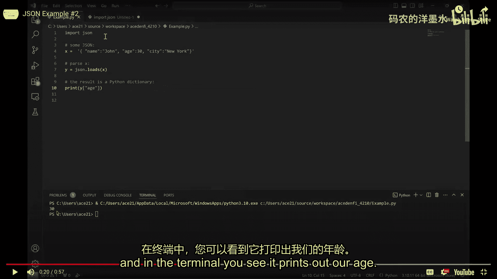

And then final example。是。嗯。Okay， our final example is a showing client client data sorry。

Client server communication using Python JSON and Flask and Flask is just a mini framework to show that allows you to take a HTML file and directly link it to a python function so if you want a particular action that happens on the webp page to execute a certain instruction it can do that。

But first you need to install flask flask， it just do PIP install flask。

And then the program sends a request for data which will be sent as a JSON string and then returns a response to that server on。

On the image on the left side it got cut off， but there're supposed there is it just says the header says example using JSO and there's a button that you click that sends a signal that sends a ping over to the server side and on the terminal here you can see that I click you know I click the button three times and you can see the time interval that each time the ping was received。

诶。So that's Steve last example with showing client server communication and how JSON is good for that。

Next one is I will be doing SQL light。And SQLL， what is it。

 SQL light is a serverless self contained file based database engine， it stores the entire database。

 tables， indexes and data included in a single file。

It's a great choice for small to medium scale applications， embedded systems。

 and local storage needs。Some advantages of SQL light are zero configuration。

 no separate server process， lightweight and easy to em applications， acid compliant。

 ensuring reliable transaction support and well suited for small projects。

 mobile applications or local storage。Some weaknesses of SQL light is designed for low to medium traffic environments and may struggle with high volumes of concurrent rights。

 SQL light stores in the entire database in a single file this commitment issue with very large databases。

 tens of gigabytes or more， as file corruption risks， increase and backups or migrations can be slow。

SQLL lacks certain advanced database features such as full text search。

 although it's available through extensions， replication and clustering。

 user defined roles and permissions， stored procedures and triggers。

SQLLite is also limited by available RA in the memory database。

 the entire database must fit in memory which limits the size of in memoryory database which is based on the systems hardware。

And for any type of local stories that would use on the kiosk， SQL light could be a good option。

Some use cases for SQLLite would be it's ideal for embedded systems like mobile devices and desktop desktop applications。

 many Android and iOS apps use SQL Bte restoring user data locally， such as preferences。

 logs or small data sets。SQLL also stores data locally for small scale web or desktop applications and useful it's useful for quickly testing SQL queries and database logic during the early stages of development developers use SQLL to prototype database interactions without setting up a full database management system like MySQL or post querySQL。

And SQLite has strong storing sensor data or configuration data locally on small IoT devices like Raspberry Pis and a raspberry Pi you should be used for a raspberry Pi used to collect temperature sensor data stored in a SQLite database before syncing it to the cloud or the larger database。

So SQLL is setting up SQLL and Python， it's pretty often pre-installed on many systems。

 but and Python comes with a SQLL library as part of the standard library。

 so no additional installation is required， but if you do have to install it。

 the command is down here， PIP install SQLL3。And so connecting to the SQL light database。

 it uses a filebased approach where the database is stored in a file and a new one will be created。

 it doesn't R exist， so this little section of Python code here at the top it imports our SQLL library and then we set up a connection through this by using the connection function and we pass in the parameter of our what our file name will be or a database name and then we create a cursor to interact with the database by invoking the cursor function and we print out for the sake of the user that you're connected to the database。

And then creating creating tables， it's very very simple it it's using a SQL and so you would you just use basic SQL to create your table and。

After that， you make your table， whatever it be for here it's ID， name， age， and grade。

 and you also specify the data types。Add for your SQL table。

And then you do the commit function to commit any changes that you did into the database。

And then you print out。That the table is created successfully for the user。And then inserting data。

 you use the execute function to and then in your pass in the parameter of in the insert statements and then you include your。

 you have to lay in the parentheses how many columns there would be。

 and then also including the parameters data that you're passing into for each。Con。

And then you run the commit function again to you want to anytime you make a change to the database。

 you want to do the commit commit function so that nothing gets lost and you don't have to do your work all over again。

And then for fetchuring。fetching and filtering data for if you're trying to retrieve if you're trying to retrieve any data from the database。

You run the execute function and pass in your select statement from whatever table that you are。

Trying to pull data from and then。For rows， for any rows。

 you just do the fetch all function and then you just print out the row。

So but if you're trying to fetch specific data， you have to filter it and use the select use a select date you run the same stuff from the first from the top of the function and you select it from where you're selecting it from and then you set it has an additional parameter specifying what type of data you're looking for right here it's looking for students where their grade is an A and you run again。

 the fetch all fetch all function and it should print out students who have an A compared to the top one who's just going to print out all students。

And then updating data。You again run the execute function。

 pass in the update statement and then you update what what you put in what you're trying to update and this one is students' age and then where you have to also label where you are updating it and then you again commit because you want to commit every change you make。

And then for deleting data and closing your connection to the database after you're finished working on it。

 you run the execute function yet again and you just pass in。

 delete where you're trying to delete data from， what table and then what column you're also trying to delete the data from。

And it's important to specify what table and a column because that it would have no way of deciding where it to delete information from。

And then to close your connection， you just run the connection close function and that will close your connection to database and you won't be making any more changes to it。

And now that's I'll be passing it off to。Arson。Alright， so I'm be talking about our sync。

What is Arrsync is a Linux space tool that can be used to sync files between remote and local servers。

Arsync has many options that can help you define the connections you make arsync is an open source synchronization program it's designed to maintain a mirror of a directory。

 it is a very advanced tool and intelligent data transfer algorithm that can be used to make backups or to copy files to another disk as I'll show in the next couple slides how I transfer data between two folders。

And different ways of doing that and manipulating the way you do it to get what you want。

Why is it used for two reasons efficiency if a version of a file already exists at the destination it only changes portions that are being transferred so if you have two files and your source files the one that you're transferring data to to your destination file and let's say you have five。

By45。File is in there and you want to transfer all them all to the destination file and they already have two of them already in there it wouldn't have to do all of it since it already has two just do what it's needed and what it needs to get so it's very efficient and fast at doing that。

In for robustness， in environments with slow connections or random hardware failures。

 especially especially disk have become non operational after heating up our scene can resume transfers that are interrupted。

 So if。You have a lot of files that you're trying to。嗯。Sink over to another。Diy。

And let's say your internet goes out or you have a network failure， it won't have to do it all。Again。

 it would like it saves it all and it starts from where it left off basically。

So what do you need to download Mac already has it installed。

 so I'm doing nothing for Linux or RPM based links machines， you have to do pseudo。

 y install our sync。And for the debutN based Linux machines， you have to do pseudo app dash get。

 install our sync。 And for Windows， I linked the video on how to do it since it was multiple steps。

And what are some arsenic flags and utilities？So flags are are basically how you so you write our syncnc and you write the flag to get what you want to happen so you have dash a copies files recur copies files recursively and。

Pservs ownership of files when files are copied。I'll be demonstrating that in the the video after。

T run， I didn't use this， but I feel like this would be a great tool， because it。

Runs a trial of the command and you want' to actually make the changes。

 So if you did something that you didn't want to do， then you could。Not actually do it。

 so that's really cool to have the delete tag。Delete any outrageous files from the destination directory。

 So when you delete a。 So when you delete something from a file and。

So when you leave something from the destination file。

You're trying to copy essentially with the source file files you have into destination file and if you have something that does not agree does not is not in the source file。

 it will delete it automatically， so that's something to be aware of when you're doing that。

Dash E tells our sync whatelle to use， exclude， exclude all this all of a specific file type。

 replace file type with the actual file type that should be excluded。

Dash H produces easy readable output， not just numbers， I show that one too。

Dash progress shows a transfer progress as the command is being run。That one kind of hasn't。Dash V。

 because。Oh dash V runs the verbo version of the command and essentially just prints out all the files onto the terminal what is being transferred between your two directories。

And progress just shows you like the speed of it and how fast it's going。And the size of it。

 so gives you more information about what is actually happening behind the scenes。嗯。

D Q runs the quiet version of the command， all the process that you are running will be run in the background it will not be shown。

Daash we compress the data and sync it。

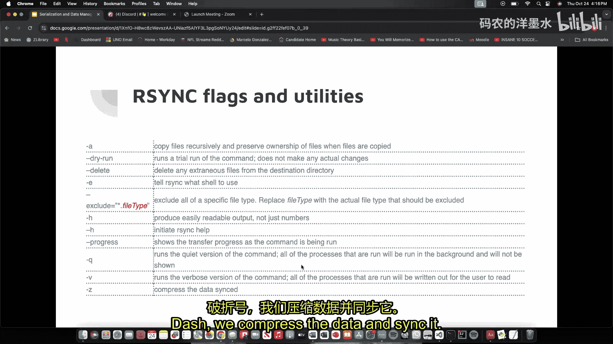

Okay， six。All right， so what I plan on showing throughout this video is some of different flags you can use with our sync。

 so right now I have two folders。Sorece folder and a destination folder， I have a couple of J big。

Bileles that are just pictures of my dog。Yeah。And what I'm going to try to do is sync the source file into destination file and show the different flags that you can use and different ways of doing it。

So。TheFirst thing， if you want to transfer only one J pigg file or any sort of file into another folder。

 we would first have to see into our desktop。And then we would， we could type our sink。不是。Source。

 which is what we're getting on our files from。I shall one by Japan。

Then what would follow out would be the destination folder and good the destination。

So as you can see， one of the JPG files successfully transferred over。And yeah。

 that was what we were trying to do so I can go ahead and delete this。

So now we can try syncing all of the all the files in the source content to our destination folder so we can do。

新手饰的甜医生。😔，And it says skipping directory source。This just means that we have to specify the recursive flag to copy the entire directory over from the source to the destination folder。

 and we could do that by。一人而心。And with our dash art flag。Let let type source and destination。

And then you can see that there appears is the source folder inside our destination folder。

 and that wasn't exactly what we were trying to do。诶You can see all of。All our files are here。

So what we were trying to do was to copy all the content inside the source folder。

 not the whole source source folder itself。So to do that， we can。

We have to be very careful with our slashes and that's the reason why the source folder。

The entire source folder was transferred over so。 instead， we could do。先定。

I just put a slash behind the app。Yeah。Yeah， just like that， we。Get all of our。

Fes in our source folder。And that's how you would transfer。Your files from your source to any。

Other file， any other directory？上个系你。😔，嗯。Another thing we could do is。

Look at the timestamps I deleted， but。Oh，Let me spring。As you can see。

 the times stampamps show the actual time that it is right now and doesn't show the times that they were。

It doesn't show the same times， so if you want to have the same times for the timestamps。

You could use the a flag。Annuities like this。Just like that， it matches exactly how。

The source folder looks， including the timestamps。And it's now a one to one relationship with the source folder and destination folder。

So you can try something else。嗯。Another cool thing we can do with our sink is to make it robustbose。

Which essentially just prints out the filing on the terminal that are being copied over from the source file to the destination file。

And we do that by typeping。微信。😔，And you just add the via。嗰边。Letter on behind the a。I do you sure。

And it copies down all the J PEg files that。I'm transferring over and that's really cool nice neat。

In to use。And a way to make that even better would be to。To show。

To show how fast it's copying and when it's done copying each one。

 then it'll go on to next one and the way to do that would be to add the progress tag。

So that would go by and。Do done。If a。Two dashes before progress。But so it shows。

How fast everything is copying over and does that one by one you could also see the sizes。Right here。

And right here。And the size are bytes， so it's not really readable。

 So if you want to make it more human readable， there is also an H。

Lg that you could use that will switch the bytes to something that makes more sense。嗯拜 by。

Ill sync again， keep the A I the H。😔，Progress。S侈。Spish。It does the same thing， but as you can see。

It goes to megabytes， megabytes， and。Good， so that's something interesting that。It does。嗯。

And now another cool thing that you can do with a sync。Would be if you want to。

Sort of simulate a sinking type of operation and that was the delete flag。咁你记得我。And like this。都。Sure。

So nothing happens because they're exactly the same。But if we add something to the destination。嗰哋。

Then something different will happen。You can see we added a test。Text fileile and destination folder。

So now if we run the same command again。It will delete the text file and essentially just wants to create an U exact from the source file and it wants to have the same thing on both sides。

And another way we can show that would be by。对。Okay。Just having a text file。Ma if we want it again。

It deletes it and it replaces it with the。With the source files that are to the left of it。

So that's a cool thing we could use with our sync。And。Lastly， the last hour show would be。The remove。

They remove command。嗯。Sometimes you might want to make a one way transfer where when you copy over the content in your source file into the destination file。

And once。It has been successfullyly transferred you want to it's going to remove the content from the source file so the way that works is by doing the same thing。

YourAnd your age。边了。Good爱 move。Ses。哎，我是。嗯。We supposed add to。She was right there。

 so I'll try that one time。Just like that， it transferred everything from source to destination and removed everything in the source file。

And yeah， that was basically what I want to show。 So the main goal of the video was to show some of the cool things that can be done when transferring data between two directories。

And yeah， thank you for watching。

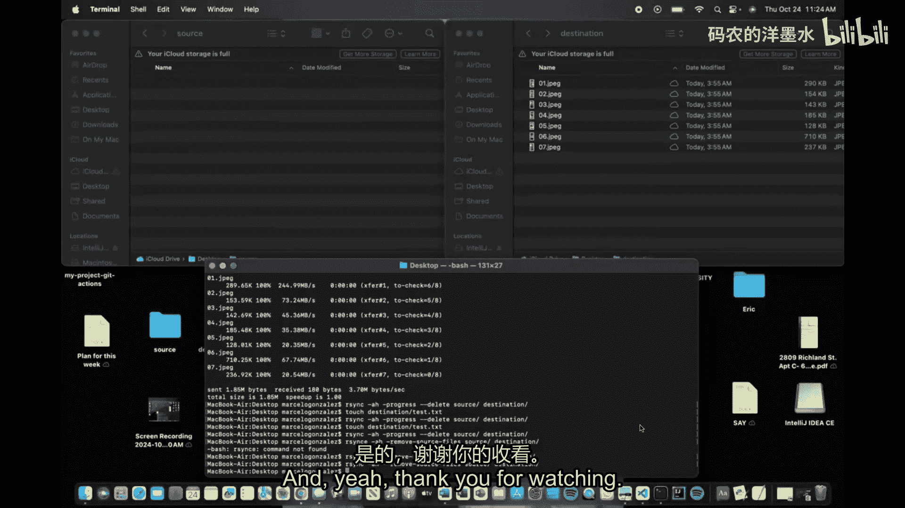

Okay。Allright。That's the end of our presentation that we just want to give you all one simple deliverable I just need y'all to create a file using one of the feature formats in our presentation and that just needs to include your pod ID and your pod description so what you do or like what your workshop was about and also the name of the members and just push it。

Push it to us。ま是。All right， thanks for watching。Does anyone have any questions about data serialization and data management or please was the drawback to using CSV the drawback to using CSV malicious code execution so no Alice Pickle。

Honestly， the drawback to CSV is that because it's very simple， right， there's not like a more。Bang。

 wait， I don't think I'd thought of a job back。It's perfect to use， let me say that。

It's a flat bio right it has a very flat file doesn the services that a database language would allow you in terms of the query power I will say one thing that you should be aware of if you do work with CSV data express in Python there's a really valuable package called pans that allows you to import CSV into what's called the data frame and it does get you query like powers onto that data frame but then the limitation is that that data frame has to exist in memory。

Whereas the benefit of a database is that it is not locally like run in the same memory space as necessarily your application and so you can potentially multiple servers communicate with a single database and that's your one source of truth that every service and then communicate with a lot of things other services you looked at are all locally run if they're all locally loaded into the memory so and has that happen on that particular machine to access the data。

 the wonderful thing about database is that it can be shared data across multiple machine needs and it's all updated and syn knowledge。

It considering the resource through the rest of the fire。

Now the raspberry pies that we have just so that you know。

 we've got the most up to date versions they have so the raspberry pie fives。

 they not raspberry pie fives， they also have eight dates of bread。Wait，With that said。

 a lot of that's going to be used by the leap motion。So yeah。

 I want to have a dedicated maybe database that all the client observer connects to to make any queries to and that's safe for anyway that way you don't have any data loss if a particular client fail。

All right， any other questions？youThen it's installedPickle or CSv。做で。This。Yeah。I think。

The what we you need Linux installed So it said that most Linux would have it， but if you just I。

I had it。Yeah， you just put that。In your terminal natural work。不是冇事。系。Any other questions？Okay， well。

We'll do the last week of a workshops next week and then we we will start on actually Yeah， you good。

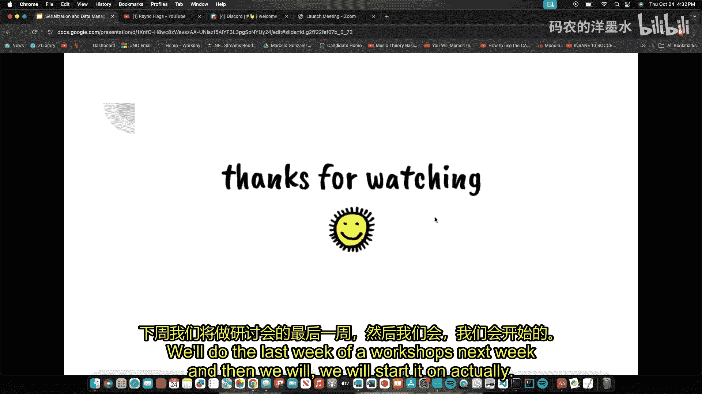

M。 he the good job。Thank you。

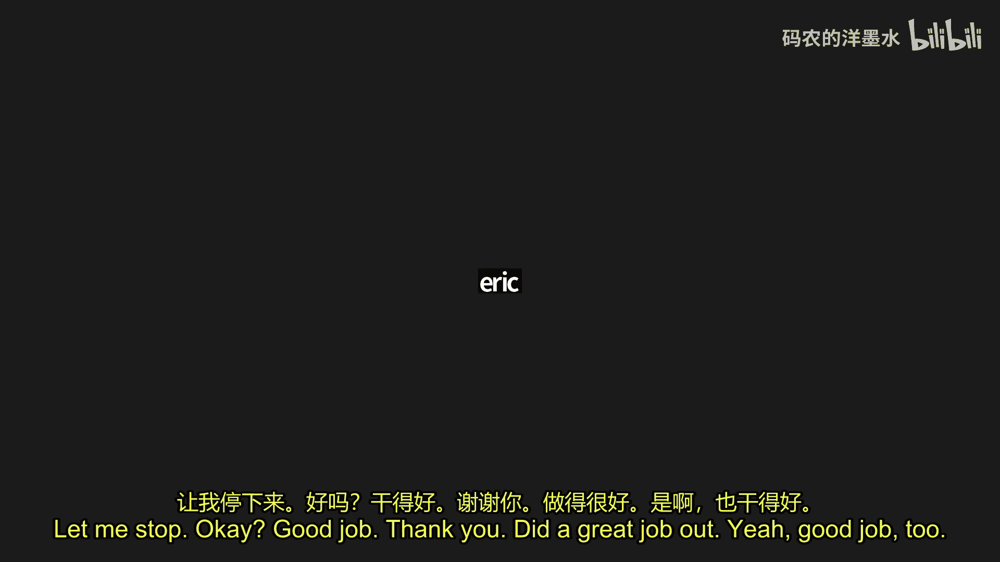