# 【全集】加州理工学院 软件工程 中英字幕 1080P p11 Lecture 11 - 容器化技术 -BV13ZzaB3EWE_p11-

关理。

Yeah。We Po seven， we're going to be talking about containerization。诶呢也 sorry。对。

So containerization of the technology that pretty much bundles up all dependencies and libraries and。

All environment variables into one single executable file。AllRight， so for instance， let's say。

I he's using Python and he only codes in Python and I only code in Java， right Java has a JDK。

 that's an environment and all that I can package up。My Java code。

Into a container and he'll be able to use my Javava code and run it on his machine without even setting up any JDA or any environment necessary。

So。Yeah。And it's pretty lightweight too。Next slide。So there are some benefits to this。

 like since everything is bundled up into a independent container。

It doesn't need to interact with anything outside the container。Isolation， that's a plus and。

Pretty consistent too， like if it works on my machine， it'll work on every other machine meaning。在。

If the container， what's inside the container will run。On my machine。And it works perfectly。

I could put all the things that it needs。Into a little box and ship it out。

To all the machines that I needed to model and。It takes up less space。

So that's why it's more efficient。So yeah， better on that。Okay， next slide。Yes。And next啊。

A bunch of uses for it the。Microserv architecture versus monolithic architecture， right。

Containers are mostly used in。Microservice， but that's more expensive。And so what microservices are？

Is that it's a bunch of containers interacting with each other。

And that's pretty much a microservice architecture。Everything。Has。

A separate survey that it interacts with so。It's very cloud based and it's different from a monolithic。

Sy the system where a monolithic。呃是。Moolilithic development or architecture。

 it uses one big server and it pretty much does everything。

It's monolithic if you're starting like a little startup。It's pretty cheap。

 So that's the one benefit of a monolithic architecture。 You can kind of dismo everything and。

Yeah it's pretty cheap so just something the keep mind I guess and oh yeah continuous integration and continuous development CICD pipeline so what that is is all it is is that it's just a bunch of containers。

Interacting with each other。And that's why it's。U see。嗯。So。Yeah， oh and it's。Easily deployable。

 like I said， it's very lightweight， so it doesn't take much to deploy。

 doesn't take much to to deploy。Safety oh so。Every container is independent and it' contained。So。

If let's say a container blows up if something。If something doesn't work， right。

You could easily replace that singular container with a different one that's。The same thing。

 but anyway was， that makes sense。Yeah。So， it's。It's easier to deal with in a large group setting。

Because if we're all messing with like， let's say 100 plus containers and one blows up。

 know it's pretty easy to replace， just take that out。But a new one in easy。

 simple and with the monolithic one。You're going to have to look at like thousands of blog ago to find a book so。

Yeah， a monolithic architecture， I like to compare it to it like。

What is it called the single kitchen restaurant， you know？Something catches on fire。

 the whole restaurant has to close down before operations can go on。So， yeah。Next slide。Oh， yeah。

 and here's monolithic versus。A market service architecture， as you can see。

 is the mono Ith think is very simple， this has one database where everything。Controrolll everything。

That does everything， it's pretty cheap。你去申 too。And micropher down here， all these microservices。

 you can think of them as like containers in and of itself。

 like a microservice deals with one specific function of。

One specific task and that's all it does it's very。Modular， in a sense。就。Yeah。

 and it has four different other databases to you know， buzz around with。No， no。Oh。

Virual machines versus containers。So V， you probably used it in like assembly。Virtual machines。

Are very， very happy to use。Because。One， let's say you're using a Mac right and you're trying to。

Useer。Do something on Windows。That's like having one operating system。

 which is map on top of another。So that can get really expensive and like it's going to pretty much cut your ramintail。

It's going to be super slow。So that's why it's like。Not really wanted。

If you're trying to like work on something in Windows on a Mac。What you can do is。你在跟这。

A container is lightweight， it doesn't eat up as much。

You don't need another operating system to run a container it works with the kernel。

And what a kernel is， it's pretty much like。嗯。It's pretty much the link between hardware and software and your system。

Very lightweight everything you need is in like and container， so yeah。Yeah。Does that make sense。

I'm trying to grasp the difference between the kernel and follow the virtual machines Okay。

 so a kernel， you can think of that as like。The like the link between hardware and software so that's like。

Hits and binaries zero what the container is interacting with yeah am I correct about that and the container instead of interacting with the perial。

Use the container engine like right here we have the like the containers don't say interact directly with the the hypervisor the operating operating system it needs of the container engine to。

To interacted。Yeah， so what a hyper is is pretty much like。A database that holds operating systems。

That's all it is， don't worry about it， it's kind of rhythm machines。Oh。

 and so what you can use to make containers is， well， doctor， that's probably the most famous one。

Amazon has their thing， I think they call it containerizing containerization services。

 but it's pretty much the same thing。Doctor， it's a platform for developing shipping and running applications in containers。

So it's。Since dumb it down， it's pretty much like a cloud based service where you can package up your code。

 ship it to the cloud and。My friend Igar， if he wants to pull my coat down。

 he can pull it from Docker。That's pretty much what it is。え？Yeah。

 it's pretty much a containerization system。 and what you need to know is that it needs a docker image so an image is like。

It's a blueprint of how the code is going to run inside the container。

 so it's an instruction manual pretty much for a recipe。And that image。

We'll run the code in the container， make sense。这。够。Next。Here we go， container orchestration。

When you're building like a microserv architecture。It's going to scale up really quick。

Dealing with 100 containers at once。It's probably not feasible。

So you're probably going to have to like。Find to figure out a way how to automate certain things like updates。

Or deployment of containers， right so that's where。

Container orchestration comes in and there's tools for this too like Kubernetes okay Kubernetes and Amazon has their things to Amazon and what all they do is that。

え？Pretty much。Helps automate deployment and。Deletion of certain containers。

Right if there's like five people on your service right and you're capped out at five you're going to need to deploy more containers to hold of more people so you could automate it with container orchestration and there's also like。

Sell healing， right when there's a faulty container， there's a faulty service， microservice。那的。

The program like Kubernetes， it would automatically discard that faulty container and put a new one in。

updates and rollbacks that gets into CICD right， let's say you're updating your service。Right。

 you can work on。You can work on the update in a。Your're local。Computer right and push the update。

Onto the cloud and that'll automatically take off the outdated container and put the new one in does that make sense？

Okay。I think probably made an innovation。So you're working on your update on your local machine。

 right？You're trying to update。Your web service。It has an old。An olive container in it， right？

You're going to pretty much do the little Indiana Dunnes thing where like he replace like you know what I'm talking about yeah that's that's pretty much what you're doing if that makes sense yeah。

So we' little bit on that。そう。And yeah there's some tools for a little bit container orchestration who are anys that's probably the biggest one if you're dealing with like a lot of containers。

AWS has a bunch of。Services by well it's software great so fargate it automates containers and deals with CRCD pipelines like like I said before the updates and you know all that Aws landda it's event driven programming So what that means is that it will react to。

Different changes in the environment so like more people are like going on your website hey deployoid containers if less people are hey take out some containers。

 you know dynamic。People dynamic。Cool and that's the list I just put the ones that I thought were really cool。

ね。没。So if you could see right here elastic container services ECS。

 that's that's pretty much Amazon's version of Docker，ber any services。

 that's like Uber Ns but Amazon and there's all these cool things that deal with containers。

Pda that's pretty cool now。Yeah， so you can find all the information on AWS。

Or on their website right here， I put it in the slide。Okay。Yeah。All right。

 Iger is going to give y'all a introduction into Docker and how to use it。So I'm going to start。嗯。

With introduction with Docker。What I do is said eat package and run the applications in a loosely isolated container。

It allows you to manage the infrastructure at the same way as to manage your application。嗯。好完了。

Here is explain how it works。It has a client cyber architecture where。The doctor。

 the doctor keep flying。U。Interact with the doctor。点啊。Doah。

So the dokaium is the engine that manage all the docker objects， this means images， containers。

 networking。Volumes。They' at clients。The command line interface where we pass the commands that we want to execute。

啊。These two components are installed。In your ho machine。

But there are cases in which you have to connect a do client to。Aoc that is on a server。

I was sorry of you were watching。We have Docker registries。

 that's where we put the images so other people can pull the images。The the default is the Do hub。

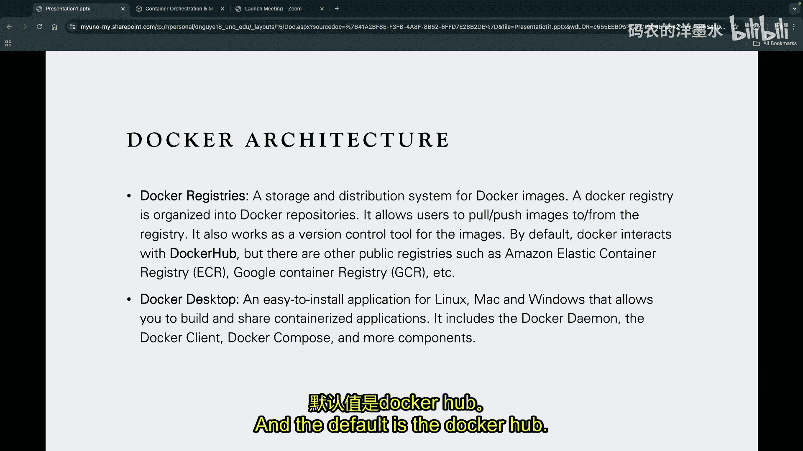

喂。

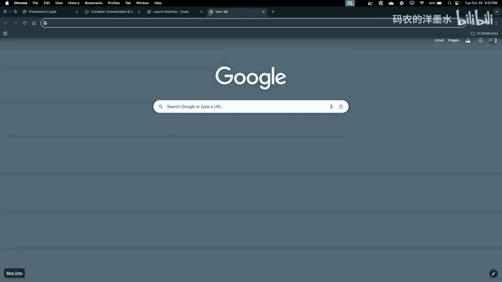

Thiss year where we find any kind of image that we want。

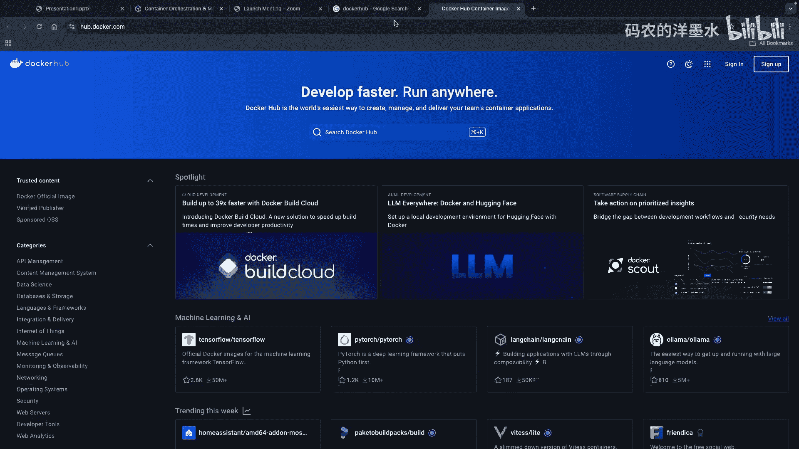

嗯。They are。嗯。They are organized into repositories， so if you want to push an image you first need to create a rippo for that image。

AndThere are other。Registries such as。I'm master lasting container service， ER。

 Google containertain Reggistry。没有。The Docker desktop is easy to install。

 iss an easy application to solve for any kind of a computer。

I would recommend you to install this has。

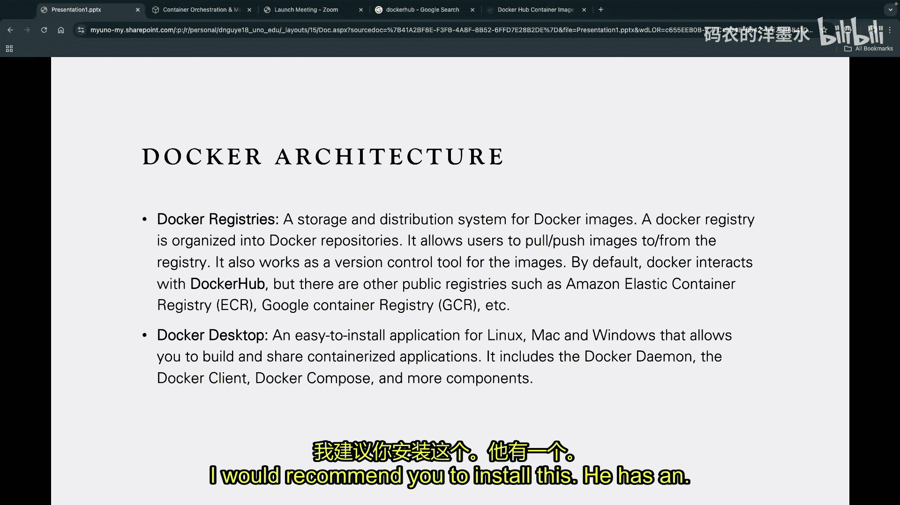

And， so you can manage all your images。Your images。

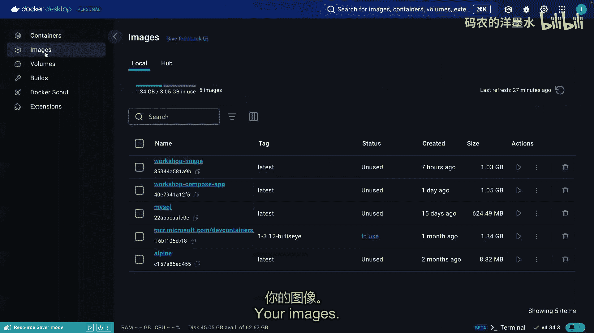

Your volumes， your containers。

It includes the Dokama， the Doka client， the Do composeose。嗯。So。The document image。

 like like Doy said， it's just a template just the recipe， the recipe or。

To configure the containers that you want to run。It includes all the files。

 the environment variables， the binaries， and libraries。To run the container。

We're going to use the Doque file to build images。嗯。They are two important principles or images。

First， they are immutable。So， once we。Create the image。 We are not allowed to to。

To modify that image， we have to recreate it again。The other is composed of players。

Each layer is kind of like a。Modification of the previous layer。Yeah。A second on top of each other。

Like I hear。And，And the last lawyer is the one thatese。鬼度不。Rightitetable。Yeah。So。

Every look file has to start with the base image。We can also specify the version。嗯嗯嗯。

They are no case sensitive by upper case。Its for convention so。Is very used upper case。

 so we don't have to。It's better for other developers to understand the code。

We have the wrong command that is test。That's the mean。Way that we create。Images。We have environment。

 we can set environment variables， we can work， we can set work working directory。This were all the。

The commands are going to be executed。We can expose sports in case the container has to。

As to interact with with the outside world。Arguments that are easy to modify。嗯。So。

 there are two ways to。That a command on。It's going to be executed when we start the container。

 we have the CMD that is easy to operateide we just have to pass。Arguments when we run the container。

 but at the entry point is hard to override， and we have to consider this when a container。

As to start with the same command。So theyll get containers， we already know their is。

A very isolated process。诶。That has your application。

We can create a stir of delete containers and'm going to show you how to do it。嗯。

One key feature that the doctorcker has is that when a container is removed。The data is not stored。

 so you have to use per as storage。W volumes。Car volumesolumes。嗯。

We have the life cycle of a container first we create the container。

 or we can also run directly the container， we can post the container。

 we can stop and delete the container。Here's some of the commands。

 I'm going to show how to create images and run the containers。

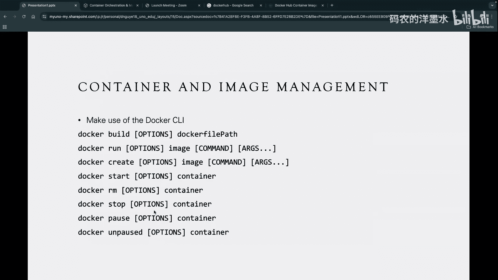

So I create those are simple。Webage we Fl is going to get input from the user。嗯嗯。And yeah。

 it's going to use it for 8080。That's important， because we want to expose。

The part of the container with the。With the airport the local machine that I'm using。嗯，嗯。So。

 like I said， we had to。Start with the base image， and this case is Python。

With very on three right here。你惊。We can override this argument， if we want to。啊。

So one of the best practices is that we failed。Install all the dependencies and then copy all the。

 all the all the。The app the to to run extension to install no， no， no， you only have to install Do。

The it has a。com online line interface。Where you can brown containers and create images。啊。

This is the file you file this is a docker file。we have the doctor。

 we set up the working directory where we are going to execute the next commands。And yeah， we。

So now I'm going to create these images。We were going to pass it okay。Yes。

Well come and divide where you where the doctor file is。

So right now I'm knowing the directory that the O follows。I have two class。我想。嗯。嗯。Yeah。

But we check with it okay。你没。好累。re that。We have some images I forgot to ci the image。

The tag of the image is just the name of the image that you want to give it。再个。你该那没。嗯一百四。

T command the T option to name the image。开唱。😔，응。You can also view the versions of your image。

I breathe one。The边。We check we at images。哦，谢伟轩。That we had the document image that we created。嗯。

My chance to direct me that I have。Because I havent。Create yeah I haven't created another。

I haven't changed。 I haven't modified the imager。 If I modify the image it's going to create another。

Thank you。What's this。AndThat's all the image that I have in this computer。

So what I want know to do now is to create a container with。With using。

With the use of this image and I'm passed， okay。嗯。嗯。We have to format up a container portres。

My computer with a person of my computer， so 8080。哎对。嗯嗯。

The first part is for my computer and the second part is the part of the container。

And we also have to。To specify the name of the image。我是。

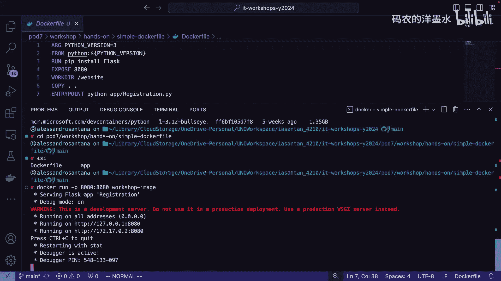

我 see now and day。

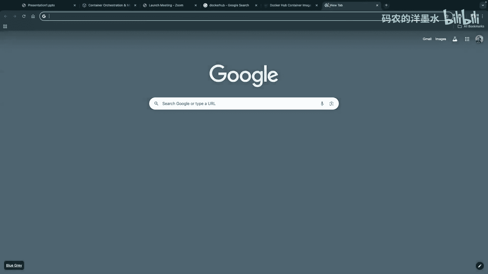

第该。

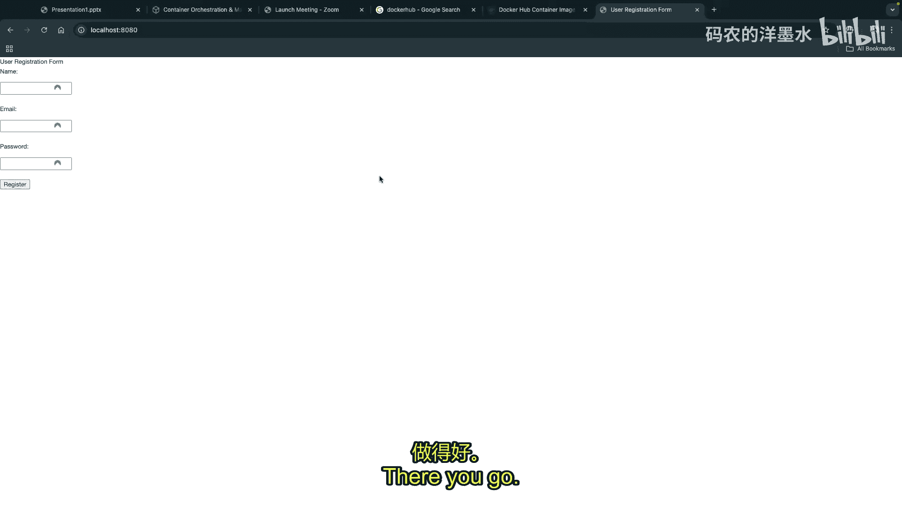

嗯。We want to stop the containers， we can just。Pce control C band。I must start using the command line。

Okay， stop。And the name of the container。But we don't know we didn't give it a name to the container。

We have to find out here is the name if you want to。

To see the list of the containers are running just。Pas the commander character yes。

And we find it right here。呃，这呃。我是在。And the name of the container。It's going to stop the container。嗯。

嗯。然。你首。You want to remove the container。You remove and name of the container。Yes。With the doctor。Yes。

 and the option。A is going to lease all the containers that we have， even the if the。

If it's not running。We can see that we don't have that container。That we just removed。啊。What else。So。

De。This command just run the container directly， but if you want just to create a container。

 but without running it， you have to pass the command doer。啊 sorryor。

All the options that you want in this case， we want the poor mapping。Are we gonna give it。

 Are we gonna give it an name。嗯。嗯。我想听。明明。Also， do you want to。Remove the container ones。

It terms vector empires the flag RM of the option RM。To remove the container automatically。

 automatically。Yeah。How do you get a vein before when you didn't specify you just random。

 random that name dance is random yeah。So now we pass the。They don' care fault。

 They don't care image named。我想。没关系。嗯。AndOkay。O。食 time。All right I see。 is don create， sorry。

The area of dark star because we don't have the container yet， sorry we have to create it。ok create。

Again。嗯。yeah， we have the idea of the container if we do dark Ps all。ok。Yes。哦。

We see that we had the container that we just created。The title is just created one。Music degree is。

Is better for。Or visualizing the numbers of the container has the boards。

Did you want to start the container， just look very sorry。Okay， sorry。

You can attach the container to your。To your command line， but。If you don't。

 I say that's how you should like。It's just when I run the container in the background。

Do' going start on the name of the container。Should。听啊。Yeah， it's running on the background。我嘅你。没有事。

Yeah have right here。这个。我要你睇。Ju have to pass it Command Do if you want to you want to attach。

The container with your command line and see the logs， you have to pass the a flag。我m sure hell。佢啊嘛。

cept the container。I think it's going delete the container too because we price it life。Yeah。

 we pass the I am flag， the I am option。So。Yeah， we we have to create a continuing game，Re。

 right in this case， I'm not going to。To pass。The I am black。I pass flag the the ports。没。your name？

好该。Sure。听么了。Yes。Right。So sorry， thank you。A we going to pass the the image。

 the name of the image or a shot。So now I'm going to start the container。

 but I want to attach this to my console to my computer。那个。Its all。嗯对。And the option a。

Under the name of the of the container。Wcha。Thank。这样。

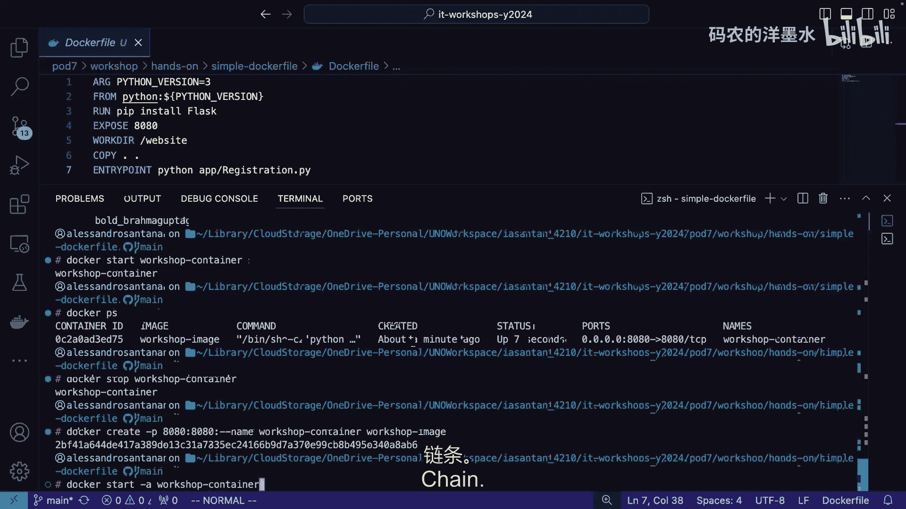

你算啦啊。We can see the logs。感见。Yeah。W。

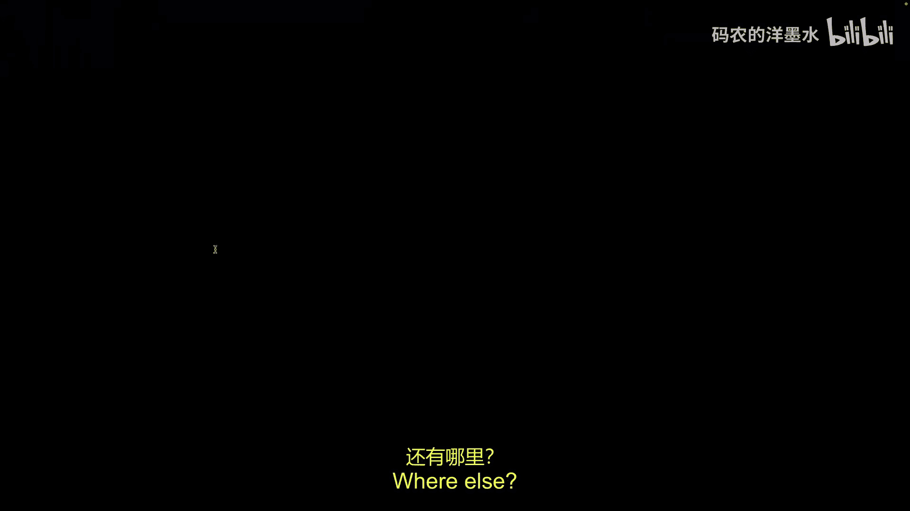

Incident April attached。To attach the container to you。光诉。没没有。When just head down here。runsOkay。

 so when it runs in a background， you couldn me pull it out behind them。Yeah。

 you have to so you have to attach。Docker is its own thing。 It's a cloud thing。 So that flag dash a。

 it connects。The cloud to your local host， which is the console， that's the webpage。

 so that's the idea of it。I right。Does it still attached to your no it's running it that just means it's running so you're going to have on that。

I another command mine。Let's suppose that you have the container running。

And didn' think what got to to buy there。They attach black。You have this daughter。I touch。

Thats going to attach and you console to the container and the name of the container。不 sure。Okay。

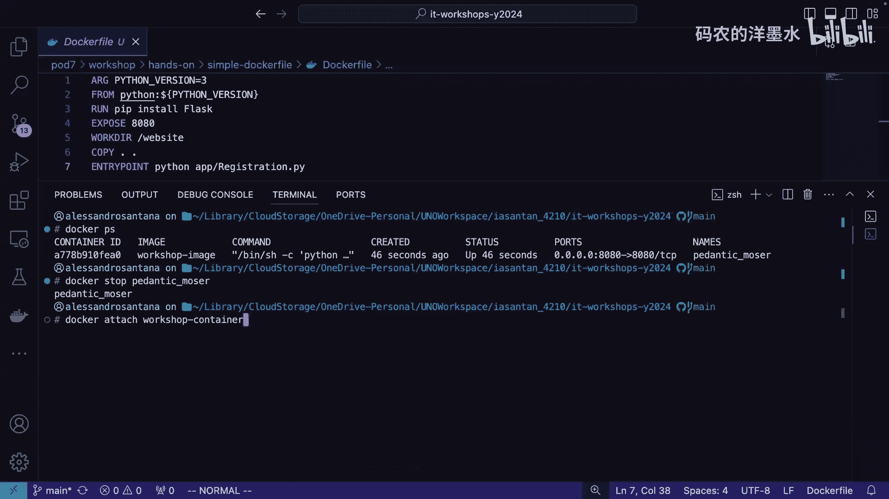

Oh yeah， we see the last band。

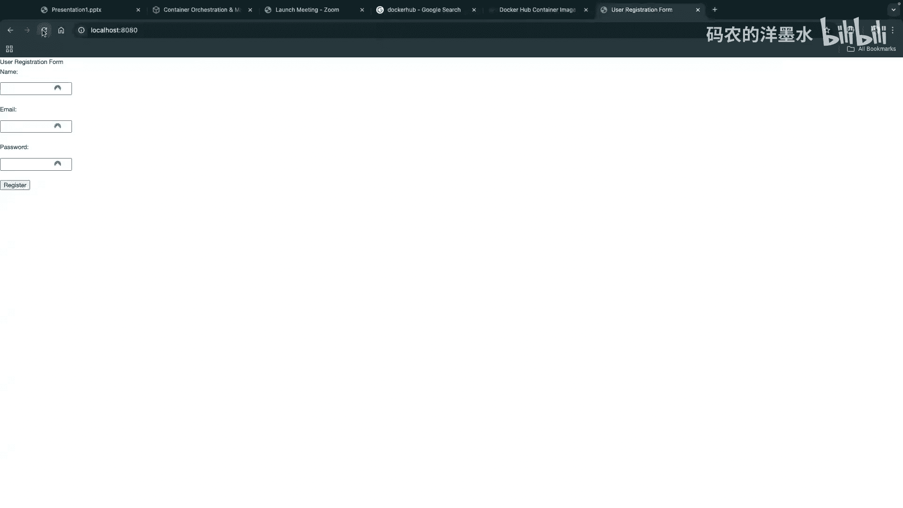

喂系。What else？I think the see for for running。大个嗰 I。咩。

When you attach it just attach so I should have probably been more clear about this it's Docker is。

Cloud based that's partially why it's like super lightweight because everything。That。

It computing is all in the cloud and yeah。Yeah， yeah。This is going to be floating yes， yeah。

So now I'm going to push the image， I'm going to show you how to push the image。

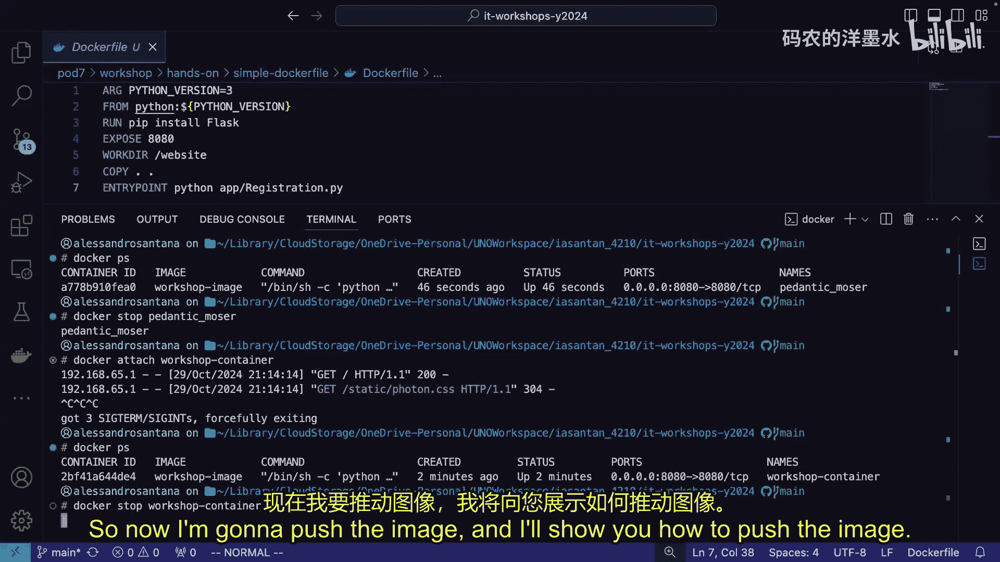

First， you have to create a rippo okay。

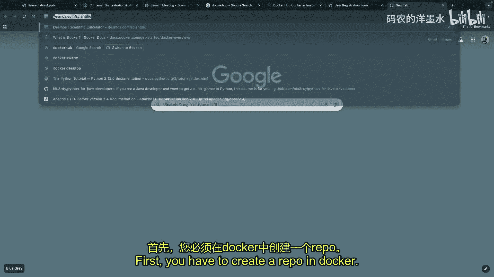

OK看到的。87。No都给好。啊 create new微。嗯 you want a namemate， whatever you wants。安全。你白。😔。

The namespace is going to be your user or organization name that you working on。嗯。嗯。

Every time you push images， you have to。Tag the image as the same as your repo。真是。Okay。Image。我。

ma modify the image my change the the tag。And do okay。E manageage。Okay有。With attack。

 that is going to be the namespace。嗯。The name space of Giripo in this case is my username。嗯呢个想州呢。

And then the name of you or your paperer。嗯，是的。You can specify in the volume there。

Debras of you of you。Of your image。应该是。啊嗯拜拜e。对。是。Check the images。没 see right here。

Before you push the image， you have to log in。And the。我要。Do account啊。

If you install Dr desktoptop is's going to ask you for sign。And automatically， automatically。

 is going to。Signing your CI， your command interface。I ready。Using my my user。

Some I just push image look there。嗯。I think and the name your image bigger。うん。UI forgot the tag。

 but it's going to， if you forget the tag is going to be latest， the tag is going to be latest。

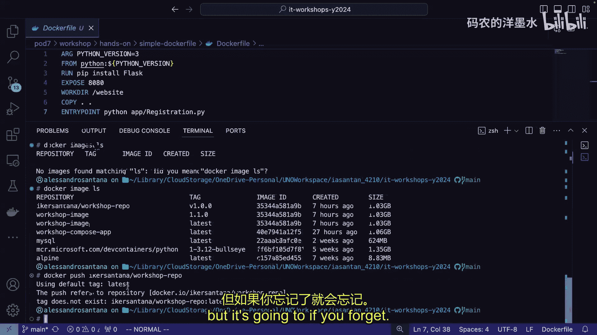

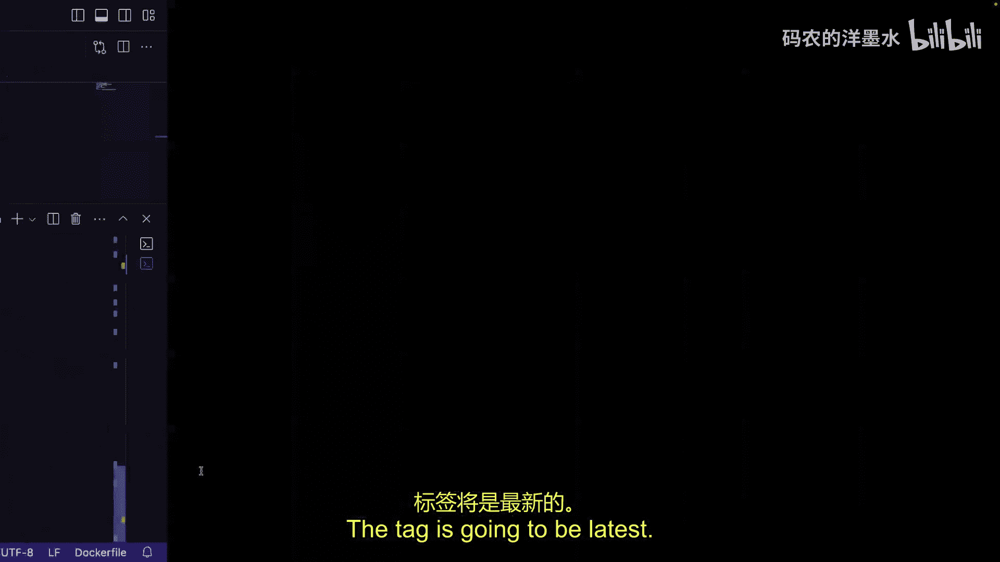

So it's where it is。连重新ss。Next， I'm going to talk about dog compose that is running multi containers environment。

In youre in the same host。It's not Kubereres， Kubernetes is more like。More complex。

Dker compose is kind of like a small scale。I don't know why you stick in on。

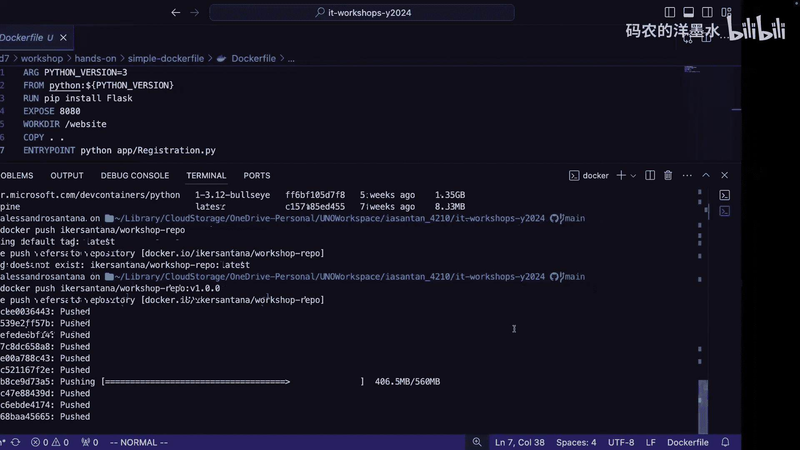

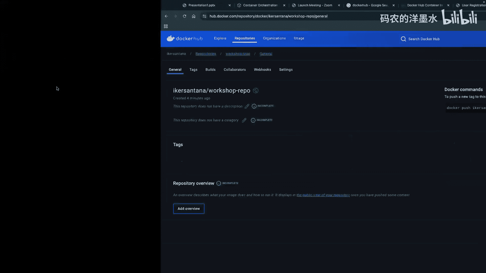

Questions， yeah。Question about those three different images we have。

what difference you think machine my did I。Get the tag， just the tag。

 you can have the same image with the same tag with it with different tags。不是。你不想多少钱。

So you want to build an image or just just sp the。It okay。嗯。And the name of the image。In this case。

 like Santa but。But in this case， I really have it on my local computer so it's not happening。

I'm gonna have anything。嗯，呢。

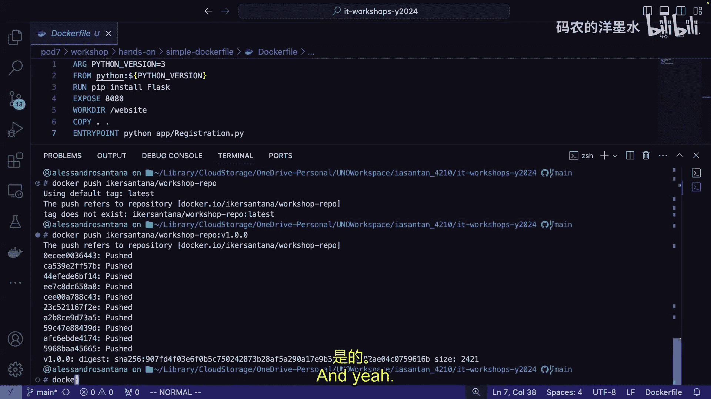

不。诶。都 it composeose。This has tool for running moving container applications， like I said。

 it's simple。We're gonna make you， were gonna make use of。Our demo configuration fault。

This is known as a compose file。 You can also name it as a target compose file。一。I just。

A configuration file， it's very basic I'm going to show you how。

It's like a dogerophil but on steroids。In simple terms。嗯。

The compose application had different levels， we have the service level thats where。

Kind of like abstract for the containers where we。Configuerate configure all the containers。

We have the networks that is kind of like a space where。

The containers communicate with with each other， so。

We want two containers to communicate with each other。We have to。

Put them in the same network volumes that are persistent data。So we can find volumess。

We also con the conflicts level。That is just configuration for。

Or the data on the run time or platform。And the secrets are kind of like more specific configuration there is。

Data that is sensitive。For for data that is sensitive。嗯。We have。

I'm just going to talk about the service level。嗯。We have the blue key that is going to。

Look for the do file that you said that you want to the container should run on。

And the container name is obviously is going to give a name to the container that depends on control the order of the service。

So if you want to a service to star fairs or you want to service to SA。Before another service。

 you can。Set it up by it depends on keyword。Environment folks， you have。

You can set up environments outside of your O compose file。

If now you want to make use of environments that is in the do compose。Images to specify the image。啊。

Neworks。Like I said， you have to， to。To sort out the containers that are talking to each other in the same network reports is the same as the P fly dying。

That I was using when we create the containers， when we start the container。And the real。

 in case of the one with the service doesn。哦。I start completely or fails iss going to restart every time。

It depends depends on the policy to be honest， we had the know。

We have no policy that is not going to restart。 Does it， Does it default。

We have the always that is's going to restart always like it's going to retry every time。

unfa in case of the。Or the service having start。on the on list that。嗯嗯。G the command诶。

We are going to use for the docket compose， the doet composeo up it's going to start all the services。

The down is going to stop and remove the services， delus。We can check the logs of the compose。

They could composet PS is' going to release the services。

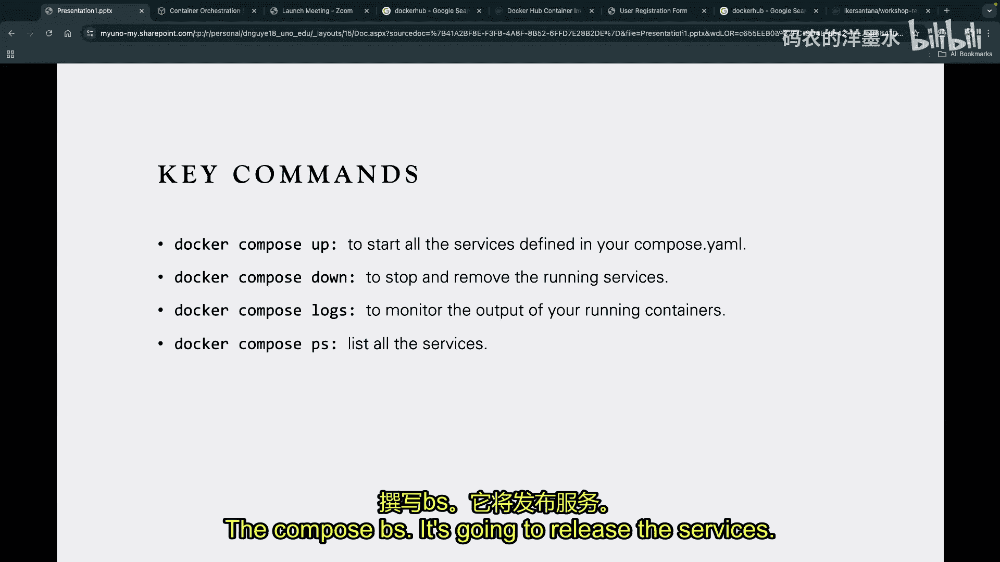

So。I have this。Is the same application wave application in which we are going to。

We are going to take the input of the user and we are going to。啊 save it on the on a database。

I'm gonna I'm gonna use my sQL。嗯。申请。Here's the gem file。

 so we pass the name of the project that we want to。

Or you can just exclude the name of the project if you want。

The service level and the network worth level。In the service level， we had two different services。

 we have the app and the database。This is a container。 Its going to be another container。啊。InDe。

 many power they built。嗯。The Bill keywords to specify where the Docker file。

 where the compose file is going to look for the Docker file。We have it right here。The compose file。

 So it's going to look for this in this container for the docker file。It depends on。嗯。

It's going to wait for the service to start， but。Here's the problem and the app is not going to wait for the database to be initialized。

 so we're going to face some problems。But I resolve we start always。

Its going totry every it's going to retry。After he follows。The port， I do the port mapping。

AndIn the database， I。Whos some environment variables。requiredquired for the to initialize。Yeah。

 I'm using it the MysqL image。And that works。These two services have to communicate with each other。

 so they have to use the same network。Yeah， that's wrong。They wrong。Again。

 you have to be in the Bri where。Wherere you do composers？嗯都 see。To what's。嗯。嗯。O， can those。

It's going through a sorry。They the services。n。嗯。Yes。你有声会 gonna非常。Some books。

 because a database is not。Ready for connections， once the database is ready for connections。

 we will get this。Los。From the app， that is ready to to run。

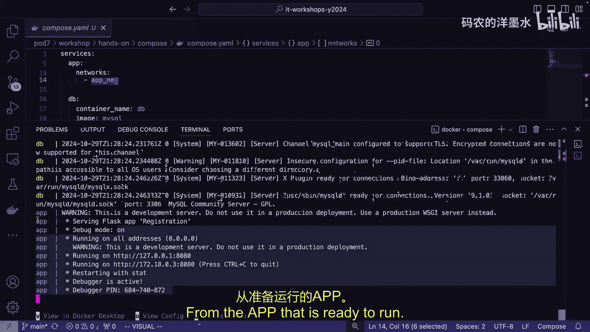

嗯。

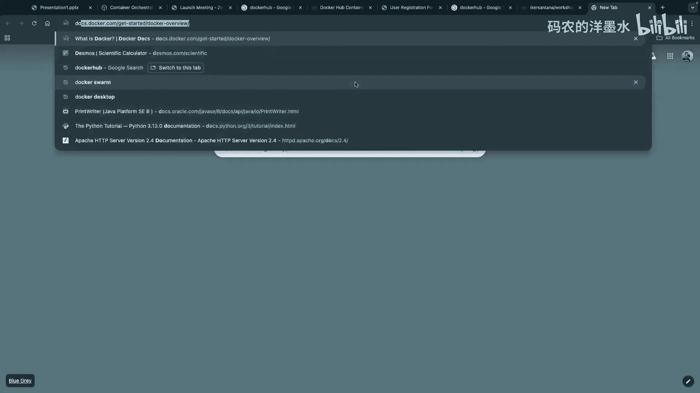

O系。能搞上去。晚拜送。上你啦。

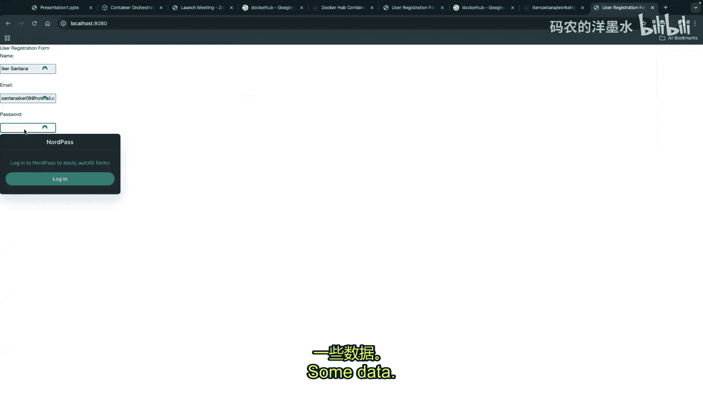

We see that we can dislu from that。啊 service。So now I going to check that。

The data was saved on the database。O。YouM check the processes are running。那个。Yes。你系唔得。Yeah。

We have the database container and we have the app container。So I might use my SQL image to。

To am I using as a as a client so。再见。And， about it。 I am flag。偶上。嗯。

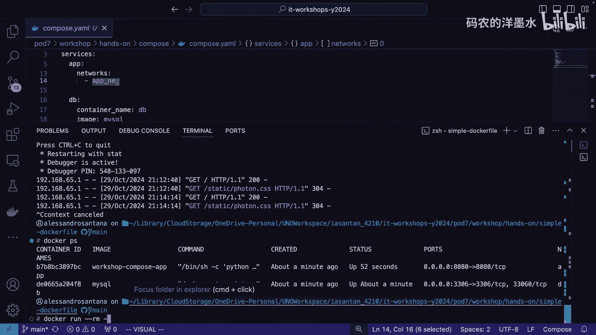

I forget good sorry。

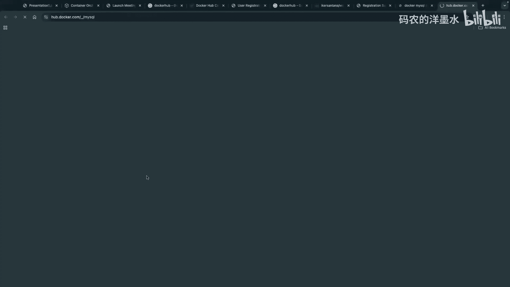

Oh yeah， the I flag。All right， that is going to allow us to interact with with the container with the。

With a container。Through the command line。嗯。Nwork。嗯。And we're going to pass it。

The network that these two containers are using。嗯。单位。Expect。Networks。隔别电视。我不 say the。

The image that I want to in this case， I'm going use my sleep please me。Sple。And the command。

 so we're going to start by my SQL。The house name that is going to be there。

The name of the service in this case is Db。你医上咧。In this case， it's going to be user。Finally。

 the password。嗯。😊，And now we are。Running another container that is going to be the client。Right here。

嗯。确实。We have the app databases and I reside。嗯。对。你听。😔，Yes sir。你这啥意思？Yeah， we have。

We have right here the input that we just last。doesn our input。

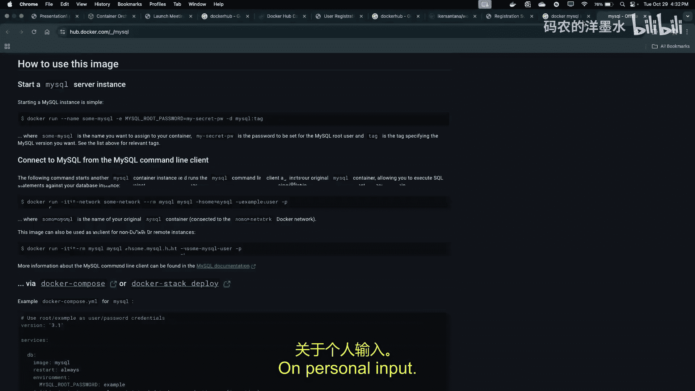

嗯。嗯。

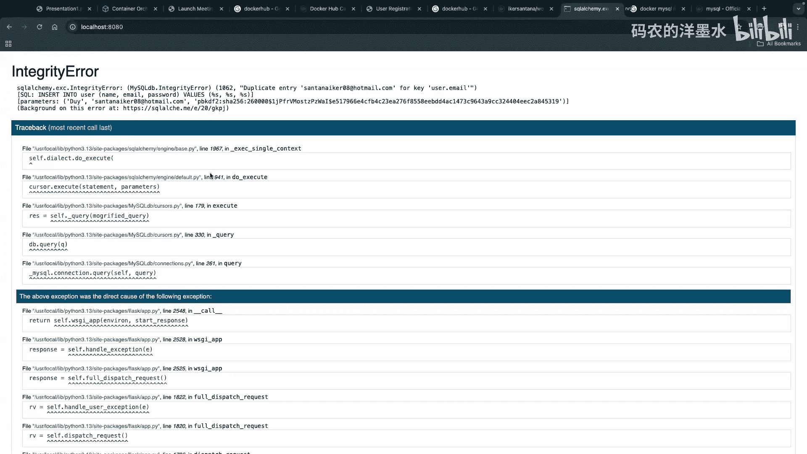

Oh， I think we go to known。You guys running。Like two hours report。Yeah， I think that's it for。

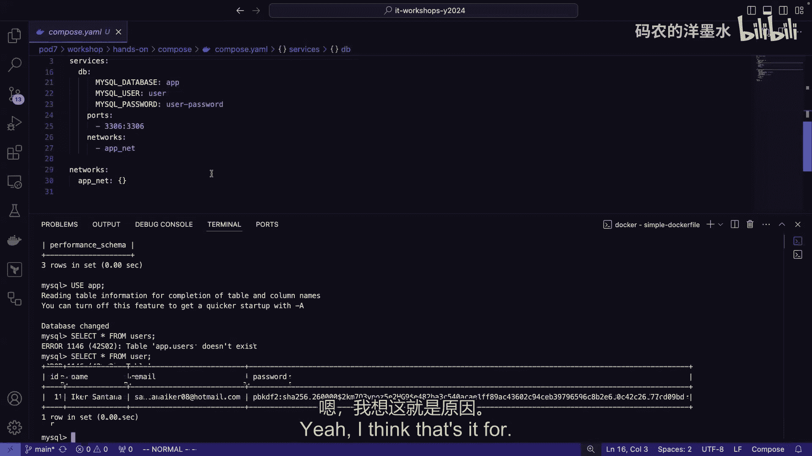

嗯。你给开。

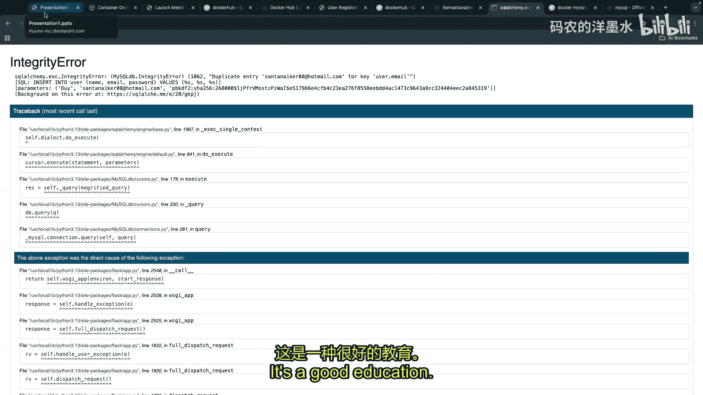

Oh， he'suplicating。诶，所以。

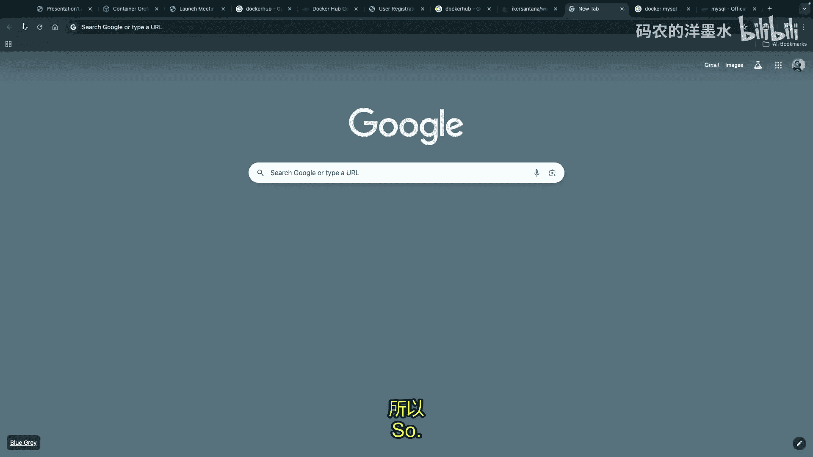

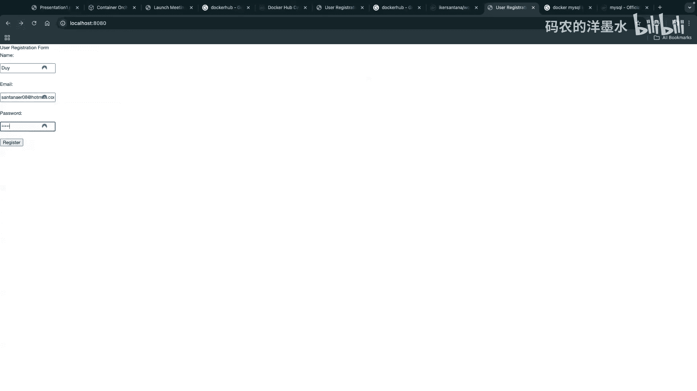

系 you。Yes事。对。你嘅。I think that's important。For the campus。Does anyone have any immigration？Yes。

Any questions about doc or containerization， I have one question start。

A set of questions How might you seeing containerization and docker as being useful for our。

Capstone project， how much we use that for the project that we're going to be working on this semester。

啊，So。I feel like for the developing stage， we can。There are raspberry pies images。On have。

 I was think about it。So we can create an image with all the libraries that we need。

Using the base image of brasspberry pies。嗯 I是拜。I'm not sure how to。We are going to use Z weed。

When in the deployment the stationman。All right， so I think raspberry Ps I think they use some form of Linux so what we can do is we could find a Uuntu image。

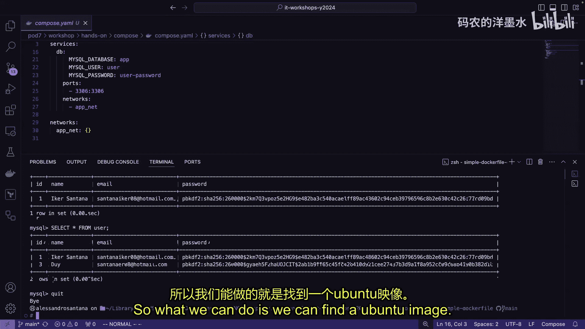

诶。Upload that onto Docker， make a container。

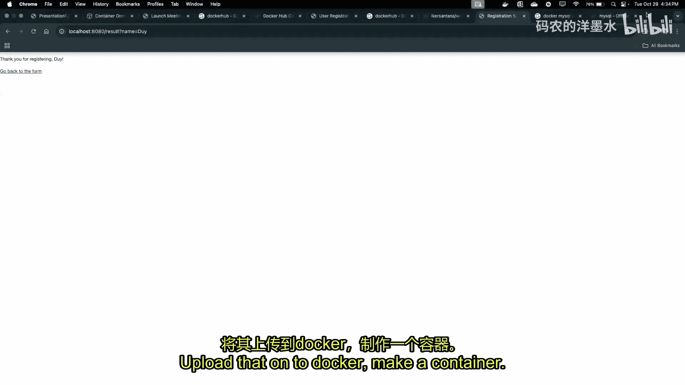

And we can deploy it like that we might have to use raspy not bun to depending on what meat motion because yeah since raspberry pie is run on an arm processor。

 you might have raspy in specific drivers for the meat motion。

I think pod 5 is looking into that you at both to and ra and a so you' have to find a rasp image but is everyone kind of play on that like one of the really powerful advantages of containerization and Docker allows us to kind of have like an OO design philosophy for our environmental workspace like as you develop your code you might be working on a Mac you might be working on window you work on any other kind of machine but really you're trying to replicate an environment that is a raspberry pod right's your code doesn't do any good if you're development it on a Mac and doesn't want on the raspberry pod right so this allows everyone to be developing on effectively virtual raspberry paused with all the libraries and modules across all teams to guarantee that your code will be able to deploy and running in the environment you expected to and allows everyone to use the say。

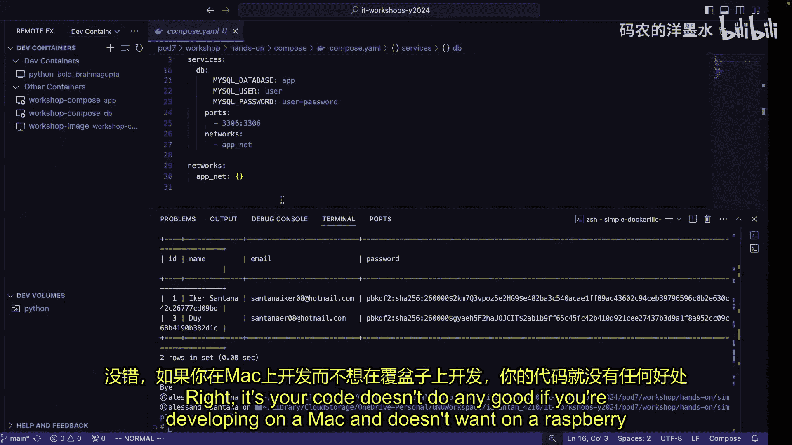

Mouleles in the same libraries locally on your own machine， whether it's a macro Windows， whatnot。

 or working in an environment that replicates the raspberry high environment。

So just like get allows you to go ahead and kind of。Share code between teams。

 Docker kind of allows you to share environments across team members as well。

And it helps you standardize your environment。Is there any other questions？

You were asking about yaml files a little bit earlier。

 just a little bit more specific yala file is a human re usually configuration outside of just used by a docker it's used by other built tools as well。

 but the big thing about it is。

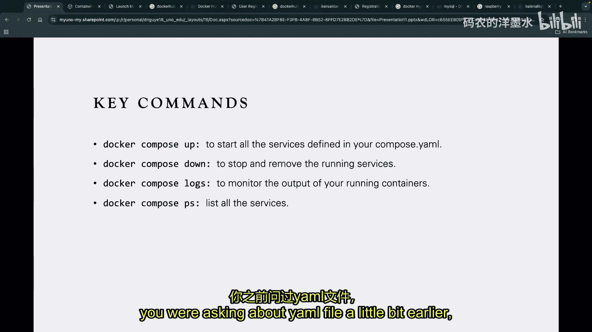

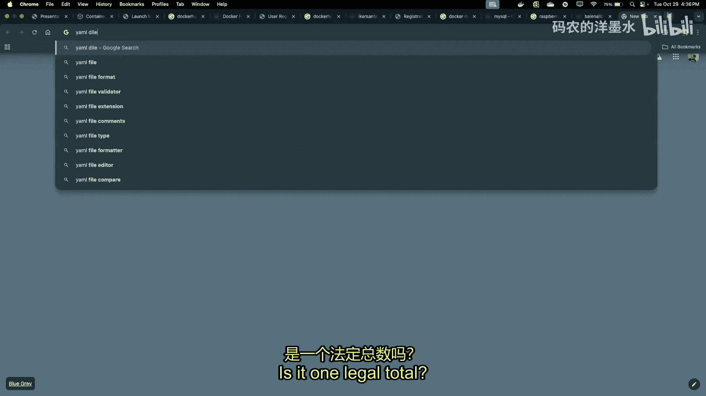

Its use cases to pass usually configuration information to an application so it knows how to boot the application on and so some built tools will use animal files。

 some will use JSO files， so it's a different type of human modifiable file that allows you to configure your application before you launch it。

Gitthub action， that is。And can you show the whole file if you look at it it's usually a key value pair so it's not dissimilar to how you might think of as like a JO file but the syntax is different。

啊点唔记合。Application so I mean， you will have to so when you're learning how to use an application and it requires initial configuration you'll have to know the configuration files and format of a Yamal file or JO file or an XML file it's another file format that's human readable and is used to configuration information for an application and any of those it depends on whoever the developer is on how they want to have you configure the application to launch So some applications will require an XM some will require Yal some will require JSO file but it's good to kind of encounter all these different formats so it's not form when you look at it and so then reach like oh。

 this is how I set up the set up the launching of this application so it'll create the container that I need。

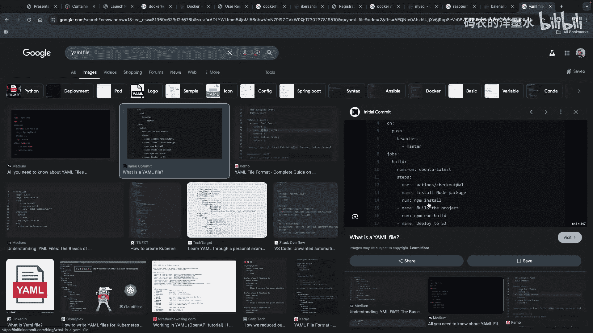

Yeah， can you go back to your Gal file that you had？

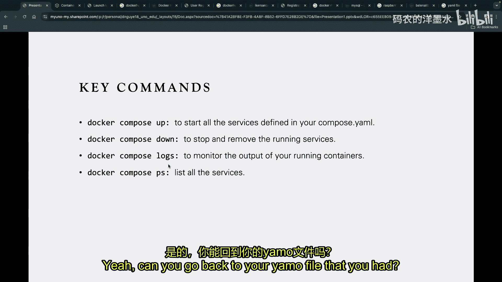

Yeah， it's just key value pattern。And then once you understand that。

 then it becomes very easy to read you。嗯，加油。If。Yeah I have another question how might you safeguard secrets in the doctor file because we're going to have all sorts of secret information that we're not going to want to make public right things like API keys or passwords think you have to。

佢 are five and。

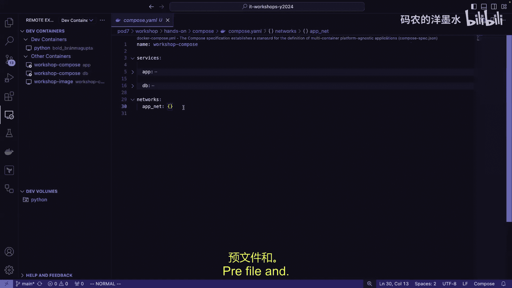

I don't know where to be honest， is located。

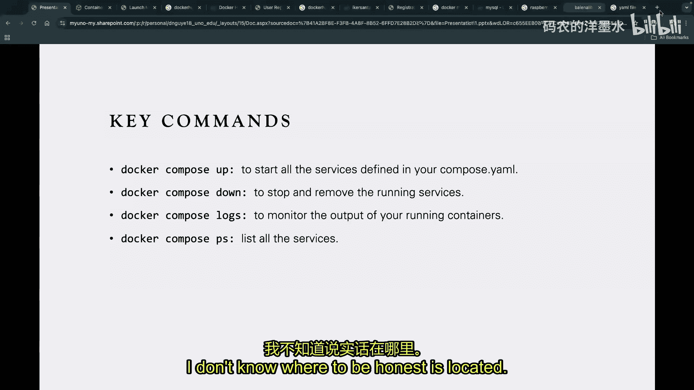

Thank Miss。Right here。That's where you going to locate your all day。

The the secrets that you want to and you're going to access them in do Com， you're going to。

Gore to access and buy secrets。嗯。The name of the secrets they won whatever name。那是 great。嗯。嗯烦。

If you put the bad or your file or the file and everyone you like the value of this right like we don't ever want to push get of information on GiHub or anything like that no API keys no passwords or or admin admin level even want to calculate these like。

Okay。And's still， but usually in a union that hole that happens all the time。And then of course。

 there'll be lots of people will see infoIA looking for key words like password。

Yeah I think I think that是 does。Any have？Does anyone have any question？H hello， all right， go。

 excellent。one question what's going to be the deliverable for this particular project Oh make a Docker image。

嗯，でも。그。

