# 【全集】加州理工学院 软件工程 中英字幕 1080P p12 Lecture 12 - 持续集成与部署 -BV13ZzaB3EWE_p12-

Good afternoon， everybody。Nicholas。I'm Carlos I'm Norman and we're pod six and we're doing continuous integration and continuous deployment。

And I have to take the wolf mask off as it hard。So what is continuous integration it's basically a approach to software development that automates repetitive and error prone task what that might mean to us is that every time we push to our shared repository it'll test or l our code every single time to make sure it can integrate into the rest of the repository。

Or other branches。嗯Yeah。So what is continuous deployment it's basically the other side of continuous integration it's the automated deployment of your code from a preproduction environment to production this step basically consists of three main components it's going to be actually getting your code out to production monitoring it to make sure that it's working well within production and then also receiving any feedback whether it's working well with what you have out or not。

Now， what is a CicCD pipeline it's essentially。Contiin continuous integration and continuous deployment together you're putting those two different stages together and those different stages are you're going to have a source stage where。

It's basically a trigger that kicks off this pipeline that we're going to get into more detail about and that could be an example is like a code push or a pull request。

 you're going to have like typically a build stage which is the compilation and packaging of your application。

 you're going to have a test stage usually and that's basically going run your unit integration or system tests and you're going to have that deployment stage which is releasing your application to staging but more typically production。

Yeah， something to keep in mind is that when you want to use a CICD pipeline as we need in our class。

 so while these are the type of main stages you might see， you can add stages in between these。

 you can take stages out it whatever is needed for your repository your in your development environment。

And as you can see it's kind of like a cycle， so it should always continuously be flow every time we push code it should be testing that code。

 building it or building it in testing， releasing it。

 deploying that to our production environment and continuously。

So what are the benefits of a CSCD pipeline well there's tons of benefits one example is you can essentially version control your infrastructure that's releasing your software when you have a CSCD pipeline that's like a piece of physical infrastructure。

That the entire team is essentially agreed upon that allows for your software release。

 which in turn ends up in you having faster release cycles so that you can develop software in a quicker manner。

And that also leads to cold quality improvements because the entire team is sharing， you know。

 the same building and testing of your application。Everyone's on the same page with that and。

Obviously you're going to have an enhanced team collaboration with that as well yeah one thing to note too。

It leads to a lot of code quality improvements because you're taking a lot of the like human error out of it。

 so you're essentially automating the process for your code to be tested and built without having to touch it manually。

Okay so some of the history of CICD in the beginning it was just manual integration and testing this was like in the 1990s where one of the popular things was a merge day at a company where everybody would get together one day and merge all their code for a lot of reasons this could be problematic if you have any issues then it could pose a big problem for the company after that in the early 2000s was when CI or continuous integration was beginning to become adopted but the problem with this was that all your continuous integration。

 all your code to automate your builds and stuff was being run on a server so。

You would have to have the physical server， you know。

 either in a company or a remote location to where you could log into that and then have that run your C。

And then we get to the early 2000s where I think around this time。

 I would say that software development began to ramp up even more and the demand was starting to rise pretty rapidly。

 so scaling was a big problem。When you have physical infrastructure that hosts your CI servers and stuff like that。

 it leads to a lot of downtime。And maintenance becomes really costly， and。

So this was a big problem around in the 2000s and then also shortly after， like I think around 2005。

 2006， you start having companies like Amazon develop cloud based services like AWS。

Which leads to the 2010s。Where Travis CI and GiHub actions。

Eliminated that need for companies to manage their servers like physical infrastructure and that allowed for much easier scalability and much more auto automated way to。

Manager CICD。Yeah， so like a big plus with this is that like Gitthub。

They offer their server overhead to anybody who has a GitHub account and they run your CICD pipeline for you。

Which is going to be the meat potatoes of our most of our presentation is give of actions。明嗯。

So what is GiHub actions this is going to be the main thing that we're going to look into today because it's really the main thing we're going to look into to integrate CICD pipelines into our filing。

And really， we're going to introduce workflows as a whole events， jobs and runners。And。

Really why we're using this， its integration with GitHub and how easy it is for us to use。

Yeah and one important distinction to make is that github actions and actions are a little bit different we'll get into it a little more when we show you like where you can find all these things。

 but github has。Precongud and built up actions that you can use。

 and then there's also a GiHub action marketplace， which we'll see later。

And one further just one more distinction we when you see workflows， just think of pipelines。

So what is GitHub actions， it's essentially GitHub's native CICD tool that is built in with GitHub and it automates your workflows or pipelines directly within GitHub reoss。

嗯。The way this is done is with YaAML files， which I think we saw an introduction to on Tuesday。

 which is basically just a configuration file language。

 and that's used to define our automated processes like our builds， our tests and our deployments。嗯。

One thing to note is that。It's event driven， which means that。

Workflows will trigger based on GitHub events and an example of this is like a push to a repository pull request。

 or you can even run workflows on a schedule。Yes there you go okay it's gonna be extremely highly customizable what we'll show you today it will be pretty complex but it's only the tip of iceberg Github actions is extremely customizable and extremely powerful we mentioned like push pull requests and schedules right here but there's many more we can even make actions that trigger based on creating new tasks in our Github projects or new labels in our Github projects we can make it on only doing actions on specific files in our repos being changed it's extremely powerful。

Yeah， and just to reiterate， the reason we're using GitHub action specifically is because it's already built into GitHub and they're already providing you the overhead and the services to run your CICD pipeline。

Before we get further like into the nitty gritty of Gitub actions does anybody have any questions about CICD like as a whole。

 like any type of questions that could maybe it'll be a lot more understandable once we go into the actual use of it and showing you gammaha ornot。

 but is there any general questions anyone wants to ask？Okay， yeah， it's going to get really deep。😊。

Okay， so the first thing we can talk about is your workflow and this is essentially your CICD pipeline like we mentioned。

 it's the automated process of testing， building your code， deploying it out to production。

 and you do it through the configuration of a Yaml file。By default。

 the location of your workflow is going to be stored in a dot GiHub directory under workflows。

One thing to note is that when you initially create your repo and actions。

 once you create your first workflow， it'll automatically create this GiHub directory and workflow directory for you basically if it if it doesn't detect that you have it like if it detects that you don't have it then it'll create it for you it' already created it will just put your portfolioflow in there。

Think of this diagram as the full workflow， this entire thing is the workflow of the event。

 the runner that it runs on the job of status which we'll go into and explain in further detail。

 but think of this entire thing as the workflow itself。And like I was just saying。

 some of the components of a workflow are the triggers。

An event a trigger looks for an event they're not the same thing。

 the event is like a push on GiHub the trigger is what triggers the workflow from that event just want to make sure that that's understood they're technically two separate things and the trigger is just a condition that's going to be initiated once it look for a certain event that you define。

A job is just a collection of steps executed on virtual machines， which are runners。

 as you can see these jobs are on and this diagram around these jobs are ran on separate runners。

And they can run in parallel by default or sequentially。And。

So one thing just I know that's a lot of vocabulary， just just one way to think about it。

Is that you have steps that make up a job。And then you have jobs that make up your workflow and then a trigger will kick off your workflow。

有。Can you give an example about the trigger and the event body just to differentiate yeah。

 it'll be a more clear to once we show you an actual yammo file but I can explain it like kind of a high level view。

 say we have a yamo file the trigger will be something like well' right out trigger going be like on the push of the main branch。

Do the rest that is the trigger the event is the actual push onto that main branch。

So it looks for that event of that push to trigger that trigger。Yeah， thats the right。Okay， so jobs。

 it's like Norman said， it's just a set of steps that your workflow is going to kick off and do。

Like Nick mentioned。By default， your workflow and your jobs will run in parallel。However。

 you can do some workarounds to where they depend on each other and they'll run sequentially afterwards。

 so for example， like we'll show you later， you're not going to want to build your code before you test it。

So there's a dependency between the test and the build and so therefore。

You'll want to have those sequentially executing instead of in parallel。And for that example。

 test would be a job， one job and building would be another job。

 so you would have a test job and a build job and like like everyones saying。

Things are going to be more clear once we get to the actual Yal files。

Something that I mentioned before that these jobs run on separate runners essentially what that is is virtual machines so my first job and my second job are running independently of each other and their own virtual machines what this means is that if you remember the Docker presentation these are containerize within themselves。

 which means without some like exceptions by major workarounds they cannot directly communicate with whatever information is in here。

 they cannot directly communicate with whatever information is in here。

So does that mean they run like congcurrently or are they gonna be like so kind of sequential Yeah no。

 actually they do run a by default in parallel so simultaneously But like you said。

 we can define if something depends on another job like say we want to test before we build say we want to test our code before we build a doctor filell put that our build job depends on the test job and so will not run until that test job is done we'll show that more clearly in end will file as we keep expanding you say is if you list it out。

 it doesn't matter that one is of the other Yes， exactly not it does not go in order that is written out you must define if one needs to run before the other So this maybe in this example。

 there's nothing under my first job or my second job say my second job was really short and my first job had a lot of steps they are running parallel and my second job might finish before the first job。

There is a small caveat to that question， like within one job。

Your your your steps will run sequentially but the actual jobs themselves will run in yes and we can point that out w that'll look yeah just to reiterate those virtual machines that your workflows are line on that's the overhead that Github provides you that's the resources that they provide you。

They're running on GitHub's， virtual machines， so it's not physically on your computer。So actions。

 we sort of mentioned it already that actions is slightly different from the title GitHub actions。

 but it's basically a predefined set of tasks that can be performed or that can perform specific functions within a job。

And they are pretty much reusable across projects， they're sort of like these prepackd。

Jobs that you can use in multiple workflows and different repos and it saves a lot of time and effort and it's just a way of abstracting some work for you when you run workflows yeah the way kind of like hopefully i'm not making more but the way I think of it is kind of like methods or function that you write in your code。

These are functions that you can call in your workflows they probably have a bunch of different commands and code within them but you don't have to worry about that you just call it in your workflow and it does whatever it describes that it should do Yeah and like we mentioned there's builtin actions that GiHub provides on default and then there's also custom actions so your custom actions could be the stuff that you get on that GiHub action marketplace。

 which is the picture you see on the right or it could be something that you develop yourself。

And then we'll show youall a little bit more about the GitHub action marketplace and like where you can go to fund。

Do did know。嗯。S please。So what we're going to pull up the marketplace right now and we'll show everybody how to get to it so let's imagine your home on Github。

If you hit this little side panel thing and go to Market。And then for our purposes。

 we want the actions marketplace， would go down to action。

And this is essentially what that screenshot was showing it's this is the GitHub action marketplace and I wanted to point out one specific action that is definitely one that everyone's going to use and GitHub themselves made it it's called the checkout action and what this action essentially does it will clone a repository for you so for example the reason you would need a clone a repository。

Within your workflow is if you had a test job you want to clone your repo to that runner that will perform your test So this is a very common thing there's this is basically documentation on how to use this specific action so it can get pretty deep but I did want to show this off so basically saying this kind of points back to what I was talking about earlier about the jobs they run containerized within themselves so they don't have any reference of your code in the repository that you might want to test or you might want to do something with so this checkout command like you was just saying copies all of your code into that runner so that the job can use it。

Exack。Oh。here we go， so this is our example of a workflow or a YamL file that we've configured。

You'll see this one specifically is made up of two jobs and then the event and the trigger are are shown on top。

 so for example， our trigger is pushing to the development branch and that makes up the event。

And then our jobs， we have test and build， like we previously mentioned。

To test and build your application before pushing it out to production。Yeah。

 oh just a reiterate not confusing we then put ventilized trigger， but this is not。で。😊。

Writing this code is not the event itself the event is the push that we actually do launch the development branch this is just a defined trigger that will happen when that event just to reiterate and yeah like he said there's two jobs test and build something to mention。

Like jobs， like this commands。Let you create your jobs that you define。

That is determined by Github actions these job names are something that I define I can name anything I can put in random letters and this job will still run I can do build like this。

I could do this build iss kind of talk about this where it builds a Docker image instead of just putting a build I could put the Docker image the name of the job is completely defined by you kind of think of them as variables you can name them whatever you want in those various defined what the job is Yeah and then you can see our runners so we're specifying what operating system to run it on and also down here you can see the dependency that we put in where it says needs test So instead of executing sequential I mean in parallel you'll see that bill relies on tests you do that what La just said that needs command right there if you see are there any specific questions about this page because we are goingquiz you in like the next slide。

This name， those are all the GithHub actions。Sorry， maybe we should have pointed out。

 this uses is specifically used when you're using a GiHub action GitHub action marketplace action。

So that checkout action that we showed you earlier， this uses is using that action from the market。

Something else that's worth pointing out this name， this name。

Those are not needed that's stuff that I define I was like。

 hey all of these steps that run right here are meting a python so I'm gonna kind of contain well it's not maybe that's not word to use I'm kind of done to section that off so it's easier for me to read but if I completely took this out it was still run all of this stuff that's just for it's kind of like comments it's kind of commenting it all for myself。

So you put name where its that like a predefined or that was your variable that was me so this name set of Python well okay this name yeah like this actual word name is a predefined thing and you put set up Yeah and I put set python yes。

And when is this？That's telling you what it's going to use Yeah。

 that's that's specific to this specific action because there' is an action that I use which is set a python from the get a marketplace and it it needs you to define what Python version So this is something that if you went to this specific action in the marketplace it would tell you this it would be like you have to define with what Python version you want us to set up with So that's something that you would have to read the documentation of the specific action that you're using and how they have dashes in front of。

And except that uses it。Sorry singing the dashes in front is that oh， yeah， yeah yeah so。

Not all of them so yeah yeah， you don't you don't the dashs are not completely needed。

 yeah yeah that。That's me just I should I should have not have put it here did not put it here because I was using dash these coding and I mess it out those dash are not me no no that's fine。

Yeah， like as you can see like this。No dashes no dashes this run doesn't have dash these two runs do have a dash you don't want need。

Um， any super questions before that quiz， we' every single person has a plan with。Okay。

 I'll do a quick。Just so everybody has the confidence to sort of read and parse this information。

 if we look at the test job just from a very high level。

 we know that we're using a bountu for the operating system of the runner and then we choose to use a GiHub action we went over the checkout action all we're doing is we're cloning our repository onto the runner。

And then we're using another prebuilt action。To set up a Python version。And then these run commands。

 it's to run basically Linux commands。On the runner。And then we're running high tests， which is。

A testing framework for Python。And that's how we set up our test job and I know everybody， you know。

 I have the faith and confidence that everyone can understand and it's it's not too bad no questions。

We might have to pick random so what we're going to do now is we're going to have a little trivia for workflow and see if。

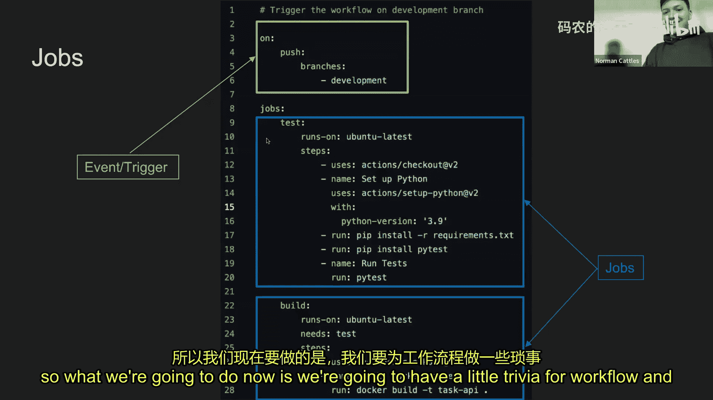

Everybody can figure out what's going on。So。Let's go to this example workflow。 This is really small。

 So what I'm going to do is zoom in。嗯。second。we're going。

 oh we're going sections we'll do sections because like I don't want it to be too small， you know？So。

 okay。Can anyone name the event for this workflow or for this sorry here？Did you name咩。Yeah， correct。

Yes， this is the trigger。Or our workflow in this example。And then I'll scroll down。Let's just， yeah。

 let me scroll down a bit。嗯。Is everybody able like， can everybody read this or is this too small？O。

Um sides， the panels are working out too Okay， okay， yeah， I didn't notice that。Okay。

 so like we previously mentioned， they'll run by default in parallel and you'll notice we have build。

Prior to our tests。So。Who thinks that there's going to be an issue with building first and then testing？

Okay， can anyone tell me why it would still be good？Yeah， you want to test before you build。So okay。

 so the reason that this would still work and decline is because we define right here in needs that there's a dependency between test and bill。

 so this job will not finish will not go until this job is finished。So we don't want。Yeah。

 we did okay。无用。Okay I don't want to we may want that for the specific example。

 but like in our previous one like this one we're building before we test and our previous example we tested and we built is' just because we're doing two separate things and this is just a different program you do whatever is needed for your program。

But in this specific example， we want to test， not large a bill before we test what why we defined that test。

So I'll ask this question now， does anybody know how many jobs we have within our job section in our workflow？

及。yeah， there's a build job and a test job。Does anybody know if we've used an action within our workflow？

系家啦。Yes。Do you remember what that checkout action goes？こ八分。Onto the runner， yeah exactly you。no。

 he's just saying that his action clones your repository， so it have access either。

So that was our first example， so let's see if I can okay。

 let's see how long this one is I'll zoom out yeah I' zoom out。嗯。that was first question attention。

 I got second question I guess there'll be a50。😊，嗯一 saying。嗯。不首歌。

But I feel like we can maybe explain about the trigger of our engagement we could like show up jobs if we be on the91 so think this is all of it wait is it too small oh is it all of it you're right okay。

And again， monitors if you're not super close to， okay。

 can anybody identify the trigger for this workflow？我意思。Yeah。

The may answer correctly can you repeat the answer oh yeah sorry so the trigger is a push onto the main branch yes that is correct。

And then I'll scroll down。Does anybody know how many jobs we have in this workflow？3ally。Canya。

Can yes， there are three can anybody name what the names name the names of all the jobs？Yes。Test。

Build。Correct， yeah， test build message， those are the three different jobs we have here。

Do you have any questions in matter？Can someone define in what order these tests would run？I'm sorry。

 Don Tes， these jobs were run。对。一。Well testing message drawing， yeah， and then go。

So test and message run concurrently and build runs after test and message， yes， that is correct。

Based off of this needs test。Yes。Well， congratulations， I think everybody did amazing。嗯。100，100%。

Yeah是。How do I like full screen without going back to the first slide？

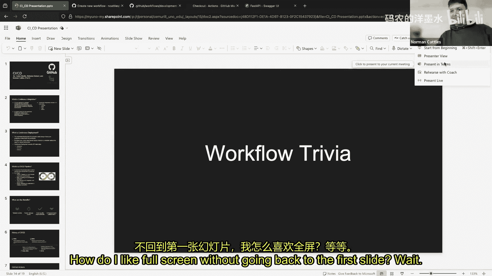

personOh yeah， oh， everyone， I like。

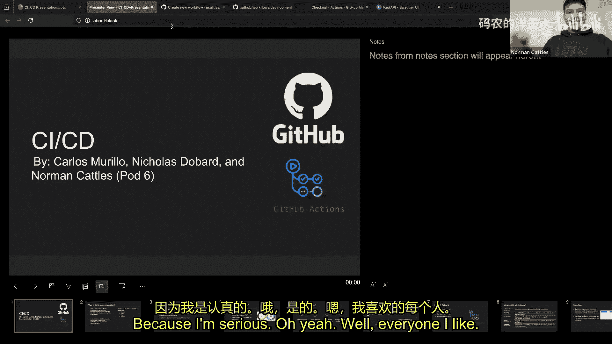

That's okay， okay I just click do it， Yeah， that's fine。因为佢上快。Oh。Okay， I'll do that next time。

got points。So now I think we'll dive into our demo we have prepared and it's basically building a CICD pipeline with GiHub actions。

Are you going to like click to it and I point out or how do you want to do it that matter？

I can click through。So yeah， if you want walk through， we have the empty people here。

So this as a precursor， we'll had to sentence first sorry what settings oh okay。哦。

just want to point out that there are specific settings for actions you'll find the first set here I'm not going to talk about the specific settings like you could just look through it and it defines what it does in here this is just where to find it in case you need to change anything I do believe I had to change stuff for hours and if you go down here。

Oh sorryrry know and runners aware you can click into runners I'm not going to say anything specific about it's just you can set up your own specific runner that doesn't run on GiHub servers。

We don't use an average store。You can go down to secret screen some variables。

And actions so if you didn't know Github has secrets and variables you can define and specifically this is for actions this may be something that we will probably want to use because we might have API secrets we don't want to expose the world and so we would want to put in here and not directly into our code or we saw that yesterday with well I think that was done in a bit of a different way he was showing how to set up environment variables like do a specific file or something like that this is through the guI of Github that you can set up。

基会的人不性的。We are same concept。Secrets can live in multiple places or in the death site。嗯。

And now we're going to show you how would create your first workflow and your repository go ahead and click action Spring yeah so big thing to highlight at the very top of pretty much every repo you're going to have this actions little tab this this actions tab。

And that's for GiHub actions yep。Some financial notices show it says like a bunch of stuff right here these are templated workflows that you can this is different from the action marketplace you showed earlier these are entire workflows that you can just pull into your deposit and like change it or use it directly as is template yes are so all of these are templates we're going。

Show you one of them but if you wanted to set up workflow so if're like no I dont to use those stimulus I need something specific to my case there's just a setup of workflow yourself option right here and as you mentioned before if you create that it will create the workflow workflow directory in your repository by itself。

So we'll click on the simple workflow just to。Get the basic outline that we just。Yeah。

 that we just took a look at。So this should look pretty familiar now looking at the template that GitHub provides。

We have a name for our workflow， we have basically a trigger here， we have two triggers actually。

And then we have our job section。That's typically what we're going to see in this class with workflows。

 we're going to have it break。And jobs。So。Nothing too crazy here。Oh hands。

Just like as a preach just like as a runback we can just read this like the name of this entire workflow ACI is going to be on a push of the main branch and on a poor request of the main branch this is a specific command that you can do in the workflow to create a button basically where you can。

Configud this， I mean you can run this workflow manually。

The jobs that we have is just one job build job it runs on a group to latest and these are the steps where it looks like it just checks out the code。

 it looks like it just echoes the commands and terminal and it echoes more commands in a terminal from terminals it doesn't really do an advance but just that's kind of how you would read over overflow even if you didn't create yourself you just you should be able to read it like that。

And you wouldn't know they have diation forward was that would tell you what the Pacific man would do。

So can we jump to our on？Yeah， and another thing I'll point out is like we see you like this was not here before it created a doc Github slash workflows。

Wellhoa， well I'm on director of the enemy figure of this。Yeah。

 when you created to make a new workflow and we use this template。

 we created that direct force Yeah you went to the yeah。

 he's going back to so when I committed that and created this basically empty workflow。

 we're going to have this。github/ workflow path。And this is where our workflows are going to be stored within our GitHub repository。

Yeah， I think good artists。So。Okay， this is more of how it would look if you again。

 there's like a to bunch jump onto to the screen。Should we start with our should we start with the M okay。

 so as we can see on our repo， we have the dot GiHub slash workflows。And then Nicholas， yeah。

 this is going to be a list of all of our workflows and this directory don general service okay。

Again， I'll just like do a quick。Ting on how to read it on push of branches。

 you'll see these stars is kind of like regular expression if you know what that is。

 if not it' super confusing， but it basically looks for any branch that has this at the front of a feature slash whatever top slash whatever love fish slash whatever as we learned in like the get presentation they learned they talk us about how we might want to name our branches in certain ways so we can keep everything uniform this kind of play on that。

And it also will trigger his workflow on pool requests of development and main branches。

And all it does is just run the test there。对は。They only has one job and just checks out our code and it runs those。

 it installs dependencies and it runs those tests。点六十啊到家。

This is our development one we're not going to worry too much about the demands it's like going to be a lot where that's not to focus the focus is on how to read workflow files and am files in general for workflows and kind of have an understanding sort of of what it's doing。

On push of the building branch。How many jobs we have。

 we have three test job sets a Python uses two actions。

 which is check out action in the set of Python action installs dependencies with PIP install。

 P install P test， and then it runs the test。嗯。So from a higher level， just from a higher level。

 if we think about it on our development branch， when we're working on our development branch for whatever project it may be。

 we want to test and build our code。And then create a pull request to the main branch if everything passes。

有死了。嗯。Yeah， just as it builds a Docker image because we're going to in our example going to show we're going to be using Docker images。

And then it creates a pull request like he was just saying at a high level I kind of use the GiHub API so anytime you push to the main to the development branch I mean it will automatically create a pull request to the main branch because we don't want to push directly to Ma we want to make sure everything goes to a pool request so nothing messed up in mail and that's kind of a disc work for us and we can。

别须没。So that was if you want to think about it because this whole branch with CICD。

 that was the continuous integration part that helped us to that helps us to when we're pushing to the general branches like future Hfi any of those branches。

 it will test then once those branches get to the development branch and it's pushed on the development branch。

 it wants to test make sure acker image can be built and it wants to create a pull request to our main branch and now we're kind of get into the deployment part of CICD does the CD part in this main branch。

It is going to retest just to make sure I don't know it really shouldn't。

 but just to make sure it's going to test again then it's going to build the Docker image this time it's going to build the Docker dimension if you remember the Docker presentation it's going to push that Docker image to Docker hub don't focus too much on that we're not the Docker presentation and then it's going to deploy that Docker image from Docker hub onto an AWS instance that I said up a lot of words again don't worry about that we're going show that more visually in a second。

So。Throughout all the workflows， we make sure that we can continuously integrate into our shared repository。

 and then through this workflow， we make sure we continuously integrate and deploy to where we need to deploy。

In this case， it's going to be like a website that innocent。

Are there any questions about that just a comment you can see how important it is that you keep all of your secret data sequestered away and how it still becomes accessible so that you see when it's used but you don't expose what it is and while he's mentioning that something will point out later is that when these are ran it will actually because as you see it echoes right here it it echoes my secret which basically means it runs it in the terminal。

But Docker sees that it's a secret， I mean， not Docker。

 sorry Gitthub sees that it's a secret and it'll basically like master。

 yell and mask you just make it all faster。At least I should on it， I'll be crazy if hit it should。

 it should it should yeah。嗯。Will we do we jump to the Python that now is there something that want to mention yeah well just to reiterate we're about to get into this little application that Nicholas just mentioned。

 but basically we have a Docker container running on a server on AWS that's that's the infrastructure and that's why the deployment is to。

你。It'd be easier for sure but yeah I didn't want to get too much into because we don't want out of focus on that actual。

work actually I I guess that's something we what was the question raspberry know there's that where are the containers going to run if we use Docker our raspberry application the motion elite motion？

They would be run these containers， these do containers would be running on the raspberry pies。

YeahYes now what Docker hub or anything we from I don't know we probably go the as a class or something would yeah but yeah it's good to distinguish between Docker hub and Docker it's like the distinction between Gi and GitHub ones like repository where you can have Dockered images that are available the the Docker can be run local so when you download Docker you'll have the Docker engine download it as well and that's what' will run your Docker container Docker hub is just where you can get over。

We can either build our own or whole one from Docker hub yeah that's more of a I think it's more of a person for like the class of the whole if you mean like yeah it's possible to use Docker without Docker hub you might use a tar file and load that directly into your local directory on Docker a Docker。

可以。对。Yeah so we're just going to jump into this application that we have hosted on a Docker container running on an EC2 instance in the cloud so it's a very simple application and thanks to the fast API group we used fast API it is a basically a little task。

呃。APpiI where you can create。You can get tasks， you can create tasks。And get a task by its ID。

 it's very simple。And let's say let's create this scenario where we wanted to add a new feature to this application。

 let's say we wanted to delete a task， we would obviously need to code that up。And if I unment this。

 we could see that we're adding a new。Endpoint that essentially allows you to delete a task based off of a task ID。

Oh show。Oh sorry go ahead the show the websiteOh， yes， I will show I will show Oh yeah。

 I'll get to that。So。Yeah， you're right。 I'll do that right now。So initially， this is what we have。

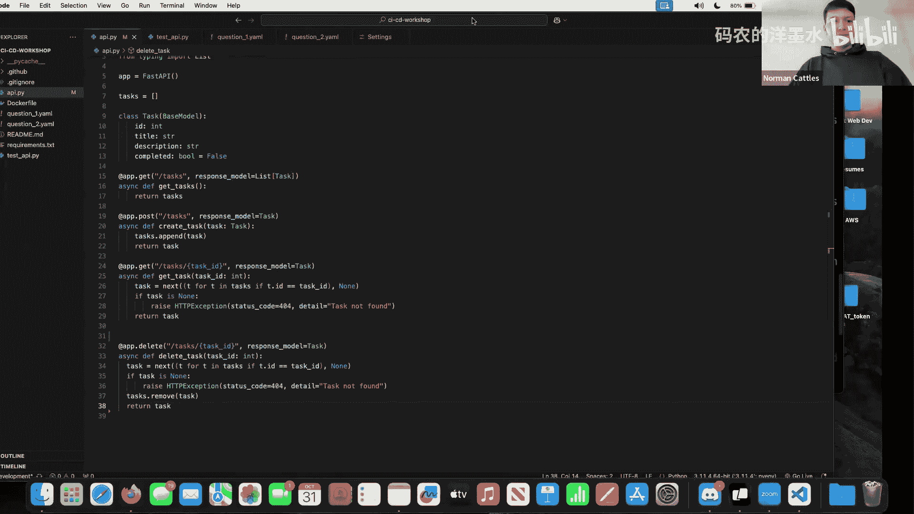

And this container is actually running live on an EC2 instance right now。So。

This is our endpoints we can hit right now with our task API， we can get tasks。

We can create a task and get a task by ID。Obviously， we could test that， but I don't want to。

Be too centric on the application itself。USo like I said。

 let's say we want to be able to delete a task。

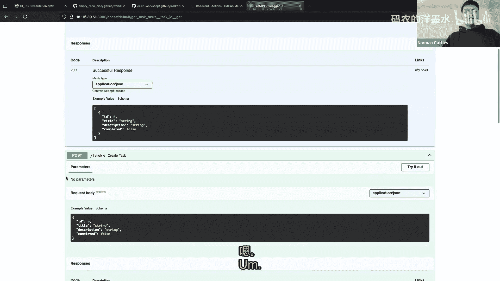

We're going to uncomment out this ability， this endpoint to delete a task。

And then we also have this little test file。Basically just testing our API， we wanted to add a。Test。

 delete task。You know， to test our implementation of the lead task。And， you know， as a team。

 we decide， okay， let's push this to development and see how our pipeline does。

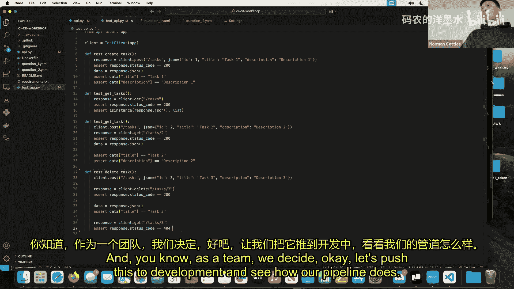

So。Where am I right now， Let's see。We are currently on development and I want to push this to development and I want to see what happens with our workflow so what I'll do is。

I them get status。Do that。Add a little message。Added tests or added delete delete task feature。

And then we want to push to。Our repository。

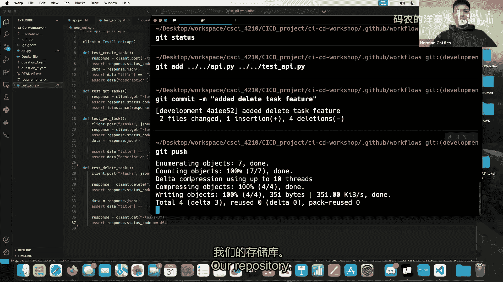

Five for example， so we tested it so it should succeed， but if it doesn't。

 we still get to show you guys how it would look if we put something that wouldn't should succeed。

So look， at the very top， we can see development had a recent push 11 seconds ago。And。

As if we remember， when we push to development， it'll。Sorry。

 no you go ahead what how do you want to do Yeah， yeah， I'll do that。嗯。Okay对。

So you can click into a workflow as running as we see it shows you in real time as sorry that's why I went to you're fine you're fine you're it tested and if you click into that test me it's while well this is the test you want me to click on the bill click test it shows you。

test workflow， which shows you all the steps it did in this job。

If you click and so just click into random one， doesn't matter。Okay。

 maybe don't click into the let's do install requirements it will show you the exact stuff you would see in your own terminal you this is the runner。

 this is the output of the runner yes this is the output of the runner exactly。

I guess we can go back to these。So now you'll see the have check marks that they all completed。

 if you went to build， you can see the same exact thing if you went to C Po plus you can see the same exact thing。

And you can look at all of your jobs independently this is also why ofs a good idea to build your jobs separately so you can know what ones but like I could just make one job that did all of this so I can make one job into test build and create a whole。

 but that wouldn't give you。As easily like visually I wouldn be able to visually see what pass and what fail if I did on network this makes it a lot easier to see exactly the fail and exactly what happen Yeah like Nick said it's like creating methods in your code you want you don't want to have a method that does everything you want to do you want to separate it out into。

Different methods so that it's easier to go back and take a look and see what went wrong。

And as we mentioned earlier in our development branchs workflow。

 we have this great poll request and as we can see now， we go ahead and click this poll request tab。

It created a pull request force us nothing we have to do manually pull request is there we don't want it to automatically push and domain because that would put it into the production environment and we don't even know if something's wrong so you can go ahead saying except the pull request it that that's we。

there。It would be the goal to get it up to a point where we could well， okay， let me let me yeah。

 so we do want it to automatically deploy， but we don't want it to automatically go from our development branch into our main branch because we don't know if something is wrong unless someone manually takes that。

If we made it automatically go to him like say he messed up in the delete test。

 but it wasn't called by a test， it was something that wasn't called by a test kind of hard for this example。

 but there could be something like maybe if there was a UI change and we could abandon button a wrong spot。

The test wouldn't really be able to adjust that but that want count yes， yes， exactly。

 Yeah typically you want。是。Yes， we once to automate the stuff that's repetitive error prone for humans。

 but we don't want the full thing to be automated because that will introduce more problems than solve want an accountable agent somewhere somewhere yes exactly if I add to bet。

 I don't think you'll ever work somewhere where there isn't some sort of request or some manual review going on especially if your junior is like I don't know。

But ignore all of these commits because we squash in where we're not to give presentation let's say it all looks good and we can approve this portal yes is his recent changes and you can maybe emerging。

You emerge to mean。So somebody reviewed it looks good。

There we merge that poll request and now if you go back to the actions tab or that's the。

Could the action stand。Is now running the workflow for the main branch because we accepted the pull request so that is now being merged into mains and so it's automatically running the stuff that we want into do in the main branch yeah we would have the trigger technically you can make it not do that but we for our purposes want to make sure that we look before it gets personality branch and deploys it's tested already it's going to the bill I guess something we'll focus on right now is if you thinking to test for me while we'll wait for this。

The way it determines if something passive a field is it looks for a non zero barud。

So the test that we created。If when your tests fail。

 like I don't know if you ever if you were ever ran pie test in your own local machine。

 whenever it fails， it just basically gives you a big error message saying like what things fail and basically returns a non zeroro error code。

The runner will pick up on that and will determine that this has failed if our test failed。

It does that for everything like doesn't just do have a test for build。

 if something in an error happened in the build one。

 it would return that error to the runner and that runner would tell us that disfas and it would not do anything else that have depend on builds。

嗯。So just for a quick refresher， if we look at this deploy job。

We are deploying to that server in AWS。And replacing that old container that ran our fast API with a new container with our new code。

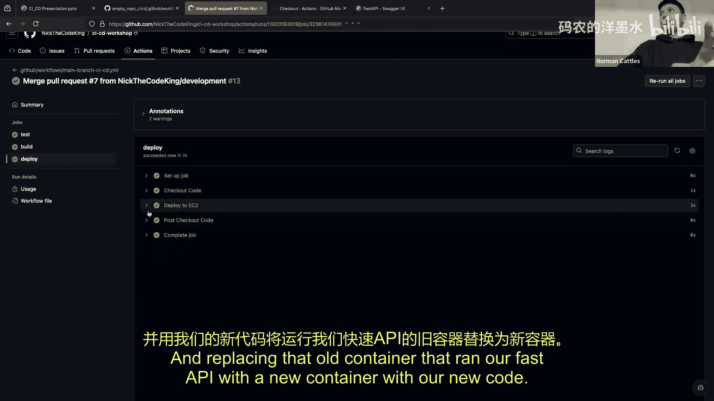

So before I refresh this。

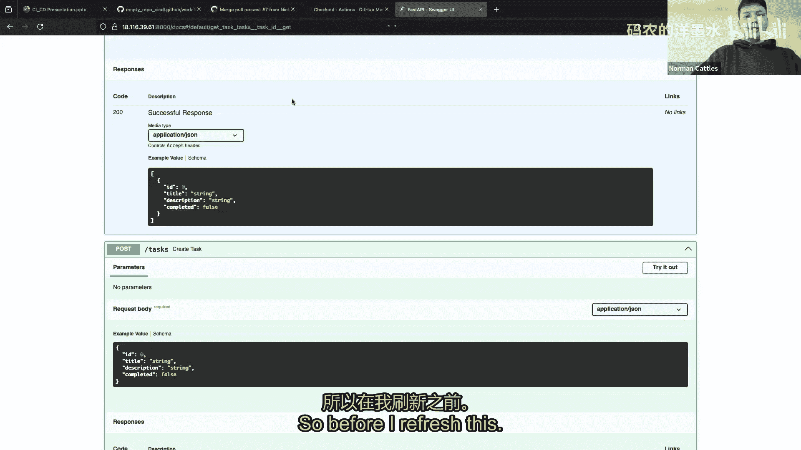

你。Well， well， it looks like。We successfully deploy according to our workflow。

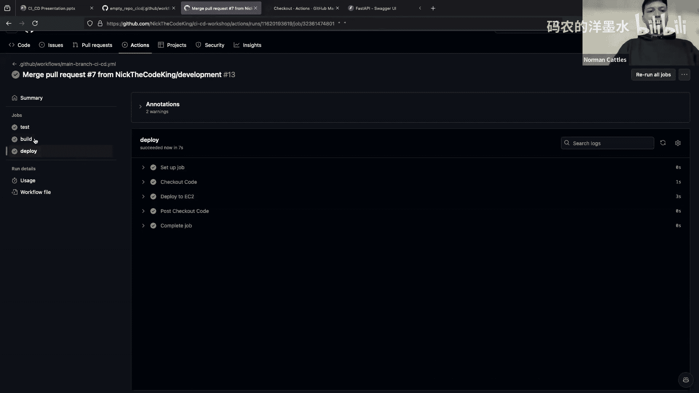

Three checks。Big check here so quick refresher so remember we didn't have a delete endpoint。

So if I refresh， I should see a new feature that allows us to delete a test。

And there it is it looks like we so like successfully deployed we didn't go into the AWs wasn they' like secretly doing it over there and touch anything we always showed you what we showed you and we so basically all of it besides our us accepting that bullet without。

行。Well， no， is that the end of our demo？Oh， well， any questions？Can you。

 is it possible to have some workflow like say on the AWS side of the server to automatically like pull something。

 for instance？Or would it would it have to you just have it like automatically the slowing every second list so the short answer to your question is that almost anything you could do programmatically is possible the way we're deploying i'm not sure if answer your question hopefully it is。

 but the way we're deploying to that you see two instance when I workflow goes off。

Our workflow is SSH in my AWS instance and it's kind of yes exactly yes yes yes。

 there are programs that like can automatic which we'll actually talk about like the next there programs that are like look for stuff that's changed and can pull and stuff like that where for this example we like brute forcing like just shellting into the instance and then pulling their latest stuff okay。

And yeah， we're going to highlight one of the tools that。

Get rid of that brute force method we'll get to it so that's it for the demo let me go back to this slide。

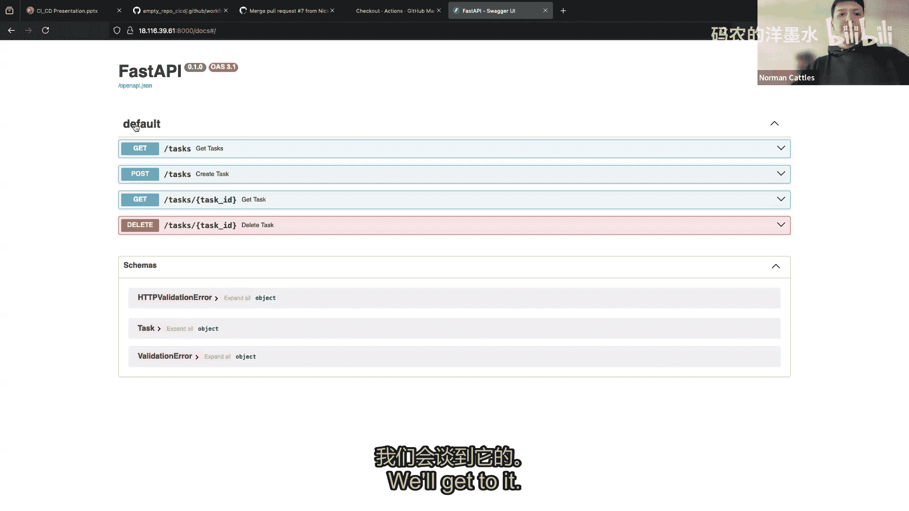

I feel like dis questioned， but like people don't want to ask。Yeah对。No， yes okay。

Give me a full screen。ButWhere is it。Right they're gone like the side itself，Like this one。okay。

 if you， if you see， wait， okay， if you go to the top right where it says like present， Yeah。

 got that menu no， I sir， there got a view whatever。don't like Google sites。😊，Yeah， okay。

 so this is our interpretation of how we might be able to use our wordflows with the raspberry pie and the leap motion now this is we're probably going to see a lot of stuff。

This is not things you need to know specifically for CICD。

 this is just our interpretation of how we might use this in our class to set up a pipeline。I mean。

 yeah， so typically。And I would say in a production environment Github actions would be used alongside many other tools to simplify your release process and so for our example。

Carla， do you want to go over actions so in our example。Once we've gone through our workflow。

 we'll have our workflow create a new Docker image。And from there。

 we'll push it to the container registry， which。Were。

 we're going to explain a little bit about how we would use Kubernetes then to help push that to all the raspberry paws that would be running delete motion SDK。

And as the containerization team mentioned on Tuesday。

 Kubernetes is essentially a container orchestration tool that is very useful when you have to manage and deploy multiple containers so if we think about our example we we would have。

If we put our elite motion applications on Docker containers。

We would have multiple containers for each screen within that you know however many screens。

 eight screens， so we would have like eight containers that we need to manage and deploy and we can use a tool like Kubernetes or a mini version of Kubernetes like micro Kubernetes to manage the deployment of these containers to those raspberry Pis。

And。Do you want to mention Argo City again Argo City is a specific program that basically monitors the Rito for。

Changes on that Kubernetesfi file so automatically see any changes in thatfi file and then update the Kubernetes cluster with that new information from the and we have an amazing graphic so we can so we can make a little more sense because I know it's a lot of tools out there this is essentially I found this online this is essentially if we decided on doing some sort of infrastructure for this and using this infrastructure this is exactly what it will look like so just to define Kubernetes and ArgoCd visually one more time。

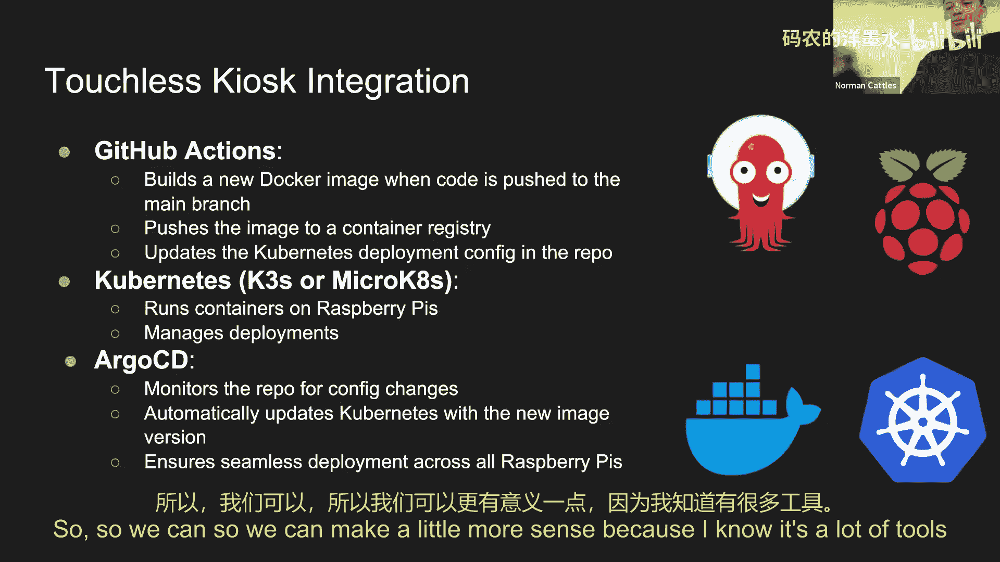

A Kubernetes cluster is essentially a group of containers that you have deployed。

That's a very simple way to put it。And ArgoCd is monitoring your GiHub repository for any new changes and ArgoCD will pick up on these changes and deploy these changes to your Kubernetes cluster whenever there's。

Not as sync like theres there's some synchronous stuff going on like。嗯。

Your cluster has to be in like a syncced state depending on this Kubernetes manifest file and this manifest file is essentially your。

Your deployment definition for your containers。Hopefully i'm making sense yeah so essentially a simplified version of that is just that our OCD is going to be an agent that's making sure and watching to make sure that if there's an updated image。

That all of your raspberry pies will be updated with that new image so I put that at like。

TheBasic level acts as how we might be doing yeah。U。

 we'll say us pod six is given on a project and we have to make some change。To the kiosk。

We're coding we're coding once we agree with what we we have and we push that feature branch to development get up actions will create a pull request from that development branch doesn't have to be exactly like this。

 but this is just an example。Someone will accept that pull request。

 which will be pushed so then it'll be pushed into the main branch。

Then Gitthub actions will on the push of that main branch will build the new Docker image with our new code push that image to Docker Hub。

The Ki action will update that manifest file。And then like they mentioned。

 the agent will see the change in that manifest file。

 which will update the Kubernetes cluster with the new container。

 which is a cluster of all the separate Docker images on each individual raspberry P so everything will be updated at once。

Exactly， yeah。Is there any questions about this specifically？

Theoctopuse the  Otopus is ArgoCd and it's that's the continuous delivery tool monitoring for any changes in your configuration policy essentially。

😊，Um it seems like a really useful tool and hopefully we can use it because this seems like a lot of fun to set up。

So no， you know we been learn。啊杨老。We're mentioning way of we kind of just like thought of this idea because we wanted to make sure that our kind of the reason we use pie test why we use Docker images and whatnot we tried to use a lot of parts yeah fast API we tried to use a lot of the parts from other people's presentation we could have done more we could have made workflow that automatically created a task and Github projects that we had to look at we don't want to do too much。

But。But like we just wanted to show of what happened other group。

 so no one really talked about Har City， but we thought this was a good way that we could set up on a lastberry of that we get to the raberry blocks。

But really this is all just a pitch to the class because you all have to decide on how we want things to exactly that's what we're hoping oh that's the goal if we can automate the entire deployment process with these tools that would be the goal that's like the dream right there。

And just one more thing to mention I think。CICD in general， we when we're talking about CICD。

 what you typically will see is a lot of。Usage of containerization。

Typically like you're going to see a lot of docker you're going to see especially at a scale。

 Kubernetes is a very， very popular tool for containerization。

There's a lot of different really popular tools used in CICD。

 but these are a few like these are pretty typically used。

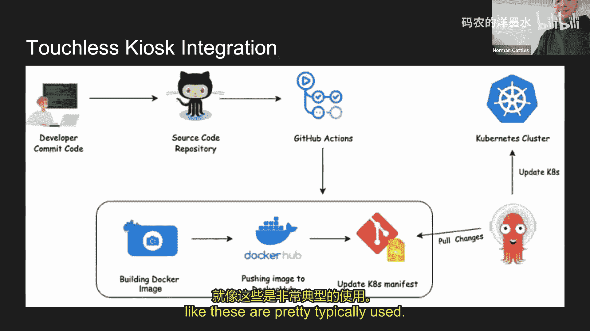

So our deliverables we're not trying to be too harsh on everybody。

 it simply create a GiHub actions workflow and upload it to GitHub。Very simple。

Hopefully it's something I that would teach you a bit more about the workflow but they're really mean anything sure so could be。

Com。一咁佢嘅。So I said， oh， I'm willing to get them out。

So do we want it to be an hour robust story do we want it to be， I mean。

 not our directory or do we want it to allow？I feel like it makes sense are we are is each pie like creating a deliverables like folder or believe that that's I believe that's the layout that we have been I believe that's what we have so I think what you could do is just。

Create a workflow in your own repository and then take a screenshot of that workflow running and upload that to our that would be a lot easier than having everyone submit their code and workflow we can from other teams So again the goal is to make sure that all the pods have a chance to actually interface and touch these technologies because it's one thing to learn about onflow presentations whole other thing to actually try to use I think that's when you're going find value in these that's acceptable you have a separate you set just that's in the。

Actuallyions？Any other questions？Excellent， everyone。

 have a happy Halloween will pick up with starting to develop。

