# 001：HTML交互式应用开发（第一部分） 🚀


在本节课中，我们将学习如何使用HTML构建一个交互式故事应用。我们将从零开始，通过迭代的方式逐步添加功能，最终创建一个包含多个场景、数据持久化和分支路径的“选择你自己的冒险”式游戏。我们将重点理解HTML文档结构、元素、属性以及如何通过查询字符串在页面间传递数据。

---

## 概述 📋

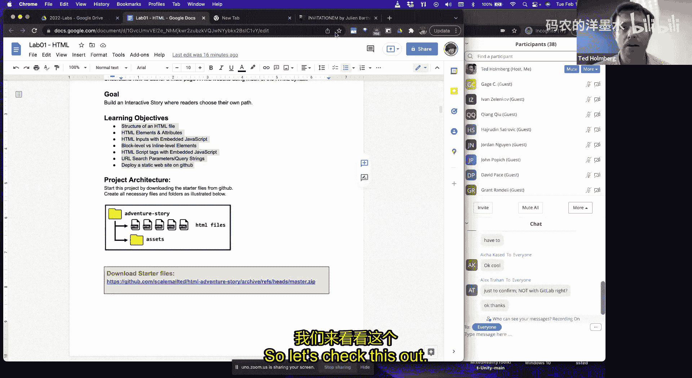

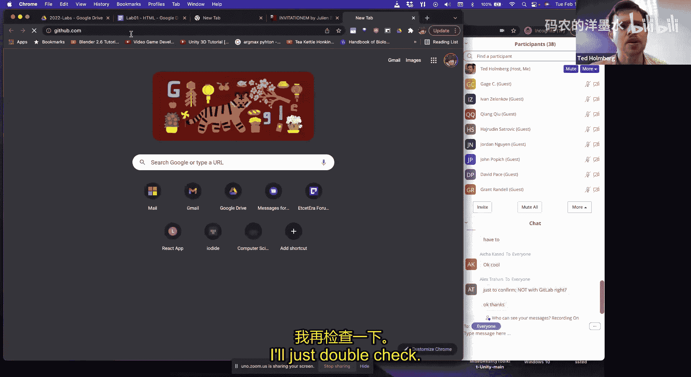

本教程基于加州理工学院“高级Web应用”课程的第一讲实验内容。我们将通过构建一个交互式故事游戏来学习HTML的核心概念。这个游戏将包含多个HTML页面，玩家可以在不同场景间导航，其状态（如金币、生命值）将通过URL查询字符串在页面间传递和保持。

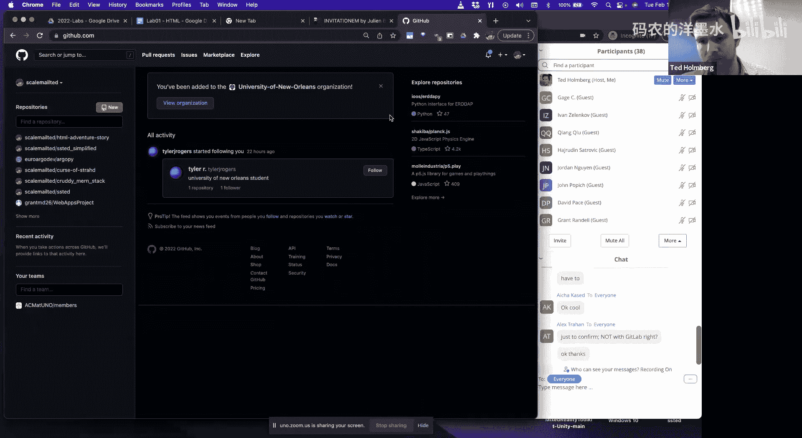

---

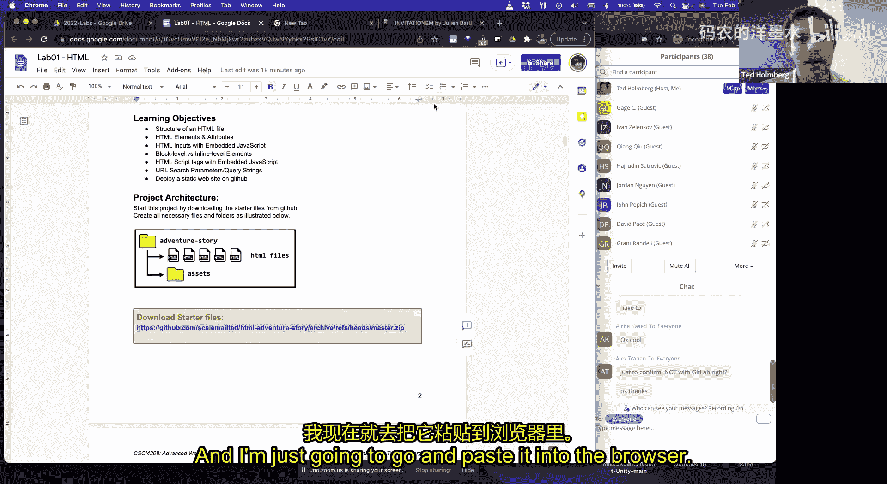

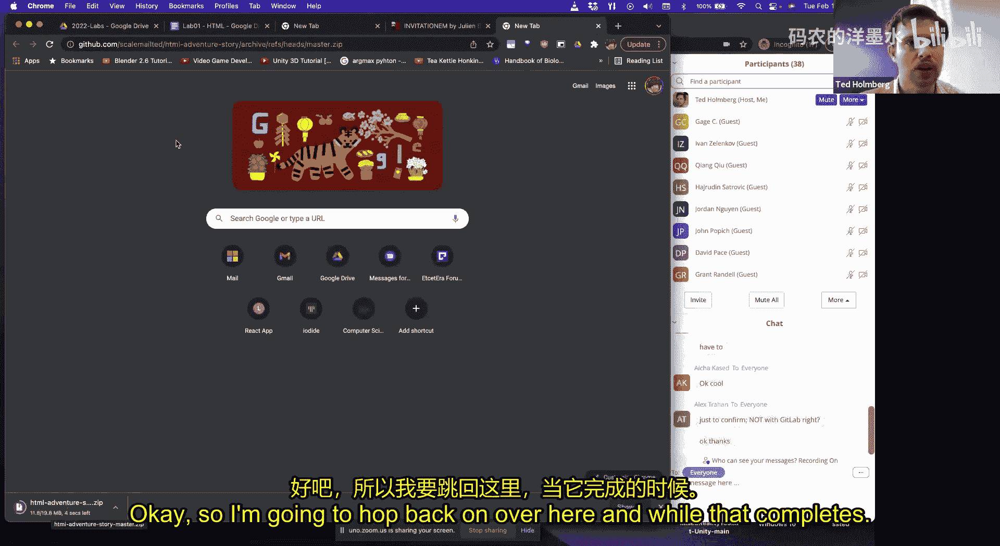

## 项目介绍与目标 🎯

上一节我们概述了课程内容，本节中我们来看看本次实验的具体目标和所需工具。

**学习目标：**
*   理解HTML文件的结构。
*   学习HTML元素和属性的概念。
*   学习HTML输入元素。
*   了解如何通过`<script>`标签嵌入少量JavaScript。
*   理解块级元素与行内元素的区别。
*   学习URL查询字符串（服务器参数）及其在传递状态数据中的应用。
*   学习如何将静态网站部署到GitHub。

**所需工具：**
*   Chrome浏览器（用于测试）。
*   代码编辑器（如Visual Studio Code）。
*   免费的GitHub账户（用于部署）。

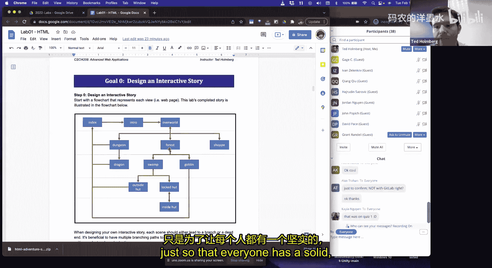

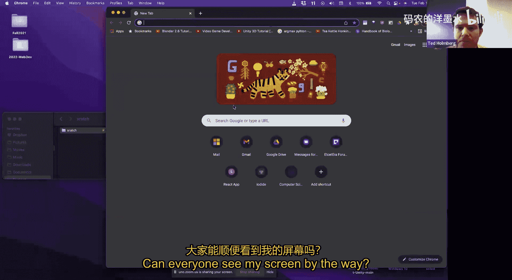

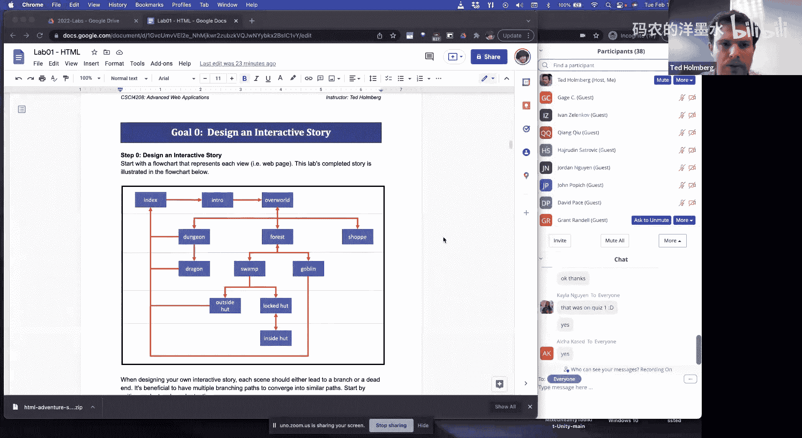

**项目动机与目标：**
*   **动机**：学习如何使用HTML语法编写多页面网站。
*   **目标**：构建一个读者可以自主选择路径的交互式故事。

---

## 核心概念：HTML 🌐

在开始编码之前，我们需要理解一些核心的HTML概念。

**HTML**（超文本标记语言）是创建网页的标准标记语言。它描述了网页的结构，由一系列**元素**组成。HTML定义了应用在Web客户端视口中的**视图**。

**HTML元素**由开始标签、内容和结束标签定义。例如，一个段落元素的结构如下：
```html
<p>这是一段内容。</p>
```
元素告诉浏览器如何显示其内容。

**HTML属性**在开始标签中提供关于元素的额外信息。例如，图像元素的`src`属性指定了图片来源：
```html

```

**块级元素 vs. 行内元素：**
*   **块级元素**（如 `<h1>`, `<p>`, `<div>`）总是从新行开始，并占据其父容器的全部宽度。
*   **行内元素**（如 `<a>`, `<span>`, ``）不会从新行开始，仅占据其内容所需的宽度。

**HTML文档的典型结构**类似于树形数据结构：
*   **根元素**：`<html>`
*   **子元素**：
    *   `<head>`：包含元数据（如标题、样式、脚本），这些内容不会直接显示给用户。
    *   `<body>`：包含文档的所有可见内容（如标题、段落、图像、超链接）。

**Web浏览器**负责解析HTML文档并将其以美观的方式呈现。除了作为HTML解析器，浏览器还包含**JavaScript运行时环境**，我们将在本实验中少量使用它来实现数据共享。

---

## 项目架构与设计 🗺️

理解了基本概念后，我们来看看项目的整体架构和设计流程。

我们的项目将放在一个名为 `html_adventure_story` 的目录中。目录内包含一个 `assets` 文件夹，存放实验所需的所有图像等资源文件。

在实现任何应用之前，设计其流程至关重要。对于交互式故事，这意味着规划每个场景（HTML页面）如何链接到下一个场景。

以下是本实验示例故事的流程图：
```
index.html -> intro.html -> overworld.html
overworld.html <-> dungeon.html
overworld.html <-> forest.html
overworld.html <-> shop.html
forest.html -> swamp.html -> (分支路径)
...
```
每个场景（HTML文档）应导向一个分支或死胡同。在开始编写HTML之前，建议先规划好你的故事分支。

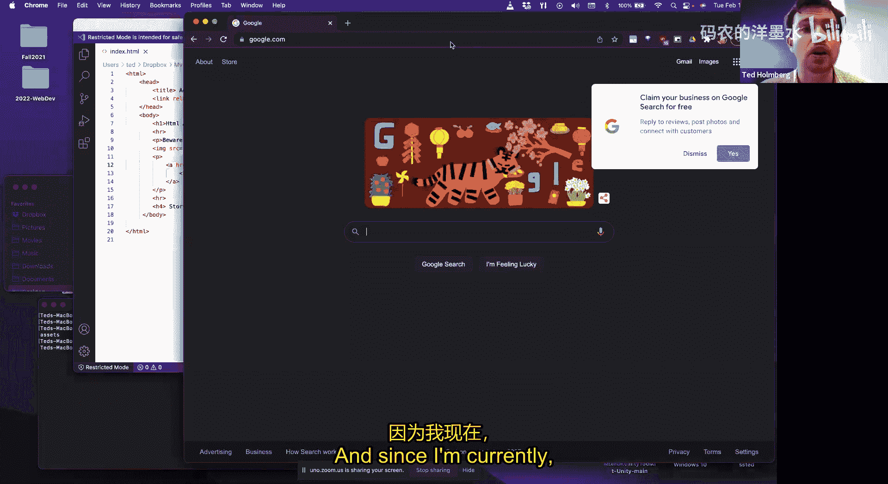

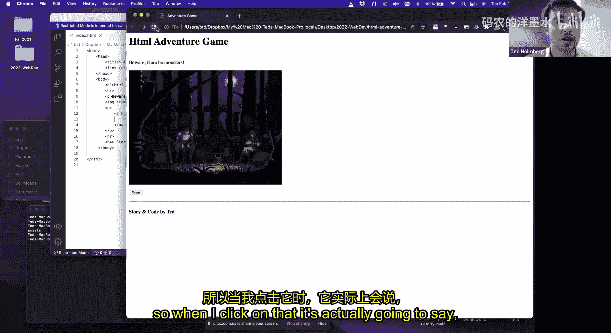

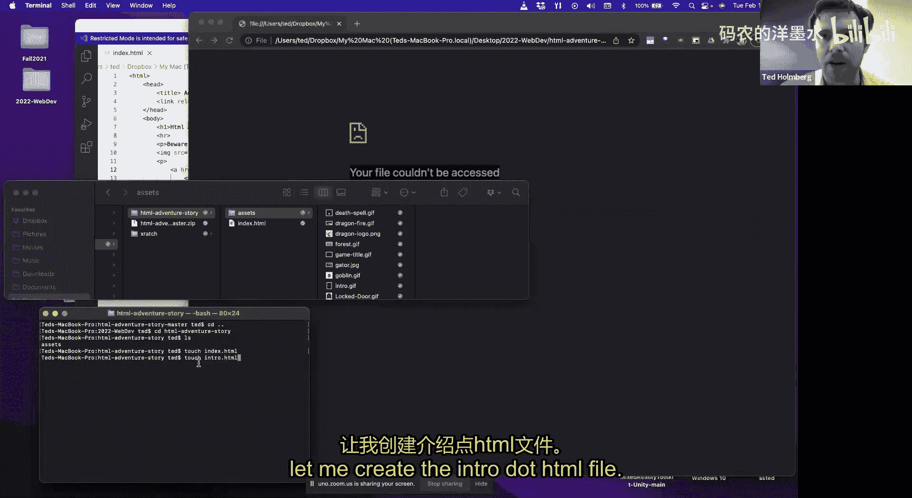

---

## 目标1：创建初始索引页面 🏁

我们将采用迭代开发策略，每个目标分为三个阶段：**设计**、**实现**和**测试**。第一个目标是创建应用的入口页面——`index.html`。

**实现步骤：**

1.  **创建HTML文件**：在项目根目录创建 `index.html`。
2.  **添加根元素**：每个HTML文档都以 `<html>` 根元素开始和结束。
    ```html
    <html>
    </html>
    ```
3.  **添加头部 (`<head>`)**：在 `<html>` 内添加 `<head>` 元素，用于存放元数据。
    *   **标题 (`<title>`)**：定义浏览器标签页上显示的标题。
    *   **网站图标 (`<link>`)**：定义浏览器标签页上显示的小图标。
    ```html
    <head>
        <title>冒险游戏</title>
        <link rel="icon" href="assets/dragon-logo.png">
    </head>
    ```
4.  **添加主体 (`<body>`)**：在 `<html>` 内添加 `<body>` 元素，用于存放所有可见内容。
    *   **主标题 (`<h1>`)**：使用最大的标题元素显示游戏名称。
    *   **水平线 (`<hr>`)**：添加一条水平分隔线。
    *   **段落 (`<p>`)**：添加游戏描述文本。
    *   **图像 (``)**：嵌入游戏标题图片，使用 `src` 属性指定路径，`width` 属性调整宽度。
    *   **嵌套元素**：在段落 (`<p>`) 中嵌套锚点 (`<a>`) 和按钮 (`<button>`) 元素，创建一个可点击的“开始”按钮，点击后将跳转到 `intro.html`。
    *   **另一个水平线和标题**：添加版权或作者信息。
    ```html
    <body>
        <h1>HTML冒险游戏</h1>
        <hr>
        <p>当心，此处有怪物。</p>
        
        <p>
            <a href="intro.html">
                <button>开始</button>
            </a>
        </p>
        <hr>
        <h4>故事代码由作者提供</h4>
    </body>
    ```

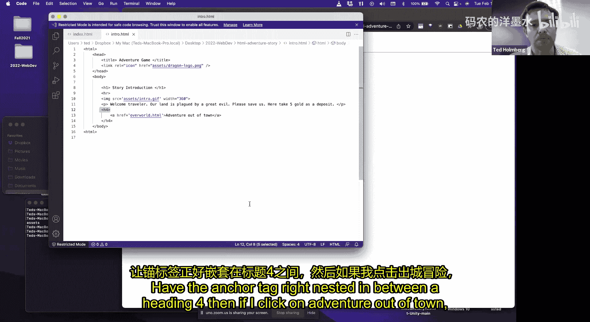

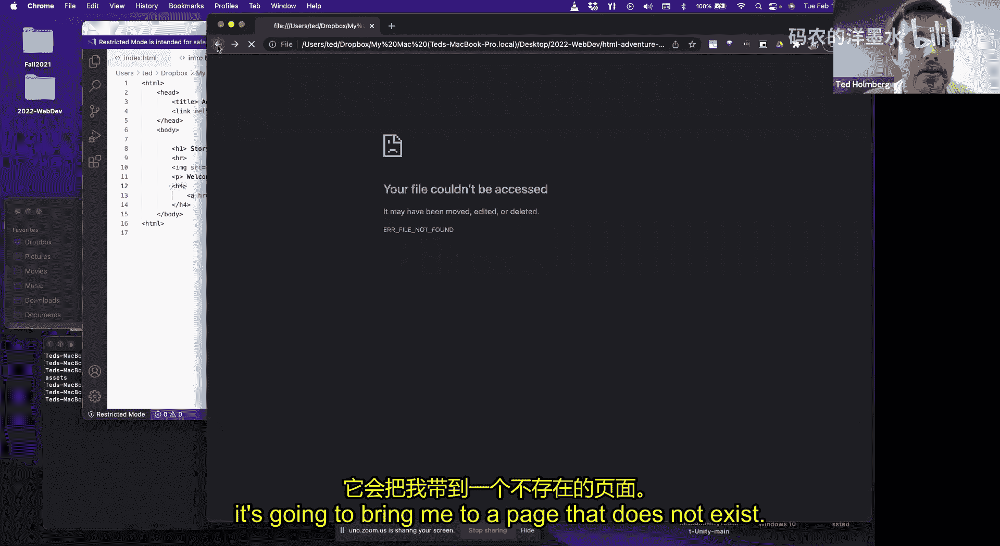

**测试：**
在浏览器中打开 `index.html`，检查标题、图标、图片和“开始”按钮是否正常显示。点击“开始”按钮应尝试跳转到 `intro.html`（即使该文件尚未创建）。

---

## 目标2：创建故事介绍页面 📖

上一节我们创建了入口页面，本节中我们来构建故事的起点——介绍页面。

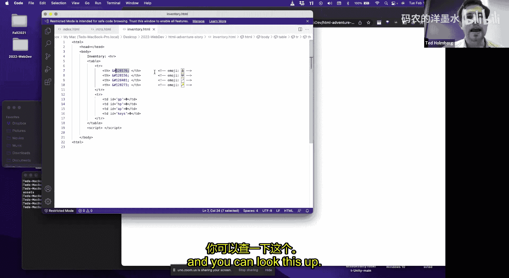

这个页面的目的是向玩家介绍故事背景和任务。

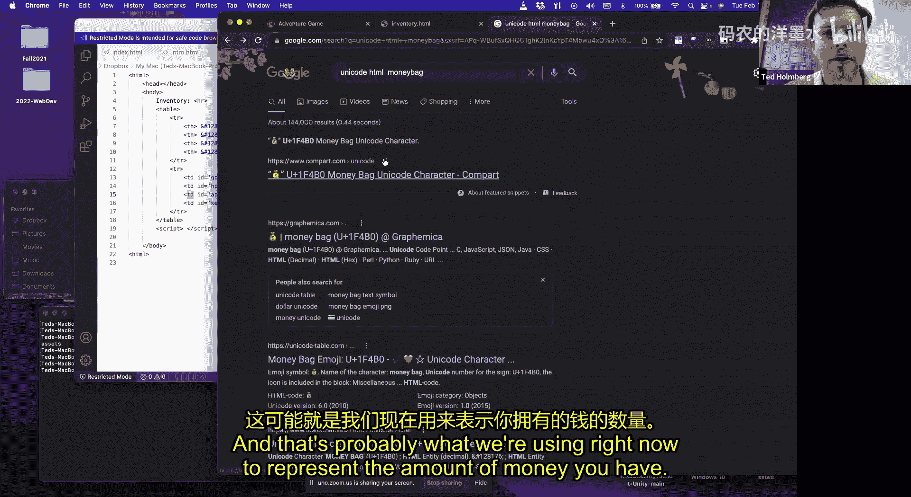

**实现步骤：**

1.  **创建文件**：在项目根目录创建 `intro.html`。
2.  **基本结构**：与 `index.html` 类似，添加 `<html>`、`<head>` 和 `<body>` 基本结构。
3.  **一致的头部**：为了统一的用户体验，`<head>` 中的 `<title>` 和 `<link>`（图标）应与 `index.html` 保持一致。
4.  **构建主体内容**：
    *   **主标题 (`<h1>`)**：场景标题（如“故事介绍”）。
    *   **水平线 (`<hr>`)**。
    *   **图像 (``)**：展示介绍场景的图片。
    *   **段落 (`<p>`)**：描述故事背景的文字（例如：“欢迎，旅行者。我们的土地被巨大的邪恶所困扰。请拯救我们。这是5枚金币作为定金。”）。
    *   **超链接 (`<a>`)**：使用锚点标签创建一个链接，指向 `overworld.html`。链接文本可以描述下一步行动（如“出城冒险”）。为了突出显示，可以将 `<a>` 标签嵌套在一个较小的标题元素（如 `<h4>`）中。
    ```html
    <body>
        <h1>故事介绍</h1>
        <hr>
        
        <p>欢迎，旅行者。我们的土地被巨大的邪恶所困扰。请拯救我们。这是5枚金币作为定金。</p>
        <h4><a href="overworld.html">出城冒险</a></h4>
    </body>
    ```

**测试：**
从 `index.html` 点击“开始”按钮，应能成功跳转到 `intro.html` 并看到介绍内容。点击“出城冒险”链接将尝试跳转到 `overworld.html`。

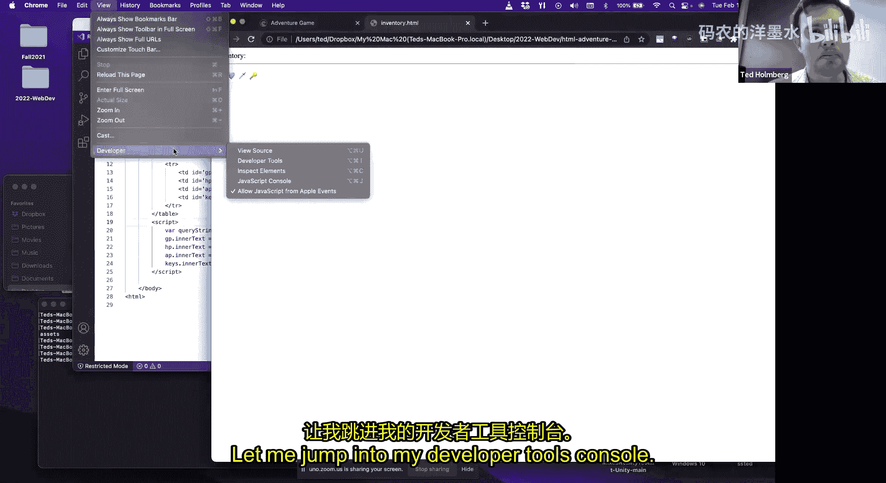

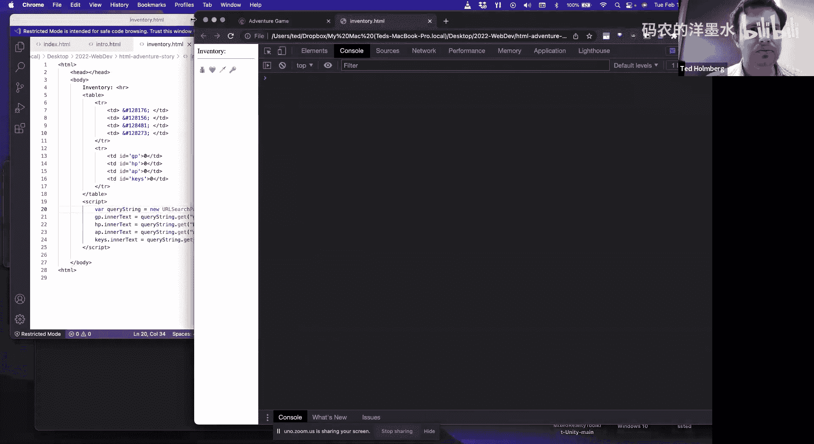

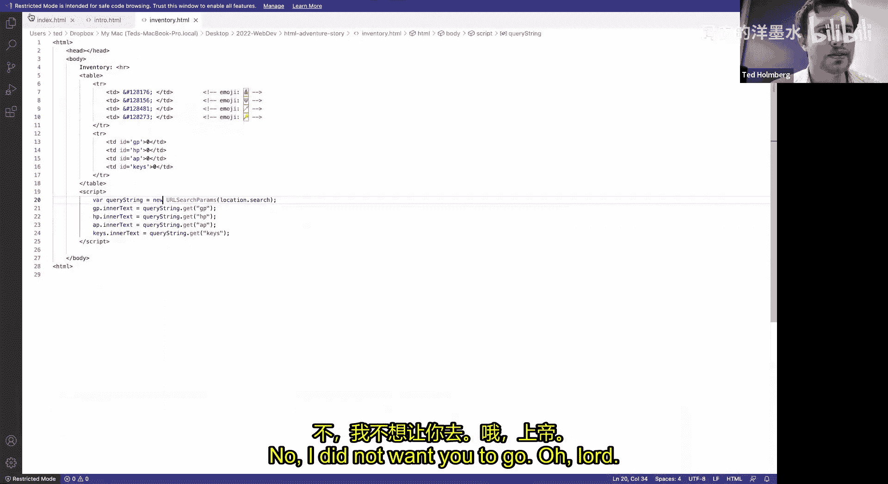

---

## 目标3：创建库存页面 📊

到目前为止，我们的页面还是独立的。为了让游戏有进展感，我们需要一个能跟踪玩家状态（如金币、生命值）的库存系统。本节我们将创建一个可重用的库存页面，并学习如何在页面间传递数据。

HTML页面本身无法直接共享数据。为了实现数据持久化，我们将使用**URL查询字符串**。

**URL查询字符串**是附加在URL末尾的数据，格式为 `?key1=value1&key2=value2`。例如：`overworld.html?gp=5&hp=3&ap=1&keys=0`。

**实现步骤：**

1.  **创建文件**：在项目根目录创建 `inventory.html`。这个页面不会直接被玩家访问，而是被其他页面嵌入。
2.  **基本结构**：添加 `<html>` 和 `<body>`。由于是嵌入页面，`<head>` 可以留空或省略。
3.  **构建库存表格**：
    *   添加一个标题“库存”和水平线。
    *   使用 `<table>` 元素创建一个表格。
    *   第一行 (`<tr>`) 使用表头单元格 (`<th>`) 显示库存项图标（金币袋、心、剑、钥匙）。可以使用HTML实体（如 `💰`）来显示Emoji。
    *   第二行 (`<tr>`) 使用数据单元格 (`<td>`) 显示各项的初始数值（例如：0000）。为每个 `<td>` 赋予一个唯一的 `id` 属性（如 `gp`, `hp`, `ap`, `keys`），以便后续用JavaScript操作。
    ```html
    <body>
        库存
        <hr>
        <table>
            <tr>
                <th>💰</th> <!-- 金币 -->
                <th>❤️</th> <!-- 生命 -->
                <th>⚔️</th> <!-- 攻击 -->
                <th>🔑</th> <!-- 钥匙 -->
            </tr>
            <tr>
                <td id="gp">0000</td>
                <td id="hp">0000</td>
                <td id="ap">0000</td>
                <td id="keys">0000</td>
            </tr>
        </table>
    </body>
    ```
4.  **添加JavaScript以读取查询字符串**：
    *   在 `</body>` 标签前添加 `<script>` 标签。
    *   使用 `new URLSearchParams(location.search)` 来解析当前URL中的查询字符串，得到一个 `queryString` 对象。
    *   使用 `queryString.get('key')` 方法获取特定键的值。
    *   通过元素的 `id`（如 `gp`）直接访问对应的HTML元素，并将其 `innerText` 设置为从查询字符串中获取的值。
    ```html
    <script>
        // 解析URL中的查询参数
        let queryString = new URLSearchParams(location.search);
        // 将获取到的值设置到对应的HTML元素中
        gp.innerText = queryString.get('gp');
        hp.innerText = queryString.get('hp');
        ap.innerText = queryString.get('ap');
        keys.innerText = queryString.get('keys');
    </script>
    ```

**测试：**
直接在浏览器中打开 `inventory.html?gp=5&hp=3&ap=1&keys=0`。页面应正确显示解析后的数值（5, 3, 1, 0），而不是“0000”。这证明了查询字符串传递数据的有效性。

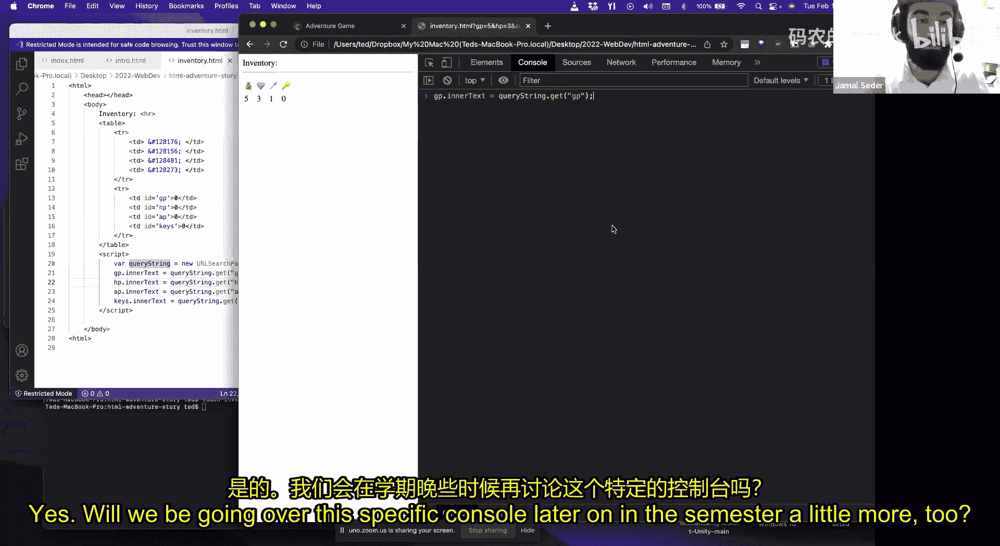

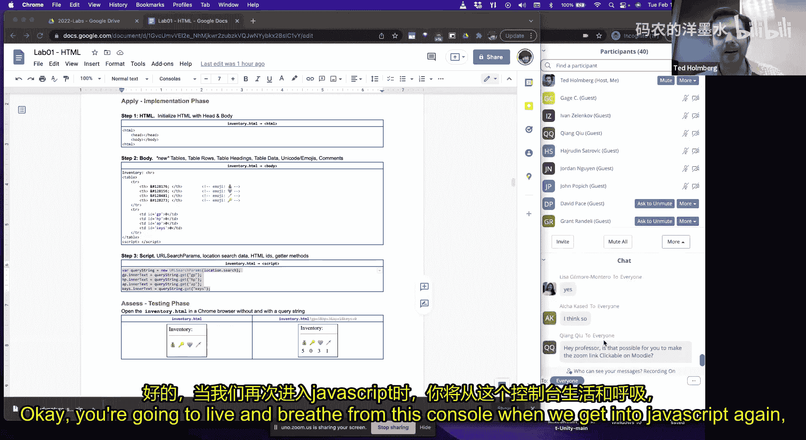

---

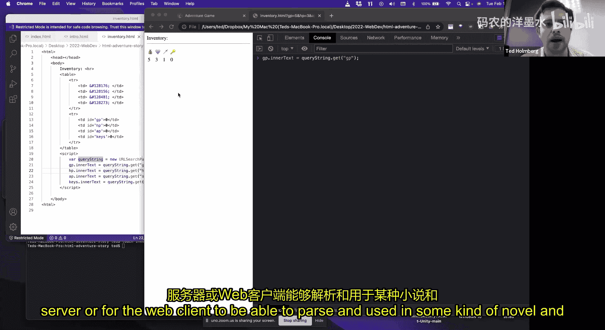

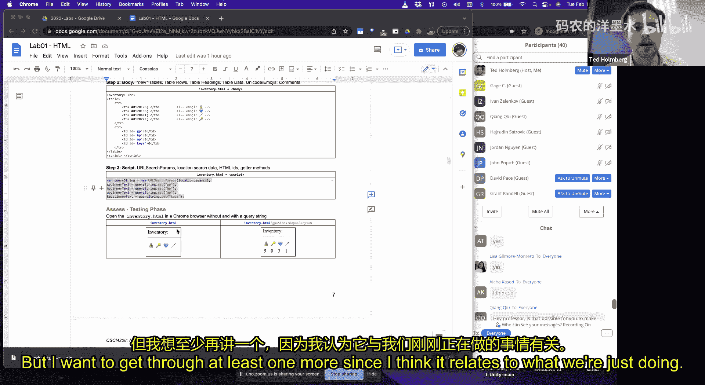

## 目标4：创建主世界页面并集成库存 🌍

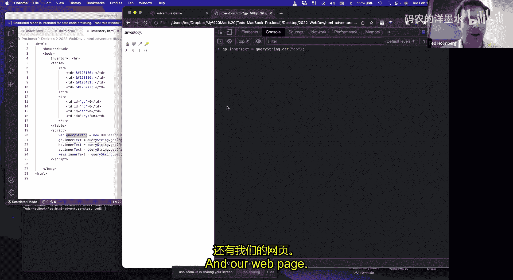

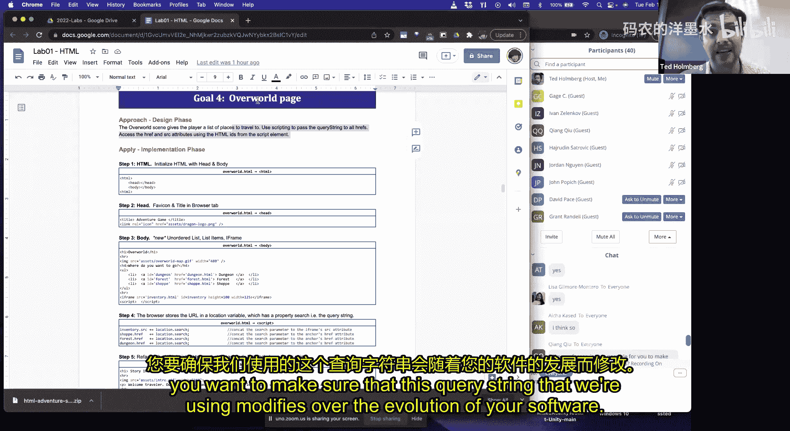

现在，我们将创建游戏的核心枢纽——主世界页面。玩家从这里可以选择前往不同的地点。同时，我们将把库存页面嵌入进来，并确保玩家状态能传递到所有链接的页面。

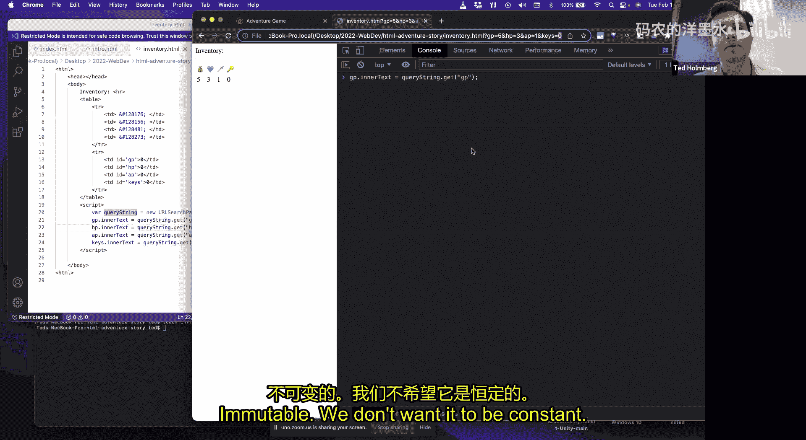

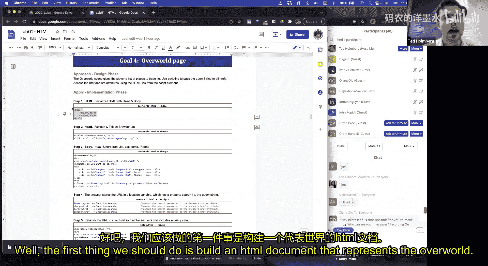

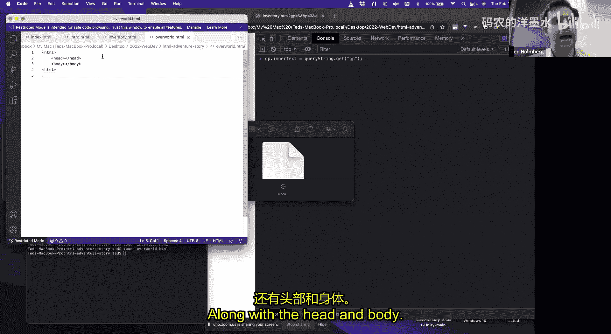

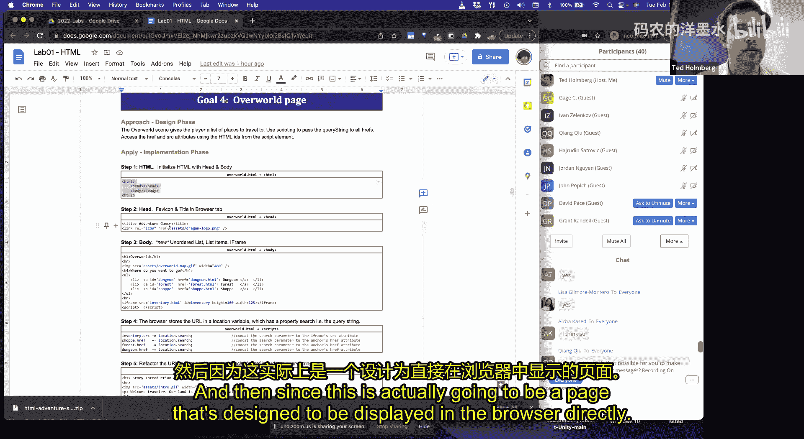

**实现步骤：**

1.  **创建文件**：在项目根目录创建 `overworld.html`。
2.  **基本结构与头部**：添加标准的 `<html>`, `<head>`, `<body>` 结构。在 `<head>` 中设置与之前一致的 `<title>` 和图标 `<link>`。
3.  **构建主体内容**：
    *   **主标题 (`<h1>`)**：显示“主世界”。
    *   **水平线 (`<hr>`)** 和**世界图像 (``)**。
    *   **提示与小标题 (`<h4>`)**：例如“你想去哪里？”
    *   **无序列表 (`<ul>`)**：包含多个列表项 (`<li>`)。每个列表项内是一个锚点链接 (`<a>`)，分别指向 `dungeon.html`, `forest.html`, `shop.html`。为每个 `<a>` 标签赋予一个 `id`（如 `dungeon`, `forest`, `shop`）。
    *   **另一个水平线 (`<hr>`)**。
    *   **内联框架 (`<iframe>`)**：用于嵌入 `inventory.html` 页面。设置其 `src` 属性，并赋予一个 `id`（如 `inventory`），以及 `width` 和 `height`。
    ```html
    <body>
        <h1>主世界</h1>
        <hr>
        
        <h4>你想去哪里？</h4>
        <ul>
            <li><a id="dungeon" href="dungeon.html">地下城</a></li>
            <li><a id="forest" href="forest.html">森林</a></li>
            <li><a id="shop" href="shop.html">商店</a></li>
        </ul>
        <hr>
        <iframe id="inventory" src="inventory.html" width="100" height="125"></iframe>
    </body>
    ```
4.  **添加JavaScript以传递查询字符串**：
    *   在 `</body>` 标签前添加 `<script>` 标签。
    *   关键逻辑：获取当前页面的查询字符串（`location.search`），并将其附加到所有需要传递状态的链接（`<iframe>` 的 `src` 和各个 `<a>` 标签的 `href`）的末尾。
    *   这样，当玩家点击链接时，目标页面将收到包含当前状态数据的查询字符串。
    ```html
    <script>
        // 获取当前页面的查询字符串
        let searchParams = location.search;
        // 将查询字符串附加到库存iframe的源地址上
        inventory.src += searchParams;
        // 将查询字符串附加到各个导航链接上
        dungeon.href += searchParams;
        forest.href += searchParams;
        shop.href += searchParams;
    </script>
    ```
5.  **修改介绍页面以传递初始状态**：为了让主世界页面获得初始数据，需要修改 `intro.html` 中指向 `overworld.html` 的链接。为其添加初始的查询字符串。
    ```html
    <!-- 在 intro.html 中修改链接 -->
    <h4><a href="overworld.html?gp=5&hp=3&ap=1&keys=0">出城冒险</a></h4>
    ```

**测试：**
1.  从 `index.html` 开始，点击“开始”。
2.  在 `intro.html` 点击“出城冒险”。
3.  现在，`overworld.html` 应被加载，并且其嵌入的 `inventory.html` 应正确显示初始状态（5金币，3生命，1攻击，0钥匙）。
4.  检查“地下城”、“森林”、“商店”这些链接的URL，它们末尾都应附带有 `?gp=5&hp=3&ap=1&keys=0` 查询字符串。

---

## 总结 🎉

本节课中我们一起学习了如何使用HTML构建一个多页交互式故事应用的基础框架。我们完成了以下核心任务：

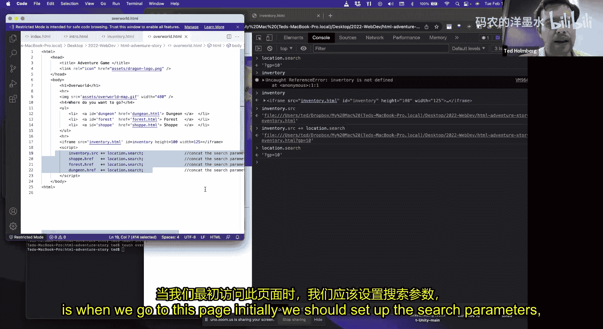

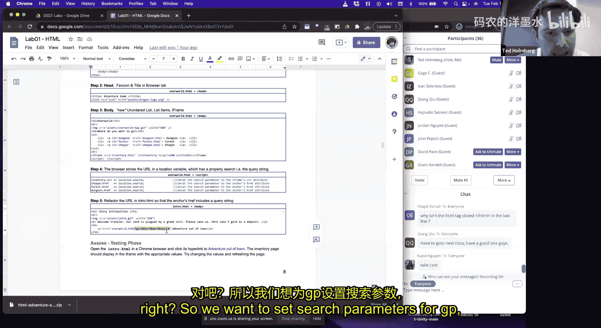

1.  **理解了HTML的基本结构**：包括根元素 `<html>`、元数据容器 `<head>` 和内容容器 `<body>`。
2.  **创建了静态页面**：构建了索引页 (`index.html`) 和故事介绍页 (`intro.html`)，并使用超链接 (`<a>`) 将它们连接起来。
3.  **引入了数据持久化概念**：通过**URL查询字符串**在不同HTML页面间传递玩家状态数据。
4.  **实现了动态库存页面**：创建了 `inventory.html`，利用嵌入的JavaScript读取查询字符串并更新页面内容。
5.  **构建了中心枢纽页面**：创建了 `overworld.html`，集成了库存显示，并编写JavaScript逻辑将当前状态数据自动附加到所有出口链接上，确保了数据在场景切换时的连续性。

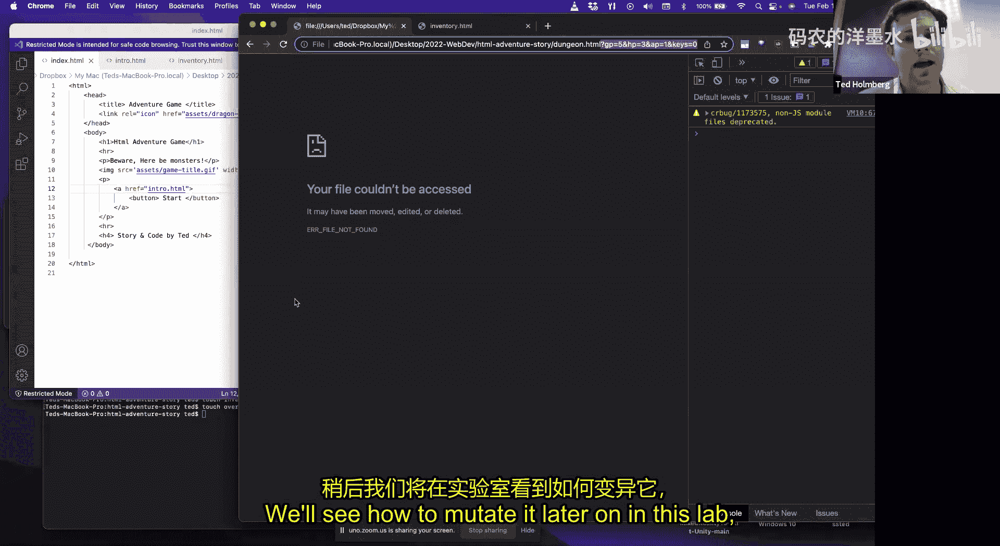

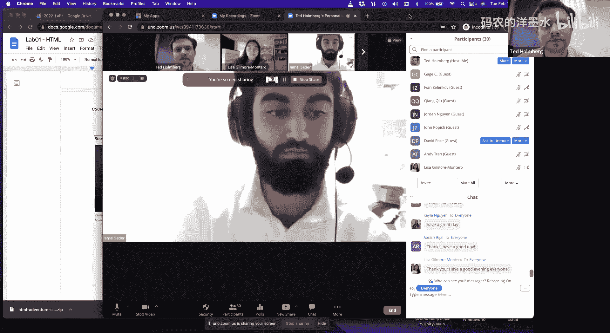

通过这个迭代过程，你不仅学会了HTML语法，还掌握了如何设计一个简单应用的数据流。在接下来的课程中，我们将基于此框架，继续为地下城、森林等场景添加更多交互逻辑和功能。