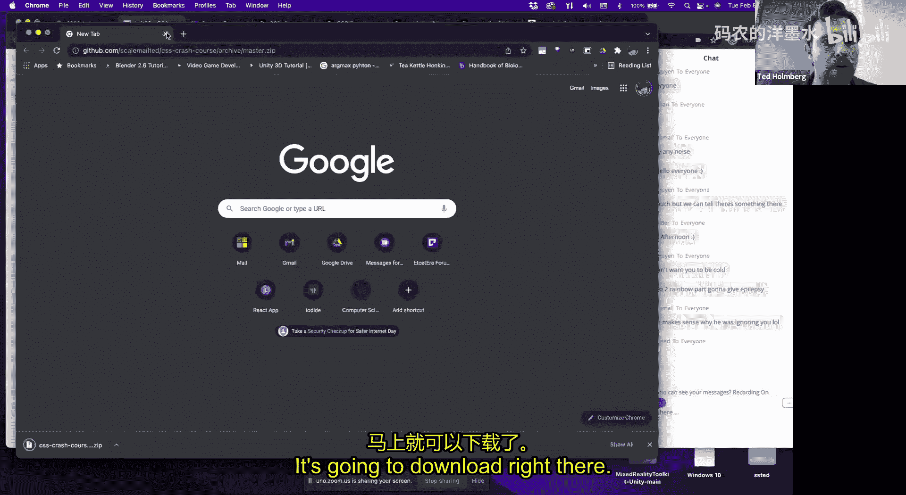
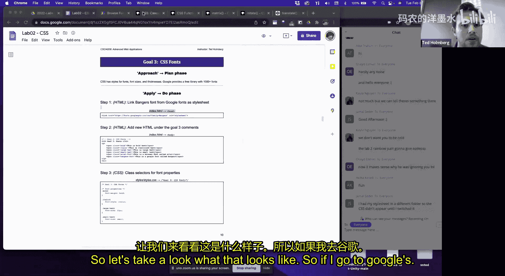
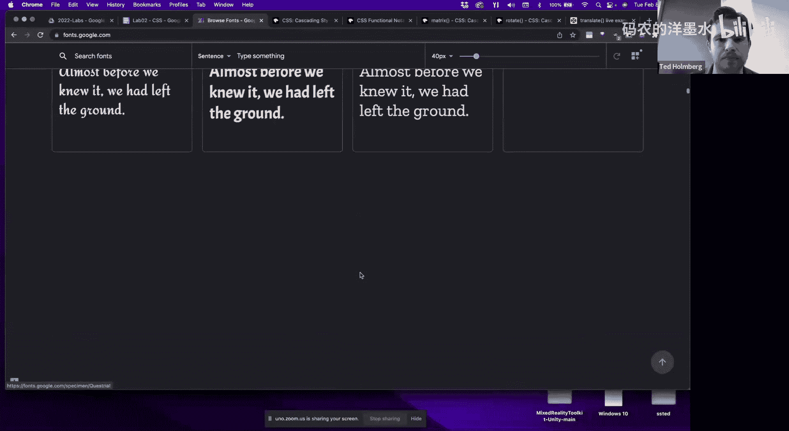
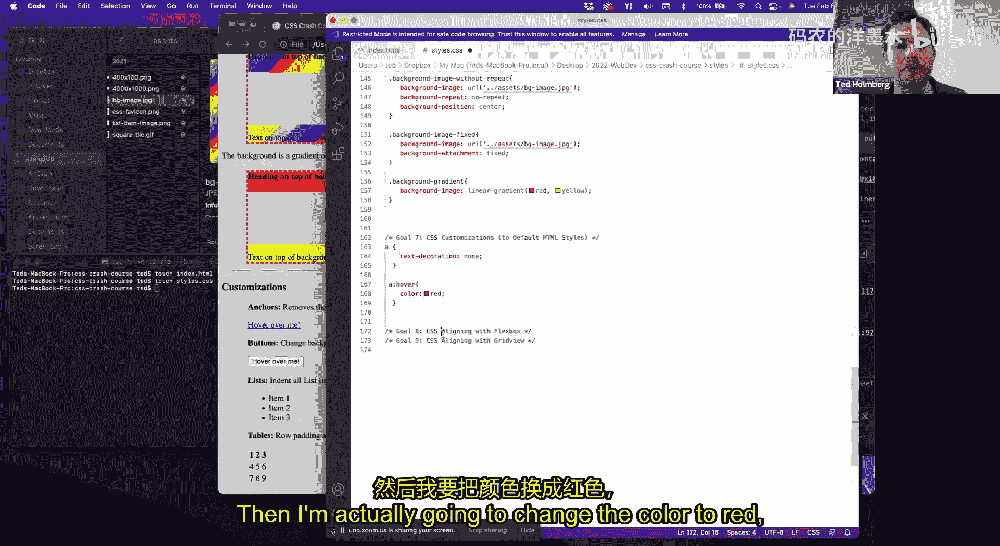
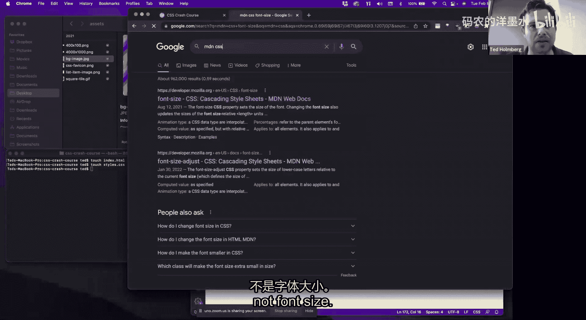
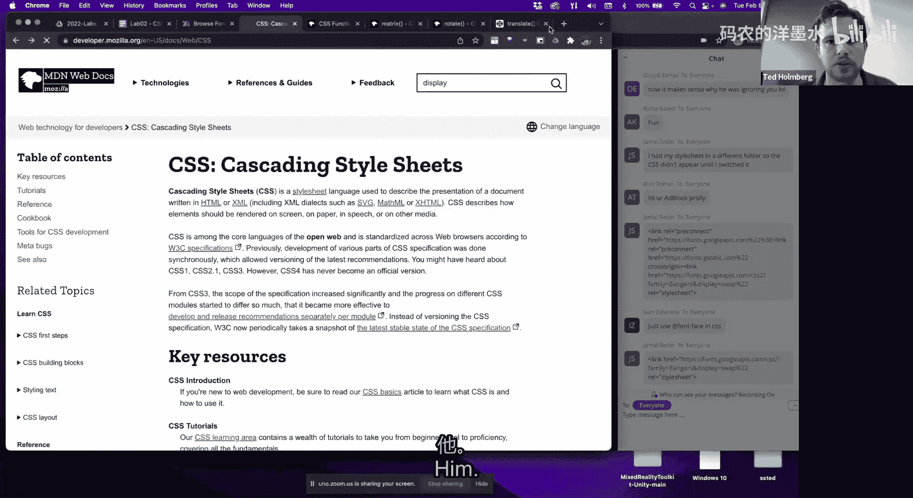
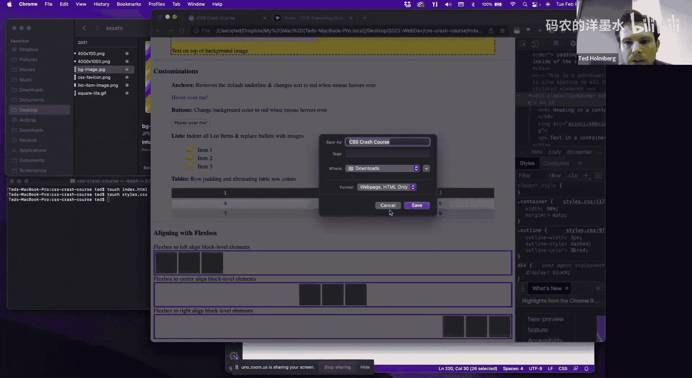
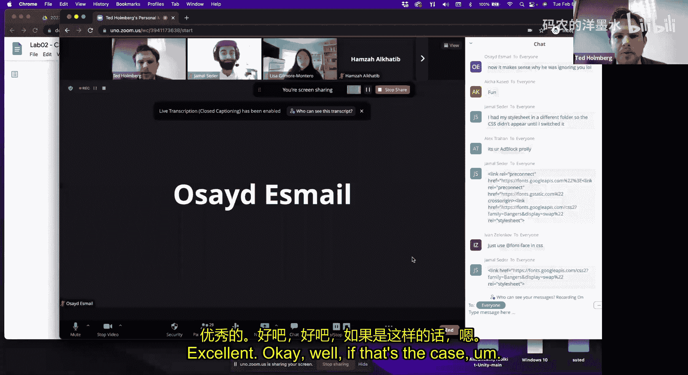
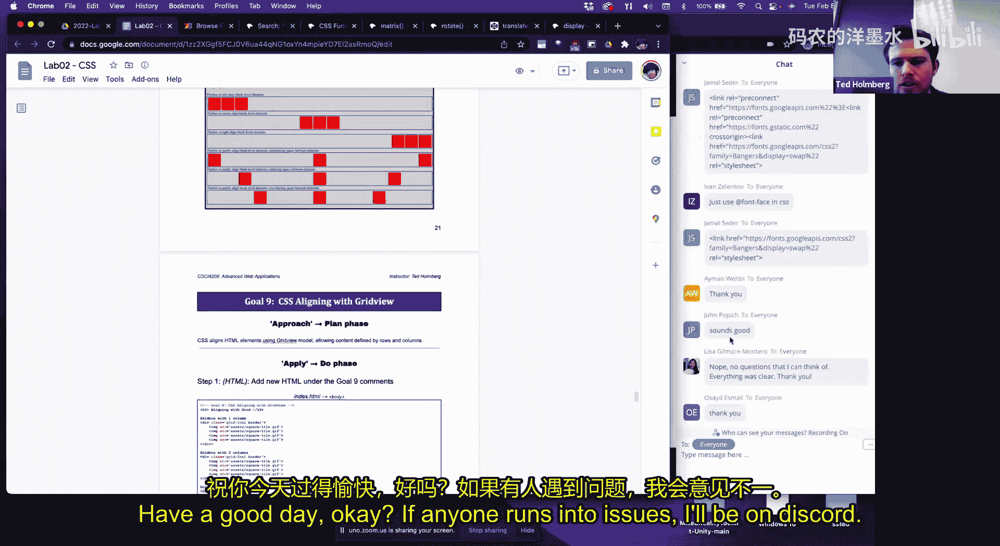
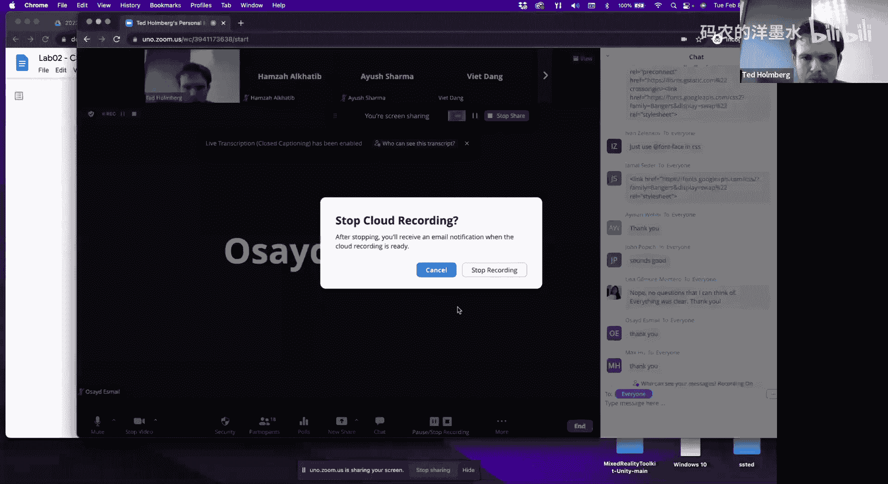

# 003：CSS速成教程 🎨


在本节课中，我们将学习如何使用CSS（层叠样式表）来美化网页。我们将从基础开始，逐步探索CSS的核心概念，包括选择器、颜色、字体、间距、尺寸、背景、自定义样式以及使用Flexbox和Grid进行布局。通过本教程，你将掌握使用CSS为网页添加样式的实用技能。

## 概述 📋

CSS是一种用于描述网页外观和格式的样式表语言。它允许我们控制HTML元素的颜色、字体、间距、布局等视觉属性。本节课将通过一个实践性实验，带你快速上手CSS的各个方面。



---

## 目标1：设置项目结构 📁

在开始编写CSS之前，我们需要先建立项目的基本结构。这包括创建HTML文件、CSS文件以及存放资源的文件夹。

首先，创建一个项目根目录，例如 `css_crash_course`。在该目录下，创建以下内容：
*   `index.html`：主HTML文档。
*   `assets/` 目录：存放图片等资源文件。
*   `styles/` 目录：存放CSS样式文件，例如 `styles.css`。

接下来，在 `index.html` 文件中设置基本的HTML结构，包括 `<head>` 和 `<body>` 标签。在 `<head>` 中，我们链接CSS文件。

```html
<!DOCTYPE html>
<html lang="en">
<head>
    <meta charset="UTF-8">
    <title>CSS Crash Course</title>
    <link rel="stylesheet" href="styles/styles.css">
</head>
<body>
    <h1>CSS Crash Course</h1>
    <hr>
    <!-- 后续的实验目标将在这里添加 -->
</body>
</html>
```

现在，我们已经搭建好了项目的基础框架。接下来，我们将深入CSS的核心部分。

---

## 目标2：理解CSS选择器 🎯

CSS选择器用于指定我们要样式化的HTML元素。理解选择器是应用样式的基础。主要有三种基本类型的选择器：元素选择器、类选择器和ID选择器。

以下是三种选择器的示例：

```css
/* 1. 元素选择器：选择所有 <body> 元素 */
body {
    background-color: gray;
}

/* 2. 类选择器：选择所有 class="class-selector" 的元素 */
.class-selector {
    text-align: right;
}

/* 3. ID选择器：选择 id="id-selector" 的元素 */
#id-selector {
    text-align: center;
}
```

对应的HTML结构如下：

```html
<h3>Goal 1: Selectors</h3>
<p>This is the body set to gray.</p>
<p class="class-selector">This element was selected by its class name.</p>
<p id="id-selector">This element was selected by its ID.</p>
```

**关键点**：
*   **类选择器**（以 `.` 开头）可以应用于多个元素，一个元素也可以拥有多个类。
*   **ID选择器**（以 `#` 开头）应该是唯一的，通常用于在JavaScript中精确选择单个元素。
*   在样式中，更推荐使用类选择器，因为它们更具复用性。

---

## 目标3：使用CSS颜色 🎨

CSS允许我们为元素的背景和文本设置颜色。颜色可以通过名称、RGB值或十六进制值来定义。

以下是如何定义和应用颜色的示例：

```css
/* 使用RGB值定义背景色 */
.bg-white {
    background-color: rgb(255, 255, 255); /* 白色 */
}
.bg-red {
    background-color: rgb(255, 0, 0); /* 红色 */
}
.bg-green {
    background-color: rgb(0, 255, 0); /* 绿色 */
}
.bg-blue {
    background-color: rgb(0, 0, 255); /* 蓝色 */
}
.bg-dark {
    background-color: rgb(0, 0, 0); /* 黑色 */
}

/* 定义文本颜色 */
.text-white {
    color: rgb(255, 255, 255);
}
.text-red {
    color: rgb(255, 0, 0);
}
.text-green {
    color: rgb(0, 255, 0);
}
.text-blue {
    color: rgb(0, 0, 255);
}
```

在HTML中，我们可以将多个类组合使用：



```html
<p class="bg-green text-white">绿色背景，白色文字</p>
<p class="bg-blue text-red">蓝色背景，红色文字</p>
```

通过组合不同的类，我们可以轻松创建丰富的颜色搭配。



---

## 目标4：应用字体和文本样式 ✍️

CSS提供了丰富的属性来控制字体样式，包括字体系列、大小、粗细和风格。我们还可以利用外部资源，如Google Fonts，来扩展字体选择。

首先，我们可以使用内置字体属性：

```css
.bold-text {
    font-weight: bold; /* 加粗 */
}
.italic-text {
    font-style: italic; /* 斜体 */
}
.large-text {
    font-size: large; /* 大号字体 */
}
.small-text {
    font-size: small; /* 小号字体 */
}
```

要使用Google Fonts，需要在HTML的 `<head>` 中链接字体库，然后在CSS中引用：

```html
<!-- 在HTML中链接Google Fonts -->
<head>
    <link rel="stylesheet" href="https://fonts.googleapis.com/css2?family=Bangers&display=swap">
</head>
```

```css
/* 在CSS中使用Google字体 */
.aerial-font {
    font-family: Arial, sans-serif; /* 内置字体 */
}
.google-font {
    font-family: 'Bangers', cursive; /* Google字体 */
}
```

这样，我们就可以为网页添加独特且美观的字体样式。

---

## 目标5：掌握盒模型与间距 📦

CSS使用“盒模型”来定义元素周围的间距。每个元素都被视为一个盒子，包含内容、内边距、边框和外边距。

以下是盒模型相关属性的示例：

```css
.outline {
    outline: 3px dashed red; /* 轮廓，在边框外部 */
}
.border {
    border: 3px solid blue; /* 边框，在内边距外部 */
}
.padding-example {
    padding: 20px; /* 内边距，内容与边框之间的空间 */
}
.margin-example {
    margin: 20px; /* 外边距，元素与其他元素之间的空间 */
}
.container {
    width: 90%; /* 容器宽度为视口的90% */
    margin: auto; /* 自动外边距实现水平居中 */
}
```

**理解盒模型**：
*   **内边距** 增加元素内容与边框之间的空间。
*   **外边距** 控制元素与相邻元素之间的空间。
*   **宽度/高度** 设置元素的尺寸，可以使用百分比或固定单位（如像素）。

通过调整这些属性，我们可以精确控制页面的布局和间距。

---

## 目标6：控制元素尺寸 📏

我们可以使用CSS控制元素的宽度和高度。`width` 和 `height` 属性直接设置尺寸，而 `max-width` 和 `max-height` 则用于限制元素的最大尺寸，这在响应式设计中非常有用。

以下是尺寸控制的示例：

```css
.fill-viewport {
    width: 100%; /* 宽度占满视口 */
    height: 100%; /* 高度占满视口 */
}
.shrink-to-fit {
    max-width: 100%; /* 最大宽度不超过视口 */
    max-height: 100%; /* 最大高度不超过视口 */
}
```

这些属性特别适用于处理图片，确保它们在不同屏幕尺寸下都能正常显示。

---

## 目标7：设置背景样式 🌈

除了背景颜色，CSS还允许我们为元素设置背景图片、渐变等。背景可以应用于任何HTML元素，并且可以多层嵌套。

以下是背景样式的几种应用：

```css
.background-image {
    background-image: url('../assets/bg-image.jpg'); /* 设置背景图片 */
}
.background-no-repeat {
    background-image: url('../assets/bg-image.jpg');
    background-repeat: no-repeat; /* 禁止重复 */
    background-position: center; /* 图片居中 */
}
.background-fixed {
    background-image: url('../assets/bg-image.jpg');
    background-attachment: fixed; /* 背景固定，不随滚动移动 */
}
.background-gradient {
    background: linear-gradient(to right, red, yellow); /* 线性渐变背景 */
}
```

通过组合这些属性，我们可以创建出视觉上引人注目的背景效果。

---

## 目标8：自定义默认样式 🛠️

许多HTML元素（如链接、列表、表格）有默认的浏览器样式。我们可以使用CSS覆盖这些样式，以实现自定义的外观。

以下是一些常见的自定义样式示例：





```css
/* 自定义链接样式 */
a {
    text-decoration: none; /* 移除下划线 */
}
a:hover {
    color: red; /* 鼠标悬停时变为红色 */
}

/* 自定义列表样式 */
ul {
    list-style-image: url('assets/finger.png'); /* 使用自定义图片作为列表标记 */
    list-style-position: inside; /* 标记位于列表项内部 */
}

/* 自定义表格样式 */
table {
    width: 100%;
    border-collapse: collapse; /* 合并边框 */
}
th, td {
    text-align: center;
    padding: 5px;
}
th {
    background-color: green;
    color: white;
}
tr:nth-child(even) {
    background-color: #f2f2f2; /* 偶数行背景色 */
}
```

这些自定义样式可以大大提升网页的专业性和美观度。

---



## 目标9：使用Flexbox进行布局 🔄

Flexbox是一种CSS布局模式，用于更高效地排列、对齐和分配容器内项目之间的空间，即使它们的大小是未知或动态的。

以下是Flexbox布局的几种常见对齐方式：

```css
.flex-container {
    display: flex; /* 启用Flexbox */
    border: 1px solid black; /* 为了可视化容器边界 */
}
.justify-left {
    justify-content: flex-start; /* 项目左对齐 */
}
.justify-center {
    justify-content: center; /* 项目居中对齐 */
}
.justify-right {
    justify-content: flex-end; /* 项目右对齐 */
}
.justify-space-between {
    justify-content: space-between; /* 项目之间间隔相等，首尾贴边 */
}
.justify-space-around {
    justify-content: space-around; /* 项目周围间隔相等 */
}
.justify-space-evenly {
    justify-content: space-evenly; /* 所有间隔完全相等 */
}
```



Flexbox使得创建复杂布局变得简单直观，特别是在处理动态内容时。

---

## 目标10：使用Grid进行布局 📐

CSS Grid布局是一个二维布局系统，允许我们创建基于行和列的复杂布局。它比Flexbox更适合于整体页面布局。

以下是Grid布局的基本示例：

```css
.grid-container {
    display: grid; /* 启用Grid布局 */
    justify-items: center; /* 单元格内容水平居中 */
}
.one-column {
    grid-template-columns: 1fr; /* 一列，占满可用空间 */
}
.two-columns {
    grid-template-columns: 1fr 1fr; /* 两列，等宽 */
}
.three-columns {
    grid-template-columns: repeat(3, 1fr); /* 三列，使用repeat函数 */
}
```

`fr` 单位代表“分数”，用于分配可用空间。Grid布局提供了强大的控制能力，可以轻松创建杂志式的多列布局。

---

## 总结 🎓

在本节课中，我们一起学习了CSS的核心概念和实用技巧。我们从项目结构开始，逐步探索了选择器、颜色、字体、盒模型、尺寸控制、背景样式、自定义默认样式，以及使用Flexbox和Grid进行现代布局。

通过掌握这些知识，你现在已经具备了使用CSS美化网页的能力。记住，实践是学习的关键。多尝试、多查阅文档（如MDN Web Docs），你将能够创建出既美观又功能强大的网页界面。







祝你编码愉快！