# 004：Bootstrap实战教程 🚀


在本节课中，我们将学习如何使用Bootstrap框架快速构建一个响应式的个人作品集网站。我们将从核心概念入手，逐步搭建网站的各个页面，包括首页、联系页面、项目展示页、博客页和关于页面，并最终添加一个导航栏将所有页面连接起来。

## 概述

Bootstrap是一个流行的前端开源工具包，它提供了一套预定义的CSS样式和JavaScript组件，使我们能够快速设计和定制响应式的、移动设备优先的网站。通过本教程，你将学会如何利用Bootstrap的类名来替代手写CSS，高效地创建专业美观的网页。

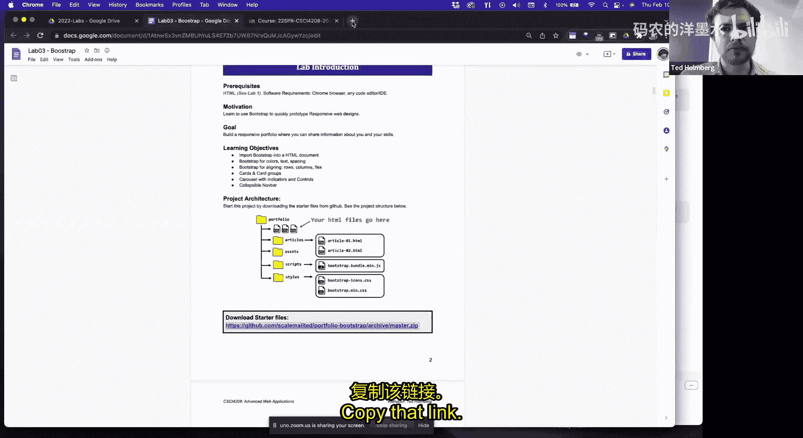

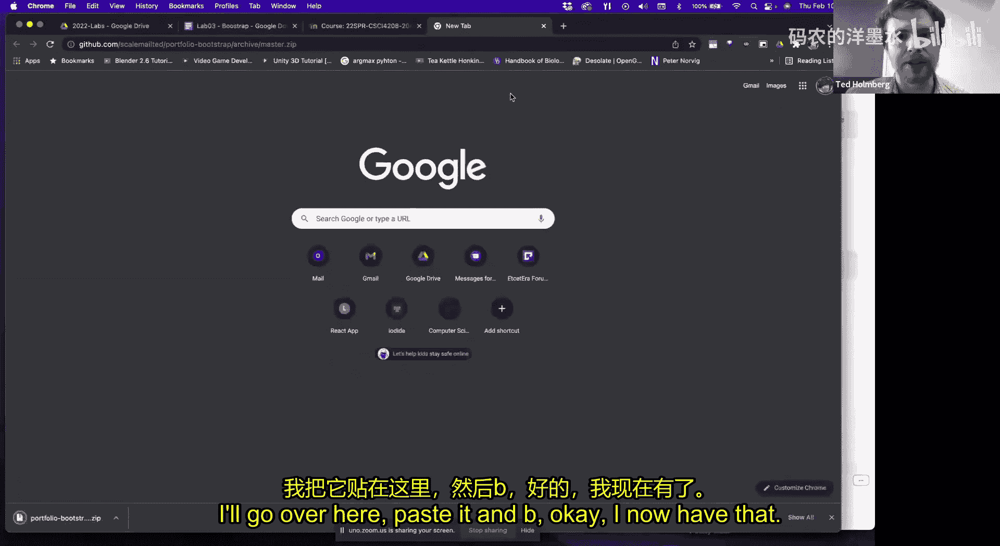

---

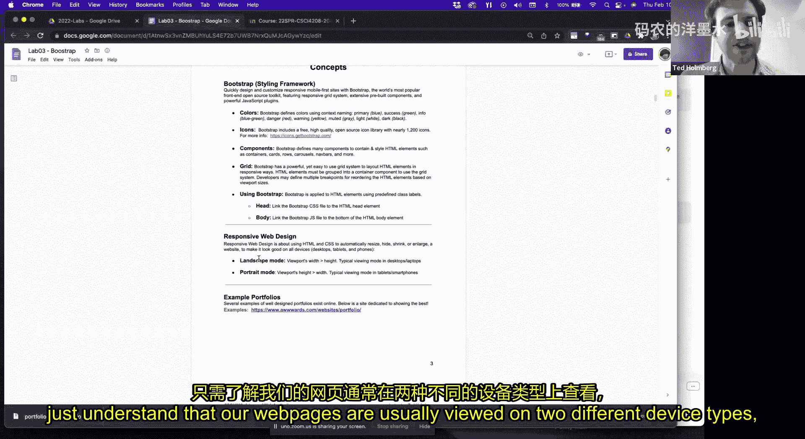

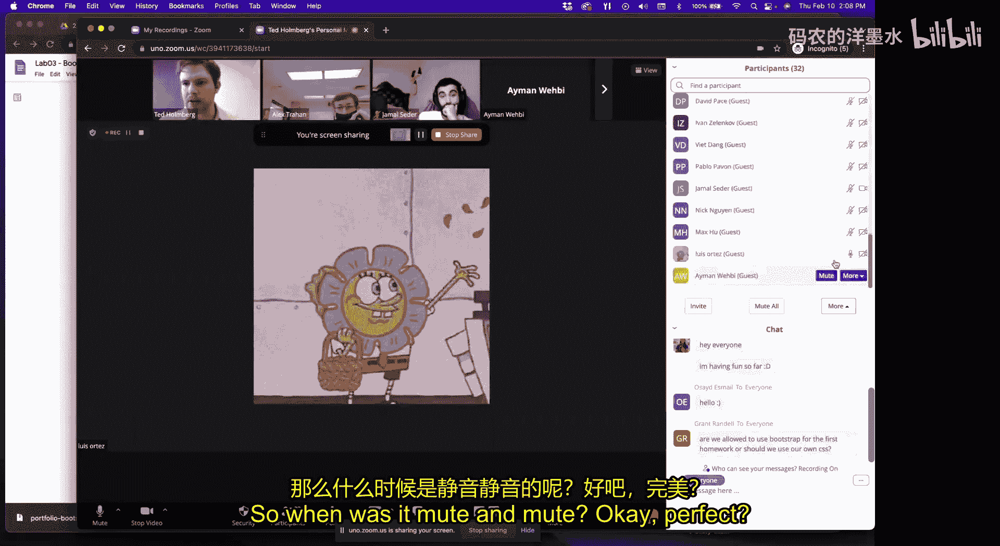

## 核心概念：什么是Bootstrap？ 🧩

上一节我们介绍了本课程的目标，本节中我们来看看Bootstrap到底是什么。

Bootstrap是一个样式框架或库，用于快速设计和定制响应式、移动设备优先的网站。它是目前最流行的前端开源工具包。

它为我们提供了以下核心功能：
*   **响应式网格系统**：帮助网页布局在不同屏幕尺寸下都能良好显示。
*   **预定义样式**：提供大量预定义的CSS类，用于设置颜色、间距、排版等。
*   **组件**：包含按钮、卡片、轮播图、导航栏等可复用的UI组件。
*   **图标库**：提供免费的图标集（Bootstrap Icons）。

**响应式网页设计**指的是网页能够根据用户设备的屏幕尺寸（如横屏的笔记本电脑或竖屏的智能手机）自动调整布局，以提供最佳的浏览体验。

---

## 目标0：设计在线作品集 💡

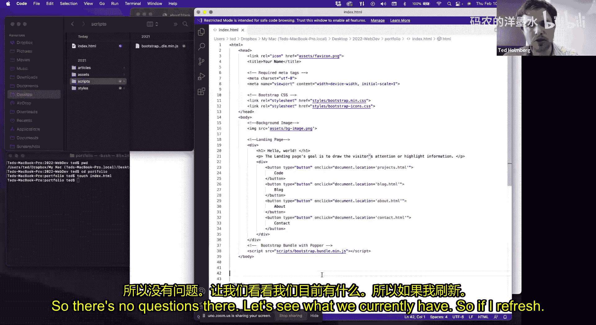

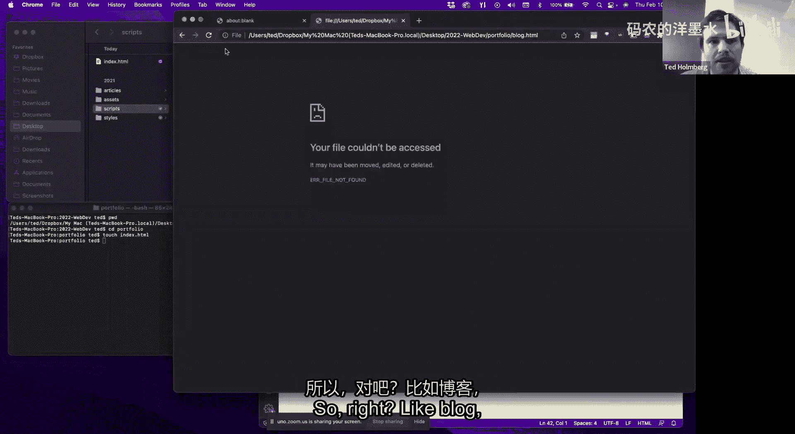

在开始编码之前，我们需要规划作品集的结构。一个作品集网站是你的个人品牌在互联网上的展示窗口，用于向公众分享你的技能、项目和文章。

以下是作品集通常应包含的几个部分及其目标：
*   **首页**：吸引访问者注意力，突出重要信息。
*   **项目页**：展示你的编程项目，包含源代码和演示链接。
*   **博客页**：发布你感兴趣的主题文章，特别是与项目相关的开发日记。
*   **关于页**：展示个人技能、经历等信息。
*   **联系页**：让感兴趣的人能够轻松联系到你。

---

## 目标1：构建首页 🏠

现在，我们开始构建网站的入口——首页。我们将创建一个 `index.html` 文件。

### 步骤1：基础HTML结构与引入Bootstrap

首先，我们设置HTML文档的基本结构，并在 `<head>` 中引入Bootstrap的CSS文件。

```html
<!DOCTYPE html>
<html lang="en">
<head>
    <meta charset="UTF-8">
    <meta name="viewport" content="width=device-width, initial-scale=1.0">
    <title>你的名字</title>
    <!-- 引入Bootstrap CSS -->
    <link rel="stylesheet" href="path/to/bootstrap.min.css">
    <link rel="stylesheet" href="path/to/bootstrap-icons.css">
</head>
<body>
    <!-- 页面内容将放在这里 -->
    <!-- 在body末尾引入Bootstrap JS -->
    <script src="path/to/bootstrap.bundle.min.js"></script>
</body>
</html>
```

### 步骤2：构建页面内容与样式

接下来，我们在 `<body>` 中添加内容，并应用Bootstrap类来实现全屏背景图、文字居中等效果。

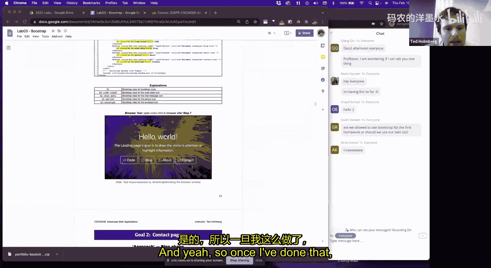

以下是首页内容的结构和关键Bootstrap类：

```html
<body>
    <!-- 全屏背景图片 -->
    
    
    <!-- 主要内容容器 -->
    <div class="container position-relative text-white text-center h-100 d-flex flex-column justify-content-center">
        <h1 class="display-4">Hello World</h1>
        <p>这是一段关于你和你的作品集的介绍文字。</p>
        
        <!-- 按钮组 -->
        <div>
            <button class="btn btn-outline-light" onclick="location.href='projects.html'">
                <i class="bi bi-code-slash"></i> 项目
            </button>
            <button class="btn btn-outline-light" onclick="location.href='blog.html'">
                <i class="bi bi-chat-dots"></i> 博客
            </button>
            <button class="btn btn-outline-light" onclick="location.href='about.html'">
                <i class="bi bi-person"></i> 关于
            </button>
            <button class="btn btn-outline-light" onclick="location.href='contact.html'">
                <i class="bi bi-envelope"></i> 联系
            </button>
        </div>
    </div>
    
    <script src="scripts/bootstrap.bundle.min.js"></script>
</body>
```

**代码解释**：
*   `position-absolute`, `w-100`, `h-100`：使背景图片绝对定位并覆盖整个视口。
*   `container`：创建一个居中的内容容器。
*   `position-relative`, `text-white`, `text-center`：设置文字相对定位、白色和居中。
*   `h-100`, `d-flex`, `flex-column`, `justify-content-center`：使用Flexbox实现内容的垂直居中。
*   `display-4`：应用Bootstrap的大标题字体样式。
*   `btn btn-outline-light`：创建带有白色边框的按钮样式。
*   `bi bi-code-slash`：使用Bootstrap图标。

---

## 目标2：构建联系页面 📧

完成了首页，本节我们来创建一个联系表单页面 `contact.html`。

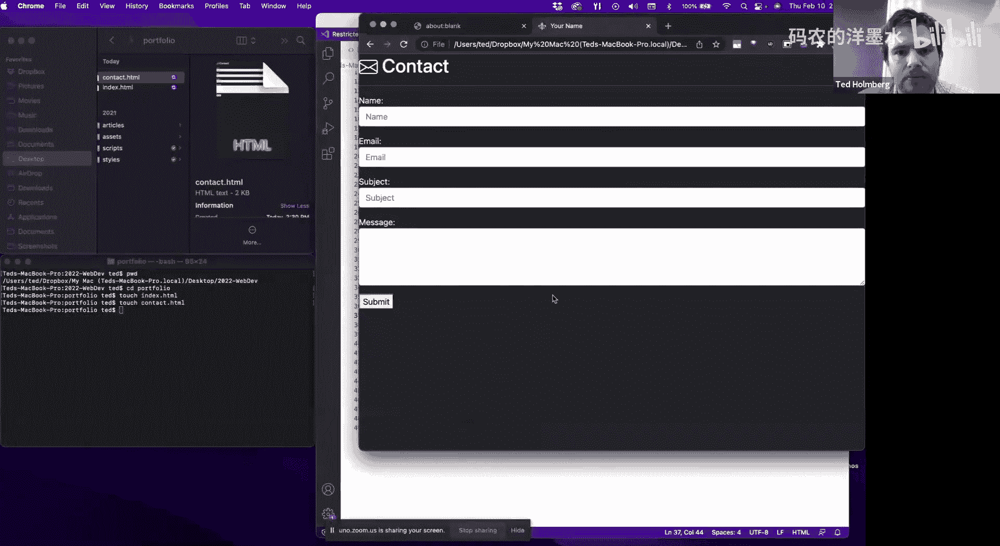

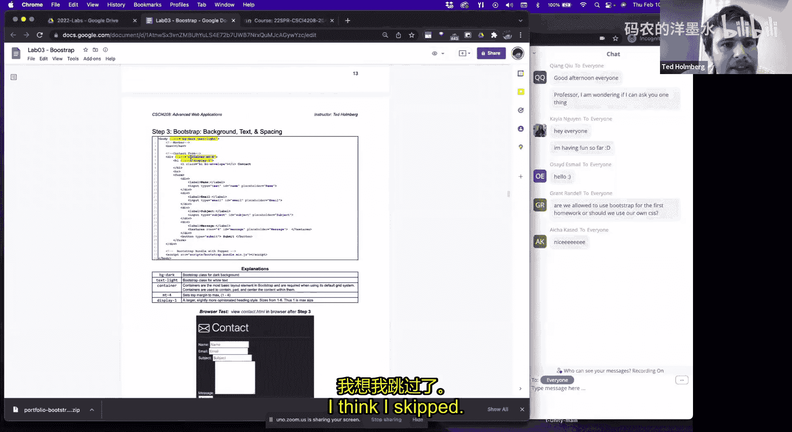

### 步骤1：创建表单结构

我们首先构建一个包含姓名、邮箱、主题和消息字段的基础表单。

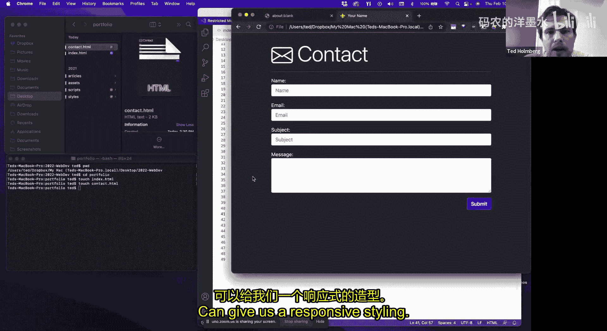

```html
<body class="bg-dark text-light">
    <div class="container mt-4">
        <h1 class="display-1"><i class="bi bi-envelope"></i> 联系</h1>
        <hr>
        
        <form>
            <div class="form-group mb-3">
                <label>姓名</label>
                <input type="text" class="form-control" placeholder="姓名">
            </div>
            <div class="form-group mb-3">
                <label>邮箱</label>
                <input type="email" class="form-control" placeholder="邮箱">
            </div>
            <div class="form-group mb-3">
                <label>主题</label>
                <input type="text" class="form-control" placeholder="主题">
            </div>
            <div class="form-group mb-3">
                <label>消息</label>
                <textarea class="form-control" rows="4" placeholder="消息"></textarea>
            </div>
            <button type="submit" class="btn btn-primary float-end">发送</button>
        </form>
    </div>
</body>
```

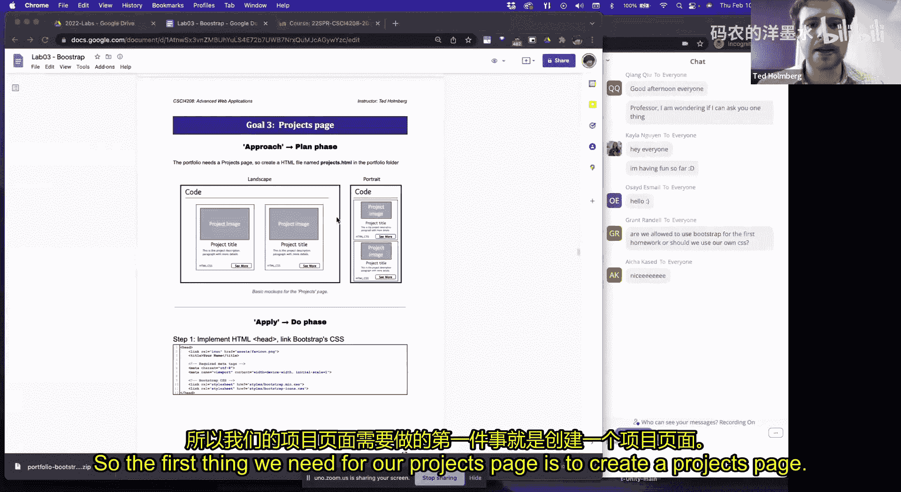

**代码解释**：
*   `bg-dark`, `text-light`：设置深色背景和浅色文字。
*   `container`, `mt-4`：创建容器并添加上边距。
*   `form-group`, `form-control`：Bootstrap提供的表单组和控件样式类。
*   `mb-3`：为每个表单组添加底部边距。
*   `btn btn-primary float-end`：创建蓝色主要按钮并使其右浮动。

---

## 目标3：构建项目页面 💻

现在，我们创建一个展示个人项目的页面 `projects.html`，使用Bootstrap卡片组件。

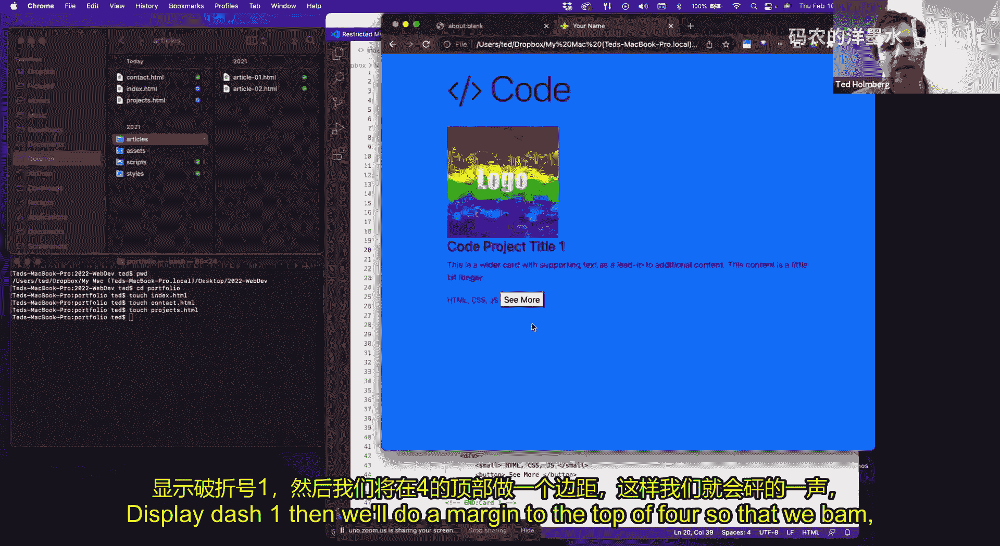

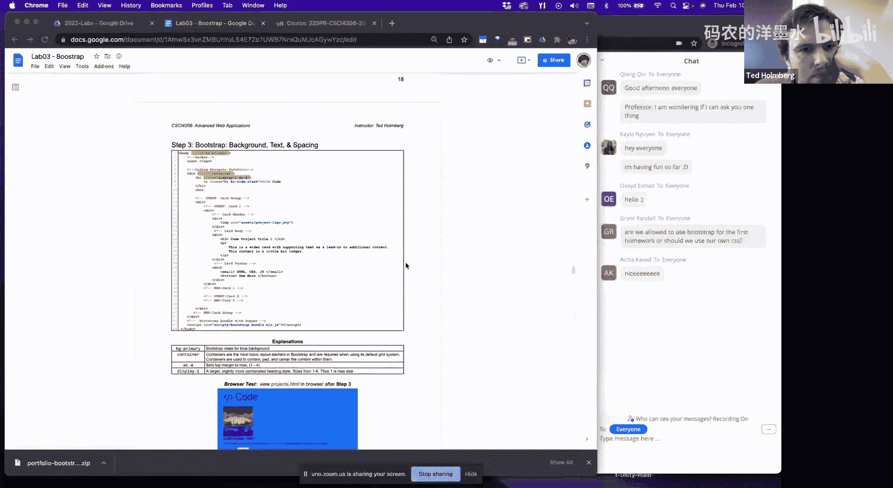

### 步骤1：使用卡片和卡片组

我们将使用 `card` 和 `card-group` 类来展示项目。

```html
<body class="bg-primary text-light">
    <div class="container mt-4">
        <h1 class="display-1"><i class="bi bi-code-slash"></i> 项目</h1>
        <hr>
        
        <!-- 卡片组 -->
        <div class="card-group gap-2">
            <!-- 卡片1 -->
            <div class="card bg-dark text-center">
                <div class="card-header">
                    
                </div>
                <div class="card-body">
                    <h5>项目标题一</h5>
                    <p>关于项目一的简要描述。</p>
                </div>
                <div class="card-footer text-muted">
                    <small>HTML, CSS, JavaScript</small>
                    <button class="btn btn-primary float-end">查看更多</button>
                </div>
            </div>
            
            <!-- 卡片2 -->
            <div class="card bg-dark text-center">
                <!-- 结构同卡片1 -->
            </div>
        </div>
    </div>
</body>
```

**代码解释**：
*   `card-group`：将多个卡片组合在一起，并自动处理响应式布局。
*   `gap-2`：在卡片之间添加间距。
*   `card`, `card-header`, `card-body`, `card-footer`：定义卡片的各个部分。
*   `img-thumbnail`：为图片添加缩略图样式。
*   `text-muted`：使文字显示为灰色。

---

## 目标4：构建博客页面 📝

接下来，我们创建一个博客页面 `blog.html`，并使用Bootstrap的轮播图组件展示博客文章摘要。

### 步骤1：实现轮播图

轮播图包含幻灯片、指示器和控制按钮。

```html
<body class="bg-danger text-light">
    <div class="container mt-2">
        <h1 class="display-1"><i class="bi bi-chat-dots"></i> 博客</h1>
        <hr>
        
        <!-- 轮播图 -->
        <div id="blogCarousel" class="carousel slide" data-bs-ride="carousel" data-bs-interval="1000">
            
            <!-- 轮播指示器 -->
            <ol class="carousel-indicators">
                <li data-bs-target="#blogCarousel" data-bs-slide-to="0" class="active"></li>
                <li data-bs-target="#blogCarousel" data-bs-slide-to="1"></li>
            </ol>
            
            <!-- 轮播内容 -->
            <div class="carousel-inner text-center">
                <!-- 幻灯片1 -->
                <div id="slide1" class="carousel-item active">
                    
                    <div class="carousel-caption">
                        <h5>博客文章一</h5>
                        <p>文章一的简要描述。</p>
                        <button class="btn btn-light" onclick="location.href='articles/article1.html'">阅读更多</button>
                    </div>
                </div>
                <!-- 幻灯片2 -->
                <div id="slide2" class="carousel-item">
                    <!-- 结构同幻灯片1 -->
                </div>
            </div>
            
            <!-- 轮播控制按钮 -->
            <a class="carousel-control-prev" href="#blogCarousel" role="button" data-bs-slide="prev">
                <span class="carousel-control-prev-icon"></span>
            </a>
            <a class="carousel-control-next" href="#blogCarousel" role="button" data-bs-slide="next">
                <span class="carousel-control-next-icon"></span>
            </a>
        </div>
    </div>
</body>
```

**代码解释**：
*   `carousel slide`：声明一个轮播图组件。
*   `data-bs-ride="carousel"`, `data-bs-interval="1000"`：设置自动播放和间隔时间。
*   `carousel-indicators`：轮播图底部的指示点。
*   `carousel-inner`, `carousel-item`：轮播图的内容容器和单个幻灯片。
*   `carousel-caption`：幻灯片上的文字说明区域。
*   `carousel-control-prev`, `carousel-control-next`：左右切换按钮。

---

## 目标5：构建关于页面 👤

关于页面 `about.html` 将展示个人信息和技能，并利用Bootstrap的网格系统实现复杂布局。

### 步骤1：使用网格系统布局

我们使用 `row` 和 `col-*-*` 类来创建响应式列布局。

```html
<body class="bg-success text-light">
    <div class="container mt-4">
        <h1 class="display-1"><i class="bi bi-person"></i> 关于</h1>
        <hr>
        
        <div class="container-fluid text-center">
            <div class="row">
                <!-- 左侧栏 -->
                <div class="col-md-2">
                    
                    <div class="d-flex justify-content-center gap-4 m-4">
                        <a href="#"><i class="bi bi-twitter"></i></a>
                        <a href="#"><i class="bi bi-linkedin"></i></a>
                        <a href="#"><i class="bi bi-github"></i></a>
                    </div>
                    <hr>
                    <div class="d-flex flex-row row-cols-1">
                        <span>教育背景</span>
                        <span>计算机科学</span>
                        <span>某某大学</span>
                    </div>
                </div>
                
                <!-- 右侧主内容区 -->
                <div class="col-md-10 bg-dark">
                    <div class="row">
                        <div class="col-md-8 col-12">
                            <h2>你的名字</h2>
                            <p>你的个人陈述或简介。</p>
                        </div>
                        <div class="col-md-4 d-none d-md-block">
                            
                        </div>
                    </div>
                    <hr>
                    <h3>技能</h3>
                    <div class="d-flex flex-row row-cols-5">
                        
                        
                        <!-- 更多技能图标 -->
                    </div>
                </div>
            </div>
        </div>
    </div>
</body>
```

**代码解释**：
*   `row`：定义一行。
*   `col-md-2`, `col-md-10`：在中等及以上屏幕尺寸下，左侧栏占2列，右侧内容占10列。
*   `d-flex`, `justify-content-center`：使用Flexbox进行水平居中布局。
*   `d-none d-md-block`：在中等及以上屏幕显示，小屏幕隐藏。
*   `row-cols-5`：在Flexbox布局中，每行放置5个元素。

---

## 目标6：添加导航栏 🔗

最后，我们为所有页面添加一个统一的、可折叠的导航栏。

### 步骤1：实现导航栏

导航栏包含品牌标识、导航链接和一个移动端可折叠的菜单。

```html
<nav class="navbar navbar-light bg-light container-fluid">
    <!-- 品牌标识 -->
    <a class="navbar-brand" href="index.html">
        <i class="bi bi-house"></i> 你的品牌
    </a>
    
    <!-- 移动端折叠按钮 -->
    <button class="navbar-toggler" type="button" data-bs-toggle="collapse" data-bs-target="#navbarOptions">
        <span class="navbar-toggler-icon"></span>
    </button>
    
    <!-- 导航链接 -->
    <div class="collapse navbar-collapse" id="navbarOptions">
        <ul class="navbar-nav">
            <li class="nav-item">
                <a class="nav-link" href="projects.html"><i class="bi bi-code-slash"></i> 项目</a>
            </li>
            <li class="nav-item">
                <a class="nav-link" href="blog.html"><i class="bi bi-chat-dots"></i> 博客</a>
            </li>
            <li class="nav-item">
                <a class="nav-link" href="about.html"><i class="bi bi-person"></i> 关于</a>
            </li>
            <li class="nav-item">
                <a class="nav-link" href="contact.html"><i class="bi bi-envelope"></i> 联系</a>
            </li>
        </ul>
    </div>
</nav>
```

**代码解释**：
*   `navbar`：声明一个导航栏组件。
*   `navbar-toggler`, `data-bs-toggle="collapse"`：创建可折叠菜单的按钮。
*   `collapse navbar-collapse`：定义可折叠的菜单内容区域。
*   `navbar-nav`, `nav-item`, `nav-link`：定义导航链接列表的样式。

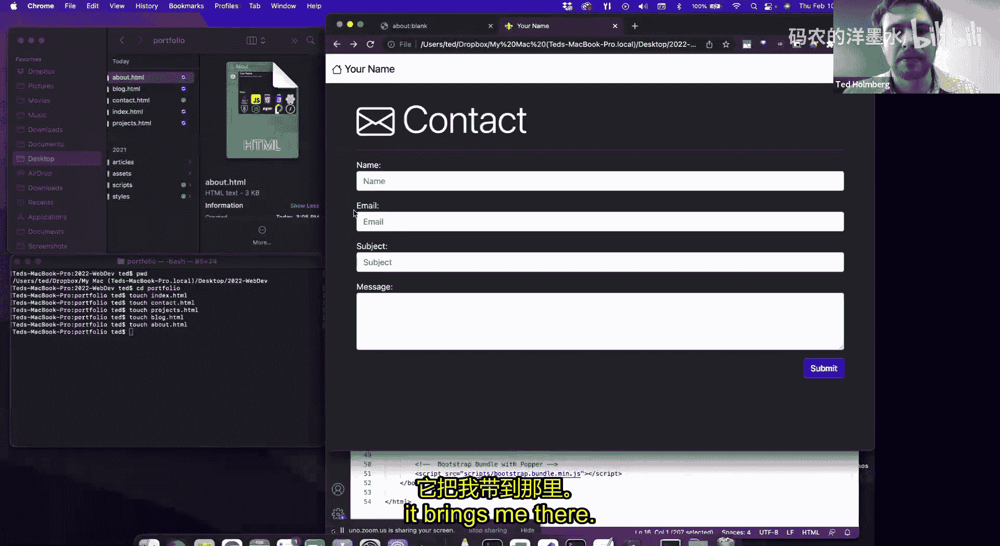

将这段导航栏代码复制到每个页面的 `<body>` 标签开头，即可实现网站的统一导航。

---

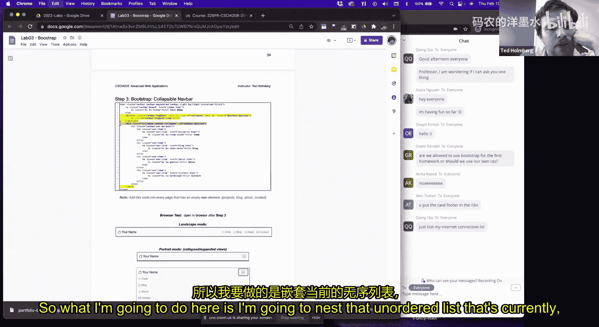

## 总结 🎉

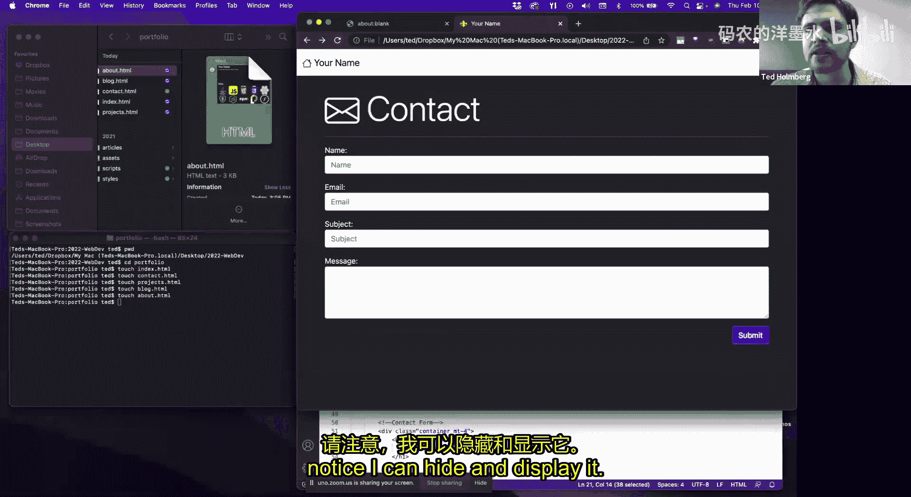

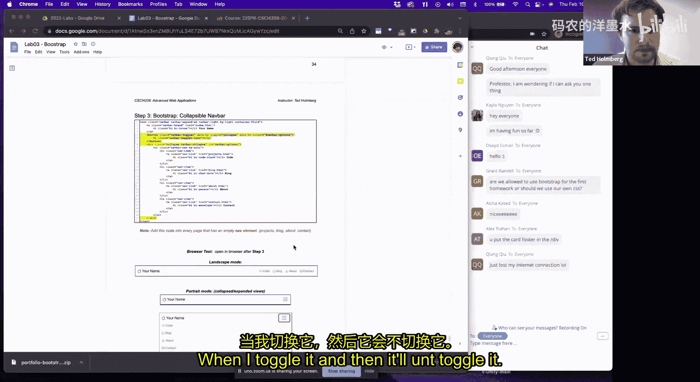

本节课中，我们一起学习了如何使用Bootstrap框架高效地构建一个完整的、响应式的个人作品集网站。

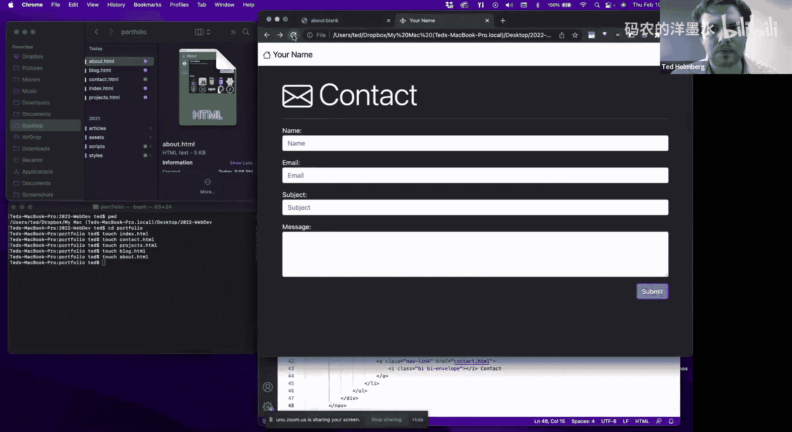

我们完成了以下内容：
1.  **理解了Bootstrap的核心概念**：它是一个提供预定义样式和组件的框架，用于快速实现响应式设计。
2.  **规划了作品集结构**：定义了首页、项目页、博客页、关于页和联系页的功能。
3.  **搭建了所有核心页面**：
    *   使用Flexbox和工具类创建了视觉突出的首页。
    *   利用表单组件构建了功能完整的联系页面。
    *   通过卡片和卡片组优雅地展示了项目。
    *   实现了带有轮播图的动态博客页面。
    *   运用网格系统设计了布局复杂的关于页面。
4.  **实现了网站导航**：添加了可折叠的响应式导航栏，将所有页面连接起来。

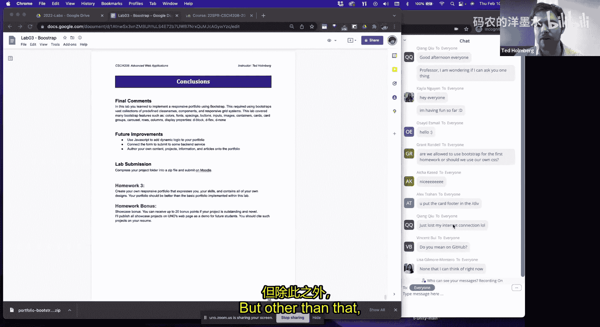

通过本教程，你掌握了仅通过HTML类名应用Bootstrap样式和组件的能力，无需编写复杂的自定义CSS，就能创建出专业、美观且适配各种设备的网页。现在，你可以运用这些知识去设计和构建属于你自己的个性化作品集网站了。