# 007：JavaScript面向对象编程 part3


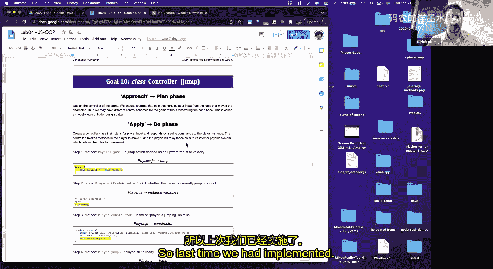

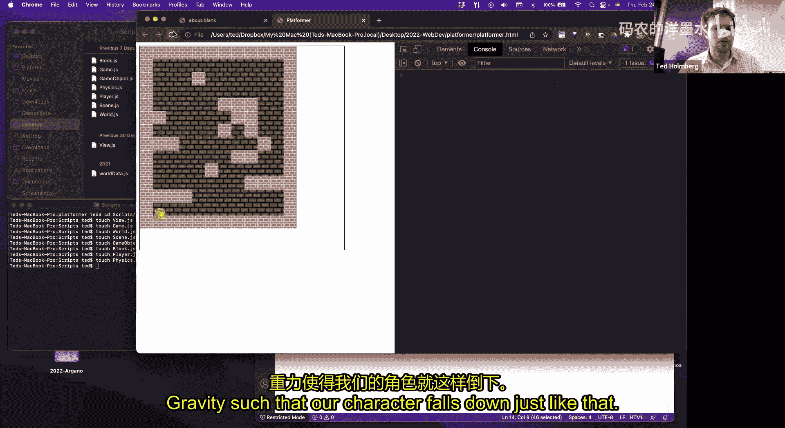

在本节课中，我们将继续构建平台游戏，重点是为游戏实现控制器系统，使角色能够跳跃和移动，并完成物理引擎中的碰撞检测与摩擦力系统。

上一节我们实现了重力系统，使角色能够下落。本节中，我们来看看如何通过控制器响应用户输入，并实现完整的碰撞物理效果。

## 🎮 目标10：实现控制器类

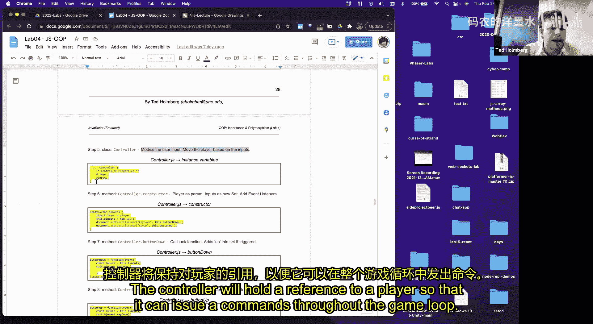

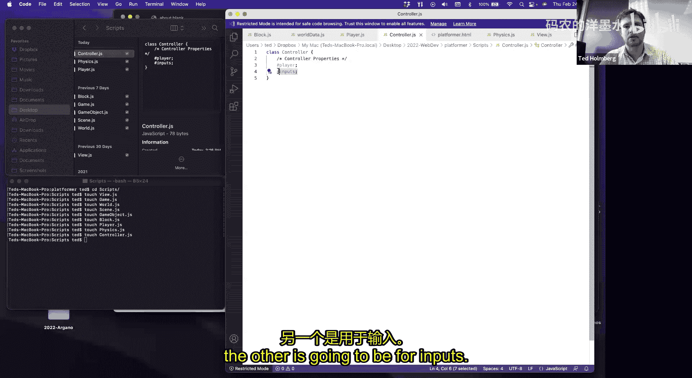

我们的目标是设计一个控制器，将处理用户输入的逻辑与移动角色的逻辑分离开来。这遵循了常见的**模型-视图-控制器（MVC）**设计模式。这样，如果我们想改变游戏的控制方案，就无需重构整个代码库，只需修改控制器类即可。

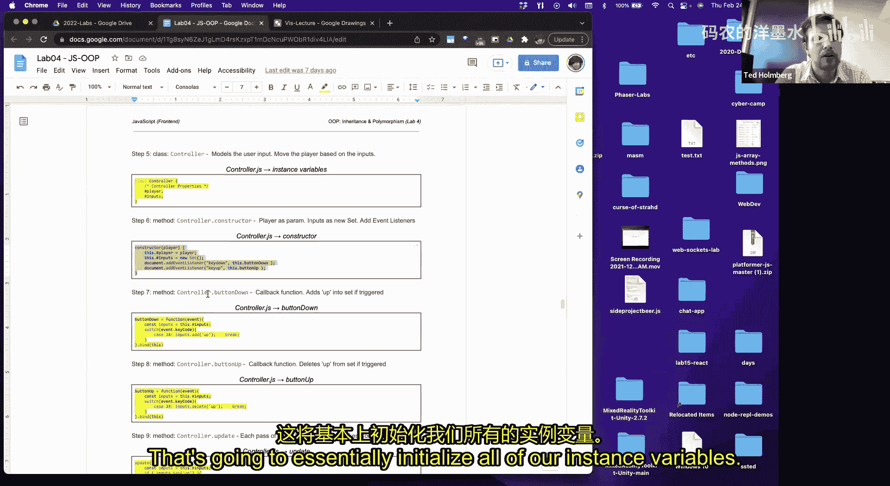

以下是实现控制器类的步骤：

1.  **在物理类中定义跳跃动作**：跳跃被定义为施加一个向上的速度推力。
    ```javascript
    // 在 Physics 类中添加
    jump() {
        this.velocityY = -this.speed * 2;
    }
    ```

2.  **在玩家类中管理跳跃状态**：添加一个布尔值来追踪玩家是否正在跳跃，防止无限跳跃。
    ```javascript
    // 在 Player 类中添加
    #isJumping = false;

    jump() {
        if (!this.#isJumping) {
            this.physics.jump();
            this.#isJumping = true;
        }
    }

    setIsJumping(value) {
        this.#isJumping = value;
    }
    ```

3.  **创建控制器类**：新建 `Controller.js` 文件。控制器将持有玩家实例的引用，并监听键盘事件。
    ```javascript
    class Controller {
        #player;
        #inputs = new Set();

        constructor(player) {
            this.#player = player;
            // 监听按键按下和抬起事件
            document.addEventListener('keydown', this.#buttonPress.bind(this));
            document.addEventListener('keyup', this.#buttonUnpress.bind(this));
        }
    }
    ```

4.  **实现按键处理方法**：将按下的键（如“上箭头”）添加到输入集合中，抬起时则移除。
    ```javascript
    #buttonPress(event) {
        switch(event.keyCode) {
            case 38: // 上箭头
                this.#inputs.add('up');
                break;
            // 后续可添加 case 37（左）, 39（右）
        }
    }

    #buttonUnpress(event) {
        switch(event.keyCode) {
            case 38:
                this.#inputs.delete('up');
                break;
        }
    }
    ```
    **注意**：这里使用了 `.bind(this)`。因为当回调函数被事件监听器调用时，其内部的 `this` 关键字默认指向触发事件的DOM元素（如 `document`）。使用 `.bind(this)` 可以确保在回调函数中，`this` 仍然指向当前的 `Controller` 实例，从而能正确访问 `#inputs` 等私有属性。

5.  **实现控制器更新循环**：在游戏每一帧更新时，检查输入集合并命令玩家行动。
    ```javascript
    update() {
        const inputs = this.#inputs;
        if (inputs.has('up')) {
            this.#player.jump();
        }
        // 后续检查 'left', 'right'
    }
    ```

6.  **集成控制器到游戏循环**：在 `Game` 类中实例化控制器，并在每帧更新中调用控制器的 `update` 方法。

完成以上步骤后，玩家按下上箭头键时，角色应该可以跳跃一次。

## ↔️ 目标11：实现水平移动

现在，我们让控制器也能控制角色左右移动。水平移动通过改变角色的X轴速度来实现。

以下是实现水平移动的步骤：

1.  **在物理类中添加左右移动方法**：这些方法会限制角色的最大水平速度。
    ```javascript
    // 在 Physics 类中添加
    moveLeft() {
        if (this.velocityX > -this.speed) {
            this.velocityX--;
        }
    }

    moveRight() {
        if (this.velocityX < this.speed) {
            this.velocityX++;
        }
    }
    ```

2.  **在玩家类中创建适配器方法**：通过玩家类的方法来调用其内部物理引擎的方法，这是一种**适配器模式**的应用。
    ```javascript
    // 在 Player 类中添加
    moveLeft() {
        this.physics.moveLeft();
    }

    moveRight() {
        this.physics.moveRight();
    }
    ```

3.  **扩展控制器的输入处理**：在控制器的 `#buttonPress` 和 `#buttonUnpress` 方法中，添加对左箭头（键码37）和右箭头（键码39）的处理，分别向输入集合添加或删除 `‘left’` 和 `‘right’`。

4.  **扩展控制器的更新逻辑**：在控制器的 `update` 方法中，检查并执行水平移动命令。
    ```javascript
    update() {
        const inputs = this.#inputs;
        if (inputs.has('left')) this.#player.moveLeft();
        if (inputs.has('right')) this.#player.moveRight();
        if (inputs.has('up')) this.#player.jump();
    }
    ```

现在，角色应该可以通过方向键进行跳跃和左右移动了。

## 🧱 目标12：实现地板碰撞检测

没有碰撞，角色会直接穿过地板。我们需要检测玩家与砖块（地板）的碰撞。

碰撞检测需要解决两个问题：
1.  两个游戏对象是否接触？
2.  如果接触，是哪个边接触的（上、下、左、右）？

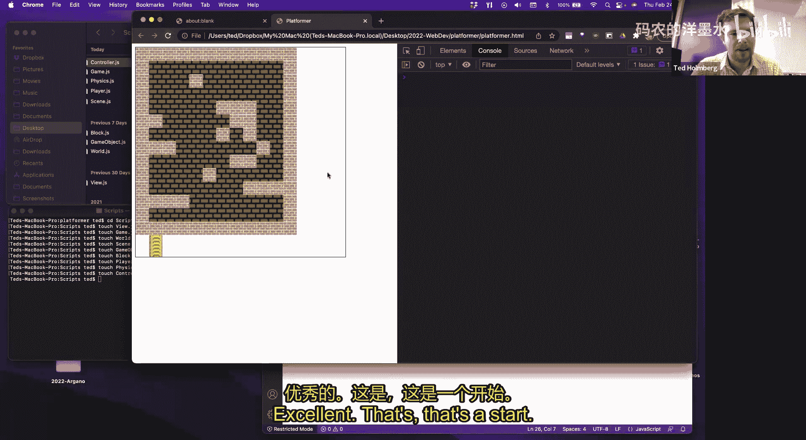

以下是实现地板碰撞的步骤：

1.  **在游戏对象类中添加获取尺寸的方法**：碰撞检测需要知道对象的宽高。
    ```javascript
    // 在 GameObject 类中添加
    getWidth() { return this.width; }
    getHeight() { return this.height; }
    ```

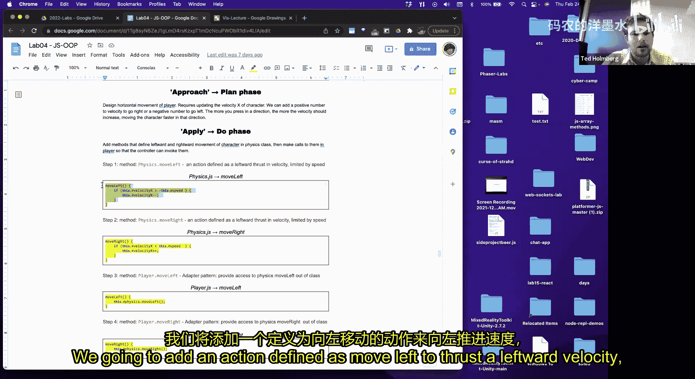

2.  **在砖块类中实现碰撞检测方法**：
    ```javascript
    // 在 Block 类中添加
    isTouchingX(gameObject, ratio) {
        const overlap = this.getWidth() * ratio;
        return Math.abs(this.x - gameObject.x) < overlap;
    }

    isTouchingY(gameObject, ratio) {
        const overlap = this.getHeight() * ratio;
        return Math.abs(this.y - gameObject.y) < overlap;
    }

    isTouching(gameObject) {
        return this.isTouchingX(gameObject, 0.5) && this.isTouchingY(gameObject, 1.0);
    }
    ```
    方法 `isTouchingX` 和 `isTouchingY` 检查在某个轴向上，两个对象的中心点距离是否小于“重叠阈值”（宽度或高度乘以一个比例）。`isTouching` 方法则要求X方向有50%重叠，Y方向有100%重叠，这构成了一个粗略的矩形碰撞框。

3.  **在物理类中实现碰撞检查**：在每帧更新中，检查玩家与所有砖块的碰撞。
    ```javascript
    checkCollisions(blocks, player) {
        for (const block of blocks) {
            if (block.isTouching(player)) {
                this.#checkCollisionFloor(block, player);
                // 后续会添加 ceiling, left, right 检查
            }
        }
    }
    ```

4.  **实现具体的地板碰撞逻辑**：
    ```javascript
    #checkCollisionFloor(block, player) {
        // 玩家在砖块上方且正在下落
        if (player.y < block.y && this.velocityY > 0) {
            // 确保玩家和砖块在垂直方向对齐（防止“墙跳”）
            if (block.isTouchingX(player, 0.5)) {
                this.velocityY = 0; // 停止下落
                player.setIsJumping(false); // 重置跳跃状态
            }
        }
    }
    ```

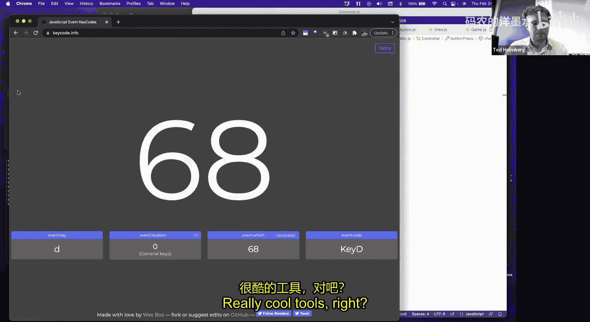

5.  **重构更新链以传递砖块数据**：需要将砖块列表从 `Scene` 传递到 `Player` 的 `update` 方法，再传递到 `Physics` 的 `update` 和 `checkCollisions` 方法中。

现在，角色应该能够落在砖块地板上，而不会掉下去。

## 🧱 目标13：实现天花板碰撞检测

当玩家从下方撞到砖块时，应该被弹回。

以下是实现天花板碰撞的步骤：

1.  **在物理类中添加天花板碰撞检查**：
    ```javascript
    #checkCollisionCeiling(block, player) {
        // 玩家在砖块下方且正在上升
        if (player.y > block.y && this.velocityY < 0) {
            this.velocityY *= -0.5; // 反转Y速度并减半，产生反弹效果
        }
    }
    ```

2.  **在总碰撞检查中调用它**：在 `checkCollisions` 方法的循环内，在检测到接触后调用 `#checkCollisionCeiling`。

现在，当玩家跳起来撞到头顶的砖块时，会被向下弹回。

## 🧱 目标14：实现左右墙壁碰撞检测

我们需要防止玩家穿过左右两侧的墙壁。

以下是实现墙壁碰撞的步骤：

1.  **在物理类中添加左右墙壁碰撞检查**：
    ```javascript
    #checkCollisionRight(block, player) {
        // 玩家在砖块左侧且正在向右移动，并且两者Y轴对齐
        if (player.x < block.x && this.velocityX > 0 && block.isTouchingY(player, 0.5)) {
            this.velocityX *= -1; // 立即反转水平速度
        }
    }

    #checkCollisionLeft(block, player) {
        // 玩家在砖块右侧且正在向左移动，并且两者Y轴对齐
        if (player.x > block.x && this.velocityX < 0 && block.isTouchingY(player, 0.5)) {
            this.velocityX *= -1;
        }
    }
    ```
    检查Y轴50%的重叠是为了确保碰撞发生在同一行，避免角色与上下方砖块的边角接触时被误判为墙壁碰撞。

2.  **在总碰撞检查中调用它们**：在 `checkCollisions` 方法中，依次调用地板、天花板、右侧、左侧的碰撞检查方法。

现在，角色将无法穿过墙壁，撞上时会被弹开。

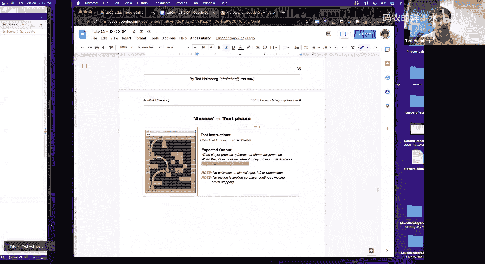

## 🌀 目标15：实现摩擦力

目前，角色一旦开始移动，如果没有撞墙就会一直滑动。我们需要摩擦力使其逐渐停止。

以下是实现摩擦力的步骤：

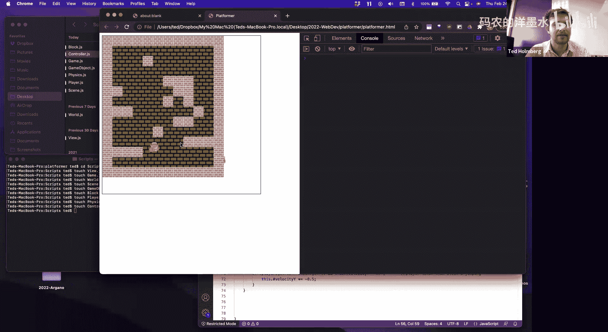

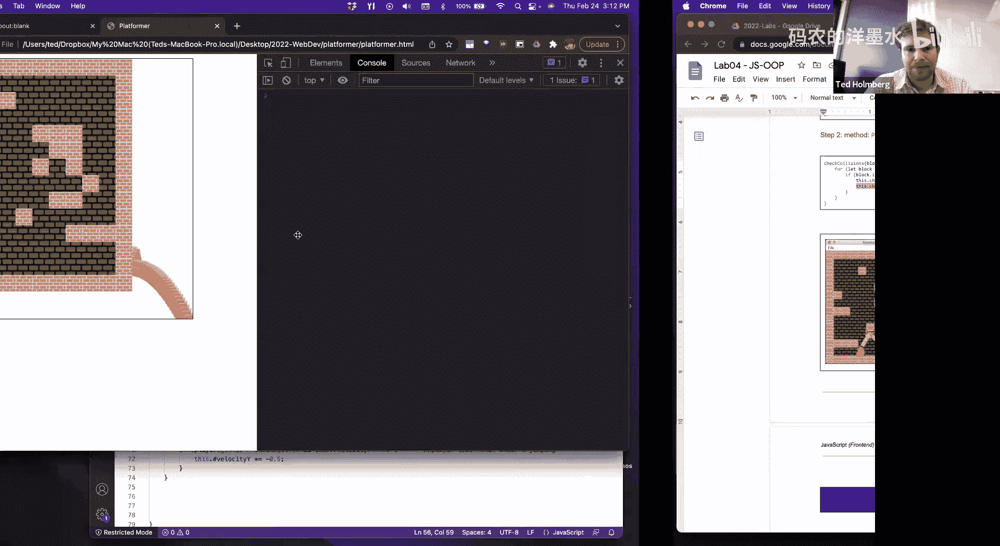

1.  **在物理类中添加摩擦力属性**：
    ```javascript
    #friction = 0.8; // 小于1的值，用于逐渐减速
    ```

2.  **创建应用摩擦力的方法**：
    ```javascript
    #applyFriction() {
        this.velocityX *= this.#friction;
    }
    ```
    每一帧都将当前水平速度乘以一个小于1的系数，速度会指数级衰减，最终接近零。

3.  **在物理更新循环中应用摩擦力**：在 `Physics` 类的 `update` 方法中，依次应用重力、摩擦力和碰撞检测。
    ```javascript
    update(blocks, player) {
        this.#applyGravity();
        this.#applyFriction();
        this.#checkCollisions(blocks, player);
        // ... 更新位置
    }
    ```

现在，当玩家松开方向键时，角色会平滑地减速直至停止。

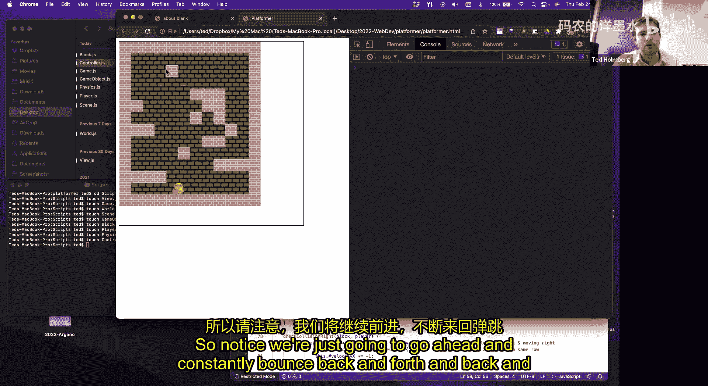

---

本节课中我们一起学习了如何构建一个完整的游戏控制器和物理引擎。我们实现了：
*   **控制器类**：使用MVC模式分离输入处理，通过事件监听和`bind`方法管理用户输入。
*   **跳跃与移动**：在物理层定义动作，通过玩家类暴露接口，由控制器调用。
*   **2D碰撞检测**：利用矩形重叠原理，实现了地板、天花板、左右墙壁的碰撞检测与响应。
*   **摩擦力**：通过每帧乘以衰减系数，模拟了角色停止的物理效果。

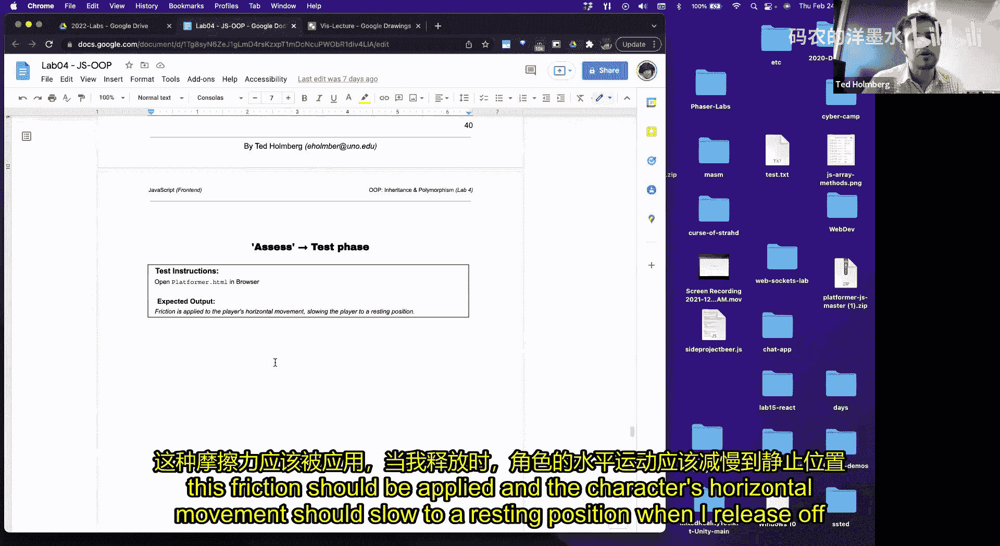

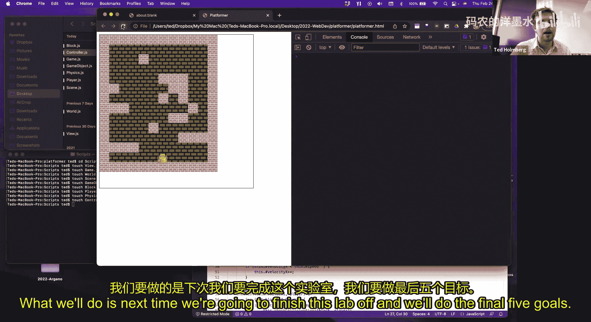

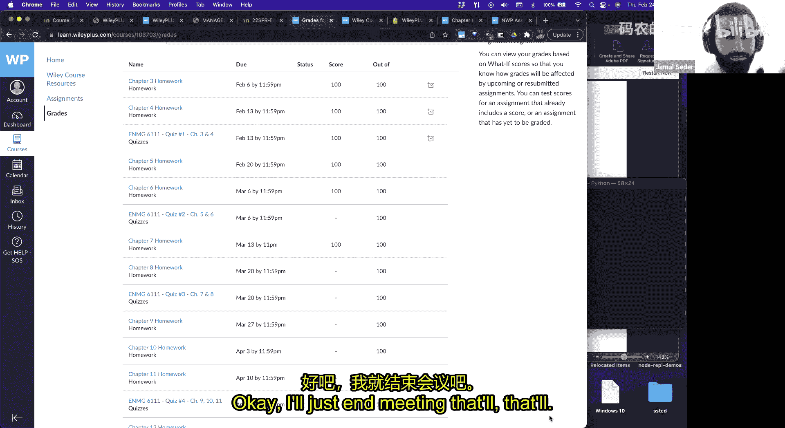

现在，我们的平台游戏已经具备了基本的可玩性。下一讲我们将为游戏添加更多元素，如危险障碍和出口，最终完成这个项目。