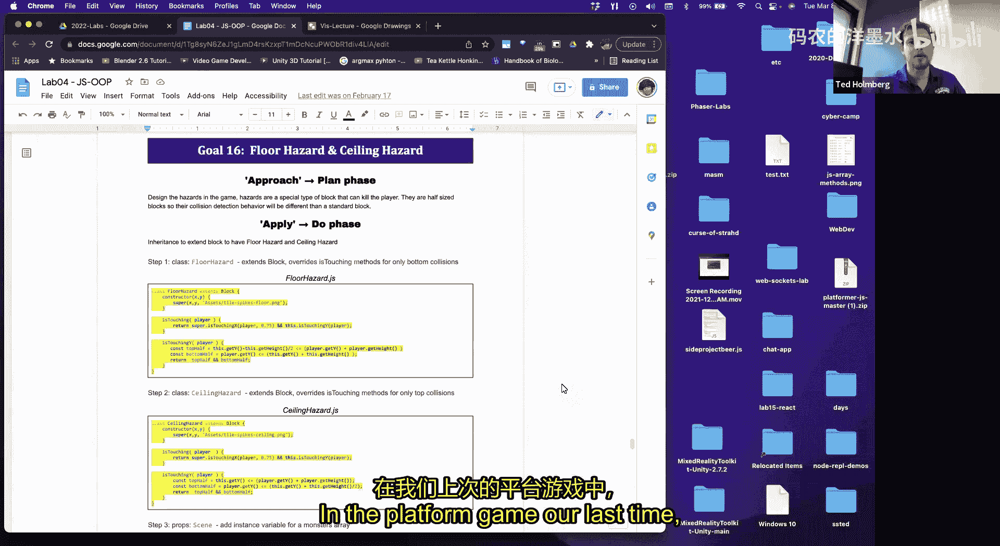
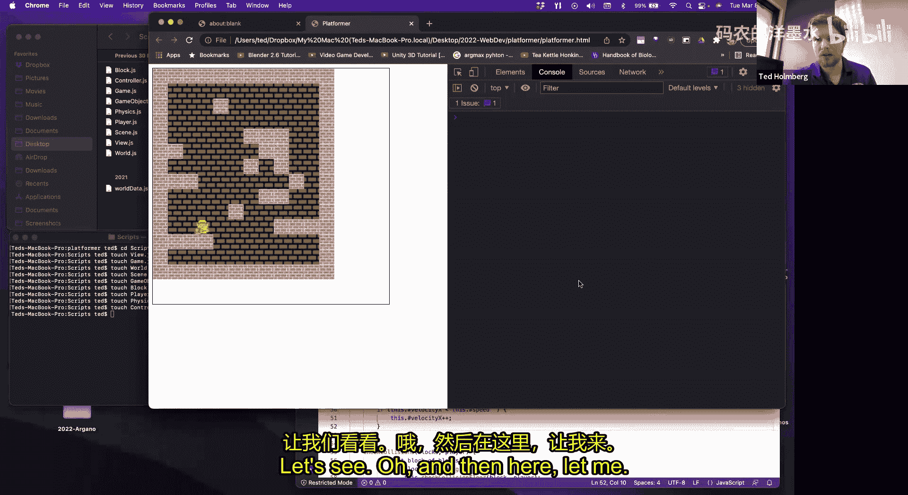
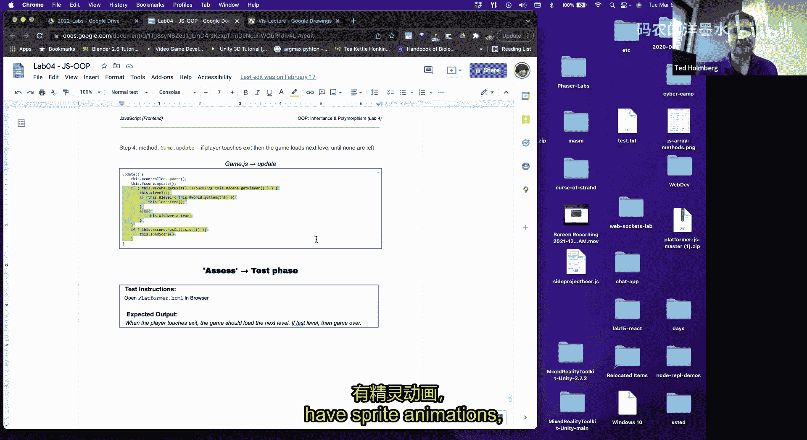
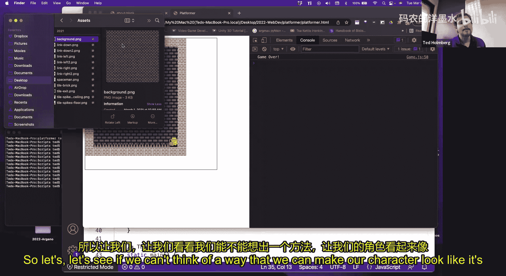
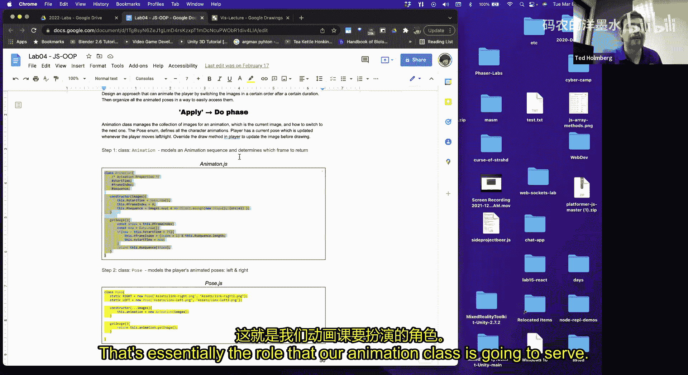
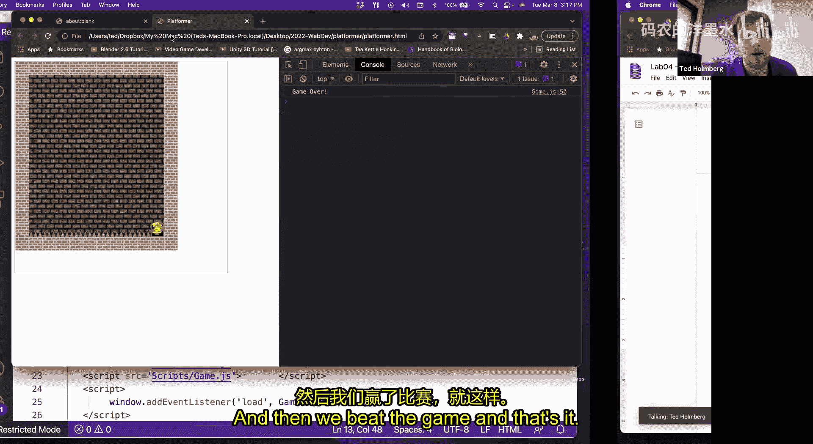
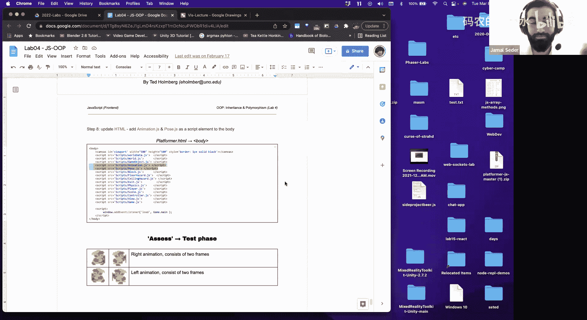

# 008：JavaScript面向对象编程 part4




在本节课中，我们将继续完善我们的平台跳跃游戏。上一节我们实现了物理效果和摩擦力，使得角色可以移动并与方块互动。本节我们将为游戏添加失败条件（如尖刺陷阱）、胜利条件（如出口）以及角色动画，让游戏变得更加完整和有趣。



---

## 🎯 目标16：实现危险方块

上一节我们完成了目标15（摩擦力）。本节的目标是添加能够杀死玩家的危险方块，为游戏引入失败条件。

危险方块有两种：地面尖刺和天花板尖刺。它们是一种特殊的方块，其碰撞检测行为与普通方块不同。当玩家以特定方式（例如踩到尖刺顶部）触碰到它们时，游戏将结束。

为了实现这一点，我们将使用面向对象设计中的继承概念，创建两个新的类：`FloorHazard` 和 `CeilingHazard`，它们都继承自 `Block` 类。

### 第一步：设计 `FloorHazard` 类

`FloorHazard` 类将继承 `Block` 类，并重写其 `isTouchingY` 方法，以实现仅对方块上半部分进行碰撞检测的逻辑。

以下是 `FloorHazard` 类的实现代码：

```javascript
class FloorHazard extends Block {
    constructor(x, y) {
        super(x, y, 'assets/tiles-spikes-4.png');
    }

    isTouchingY(player) {
        const topHalf = this.y + this.height / 2;
        const bottomHalf = this.y + this.height;
        return player.y + player.height >= topHalf && player.y <= bottomHalf;
    }

    isTouching(player) {
        return super.isTouchingX(player) && this.isTouchingY(player);
    }
}
```

**代码解释**：
*   `constructor` 中调用了父类 `Block` 的构造函数，并传入了尖刺的图片路径。
*   `isTouchingY` 方法计算了方块的上半部分（从中间到底部），并检查玩家的底部是否进入了这个区域。
*   `isTouching` 方法结合了父类的 `isTouchingX` 和新的 `isTouchingY` 逻辑。

### 第二步：设计 `CeilingHazard` 类

`CeilingHazard` 类的逻辑与 `FloorHazard` 类似，但碰撞检测区域是方块的下半部分（从顶部到中间）。

以下是 `CeilingHazard` 类的实现代码：

```javascript
class CeilingHazard extends Block {
    constructor(x, y) {
        super(x, y, 'assets/tiles-spikes-ceiling.png');
    }

    isTouchingY(player) {
        const topHalf = this.y;
        const bottomHalf = this.y + this.height / 2;
        return player.y + player.height >= topHalf && player.y <= bottomHalf;
    }

    isTouching(player) {
        return super.isTouchingX(player) && this.isTouchingY(player);
    }
}
```

### 第三步：在场景中集成危险方块

现在我们需要在 `Scene` 类中管理这些危险方块。

1.  **添加实例变量**：在 `Scene` 类中添加一个 `monsters` 数组来存储所有危险方块。
    ```javascript
    this.monsters = [];
    ```

2.  **解析地图数据**：在 `setTile` 方法中，根据地图字符（例如 `'A'` 代表地面尖刺，`'V'` 代表天花板尖刺）创建相应的危险方块实例，并加入 `monsters` 数组。
    ```javascript
    case 'A':
        this.monsters.push(new FloorHazard(x, y));
        break;
    case 'V':
        this.monsters.push(new CeilingHazard(x, y));
        break;
    ```

3.  **渲染危险方块**：在 `Scene` 的 `draw` 方法中，遍历 `monsters` 数组并调用每个危险方块的 `draw` 方法。
    ```javascript
    this.monsters.forEach(monster => monster.draw(ctx));
    ```

4.  **添加脚本依赖**：在 HTML 文件中，在 `block.js` 的 `<script>` 标签之后，添加 `floor-hazard.js` 和 `ceiling-hazard.js` 的引用。

完成以上步骤后，游戏场景中应该能正确显示尖刺方块，但目前它们还不会对玩家造成伤害。

---

## ⚠️ 目标17：实现失败条件

现在我们已经有了危险方块，接下来需要定义游戏失败的条件：当玩家触碰到任何危险方块时，游戏结束。

### 第一步：在场景中添加碰撞检测方法

我们在 `Scene` 类中添加一个 `hasCollisions` 方法，用于检查玩家是否碰到了任何危险方块。

```javascript
hasCollisions() {
    return this.monsters.some(monster => monster.isTouching(this.player));
}
```

**代码解释**：
*   `some` 是 JavaScript 数组的高阶方法。它会遍历 `monsters` 数组中的每个元素（即每个危险方块）。
*   对于每个危险方块，调用其 `isTouching` 方法（我们之前重写过的），并传入玩家对象。
*   如果 **任何一个** 危险方块的 `isTouching` 返回 `true`，则 `some` 方法返回 `true`，表示发生了碰撞。

### 第二步：在游戏主循环中触发失败条件

在 `Game` 类的 `update` 方法中，我们调用场景的 `hasCollisions` 方法。如果返回 `true`，则设置游戏结束标志 `isOver`。

```javascript
update() {
    // ... 其他更新逻辑（如更新场景、控制器）...
    if (this.scene.hasCollisions()) {
        this.isOver = true; // 游戏结束
    }
    // ... 后续逻辑 ...
}
```

现在，当玩家触碰到尖刺时，游戏会停止循环，并显示游戏结束信息。

### 优化：实现立即重生

为了让游戏体验更现代（类似《超级食肉男孩》），我们可以在玩家死亡时立即重新开始当前关卡，而不是直接结束游戏。这可以通过在碰撞发生时重新加载当前场景来实现。

修改 `Game` 类的 `update` 方法：

```javascript
update() {
    // ... 其他更新逻辑 ...
    if (this.scene.hasCollisions()) {
        this.loadScene(this.level); // 重新加载当前关卡
    }
    // ... 后续逻辑 ...
}
```

这样，玩家每次死亡都会立即在当前关卡重生，游戏只有在达成胜利条件时才会真正结束。

---

## 🏆 目标18：实现胜利条件与关卡切换

一个完整的游戏需要有胜利的目标。我们将添加“出口”方块，当玩家到达出口时，可以进入下一关。如果已经是最后一关，则玩家获胜。

### 第一步：创建 `Exit` 类

`Exit` 类同样继承自 `Block` 类。它的碰撞检测容忍度可以设置得宽松一些，让玩家更容易触发。

```javascript
class Exit extends Block {
    constructor(x, y) {
        super(x, y, 'assets/tile-exit.png');
    }

    isTouching(player) {
        // 设置较大的碰撞容忍度，例如需要25%的重叠
        const xOverlap = this.isTouchingX(player, 0.25);
        const yOverlap = this.isTouchingY(player, 0.25);
        return xOverlap && yOverlap;
    }
}
```

### 第二步：在场景中集成出口

1.  在 `Scene` 类中添加一个 `exit` 实例变量（因为每个关卡只有一个出口）。
2.  在 `setTile` 方法中，根据特定字符（例如 `'!'`）创建 `Exit` 实例并赋值给 `this.exit`。
3.  在 `Scene` 的 `draw` 方法中，绘制出口方块（顺序建议在玩家之前）。
4.  在 `Scene` 中添加一个 `getExit` 方法，以便其他类能访问到出口对象。
5.  在 HTML 中添加 `exit.js` 的脚本引用。



### 第三步：实现关卡切换逻辑



1.  **添加关卡索引**：在 `Game` 类中，我们需要一个 `level` 变量来跟踪当前关卡。
2.  **添加场景加载方法**：在 `Game` 类中创建一个 `loadScene` 方法，它根据给定的关卡索引从 `World` 类获取地图数据，然后创建新的 `Scene` 和 `Controller` 实例。
    ```javascript
    loadScene(levelIndex) {
        const map = this.world.getLevel(levelIndex);
        this.scene = new Scene(map);
        this.controller = new Controller(this.scene.getPlayer());
    }
    ```
3.  **在 `World` 类中添加辅助方法**：添加一个 `getLength` 方法，返回总关卡数。
4.  **实现胜利检测**：在 `Game` 的 `update` 方法中，检查玩家是否触碰到出口。
    *   如果碰到出口，则增加 `level` 索引。
    *   如果 `level` 小于总关卡数，调用 `loadScene` 加载下一关。
    *   如果 `level` 等于或大于总关卡数，说明已通过所有关卡，设置 `isOver = true` 并显示胜利信息。

```javascript
update() {
    // ... 其他逻辑（如失败检测）...

    if (this.scene.getExit().isTouching(this.scene.getPlayer())) {
        this.level++;
        if (this.level < this.world.getLength()) {
            this.loadScene(this.level); // 加载下一关
        } else {
            this.isOver = true; // 游戏胜利
            console.log('You win the game!');
        }
    }
}
```



现在，玩家可以通过到达出口来闯关，并在完成所有关卡后获得胜利。

---

## 🎬 目标19：实现角色动画

最后，为了让游戏看起来更精致，我们将为玩家角色添加行走动画。这涉及到在玩家移动时，在不同图像帧之间切换。

### 第一步：创建 `Animation` 类

这个类的职责是管理一个动画序列，并根据时间决定当前应该显示哪一帧。

```javascript
class Animation {
    constructor(...images) {
        this.startTime = Date.now();
        this.frameIndex = 0;
        this.sequence = images.map(src => {
            const img = new Image();
            Object.assign(img, { src });
            return img;
        });
    }

    getImage() {
        const index = this.frameIndex;
        const now = Date.now();
        if (now - this.startTime > 75) { // 每75毫秒切换一帧
            this.frameIndex = (index + 1) % this.sequence.length;
            this.startTime = now;
        }
        return this.sequence[index];
    }
}
```

**代码解释**：
*   `constructor` 接收一系列图片路径，并为每个路径创建 `Image` 对象。
*   `getImage` 方法检查自动画开始后经过的时间。如果超过75毫秒，就切换到下一帧（通过增加 `frameIndex`）。`%` 运算符确保帧索引在序列长度内循环。

### 第二步：创建 `Pose` 类（姿势枚举）

这个类使用 `Animation` 类来定义玩家具体的动画姿势（如向左走、向右走）。我们使用静态属性来模拟枚举。

```javascript
class Pose {
    static RIGHT = new Pose('assets/link-right.png', 'assets/link-right-2.png');
    static LEFT = new Pose('assets/link-left.png', 'assets/link-left-2.png');

    constructor(...images) {
        this.animation = new Animation(...images);
    }

    getImage() {
        return this.animation.getImage();
    }
}
```

### 第三步：修改 `GameObject` 和 `Player` 类

1.  **在 `GameObject` 中添加 `setImage` 方法**：允许动态更改游戏对象显示的图片。
    ```javascript
    setImage(img) {
        this.image = img;
    }
    ```
2.  **在 `Player` 类中集成动画**：
    *   添加 `currentPose` 实例变量。
    *   在构造函数中，初始化 `currentPose` 为 `Pose.RIGHT`，并调用 `setImage` 设置初始图片。
    *   在 `moveLeft` 和 `moveRight` 方法中，切换 `currentPose` 为 `Pose.LEFT` 或 `Pose.RIGHT`。
    *   重写 `draw` 方法：在每次绘制前，从 `currentPose` 获取当前帧的图片，设置给游戏对象，然后调用父类的 `draw` 方法。

```javascript
class Player extends GameObject {
    constructor(x, y) {
        super(x, y, 0, 0, 'assets/link.png'); // 初始图片会被覆盖
        this.currentPose = Pose.RIGHT;
        this.setImage(this.currentPose.getImage());
        // ... 其他初始化 ...
    }

    moveLeft() {
        // ... 移动逻辑 ...
        this.currentPose = Pose.LEFT;
    }

    moveRight() {
        // ... 移动逻辑 ...
        this.currentPose = Pose.RIGHT;
    }

    draw(ctx) {
        this.setImage(this.currentPose.getImage());
        super.draw(ctx);
    }
}
```

3.  **添加脚本依赖**：在 HTML 中，确保 `animation.js` 和 `pose.js` 在 `player.js` 之前被引入。

现在，当玩家左右移动时，角色会播放相应的行走动画，大大增强了游戏的视觉效果和趣味性。

---

## 📝 总结

本节课中我们一起学习了如何为一个基本的平台跳跃游戏添加核心功能，使其成为一个完整的、可玩的游戏。我们通过面向对象编程的方式，逐步实现了：



1.  **危险方块**：通过继承创建了 `FloorHazard` 和 `CeilingHazard` 类，实现了特殊的碰撞逻辑。
2.  **失败条件**：在游戏主循环中检测玩家与危险方块的碰撞，并触发游戏结束或重生逻辑。
3.  **胜利条件与关卡系统**：创建了 `Exit` 类作为出口，并实现了关卡加载和切换的逻辑，让玩家可以通关并取得最终胜利。
4.  **角色动画**：设计了 `Animation` 和 `Pose` 类来管理动画序列，并在 `Player` 类中集成，使角色在移动时具有流畅的动画效果。



通过这些步骤，我们不仅完成了一个功能丰富的游戏原型，还深入实践了JavaScript的面向对象特性，包括类、继承、方法重写、静态属性以及组合等概念。你现在已经具备了使用纯JavaScript或现代游戏引擎（如Phaser）来开发更复杂2D游戏的基础知识。