# 011：HTTP POST 请求教程 🚀


在本节课中，我们将学习如何使用HTTP POST请求，特别是通过HTML表单和异步JavaScript，将数据从客户端发送到后端服务器。我们将通过构建一个功能完整的联系表单来实践，该表单会将用户提交的数据存储到Google Forms中。

---

## 概述 📋

本教程将引导您完成一个联系表单的实现，该表单能够将用户提交的数据发送到Google Forms后端进行存储。我们将从最简单的纯HTML实现开始，逐步过渡到使用JavaScript控制表单属性，最后实现完全使用异步JavaScript发送HTTP请求，而不依赖HTML表单的内置行为。

---

## 项目架构 🗂️

我们将创建一个名为 `contact_form` 的主目录，其中包含以下文件：
*   `index.html`: 主页面文件。
*   `scripts/`: 存放JavaScript脚本的子目录。
    *   `form_model.js`: 处理数据逻辑和与后端通信的模型。
    *   `form_controller.js`: 处理DOM交互和事件监听的控制器。

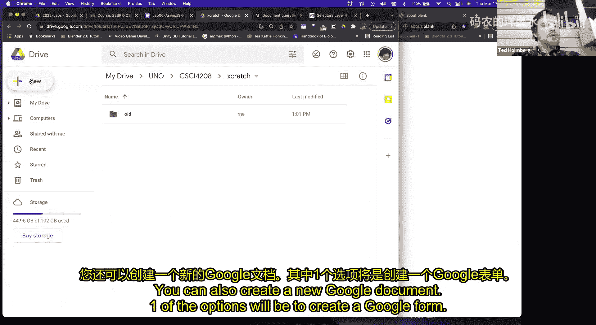

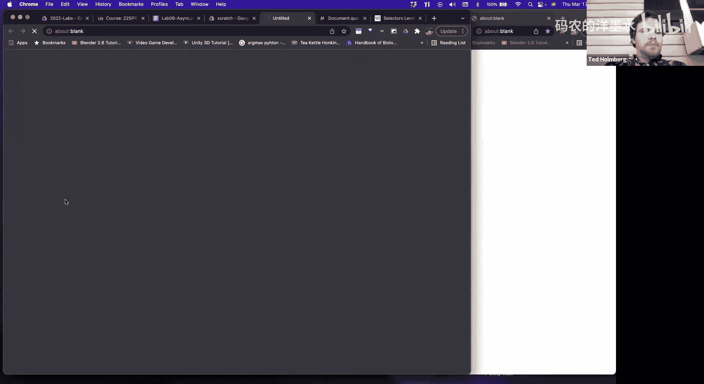

---

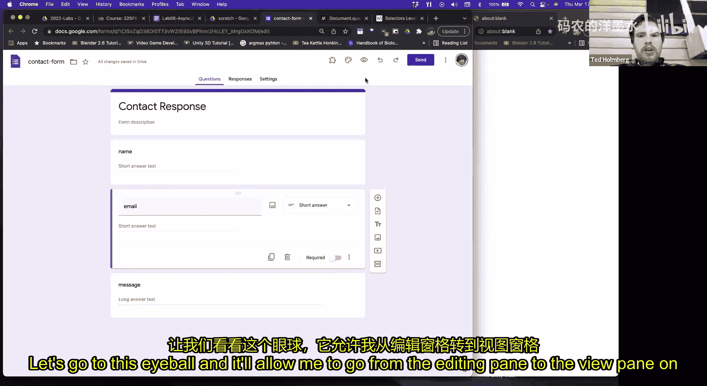

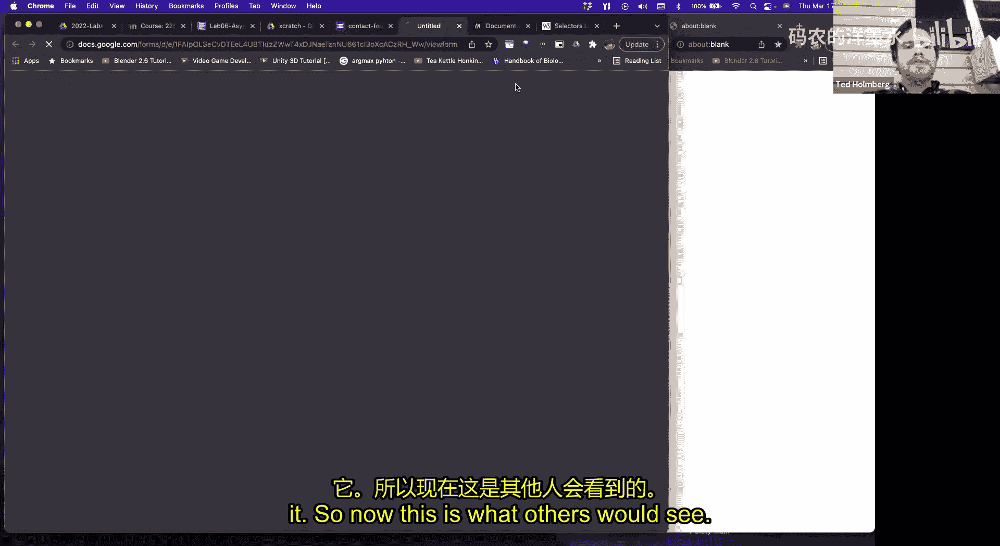

## 目标1：创建Google Form作为后端数据库 🗄️

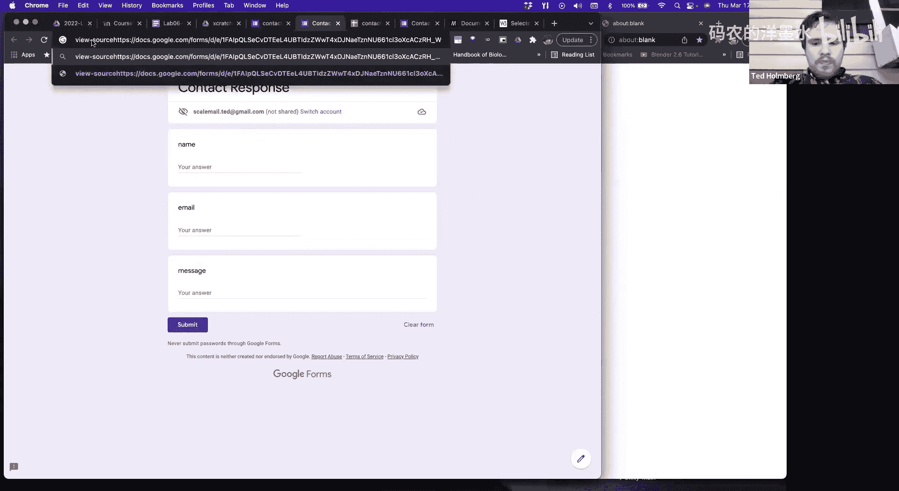

在开始构建前端之前，我们需要一个后端服务来接收和存储数据。本节中，我们将使用Google Forms创建一个简单的“数据库”。

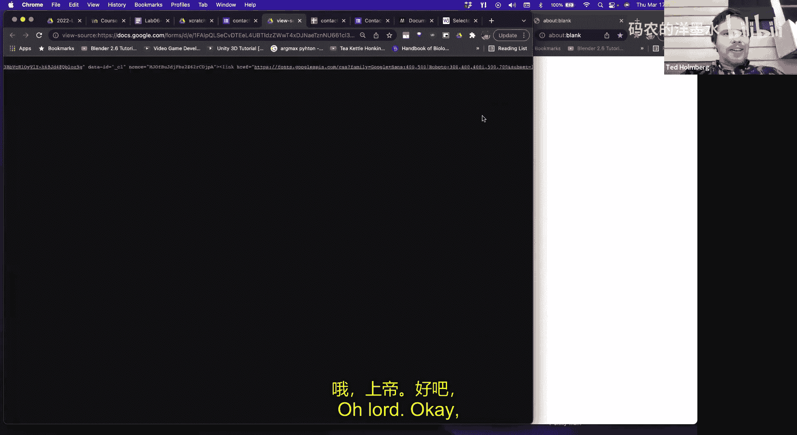

**步骤：**
1.  访问 [forms.google.com](https://forms.google.com)。
2.  创建一个新的空白表单，命名为“Contact Response”。
3.  在表单中添加三个问题字段，类型为“简短答案”：
    *   `name`
    *   `email`
    *   `message`
4.  保存表单。这个表单的提交地址将作为我们后端的**端点（Endpoint）**。

**核心概念：**
*   **端点（Endpoint）**：服务器监听特定HTTP请求的URL地址。对于我们的Google Form，其端点格式为：`https://docs.google.com/forms/d/e/{FORM_ID}/formResponse`。
*   **数据持久化**：将用户提交的表单数据（如姓名、邮箱、信息）存储到Google Sheets中，实现数据的长期保存。

为了让我们自己的网页能与这个Google Form通信，我们需要获取两个关键信息：
1.  **表单ID（Form ID）**：包含在表单的URL中。
2.  **字段名称（Entry Names）**：Google为表单中每个问题字段自动生成的唯一名称（格式如 `entry.123456789`）。

我们可以通过查看表单页面的源代码，并使用一些JavaScript代码来提取这些信息。以下是提取字段名称的示例代码逻辑：

```javascript
// 此代码在Google Form的预览页面控制台中运行，用于获取字段的`name`属性
const entryList = [...document.querySelectorAll('input[name^="entry"]')];
entryList.forEach((element, index) => {
    console.log(`字段 ${index + 1} 的名称（name）为: ${element.name}`);
});
```

运行类似代码后，控制台会输出类似 `entry.1784365446` 这样的名称。记下它们，分别对应 `name`、`email` 和 `message` 字段。

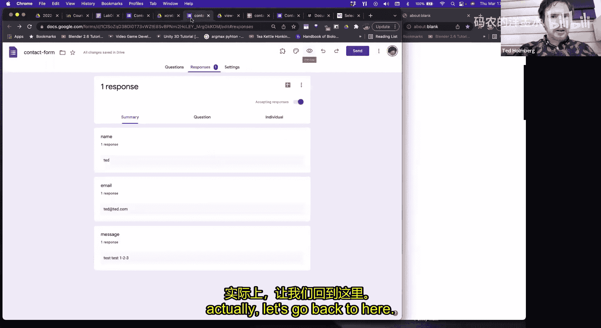

---

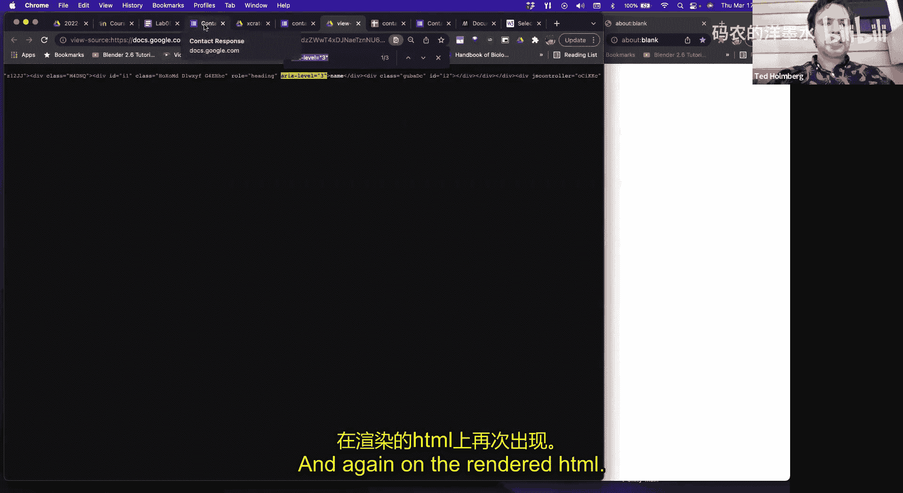

## 目标2：使用纯HTML表单提交数据 📝

上一节我们准备好了后端。本节中，我们来看看如何构建一个最基础的前端——使用纯HTML表单来发送数据。

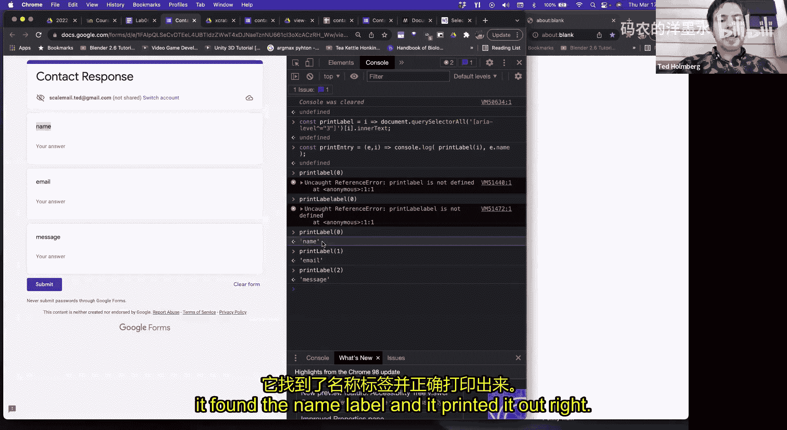

**步骤：**
1.  在 `index.html` 中创建一个 `<form>` 元素。
2.  设置表单的 `action` 属性为Google Form的端点URL（包含你的表单ID）。
3.  设置表单的 `method` 属性为 `"post"`。
4.  在表单内，为每个数据字段（name, email, message）创建对应的 `<input>` 或 `<textarea>` 元素。
5.  **关键**：为每个输入元素设置 `name` 属性，其值必须与我们在目标1中获取的Google Form字段名称**完全一致**。
6.  添加一个提交按钮。

**示例代码（index.html 片段）:**

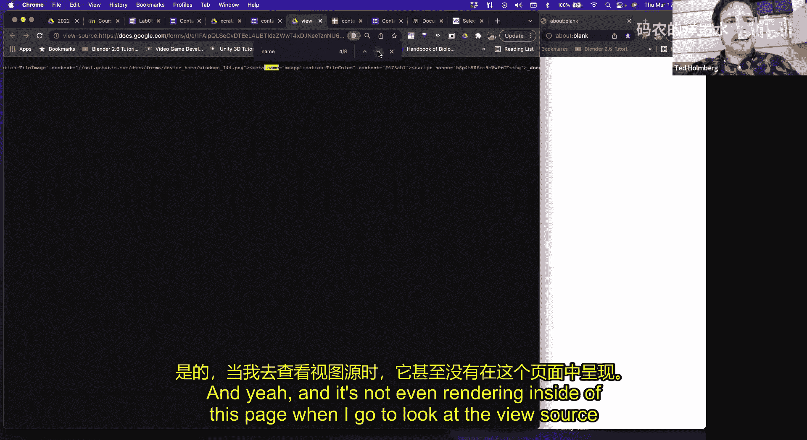

```html
<form id="contact-form"
      action="https://docs.google.com/forms/d/e/YOUR_FORM_ID_HERE/formResponse"
      method="POST">
    <div>
        <input type="text" placeholder="姓名" name="entry.1784365446" id="name">
    </div>
    <div>
        <input type="text" placeholder="邮箱" name="entry.1529700185" id="email">
    </div>
    <div>
        <textarea placeholder="留言" rows="4" name="entry.31461068812" id="message"></textarea>
    </div>
    <button type="submit">提交</button>
</form>
```

**工作原理：**
当用户点击提交按钮时，浏览器会自动触发表单的 `submit` 事件。它会收集所有具有 `name` 属性的表单元素的值，按照 `method` 指定的方式（POST），将数据编码后发送到 `action` 指定的URL。成功后，浏览器会跳转到Google Form的确认页面。

**优缺点：**
*   **优点**：实现简单，无需JavaScript。
*   **缺点**：页面会发生重定向，用户体验中断；所有逻辑硬编码在HTML中，难以灵活控制。

---

## 目标3：使用JavaScript设置表单属性 ⚙️

纯HTML表单缺乏灵活性。本节中，我们将使用JavaScript来动态设置表单的属性，为后续完全用JS控制请求做准备。

**思路：**
我们仍然使用HTML表单来触发提交和发送请求，但表单的 `action`、`method` 以及输入框的 `name` 属性都将通过JavaScript来设置。

**步骤：**
1.  **修改HTML**：为表单和输入元素添加 `id`，方便JS获取。移除之前在HTML中硬编码的 `action`、`method` 和 `name` 属性。
2.  **创建模型（Model）**：在 `form_model.js` 中，定义从目标1获取的常量数据（表单ID、各字段的Entry Name）。
3.  **创建控制器（Controller）**：在 `form_controller.js` 中：
    *   编写 `initControllers` 函数，获取表单DOM元素，并为其添加 `submit` 事件监听器。
    *   在事件处理函数中，使用 `form_model.js` 中的常量，动态地为每个输入元素设置 `name` 属性，并为表单设置 `action` 和 `method`。

**示例代码（form_controller.js 片段）:**

```javascript
import { FORM_ID, ENTRY_NAME_1, ENTRY_NAME_2, ENTRY_NAME_3, getFormEndpoint } from './form_model.js';

function initControllers() {
    const contactForm = document.getElementById('contact-form');
    contactForm.addEventListener('submit', function(event) {
        // 动态设置输入字段的name属性
        document.getElementById('name').name = ENTRY_NAME_1;
        document.getElementById('email').name = ENTRY_NAME_2;
        document.getElementById('message').name = ENTRY_NAME_3;

        // 动态设置表单的action（端点URL）
        contactForm.action = getFormEndpoint(FORM_ID);
        // 设置表单的method
        contactForm.method = 'POST';
        // 注意：事件处理函数执行完毕后，表单会继续其默认提交行为
    });
}
// 页面加载后初始化控制器
document.addEventListener('DOMContentLoaded', initControllers);
```

**过渡：** 现在，表单的配置信息已经与HTML结构分离，管理起来更加方便。但我们仍然依赖表单的默认提交行为。接下来，我们将尝试自己构造要发送的数据。

---

## 目标4：使用JavaScript构造查询字符串 🔗

上一节我们使用JS配置了表单。本节中，我们将更进一步，自己来编码要发送的数据，将其构造成URL的查询字符串（Query String）。

**思路：**
我们将拦截表单的 `submit` 事件，阻止其默认行为。然后，手动收集表单数据，将其编码为 `key=value&key2=value2` 格式的查询字符串，并拼接到请求的URL末尾。最后，再以编程方式提交表单。

**步骤：**
1.  **更新控制器**：在 `submit` 事件处理函数中，调用 `event.preventDefault()` 阻止表单默认提交。
2.  **收集数据**：从DOM中获取用户输入的值，并与对应的Entry Name组成键值对对象。
3.  **编码数据**：在模型（`form_model.js`）中创建一个函数（如 `buildQueryString`），使用 `URLSearchParams` API或手动拼接，将数据对象转换为查询字符串。
4.  **构造最终URL**：将查询字符串附加到表单端点URL之后，形成完整的请求地址（如 `端点URL?entry.123=用户输入&...`）。
5.  **提交表单**：将构造好的URL设置为表单的 `action`，然后调用表单的 `submit()` 方法（注意不是触发`submit`事件）。

**核心概念与代码：**
*   **查询字符串（Query String）**：出现在URL中 `?` 之后的部分，用于向服务器传递参数。格式为 `key1=value1&key2=value2`。
*   **`URLSearchParams`**：JavaScript内置API，用于处理查询字符串。

```javascript
// form_model.js 中构建查询字符串的函数示例
function buildQueryString(formDataObject) {
    const params = new URLSearchParams();
    for (const key in formDataObject) {
        params.append(key, formDataObject[key]);
    }
    return params.toString(); // 输出如 "entry.123=John&entry.456=john@example.com"
}

// form_controller.js 中收集数据并构造URL
contactForm.addEventListener('submit', function(event) {
    event.preventDefault(); // 阻止默认提交

    const formData = {
        [ENTRY_NAME_1]: document.getElementById('name').value,
        [ENTRY_NAME_2]: document.getElementById('email').value,
        [ENTRY_NAME_3]: document.getElementById('message').value,
    };

    const queryString = buildQueryString(formData);
    const fullUrl = `${getFormEndpoint(FORM_ID)}?${queryString}`;

    contactForm.action = fullUrl;
    contactForm.method = 'POST';
    contactForm.submit(); // 编程方式提交
});
```

**注意：** 此方法会将所有提交的数据暴露在URL中，不适合传输敏感信息（如密码）。

---

## 目标5：使用异步JavaScript（Fetch API）发送请求 🌐

之前的方法都离不开HTML `<form>` 元素。本节中，我们将最终摆脱对表单的依赖，使用纯粹的JavaScript——Fetch API来发送HTTP POST请求。

**思路：**
1.  将HTML中的 `<form>` 标签替换为普通的 `<div>`，因为我们不再需要表单的默认行为。
2.  为提交按钮添加 `click` 事件监听器。
3.  在事件处理函数中，使用Fetch API构造并发送请求。
4.  使用 `async/await` 语法优雅地处理异步操作。

**步骤：**
1.  **修改HTML**：用 `<div>` 包裹表单字段，移除 `<form>` 标签。
2.  **更新控制器**：将事件监听从表单的 `submit` 改为按钮的 `click`。
3.  **重构模型**：创建新的 `sendRequest` 函数，使用Fetch API。
    *   使用 `async` 关键字声明异步函数。
    *   在函数内，使用 `new Request()` 构造函数创建一个请求对象，指定URL、方法（POST）和模式（mode: ‘no-cors’ 或 ‘cors’，根据后端配置）。
    *   使用 `fetch(request)` 发送请求，并用 `await` 等待响应。
    *   处理返回的响应对象。
4.  **处理响应**：根据服务器返回的状态码或内容，更新前端界面（例如，显示“提交成功”提示，而不是跳转）。

**核心概念与代码：**
*   **Fetch API**：现代浏览器提供的用于发起网络请求的接口，比古老的 `XMLHttpRequest` 更强大易用。
*   **`async/await`**：用于处理异步操作的语法糖，让异步代码看起来像同步代码一样直观。
*   **Request 对象**：封装了HTTP请求的所有信息（URL、方法、头部、体等）。
*   **CORS（跨源资源共享）**：一种安全机制。当我们的前端页面域名与后端接口域名不同时，需要后端配置CORS策略，或在前端请求中设置特定的`mode`（如`‘no-cors’`，但限制较多）。

```javascript
// form_model.js - 使用Fetch API发送请求
async function sendToGoogleDb(formDataObject) {
    const endpoint = getFormEndpoint(FORM_ID);
    const queryString = buildQueryString(formDataObject);
    const url = `${endpoint}?${queryString}`;

    // 1. 创建Request对象
    const request = new Request(url, {
        method: 'POST',
        mode: 'no-cors', // 根据实际情况调整CORS设置
        // 如果需要发送JSON，可以设置headers和body
        // headers: { 'Content-Type': 'application/json' },
        // body: JSON.stringify(formDataObject)
    });

    try {
        // 2. 发送请求并等待响应
        const response = await fetch(request);
        // 注意：`no-cors`模式下response可能不可读，这里主要演示流程
        console.log('请求已发送，状态码:', response.status);

        // 3. 根据响应更新UI（例如，在控制器中调用）
        return { success: true, message: '提交成功！' };
    } catch (error) {
        console.error('提交失败:', error);
        return { success: false, message: '提交失败，请重试。' };
    }
}

// form_controller.js - 处理按钮点击
document.getElementById('submit-btn').addEventListener('click', async function() {
    const formData = {
        [ENTRY_NAME_1]: document.getElementById('name').value,
        [ENTRY_NAME_2]: document.getElementById('email').value,
        [ENTRY_NAME_3]: document.getElementById('message').value,
    };

    const result = await sendToGoogleDb(formData); // 调用异步函数
    alert(result.message); // 根据结果提示用户
    // 或者更优雅地更新页面中的某个元素来显示结果
});
```

**优势：**
*   **完全控制**：可以精细控制请求和响应的每一个环节。
*   **无刷新体验**：可以在不刷新页面的情况下提交数据并更新部分内容，用户体验更好（即实现SPA效果）。
*   **灵活性**：可以轻松发送JSON等格式的数据，而不仅仅是表单编码数据。

---

## 总结 🎉

本节课中我们一起学习了HTTP POST请求的多种实现方式。我们从创建一个Google Form后端开始，逐步构建前端：

1.  **纯HTML表单**：最简单直接，但控制力弱。
2.  **JS设置表单属性**：将配置与结构分离，增加灵活性。
3.  **JS构造查询字符串**：开始手动控制数据编码过程。
4.  **异步Fetch API**：最终方案，完全通过JavaScript控制HTTP请求，实现了前后端的解耦和无刷新交互。

我们涵盖了**端点（Endpoint）**、**查询字符串（Query String）**、**Fetch API**、**`async/await`** 以及 **CORS** 等核心概念。通过这个循序渐进的实验，你应该对客户端如何与服务器通信有了扎实的理解，为后续学习服务端开发和更复杂的Web应用打下了基础。

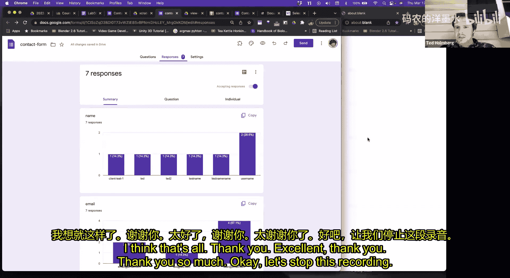

现在，你可以将这个功能完整的联系表单集成到你的个人作品集页面中，并配置Google Forms的邮件通知，以便及时收到用户的留言。