# 012：模块化与异步编程 Part 1


## 概述

在本节课中，我们将开始学习Lab 7，构建一个带有排行榜的问答游戏。我们将重点学习如何构建一个REST客户端应用，这依赖于HTTP协议和JavaScript Fetch API的知识。此外，我们还将首次深入探讨JavaScript模块，这是一种更好的代码组织方式。请注意，使用模块要求我们通过HTTP服务器（而非文件协议）来托管页面。

## 核心概念解析

在开始构建应用之前，我们先来理解几个关键概念，这些是完成本实验的基础。

### REST客户端与API

一个完整的应用（Full-stack App）通过HTTP请求/响应在客户端和服务器之间共享数据。当我们的浏览器内应用开始请求外部数据时，它就可以被视为一个分布式应用，而浏览器应用本身则成为了一个REST API的客户端，即**REST客户端**。

*   **REST API**：指服务器通过HTTP请求提供的数据接口。
*   **HTTP方法**：常见的操作包括：
    *   **GET**：读取数据。
    *   **POST**：创建新数据。
    *   **PUT**：更新已有数据。
    *   **DELETE**：删除数据。
    这些操作与数据库的CRUD（增删改查）操作相对应。
*   **端点（Endpoint）**：服务器上监听特定HTTP请求并返回数据的URL地址。

### 异步JavaScript

JavaScript提供了**非阻塞函数**，允许在等待异步操作（如网络请求）完成时，继续执行其他代码。这对于网络任务至关重要。

*   **`async` / `await`**：
    *   使用 `async` 关键字声明一个异步函数。
    *   在需要等待输入/输出（IO）操作完成的语句前使用 `await` 关键字。
    *   如果一个函数内部使用了 `await`，则该函数必须声明为 `async`。
*   **Promise对象**：异步函数返回一个Promise对象。函数执行后立即继续后续任务，Promise对象则在异步操作完成后被“解决”（resolved）。我们可以通过回调函数来处理解决后的结果。

**代码示例：一个异步函数**
```javascript
async function fetchData(url) {
  const response = await fetch(url); // 等待网络请求完成
  const data = await response.json(); // 等待将响应解析为JSON
  return data; // 返回数据
}
```

### JavaScript模块

模块允许JavaScript文件之间直接相互导入，而无需在HTML中通过 `<script>` 标签链接。这使代码更易读、可维护和扩展。

*   **要求**：使用模块的HTML页面必须由HTTP服务器托管。
*   **作用域**：模块拥有自己的作用域，不属于全局作用域或函数作用域。模块内的数据需要通过导入/导出进行共享。
*   **`import`**：允许脚本访问其他模块作用域中的函数或对象。
*   **`export`**：提供对模块内函数或对象的外部访问权限。可以导出多个命名项，也可以设置一个**默认导出（default export）**。

**代码示例：模块导出与导入**
```javascript
// bar.js - 导出模块
const myObject = { name: "Bar" };
export default myObject;

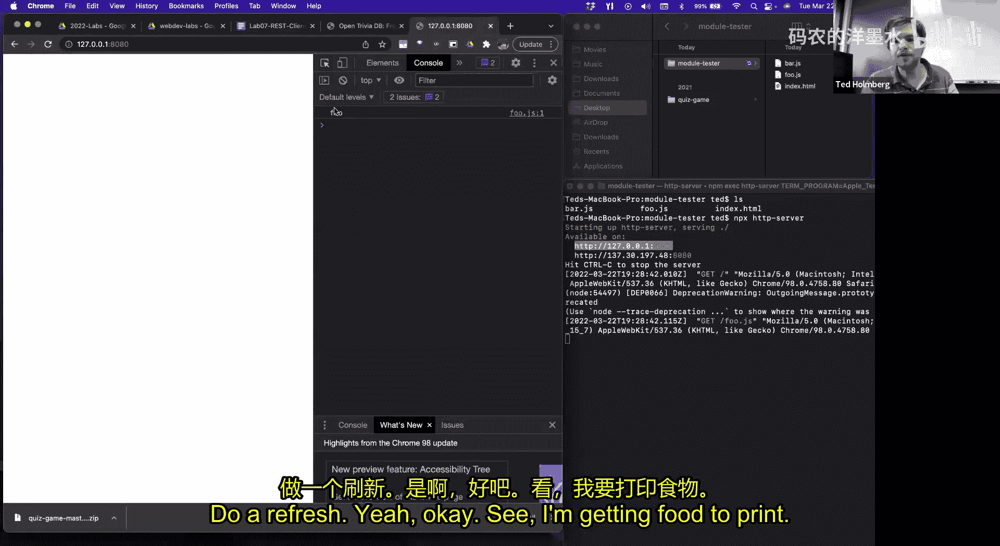

// foo.js - 导入模块
import importedObject from './bar.js';
console.log(importedObject.name); // 输出: "Bar"
```

*   **路径说明**：`./` 表示相对于当前目录，`../` 表示相对于父目录。

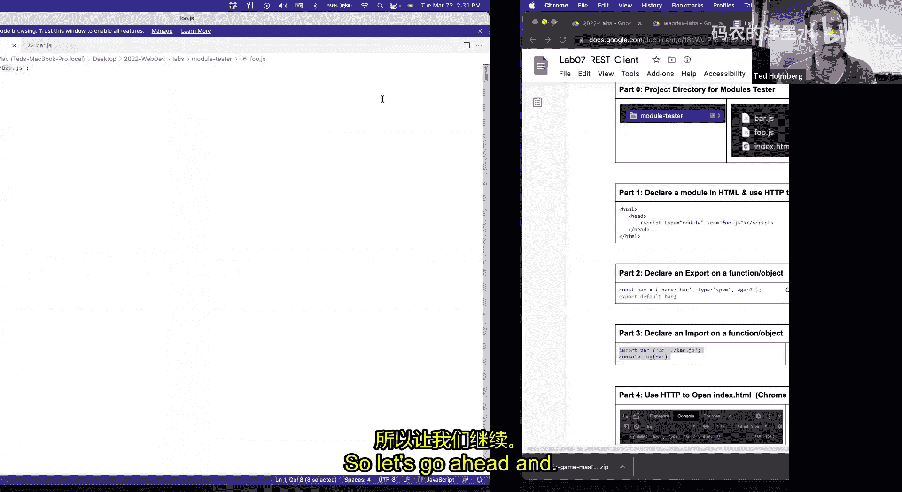

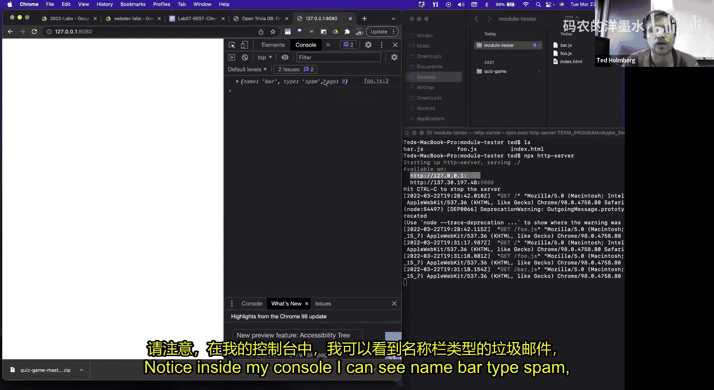

---

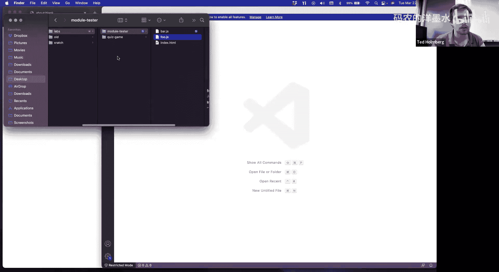

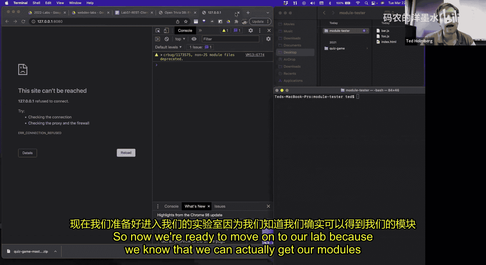

上一节我们介绍了构建本实验所需的核心概念。接下来，我们将开始实际构建问答游戏的第一部分。

## 第一部分：构建问答游戏

我们的目标是构建一个如下图所示的问答游戏界面，包含计时器、分数、问题类别、难度、问题本身以及多个选项。


我们将采用迭代式开发，分步完成。首先，我们不自己编写问题，而是利用一个免费的在线服务：**Open Trivia Database**。它提供了一个无需API密钥的JSON API，我们可以通过发送带有查询参数的GET请求来获取随机的问答数据。

### 目标1：发送GET请求到REST API

我们的第一步是创建一个能够向 trivia API 发送GET请求并获取数据的JavaScript函数。

**以下是实现步骤：**

1.  **创建HTML文件**：创建 `index.html`，链接CSS和JS文件。页面主体中只需一个带有 `id="view"` 的元素（如 `<header id="view"></header>`），后续所有内容都将通过DOM操作动态插入到此元素中。
2.  **创建HTTP模块**：在 `scripts/` 目录下创建 `http.js` 文件。定义一个异步函数 `sendGetRequest(url)`，它使用Fetch API向指定URL发送GET请求，并返回解析后的JSON数据。
3.  **创建主应用模块**：在 `scripts/` 目录下创建 `app.js` 文件。
    *   从 `http.js` 导入 `sendGetRequest` 函数。
    *   定义 trivia API 的端点URL（例如，从Open Trivia DB生成一个获取1个简单问题的URL）。
    *   初始化一个 `state` 对象来管理游戏状态（目前可为空）。
    *   定义一个异步函数 `playGame()`，在其中调用 `sendGetRequest` 获取问题数据，并暂时用 `console.log` 打印结果。
    *   定义全局函数 `start()`，在页面加载时调用 `playGame()`。
4.  **链接模块**：在 `index.html` 中，使用 `<script type="module" src="scripts/app.js"></script>` 引入主应用模块。
5.  **测试**：使用Node.js的 `npx http-server` 启动一个本地HTTP服务器，在浏览器中打开页面，查看控制台是否成功打印出获取的 trivia 数据。

### 目标2：在DOM中显示问题

获取到数据后，我们需要将其显示在页面上。我们将创建可重用的“组件”函数来生成HTML。

**以下是实现步骤：**

1.  **创建问题组件**：在 `scripts/components/` 目录下创建 `question.js`。定义一个函数，接收 trivia 数据对象作为参数，返回一个包含问题类别、难度和问题文本的HTML字符串。将此函数作为默认导出。
2.  **创建视图模块**：在 `scripts/` 目录下创建 `view.js`。
    *   从 `./components/question.js` 导入问题组件函数。
    *   定义一个 `renderDom(html)` 函数，它获取 `id="view"` 的DOM元素，并将其 `innerHTML` 设置为传入的HTML字符串。
    *   定义一个导出函数 `playScene(properties)`，它从传入的属性中解构出 `triviaData`，然后调用 `renderDom` 函数，传入由问题组件生成的HTML。
3.  **更新应用逻辑**：在 `app.js` 中，从 `view.js` 导入 `playScene`。修改 `playGame()` 函数，不再打印日志，而是从获取的数据中提取出 `triviaData`，然后调用 `view.playScene({ triviaData })` 来渲染问题。
4.  **测试**：刷新页面，现在问题应该会显示在浏览器视口中，而不仅仅是控制台。

### 目标3：显示答案选项

一个问题通常伴有多个答案选项。我们需要根据问题类型（布尔型/多选）来渲染不同的按钮。

**以下是实现步骤：**

1.  **创建选项组件**：在 `scripts/components/` 目录下创建 `options.js`。
    *   定义 `booleanOptions(triviaData)` 函数，返回包含“True”和“False”两个按钮的HTML。
    *   定义 `multipleOptions(triviaData)` 函数。它需要将正确答案和三个错误答案合并到一个数组中，排序打乱顺序，然后返回四个按钮的HTML。每个按钮的 `onclick` 事件调用一个名为 `checkAnswer` 的函数，并传入该按钮代表的答案文本。
    *   定义主函数 `options(triviaData)`，根据 `triviaData.type` 决定调用上述哪个函数，并返回结果。
    *   将 `options` 函数作为默认导出。
2.  **集成选项到问题中**：修改 `question.js`，从 `./options.js` 导入 `options` 函数。在生成问题HTML的字符串模板中，加入对 `options(triviaData)` 的调用，将其结果追加到问题文本之后。
3.  **测试**：刷新页面，现在每个问题下方应该会出现相应的答案按钮（True/False 或 A/B/C/D 四个选项）。按钮目前还不会交互。

### 目标4：实现计时器与HUD

为了让游戏更有挑战性，我们需要添加一个计时器和分数显示（HUD）。

**以下是实现步骤：**

1.  **完善游戏状态**：在 `app.js` 的 `state` 对象中，初始化以下属性：
    ```javascript
    state = {
      score: 0,
      timer: 20, // 初始时间
      intervalId: null, // 用于存储计时器ID
      trivia: null // 当前问题数据
    };
    ```
2.  **创建HUD组件**：在 `scripts/components/` 目录下创建 `hud.js`。定义一个函数，接收 `timer` 和 `score` 作为参数，返回显示游戏名称、当前计时和分数的HTML字符串。将其作为默认导出。
3.  **更新视图**：在 `view.js` 中导入 `hud` 组件。修改 `playScene(properties)` 函数，使其能从 `properties` 中解构出 `timer` 和 `score`。在 `renderDom` 的调用中，同时包含 `hud(timer, score)` 和 `question(triviaData)` 的结果。
4.  **实现倒计时逻辑**：在 `app.js` 中：
    *   定义 `countdown()` 函数。如果 `state.timer > 0`，则将其减1，并调用 `view.playScene(state)` 更新界面（这会更新HUD的显示）。如果计时器归零，则暂时什么都不做（下一步处理）。
    *   定义 `createGame()` 函数。它重置计时器，使用 `setInterval(countdown, 1000)` 启动一个每秒触发一次的计时器，并将返回的ID存入 `state.intervalId`。然后调用 `playGame()` 获取第一个问题。
    *   修改全局 `start()` 函数，改为调用 `createGame()`。
5.  **测试**：启动游戏，现在应该能看到顶部的计时器从20开始倒计时，并且分数显示为0。

### 目标5：实现游戏结束场景

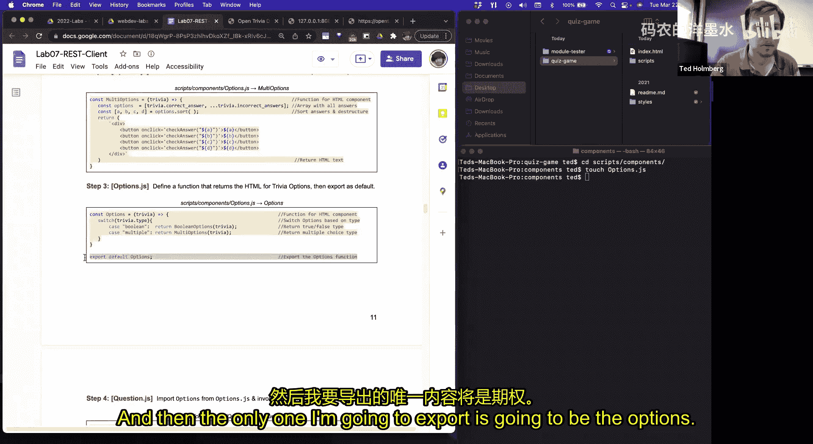

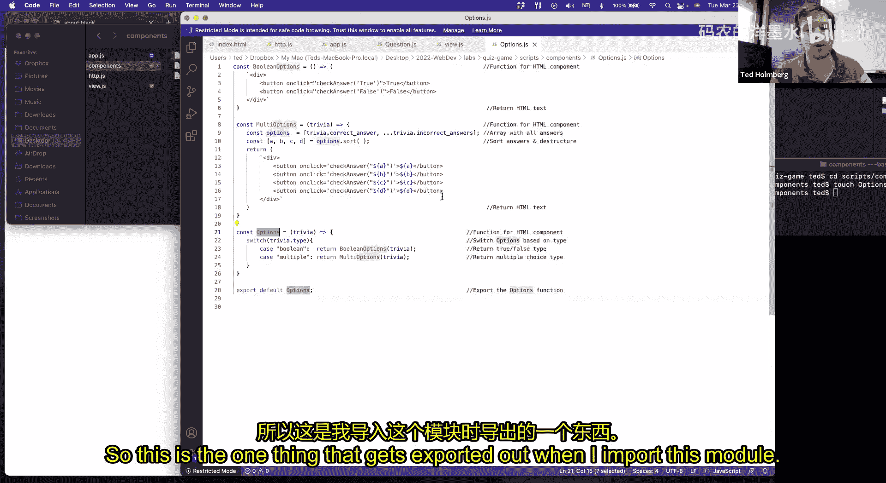

当计时器归零时，游戏应结束并显示一个“游戏结束”画面。

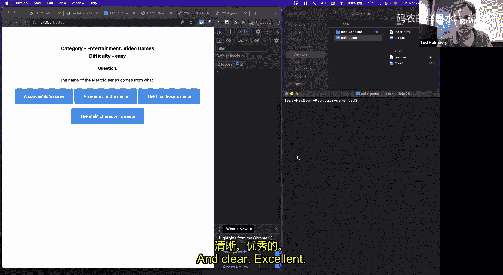

**以下是实现步骤：**

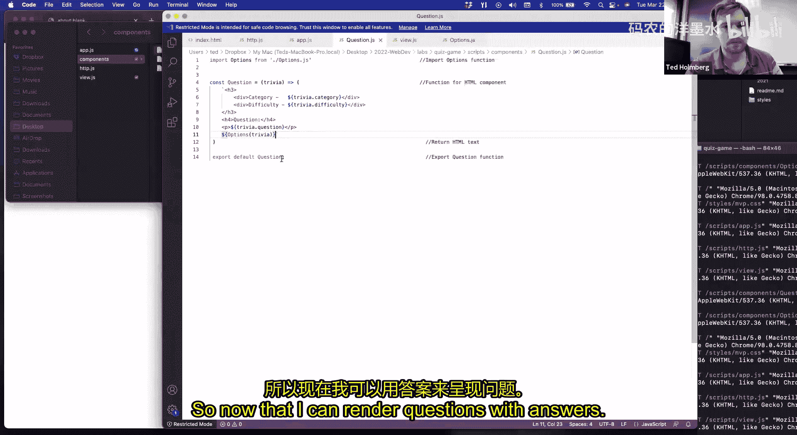

1.  **创建游戏结束场景函数**：在 `view.js` 中，定义一个新的导出函数 `gameOverScene(properties)`。它接收状态，渲染HUD，并添加一个“Game Over”标题以及一个“Start Menu”按钮（按钮的 `onclick` 事件暂定为 `startMenu()`）。
2.  **修改倒计时逻辑**：在 `app.js` 的 `countdown()` 函数中，添加 `else` 分支。当 `state.timer === 0` 时，调用 `clearInterval(state.intervalId)` 停止计时器，然后调用 `view.gameOverScene(state)` 切换到游戏结束画面。
3.  **测试**：让游戏自然结束，确认会显示“Game Over”界面。

### 目标6：实现“跳过”功能

允许玩家在时间用完前跳过当前问题，获取一个新问题。

**以下是实现步骤：**

1.  **创建跳过组件**：在 `scripts/components/` 目录下创建 `skip.js`。定义一个函数，返回一个带有“Skip”按钮的HTML。按钮的 `onclick` 调用 `playGame()` 函数。将其作为默认导出。
2.  **集成跳过按钮**：在 `view.js` 中导入 `skip` 组件。在 `playScene` 函数中，将 `skip()` 的结果也加入到渲染给DOM的HTML字符串中。
3.  **将`playGame`函数暴露到全局**：为了让HTML按钮的 `onclick` 能调用到模块内的 `playGame` 函数，需要在 `app.js` 中将其赋值给 `window` 对象的一个属性（例如 `window.playGame = playGame;`）。同时，确保 `playGame` 函数会更新 `state.trivia` 并调用 `view.playScene`。
4.  **测试**：游戏中现在应出现“Skip”按钮，点击后能立即获取并显示一个新问题，而计时器继续运行。

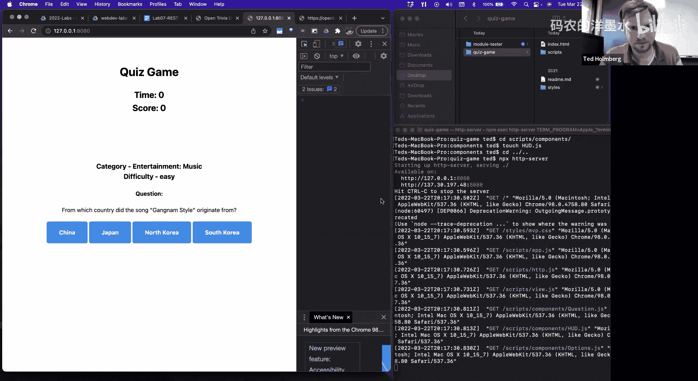

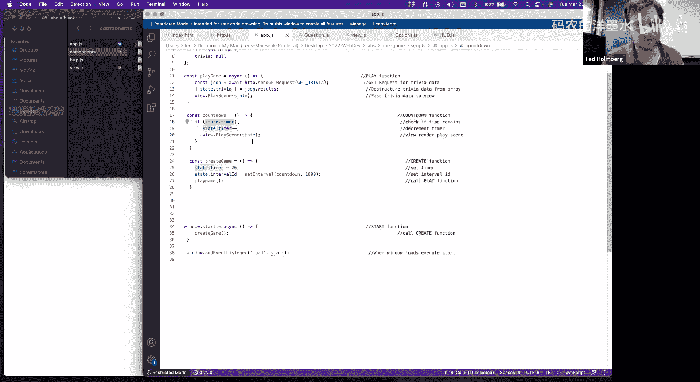

### 目标7：处理答案提交与判断

最后，我们需要让答案按钮真正起作用，判断对错并更新分数。

**以下是实现步骤：**

1.  **实现答案检查函数**：在 `app.js` 中，定义一个函数 `checkAnswer(attempt)`。这个函数也需要被暴露到全局（`window.checkAnswer = checkAnswer;`）。
    *   函数逻辑：
        *   从 `state.trivia.correct_answer` 获取正确答案。
        *   比较 `attempt` 参数是否与正确答案匹配。
        *   **如果正确**：
            *   将当前 `state.timer` 的值加到 `state.score` 上（回答越快，得分越高）。
            *   给 `state.timer` 增加一些时间（例如加5秒），作为奖励。
            *   调用 `playGame()` 获取下一个问题。
        *   **如果错误**：
            *   调用 `clearInterval(state.intervalId)` 停止计时。
            *   调用 `view.gameOverScene(state)` 结束游戏。
2.  **确保按钮调用正确**：回顾 `options.js` 中按钮的 `onclick` 属性，它们已经设置为 `checkAnswer('...')` 的形式，其中 `'...'` 是具体的答案文本。现在这个调用将指向我们刚刚定义的全局函数。
3.  **最终测试**：完整地玩一次游戏。尝试回答正确（分数增加，时间奖励）和回答错误（游戏结束），确保所有功能按预期工作。

---

## 总结

在本节课中，我们一起学习了Lab 7的第一部分。我们成功构建了一个功能完整的问答游戏，在这个过程中深入实践了以下核心技能：

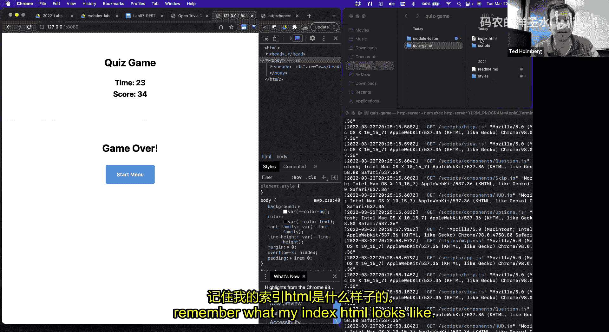

1.  **构建REST客户端**：使用Fetch API向外部服务（Open Trivia DB）发送异步GET请求以获取数据。
2.  **使用JavaScript模块**：通过 `import`/`export` 来组织代码，将应用拆分为职责清晰的独立文件（如 `app.js`, `http.js`, `view.js`, 以及各个组件），提高了代码的可维护性。
3.  **异步编程**：利用 `async`/`await` 语法处理网络请求，确保UI不会阻塞。
4.  **操作DOM构建单页应用（SPA）**：所有界面更新都通过JavaScript动态操作一个根DOM元素（`id="view"`）来完成，实现了无页面刷新的流畅体验。
5.  **管理应用状态**：使用一个中心化的 `state` 对象来跟踪分数、计时器、当前问题等游戏状态。
6.  **处理用户事件**：为按钮绑定 `onclick` 事件，并调用相应的全局函数来处理跳过和答案提交逻辑。

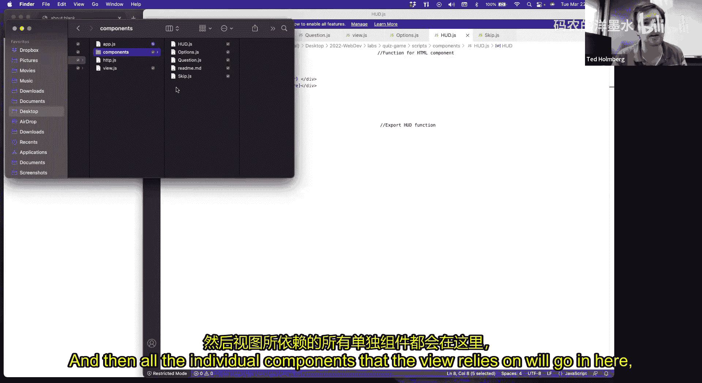

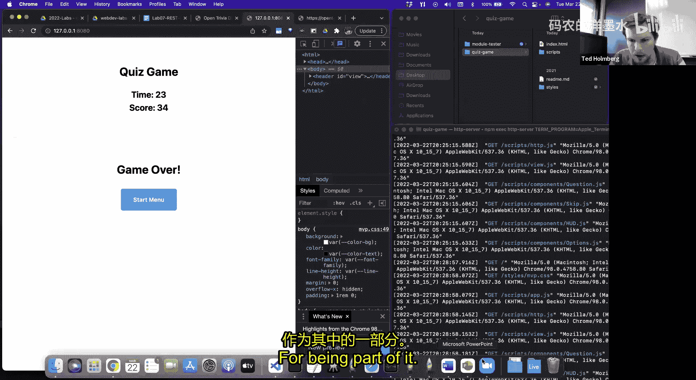

目前，我们的游戏还缺少一个关键的社交功能：一个所有玩家共享的**全球排行榜**。在下一节课中，我们将进入Lab 7的第二部分，学习如何使用另一个名为JSONBin的API来存储和读取排行榜数据，从而完成这个分布式应用的最终形态。