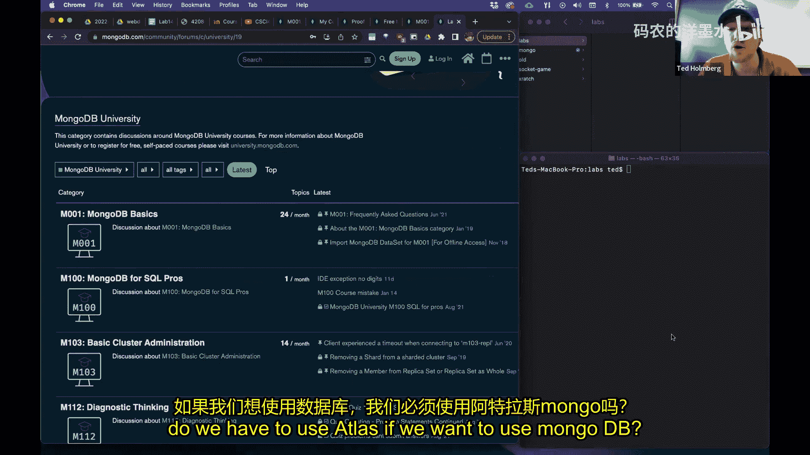
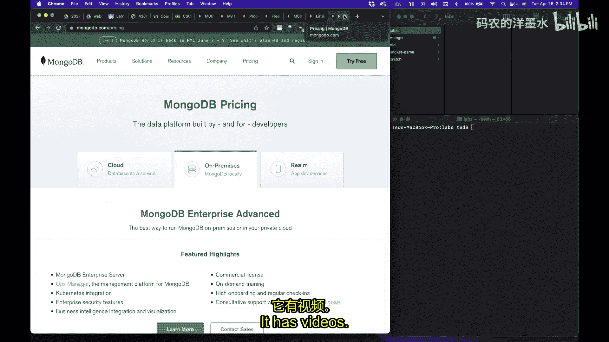
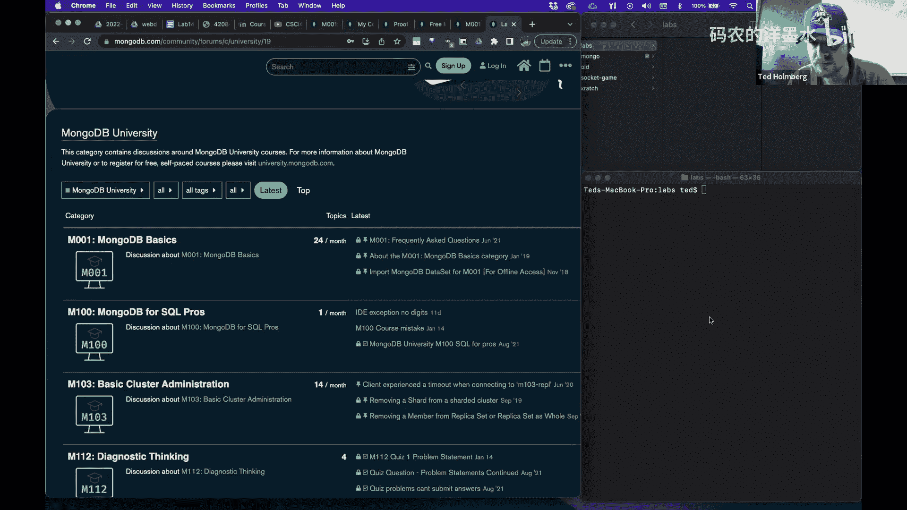
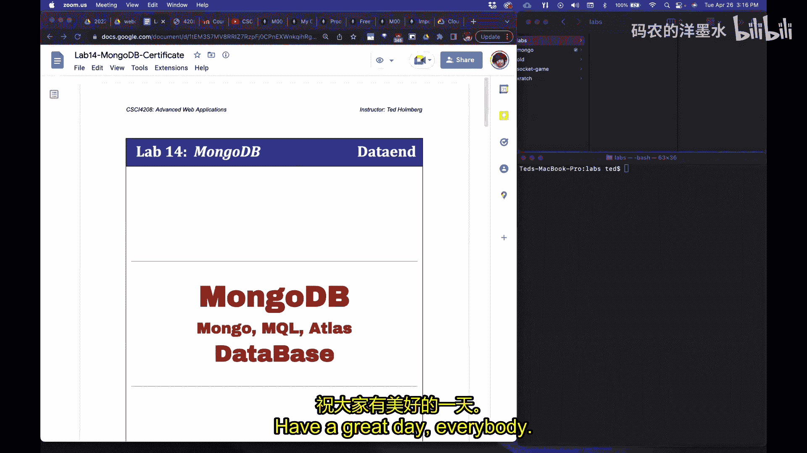

# 021：实时聊天应用


在本节课中，我们将学习如何使用MongoDB作为数据库，并完成MongoDB官方提供的免费认证课程。我们将了解MongoDB的核心概念、操作以及如何通过Atlas云服务部署数据库。

---

## 概述

本节课我们将学习MongoDB数据库技术。我们将了解什么是集合、文档和字段，学习CRUD（创建、读取、更新、删除）操作，并使用MongoDB查询语言（MQL）进行数据查询。课程目标是帮助大家获得MongoDB官方认证，为简历增添竞争力。

---

## MongoDB简介

MongoDB是一种文档型数据库，它以JSON格式存储数据。这与JavaScript对象在内存中的存储方式一致，使得数据序列化和存储变得非常方便。

**核心概念**：
*   **数据库**：数据的最高层级容器。
*   **集合**：相当于关系型数据库中的“表”，是一组文档的集合。
*   **文档**：相当于关系型数据库中的“行”，是数据的基本单元，以BSON（一种二进制JSON）格式存储。
*   **字段**：文档中的键值对，相当于“列”。

**示例代码**（一个文档）：
```json
{
  “_id”: ObjectId(“507f1f77bcf86cd799439011”),
  “name”: “张三”,
  “age”: 25,
  “city”: “北京”
}
```

---

## 课程与认证路径

上一节我们介绍了MongoDB的基本概念，本节中我们来看看如何系统地学习并获取认证。

MongoDB University提供免费的认证课程。完成“MongoDB基础”课程并通过测试后，可以获得官方认证证书。该证书可以链接到LinkedIn等职业平台，验证你的技能。

课程涵盖六个章节，预计总耗时约8.5小时，包括视频讲座、实验和测验。注册后有60天时间完成。

**以下是获取认证的步骤**：
1.  从课程平台下载提供的幻灯片作为参考，其中包含与认证测试类似的练习题。
2.  访问MongoDB University，注册并开始“MongoDB基础”课程。
3.  按顺序完成所有视频讲座、动手实验和章节测验。
4.  完成所有内容后，参加最终认证测试。
5.  通过测试后，将获得的证书提交到课程指定平台。

---

## 工具与环境：Atlas vs 本地部署

在学习过程中，我们将主要使用MongoDB Atlas。它是一个云端的数据库即服务（DBaaS）平台，提供了免费的集群套餐，非常适合学习和开发。

**Atlas的优势**：
*   **免费套餐**：提供512MB至5GB的存储空间，无需信用卡。
*   **易于管理**：无需在本地安装和配置数据库服务器。
*   **便于部署**：与Heroku等Web应用托管平台结合，可以轻松部署全栈应用。

当然，你也可以选择在本地计算机上安装和运行MongoDB服务器。这对于本地开发和测试非常方便。课程也可能提供可选的实验，指导如何进行本地部署。

**选择建议**：对于希望项目能被公开访问的同学，建议使用Atlas；对于仅在本地进行练习和测试的同学，本地部署是更直接的选择。

---

## 学习资源与支持



为了确保大家能顺利通过认证，这里汇总了可用的学习资源和支持渠道。

**以下是主要的学习资源**：
*   **官方课程视频与实验**：MongoDB University平台上的核心内容。
*   **参考幻灯片**：老师提供的幻灯片，内含重点总结和模拟练习题。
*   **社区论坛**：MongoDB官方社区论坛，全球学习者和教育者在此讨论问题。
*   **课程Discord/课堂讨论**：在课程进行中，可以随时向老师和同学提问。

如果在实验或测试中遇到问题，可以随时在课堂时间或通过Discord寻求帮助。认证测试中的问题通常允许多次尝试，因此可以利用这些机会弄懂每一个概念。

---



## 总结

本节课中我们一起学习了MongoDB的入门路径。我们了解了MongoDB作为文档数据库的核心优势，明确了通过MongoDB University获取官方认证的流程，并熟悉了Atlas云服务这一重要工具。此外，我们也掌握了包括官方课程、参考幻灯片和社区论坛在内的多种学习资源。





接下来，请大家按照步骤开始课程学习，利用课堂时间推进进度，并积极利用支持渠道解决遇到的问题。掌握MongoDB将为构建动态Web应用打下坚实的数据存储基础。