# 【全集】加州理工学院 高级Web应用 中英字幕 1080P p01 Lecture 1 - HTML：交互式 part1 -BV192zTBrEmu_p1-

我。

Okay， yep， okay， I'm recording now。 Okay， so what I was saying for last or the very first lecture of the semester。

 one thing that I wanted to attempt to do is go ahead and instead of spending my entire lecture block。

Instead of spending my entire lecture block。Rranting and lecturing over lecture slides where you just go ahead and listen to them。

 you can listen to my video of them so that I can do interactive coding with you for this semester。

And so with that said， the first lab that I've assigned to everybody is going to be one that's focused on HTML now I had actually just re。

Written this lab for this semester， the prior version of this lab。

Use strictly HTML and typically the way that the homeworks are based。

 the homeworks are derived off of the kind of activities we do in lab and so there was a lot of students who wanted to get some kind of data persistence in their interactive story that they weren't able to because it wasn't shown how you might achieve that with strict HTML strict HTML doesn't allow for any data persistence so I use a little bit of embedded JavaScript in this lab strictly for the purpose of opening up options for you when you go to design your own interactive story。

So in this lab we're going to learn HTML， we're going to learn HTML by actually building a an application and the application we're going to build is going to be what I'm going to call a interactive。

Story， so it's a story like a choose your own adventure story， so to speak。

 where you get to decide the action and then you have branching pathways and then you could either die or you get to some conclusion。

So I think that that's a good use case of an app that's strictly kind of HTML only。一分で大ててら。Okay。

 hang on。Someone became unmuted。Let's take participants。Let's say， okay， perfect。Okay。

 so now let me go， so this document should already be available in Moodle。As a PDF。

 and then when it comes time to submit， well， we'll talk about that when we get to the end of the document。

Okay so the first page that we're going to go through is going to be the table of contents and so the way that all of the labs are going to be structured is it's going to be about building an application using the technology we're covering inside the lectures so the first lecture is about HTML so we are going to build an HTML related application the next lab is going to be cS so we're going to build。

Something that uses CSS， a lot of CSS， the next lecture would be about Twitter bootsottrap。

 so it would be to go ahead and design a web page， a responsive webp page using bootstrap。

 the next lecture would be probably about the introduction basics of JavaScript。

 so we'd start to build a lab using JavaScript。And your homeworks are going to be derived off of kind of like that lab content。

Okay， so with that said。Here you can see this particular lab is broken down into 12 different goals。

Each one of these goals is essentially an iterative approach on how our software is going to get built。

 so we'll see more of that as we actually start to walk through this lab。

But I do tech so these labs are intending to do multiple things。

 the first of which is to go ahead and show you a technology that you're going to be able to use to build out your web applications。

 but another approach of these labs is to show you how you can start with nothing。

 how to start with nothing but an idea， a concept and how to grow it into a full-sized application using kind of an iterative design strategy。

Where we'll go ahead and build。Based off of a concept and keep adding more complexity until we get where we want them to be at and so here each one of our complexities is going to be like goal one is going to be to add an index page goal two would be to add the intro page goal through the like an inventory page you'll see we're building a new web page an HTMLs document for each of these goals。

Okay， so let's move to our introduction。 So what do we need to know for this particular lab。

 not not much。This lab is essentially supposed to be self-contained so there's no prerex and all we need is like a Chrome browser Chrome is going to be the browser that I'm going to do all the testing on。

 you're free to use any other browser but you have to make sure that it does work in Chrome and if it works in Firefox if it works in Safari if it works in edge it should work in Chrome。

We'll need a code editor。So I'm going to use a。Probably my visual studio code。

And then a GiHub account and you can create a GitHub account for free。

 the reason why you will need a GitHub account is for being able to deploy your HTML web pages。

 your static web pages。To the internet so that it actually has a live URL。Okay。

 so what's the motivation behind this lab to understand how to author multipage HTML websites using the HTML syntax。

 perfect and what's got our goal， Well， it's to build an interactive story。

So the motivation is to learn this， the goal is to actually build something。

And so here where the reader chooses their own path。Okay， and our learning objectives。

 the things that we're looking to get out of this lab by the time we're done with it is to learn the structure of an HTML file。

To learn what HTML elements are and what attributes are。No。

Just to confirm we're going to use GiHub not Gitlab not the CSs Gitlab we'll be using Github so let's check this out so GiHub so if you haven't seen it before and I think this might be inside。

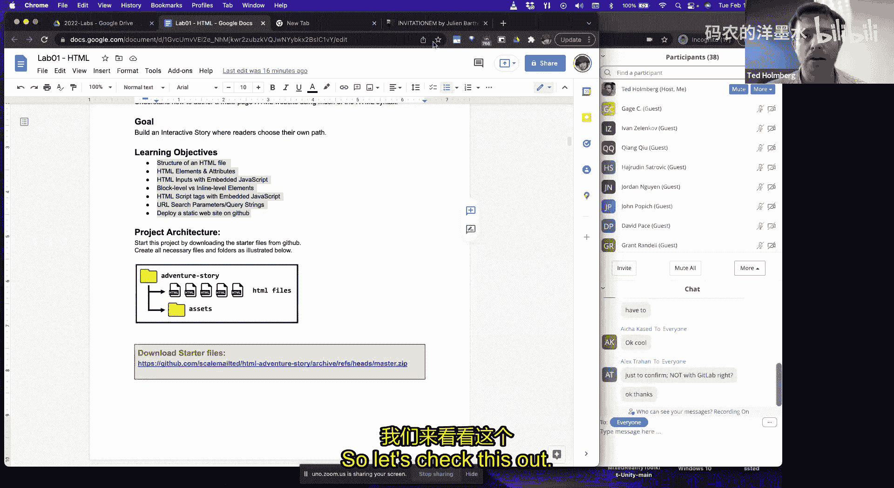

I think I do have a lecture on this， I'll to double check， but if you go to Github。com。

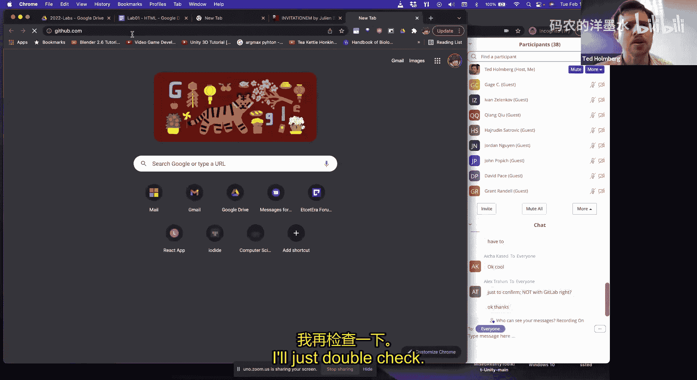

Go and if you haven't created an account here， created an account。

 and this is it looks very much like Gitlab， this is what we'll be using to go ahead and publish our web content。

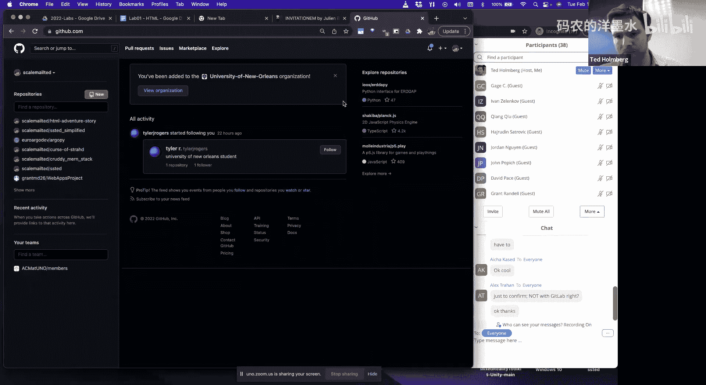

Okay， let's say we're going to。Learning objectives learned about HTML elements and attributes。

 we're going to learn about HTML inputs and we're going to learn about embedded JavaScript。

We're going to learn what the distinction between a block level versus an inline level element is。

 we'll talk more about script tags and how we can embed JavaScript logic into an HTML2 page with script tags and this is given this kind of cheating little bit but we're going to use a minimal amount of JavaScript and。

We'll learn much more about JavaScript when we get to that section we're going to learn about URL servers parameters or query strings that's going to allow us to transfer the state。

Of one of our pages to another page in case you want to make an interactive game that requires you to。

Continually accrue some kind of data or resource and whatnot for your character。

And then we'll learn how to deploy a static website onto GitHub。Okay。

 so let's see here the project architecture for this particular project is we'll have a directory we'll call it say for instance。

 adventureure story inside the adventureure story is going to be assets that are giving to you that you will need for this lab you can get these assets either from Moodle from the starter files or you can just follow this link I'm just going follow this link because it's easy so I'm going copy this here。

And I'm just going to go and paste it into the browser here we go and what you're going to see is what。

 it's going to download。

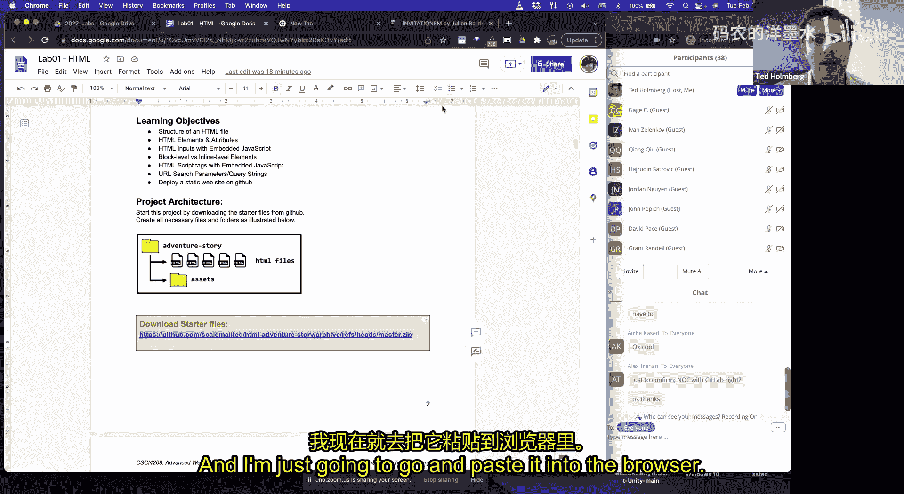

A 19 file。Okay， so I'm going to hop back on over here and while that completes。

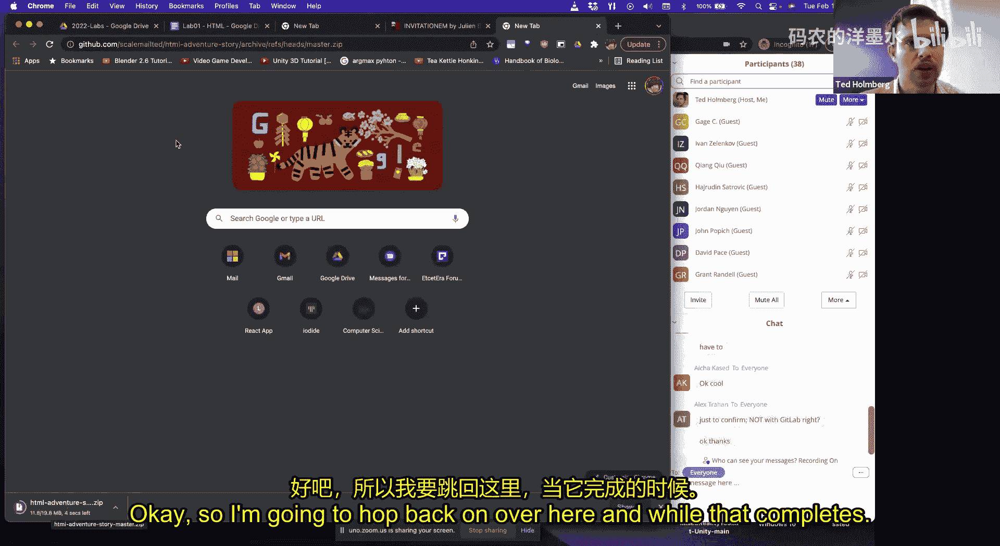

Okay， perfect， Okay， so concepts。So the critical concept that we're going to really cover today is HTML is the standard markup language。

For creating web pages。And AC stands for hyperpertext Markup Language。

So HTML describes the structure of a web page， and the HTML consists of a series of elements。

And typically what we're doing with HTML is we're going to define our apps view or essentially what gets rendered in the web client's viewport。

 so every time you see anything that gets rendered as a web page in the browser that's the viewport above the viewport is your navigation tabs where you can navigate between multiple web pages you have a URL。

😡，Tab here where you could put it in the pathway to an HTML document。

 one of the beautiful things about web browsers is it can open up HTML documents either from local either from your local file storage or from a ACTP request。

And then it's the role of the browser to go ahead and parse these email document and essentially display it in a way that looks pleasant。

 like for instance， notice some of this text will render larger than another text。Okay。So then HTML。

 the components of HTML we're going to。We're going to derive words off of is going to be HTML elements and an HTML element is defined by a start tag。

 it has some content in between and it has some end tag and HTML elements will tell the browser how to display the content。

 You have HTML attributes。which can provide additional information about HTML elements after you are declared with a start tag。

When we were talking about block elements versus in line elements。

 a block element always starts on a new line and takes up the full width， the horizontal space。Of。

Of whatever gets rendered and an inline element uses the existing line and only takes up as much width as necessary。

And the typical structure in HTML file is your root。Your root element。

 so first of all you can think of an HTML document as a treelike structures's like a treelike data structure。

 the root node， the root element would be the HTML element， it would have two children element。

 one that will be called the head element and the other that's called the body element the head element is a container for metadata so data about the HTML document itself。

 but not data that's supposed to be shown to the end user metadata is not displayed and it typically defines the documents title。

 maybe your character font set it could be your styles， it could be your scripts。

 whereas the body will define the documents body， and it can contain all the content of an HTML document。

Meant to be fewud such as the headings or the paragraphs， images， hyperlinks， all that other stuff。

Let's see we have our web client， so at our web browser， so I kind of mentioned that previously。

 that's what an HTML document is open to buy a web browser。

And so we can open up HTML documents in one of two different protocols， either the HTP protocol。

 so typically when you type in HTP colon slash wwW and goes to some web address that's using that protocol。

 that's the preferred protocol to use， you also have the file protocol。

 but just understand the file protocol is a little bit more limited。

So you might not be able to do everything functionally with your HTML document as you could with HTP protocol and they do that for security reasons。

😡，Okay。In addition to being an HTML document parser and viewer。

 browsers also have JavaScript runtime environments。

 which will'll actually make use of for this lab very minimally just to be able to share our data。

So like I said， we're going to build an interactive story if you want inspirations of what an interactive story might look like。

 I actually give you an example link here。😡，And actually， let's go on over。

And let's see where that goes Okay， yeah， so this is just a collection of games that are all tagged as interactive affection fiction and if you want to go through and actually play some examples。

 there's plenty on here。Okay， but I'm not going to bother doing that， nope。

 Im not going to go bother doing that。For that。Okay， so goal zero。

Is the actual design of our interactive story。Okay。Let's actually before we get to any of the goals。

 just so that everyone has a solid firm understanding of what we're building， why don't we test out？

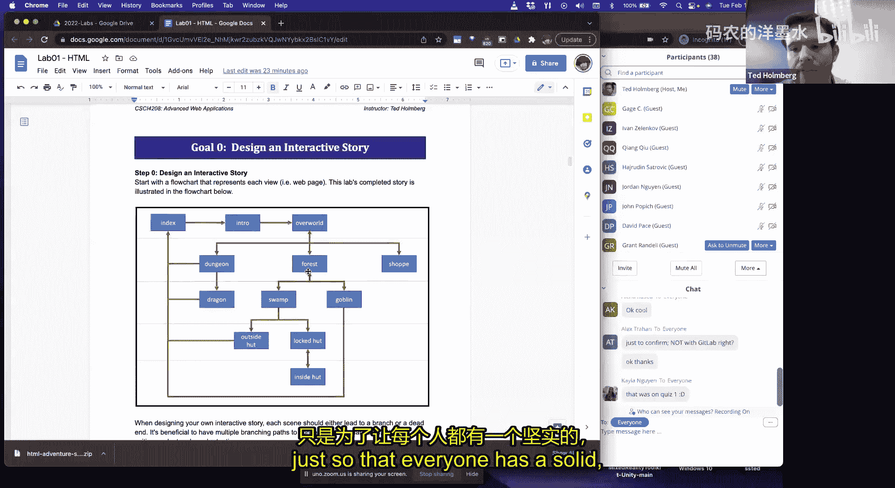

What the final application is going to look like， so let me open up a browser here。

 can everyone see my screen by the way。

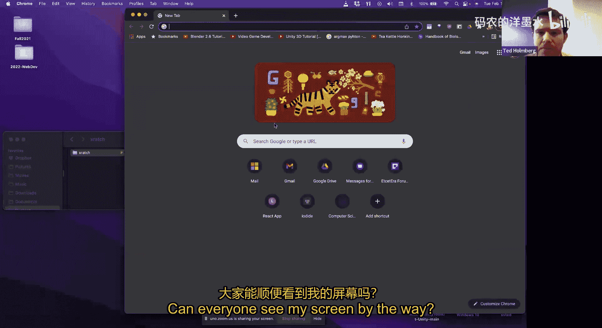

Perfect。

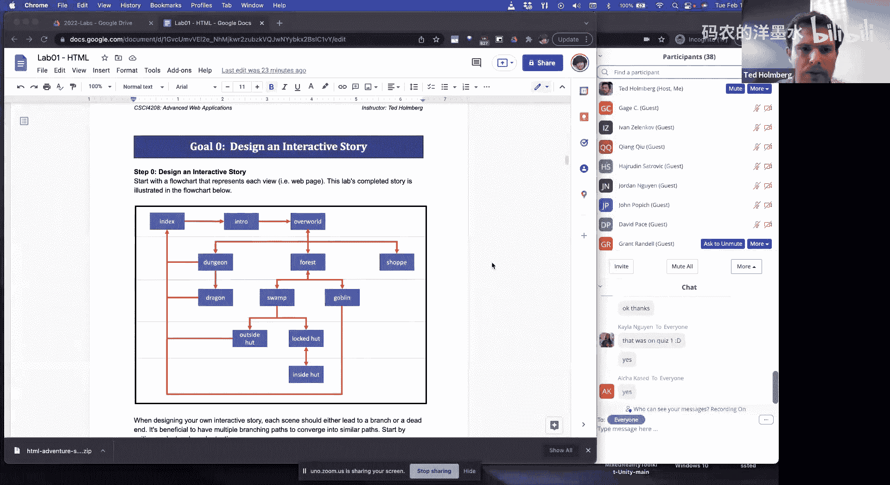

Okay okay， so now let me go here， this is here here and it's going to be index out these okay。

Pull that in here。Okay， so when we first launch our application I should also illustrate if I could just double click too because the default application for open up HTML documents is the browser Okay。

 so when we first launch we're building an HTML adventure game we have a little bit of text here and we have a an image and one nice thing about browsers is it supports animated gifts so you can get a little bit more motion in your images。

If you use a looping G， which is what I used here。I'm going to click the start button， okay。

 it's going to bring me up to my story introduction。That gives me the little blurb of my story。

 welcomecome traveler。 Our land is plague by great evil。 Please save us here。

 take five gold as a deposit。 So let's adventure out of town。😊。

I'm going to go to our overworld and notice here I have an inventory so this is represents the data persistence we'll be able to achieve。

 I have five gold which was given to me at the intro I have three hearts， health。

 I have one attack power and have zero keys。Okay， so let's see here's。

Go into the shop here inside the shop， we have the ability to buy health or buy attacks or buy keys。

 I can't buy the key yet， because only have five gold， but I could say for instance。

 get help if I want it。I get in attack if I wanted to okay let's exit out there。

 let's go into the forest， but I go into the forest。

 I can either go into the hills or I can go into the swamp if I go to the hills I'm gonna to get into some kind of fight where I have the option to take either there fight or retreat let's retreat out of there I can go into the swamp notice each time I go I have the same data that's following me around when I go into the swamp let's see it gives me some choices I can either go into the hut or I can go outside if I go to the hut that's a locked door probably why I need a key so I can exit out of there。

Exhait out of there， let's see here if I go to the swamp again， but try to go outside the hut。

That's going to lead to a death screen， so that's a ending an end state that brings me back to the beginning I got inba alligator。

Okay， so let's C。If I got to the dungeon， there's some kind of riddle here。

 I got to type in some kind of word that dispels this runic spell， let me just put hello。

That was the wrong one， so that's also an example of how I get to an end state。And then。If I。

And then presumably I can go and like try to fight the goblin。Right there， Yes， he。

 we fight the goblin and。It looks like game over，So that gives you just a quick example of what we're going to be building today and so when we go to build this notice what's happening is we're linking a lot of our HTMLL documents one after the other with these hyperlinks。

So the first thing you should do。Oh， sorry about that。Didn't mean to put jump scares into the game。

Again。The first thing you should do though before you start designing or implementing any application。

Or whether it's a web application or a desktop application or even a web page is to figure out what is going to be the flow from one portion of the application to the next。

So especially if you're building an interactive story。So I gave you like an adventure idea。

 but you know， I think this project would lend itself really well with like some scary ideas too like a scary story as apparently this one already has the effect of making people jump。

So going back to what we had here。😡，We started at the index page and that flows into the intro page。

 right？And from the intro page， we then go to the overall page and then the overall page notice this has two headed arrow instead of a single headed arrow。

 the single headed arrow represents going from one page to the other。

 but without having the option to go back。So the index brings us to the intro。

 the intro brings us to the overworl， the overworld gives us the option to go to the dungeon。

 the forest or the shop， and all of those can go back to the overworld。Now， if we go to the dungeon。

 the dungeon can lead us to the dragon and the dragon will be the end of the story so that would bring us back to the index page。

Now the forest can bring us either to the swamp or that goblin fight。

 the goblin fight can either bring us back to the force if we win or if we lose。

 we go back to the index， the s of the game。Now if we go into the swamp。

 we have the option to either go outside the hut or inside the lockUt if we go outside the hut。

 again， that's our other losing conditions that brings us back to the index page。

 whereas if we get into the logUud， if we have the resources it gets us inside and then we can get back out。

 double arrow， get back out that should have a double arrow so that's an  error inside this document。

And then finally， yeah， the shop allows us to go in and out so this is so this is just a flow chart that describes how we're going to flow each scene in our interactive story and each scene is represented by an HTML document。

So when design your own interactive story， each scene should either lead to a branch or a dead end。

 and it's beneficial to have multiple branching paths to conversion into similar paths。

So you should start by writing your story branches out before you start design your HTML document。😡。

Okay now with that said let's actually get into implementing so for the purposes of time what i'm going to do is i'm going to copy and paste the code。

 but I'm going to explain it each step of the ways as I do that that way we can try to get through this document all within this lecture period if possible。

So。Each of our goals represents one thing we want to achieve with our application at a time。

 So we're not going to try to build that entire game all at once。 We're going to focus on。

 say just the index page now every。😡，Web page and every web application should have some index on HTML that's like the launch point of your application of your of your web page it should be the first landing space。

 the landing page that all end users are going to go to so our first goal will be to have an index HTMLm page so we're going to break our goals down into three phases a approach phase or what I like to call the design phase the implementation phase which will be to apply the concepts that we've defined in our approach and then we'll have a testing phase where we assess to ensure that everything that we intended to build for this goal is working the way we expect to so you can think of these as the three A's of development。

😡，Having an approach or designing， applying your approach， which is implementation and assessing。

The approach， which is testing。Excellent， okay， so our first goal is to define the initial index page where the player starts all scenes in this interactive story use HTML in order to define。

All our HTML elements and we'll talk about them as we we start that out so before we can start writing HTML documents we need to actually create an HTML file。

 so let's go over here。So no， don't want to go。 okay， so I'm going to open into this tab。

 Let's see here。 I'm going to create a new， actually， I have this file I download。 Remember。

 let's drag that in。Okay， so this is going to be the initial。Let me no， not that， let me unz that。

Perfect okay， so now I have all these assets and stuff now this probably also has like some get files in there so if you want to separate some some hidden Gi files in there and actually let's say I could I could prove the same new terminal I folder since I downloaded this off of GiHub let me see print working directory yep okay。

 I' going to do it。Oh yeah。2。Caring， I mean。Yeah， see。

 so we have like a get ignore file and probably some other things in here I'm fine with that though。

So let's clear this。Okay， so when I first download。

The zip file notice it's going to have all of the art assets that we're going to need for this project。

So that's where those are going to come at， those are all going to be inside of the assets。Folder。

 so I want to be and the。Root directory here， this one。 and I'm going， no， stop that。Okay。

 there we go。Let to get rid of that， Okay， so AmL adventure story so this is going to be and let me clear this。

Perfect， okay， so now it should be an AL adventure story， perfect。Perfect， okay。

 so I'm going to create。The index。 HTML page， perfect。And now if I go to open that in a text editor。

I'm going to use visual Studio code。We start with a blank file and what we're going to do as step one is a the HTML element so I'll copy this and explain what it is so let's go ahead paste this in here so HTML element so we have an open tag we have a close tag we need a close tag so open tags are in between these dangled brackets。

And the root document， the root elements HTML， the closing tag is going to have a slash and then whatever that tag is。

 and then we can put content in between because can have other HTML elements。

Or text in between an HTML element so like I said this is a treevi like structure and the children of our HTML elements。

 which allows essentially the browser to know hey， this is the contents of the HTML this is the beginning the end of the HTML will be the head tag and the body tag。

Okay， so at this point we have an HTML document， let's actually go ahead and actually open it up over here perfect and there's not going to be much there。

 in fact I can also just double click it。Okay， but we haven't implemented anything in there。

 So the next step will be， well， let's add some content to the head the content I want to add to the head is going to be a Fva column。

And a title， Okay， so let's go ahead and grab this。 I'm going to grab the fbaon and the title。

 and then we're going to talk about it。So remember， I said that the head element contains。Metaadata。

 so not something that's supposed to be directly displayed to the end user。

 but it's it's it's data that or resources that are required by this HTML document to render the way it's supposed to be rendered。

 So when I say when I say a title， what the title is。

 is if I go back over here and if I refresh the page。

If I refresh the page notice I have a default favon。

 the favvaon is the little icon that appears on a tab。

 the title is the name that appears on a tab so if I define a title inside of the head so here I have a title element and so I have the opening tag I have the closing tag and in between the Open and closing tab i'm just going to put the text adventure game。

So now if I go ahead and hit refresh， notice all of a sudden the title changes to have on the tab changes to have the name that I put here。

 and then I can do a link。😡，Eleement and a link element is a special type of element that does not need a closed tag。

 it just needs an open tag because it can never have content in between it。😡。

And so this link element will put what its a relation it is。

 it's an icon and its hyper reference is going to go into the assets directory and it's going to go to the Dragon logo PG so inside my assets directly I have this Dragon dashash logo PG so I'm going to use this and I'm going to link it as the icon for the tab。

And so these are attributes， right so when you have。😡。

These assignments inside of a head tag like that， then that's the attributes that are set for that element。

😡，And so sometimes these attributes have to define like a source or hyper reference or something just to note tell the browser where to go to find that data。

 and so that's going to allow me to render my own little logo there。Professor in the in the lectures。

 whenever we linked something， we would use a。Instead of the word link。

Which one is more commonly used， is it link or a？Well that's a great question。

 there are actually two different elements。So in order to link to this document a。Baaviong。

We have to use the link element， but typically inside of the body of an HTML document when you want to hyperlink from either one part of the page to another part of the page or to a whole other HTML document you use what's called an anchor tag and so the A is short for anchor tag so we can't use anchor tags to embed this logo though the only way we can embed a faccon is using the link element and so these are the kinds of things these kind of nuanced distinctions where it might seem obvious that you can create a hyperlink with a link element where you can't you have to use the anchor element to create a hyperlink like these are the things that you'll really pick up more by just building your own HTML content but great question I'm glad you asked that so yeah the only clification。

Okay， so then let's go into okay so now that we have our head the way we want。

 let's go ahead and implement the body Now the body is going be a lot bigger because we're gonna to actually use a lot of HTML elements here and I'll step through all of them after I go ahead and paste them now what I would recommend to you is to actually type all this out and don't do it the way I'm doing it which is copy pasta in and the reason why I prefer to type it for you to type it out is it'll build up your memory or experience of having to type it out and that process is a learning process that'll make you much better acquainted with all these tag names and the structuring of your elements notice how I'm taing everything over so it's very easy for me to see where where the beginning of an element starts and ends at and in fact you could see inside of my code editor here even draws a vertical line to show me the start and end。

And so just like I said of curly braces and Java， right， it shows me the scope of each element。

So I would prefer for you to actually type these out。

 but for the purposes of time I'm going to go ahead and and copy paste them so inside of our body now remember the body tags are really designed to hold all the content that's supposed to be rendered into the browser's viewport。

And so H1 is a heading， it's the biggest heading we can have。😡，Inside of our elements。

 So that's going to create a big bold piece of text that will represent the title of our game HR stands for horizontal rule。

 it'll allow us to go ahead and render a horizontal line and both the H1 element and the HR or what we'll call block level HTML element。

 which means that after this renders it'll be the only thing on that horizontal line so it'll create a new line as if I hit the return key and before rendering the next thing under that and so then we're going to do a horizontal line and then we're going to do a paragraph graph element so a paragraph element uses the P。

Um， as it's as it's a tag， and then I can put content between my uh my paragraph here， beware。

 here be monsters。Then after I go ahead and give a small description。

 I we'll go ahead and use an image。Element now an image element is just like the link element。

 the fact that it is a it's a self-contained element does not need a closing block because you can't embed content in between an image right you're just trying to embed the image into the HTML document Now this s is traditional but it's optional if you don't put it there the browser will put that in there So I want to highlight you can either put the so this is classically what is correct when you have a like single tagged element you open and close it in the same set of angled brackets in the same tag however。

 if you don't do that it's fine。So our image requires a source attribute and the source is going to be where in your file system。

😡，Is your image actually located so that's a file path so and this is in relation to where the HTML document itself is at so since our HTML document the index HTML document is located inside of HTML adventure story here since it's located right there its。

😡，We can use a relative path to say okay well inside the directory I'm already at is an assets directory and inside the assets directory will be this game titleit。

G and then I can also specify a with if I don't specify a with it'll use the native width of the image。

So if you want to force an image to be bigger or smaller。

 you can do that by just defining this other attribute。

 so I could also put a height in there as well。Okay。

 here's an example of how I can even start nesting HTML elements， I can create a paragraph。哦。

Element and the reason why I want to create a paragraph element is that I'm embedding into it an anchor element and so an anchor element。

 as you might recall or maybe we haven't talked about this so I'm going to say is an inline element so if I want an element to have a block level like behavior。

 which means that it goes on its own its own line， then I can nest it in some block level element like a paragraph or div。

But anchors are normally going to， if there's another element that comes after them。

 it'll just do one after the other。Inside of my anchor element I'm also going to nest a button so the idea here is that willll have a button that says start when I press start it's going to activate the anchor tag and the anchor tag when it's when it's when an event occurs on it will go to whatever this hyper referenceference is is hyperreference will bring us to the intro HTML document so it's going to bring us to a whole other HTML document。

Then after this paragraph， I'll do another horizontal line and then I'll do another heading element。

 so the heading elements are going to be。Much bigger than the paragraph tax the paragraph text will be rendered in like a like a 12 font like it's the typical content you're going to find。

 but the headings will be like your headers that go above that So here I just want to put the storying code is by the author here which is me Okay so if I save that and if I go and just refresh my my page I should now get that。

Start page like we had， is there any questions about this？Yes。

 I have one question with the hyperlink with the a hyperlink with the Hf。

 you see how you have intro that HTML now what if this page already exists for somebody else。

 does it go to their intro that HTML or does it go to yours？Well。

 so the intro H since I'm not using an HTP colon slash/lash and then www。

s web address since I'm not using a web address it's going to use the file path and since it's not using a since it's using a relative file path it's going to look just for this directory right so if I wanted to I can make it through something like this。

I could do this www。 google。com right so if I save that since this is using the WWW。Protocol。

 when I click that， let me do HTTP as well。Let's go back okay。

There we go so it knows to jump to the web because I'm using this HTP protocol and then I can give it a web rest that can exist anywhere without that HTP and since I'm currently if I click on here oh let me go back。

😡。

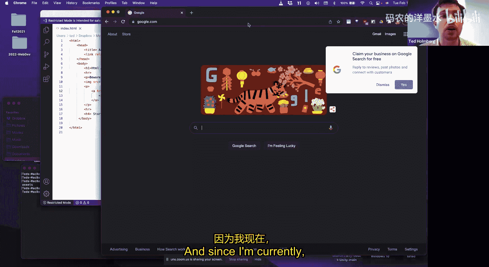

Notice right here it shows file that means I'm in file protocol I'm in file protocol is just going to look in my the directory I'm currently in so let me go back to where it says intro do h which doesn't exist yet by the way right so actually when I let me refresh this so when I click on that it's actually going to say oh your file couldn't be accessed and the reason why it could be access is I didn't make it In fact let me make it really quick let me go back over here let me create the intro h file。

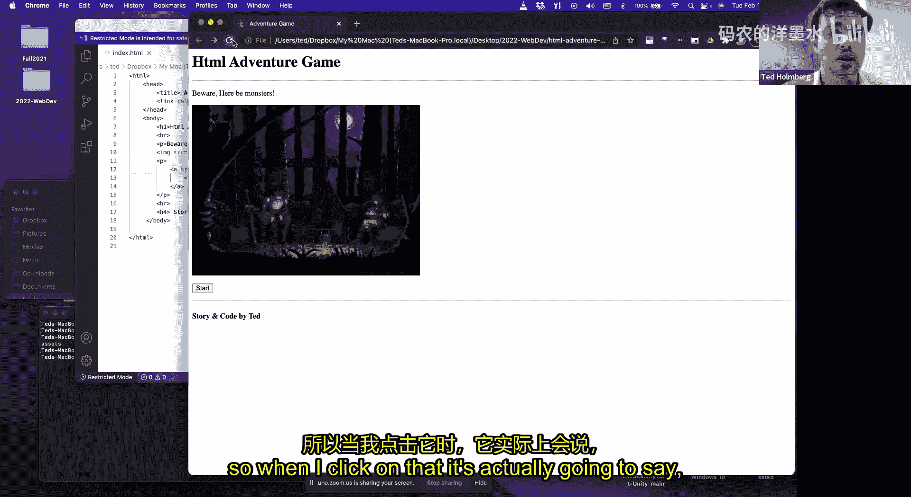

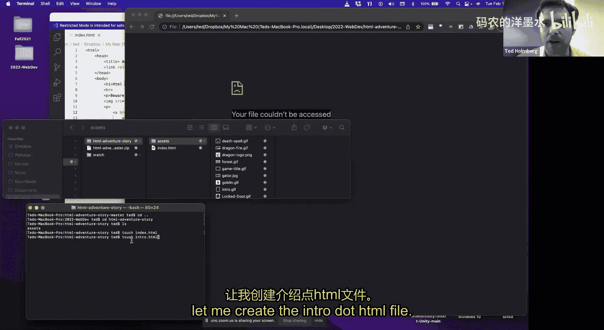

Okay， so now that it even exists， let me go back， let me refresh and if I hit start。

Now it actually can find it， there's nothing on there yet， we haven't read it yet。

 but notice it didn't give me an error message。Did that help answer your question？Yes。

 because now I most definitely will look to see that there's the HttPS anytime I'm clicking buttons on my web browser。

A sure I'm going to actual websites。Yeah， there's lots of nefarious things that can be had to and we'll talk more about security implications of web applications as we go throughout the course。

And of course。Okay， so now what we're going to do is we go through that assessment phase。

 I think we already did this though， so we opened the index of H out in our Chrome browser and we had that tab in the viewport both display so we saw the tab yep and we saw what this this content in the browser so now that。

My content that I've just implemented is in line with what is illustrated inside of this lab document I can move on to the next step I've completed this goal I'm successful so for goal2 I want to build the intro page so our second goal is essentially it's just to introduce the story of our interactive game so it's going to like introduce the character or it's going to be like the starting action that's going to create the quest or if it's a scary story maybe the thing that's going to be the source of inspiration of the the scars like the haunted house that you go walk into or whatnot。

Okay。Yeah， that's exactly anchor tags are used and so the idea behind the concept of an anchor tag is you're anchoring it's like an anchor point of the HTML document to some other point so which could either be in the document itself or it could be another HTML document。

So we're going to start every HTML page the same way we're just going to start with an HTML element and inside that HTML element we're going to add。

He element and a body element， so let me go to my intro。html。😡。

And let us go ahead and paste our code into there。 So HTML element， we start with that。

 and we give it a head and a body。And we're going to do the same second step every time。

Which is going to ensure that this page also has inside of the tab adventure game and that logo。

 If I go now， look what happens right now， if I go。Notice it goes to intro。

 HTMLtm and then the default of vvacon。So if I go into my head and if I go and。

Put in that title element。And also put in a link element that lits that has the relation of an icon and then links has a hyper reference to the logo we want to use。

 then when I refresh there we go so now now that's going to be consistent if I go back。

My index on HTML and then my adventure game， HTML will all have the same kind of user experience across the multiple pages。

Okay， so now let's go to the body。 And so the third step。

 every time we go to design our HTML pages will then be to define the body。

 which is going to be all of the elements that are going to be rendered。 So remember。

 the point of this page is going to be to go ahead and effectively and let me tab that in。

 I want to have these。Pretty late， I want all of my HTML documents to have pretty styling the same way that you've learned how to style your documents in Java。

 you kind of want to do the same thing have all the scope the indentent within because then I could see the beginning and end of an element and easily see。

😡，What's contained within so just a quick readout of my elements I have a heading element。

 a big heading element a heading one so I could have a heading one and H1 and H2 and H3 and H4 H5 and H6 and they progressively get smaller for each of those heading elements so here I'll have essentially the heading of this this scene I'll then have a horizontal rule a horizontal line。

Then I'm going to have an image that depicts what's happening in this scene and then a paragraph that describes to our player。

The intro of our story so here it's just a quick welcome traveler our land is plagued by great evil。

 please save us and then I'm going to give five gold pieces as a deposit and then I'll do another heading element which is going to have nested inside of there that anchor tag that will let the player click into the overworld HTML file so it'll go to another HTML document and then what by putting text in between the anchor tag instead of revealing what the address is can we can give a description of where this is going to go so this is going to then have a piece of clickable text that says adventure out of town。

Okay。So let me click on here and see oh yeah， so there's our heading one element and then this is our horizontal line and we have the embedded image here and then we have our paragraph。

Here， and then that's our hyperlink。 and notice our hyperlink has a heading4 element。 right。

 It's bolder than the normal tax because we。Have the anchor tag right and that's sit in between a heading floor and then if I click on Advure out of town。

 it's going to bring me to a page that does not exist。

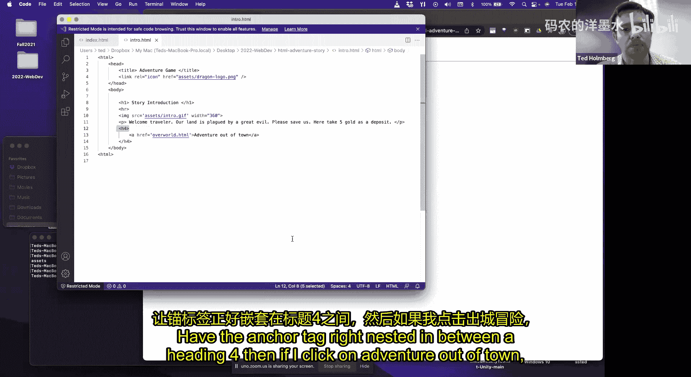

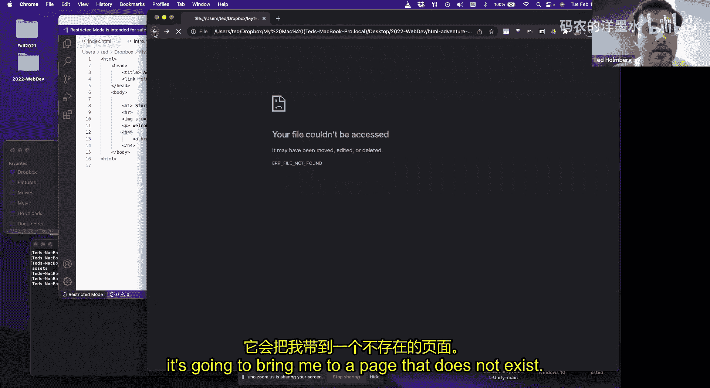

Excellent。So there's not much different between this goal and the last goal。

 just illustrating how we can link between two different HTML documents and we can put all sorts of media in our documents。

 so it's not just text but we can have and not just hyperlinks， we could do list。

 we can do tables which we're about to go say how to do we could do images we could do video。

 we can embed video and we can embed audio and we'll do all that over the course of this lab。Yeah。

 so we don't need to， in fact， we can have some really ugly look in HTML I can get rid of all the I can have it all go across one line and the browser will be able to parse it but we won't be able to read it well so it's the same reason why we do indentations on code it's for readability for our developers and not necessarily because the application requires it。

😡，Okay， I'm happy with that， okay， so let's move on to goal three。

So in goal three this is going to be our inventory page so this page displays the players inventory the HTML documents HTML documents normally can't share data between each other and so this is one reason why this concept of a single page application has evolved and we'll talk more about what Ss are and progressive web apps later。

 but one reason why we've moved away from multi page。😡。

Pages into single pages is to maintain or data persistence in the Java script runtime environment。

 However， this， this lab， you're not going to do that。

 So we need to find an alternate way to be able to get data from one web page。

 one web page to another。 And there is a way to transmit data between web pages using what's called a query string。

 which is embedded at the end of a URL。 So if we look at the anatomy of a URL。

It might look something like this， so this might be and this is an HTP one。

 but this could be the same as a file pathway too of an HTML document so we would have whatever the file path is to an HTML document。

😡，And then we could put a question mark after it and a question mark。

Is the delimiter between the web address and then the set of data that you want to inject。

Into essentially the JavaScript runtime environment。

And so then it's a key value pair where I can have a key and then set the value with an equal sign if I have more than one sets of keys。

 I can combine them with a single ampersstand。😡，So let's take a look at how we could do that's first let's make an inventory。

ht page。So let me go back over here。Okay， let's open this up in here， Okay。

 and we'll also double click it so we can see what's happening as it evolves over time。Okay。

 so we're going to start our HTML document the same every time we're going to start by defining the HTML element and inside the HTML element。

 you need a head element and a body element。Okay， so once we once we have that。

 the next thing we want to do is we're not going to actually for our inventory page。

Create a title for it because。The way that we're actually going to use this in our game is we're going to create an iframe in other pages that's going to display this content so we'll never actually directly access our inventory do HTML page we're always going to indirectly access it well on another page so we're just using this as a view into the content the of what the player has so let me go ahead and just grab really quick。

😡，The body。Elements， so I'm going to leave the head blank then and here I'm going to on let me indent all this in so that it has the appropriate。

It'sTing and let me save this okay， so what's happening here？Okay， so we have。Inventory。

 and notice I'm not wrapping that around anything， right？And then I'm going to do a horizontal rule。

 so when I go to look at this， it's going to be plain text。😡，Word inventory。

 and then it's going to be a horizontal rule and now I'm going to create a table。

So a table you might want to think of as like like a Excel table almost right where you can have rows and you can have columns so when you define a table element tables can have TR elements TRella。

 the TR is short for table row so everything that goes between this TR。

 the open TR tag to the closed TR tag will represent the content that goes into the table row and then table rows can have either TDs。

 which is table data or TH which is the table head and so there's a stylistic choice that's going to render by the browser based off of whether you do TH or TD TH is going to kind of bold in whatever the content that whatever text is between that because it's thinking that's your table header。

Or your table heading and TD is just going to display it as if it's a paragraph text so it's not going to do anything special to it Now it's actually possible to embed emojis or Unicode characters into our HTML documents we can use a special symbol of ampers stand and then hashtag and then whatever the Uniicode symbol is and you can look this up so for instance if I wanted to find。

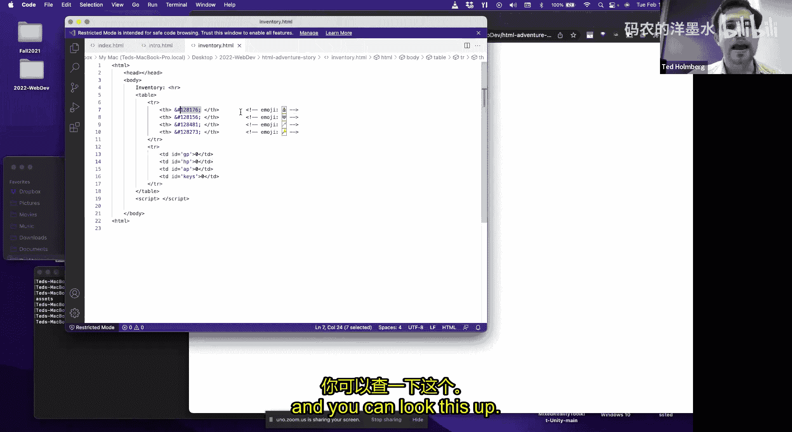

Like the Uni code， and then I can even put an HTML if I'm want the HTML syntax for of let's say。

 for instance， of a smiley face。I can just do a quick search and okay， okay， there we go。

 we can see here。Let's do something more interesting than a smile let's do like a dragon is there a dragon Okay。

 so here we go we have a dragon let me just click on this the first hit this on here。

sSa if it loads okay， so here you can see this would represent the hex encoding you can either use the hexencoding or you could use the encoding of this dragon here and as long as you preface it with a ampersstand and a hashtag it can then render。

That。It can then render that symbol。Actually， let's do we could do money bad too。Okay， yeah so。

And that's probably what we're using right now to represent the amount of money you have。

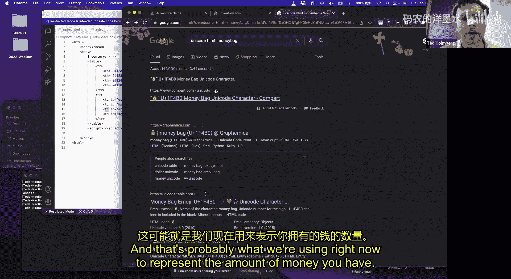

So that's just what's happening here so this is going to be the Unicode character for a money bag this will be the Unicode character for a heart。

 this will be the Unicode character for sword， this will be the UniIcode character for our key and these are comments in HTML by the way so a comment can be embedded in HTML it's a multiline comment it starts with what looks like this arrow with an exclamation mark in it as the beginning portion of a comment and you end it with a arrow that's pointing in the opposite direction dash dash and then the angle bracket and then any content in between as you see is going to render green its not going to actually be parsed and displayed inside the viewport。

Then what we're going to do is so this is going to be a first table row。

 then we're going to have a second table row， which is going to have the table data elements。

 TD elements， and in between each of those we're going to start with0000 and I'm going to assign an attribute an ID attribute to each of these as a string and string in HTML could either use double or single quotations just be consistent with it for opening and closing and so here I'll give this the ID of GP for goal pieces。

 this will have the ID of HP， the ID for HP for health。

This will have the idea of AP for attack power， health power goal pieces and then finally the keys so you's supposed to line up here so money。

 health attack and your keys and then after I have the two rows I will go ahead and close out my table element and then I'm going to eventually embed some logic into this page。

 I can embed some JavaScript in between script tags。So if I go and just hit refreshsh now。

 you'll see oh that's what I have inventory in plain t along with the horizontal line and then I have my emojis at render out and then underneath it because this is a table right then underneath that I have0000 perfect so now let's see what we're going to add into that script tax。

That's right now。Now， and to prove this， let me put something like this。See how it by the TH。

 for table heading， if there's any text in there， it would go ahead and it would bold it and make it bigger and font。

As opposed to posts。As opposed to like this， however， emojis can never be bolded。

 emojis don't have like font differences。You can only increase the size of them。

I know cancel that Okay， so now let's go into our script tag and let's go ahead and paste this in there。

question， sure。For the table， do you need to start it with a TH tag or does it need a heading tag？No。

 it does not the table does not need a TH so I could have just made these TDs if I wanted to and that's the only reason why I used THs here was because I wanted you to see the element existed。

 but then of course I put a text in there that didn't matter。😡，So this would work just fine。

 you're never required to have a table heading。So if you wanted to make a table that represented like a chess board or checker board and just navigate the things in between though。

 that's completely fine as well。Thank you。Okay。Now， inside my script tag， I can actually put。

Some imperative logic in there so I can move away from the declarative paradigm that I'm stuck in with H and actually start to get some interesting algorithm design and whatnot here。

 but what I'll do here is I will。I will be able to create a URL search parameter。

 So this is an API call， a javascript API call that all browsers support。

 So let's see what's actually happening here。 Let me jump into my developer tools console。😊。

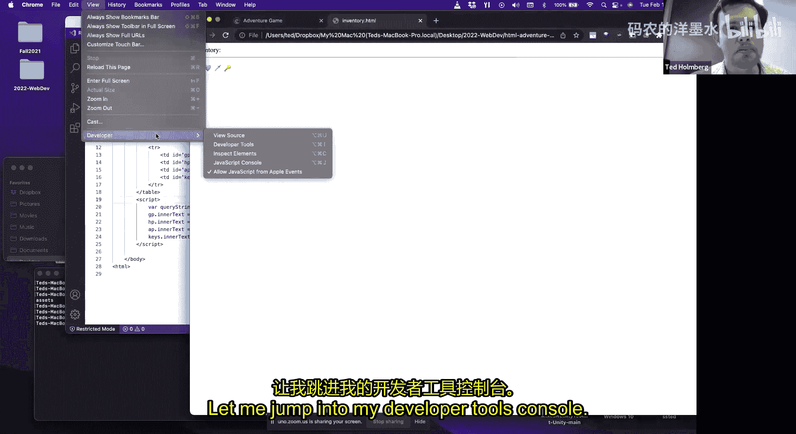

Here。Excellent。

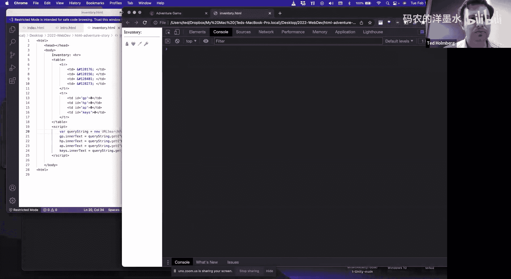

No， I did not want you to go。

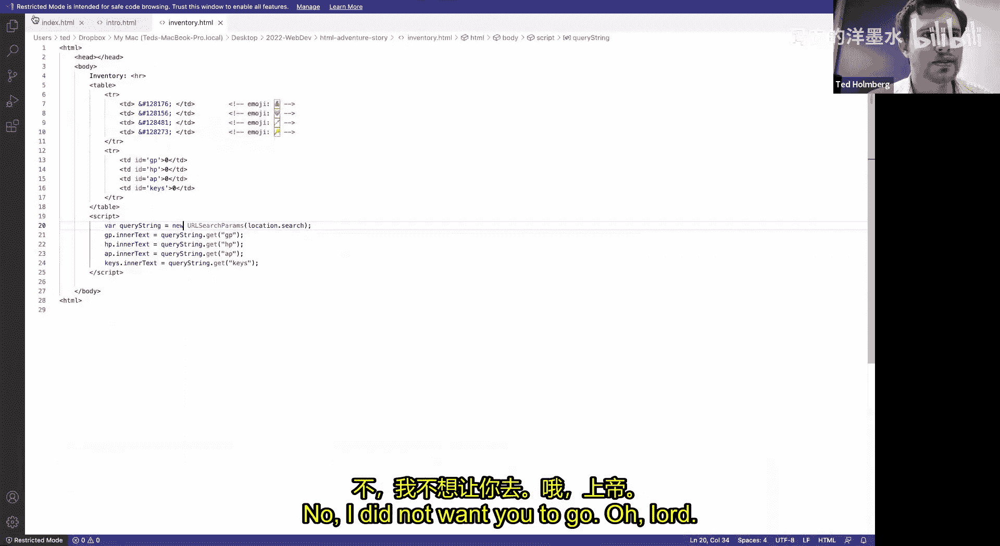

Oh lor。Let's。Collapse that down。Okay。So here we go。 Okay。

 so here I'm going to open up my developer console。 So if I type in。Location。

 searchs first of all let me let me see this we have by default a window object available to us that has all of the settings and data for any given web page and this is this is launched when a web page opens by the browser one of the attributes of the window is what's called location so that gives me the location information that's inside of the address bar here there's actually ailes to that it's just called location so if I type that notice that's the same thing。

😡，Okay， so I have this location data that's available to me at the inside of the JavaScript runtime environment that contains the address we're currently at。

 And in fact， if I type in and get the search attribute of that。

Think of this as an object so this is an object if I type in the search parameter it will turn back a string to me to say oh that's a search parameter at the end of your address now I didn't put in a search parameter at the end of this right but if I put a question mark and let's say I put something like GP is equal to five right so goal pieces is equal to5 and let's do that Ampersand and let's say I do HP is equal to three。

Okay， and then let me do that and let's say I do that attack power is equal to one。

 Well there's that one more， let's do keys and P's is equal to zero。Okay。

 let me now reload the page and the page looks like it loaded just like before。

 but now if I go and type in location。search， notice it returns back to me the search parameter。

That was fed into accessing this page， so now I actually get the question mark and then all of those attributes I just typed in。

😡，So let's say then I'm going to create。Something so right this is just a string if I wanted to access it as if it were a data structure like it were in Java JavaScript or Python or any other programming language。

 I could take this string。😡，This search term the search parameter and I can instantiate a URL search program object from it。

 so let's take a look at what that's going to look like let's do this one single line inside of the console。

😡，So here I'm going to declare a variable using the keyword var。😡。

And I'm going to give this variable name query string， and I'm going to assign into this variable。

 a new instance of a URL search parameter that is this location this location。 search。

So here now what do I have？I now have a URL search for rounds。

And so this has giter methods so I can say for instance， query stringing。

 gi and I can do git and I can use whatever these keys are so if the key was GP。

 it will now give me the value from there five or if it was HP I can now get the value of three so it's parsing it for me if it was the attack power it's going to be that one and if it was the keys。

 it's going to give me that zero。And in fact， if I wanted to go ahead and notice it's a strings here。

 if I wanted to parse it as a integer to actually do addition or something on it。

 I I can kind of force cast by putting in a plus sign in front of it and so now notice that's an actual integer value so if I did plus one it would actually add one to that whereas if I don't put that plus sign in front there's other ways to cast when we talk about when we actually get into proper JavaScript lessons。

 I'll show you all the different ways we can cast data。

 but here you could just see if you by default， try to add one it'll do a concatenation operation but we can force strings into number data by just putting a plus sign because what it's going to try to do is just trying to give it a sign essentially。

Professor， what is this what is this process called like I noticed when。

When I did plus one to the query string， it didn't state it reverted back to zero。

What is this like process called。Um what？What do you what do you mean like I mean like。

I noticed that when we're in programming in text editors we're programming text editors here this console is this really like programming this is such a great question and one that I you know I hadn't anticipated answering yet usually I covered this when we actually get to JavaScript but since I rewrote this lab to actually use a little bit of embedded JavaScript that I'm kind of trying to give you an idea of what this code is doing by jumping into the console I guess this is a great time for me to lead with the idea that usually you can divide programming language into one of two kinds of categories you have compiled languages and you have you have。

Scriping languages。And so。With a compiled language when you are in your text editor and you go ahead and you build all your source code you have to go through a compilation step that converts it into essentially bytecode or object code that is essentially the machine code right you're assembled instructions that will then be run and once you've compiled it like you can't go and change the code in scripting languages there's no compilation step so it's essentially it parses a statement at a time and tries to execute them another name for scripting languages usually called an interpreted language because it interprets your statements one after the other now one of the biggest criticisms about interpreted languages is that they're a little slower then compiled languages。

嗯。So but but there can be very performant and they allow you to really kind of test and evaluate your code base so JavaScript as a as a interpreted language means that it can be fed code on the fly and it' will go ahead and update the viewport based off of those instructions and so that'll allow us to create kind of interactive code。

😡，I understand I'll give you an example of that later on right now I don't want to get too deep into the JavaScript but I do want everyone to feel comfortable enough to be able to use it to build their interactive stories。

 but right now all we're doing is this query string is the variable and then we can just go ahead and invoke a Gi method with whatever the key name is to get those values。

😡，Did that answer your question at least between interpret language and other compiled language and what we're doing inside the console so this console is our runtime environment for JavaScript and allows us when we go and when we execute this script tabs this is essentially what is' running these instructions in it's loading the instructions into the console for this tab and every tab has its own JavaScript runtime environment that is different than all the other tabs so every time you open up a browser window and its tab inside the browser window each one of those windows has its own JavaScript runtime environment。

So when I think of the JRE， I should be thinking of this dark screen that has all these like optional query strings that I can insert into。

Absolutelyly， okay， so this is the JavaScript runtime environment， thank you。Yeah， yeah。

 and so if you watch the lecture on browser tools or developer tools。

 I give a full rundown of all the different things you can use the browser for for web app development。

Okay， so now that we have this query string and we can get the data from the query string， well。

 do you remember how I gave an ID attribute to these HTML elements up here？😡，Well。

 one of the advantages of giving an ID to an HTML element is as soon as I given it an identifier。

 I can now use that identifier as a variable name in the jascript runtime environment。

 So now if I type in GP。哦。Notice it grabs that element， right if I type in HP。It grabs that element。

 if I type in AP， it grabs that element and if I type in keys。It grabs that element， Okay。

 let me do a quick clear because this is this is starting to get kind of。

Filled up with content okay so。I can then go into GP and access the inner textex。

 So let me let me type that again。 So I have GP。 if I go to GP dot。And access the inner text。

That's the actual value that's in between that HTMLL element so if I do an assignment to that let's say I sign it C 10。

 for instance look pay attention to this when I do this assignment so right now it's five right as soon as I hit enter it now goes to 10。

😡，So I can actually change the state， the value of what's inside that HTML document， I'm sorry。

 the HTML tags。By accessing its ID and then the inner text that's between the open and closed tags on there。

 let me go back to file。So what I want to do though。

 is I want to give values to it on what's based off those off of the parameter string that's fed as part of the web address。

😡，So here， if I do get the value of GP from the query string and send GP to that， oh， well， actually。

 let me hang on。Let me do a refresh。So that。Oh， well。Well。

 it's already everything because we're parsing it but。So this won't do anything。

 but you could see that's why it's setting this to five and three and one and zero because we built that query string and then we're getting each of the keys。

 which is returning the value and then we're setting the inter textex to each of these elements to be what the value is inside there。

Excellent。嗯。Cancel lot。Okay， is there any questions about this or does this this is the first kind of JavaScript and this isn't covered in the lecture。

 so this is only covered in this lab， but does this make enough sense for everyone to at least kind of understand what's going on here？

Yes， will we be going over this specific console later on in the semester a little more too？

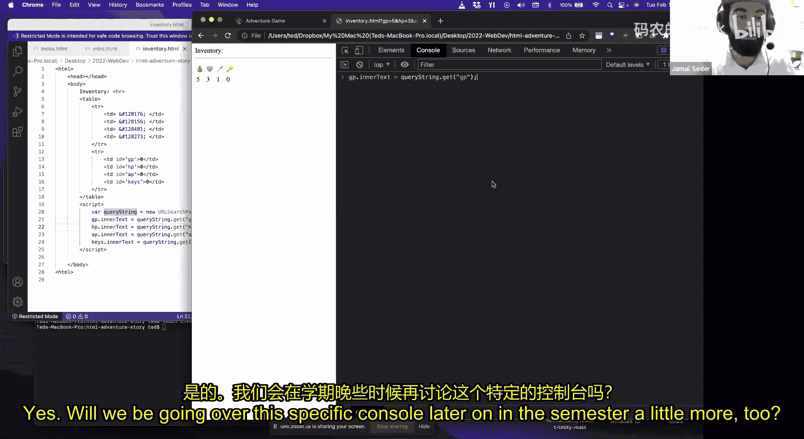

Oh yeah， where is this little okay， you're going to live and breathe from this console when we get into JavaScript？

Again， the only I had avoided actually showing off this console。

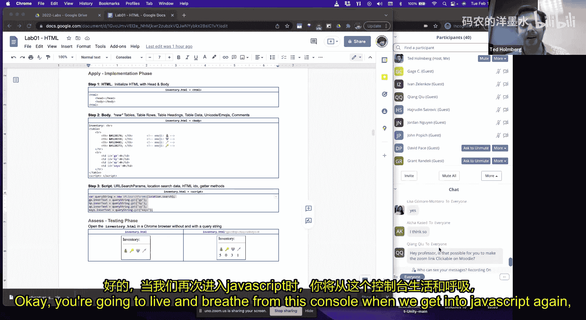

For the first three lectures last semester， but I decided to introduce it in fact。

 the first lab in this semester because for the homework。

 there was a lot of students who wanted to be able to get this sense of shared data and I thought this was a good opportunity to show search parameters and how you can have a multi-pd application and share data between each page using that search parameter。

 and now when you go to some web pages let's see I don't know。

 and if you see that theres that question mark and you know what that is actually doing that those are search parameters that are either used to send data to the web server or for the web client to be able to parse and use in some kind of novel and interesting way。

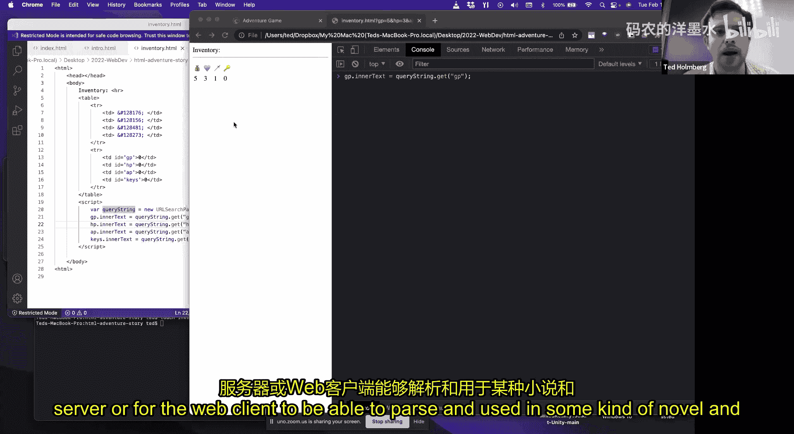

As soon as you mentioned it， I did check Moodle and after you're logged into Moodle。

 it actually has a question mark。And it has like an I。It's， I think it's prevalent a lot of。

Of course yeah yeah it's a very common measure and we'll learn other ways too so yeah it's a I thought it was a fun way to add something and I think get some better assignments out of this too。

Okay， let's say I won't have as what will。I know let you know。

 we'll finish this up probably next week so I won't be able to get through all of these goals here。

 but I want to get through at least one more since I think it relates to what we're just doing。

 So at this point we have it so that if I。

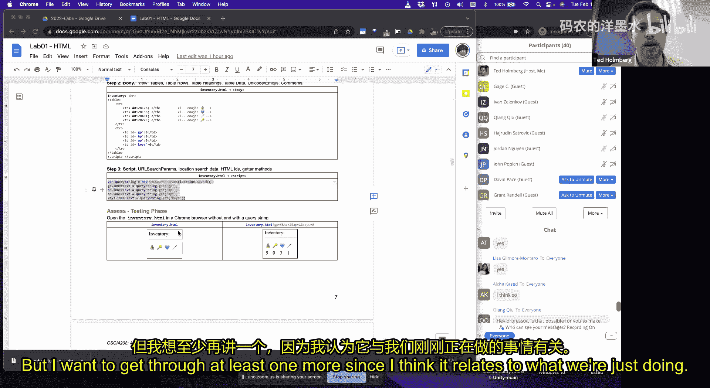

Don't put it in a search parameter， right？I don't get any values and then when I do put in the search parameter。

 I get values and whatever values are passed in。So that was our goal to build an inventory page that we can go ahead and load data into and kind of parse it and use it。

And our web page， so let's move on to Go for and this will probably be the last goal that we're going to do for today's lecture。

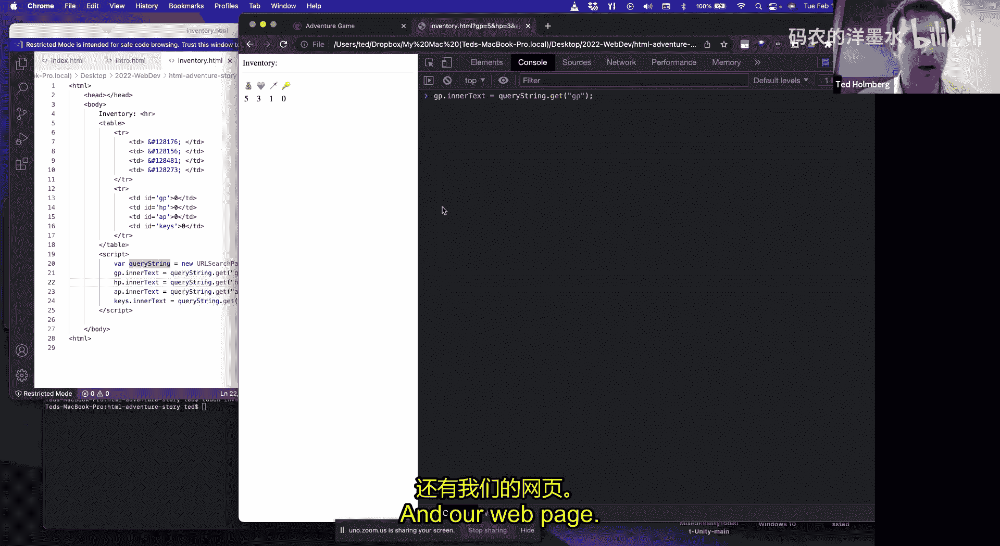

Where we're actually going to go ahead and build our overworld scene and our overworld scene is going to give the players a list of places to travel to。

And we'll be able to use our script tags to pass that query string to all of the H RAs。

That we're going to link to。So that's going to be the approach that the trick is as you accrue things you want to make sure that this query string that we're using modifies over the evolution of your software so we can we hard coded it here。

 but in the future we're going want to make the values of like five for gold the value of health right the three here the value of one and the value of zero inside of the H document we want that to be able to be variable data and not。

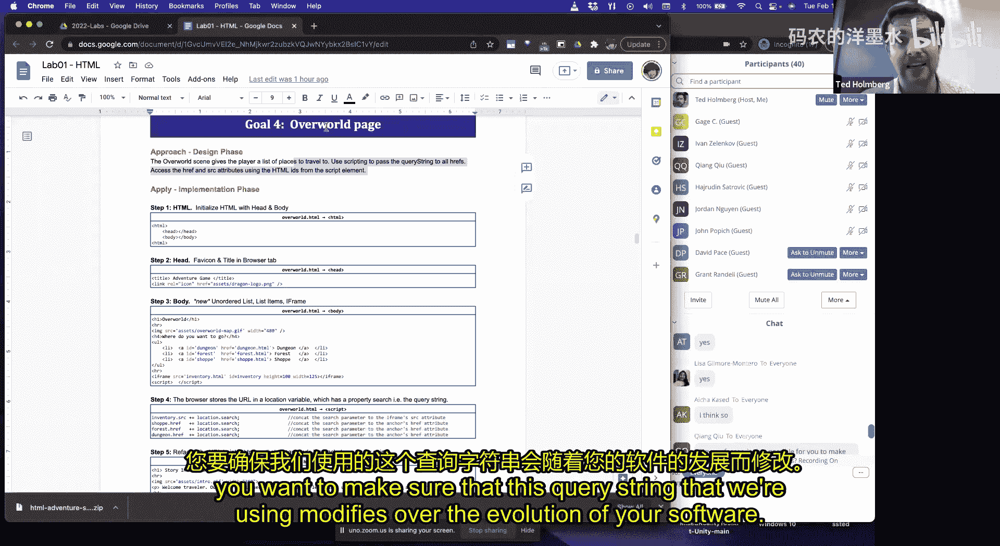

Imutable， we don't want it to be constant。

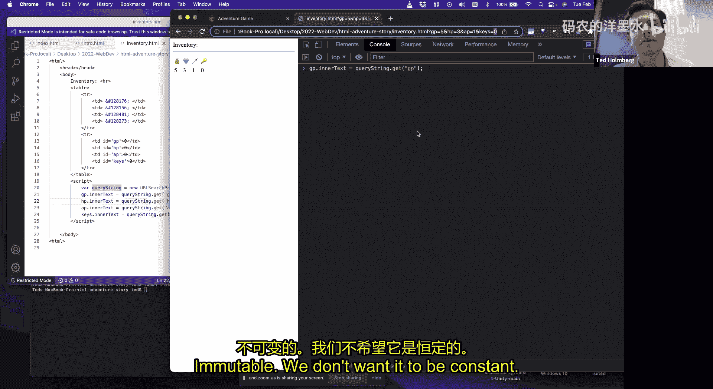

We don't want to hard code it。So let's see how we might go about doing that well the first thing we should do let's build an HTML document that represents the overworld and as you recall from index to intro。

 we're actually linking to overworld from intro。

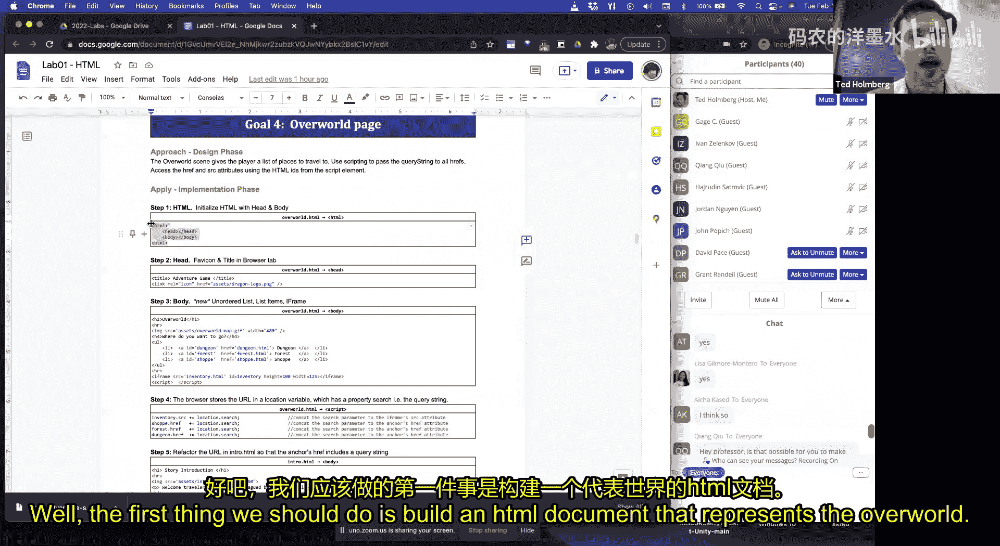

So here let's go on create To。Overworld。htm。Huold this into here。

And let's start by giving at the HTML。Aggs along with the head and body we're going to start everyone the same way and then since this is actually going to be a page that's designed to be displayed in the browser directly。

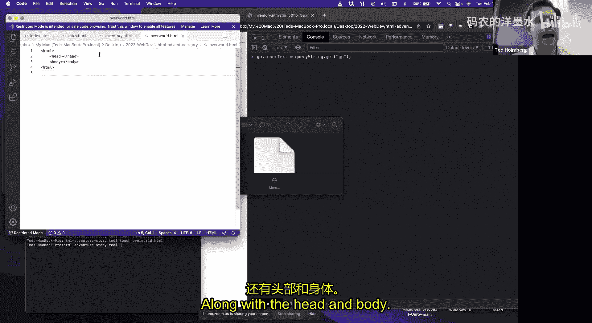

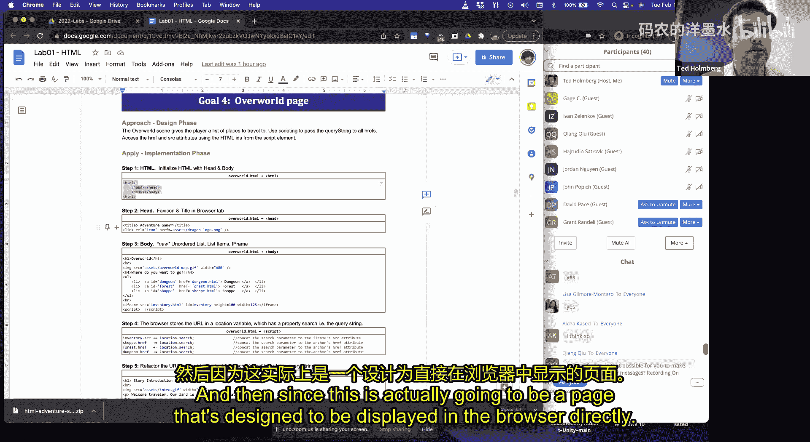

I。We're actually going to。Lord， I'm to start and freeze。 Test， test， test。Okay。

 then we're actually going to do okay， perfect。Okay。

 then we're actually going to grab the head element that we were grabbing before。

 so since this is going to be part of our actual interactive game， unlike the inventory page。

 which is going to be used by the other scenes。Well'll go ahead and add that title and that。

So let's back here， let's go back here。Let's go back a couple times Okay。

 so let's go to adventureure out of town。 Okay， perfect。

 so here we could see we have our title and our logo。Now。

 the next thing I want to do is I want to grab。The Hl elements that we wish to render into the viewport and put that into the body。

 Oh， let me get my tabing correctly on here。 So it's easy to read。 Okay， so in our overworld scene。

 This is the first like real scene after the introductory story。 We will have a heading element。

 a big heading， a heading one element that says overworld。 We'll do a horizontal rule。

 we'll embed an image that is the animated gift of our overworld and we'll set it to be the width of 480。

Then we're going to use a heading four in to alert the player， hey。

 where do you want to go and here we're going to create an unordered list。😡。

So an unordered so we can create either ordered list， which is a numbered list。

 or we can do it unordered list， which is going to be used essentially dots and each list。

 whether you use a UL or OL will have list。Items or elements inside of them and the and each L element will produce either a number or a bullet point and then we can embed an HTML element in there it'll be an anchor tag that essentially allows us to hyperlink to a new。

😡，Ht document which will represent。Where the player could potentially go so Dunngeon will link to dungeon。

 HTMLtml Fors will link to forceesighthtml and shop will link to shop。

html Now remember every time we go to send the player to a HTML file to another location inside of our application inside of our interactive story we're going to also have to add the search parameters to it so that we don't lose the player data we want the player to be persistent across every page。

 which means we have to do that inside of a script tags so in order to access these H ref element we have to also give these inker tags and ID element。

So that we can access it inside the script so that we can access it using the term dungeon or For or shop and so that's what's eventually going to go inside these script tags here。

Then we're going to have our our HR， I not I'm sorry， our horizontal rule。

 another horizontal line and then we're going to do an iframe and notice the iframe is going to go to the inventory。

 HTMLt page when iframe allows us to open up a little window。

Inside of our current page to some other page and so the source is going to be this other page。

 I'm going give this an ID Ash2 so that I can access inside of my script tags and then I can give this window this little browser window this iframe window it's own width and height So before I put any scripts in there if I were to go and just hit there you could see this is my heading element that's that horizontal rule this is that animated G that's 480 pixels wide this is my heading for element that gives the user the option of saying hey where do you go and then this is that unordered list right so it uses bullet points if I change this to OL just so you could see which would be ordered list save that it would all of a sudden become numbered。

So that's how easy it is to switch between an ordered list and an unordered list。

If I switch it back I get my bullet points okay now each one of my bullet points is inside of the list items and those are those are gonna be hyperlink so when I go a right that doesn't exist but I should be able to click on each one of those and would try to go to4 HTML shop HTML and then here is that iframe so I have that other horizontal line and then here's that iframe that I set to be 100 pixels by 125 pixels and so this is what's giving you us set view。

From inventory。 HTML that we built earlier， now notice we're not getting any data in there yet。

 in fact， we're not。We we need to send that data to inventory in order to access it。

 so let's take a look at how we're going to do that inside the script text it's going to be pretty simple though because。

😡，What we can do， and I want to jump back into the console developer tools。Okay。

 so I know that I can access I have an element that has the the ID of inventory so there that is right so one thing I can do here is if I go to that element inside the script tag access it。

 I can access all of the attributes as if it were a class I'm sorry as an instance variable。😡。

From this object， so if it has a source， right， this has an attribute of source。All rightOkay。

 there we go。 We have an attribute of source right here so I could do inventory dot source and look at that。

 It actually gives me the location of that。Now， remember if I do location。search。😡，That up。

Let me do this。Gp equals 10， for instance， okay， refresh， so now now I have that。

And let me go back to inventory。No。Okay， and inventory dot source。 Okay。

 so now if I take inventory dot source and I can patentate to it， let's say the location。好。Location。

search， that string parameter。Look what just happened， see what happened。

 it actually was able to send GP 10， right that's the search parameter。Is able to send that。

As part of this hyper reference， and since the inventory page is looking for those keys。

 it's actually going to be able to set that value。So that's exactly what I'm going to do inside my script tag so inside here I'm going to paste。

😡，Or I'm going to add in this logic and actually the main tab it one more time where the inventory。

 the HTML element that has the idea of inventory， it has a source attribute I'm going to concatenate to it the search parameter string。

 I'm going to do the same thing to the anchor tags hyper reference。To dungeon。html。

 I'm going to do the same thing to the anchor tag with the idea For。😡。

And I'm going to do the same thing with the anchor tag hyper reference to Dunngeon by time so what I'm doing inside this is I'm appending my query string from whatever I have at this page to all of the other pages that this page links to so that I can share this data when we transfer control from this page to the next。

😡，Okay， one last thing I want to do here is when we go to this page initially。

 we should set up the search parameters right， so we want to set search parameters for GP， HP。

 AP and keys。😡。

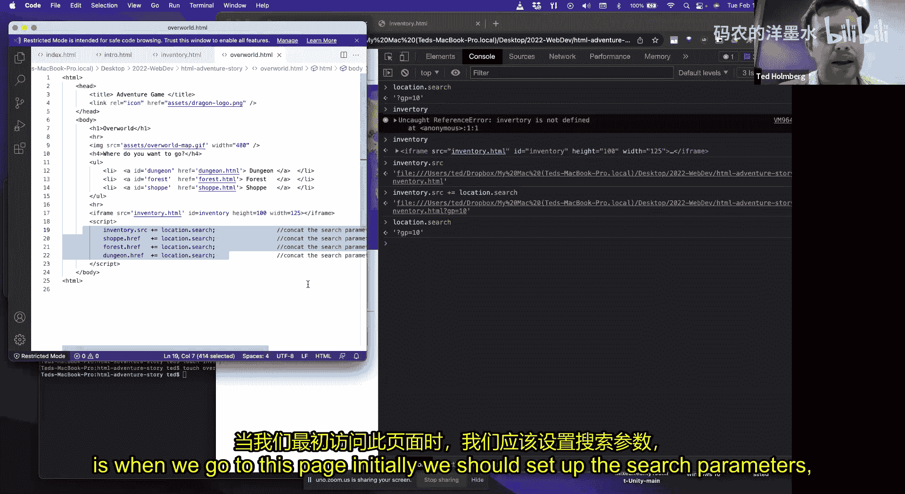

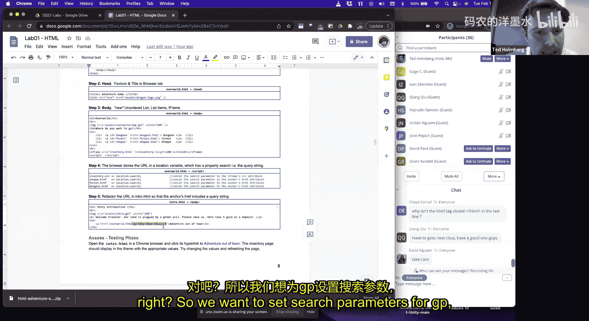

So let me do that， let me go back to intro。There， save that and let's see。

 let's go back to index on HTML， let's actually open this up let's go back。Let's go back。

 let's go back Okay， so here starting from our beginning page of our game。I will start。

 I'm told I have five gold pieces， I will now go here and look at this， oh。

 my inventory screens working fine。5ive，3， one， and zero。 And if I hit dungeon， for instance。

This doesn't exist， but let's take a look at the URL link， yep， that worked。😡。

At the end of that URL link is the question mark and then GP is equal to is5 and HP is three and AP is one and keys is zero so this is starting to build a mechanism where we can start taking and mutating the data and sending it well at least set the data and send it to all the hyper referencefers we'll see how to mutate it later on in this lab but I'm out of time today and so we are done with where we need to be for goal number four so we will pick up on Thursday at goal5 but up till now you can actually start working on this lab on your own。

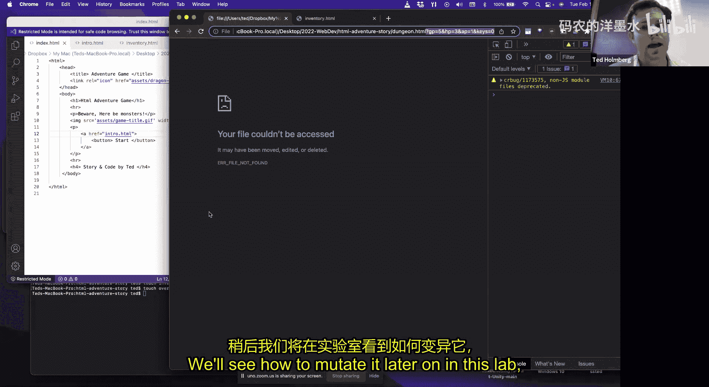

And in fact， if you run into any issues， you could ask me questions about it next class when we start working on it again。

Yes， I will post this lecture up on Moodle as soon as it is done transcribing。U。Yeah。

 I don't want to spend too long honestly with the HTML and CSS and bootsottap Labs because the more interesting content of this class is going to definitely be all things related to JavaScript。

 but it's super important for everyone to have strong concepts of HTML and CSS and just responsive web design before we move into JavaScript so that you understand what some of our aims of JavaScript will be。

But we'll play it by you， we'll play but， we'll see what happens on Thursday。Excellent， everyone。

 have a great day。

Thank you。 Have a good day。