# 【全集】加州理工学院 高级Web应用 中英字幕 1080P p02 Lecture 2 - HTML：交互式 part2 -BV192zTBrEmu_p2-

Okay， I'm now recording， let me put the chat up， get rid of participants。

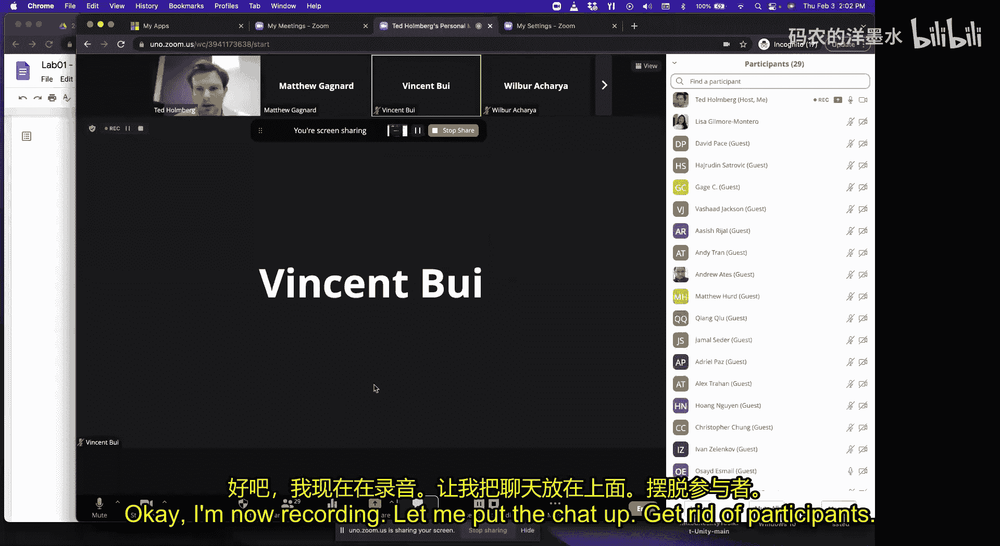

And there we go。 So I want to go ahead and spend this lecture continuing。Where we last left off on。

 well， this lab continuing where we last left off last lab。

 so we've made it through the first four goals in lab one， the HTML lab。

 so I intend to get through goals five through 12。Over this slide over today's demo or today's coding session。

So let's do a quick review of where we last left off。Let me go to where we're at。

 so we had just finished programming our overworld page and if you recall the overworld page now has this query string here。

That gets parsed by the script tags， and then it goes ahead and sends that to this iframe that allows us to see。

D。State of the data that our user has pretty much accrued， our player has accrued。

 so we have five gold， we have three health， we have one attack and we have one key and if we click on any one of these links。

 say for instance， the forest link。It'll link us to a page that doesn't exist yet and it's going to be goal five I remember correctly。

 but notice that the URL now also includes whatever the search the search parameters or the query string is from the previous page and we learned how to do that using a little bit of JavaScript。

A minimal amount of JavaScriptscript。Okay， so let's see what we are going to move on to do so in goal five we're going to build our forest page。

And so here we're going to again， look back at this approach。

 apply and assess model for each of our goals。Please as you come in mute yourself。So our approach。

For our forest page is going to be a forest page that links from the overworld page and it's going to provide the player with some new choices to explore inside of our story so up to this point I think it's been pretty linear right let's go back and see what we have so we have this the index HTML page which literally has a start button and brings us to an introduction which has no real options right it just tells us to go adventure out of town and so finally we have some multiple options here。

And so let's implement the first that's going to bring us into the forest。So in order to do this。

 I'm going to do what I have been doing， Let me make a new。

Html page so I'm going to create one that's called forest。htm Okay so now I have this force。

 html page let me go ahead and open that up inside of my text editor so go ahead and do that and now recall every time up till now that we've decided to implement an HTML document。

We start with the。Ht tags and the HTML tags have two children elements。A head and a body Okay。

 so now that we have this page that exists， if I click on For， we now load up to a page。

 we haven't added any content yet and of course the first content we want to add is going to be that favcon and we want to replace the title with whatever the title of our game is going to be so we're going to move to step two So we've already completed step one where we've built an HTML。

File nameforest。hc now we're going to add this into the。Head。

Element and here just like before we've seen these lots of times。

 it's the title tag and it's going to be a link element that's going to be。A relative type of icon。

Relation of an icon and then we will hyper reference our PNG， so if I refresh this now， there we go。

We've updated our navigation tab。Now， the next thing we want to do is actually implement what the scene in our force is going to contain。

So again， I'll go ahead， I'll copy this over， and then I'll walk through what's actually happening inside of this code。

So inside of our body， we're going to paste this and then I'm going to format it because I want。

This to be human readable So what's gonna what is going to render into our viewpoint viewport here Well。

 the first thing is going to be a heading one element that's going to say that this is our forest scene and then we're going to do a horizontal rule so we'll have a line that gets rendered then we're going to add an image we'll use the forest skiff image as our source and we'll give it a width a 480 to fix how large our image is going to draw we'll have a quick paragraph that gives a descriptor of what's happening in the scene so you wander into the forest to the left is a winding path up the hills to the right as a path to the swamp so this scene itself will offer two options to the user。

Then we'll use a heading element， but one that's smaller than the heading one element。

 a heading four element to ask the user what do they want to do and then here we're going to use that unordered list again。

And for。And for each set of items， list items， we will go ahead and embed those as these list item elements and each of these list item elements will have a anchor tag。

That will have the option either to go left into the hills or go right into the swamps and so this will be the text component that's going to be。

Associated with this anchor tag and now the attributes for this anchor tag will have a hyper reference that will lead to another page either goblin。

html or swamp。ht and then we'll also have the ID tags that we associate to each of these anchor tags and recall the reason why we're using these ID attributes is that we want to be able to access our our anchor tags。

 every hyperlink that we're going to produce inside of our interactive game we need to also be able to append the parameter。

 the parameter string， the query string to。So that we can。

Maintain the data from one web page to the next and so that's what we're going to use the script tag forward。

 you'll use a little bit of JavaScript to accomplish that task。Okay after the unordered list。

 we're going to have another paragraph， we're wrapping an anchor tag into a paragraph because anchor tags are in line elements。

So without wrapping it into a block level element， it could potentially share the same horizontal line as some of these other elements。

😡，So just to ensure that it has its own horizontal， its own vertical and horizontal space。

 we're going to wrap it such that we can get the behavior we want。

And then we'll have a horizontal rule after that， where we will then have this eyeframe。

 or call then eyeframes like a window into another。HtM document。

 so we'll give the source of the HTML document as our inventory。

htm we'll give this Nd so that we can also append our query string onto this URL and then we'll also set the height and width of our iframe so up to this point if I go ahead and refresh my page bam I have my heading element。

 a horizontal rule， I have my forest image I have the description of what's happening in the scene I have kind of a prompt to let the player know hey you have to make a decision。

 these are the decisions they can make this allows us to exit。

And the exit goes back to the overworld， right？And then we have our inventory。 Now。

 we haven't done the script tags that actually allows us to to actually。Pase the query string。

 So notice I don't actually have any inventory。 And in fact， if I go and hit exit now。

 I've lost all my inventory。 This is why it's so important that we go ahead and append the the data to the search queries to all of our hyperlinks。

So let's go ahead and go to step four for the script where we're going to pass the state data into the new pages via those URL query strings and just so you know。

Okay， let me go and paste this in the script tag。Okay， and let me in that in。Perfect。

 and let me indent one more time perfect Okay， so what's happening here。

 let me elongate this so inside of our script tag we're going to access each of those elements by their ID name so。

Inside of the inventory， there's a source attribute an SRC attribute so I can do a concatenation operation right so this is a compound assignment operation where we'll take the search parameter because recall if I type in here location。

 search。givesive me that query string， right？So I will just append that to every hyper reference that's on this page。

Now we've learned that I want to make one additional comment， we learned an HTML a comment。

Looks like this。This is a comment。Right now inside of the script tags。

 technically we're using JavaScript notation， so comments in JavaScript looked very much like Java so a single line comment is just slash slash if I wanted a multi line comment it's going to look just like that。

There we go。And again， if I tried to put this outside the script tag inside the actual HTML is not going to recognize that。

 I'm just going to think that's text。Same thing with this。

understand depending on whether you're in the script tags。

Or whether you're outside the script tag is going to depend on how comments are inserted because everything in between the script tag is technically accessing the JavaScript runtime environment。

It allows you to embed JavaScript and all of this patients， so in fact。

 if I were to try to do HTML comments here， notice it does not pick that up and I'm getting these red squareirly lines because it doesn't know what's happening there。

😡，Excellent， okay， so let me save this and okay。Let's see what our next step is up that's the final step for that goal。

 so if I read my assessment， it says try to open up the forest page and see if it works。

So let's test it out'll actually to make this easier for myself， I'll go to。

Let's go to the exit Okay so here I still have my state so presumably let me check the URL yep so I have my state here。

 so if I click on For now I maintain the state here and presumably if I hit for instance swamp and I look at the URL yep。

 I can see that the state has carried over。And then we go back， if I hit exit， yep。

 my state has maintained perfect， so we are complete this goal， let's see if a goal success。

So for goal6， we actually want to go ahead and implement our swamp page。So， again。Let's see。

 I think you mentioned it， but later on， we're going to implement a way to where the user can't change their inventory。

Well， so or at least we'll implement in such a way such that the user。

What we're going to learn how to do is learn how to mutate the inventory so that we can actually reduce or increase the gold levels。

 reduce or increase the health levels， reduce or increase the attack power or the keys now。

Unfortunately since we're working everything at the client side all of our data is exposed and in fact the user can always cheat right like for instance。

 if I was since it's all the data is essentially stored inside of our search query if I say for instance。

 made this a 50 right in GP and then hit refresh， notice all of a sudden I get 50 gold so yeah this is obviously a very easy game to cheat。

 but we'll learn more secure ways to go ahead and manage our data over the course of the semester。

Just understand that this is a designed to be public data and not private data。

 this is definitely not the way you'd want to store a password， for instance。

Let's say to clarify for the iframe tag and the ID property does not need。Okay， let's see here。

 So the question here is for the Id。Here or for what's the other one you had mentioned or the iframe tag。

So the iframe tag。Oh， I see， I see what you're saying。 Yes， so as you can tell。

 I don't need to actually wrap。Inventory for instance， the ID as a string。

 but what's happening is if I don't Java script， the JavaScript runtime environment when they parse the HTML document will essentially wrap that into a string for me so。

😡，So JavaScript tries to go ahead and determine。Syntax that is incorrect and corrected for you。

 so that's effectively， but yes， it means that I could just label all these things as non streams。

 but typically what we prefer to do is is to wrap the the quotations around it so let me be consistent with that good catch on that。

And。Perfect。Okay， so let's go back to the samp page。Just in terms of the coding convention， though。

 you typically want to do that just to illustrate the fact that it's a string that you're applying there。

Okay， so our swamp room is going to be another scene in our game andll recall we access our swamp from the forest scene and the swamp scene itself will have some options。

 it'll be the first option that will result in a game over screen so we're going to see how we can accomplish this by again invoking a script function that will allow us to overrite the entire HTML document body。

With new HTML elements Okay， so since that's going to be our approach。

 we want to have a scene that allows us to get a game over and or lead to a deeper part of our story so before we can start all this let's make a new swamp on HTML page。

😡，Okay， so this should now be inside of my directory。And I will go ahead pull that in。

 It's completely empty。 We're going to do the same thing we've been doing right。

 step one is going to be at least to put in all of our boiler platelate H code right。

 So the initial H element that has a head and a body。

 The second thing we're going to want to do is have our。Title and fvacon defined inside of the head。

Just like so。 Oh， let me just go ahead and have that。Have it again。

 save that and let's take a look at this。So I like to check as I modify my code just to see what's been happening。

 so here we said we're going to go into the forest inside the force is a swamp。🎼Okay， and yeah。

 there's my fbacon and there's my title。 perfect。 So next thing we're going to do is we're going to implement the body of the of this swamp scene。

 So let me just copy and paste， and I'll walk through it。

okay get everything in and in okay so the swamp is gonna have a heading element and then a horizontal rule has been pretty consistent in our design metaphor in fact every time I think every scene has been the same right so here if we go to the adventure game it's this title heading with a horizontal and then if I start it's a story introduction and then when I go there it's his overworld when I go to no not shop forest so we're just being consistent with the essentially how we're displaying the content so that we build up an understanding in our users there's a cohesive consistent user experience so that we're not changing things over between each page making the player struggle to find where information is at which is the motivation there okay and then let's say after that we're gonna have an inch of our swamp and then we'll have a descriptor a paragraph。

Iing what is in the scene and then we'll prompt the player， well what do you want to do。

 then we'll have another unordered list with a collection of list items that also are hyperlink that give the option to either go into the hut。

Or here。We're going to set a hyperlink。That is actually going to be a hashtag。

 which means it's it doesn't link anywhere but。Because hyperlinks are clickable。

 I can create an on click event and this on click event can go ahead and invoke a function that we could put in our script tags that's going to be called die。

So on click means that when an HTML element has been clicked on by the end user。

 we can actually go ahead and attach a JavaScript。啊。AFction that invokes。In response to that。

And again， we're going to give an ID to our anything that has a hyper reference where we need to share data。

Our query string。And then again we'll have the option to exit that'll go to the overworld we'll go ahead and give that an ID as well so that we can append the query string on top of that and then we'll also have the iframe so that we can display the inventory of the user and again it may be consistent and actually wrap that inside of。

PatientsSo that's a string。Perfect， so now if I save that。Yeah。

 we get everything as we would expect it to render。

So now let's go and update our script tags to give the behavior that we're going to need for this page。

So let's jump in here。其实。And let me tap this over so that it's all indentted。Save that。

 make sure there's no questions。Is there a difference between on click and on click？No， so。

So for the attribute names those will be the same so for consistency let's go back to remind me when we get to there to change that so it's all lowercase or it's all or it's it's。

I believe the attribute we want is going to be lowercase let me go to button and let's do MDN whenever you're in question。

 Mozilla developer network is essentially the API for all things HTML and so we can go and check here。

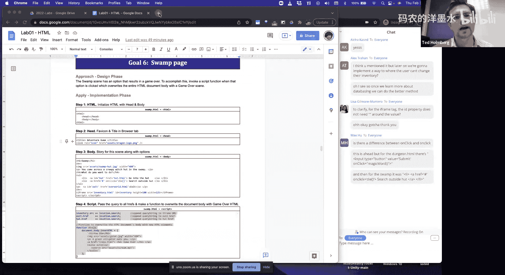

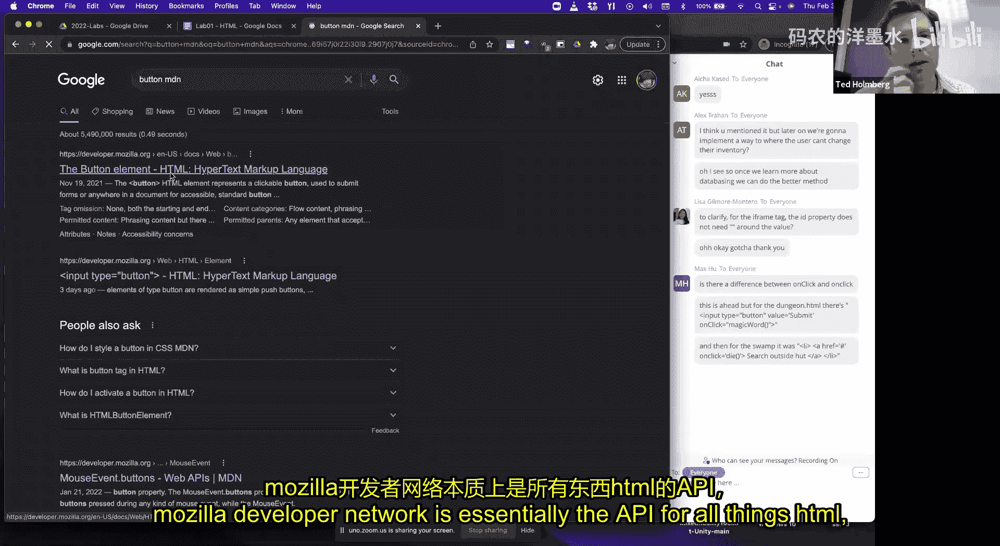

みち。On。Don't have。The attribute， I say。It seems to be taking a little bit of time for this to all load up。

 Okay， let's see here， let's take the attributes。To do to， do， to submit button。Mod type。Okay。

 let's just search for click， y， clickable clicking。Oh。

 I'm surprised I don't have the attribute listed here。

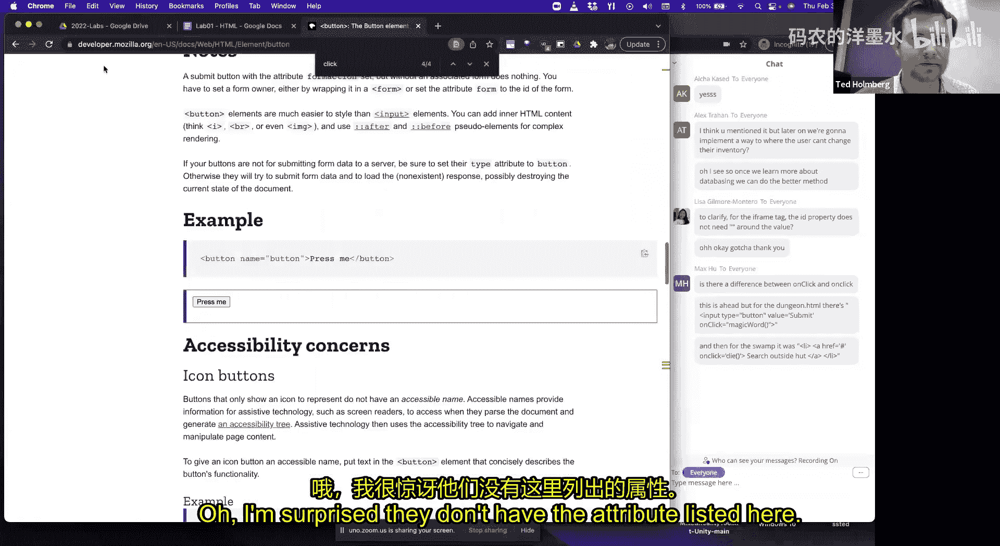

Let's see this。Let's do。On click， no， wasn't too much。There we go。

 so we have our global event handler on clicks and notice。

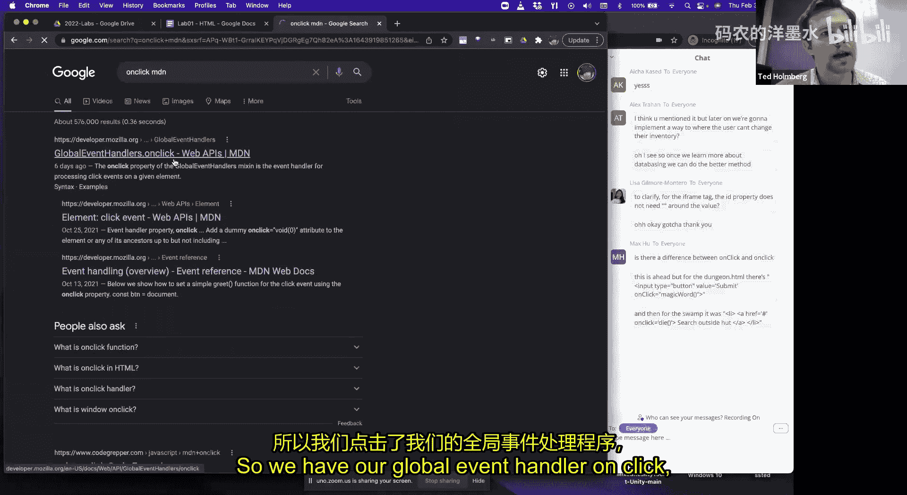

，The appropriate expected notation would be an lower case。In HTML， that so we're going to use that。

 but as you can tell， it doesn't really matter。Okay。Good question though。So。Okay。

 so we got the script here and so let's explain what's happening。Inside of our script tags。

 the first thing we're going to do is we are going to append our。Search。Perarameterters。

From this URL to all the hyperlinks inside of this page， there's three hyperlinks。

 one for the inventory， one for the exit to the overworld and one that's going to bring us to the h so we make sure to do that first and foremost and then since we're going to have the ability to die。

 I could do death in one of two ways。I could have made another HTML page that had the specific that had all of this that had all of this HTML tags for this。

 so I could have put like Gatorde HTML and I could just hyperlinked that or what I could do is create a function in my script tag should to create a function in JavaScript effectively you just use the word function and then a function name and instead set of parentheses and then to give the function a body we use curly braces pretty much the same thing you do in Java and so。

Let me show you from JavaScript， just like you have a location and object and a window object。

 you by default have a document object that gives you access to the current HTML elements inside that document。

 so if I do document God body for instance， it's going to give me access to the body tag that has all of the HTML in there。

😡，Well， I can access the inner HTML and just do an override operation assignment operation。😡。

So I can create a multilined string。😡，Using the ticks so notice there's a tick the tick is the same key as the tillday key if you shift till day it's going to create this tick。

So I'm going to use the ticks to create this what's called a string template。

 which can be a multiline string。😡，And I'm going to essentially encode the new HTML elements I want to overwrite into the inner HTML of the body of the body hack。

So because I want to line this up， so it's a little bit more readable， I can encapsulate a string。

Templates in between parentheses。😡，So we'll learn more about why this is necessary to do when we talk more about JavaScript。

 but just understand instead of having this all be one line or be or I could have alternatively started it like this。

 right？There we go， this would have been fine as well， I could have done this。

Without the parentheses， but if I want to format it， the way it was formatted before。😡。

And actually have the string start on a different line as the assignment sign then I need to use a parenthses because what a parentheesis is going to let you do is essentially wrap any data in there and it's going to just ignore the new lines until it finds that data so wrapping parentheses is just a convenient way if you want to have an assignment of a value that's on a different line that's effectively what we're doing。

And then so inside this string notice essentially I'm just like typing out the text of HTML right so I'm creating the heading one element you die。

 I'm creating an image element that goes to some kind of gator pick。

 I'm doing a paragraph that says a giant alligator E2。

I'm doing a hyper reference that's going to say game over and it's going to link back to the indexex。

 HTML， I'm going to embed a audio element and I'm going to tell it to autoplay。😡。

And inside of my audio element， I'm going to have a source element that's going to give the the source of that of that。

😡，MP3 file， which is part of the assets directory。So let's see what happens here。

 we're going to save this。I'm going to refresh this page。 So now that I've refreshed the page notice。

 look， I now am getting all of my inventory values， which is good。 Now。

 presumably if I click on the h， it'll bring me to the h H that doesn't exist yet。

 if I click on this。Search outside the hut， though。I'm。I'm triggering this on click of it。

 so let's do that and notice yep， what happened was when I did that it invoked this die function。

 which overwrote the body with that HTML that I put， including playing that audio。Excellent。

 is there any questions about that step？😀哈哈哈哈。😊，Okay， is everyone with me then？Okay。

 so we have our first essay， so if I go and hit game over now is to bring me back to my index@ HTML page where they can start the game all over again。

With the initial starting value。Okay， great， so we have our first death scene。Yeah。

 that's exactly what it's doing， so by accessing document。 body。

And I'll do that actually from the terminal too just so you can see this。

 so if I go to document God body inside of my console。I can assign into it。And actually。

 but I want to assign into it the inner for the inner HTML team I love it。

 so I don't want to overwrite the body itself， I want to overwrite the contents that it contains so if I click on just inter HTML teaml here that's all the contents。

And we're HTML file， so if I。Just string， let's say。Like this。Aam。

 right it allows me to overwride all the HTML that's currently loaded there。And again。

 we're going to learn much more about this when we go into our lectures about the dom。😡。

Wwhich is the document object model and here I'rem going to clear this。

 but it's a fun thing to be able to play around with right now when we're embuing this interactive story so you play around with a limited capacity now。

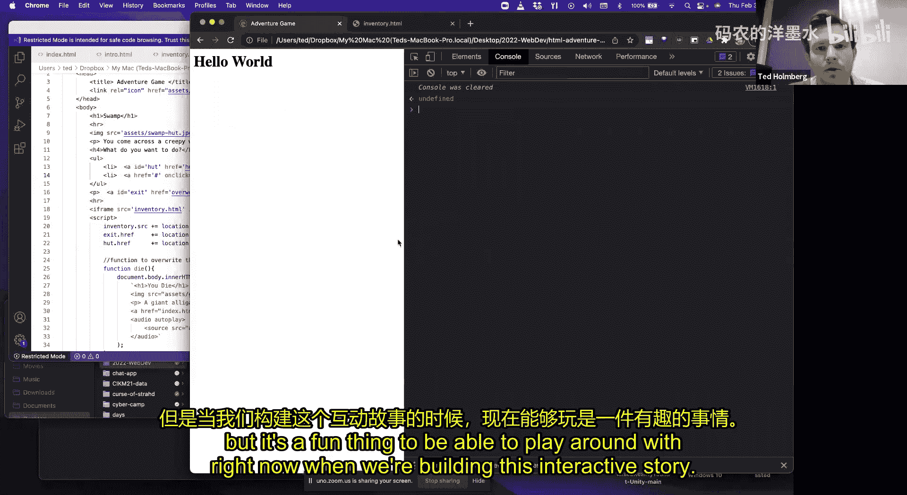

Excellent， okay， so now。Let's move on。To goal 7 for goal 7， we want to go ahead and。

We wanted to define our hut scene， so for our approach again， let's talk about our approach。

 our apply， and then our assess。our approach is the Hud scene is going to have a locked door that will not open without a key。

When we open it with a key， the key will break and the door will open and the player can then decide to click on onto the door to enter into the hut。

😡，The door state may be checked within the script logic。 So our goal in order to have。

A situation where you have to meet a criteria such as you have a key or not。

 we're going to rely on our script tags to be able to check that logic for us。

So again let's go and create a hUD HTML page and we'll see how that all fleshes out so the first thing we need to do just like all the other steps is build our new HTML page so i'm going to create a h do HTML and then let me go here。

Yep， there's the h page， let me drag that here into。

My tax editor and we'll start just like we've started before。

 the first step is going to be to essentially create our boiler platelate HTML so we'll create the HTML elements and inside the HTML elements will be head in our body。

Perfect， and then inside of our head， we want to go ahead and add our fvacon and our title。

 So let's do that。 And then once we do that， let's just make sure that that's working。

 so I like to test along the way。Save that， lets jump over here。Let's minimize this。

So we get more render more viewable space。 Okay， let's go to forest inside the forest is the swamps inside the swamps。

 we'll try to go into the hut。 There we go yep， our fcon and our title are。Drawing。

 so now the next thing we want to do is actually implement the contents of our scene for the hut。

So I'm going to go into the body here。I'm going to past my code。And I'm going to tab over。

 I'm going to tab over。Okay， so let's see what's happening here。

 We have the heading element to say this is a witch is h。 we'll have that horizontal rule applied。

 Then we'll go ahead and we're going to create the image like we have before。

Now this image will give an ID because eventually we're going to want to update the image so that it goes from lock door to open door。

 so anytime we want to access something in our script tags。

 we need to give an ID so that we can access it， we'll also create an oncl event that's going to be called open door。

😡，We're also going to go ahead and add this source to this image and we'll set the width of this image to 240。

 we're going to wrap this image around a anchor tag that's called door and actually give it a hyper reference of nothing。

And we'll see why we want to do this in just a moment。Okay， and then after we do that。

 we're going to create an empty paragraph。That we give an ID called text block and we're going to do that so that from our script。

 depending on what the condition is， we'll be able to actually add content。

Into that paragraph from the script tags。Then what we're going to do is we're going to use these div tags because we want to have that exit option。

For the player， we'll exit into the swamp scene。And again。

 we'll have an ID tag on all of our anchor tags so that we can append the search string to it。

Then well do a horizontal rule and then we'll do an eyeframe。

 and our eyeframe will also be given an ID so that we can access it to also append the search parameters。

Perfect， so let me go ahead and save this。And there we go， we have the witches hut。

 we have a door notice when I hover over it it's clickable right because's it's a hyperlink as well I also have this that should bring me to the exit yeah but I've lost my inventory because I don't have any script stuff yet。

But this is the general idea of what I want to have here before I add any logic。

So let's take a look at what we're going to do script wise。

 let me copy it and that'll stuff through the code on it。然。And let's indent all this in。Again。

 if at any time you have a question just ask it inside the chat and i'll take a moment to pause and further explain any of these concepts you know the first thing i've been doing inside my script tags is making sure that my current location search parameters are appended to all the hyper references that link back out of my out of the scene so again our inventory screen has that sRC that is going to essentially be the inventory and then our exit currently is going to also be this。

Is also going to go to the swamp so we're going to access those two things and make sure that happens now we're going to do something a little bit different we're going to create some variables that are going to exist inside of the scriptcope and so because they exist in the scriptcope they'll be accessible inside of our function or anything that goes down after we declare these。

So recall that we can create a URL search parameter。So let's take a look at what's happening here。

 I think we've already looked at this before。Okay。So here when I look at query string。

It's going to create an instance of a URL search parameter that I can then call get and I can even call set on。

😡，So the first thing I want to do there is I want to go ahead and grab the number of keys because the open door function is going to have to be able to know how many keys we have because we need a key to be able to open the door。

So let me do it without this plus sign first， I know we already talked about this。

 so now when I look at key notice it's going to grab the value of key well key is zero right now because wait why is key zero？

 oh yeah but。Yeah， but okay， so now let me do that so key's still going to be zero。Perfect， now。

 if I want key to be a number。I couldn't。Cast it by putting a plus sign。

 essentially signing it so it's going to go ahead and now if I look at key。

It's now noticed it's not wrapped in quotations， it's actually rendering as a number value。

So we'll go ahead and cast what gets returned from querystrings。get method。

 which is going to be the number of keys and then we're going to save it into a local variable called key。

 then we're going to declare this function called open door and recall on a click event。😡。

On the image， so notice one awesome thing about these HTML elements is every HTML element can actually have an oncl attribute。

And you can bind that on click attribute to a function to a JavaScript function。

So here we're going to have open door and then we're going to open and close the the scope of this function and we're going to check if。

On door image the source so let's see what this is going let me clear this so let's actually let's play around with what's happening inside this code inside of our terminal。

Inside of our console， so shouldn't do。Okay， let me do this in a way that I can see my code a little bit easier too。

 okay， perfect。I guess I don't need that much space okay so here we know that we can grab door image from here because door image is the ID right so I can grab that element based off the ID it has a actually view called SRC right because that's the source of where the image is located and now since this is a string。

Strings have a includes method。That can search for a substr， so say for instance， if I say doorimage。

 source or SRC。 includeslude and then I put say for instance door， it's going to say true。If I do。

Open door iss going to say false， it's going to say false because the name of this door is locked door。

However， when we go to open door， we're going to say， well。

 if the source file pathway does include the text open door。

 then what we're going to do is we're going to access door door is this anchor tag here remember this ID it's on line8 we're going to access the。

😡，Hyper reference， which is currently empty。 doesn't bring you anywhere。

 So if I try to click on door， it doesn't do anything right now。

 And I'm going to update it to actually go to a new web page。 H Hu dash inside dot H T M L。

And then I'm going to put the question mark and I'm going to append our query string onto it。

 so if we concatenate the query string and let me actually let's take a look at what happens when we do that。

😡，Okay， so I have that query string， so if I try to do a connation。

 their query string actually has a two string method that will actually display the T's and values as a properly formatted queryrry string。

 the only thing it's missing is the question。MarSo we can go ahead and put the URL and then the question mark and then just go ahead and concatenate the query string to essentially calling two string on it。

To go ahead and update the hyper referencefer and when this happens。

 we can now click on the door and it'll act as an anchor tag actually hyperlink of somewhere okay otherwise we can check to see if the key so so if the door isn't open then we'll check well is the key value greater than zero and if the key value is greater than zero then we're going to change the image of the door。

 the source image to now be an open door。And then we're going to change the text box enter AC to say。

 hey， the door is unlocked， but the key broke apart。😡。

Then what we'll also do is inside of our query string。

 this is the first time we're going to mutate the state of our data， we're going to set the keys。😡。

Key that， the key keys。 And we're going to。Call the decrement operation， no remember。

All the way back to Java， Java1， you have an increment and decrement operator。

 and you have a post increment and a pre increment or a post decrement and a pre decrement。

 This is a。Prederement， which means it will decrease the value of the key variable first。

 and then it'll do the rest of this method or the rest of the statement。

 which will then be to set this new value into the query string at the value or at the key of keys。😡。

And then once I've mutated the state of my query string。😡，I am now going to tell inventory。

sRC to update its source and I'm going to tell the exit hyper reference to update its source with the new value of the query strip to illustrate that we lost that key that we've decremented and reduced the value of the key okay。

 so if keys isn't greater than zero and if the door isn't open。

 then I'm not going to do anything I'm just going to add to the text in the text box。

 the door is locked。😡，So this function can do one of three things。

 depending on if the image is the open door image or if the player has more than one key or more than zero keys or。

😡，Otherwise， we just put doors locked， let me save this。

And let's test this out so if I click on this。It's going to invoke the open door function and since this is a locked door and since my keys are zero is going to display the doors locked and each time I click on it is going to keep saying this thing now if I change my key value to one。

😡，Here now notice I have one key， so now if I click on it。😡，There we go。

 we noticed the image got replaced with the open door image。

 the text box got replaced with the door is unlocked， but the key broke apart。

 my keys have now been reduced down to zero because I decrement inside the query string and then I replace the inventory and exit values for that query string so if I click back here notice my keys are still zero。

😡，I hit the back so gave me back my keys wants here okay， and then finally。

 if the door is open and I click on it again on open door since this is using the open door and let me do this again door。

Mmitch got SRC。Yeah， since this now has the open desk door inside of the file pathway when I click on that。

 it'll actually act as a hyper reference。And we'll go ahead and send me to hutinside。html along with。

All of my data。The query strike， excellent。Okay， that was a really interesting function， I think。

So no the compound assignment operators， so concatednation can use a compound assignment。

 but just to give you an example， it differs from a simple assignment so this might be a simple assignment okay so we have 10 and then we could say okay X is equal to x plus。

Plus 10 so this is a simple assignment but we're reading the value of x here and then we're overr it here。

 so if I wanted to do the addition and assignment at the same time。

 I can do that with one operator that's called a compound assignment here it's addition and assignment just like that。

😡，And so we can do the same thing。With concatednation， right？So whenever I say a compound assignment。

 that's just what I'm referring to。Excellent， okay。Let's move on to goal eight。

Hut inside so now that we can potentially get into the hut the next thing we want to do is write our scene about what happens inside the h so this is going to contain a video clue depicting a sequence of runs that are needed and the dungeons scene in order to open up or to dispel a magical cS that's in there so one thing about these interactive games is usually you have clues that are in different scenes that the player has or items or whatnot that they have to collect that will be useful in some other scene。

😡，So the h will have some meaningful clue that will be used in a future scene。

 so recall that HTML not only supports images and text。

 but it can also support video and audio we've already seen how to do audio elements when we went ahead and created our death scene。

And then and so here we'll also go ahead and look at making a video element and video elements have all sorts of again。

 if you ever want to see the attributes that can be had in something like video， let's do video。

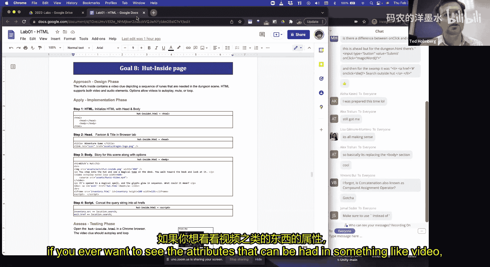

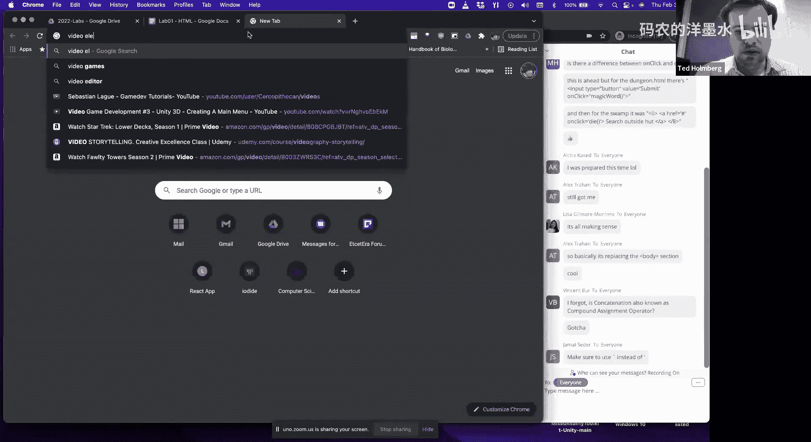

Eleement MDN， you can always go to the MDN webpage Mozilla developer network and has APIs that'll show you all the attributes we arguing like autoplay。

 you can have controls， you can have height and loop and mut it。You can have a poster which。

 you know， I might actually update this lab。Again， you have to have the source of where the video file is to include a poster because that could be fun。

Okay but before we do any of that， we're talking about the approach okay。

 so now that we have a general idea of what our scene is going contain and what kind of elements we want it to have and what kind of clues and riddles and whatnot's going to be in there。

 let's go ahead and actually create something called h dashash insideside。

 hm so let me jump over here。Perfect， and now let me jump over here into hot dash inside and。Perfect。

 okay， and the first thing I'm going to do is。To boiler played out my HTML。There we go。

And then let me get， let's say here， what's this comment make sure to use instead of also HTML is usually to capitalize HTML Oh yeah。

 very good thank you。Those were little bugs that I was trying to get my thing to work and I noticed them。

Oh excellent， excellent， so if anyone's having issues with the inner HTML。

 make sure that you uppercase HTML。

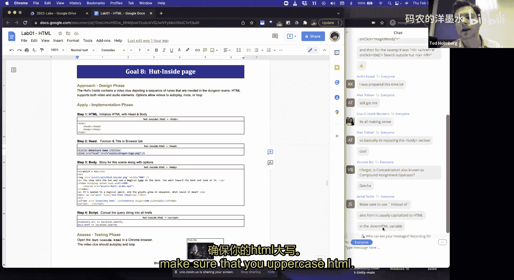

I'll show you what I mean by that so right here if we go to document do body。

Got inner so notice it'll actually autocomplete in here so you have an inner text with a capital T for text or an inner HTML with a capital HTMLM if we don't do the upper case because case matters in JavaScript。

 if we don't do an upper case， we'll just create a new variable called the inner HTML that doesn't do anything。

😡，Right， like this is just。So even though。To give an example。Now this exists actually。

 so if I go into document dot body。😡，And look at well。Got enter HTML this now exists。

 but doesn' it doesn't mean anything to the browser。

 the browser is using this other one with the upper case is to actually access the elements inside of it。

😡，Okay will matter in that， so if you're having issues， just keep that in mind。😡，Okay。

 inside of my h dash inside that HTML I'm going to also add my fcon and my title like we've been doing before okay。

 let me refresh this page let me go back let me go into the h okay yeah there we go and we have that next let's go ahead and add the text the body so all of our HTML elements that are going to make up our witch is h。

And so when we take a look at this。We have a heading element that's going to say witch is h。

 we have that horizontal rule， we'll have an image for what's inside the witch is ht we'll have an explanation about this scene。

 what's inside the scene then we're finally going to do this video element so a video element unlike an image element and very much like an audio element actually has an open and close tag so recall when we went to samp and we did that right an audio has an open and close tag now for audio we use autoplay and it made the death as soon as it rendered that page so here we're going to do the same thing we're going autoplay the video。

If we want the autoplay to actually work。When it's designed in H like this， it has to be muted。

 Anything that's autoplay that has audio will not autoplay。 It just， it's。

 it's something that Chrome won't allow。 We're also going to loop this this video and we'll set the width of our video player to be 480。

 Now， our video is going to have a child element that is a source element and that is going to be not require closing block。

 right， that can be it's both the one tag is open and close ands just going have a source attribute。

That's going to play this runic dashvideo。mp4， which is inside of our assets directly。

Then I'll have a paragraph that explains a little bit more about what this video is。

And then I'll have a div tag that's going to have a hyper reference that goes to the exit and again anything that has a hyper reference I'm going to create an ID for because I'm going to want to be able to go ahead and connect it with our search parameters inside of our script tag same thing for our inventory we want to go ahead and make sure our inventory has an ID so that our script can go ahead and append。

The search parameters to it， and so we'll just go ahead and grab that。

No didn't quite get the other one， let's get the inventory too。There we go。

Let's save that and let's take a look at our what's happening here。

 So now we have our witches h horizontal line， the image of the witches h a little bit of text and here's our video right here。

And you can see it's autoplay right， you see the runs that are lighting up as it plays there and then there and then there and then there for something called dis spellel magic。

Okay， and I can play around with these， so if instead of autoplay。

 perhaps I want to have controls and not have it loop。So I could do this， save that。

 and if I do that when I refresh。Instead of an auto applying， it'll actually give me player controls。

 and then I actually would say， oh， let me go ahead and hit the play button and when I play it'll says。

And this I think is better actually this is more like you opening the book up and what would be greater is if I go back to refactor this。

 I might even actually give a poster attribute here that might be a closed home so that when you then click on it and it plays it then looks like you've opened it up and you can read the runs that light up。

So you have a lot of different controls that you can do for the video options here。

Then if I removed the controls here。And just have the video。

Pancel that let me refresh and then here we have no controls but now I can't play either because I haven't had it on autoplay so if you want to give control to the player you have to add the controls options otherwise you just have a static video that doesn't do anything。

Excellent。Okay， let me go back and get it back to the way it was I'll just save it like this because I like that I like the interactivity of that makes it feel more game like and then if I hit exit。

 I should be able to exit back over here perfect and if I exit here。

 I should be able to exit back over here perfect。But exit here， she brings me to the overworld。

 awesome。Okay， let's move on， so assessment open the hut。

Dash index HTML and the video clue should autoplay loop which it does So now let's go back to our next goal our next goal is to finally build our dungeon scene。

So our dungeon scene is going to use an HTML input element to get the text from the plier。

And if the player enters the correct password， they advance to the next scene， otherwise。

 the HTML document overwrites when another game overseen。😡，So let's create Dunngeon。html page。

And okay， here it is， and let's pull that in here。All the way。

 let's close out some of these other ones I don't need so much。Of these。Okay。

If I need them again I can always open them up Okay。

 so there we have our dungeon and just like we've done with every other HTML document we're going to start by giving ourselves an HTML element and giving it some head and body element and then inside of our head element we're going to add the title and we're going to add the fviccon。

There we go， okay。And now we're going to add the body。

 so let me grab the body and then we'll take a quick gander at what elements and we're going to have some new elements in this because we're actually going to have some input。

Elements so me。Tab tab， perfect， Sa that。 So inside of our body here。

 let me also tab the script that's currently empty。

We're going to have a heading element that's dungeon entrance and then we'll do a horizontal rule and then we'll have a paragraph that gives it some kind of descriptor to the user there's a kind of a riddle to solve here of sort or puzzle there's a magic seal preventing you from entering the dungeon you must dispel it then we'll have an image that is an animated gff of or magic seal and we'll have another paragraph that says there's a codex for translating runic spells into English be careful incorrect incanations are dangerous。

And then we'll go ahead and we'll have this run translationlation Png here that the users will have to use。

 the players will have to use to solve this riddle。

 then we're going to create a div tag because input elements are in line so we want them to have their own block we want them to essentially be on their own line so we're going to nest this inside of a div block so anything that's in div block is now essentially a block element we're going to give a label so input elements can have a label which is essentially just text that appears on top of it so we're going to give our input field a label enter the magic word and then we'll have an input element now notice input elements。

A。We'll have this be a type of tax it'll be tax input and we'll give it the ID input tax so that we can go ahead and access it。

From our all script tags， and then we're actually going to have a button that we can use as our submit button。

😡，And so if I put value submit， what's going to happen there is anything that is the value。😡，Here。

 so like， for instance， I could put。Value here as well on not inside the string like put value here inside as well it that says like inner magic word。

m not going to bother though。And then on the own click event on the button and to be consistent。

 I'll make it lowercase， I will invoke a function that we will call magic word。

So we're going to have two inputs， one's a text field， and the other is a submit。

Then I'll have a horizontal on a rule and then I'll have a div that has a anchor tag that will lead back to the overworld which will represent our exit and then I'll have the eyeframe with what value what items the player has so now let me go ahead and click on dungeon and so that's exactly what we have。

So that's our heading。 This is the text。 This is the image。 There's a codeak。

 This is what the player will use。 And then here， notice again， like I said。

 all of this is in line elements， So they're going share a line with everything else on there。

 But since they're collectively wrapped in a div， it'll appear above the image and below this。

 So it's on its so own line。 So this is the text field from line 14 and this is the submit button from line 15。

 and the submit is coming from giving it a value。 In fact， if I gave the text field a value here too。

Save that。 and if I refresh notice it would add that text inside there so the any。

I'm going to leave it blank though because I don't want it to initially have a value。

 but understand there is a value attribute for all these input。elements。Excellent。

 so now let's go and。Yeah， so if I took the div away。

 it would probably share the line as the image above it。

Because image elements are also in line elements， so if I took this away。See now it's sharing the。

It's sharing the space as this image。😡，Another nice thing about this development is you can always play around。

 refresh and see how things change。Okay， so let me go ahead and put in。

What goes in between the script tag so the first thing we're going to do like we've done every other page is every time we have a hyper reference out of this page。

 we have to make sure to append。Our search parameters so we have our data persistence and then there's one other thing we have to do on this page remember we have this own click event that's going to invoke this magic word function so we're going to create a function called magic word and we're going to check if input text so remember that input text it has the ID here so I can go into here input text God value and the value no Ive got to spell that right。

啊。And好。Are that。Input。Okay， good。 Now value。 Okay， the value by default is empty， right， so。

If I type something in there。now I can see what the value is that I'm typing in there。

So from the script tag， I can go ahead and access the value。

 and then I'm going to say if it's equal to the word open。😡。

Then i'm going to tell i'm going to read I'm going to overwrite the location so remember a location is what is inside this web address what the URL bar if I overwrite that with an assignment operator。

 I can give it a new。😡，HTML page and it'll actually bring me there。If it's anything besides。Open。

 then I'm going to go ahead and tell the document bodies inner HTML。

 I'm going to override it with another death with another multi or string template。😡。

That has the HTML for making a death scene so it's going to say you die it's going to have a image it's going to have a paragraph that says that you misspoke the magic words it'll have a button that brings you to game over and it's going to have a death stream again so let's take a look at thiss let's type this。

So now magic word。Is triggered on when the button clicks。

 but it's going to use the value in our input text。 So both these are working in conjunction。

 So let me refresh this。 So if I hit just submit without adding anything。

 Yeah it's going to overwrite my document dot body inner Html to now be this new。

ll set of HTML elements and then let me go back to the dungeon。

And if I type in the word open and then trigger this magic word well that will be equal right so it's going to bring me to this Dr do HTML page and yep we didn't make it yet。

 but if I look inside the URL bar， yep Dragon do HTML and then it also gives me all my inventory information。

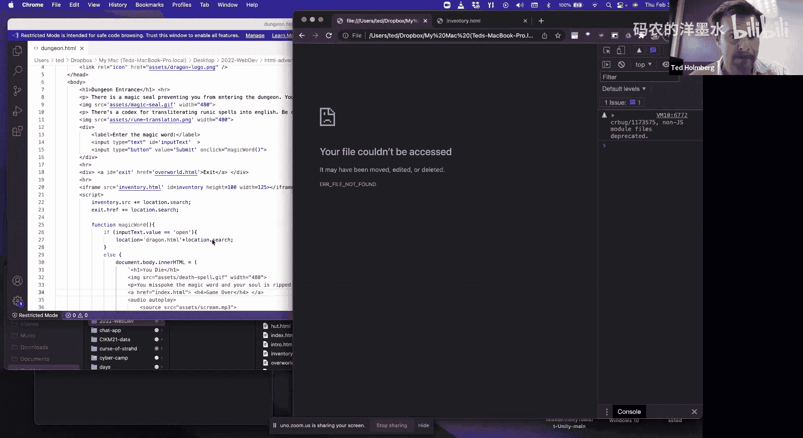

Excellent。Let's just check the assessed to make sure that， yep。

 test it with the right word and to do that， test it with the wrong word。

 and it should give you a death screen。Excellent。So now let's go on to goal number 10。

 let's make our shop scene。Let's see in the lab document， it has parent location， oh yes。

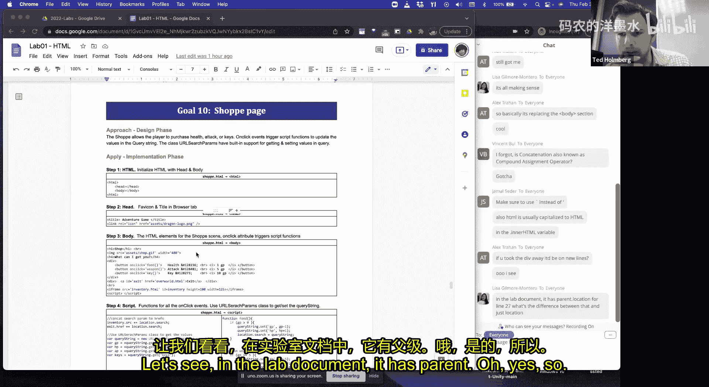

It's a alias again， so just like I showed you。Window。So if I show you。

 parent is talking about window and window is technically the thing。That has the location。

 so window has location。But you know what there's obviously alia it's just called location so instead of giving you all of these like parent and window and all these other things that technically contain location since the browser already exposes the location object under the alias location I decided to correct it in a version that I haven't shared with you so your version probably shows parent dot location that's equally as correct right that's another way to access the location window dot location would also work。

😡，Just alternate ways to access the same thing in memory， which is the location object。

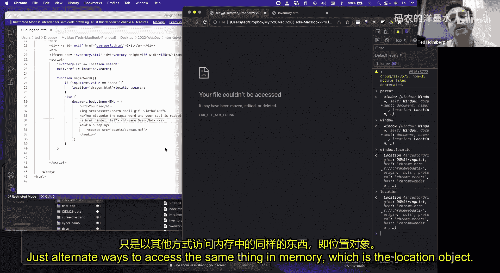

Let me go ahead and clear Okay， so now I want to build the shop page。

 let me start the way I always start， let me create a touch。Chop got。Html。Perfect。🎼And there we go。

Drop out there， we're going to start our scene， our shop scene， the wait we start every scene。

 we're going to add in our boilerplate。HCML， and then what we'll do is we'll also go ahead and add in our Havocon and our title。

There's only so many times I can test all that out。

 so I'm just going to keep doing the same thing and move on。Okay， so now that we have that。

 let's actually add in the contents of our shop scene。Into the body。

And let's take a look at what these elements are going to be these H2L。

 so we're going to have a heading。And then we're going to do a horizontal tag and then we're going to have make image of a shop and then we're going to have a prompt to the player well what do you want to do and then we're going to do a div tag because buttons are inline elements so we want to group the buttons together to their side by side。

 but we want them to be on their own horizontal block essentially。So we'll wrap us in divs。

 then we're going to create three buttons， these buttons will have on clickick events。

 onclick attributes that will trigger a food function， a weapon function and a key function。😡。

We'll also have the contents of our button。😡，Say health and then have the emoji of a heart。

Attack and then have the emoji encoding of a sword and key and have the emoji encoding of a key。

Then we'll have a B BR is a break line， so this will create a new line。😡。

And then underneath it will'll put  one GPp，5 Gp and 10 G。

 So each of our buttons will be two lines large because of this break so that the text will overflow from one line to the next to have the gold value as a second line and then。

A depiction of what you can buy on the first line。Then I'm going to also have the option for the player to be able to exit to the overworld。

 I'll do a horizontal line and the iframe that has the inventory and let me just be consistent and put inventory here perfect Okay。

 let me save this and let's take a quick look at it。Go back。Let's go here to exit， excellent。

 let's go to shop。And there we go We have our shop with all of our HTML so let's actually wire up no I don't want to save the HTML whatever Okay so now the next thing I want to do and see how my buttons are actually go overflow into two lines and that's because of this Br tag so keep in mind that actually new line characters in HTML are ignored so if you want to hardcode a new line it's kind of similar to what you have to do in Java right just like you have slash n you have BR。

Okay， so now there's a lot of code here， but it's all pretty much doing the same thing。

Let me copy this into my script tag。T that over， to T that over。

 let's tab that over one more time because I wanted to be nested perfect。

And now let me grab all of these functions， so the functions are on one side here and the variable declarations are on the other I'll just。

So before I do the functions， let me just say what I'm doing here。

 the first thing I'm going to do is。Concatednate the search parameters to all the hyperlinks out of here。

And then the next thing I want to do is access the actual data。

 all of our data that we potentially want to reset or update。😡，In this page。

 so I'm going to take the location search parameter which is a string I'm going to pass it to the constructor of URL search parameter so it can convert it into data that we can actually look up and mutate and I'm going to save that into a query string variable and then I'm going to create variables GP HP AP and keys and I'm going to get the value from the query string so I'm going to call the gi method for the key of GP for the key of HP for the key of AP and for the key of keys。

😡，And I'm going to convert those， I'm going to cast those into number data types so that I can actually subtract or add to them。

Okay， so this now allows me access to the data in a way that I can start to manipulate it。

 So now let me go ahead and。Put in the functions that we're going to be doing。Okay。

 so I'm going to have a food function。 So when the food function triggered， it's going to search。

 hey， if the value of GP， which is declared here on line 205 is greater than0， then set GP。

To be whatever the value GP is minus one。And then set HP to be whatever the value of HP is plus one。

So these are our set methods and the way that these set methods work is you give the key that you want to get access to the value and the new value you want to go ahead and set it to。

😡，So it's two two parameters here for a set， one parameter for get get is the key。

 so that is key and then new value。😡，Then once we've reset these new values。

 we're going to then overwrite the locations of search。😡。

Oject with our query string object so that it changes the state of that and I'm going to do the same thing with weapon right but with weapon I want to see if the goal pieces is greater than or equal to5 and then I'm going to mutate GP I'm going to say take whatever the value GP is and subtract5 from it and then add AP by one and then for key I want to check to make sure that the value of GP is greater than or equal to the 10 and if it is I want to reduce the goal pieces by 10 and overwrite that in the query string and I want to increment the value of keys by one。

😡，Okay， so once I do that。If I go ahead and refresh。

Let me actually give myself some goals here to play around with this so I'm going to give myself 50 gold I'm going to hit enter so I have 50 gold so now notice I can click on health and my goal went down by149 and my health went up by one so each time I click on it it's given me the option to and it's refreshing the page each time。

If I hit on attack。It increases my attack by one， decreases my goal by five， and if I click on key。

 it increases my key and now if I exit out。It's carrying all those values over so this is the first time that we really well it's the second time we saw how to really update the state of our data and our search parameters。

 but here we got to see how to do it for all the different data and how to subtract and how to add and whatnot。

Oh no， cancel that。Excellent so we let's check the assess here for assess we're just checking to make sure we can buy things and it affects our gold and our items the way we expect so let's move on to goal 11 our goblin page。

So on our goblin page， we want to go do our approach， our apply and our assess on our approach。

 the goblin page will represent combat between the player and the goblin。

 we will use a script function that uses the values from the query script string to determine each round in combat。

 if the players HP is zero， then the game is over if the Goblins HP is zero then the player gets gold and if neither are true。

 then we can continue combat。😡，So let me。So now that we have an approach。

 let's go ahead and apply that。We're almost done our game。

So first I'm going to do is create my goblin。Html page the next thing i'm going to do is drag it into here then the first couple things i'm going to do is set everything up let me get the boiler plate HTMLl paste that in there and let me get my。

Head all my head elements， oht know。Here and there， my title in my fbacon。

And I'll just paste those into here。Have that over。Perfect。

 now let's get the body of what's going to be inside of this scene。

Inside of this particular web page， so here。把啲。And let me tab tab， okay。

 so here we can see we're going to do a heading element that's going to say hills we'll do a horizontal line。

 I'll do an image of a goblin， I'll do a paragraph that will represent the battle text so I'm going to give an ID so I can access that I'm going give an ID to the image as well because when the goblin dies I'm going to replace it with either like a sack of gold or something。

And the battle text should give information about what's happening in the battle over the course of the player's interaction。

 so I'm going to give that an ID， I'm going to give a prompt to the player as a heading element。

 what do you want to do， I'm going to do a div tag that's going to give options to the player and again I'm going to give this an ID the understanding that I can change what or is happening in these options I can remove these options if I want to or I can change the state of them from the script tag I'm going to create a button that's called fight。

 I'm going to have access to this button because I'm going to give it an ID but I'm also going to create an onclick event that can trigger an attack function inside by script tag I'm also going to create a hyperlink。

That's going to be a retreat that leads back to the forest and of course I got to give that an ID because every time I give a hyper reference I want to be able to append my search string to it。

😡，Or my query string perfect so let's take a look at what that looks like， let's go into the forest。

 let's go up the hills perfect I have my goblin， I have my battle tax I have my prompt where I can either fight which is one button and another is a retreat button which is wrapped around these hyperlinks so if I hit retreat it should take me back to the forest。

Now let's go ahead and let me grab the。Make grab the。Cript here， so the script。

 the first thing I'm going to do here is I'm going to update。😡。

All of the hyperrefers that lead off this page to also include the search parameter so that we can have our data persistence then I'm going to do just like what is in the shop page I'm going to create using the location do search parameter to create a new instance of a URL search parameters objects and save that as a query string because in combat we could potentially mutate your gold whether you kill the goblin or your health or we also need your attack power to see how much damage you do to the goblin so we're going to create variables for all those things so from the query string we'll call the gi method we'll grab the values of all those keys and we'll make sure to cast them as number data then we're going to create variables just variables that we can have access and maintain that will represent the goblin's life which is three and the goblin's attack power which is two。

It know， don't do that。Okay， and then let me get this attack function and then we'll test it out and if for any reason since it's 315 at this moment。

 if you have to leave， I kind of want to finish this today so I'm going to continue going but if you have to leave this will be all part of the video and you'll be able to jump to it so to see what you might have missed but I do intend to finish this lab today。

Okay， so let me go ahead and add this function in。Tab that over。 Tab that over。 perfectfect。 Okay。

 so recall that the fight button。Has an onclick event that causes your attack function to trigger。

 so what does attack do？Well， the first thing it's actually going to do is it's going to take your AP。

 so this variable on line 27 and it's going to subtract。😡。

Whatever your attack power is from the Goblin hit points， so if your attack power is one。

 which is what starts at， then the goblin hit points should then go to two then it's going to then it's going to check。

If the goblin is dead， so if the goblin's hit points is now less than or equal to zero。

 then we're going to set the goblins， so goblin。Recall is the image of the goblin。

 so we'll change the source of the pathway of that image to be a treasure。g。

 so we'll override the image。😡，And then we'll set in our query string your goal pieces up by three。

 so we'll access the GPK， and then we'll increment it by three。

And then we'll set your health points to be whatever your current state of health is from the combat so if you've taken any damage。

 you'll now have lost damage with this set。Then we'll go ahead and we don't want to cause the web page to refresh because then we will lose all of the state of the data we're tracking inside the script tag。

 so what we're going to do is we're going to manually update the in。

 HTML URL to use the new version of the query string the thing that we're currently computing on。

 we're not going to use location。 search， we're going to use this temporary data that's being archived to represent middle combat values and then we're going to access the battle text HTML element and we're going update the inter HTML there to say you defeat at the goblin and find three gold。

😡，And then in our options we don't want to have an attack button anymore so we'll just have a go back button。

 which will bring you back to the forest and again we want to make sure when you go back to the forest it's going to use the new values from this query string so we're going to manually set the HR to be the forest HL and then use。

😡，Notice we're using the ticks here。😡，Right， which is the tillday shift tillday keys that allows me to embed。

Variable values without having to use concatednation。

 So I did dollar sign and then open close curly braces。

 And then I'm de referencing the value of query string， which will then concatenate in。

 I could have just as easily if I wanted to have done this and done a traditional。I know。

This would have also worked like I've just done this as well。Two strings concatenate it like that。

 I personally prefer the string templates because I feel like it reads easier than constantly putting plus signs to concatenate because it allows you to embed lots of data in。

Is this just another way to go ahead and do a concatenation effectively or to embed a value into a string template？

But you can only do this， you can only do this when you have a string declared with the text。

There and there。Excellent， okay， so if the goblins health point isn't greater less than or equal to zero。

 then。Well， that means the Goblin's still live， which means we'll go ahead and use the Goblin attack power。

 which was two， and we will subtract it from whatever your current hit points are。

 which we dereferenced here on line 26。And then we will tell the query string to now reset your hit points with the new value that they are。

 we will update the inventory do source， the iframe so that it reddiplays with the new hit points and then we will update the battle text to say you hit for this amount of damage it has and then the goblin has this amount of life left and then we'll do a new line with a break and then you take this amount of damage from the Goblins attack power so again this is the nice thing about using the string template is。

I can keep embedding data just by using dollar sign and then open closed curly braces and then dereferencing the value there so now I'm accessing AP goblin HP and goblin AP。

And so if the Goblin isn't dead and and afterward attack， so after this sequence has happened。

 the next thing we want to see is if you died， so if after the Goblin attacked you。

 if your hit points is less than or equal to zero， we can just inside of our battle attacks say you died and then our options we overwrite the options to be game over。

So。One of three things can happen during the course of an attack let's go ahead and check it out let's test it out so let's start by。

Hitting the fight button。And here the goblin didn't die。

 I didn't die so we gets an update to our variables here and then it's going to say you hit for two damage。

 it has one hit point left you take two damage and if I hit fight again this time it dies。

 we replace the image with gold we replace the battle text with you defeated the goblin and find three gold and now we have three more gold than we had before and when we go back。

We're going to persist with that， right， because we've updated inside of the all the hyper references inside of the attack function。

 Let's go back here。 let's do this in a way that my attack power。

It's not strong enough to kill the goblin and let me give myself one hit point too。

So to sets this out so now when I hit fight up it's going to say I died game over and then it's going to bring me back here。

Excellent。Okay， so we have one last scene to complete out this one last goal to complete out this lab。

And it's going to be the dragon page， the final battle。

Whi is kind of honestly a tease of source because really I've covered everything I wanted this to do。

 but I need this to go one last place。So we will create a dragon HTML page。

 we will go to this dragon HTML page let's bring it into our tax editor and this is not going to have anything new or interesting or novel into it。

 So this is just you know we're create some HTML。Well， go ahead and give a fvacon and our R title。

Thingsve got we've been doing。Perfect， and then we will have our body and notice there's not even any script logic in here。

 This is just a collection of HTML elements we've already seen。

So really the most interesting things of this lab we've done already in previous goals。

 so this is just saying dragon's layer， horizontal rule， an image of a dragon breathe and fire。

 a paragraph that says you step into a dungeon to find a red dragon it roars and breathe fire toward you you draw your sword and it says to be continued in terms of the prompt of the player and then just gives you the option to start over and go back to index IH so if we go to now let's see let's go to start。

Let's go to Adv outta town， let's go to Dunngegeon， let's go to open。There it is。

 that's the completion of our lab。Excellent。And so now， really， this lab will allow you。

 once you complete this lab， you should be able to start working on the first part of homework one。

 So homework one is going to be for you to design and develop your own interactive story。

 Akin to what we've built over the course of this lab。 You can use this lab as a framework。

 You can use it as a resource。 You can use it as inspiration for how you can design your own interactive story。

However， I say it's the first part it because the next lab we're going to do on Tuesday will be the CSS lab。

And so homework one will not only have you author out at HTML Inter Story。

 but it will also take what you learned from CSS and actually apply interesting and nice styles to each of the pages to make the content much more beautiful。

To make it make the experience much more professional as opposed to just pure HTML without any siline on it and you can do a lot of things with CSS we'll talk more about that next class though。

Excellent， so is there any questions in the lab？

And okay， so saw so before I end today's lecture， I do want to show one more thing because I had gotten a comment I gotten a comment。

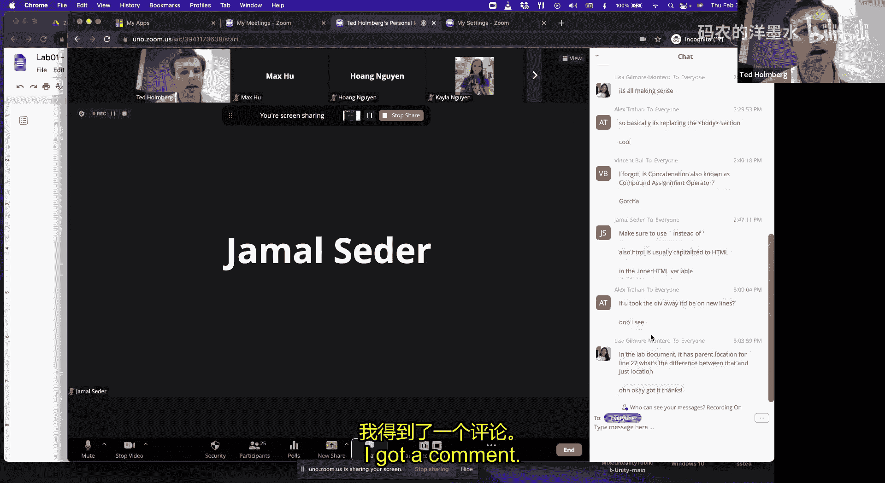

In Discord about how can I get audio to autoplay and so remember when I was talking about how they have different protocols that open up in the browser between file and between HTTP that HTP has more functionality than the file protocol for security purposes well。

😡，Audio won't autoplay ever inside of the file protocol。

 So you might have to host on a web server or your HTML page。 Now， if you're using Chrome。

 it's super simple to host。 And actually， I created a small demo to actually demo this out。

 So let me just grab it really quick So you can see。

 So for those of you who want to have like background music。 I'm gonna show you how to do that。

 So I have these audio demos here。 let me just grab the index on H。

 These are super simple just to give you clarification So so that you can do this。

 And it makes sense for me to have this as the。The conclusionary part of the lab。

Okay so here I just have an HTML page that hyperlinks to an intro I have an intro that has audio and it says autoplay is going to use the autoplay and loop and it's going to link to this MP3 file and notice I didn't show this but you can actually embed the source if you wanted to so you don't have to have the child so it's just another way that we can define what the source is for audio and then I'm going to hyperlink from that to another page called battle。

And for battle， I'm going to hyperlink back to battle so these are very simple HTMLml files that all they have is a heading element and an audio。

And I wanted to show what happens if I try to open it， so let me go here。😡。

Let me go here and just open this index HTML。No， not there。

Let me do it here so that I can look at everything， let me close that。Jump here okay。

 so here we have right now that says go to intro so when I go to intro now I'm inside of Intro now which has audio。

 but this is probably what a lot of people have been noticing。

When I try to do autoplay it's not playing any music right and then if I go to battle it's not playing any music and I can click on that so yeah this is a nogo。

 but there's a simple solution。If you're using Chrome， Chrome supports some web apps。

 one web app I would I would tell you to install is the web server。

 You can find it by going to Google and justtyping in Chrome web server。😡。

Right here should be the first thing that links it should be the page。

 you should have the ability to add this app into your Chrome browser。And then with this app。

 if I launch it。It'll allow me to host a simple web server so I can choose a folder effectively and here the folder I want is audio demo。

 So I'm going to select that， and then it gives me an HTP address on local host that I can click and now。

Instead of a file protocol like I was using here， it's actually using the full HTTP protocol。

 so if I hit go to Intro here， notice I get my music to auto apply。

Now one thing one thing you should know though is notice if I refresh the page autoplay does not work。

 I could not put an autoplay and I'm going to prove this to you if I copy this and paste it into my index on HTML。

This will never work。Let me go back over here notice even though it's there。

 it doesn't work it's because as a security reason。

 audio is a very annoying thing and when the audio tags were first released。

 all sorts of web developers were creating like pop up audio that would loop and say， hey， look here。

 hey， look here， hey， look here and every web page was a nightmare with adverts that were screaming at you so to prevent that from happening。

 even if you put autoP， it doesn't trigger unless there's an event that the player that the user triggers inside of your web page。

😡，🎼So like refresh on the page there's no trigger that happens however。

 if you link from one page to the other like going from index to intro that was an event that was an event so then it's going to allow the autoplay to actually work so one reason you might want to have an index HTML that then leads to the intro to your story is that you can have music and your intro and when you link from the index to the intro it can prompt your music to start like this。

Sorry， sorry that。Okay， yeah， so my point here was， okay， so and once you have music playing。啊 boy。

Once you have your music playing， you can trigger new music in another page。Right。

 so every other page that has autoplay can have some music。Now， if I refresh this， again。

 every time you refresh it's not going to autoplay。

 but notice I'm hyperlinking back to my own page here， so if I do HR to battle that HTML。

I can click on that and it'll allow me to play because a user have been happy。

As opposed to no user event， user event， perfect。Okay， any questions about that。

 does that help understand what's happening with your audio files？Excellent。

 okay so if anyone has any issues while working on the homework， please contact me on Discord。

 thank you for saying a little bit later， if you decided to to finish out this lab I'm going to be posting the video for those who haven't so you can still watch the tail end。

And I will see you all on Tuesday。

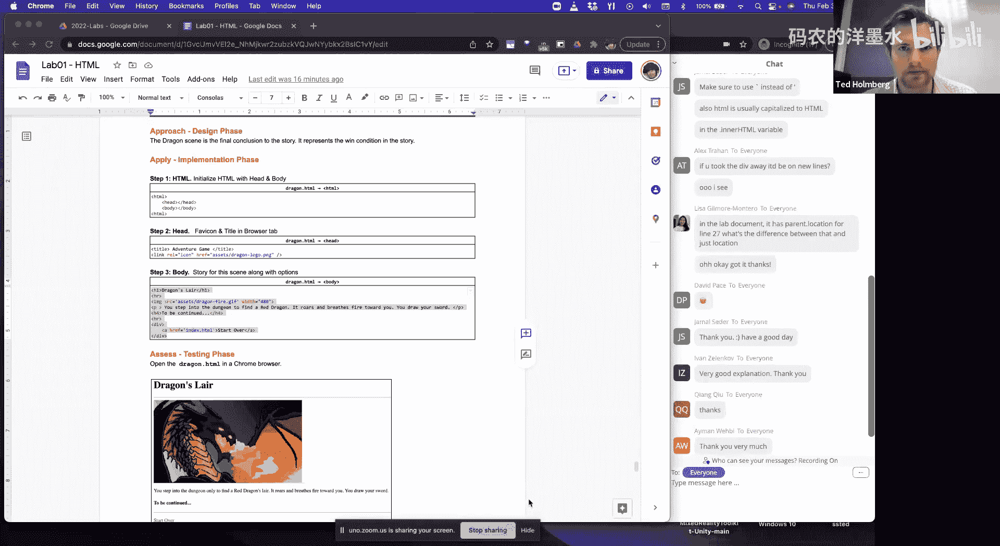

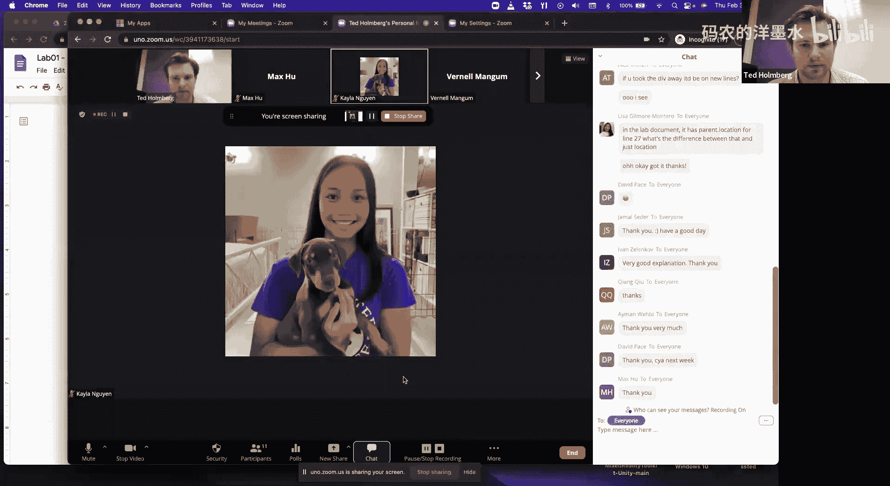