# 高级Web应用：第2讲：HTML交互式游戏开发（第二部分）


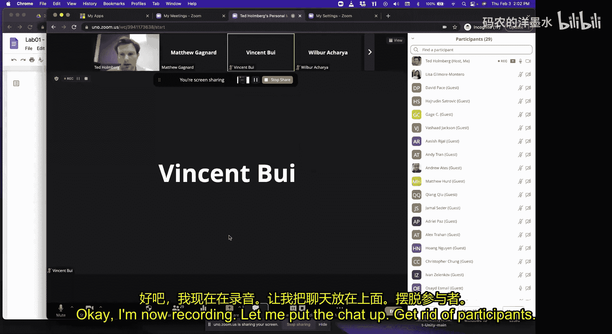

在本节课中，我们将继续构建一个基于HTML和JavaScript的交互式文字冒险游戏。我们将完成从目标5到目标12的开发，实现森林、沼泽、小屋、地牢、商店、哥布林战斗和最终场景。我们将学习如何通过URL查询字符串在页面间传递和更新游戏状态，以及如何使用JavaScript响应用户交互。

---

## 目标5：构建森林页面

上一节我们完成了游戏主世界页面，现在我们来构建第一个分支场景——森林页面。

### 步骤1：创建HTML文件
首先，创建一个名为 `forest.html` 的新文件。

### 步骤2：添加基本结构和元数据
在 `forest.html` 的 `<head>` 部分添加标题和网站图标（favicon）。

```html
<!DOCTYPE html>
<html>
<head>
    <title>冒险游戏</title>
    <link rel="icon" type="image/png" href="assets/favicon.png">
</head>
<body>
    <!-- 页面内容将放在这里 -->
</body>
</html>
```

### 步骤3：构建页面内容
以下是森林页面的主体内容。它包含一个标题、一张图片、场景描述、玩家选项和一个用于显示库存的iframe。

```html
<h1>森林</h1>
<hr>

<p>你漫步进入森林。左边是一条蜿蜒上山的小路，右边则通向沼泽。</p>
<h4>你想做什么？</h4>
<ul>
    <li><a id="hills" href="goblin.html">向左进入山丘</a></li>
    <li><a id="swamp" href="swamp.html">向右进入沼泽</a></li>
</ul>
<p><a id="exit" href="overworld.html">退出</a></p>
<hr>
<iframe id="inventory" src="inventory.html" height="100" width="300"></iframe>
```

### 步骤4：添加脚本以传递状态数据
为了在页面跳转时保持玩家的库存状态（如金币、生命值），我们需要使用JavaScript将URL中的查询字符串附加到所有超链接上。

```html
<script>
    // 获取当前URL的查询字符串（例如 "?gp=5&hp=3&ap=1&keys=1"）
    let searchParams = window.location.search;

    // 将查询字符串附加到所有需要传递状态的链接上
    document.getElementById('hills').href += searchParams;
    document.getElementById('swamp').href += searchParams;
    document.getElementById('exit').href += searchParams;
    document.getElementById('inventory').src += searchParams;
</script>
```

**核心概念解释**：
*   `window.location.search` 获取当前URL中 `?` 之后的部分，即查询字符串。
*   `+=` 是**复合赋值运算符**，用于字符串拼接。`a.href += searchParams` 等同于 `a.href = a.href + searchParams`。

**评估**：打开森林页面，点击链接，检查URL是否包含了来自主世界页面的状态数据（如 `?gp=5&hp=3`）。

---

## 目标6：构建沼泽页面

本节我们将构建沼泽页面，并实现第一个“游戏结束”场景。

### 步骤1：创建HTML文件
创建 `swamp.html` 文件并添加基本结构。

### 步骤2：添加页面内容
沼泽页面提供了两个选项：进入小屋（后续开发）或探索外部（触发死亡）。

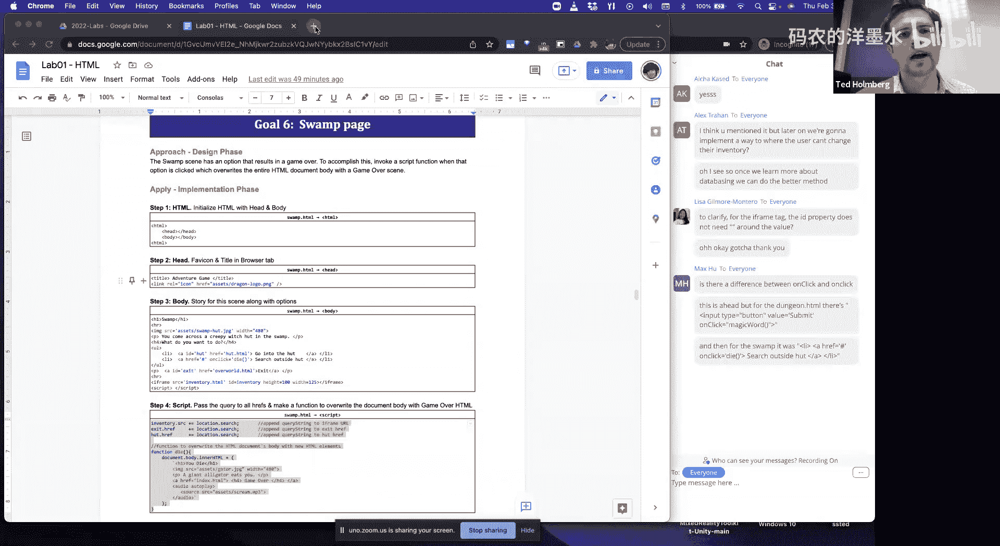

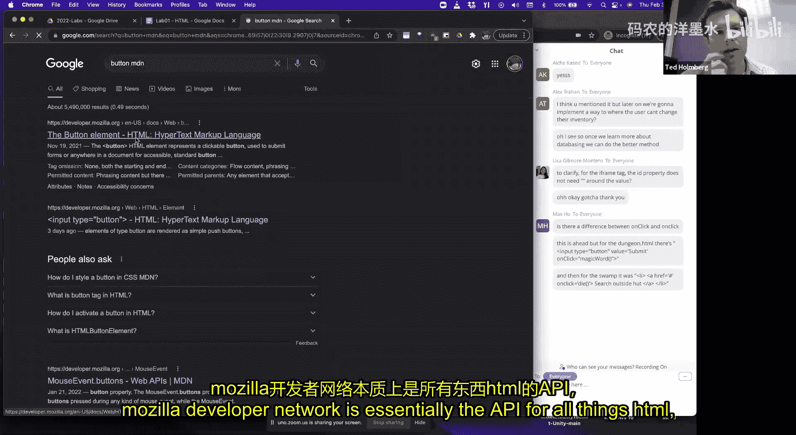

```html
<h1>沼泽</h1>
<hr>

<p>你踏入一片阴暗的沼泽。前方有一座破旧的小屋，周围雾气弥漫。</p>
<h4>你想做什么？</h4>
<ul>
    <li><a id="hut" href="hut.html">进入小屋</a></li>
    <!-- 注意：此链接使用 # 占位，点击将触发JavaScript函数 -->
    <li><a href="#" onclick="die()">在小屋外搜寻</a></li>
</ul>
<p><a id="exit" href="overworld.html">退出</a></p>
<hr>
<iframe id="inventory" src="inventory.html" height="100" width="300"></iframe>
```

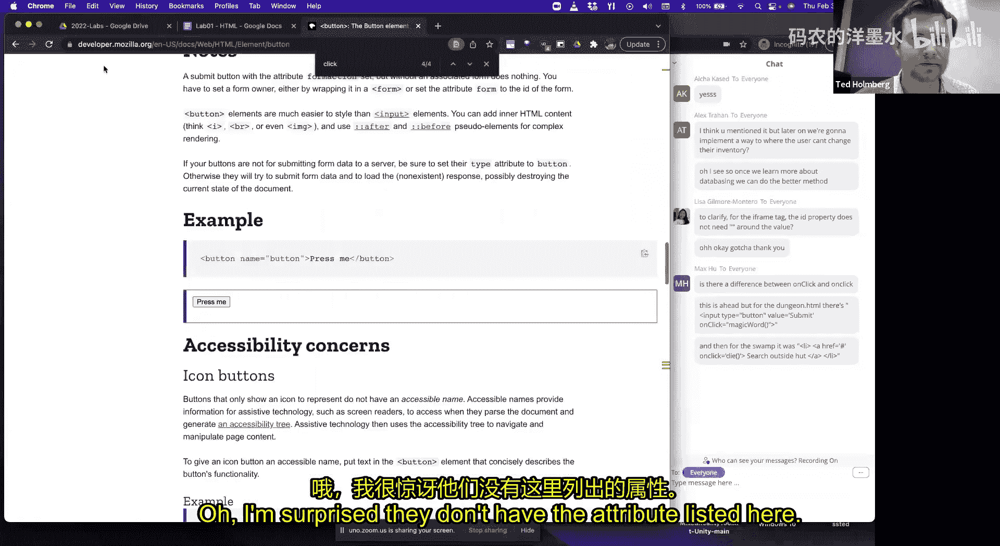

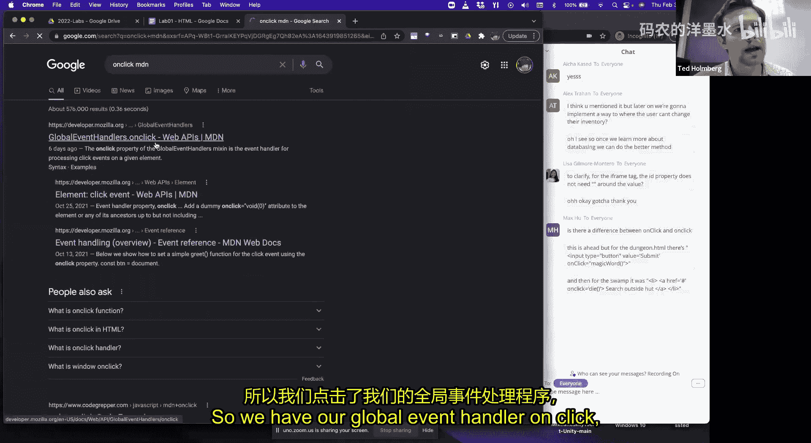

### 步骤3：添加交互脚本
我们需要添加两个功能的脚本：1) 传递状态数据；2) 实现 `die()` 函数来覆盖页面内容，显示游戏结束画面。

```html
<script>
    // 1. 传递状态数据
    let searchParams = window.location.search;
    document.getElementById('hut').href += searchParams;
    document.getElementById('exit').href += searchParams;
    document.getElementById('inventory').src += searchParams;

    // 2. 定义 die() 函数
    function die() {
        // 使用新内容完全覆盖当前页面的<body>内部HTML
        document.body.innerHTML = `
            <h1>你死了</h1>
            
            <p>一只巨大的短吻鳄吞噬了你。</p>
            <p><a href="index.html">游戏结束</a></p>
            <audio autoplay>
                <source src="assets/death.mp3" type="audio/mpeg">
            </audio>
        `;
    }
</script>
```

**核心概念解释**：
*   `onclick="die()"` 是一个**事件处理器属性**。当用户点击该链接时，会调用JavaScript函数 `die()`。
*   `document.body.innerHTML` 用于获取或设置 `<body>` 元素内的HTML内容。通过赋予它一个新的HTML字符串，我们可以动态重写整个页面视图。
*   **反引号（`）** 用于定义**模板字符串**，它支持多行字符串和字符串插值（`${expression}`）。

**评估**：在沼泽页面点击“在小屋外搜寻”，应触发死亡场景并播放音效。

---

## 目标7：构建女巫小屋页面

本节我们将创建一个需要钥匙才能进入的场景，并演示如何根据游戏状态动态更新页面元素。

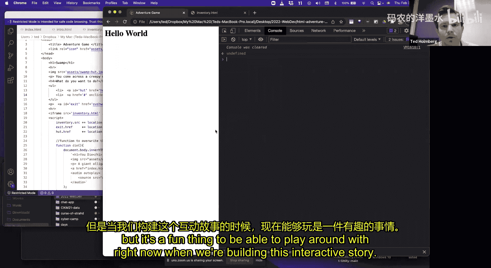

### 步骤1：创建HTML文件
创建 `hut.html` 文件并添加基本结构。

### 步骤2：添加页面内容
小屋页面有一扇门（图片），其状态（锁定/打开）将由脚本控制。

```html
<h1>女巫的小屋</h1>
<hr>
<!-- 图片本身也是可点击的链接，并绑定点击事件 -->
<a id="door" href=""></a>
<!-- 此段落初始为空，脚本将根据情况填充文本 -->
<p id="textBlock"></p>
<div>
    <a id="exit" href="swamp.html">退出</a>
</div>
<hr>
<iframe id="inventory" src="inventory.html" height="100" width="300"></iframe>
```

### 步骤3：添加复杂逻辑脚本
脚本需要：1) 传递状态；2) 从查询字符串中读取钥匙数量；3) 根据钥匙数量和门的状态定义 `openDoor()` 函数的行为。

```html
<script>
    // 1. 传递状态
    let searchParams = window.location.search;
    document.getElementById('exit').href += searchParams;
    document.getElementById('inventory').src += searchParams;

    // 2. 解析状态数据
    let queryString = new URLSearchParams(searchParams);
    // 使用 + 将字符串转换为数字
    let keys = +queryString.get('keys'); // 例如 "1" -> 1

    // 3. 定义 openDoor 函数
    function openDoor() {
        let doorImg = document.getElementById('doorImage');
        let textBox = document.getElementById('textBlock');
        let doorLink = document.getElementById('door');

        // 情况A：门已经是打开的
        if (doorImg.src.includes('door_open')) {
            doorLink.href = `hut_inside.html?${queryString.toString()}`;
            return;
        }

        // 情况B：门锁着，但玩家有钥匙
        if (keys > 0) {
            // 更换图片
            doorImg.src = 'assets/door_open.png';
            // 更新文本
            textBox.innerHTML = '门锁开了，但钥匙也断了。';
            // 更新状态：钥匙数量减1
            keys--;
            queryString.set('keys', keys);
            // 更新页面上的链接以反映新状态
            document.getElementById('inventory').src = `inventory.html?${queryString.toString()}`;
            document.getElementById('exit').href = `swamp.html?${queryString.toString()}`;
        }
        // 情况C：门锁着，且没有钥匙
        else {
            textBox.innerHTML = '门锁着。';
        }
    }
</script>
```

**核心概念解释**：
*   `URLSearchParams` 对象提供了读写URL查询字符串的便捷方法。
*   `queryString.get('keys')` 获取 `keys` 参数的值。
*   `+` 运算符在此处作为**一元加运算符**，将其后的值转换为数字。
*   `queryString.set('keys', keys)` 更新查询字符串对象中 `keys` 的值。
*   `string.includes(substring)` 方法检查一个字符串是否包含另一个字符串。

**评估**：尝试用钥匙开门和没有钥匙时开门，观察图片、文本和状态（钥匙数量）的变化。

---

## 目标8：构建小屋内部页面

本节我们将在小屋内部添加一个视频线索，该线索将在后续地牢场景中使用。

### 步骤1：创建HTML文件
创建 `hut_inside.html` 并添加基本结构。

### 步骤2：添加页面内容（包含视频）
使用 `<video>` 元素嵌入一个自动播放、循环的线索视频。

```html
<h1>女巫的小屋</h1>
<hr>

<p>你进入小屋，发现一本发光的书。</p>
<!-- 视频元素：自动播放、循环、静音（Chrome中自动播放要求） -->
<video autoplay loop muted width="480">
    <source src="assets/runic_video.mp4" type="video/mp4">
</video>
<p>书中展示了一串闪烁的符文，似乎是解除某种封印的咒语。</p>
<div>
    <a id="exit" href="swamp.html">退出</a>
</div>
<hr>
<iframe id="inventory" src="inventory.html" height="100" width="300"></iframe>
```

### 步骤3：添加脚本以传递状态
只需确保退出链接和库存iframe携带状态数据。

```html
<script>
    let searchParams = window.location.search;
    document.getElementById('exit').href += searchParams;
    document.getElementById('inventory').src += searchParams;
</script>
```

**评估**：页面加载时，视频应自动播放并循环。

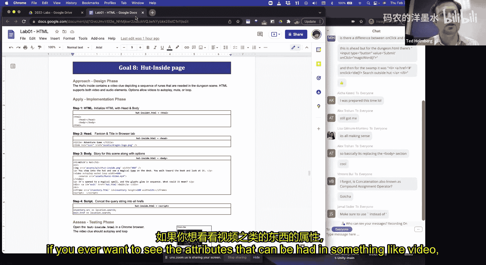

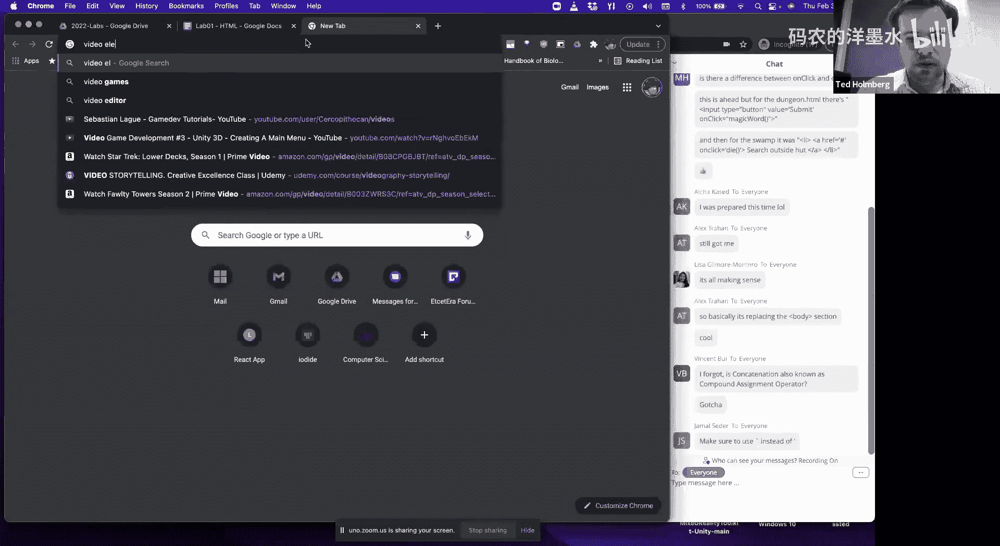

---

## 目标9：构建地牢页面

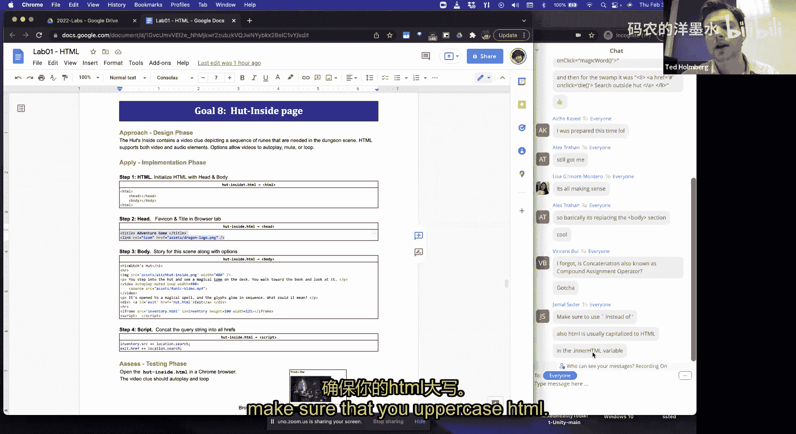

本节我们将创建一个谜题场景，要求玩家输入正确的密码（来自小屋的视频线索）才能通过。

### 步骤1：创建HTML文件
创建 `dungeon.html` 并添加基本结构。

### 步骤2：添加页面内容（包含输入框）
使用 `<input type="text">` 创建文本输入框，并使用按钮触发检查。

```html
<h1>地牢入口</h1>
<hr>
<p>一个魔法封印挡住了去路。你必须解除它。</p>

<p>这里有一本符文咒语翻译法典。念错咒语是危险的。</p>

<div>
    <label>输入咒语：</label>
    <input type="text" id="inputText">
    <button onclick="magicWord()">提交</button>
</div>
<hr>
<div>
    <a id="exit" href="overworld.html">退出</a>
</div>
<iframe id="inventory" src="inventory.html" height="100" width="300"></iframe>
```

### 步骤3：添加密码验证脚本
脚本将检查输入框中的值，正确则前进，错误则触发“游戏结束”。

```html
<script>
    // 传递状态
    let searchParams = window.location.search;
    document.getElementById('exit').href += searchParams;
    document.getElementById('inventory').src += searchParams;

    function magicWord() {
        let input = document.getElementById('inputText');
        let password = input.value;

        // 正确密码是 "open"（根据视频线索）
        if (password === 'open') {
            // 跳转到下一个场景（龙穴），并携带状态
            window.location.href = `dragon.html?${searchParams}`;
        } else {
            // 输入错误，显示死亡场景
            document.body.innerHTML = `
                <h1>你死了</h1>
                
                <p>你念错了咒语，封印将你吞噬。</p>
                <p><a href="index.html">游戏结束</a></p>
                <audio autoplay>
                    <source src="assets/death.mp3" type="audio/mpeg">
                </audio>
            `;
        }
    }
</script>
```

**核心概念解释**：
*   `input.value` 获取文本输入框的当前内容。
*   `window.location.href` 获取或设置当前页面的完整URL。对其赋值会导致浏览器导航到新URL。

**评估**：尝试输入正确密码“open”和错误密码，观察不同的结果。

---

## 目标10：构建商店页面

本节我们将创建一个商店，玩家可以在这里消费金币来购买生命值、攻击力或钥匙。

### 步骤1：创建HTML文件
创建 `shop.html` 并添加基本结构。

### 步骤2：添加页面内容（包含按钮）
使用 `<button>` 元素创建三个购买选项。

```html
<h1>商店</h1>
<hr>

<h4>你想买什么？</h4>
<div>
    <button onclick="buyFood()">生命 ❤️<br>1 金币</button>
    <button onclick="buyWeapon()">攻击 ⚔️<br>5 金币</button>
    <button onclick="buyKey()">钥匙 🔑<br>10 金币</button>
</div>
<hr>
<div>
    <a id="exit" href="overworld.html">退出</a>
</div>
<iframe id="inventory" src="inventory.html" height="100" width="300"></iframe>
```

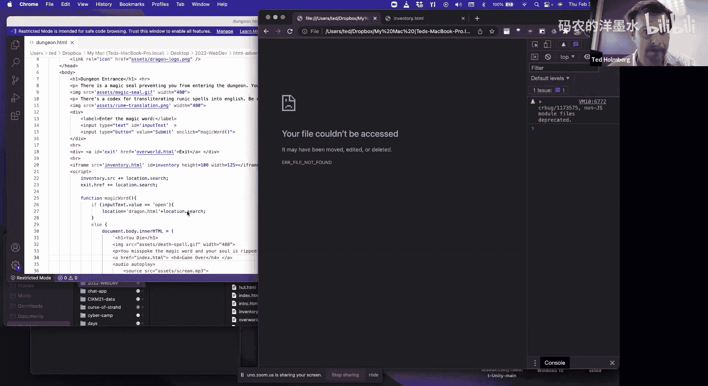

### 步骤3：添加商店逻辑脚本
脚本需要读取当前状态，并在购买时更新金币和相应属性。

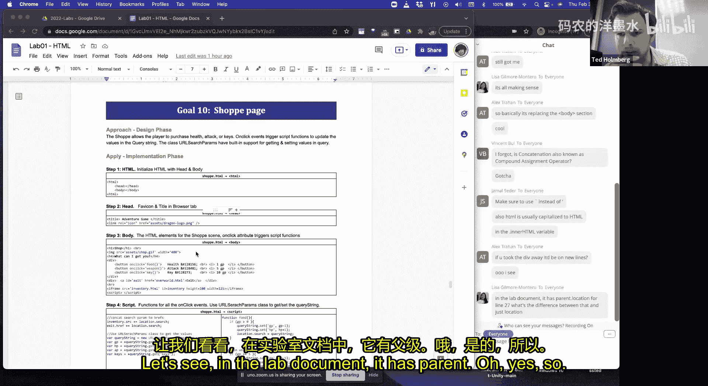

```html
<script>
    // 传递状态
    let searchParams = window.location.search;
    document.getElementById('exit').href += searchParams;
    document.getElementById('inventory').src += searchParams;

    // 解析状态数据为数字
    let queryString = new URLSearchParams(searchParams);
    let gp = +queryString.get('gp');
    let hp = +queryString.get('hp');
    let ap = +queryString.get('ap');
    let keys = +queryString.get('keys');

    function buyFood() {
        if (gp > 0) {
            gp--;
            hp++;
            updateState();
        }
    }

    function buyWeapon() {
        if (gp >= 5) {
            gp -= 5;
            ap++;
            updateState();
        }
    }

    function buyKey() {
        if (gp >= 10) {
            gp -= 10;
            keys++;
            updateState();
        }
    }

    function updateState() {
        // 更新查询字符串对象
        queryString.set('gp', gp);
        queryString.set('hp', hp);
        queryString.set('ap', ap);
        queryString.set('keys', keys);

        // 更新地址栏和页面上的链接，使状态生效
        window.location.search = queryString.toString();
    }
</script>
```

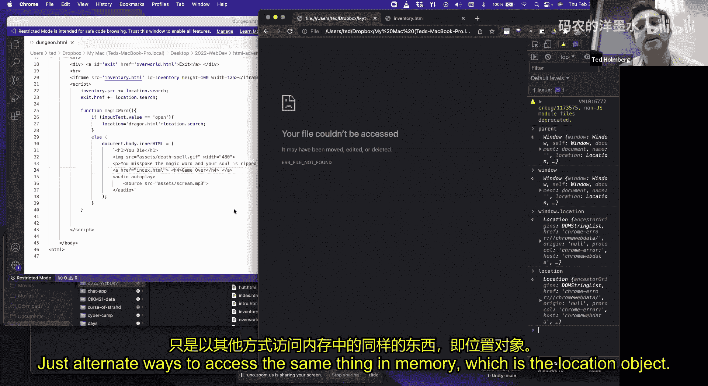

**核心概念解释**：
*   `-=` 是用于减法的复合赋值运算符。
*   `window.location.search = queryString.toString()` 会使用新的查询字符串重新加载当前页面，从而更新所有显示的状态。

**评估**：购买物品，检查金币和物品数量是否正确更新。

---

## 目标11：构建哥布林战斗页面

本节我们将实现一个简单的回合制战斗系统，展示更复杂的游戏状态管理和DOM操作。

### 步骤1：创建HTML文件
创建 `goblin.html` 并添加基本结构。

### 步骤2：添加页面内容
页面显示哥布林图片、战斗文本和“战斗”/“撤退”选项。

```html
<h1>山丘</h1>
<hr>

<p id="battleText">一个哥布林挡住了你的去路！</p>
<h4>你想做什么？</h4>
<div id="options">
    <button id="fightBtn" onclick="attack()">战斗</button>
    <a id="retreat" href="forest.html">撤退</a>
</div>
<hr>
<iframe id="inventory" src="inventory.html" height="100" width="300"></iframe>
```

### 步骤3：添加战斗逻辑脚本
脚本将模拟战斗回合，更新双方状态，并根据结果动态改变页面内容。

```html
<script>
    // 传递状态并初始化
    let searchParams = window.location.search;
    document.getElementById('retreat').href += searchParams;
    document.getElementById('inventory').src += searchParams;

    let queryString = new URLSearchParams(searchParams);
    let gp = +queryString.get('gp');
    let hp = +queryString.get('hp');
    let ap = +queryString.get('ap');

    // 哥布林属性
    let goblinHp = 3;
    let goblinAp = 2;

    function attack() {
        // 玩家攻击哥布林
        goblinHp -= ap;
        let battleText = document.getElementById('battleText');
        let optionsDiv = document.getElementById('options');

        if (goblinHp <= 0) {
            // 哥布林死亡
            document.getElementById('goblinImg').src = 'assets/treasure.png';
            gp += 3;
            queryString.set('gp', gp);
            queryString.set('hp', hp); // 更新可能受伤后的生命值

            battleText.innerHTML = `你击败了哥布林，找到了3枚金币！`;
            // 移除战斗按钮，只留下返回链接
            optionsDiv.innerHTML = `<a href="forest.html?${queryString.toString()}">返回森林</a>`;
            // 更新库存显示
            document.getElementById('inventory').src = `inventory.html?${queryString.toString()}`;
            return;
        }

        // 哥布林反击
        hp -= goblinAp;
        queryString.set('hp', hp);

        // 更新战斗文本
        battleText.innerHTML = `你对哥布林造成了 <strong>${ap}</strong> 点伤害。它还有 <strong>${goblinHp}</strong> 点生命值。<br>
                                哥布林对你造成了 <strong>${goblinAp}</strong> 点伤害。`;

        // 更新库存显示当前生命值
        document.getElementById('inventory').src = `inventory.html?${queryString.toString()}`;

        // 检查玩家是否死亡
        if (hp <= 0) {
            battleText.innerHTML += '<br><strong>你死了！</strong>';
            optionsDiv.innerHTML = `<a href="index.html">游戏结束</a>`;
        }
    }
</script>
```

**评估**：进行战斗，测试胜利、失败和中间回合的情况，观察所有状态和页面元素是否正确更新。

---

## 目标12：构建最终场景（龙穴）

这是游戏的最后一个场景，作为一个悬念结局。

### 步骤1：创建HTML文件
创建 `dragon.html` 并添加基本结构。

### 步骤2：添加简单的页面内容
这个页面主要是叙事，没有复杂的交互。

```html
<h1>龙穴</h1>
<hr>

<p>你步入地牢深处，发现一条红龙。它咆哮着向你喷出火焰。你拔出了剑...</p>
<p><strong>未完待续</strong></p>
<hr>
<p><a href="index.html">重新开始</a></p>
```

**评估**：确保能从地牢正确导航到此页面。

---

## 补充知识：音频自动播放问题

在开发过程中，你可能会遇到 `<audio autoplay>` 不工作的问题。这是由于现代浏览器的自动播放策略：

*   **文件协议（file://）**：通常完全禁止音频自动播放。
*   **HTTP协议（http://）**：允许自动播放，但通常需要伴随一个用户手势（如点击链接）。页面刷新不被视为手势。


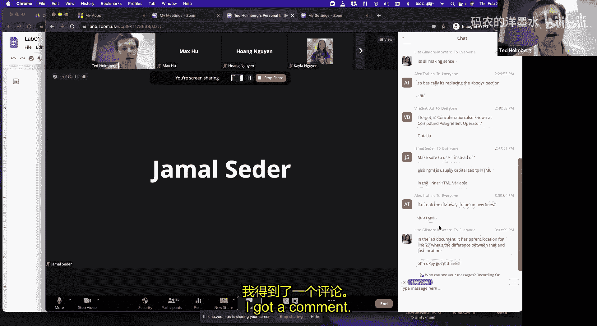

**解决方案**：
1.  使用简单的HTTP服务器来托管你的游戏文件。Chrome用户可以使用“Web Server for Chrome”等扩展。
2.  设计游戏流程，使音频页面（如介绍页面）是从另一个页面（如主页）通过点击链接进入的，这满足了“用户手势”的要求。

示例：`index.html` 中有一个链接到 `intro.html`（带自动播放音频）。用户点击链接进入 `intro.html` 时，音频可以播放。

---

## 总结

本节课中，我们一起完成了一个完整HTML交互式游戏的所有核心场景。我们深入学习了：

1.  **状态管理**：使用 `URLSearchParams` 和查询字符串在页面间传递和更新游戏数据（金币、生命值、攻击力、钥匙）。
2.  **动态内容更新**：通过 `document.getElementById()`、`.innerHTML`、`.src`、`.href` 等属性和方法，使用JavaScript动态修改页面内容、图片、链接和文本。
3.  **事件处理**：使用 `onclick` 属性将用户操作（点击）与JavaScript函数绑定，实现交互逻辑。
4.  **多媒体集成**：在网页中嵌入和控制 ``、`<audio>`、`<video>` 元素。
5.  **条件逻辑与游戏机制**：实现了解谜（密码门）、购物（商店）、回合制战斗（哥布林）等复杂的游戏机制。

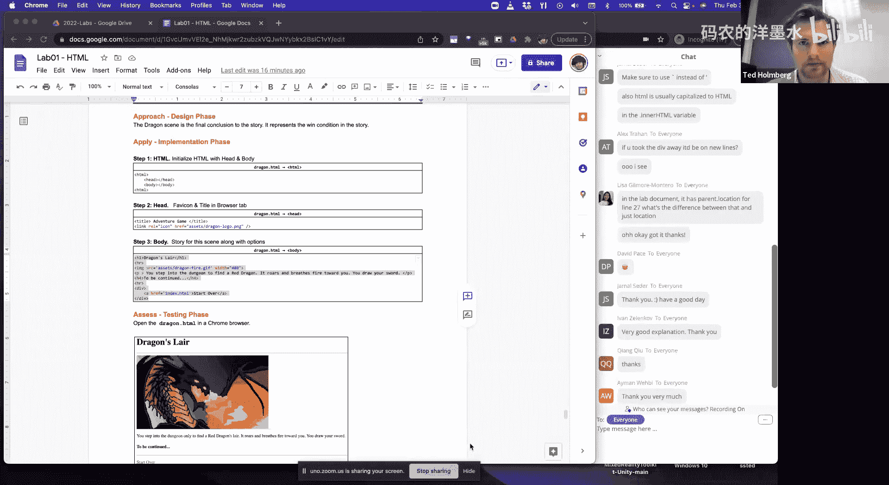


你现在已经掌握了使用纯HTML和JavaScript构建基础交互式应用的核心技能。在接下来的CSS课程中，我们将为这个游戏添加样式，让它变得更加美观。