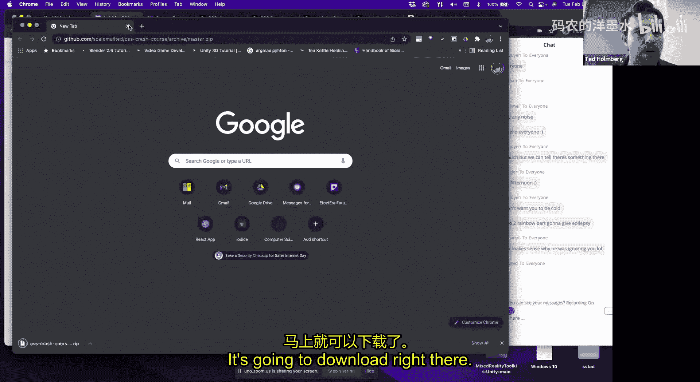
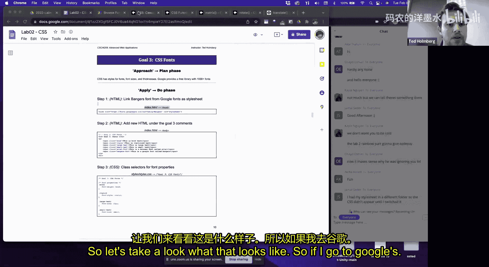
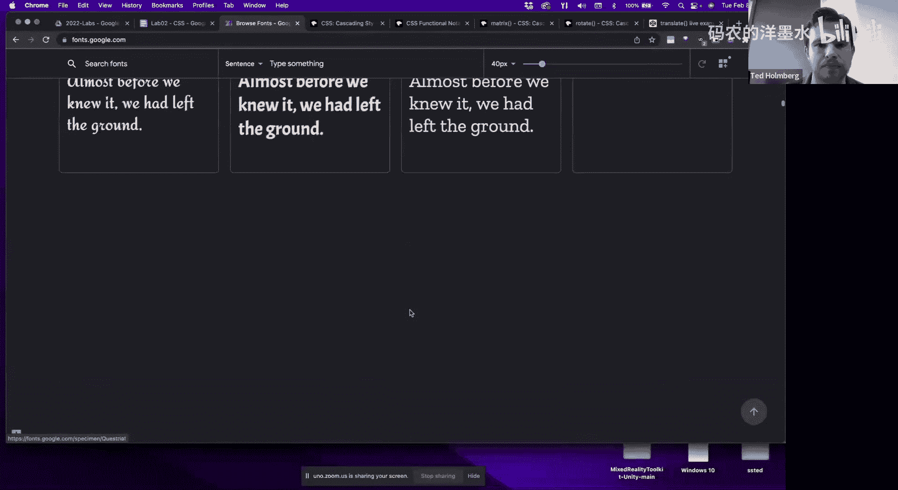
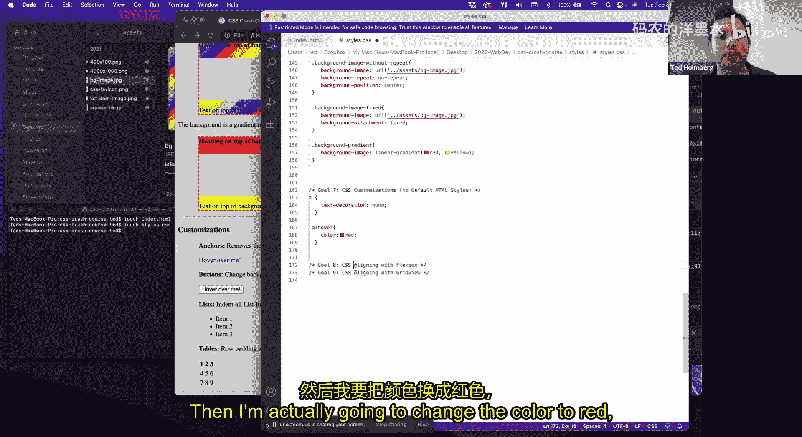
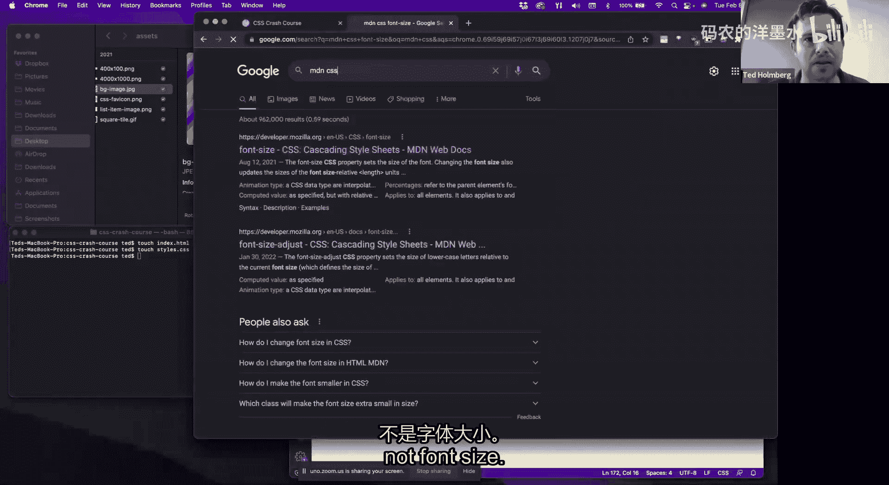
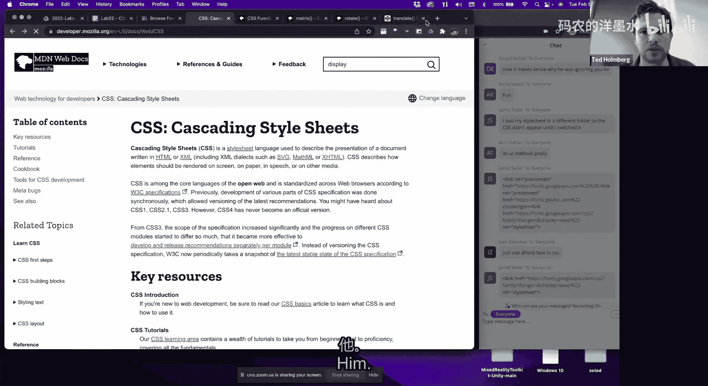
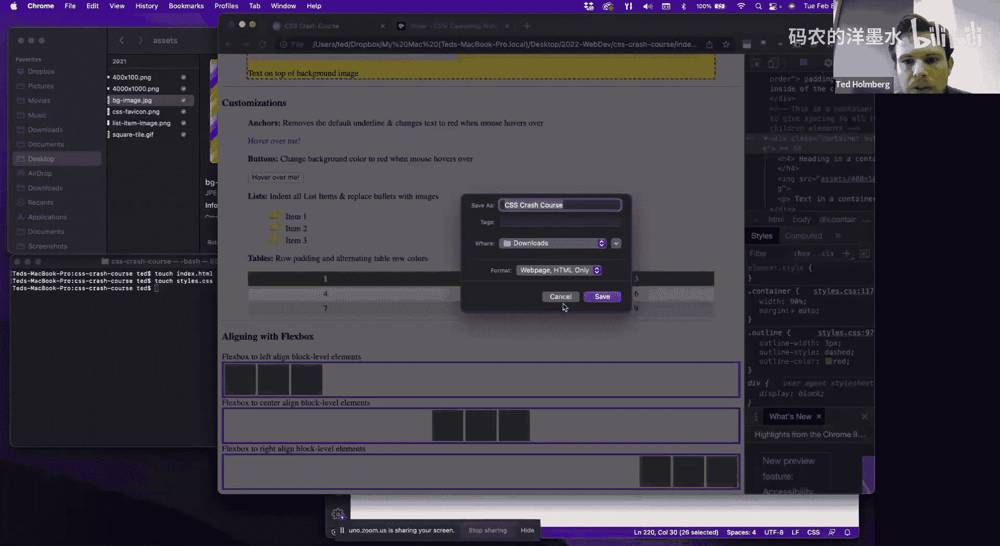
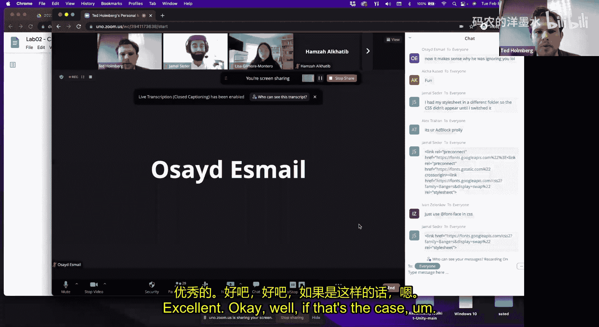
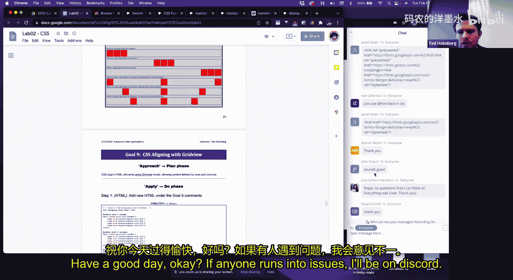
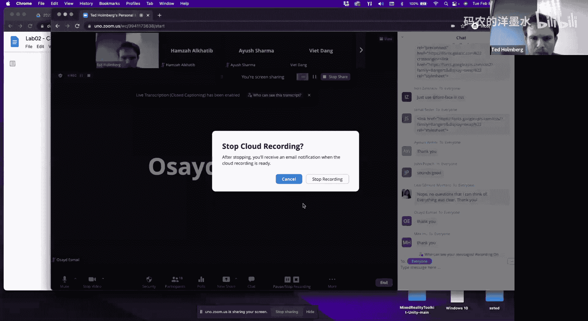

# 【全集】加州理工学院 高级Web应用 中英字幕 1080P p03 Lecture 3 - CSS 速成 -BV192zTBrEmu_p3-

Okay， perfect recording。 Okay， so today。I want to go over the CSS lab。

So this should be available already through Moodle。

And so we're going to start every lab just examining the table of contents because that'll give us a firm understanding of what our learning objectives are going to date。

 This lab has a total of。10 goals if we start our index at zero。

And really what I want to do over the course of this lab is give you some practical examples of how to use CSS so we'll look at CSS selectors。

 we'll look at CSS colors， we'll look at fonts spacing， sizing backgrounds。

 customizations to some of the default。Sttylings for some elements like the acre tag or the list items in a unordered list we'll look at aligning our elements with both flexbox and gridview and then we might take whatever time we have left over to examine some of the other things that we are we don't have an opportunity to go deeply into over the course of this lab so by the time we're done this lab though we should have touched almost every little aspect of cS。

So that you can go ahead and know how to use it to go ahead and style your web pages。Okay。

 so the lab introduction here just kind of。It assumes you know a little bit of HTML doesn't go through a lot of the HTML but we're going to do very little HTML here and so presumably you've already done lab one before we do lab two and the motivation behind our lab here is to understand CSS and use it to style various properties of the HTML in the browser's viewport and so our goal in this lab will be to change the colors and fonts and spacing and sizing and backgrounds and alignments of the default styles of HTML。

So we'll have multiple learning objectives the first will be how do we structure a CSS file and then how do we do CSS declarations and how do we define CSS properties and selectors and then what is this thing that's Flbox and then what's this thing called GrVi and how do they compare one to the other the other big thing would be to take a look at Google font API because that will probably be a really fun API to play around with for the first homework that everyone's probably already started working on。

So just to get familiar with our basic project architecture for this particular lab。

 we're going to have a root directory， our project directory。

Wwhich we'll call CSS Cr course inside of there we'll have our index。

 HTML that'll be our source HTML document， we'll have an assets directory for with images or whatever content this lab requires and then we'll have a Sts directory that's going to hold a CSS file into the CSS file we'll hold all the styles that we want to apply to our HTML document so before we start why don't we grab this link here and get the down download our starter files。

So I will copy that， I will go ahead and。Paste that into a URL。

 it's going to download right there perfect should be my downloads folder。

 let me hop on over here and。

Pull this here and put it inside this directory that I've been working in。

 so I'm going to unzip that。And there we go。 So here I'm going to just rename this so it's consistent with what's inside the。

CsS crash course is that what we called it here yeah perfect。 So now it's consistent。

 And so when I first start all I'm going to have is this assets directory my assets directory is going to have a couple of these。

A couple of images we're going to use throughout the lab。Excellent。Okay。

 so concepts that we're going to cover that are going to be pretty critical for the lablab to first is。

CSS which stands for cascading style sheets so CSS is a standard styling language for selling our web pages it essentially just consists of a series of declaration so it's a declarative language and our cS file is linked into the HTML head element so when we first open up the HTML document。

This is part of the metadata that should get imported from along with the HTML document。

 which is going to define all of the。Sttylings each element should have。So when I say declarations。

 this means that all CSS statements are defined as declarations。

 the basic format of a declaration consists of a selector， what are we selecting。

 and then we open up each selector with a scope the same we would do in Java JavaScript that uses curly braces to open the scope。

Of a declaration we close it with a curly brace and then each style we want to apply based off of that selected HTML element will have a property and this is a welldefined property name so this is something that the more CSS you go ahead and author the more you'll learn about the properties that are available to you。

So declarative language means it's essentially a closed language so you don't add there's no logic。

 there's no state that you can really go ahead and add to it so it's similar to what I like to say like programming a VCR or microwave right they're programmable but they're very limited in its capacity and so in many ways CSS is kind of like that as well and so the nuance is just learning all the properties that are available to you and the values you can set them to。

Now when I say a selector， a selector is used by CSS to select an HTMLL element for styling there are three basic types of selectors and we're going to look at all of those in this lab。

 but it'll be an element selector class selector and an ID selector and the basic structure of a CSS file is that CSS declarations are all defined consecutively one after the other。

And a style is applied to an HTML element， it cascades down to all of its children， so if I style。

 say for instance， a div and that div has child HTML elements。

 that style cascades down into that down the tree like structure that is the HTML document and so that's why we have that name cascading style sheets is because when you apply the style to one node it cascades to all of its children node。

Another thing to know about CSS is we'll talk a little bit about fonts there's some built in fonts that the browser supports there's typically five generic types of fonts。

 which is serifs， San serifs monospace cursive and fantasy， but Google。

Provides a thousands of free fonts that we'll have available and we'll look at that over the course of those lab too。

If you want additional resources I give tons of resources like playgrounds where you can do live coding or see other people's examples of projects if you want to see some beautifully designed websites I have this for examples that you might want to go to some tutorials that are on Mozilla's webp page and of course Mozilla's reference for CSS so this would essentially be the equivalent of the CSS API so for any reason you want to find out what are your options for styling that's where you should go Okay with all that the lead up to the lab is done why don't we start actually working on the lab now typically what I'll do is I'll show you the lab but I didn't actually I didn't actually。

好好。I don't think I have it on this machine， so we'll actually see what this lab looks like as we run through it。

 but this isn't going to be so much a full application。

 it's going to be a demonstration of how we can style a variety of elements in HL with CSS。Anyway。

 with that said， we have to build an HTML document so our first goal is going to be to set up an HTML file and set up a cS file so let's do that The first thing i'm going to do here is i'm going to create。

An HTMLL file and actually， let me see， where am I？Okay， let me go into my。There we go。 Okay。

 let's clear that。 Okay， so now let's create a H document。There it is。And I'll pull that into here。

There we go， okay， and just like we've done in the last lab whenever we go to produce an HTMLl documenting。

It's not going to。There we go。We are going to start by defining the root node HTML。

 and then make sure there's a head and body。Elements。Perfect， and once we do that。

 we will inside the head， create ourselves a title。And we'll also go ahead and put in our foccon。

 so not much to explain here， let's get rid of that。就翻。Now said heads， that doesn't make sense。Okay。

Perfect。死啦。And so now let's see here if I go here。Perfect。

 and right here we can see I have the fvacon and have the title。

 so I now know that I have my HTML document loaded into the browser。And let's see here。

 the next thing I'm going to do is let's go ahead and define the body of my HTML document。

 So here I'm going to replace this body here with the body there， perfect。

And I'm going to start off here with。A heading that just says CSS crash course， a horizontal line。

 and then I'm going to add comments where all my goals are for this。So let me go here。

Refresh and there it is CSS Cr course and。Each one of our goals is going to go as we approach them。

Excellent。And then let me create a CSS file called Sts， so let me do that。Touch。Sles。css。Perfect。

 and actually let me make a new folder here， I'm going to call it styles。Perfect， and I will move。

So I will keep all my CSS files inside of a Ss directory。

 I'll keep all of my web page assets and an assets directory and then the HTML document itself will just be exposed inside of our root project directory。

Okay， let me actually drag this over here so that we'll be able to go ahead and actually let me say。

 can I？There we go。This way I can have both documents kind of opened at the same time。Okay。

 and the next thing I'm going to do here is I'm going to grab this and so the first thing you should notice is in CSS。

 we define our comments similar to the way we would in Java。

Or in JavaScript now CSS does not have single line comments with just slash slash。

 it's just going to use slash asterisk asterisk slash it's always multi line comment。

So this is our comments so we'll have our nine goals of each of our CSS instructions here inside our CSS document。

Excellent， and then with that said， that's it。For our goals here it was just a lot of setup work and so here we'll just double check yeah it looks perfectly fine so let me jump over here so goal one is to learn a little bit about CSS selectors。

Okay， so before we can actually start applying CSS to our HTML document。

 we need to link the CSS file into the document。So we're going to create a link element。

And so let's jump。And to the HTML， so we're in the HTML right now inside the HTML I'm going to add a link element just like what we had for the fvacon for this time。

The type of length this is going to be。😡，The relationship of this link is going to be of a style sheet。

And the hyper reference is going to go into the Sts folder and then reference the Sts。

css file that we just created。So this is how we're going to be able to import that CSS file so that we can apply it towards our HTML documents inside this page。

Okay， so now that we've linked。The CSS file inside of the head element。

 let's go ahead and grab this new portion of the HTML code。So it's going to go here into goal one。

Let me tab that over。Perfect， and I don't need to gold ones。 Okay， so here all I'm doing is I am。

Making a heading three element go one selectors and then I have a paragraph I have another graph that has a class attribute defined called and the name for that class is going to be called class selector and then I'm going to have another paragraph graph that's going to use an ID attribute called ID selector and so the idea here is I want to show you how I can select an HTML document based off of the element type off of a class name that an element might have or the ID name that an element might have Okay so now let's look at what the CSS is actually going to look like。

And so here， for this time， I'll just go ahead and copy it all over and then break it down。

 but some of these I'll do one at a time。Okay。So， here I have。

A selector and I'm selecting on the element name so it's going to select on the body so it's going to only need to so when the CSS gets applied。

 what's going to happen is it's going to look for any element within the name body and it's going to apply a background color this is the property that we're going to go ahead and apply a style to and then the value is going to be like gray。

And of course we'll go more into the colors and alignment and stuff in a future goal。

 but this is just showing you how you kids select that body and so presumably we have one body that's like one of the major elements。

 one of the major nodes in our tree， so this means the entire background is going to go like gray。

Now when I use a class selector， I would use the class selector name。

But class selectors to be able to parse it and and allow for the browser to know that this is a class selector。

 we preface it with a period so it's not enough just to use a class the class。😡。

Ne that is applied in the document， you have to let in the CSS know that it's a class that you're searching for by preface in it with a period and then it's going to look for a class that then has class selector。

😡，And it's going to be a similar concept with an ID in order to allow the CSS parer to know that the next selector is looking at an ID name you preface it with a hashtag and then whatever the ID name is that you're looking for so in this case it would be ID dash selector and for the class selector we're going to go ahead and text to the right for the ID selector we're going to go ahead and text to the center so let me save that。

And let's see let's go ahead and refresh and so there we have our gray。

 let me save to make sure we have this， let me save to make sure that this is all saved。

And now now after saving it， you'll see now I do get that head element， goal one is selectors。

This is the body set to Greg， so that was based off of the element selector。

 this element was selected by its class name。And so again， because it had a class here。

Since I had a class name， this paragraph got text aligned。To the right。

 and then this one got selected by its ID。So it got texton to the center so again。

 the advantage of a class selector over an ID selector is that an HTML document can have multiple class names。

So。So you can have an element， you can have multiple elements that have the same class name。

 or you can have one element that has multiple class names。

So you could be a member of multiple classes， whereas with an ID， you can only have one unique ID。

So typically the preference is to use class selectors when defining your CSS。

Styleles because you typically you want to add them to multiple elements。Whereas in the script tags。

 we were using IDs because we wanted to just grab one unique element and discriminate it from all the other elements so that we could apply some kind of change to it。

Syleles， typically we want to apply to multiple elements or multiple styles to mine element。

 and so class electors really allow us to do that well for us。Excellent。

 so if there's no questions for goal one， I'm going to move over to goal two。So。Let's see here。

I had my style sheet and in different folders the CSS didn't appear until I switched it yeah yeah so that's you have to make sure that the pathway is's all right for your cS to be somewhere else inside of your of your O but you have to give it the appropriate path so that it links correctly otherwise it it will silently fail and just not get applied so that's one thing that might be frustrating。

As we continue to develop our web code is that CSS。

 H and JavaScript are all designed to silently fail。

 so for some reason there's if it can't accomplish the tat the statement gives。

 it just ignores it and moves on。It makes debu makes debugging very difficult。Okay。So our goal， too。

 is going to be to look at how CSS manages colors。And here CSS has styles for background colors and font colors。

 colors may be declared either by their name， by an RGB value or by a hex value。

So let's start by now adding some more HTML into。Our each emailt document。

 so let me jump back over here， so I'm going to go to goal2 here。And I'm going to。Add in。

This stepsa code so here I'm going to do another heading element to say this is goal two colors and notice now everything's just going to use class selectors and that's going to be。

 like I said earlier our preference moving forward because as you can see I can actually give two class names by just separating them with a space。

So now this paragraph has a class of BG dash screen and text dash screen。

And I can select off of both of those and give sline instructions on both of those and it'll be the same with this one which is going to have a BG blue text red。

 BG red， text blue， BG dark text white， the idea behind the BG is that's a name。

I'm trying to I'm also aiming to do the same thing I do in Java or with any other coding project I strive for。

Self documenting code so whenever I create a name or label for anything it should be evident on what it's going to do so in this instance BG is going to be background green background blue background red or background dark and then obviously text screen would be affect the the color of the text。

Okay， so now that we have。Toefine some class names inside our HTML document。

 let's go into our CSS document and actually create some declarations that are going to go ahead and implement or style those elements。

So here I will go ahead and。Create。Some declarations and again since these are class selectors since I'm going to select off a class name each of the selector that's going to apply a style to these names have to be prefaced with a period so BG dash white is going to apply a background color so there's a property called background color which will change the background of any HTML element so it could be a paragraph or div or whatever and so here initially we're going to look at how we can go ahead and define our colors as RGB values and so I know the lecture goes into great detail about how RGB colors are defined and I have the primary colors here so white would be where your red green and blue to be any value between 0 to 255。

So if they're all at max， that's white， if just the middle one is max and the other two or0。

 that's our green， that's our red。That's our blue。And then when we start combining them。

 we can get other colors like say， for instance， yellow。And then if none of the colors are active。

 then that's going to be black。And so notice each one of these。

 we're just going to create a class selector and any HTML element that has this class name will then get a background color of that color。

Okay， but now we've only implemented half of that effect。

 if I if I save this and just see what happens。Let me actually also take my N so that it actually renders。

Okay。So yeah， so now I have the background colors for each of those paragraphs。

 so now if I want to also affect the the text itself。

Let me go ahead and add in some more CSS declarations。Just like so， so these any。

Ht element that has text S red， we would just use the color property to affect the actual font color。

Or the text color so now if I go and I refresh this page， there it is。

We have applied a background color， and we have applied a。A tax color as well。And we assessed。

 and that's exactly what we have。So that's how we can use CSS to change the colors for both background and of our tax so let's move on to fonts CSS has styles for fonts and font sizes and thicknesses Google provides a free library with over  a thousand00 fonts I'm going to show you that library in just a moment。

So。I'm going to come back， I'm going to link this when I talk more about the so if we want to use the Google fonts。

Most of these fonts we're going play around with are built into the browser so we can just toggle on to it。

 but the Google fonts are not built in so we have to import them the same way that we would import like our fivevacon or the same way we would import the cS file itself so effectively if we want to go ahead and use one of the fonts that Google makes available let me move this over here I would go into the。

Actually just so it doesn't create so much noise here， okay， perfect。

I would create another link element inside my head。And then here， let me move this to the font。

Type of link that would be would be a style sheet similar to our CSS style。

 but the hyper reference would go to the Google APIs。

 the font APIs and it would go ahead and query to grab whatever type of font we want so in this lab we're going to be using a font called bangers so let's take a look what that looks like So if I go to Google's。

Available web fonts and you can get there just by going to fonts。google。com。Let's see I can search。

Or this is going to be the font we're going to use in this lab。Now。If I want to select this font。

 the way I could add that is。Let's see here， there should be an option。To select this font。

And what does it， Where did it。I was about to stretch this out some。Reve this font。

What happens if I paste？Oh yeah， no， not that。Press select this style look you see where it says remove this style。

 remove it and then press select this style again。Yeah， oh。

For me themic is up a little tab yeah so it's it's normally opens up a tab here let me see if it's because。

I don't know what's going on with let me go。Let me just go back to I can send it into the chat。Yeah。

 all， let me go here。Yeah。Typically what it'll do is when you ask it to select a style。

 it go ahead and produce that link element that you can just copy and paste。Oh here it is。

 so what has been doing for me is it's everything I've been selecting just now is been throwing。

So here it looks like right here in this top right hand corner。

 you can view all of your selected families， you could just copy this and then paste it into your head element of very T document。

 and then that'll import whatever fonts you've been looking at on Google S API。And you could say， oh。

 let me go back over here。No， not that。Right here， browse the fonts。

 you can see inside here that there's a lot of cool fonts that you can go ahead and。

So lack that would really set the ambient tone of your adventure story。

Okay。So here I'm just creating the link。And then you could use this as a basis as well。

 you don't necessarily have to have an auto generaterate that link for you。

 although it's super easy if you do， you can manually type in instead of bangers。

 whatever the name is and use this link element to import。Okay。

 so now that we have imported a font from Google， let's go ahead and add in some HTML。And again。

 this HCL， HTMLls pretty simple， it's going to create a heading。That's going to say goal three fonts。

Perfect， and we're going to make a couple of span span elements， span elements。Are in line elements。

 which means that each one of these pieces of text will line up horizontally next to the other but。

It's an inline generic element that allows me to be able to encapsulate a piece of text or an HTML element and then apply a class name to it。

 so here we'll play around with making the Texco bold or italic or making it go larger size or smaller size or giving it a aerial font and even using this bangerss font that we're going to get from Google。

So let me save that and again all these styles I'm going to apply。

 I'm going to use class names so that I could potentially use this CSS document on multiple elements and a nice thing about having these external CSS files is it allows me to go ahead and potentially import this into multiple HTML document so I can write a style once and use it many times。

Okay， let me go and get the actual implementation here。

And let me actually set this so that we can also see what's happening there。Okay。🎼Yeah。Let's go， and。

Oh， Excel， they got too much。Let's start with。Yes。And there we go。

So let's start by just looking at the non。Funt changes so in order to affect bolding。

 there's an attribute a property called font weight in order to affect the italics。

 we have a font style。In order to adjust the size， there's a font size and we can adjust the size either by pixel or we can do small。

 large。And you can always say if at any time you have a question about what the values potentially are。

 we can always check MDN。 So say， for instance， we do MDN， CSS， and then we could do。Font size。

 for instance， and it'll bring us to essentially the API that shows us all the different units that we can set a the font size to。

So this is such a this is a indispensable tool just like the Oracles API for Java when you'll learning how to program in Java。

 and this is where you'll learn all the different properties and associated values for the properties as you start learning to style on your own。

Okay， so if I go back over here and。Refresh， I now can see I have bold tax and italicized tax and large tax and small tax。

Now I haven't applied the styles yet， so let's go and grab here。

Add in these class selectors to apply。So font family allows us to change the font type。

So aerial is one that's built in and then bangers will be one that we import it。

From our HTML document。And so now if I refresh the page。

 the latter two pieces of text will now change。To be a different font than the default font。

And then we even have this Google font。Which really opens up the options。

And so Google's font's very interesting， I advocate you to watch the lecture because you can even apply stylings and other things and transformations to it。

Okay。Now we've looked at。Selectors， we've looked at colors， we've looked at。

The different fonts that we can have， so let's take a look at spacing now the way that CSS spacing typically works is that it uses what's called the box model。

And so we're going to go ahead and apply。Let's see here， let's grab this really quick。

Let's look at what's happened in this HTML well， no， what's not going to there。

 let's going to HTML first。And what we're going to do is we're going to play around with everything inside of the。

Let me get rid of that inside of the box model so that we can get a firm understanding of。

What each part of it is。On our document So here we'll have a heading element yeah and then what usually we have okay。

 so we're going to do a div that we're going to say is going to have the class outline and border So we're going to compare what an outline is versus a border then what we're going to do is we want to go ahead and add a margin between our outline and a border and then we want to apply a padding between our outline and a border to see where does a margin fall on an element versus the padding on an element。

And then finally， what we're going to do is。We're going to create a container div to give spacing into all of its children elements so we can see how that kind of cascades down for us。

To try to make something a little bit more responsive。

 so here we'll make a div inside the div will be a heading。

We'll have an image and then a paragraph let's just see what this looks like before we have any slideline applied so I'm going refresh that Okay perfect so here we have just that text。

 another text， some more text so these are the various divs so they're block elements right and then we have this other div that has like a header and an image and a piece of text under。

So let me grab the styling then we'll see what the and then we'll walk through what the styling's doing。

And then inspect it to see how it。Ties into that box model。

 so here anything that has the outline class name， we will make the outline with。

B three pixels will make the outline style be a dash like a dash line and we'll make the color red so those are the properties we'll set there whereas for the border we'll make the border also three pixels we'll make it have a solid line and we'll give it a blue color。

And then for padding， we're going to set the padding property， for margin。

 we'll set the margin property， both to be 20 pixels， and then for container。

 we'll set the width of the container to be 90% of the viewport and we'll allow the browser to default what the margin should be for。

Okay， so let's step through this to see how this is going to update so the first thing was and let's go back to the this the first thing was a div that had outline and border so if I go and I look at outline this is outline and border so div has both an outline in a border and if I look I'll see oh。

 the outline。Is outside of the border。So borders are interior versus outlines which are exterior。

 so both of them can draw。😡，A border around both of them can be considered like borders of sorts。

But depends on where inside of our box model we want that to be rendered at。

 So if I actually inspect this element and I can just right click and inspect。

 I can look at the style。 and let me stretch this out some。Okay， let's see here。

 if I look at the style here， it gives me the option to actually see。

This box model where the box model， this is the content inside and then padding this doesn't have any padding and in my border。

And then my margin， and then notice in my box model， the outline goes around the margin。

Whereas the border goes in between the padding and the margin。Okay， so with that said。

 let's see what's happening on this next one then。I kind of like that， so let me go back over here。

So if I I look at this one， the next tip has a margin an outline and a border and the entire point of that is let's。

Inspect that so when I inspect that we could see oh our border， so our margin has a value of 20。

 my border has a value of three and so here we can actually see by producing a margin。

It's actually going to go ahead and kind of indent or create space all around that element。

Whereas if I look at the padding。Let's inspect that。

You can see the paddings in the green here when I apply just the paddings going into put。

Spaccing between the element and the border。So depending on whether you want to add padding or margin to your CSS depends on whether can depend on these two properties right。

 you can see how both of these are effective if I'm not drawing these lines。

 they would look like they're effectively in the same place right if I didn't draw an outline and a border around this element in that element。

 they would actually line up to be 20 pixels。Offset。😡。

But you could see how that spacing is applied slightly different with inside the box model。Okay。

 and the last thing I kind of want to show you is this one here that we're looking at wheret know I'm going to see it here。

 okay， so here you see this is the one that we created a and let me look at， let's take a look at it。

Where I had this。Element that had some children elements and I applied the class name there here I used the container which sets the width by 90% So if you look there's actually it went and centered it and so here the other 10% it's been offset and that actually I think looks a little bit nicer right having something that contains。

And offsets your HTML elements so that they're not rendered right on the very edge of your viewport。

 but they're kind of kind of that there's some kind of spacing between your drawable space of the viewport and where HTML elements start to render at。

And then you can see all the children elements inherited the style from that parent element from the dev。

 so that's an example of that cascading style。Excellent。And of course。

 if no one has any questions about what's happening there， if that all makes sense。

 I'll move on to the next goal。So the next thing I want to show after we've talked a little bit about size and again。

 I mean about。About spacing and of course spacing happens using the box model I want to talk about sizing so there's a width and height property that forces all elements into a size and then there's some other properties like max width or min width max width and height applies only if an element is too big。

Wwhich could be very useful if you find a picture that is part of your adventure game for instance。

 and it renders in such a way that it creates like a horizontal scroll bar。

 you might want to fit that to be the viewport with or the viewport height。

So let's start this goal by grabbing our HTML and let just taking a little look at it to see what's going on with there。

So I can go to here where it says goal five。Ident， and I'm going to paste that me delete that。 Okay。

 let me indent this in so that I'm adhering to。The proper formatting so here just going to be a heading element actually let's just take a look at it really quick and then we'll look at the code。

So we'll refresh this so here we have。Goal five sizing this image is normally too big in the few port and we can see it's too big right I look at this I have a horizontal scroll bar that we're talking about so 4000 by 1000 I got to scroll all the way。

To kind of see what's going on with that。Okay， and then this image already fits in the viewport。

 yeah， 400 by 100 and this image fills the viewport with。Regardless of if it's assume small or big。

 well， we haven't applied the styles yet， but now we could see what we have in pure HTML。

 we're going to apply some classes so we have three different images。

 we're going to create a class that's going to shrink the image to fit into the viewport。

 we're going to apply that to both an image that's too big to fit in the viewport。

 but we'll also see what happens if we apply to an image that's small enough to fit in the viewport and then we're going to create a class that's going to force。

An image to fill the viewport。So let's go into our CSS and actually。

 let's go into our goal five here and let's grab those declarations that's actually going to implement this goal。

So here I'm going to put this into under my comments for this this part of the lab so here。

I'm going on my class elector， I'm going to set the width and the height property so to have a any element actually fill the viewport。

 you could set the width and the height based off of the percentage value， so 100%。

If you want to shrink something that's too big instead of width and height。

 you can use max dash width and that'll make sure that the maximum possible width is set to 100% of your viewport。

 so actually rescale in this case the image so that the max width and the max height on it can't be more than what the viewport size is。

So max width and max height are only applied if the image or the element is too big to fit in viewport。

 whereas width and height will be applied uniformly。So going back to our HTML， remember。

 we're going to shrink both these things， the first two images， but in reality。

 only one's going to shrink whereas that same image that we have。As number two here。

 that the 400 by 100 will actually then force it to fill the entire viewport。So let me go to my。

Here we go， so let me refresh this and there you go。

 so my 4000 by 1000 that had that big horizontal scroll bar。Now fits。Inside of the entire viewport。

Now this already fits， so notice setting the max width and the max height didn't affect it in any kind of way。

Now here， when we actually set the width and the height to be 100% of what the viewport is notice it now rescaled and stretched this image so it actually fills the entire width and the entire height。

So this is just some ways that we can affect the sizing of our HTML elements using CSS。Okay。

And so we've assessed we've made sure that this is how everything is rendering perfect。

 so if there's no questions on that， I'll move over to goal six。

That's going to be to talk about backgrounds。 So we already saw how we could adjust the background color。

 but we do more than affect the background color using CSss。 We can give our backgrounds。

 things like images or gradient or lots of other cool properties。

 and we can affect the background of。😊，Nested elements as well。

 so we already have a background color on the body that is gray。

 but we can have div tags that we put say for instance。

 a background image to we can even set a background image to the body if we wanted to。

So keep in mind， every time we affect the background。

 we could do it on any HTML element that we want and keep nesting that so that we can have backgrounds on top of backgrounds on top of backgrounds。

So let me go over here。And let's take a look at what the HTML is going to be。Have this over。

Excellent， okay so。What we're going to have here is。Our background section。

 we're going to create a paragraph that's just an explainer the background is an image。

And here will be a div class。 We're actually going to apply the background to the div。

 So notice I'm using multiple class names here， the one that's going to be new for this part of the lab is going to be one that we're going to call a background dash image and actually。

 let's do this one at a time。 Let's， let's not do。All this at once so that we don't create so much noise here。

So let's just start with this， so we're going to create a div with a class background image ands going to use the container and outline so we haven't created background image let's see what we get by default so let me go over here and just do a refresh。

Okay， so here we have the background is an image， so here I'm drawing and outline around the div tag so that you can see where it starts and ends and I also apply container so that we have a little bit of spacing around it so that we can kind of witness what's going to happen as we apply these background images。

So the div contains a heading， it contains a image， it contains some text。

And what I want to do is I want to put an image as the background of that div tag。

 is which has that outline around it， the red outline。So let's go and grab background damage here。

TheThe selector， CSS selector， and let's actually go ahead and。嗯。Oh yeah， CSS style this War1， Okay。

 perfect。There we go so inside of here with a class name background image。

 which is the class that I gave this particular a div class background image I'm going to select that and I'm going to say hey I want to have a background dash image and I'm going to set it to this URL so in CSS in order to to provide a URL you it's kind of like a it's done very much like a function would right so URL then parentheses and we're going to pass a string which is the file path of our URL which is going to be inside our SS directory is going to be the BG dash image。

So now if I save that。Since I have that class name。

 I should now be able to apply a background image to that div and there it is。Now if I take a look。

 let's take a look at what that original image looks like so I'm going to go to assets so it's going to look like this。

 so notice one thing this image is relatively small compared to what's happening here。So。

This image is actually being。Repeat it automatically to try to fill the entire space。

 so if the image is too small to fill the space， it automatically repeats。😡。

So the next thing I want to show you is what what if we don't want it to automatically repeat so that's what we're going to do next we're going to do the same thing。

 but we're going to set it without repeating and we're going to compare and contrast so let me jump over here and add a little bit more code into here so here i'm going to add。

Some HTML that's going to make a whole otherher div just like that。

 it's going to draw an outline around it it's going to put it in a container so we can have some spacing around our div class so we can see what the background image looks like with some horizontal vertical spacing and this one we're going to use a class called background image without repeat。

So again， if I do that before implementing that， we can say， oh， nothing's applied there yet。

So let me go here and grab the。Class elector。I'm going to apply that to my styles here。

There we go here， I'm going to give the same background image。

But I'm going to also set the property background repeat to not repeat the default is to repeat。

 and I'm going to set the background position to be center so it's lined up in the middle of our viewport。

 the default is to left justify to render it all the way to the left。Okay。

So if I take a look at this。We could see now this is what it looks like if I don't repeat it。Okay。

 so then the next thing I want to。Play around with is， well， what if I right now， as I scroll。

Up and down。It locks， it's actually using a relative position of the image， so the image as I scroll。

😡，Moves up and down alongside the content of the web page it's actually possible to have an absolute position for the website so despite。

😡，Where we are， in terms of scrolling vertically， the position of all the other HTML elements。

 we can lock the image in place so it doesn't move around。So we can actually fix that image。

Let's take a look at what that looks like， so let me grab this。And。Peces here。Yeah。

And so it's essentially it's the same code we've looked at already。

 all we're going to do is we're going to apply this new class selector called。M咪。

Background image fixed we're going to use that background image。

 but then we're going to put background attachment fixed instead of relative。

 So what's going to happen is when I refresh my page。I have。My background image。

 but notice what's happening here is it looks like it's moving。

 but what's happening is it actually keeping it still while the page is moving so if this was like another type of image besides like a rainbow it would look like it's the page it would look like a window of storms。

Where as you move the page， your view of the window is changing。😡。

So this is a very popular style that you'll see very common on the。Somewhat pages。

And the last thing I want to show you is well what if we don't want to do a background image at all。

 what if we want to like do a computation and some kind of gradient of sorts so let's actually put the same thing we've had this entire time right。

So。The same divb， but now we're going to do a background gradient， and let me just go and grab。

So in our CSS。When we go to apply this here， there's actually a function。

Inside a CSS that can produce a linear gradient and you can pass it two colors and it'll compute a gradient between。

 say， for instance， red and yellow and apply that。And then if I refresh。

 you'll see it produces an effect similar to that and again。

 if you wanted to see what some of your options are， you can always do CSS。MDN。Linear。Rian。

And you could see all your different options for that。So again。

 this is the API you would use to figure out what goes beyond on the scope of this lab and again。

 you can affect the degree。And a variety of colors。Excellent， okay。

 so that's a little bit about background things that we can do in terms of style。

 let's talk a little bit about overriding some of the default styles or producing some CSS customization so like CSS customizes default styles for things like your anchor tags or your。

Your。List elements， so let's grab this right here for goal 7， let me grab go to my H。

And we'll take a look at that。That's a lot of HTML。

So let's take a look at everything that's going on here。

 So we have a heading just to say this is a customization section and we're going to put everything into a container so we get nice spacing on it。

 But then the big thing is we're going to have。Our anchor， so we're going to have an anchor tag。

 so let's do this a little bit at time。 Let's grab each of the style。

 So first let's see what the entire section looks like。

Because I don't want to spend too much time just looking at HTML that's relatively easy to read at this point so here we just have some basic HTML wall right here right this looks like a table this is a list this is a button and this is a anchor tag now notice one of the big that the common thing amongst all these elements is that they have a default stys that's being applied to them like these。

Bulletets here and what this table looks like here and the underline and the color blue on side of the anchor tag。

And the same thing with the way this button is rendered so these are the default styles we can actually override those default styles。

 so let's start with doing that with the anchor tag。And we'll do this a little bit at a time。

 so let me hop on over here， let me go into my styles。

So here I'm going to do a element selector and the property I'm going to adjust is for all anchor tags。

 the text decoration I'm going to turn off。And I'm going to use a pseudo class selector。

 so for all anchor tags， when the user is doing a hover event over it。😡。

Then I'm actually going to change the color to red。

 but only when the hover event is occurring and again， if you wanted to look this up。

 you can always go to MDNCS， no， no， no， no， not font size。

And just do something like。And gets。Great detail on what's happening there。Okay。

 so let's see what happens when we actually let's look at this anchor tag when we refresh。

 it took the underlining off and now when I hover over it。

 it now turns red and when I'm not it turns back to blue。

So we can do selections based off of the state of a element using a pseudo class constructor so that's an element and then it's an event after that let's apply that same thing to a button because this can make your adventure game look a lot。

嗯。A lot more interactive if you're actually showing the player。When they're hovering over an option。

Okay， let's affect this。你。List elements now， so i'm going to go here。

 let's apply on this' use a element selector for un ordered list。

 we're going to change the list style images to be。Related to an image， so instead of these dots。

 we're going to use an image of a finger pointing。😡。

And we're going to change the list style position to be the inside let's let's remove this first。

 we're going to put that back， let's just change the style of the image， so there they are。

And then if I go and put the position on the inside。You'll see it inden。

So we can even use images instead of bullets， but you can also change the list style to be things like stars or diamonds or。

Or other things。 And the last thing is， let's take a look at how we can affect the table。

 So the first thing I want to do here is let's do this a little bit at a time。

So we can see how each of these effects are the table I want the border to collapse I want to be 100% so let's see what just that does let's save that now let's look at this table here。

Okay， so now now does our tables now 100%。And we've collapsed the borders between them。

 so the next thing we're going to do is we're going to do an element for each of the table headers and the table data where we want to align the text and apply five pixel padding so let's see what happens there Okay so that gets everything aligned now。

Let's affect the table heading。In such a way。So notice we can do multiple elements using a comma separated list。

 we can also do another selector and apply two different styles right so we can affect this multiple ways we're going to say have the table header have a background color of green and text color of white。

Okay， perfect。And then we can even do a pseudo。Class selector on table rows。And again。

 this is available in the API if you just want to double check where on its table row。

We can call pseudo class on the child and then give some kind of number or alias here。

 So this is every even row it will make white and every odd row it will make silver。

 I could also put in something like four end here or two and it'll go like on every fourth row or every。

Every second row， but for a table typically even in odds are a good way to go。

So there's lots of controls on how we can select rows inside of a table to style。And again。

 I implore you to read the MDM just to check that out and play around with it。And of course。

 if there's no questions about that， the last thing I kind of want to cover over the course of this lab is how we can align our HTML elements。

Using different display mode， so the default display mode is in line or block element and in fact let's take a look。

So if I look at the display property go。Com。And。

Okay。So normally in line and block， but there's also something that's called flex and grid。

 which were。Introduced with CSS3 that gives us a lot more control on defining how multiple elements should lay out horizontally and vertically inside of the dewport。

So let's start by looking at the flex model and I want to start by just taking this code and not applying any style so we can see what the default behavior is and then we're going into。

And actually， let me do this a little bit at a time like I did the last one。

actually I'll do them all， I'll do it all and thenll we'll stop that way and't have the copy paste。

 let's see what that looks like let's see if it's too much。Okay。

 so here I'm going to go to my flex box。Oh wow， that's so much Okay yeah。

 we we're not going to do all this we'll do nowll stop。It's a lot of the same thing。

 but I think it'll be easier to understand what's happening if。If we start with just this， okay。

 so what we have here is we will have a flex box to left align the block level elements。

 I'm going to create a div class， which is going to hold three three images。

And the idea here is I want to go ahead， I'm going to draw a border around the images so we can see where this div is located at where the boundaries of the div is。

 but I'm also going to give a class name of left so let's just see what this looks like without any style。

Go over here， let me hit refresh so here that's that border I drew so we can see where the div is and I have three image elements。

And so by default， they're rendered with the inline property， so it's side by side by side， right？😡。

So now let me go here and take a look at what left is going to do。So I'm going to grab the left。

Going to hop on over into here and inside of styles， let's go into。

8 and so here I'm going to do my class selector display I'm going to change to be flex mode and I'm going to justify content to be flex to the start。

 which means。Start all your elements to the left hand side。And of course， when I refresh。

 it doesn't look like anything change， I did change everything， though。

 it's just between the default behavior of inline elements and using flexbox to push everything to the lefthand side it looks exactly the same but to prove that this is a little bit different let's go ahead and let's then center them So let me grab go come up to this。

 I'm going do the same thing So this is going to be this HTML is going to be the same as。

What is above it， but I'm going to apply the class center instead of left and then here。😡。

Let me go and grab my。Center class elector i'm still going to use that display the flex display。

 but now i'm going to justify content to be in the center， so now when I hit refresh。

I can now align all of my elements to be in the center of the viewport。😡。

And so probably not so surprising if I go and do this again， but let me grab where it says。

To write justify them， so let me hop on into here。I to jump into my index HTML。Tab that over。

 that's the same code the only difference is it has the class name right。

 let me grab the right selector for my CSS it's going to be right here。I guess no puns end there。

Okay， save that and here I'm going to justify content to be at the flex end。

 which is going to push it all the way to the right hand side。I don't know， that's not what I want。

And then we can we can do more to justify based off the space so what you see is iss not spacing any it's not putting in any space between our elements。

 it's just justifying it based off of the location of the viewport so if I want to be a little bit more intelligent about how I'm am。

😡，Spaccing those out I can use a different type of property so here let's call a class justify space between。

How let me grab。Nope， not that justifies space between and actually I'm going to grab all these at once。

Okay so that I can just talk about them and i'm going to grab these as well so at this point I think we've seen this enough so it's not going to be so overwhelming and I think these are benefit from seeing side by side。

Okay， right justify space betweens around and space evenly， okay so。

So all three of these are the same one just using different class names one I'm going to justify the space between one i'm going to justify the space around and one i'm going to justify the space evenly。

 so for styles。I'm going to use space between space around and space evenly。

 that's the only distinction between these。😡，In my values and I'm setting， and if I look at them。

Here， when I'm setting。The space between， it's setting the maximum amount of space that possible between these elements。

So one's to the very right， one's to the very left and one's to the very center。

When I say put space around it' putting an equal amount of space between each element。

 so notice this element has this amount of space and then this amount of space the to its right。

 but then this element has that amount of space to the left so this doubles up。😡，Saying here。

 this has space to its right and its left， so that doubles up and so each one has an equal amount of space of this and this。

And then finally， if you want everything to be evenly spaced where this amount of space equals this amount of space equals this amount of space。

 equals this amount of space， I could use that last。

And so that's how I can use the flex box to be able to create like a griddit。

Or kind of flex maybe not a grid but flex all my elements around to fill my viewport in a nicer。

 more fluid way without fighting with in line and elements of block elements and then the last thing I kind of want to show off in this lab is as opposed to using a flex box that kind of pushes things through and that you can kind of decide how much spaces around each individual element as it overflows line after line。

 you can also position things in a gridlike view。And so here let me actually just grab this HTML here。

And I won't I won't apply any styles on it and it's all going to be the same except for class names so let's see what it is so here。

Oh no， no， no， no， no， on the style， what am I doing？And the HTML， Okay。

 so let's go into my HTML here。Under this comment perfect， Okay。

 so here I'm just going to go ahead and have a gift tag that I'm going to say this is going to be a grid with no。

 this is going to be a grid with one column this will be a grid that has two columns and this is going to be a grid that has three columns and each one of these dis is going to have four images in it。

So before we apply any styles。We just have aligning with grids and they all look the same by default。

Okay， so let's see how we can go ahead and use grid， so let's start。

By defining the grid with one column， let's go into the CSS。There we go。

 so our class selector grid that's one I'm going to use a display type of grid mode。Here， actually。

 let me make this easier。So I could do this in one of two ways。 I could say， oh。

 I want to do this as one fraction， so that's a fraction unit。

And I'll just set my grid template rows to the automatic so the browser decides that and I'm just going to justify the items to be in the center。

Otherwise that it's left justified so here there we go， I have one row that I've created。

By using a fraction unit。Now。I'll just copy paste this。 So here if。I wanted two columns。

 I could go do one frame and then another frame。And that's going to create two columns。

 And if I wanted to have three。Let's call that three columns。 I add another one frame。

Or one fraction unit， I'm sorry， one fraction unit， and that'll give me three columns。One， two。

 three， and then it overflows over。Now。😡，What were we seeing here earlier。

 that's a little bit different than what we're seeing in the code。 CsS actually has CSS functions。

 So you could imagine if you make a column that's large。

 like let's say I want to do six columns I don't have enough units for that then you'd do one FR space 1 fR space 1 fR。

 one easier way of doing that would be well repeat。

This process three times of inserting one fR so that's the same thing。

 that's the same thing as doing one fR space one fR space1 fR is called the repeat method as the number of times you want to repeat and then the unit you want to repeat and you'll see when I refresh is going to be the same thing。

Right， it's going to be。Or and then I can just replace this call the repeat if I wanted to be more consistent。

 replace that here， repeat this two times， I can even just tell it to repeat one time so that is consistent here。

 but that's what is' happening with repeat when you see there。

It's literally just repeating that unit so that I get the one column two column。

 you get a column for each one of these units that you insert for your template for columns。

And of course， if you want to learn more about the CSS functions， you can go to MDdN and read， oh。

 yes， they are CSS functional notations， which there's multiple functions that you can call in CSS besides repeat some cool ones。

 for instance， is like the matrix function where it allows you to go ahead and treat an element as if it's a matrix and you can pass it in so that you can change for instance。

 here， if you look at this， you have a normal div， you have this change div where it's going to change the X and the y and the rotation and you could see。

You can apply some interesting transforms on it。It's the same thing and so these would be tied to the transform because essentially you're using 2D and 3D transforms onto the element within the viewport another example of this would just be like the rotate method again you apply this onto a transform in this TS right so you have a transform property that can take in a lot of these CSS methods to be able to render your ECL elements using the viewport geometry。

And if you want to rotate things around and whatnot zoom them up， scale them， move them。

 transform them to move them。Excellent。Yeah， perfect。Is there any questions about this？

So this is pretty much just a quick little crash course in CSS where we kind of had a chance to play around with everything CSS allows us to do again going back to our original learning objectives that was to play around with setting it up and defining selectors and colors and fonts and spacing and sizing and backgrounds and overr default overwrite styles with customized styles and then align in our elements with both Lebox and gridview and so hopefully this is enough of a crash course so that you can hit up MDN you can look at tutorials and maybe W3 schools and really strive to build some beautiful styles for your adventure game so with that and after this lab you should have all the knowledge as you need to really get that first homework done and also advocate that if you can produce a stellar project I do offer bonus points I think that's on the homework document itself so before。

系系。I in today's lab， is there any questions about what we've covered today？Yeah。Excellent， okay。

 well， if that's the case。

I'm going to go ahead and end today's lecture and we will pick up looking at Botstrrap。

 we'll go through the bootsottrap lab on Thursday。Sounds good， thank you。Have a good day Okay。

 if anyone runs into issues， I'll be on Discord。

