# 【全集】加州理工学院 高级Web应用 中英字幕 1080P p04 Lecture 4 - Bootstrap -BV192zTBrEmu_p4-

I dont Okay， so welcome to today's video lab， today's lab I want to cover。Blud strap。

So I have a lecture bootsottrap already that you should watch。

 I have a quiz that you can take just to evaluate your aptitude of it and you have unlimited attempts on that quiz。

 so today I want to use bootstrap to build out a portfolio site。So we're going to use Boott5。Okay。

 so let's see here。Let's cover our table of contents。

Excuse me the first thing we're going to do is introduce the core concepts of what Boottap is and what problems it solves for us。

 and then we'll go into goalal zero where we'll talk about designing an online portfolio。

And just basic advice for what you might want to consider when you design your own portfolio and why you might want to have a portfolio and then we'll build out each of the pages in our portfolio across this lab so we'll have a landing page。

which will be essentially the initial page that a user would get directed to。

 then we'll have a contact page， which is going to be a page with inputs that a user will be able to go ahead and send you a message。

Then for goal three we're going to build a projects page which is going to consist of bootstrap cards and card groups so that'll be where you can show off all the projects that youve built so that'll be a portfolio of sorts then our goal four will be to have a blog page that can have articles about anything you want to write about and that'll make use of a carousel。

Then we'll have an about page， which will essentially have all of your skills and talents and things like that。

And then finally， we'll go ahead and add a nav bar to our pages so we can easily hop from one to the other using the consistent kind of UI element at the top。

 and then we'll make some concluding notes and kind of just talk about how you might want to create your own portfolio after that。

Okay， after going through the introduction was'。Go through I mean the table contents。

 let's go through the introduction so our prerex for this lab is well。

 there's not much we just need to have a Chrome browser， some kind of code editor。

 same as the other labs， and it would help if you knew what HO was。

The motivation behind this lab is we want to learn how to use bootsottrap to quickly prototype a responsive web design and so our goal is to build a portfolio page like I mentioned in the table of contents where we can share information about who we are and what our skills are and so the learning objectives that you should come away with after completing this lab will be to learn how to import bootsottrap into an HTML document how you can use bootsottrap。

For all of your styling needs， so the nice thing about bootstrap is instead of having to implement CSS files。

😡，From scratch， Bootstap is effectively predefined CSS files that have predefined names and we can just use those names to style like colors or attacks or provide spacing。

 but'll also learn how to use bootsottrap for aligning things like rows and columns and that flex the flex space。

We'll talk about how we can use bootstrap to create card components and card groups。

 how we can make carousels with indicators and controls。

 and finally how to have a nice fancy nav bar。That will collapse and again be responsible I'll talk about what it means to have responsive web design in just a moment let's cover the project architecture so our projectss going to be a portfolio folder inside the portfolio folders where we're going to put all of our HTML files will' have a host of subfolds one will hold all of our blog articles so inside of articles will be other HTML files that are not part of the actual portfolio site but they'd be。

Pages you add to it will'll have an assets directory that's going to have all the images we need for this lab we'll have a scripts directory that has a bootstrap dependency。

 so there is one JavaScript bootstrap file we have to include that gives us some kind of interactive。

哦。Compons like carousels and collapsible buttons and whatnot。

 so order to in order to update the DOm in our viewport need those JS files and then we have these predefined CSS files。

 bootstrap dash icons and bootstap。 then so minimize bootstrap。Okay。

 so let's grab that so first thing I'm going to do。Copy that link。

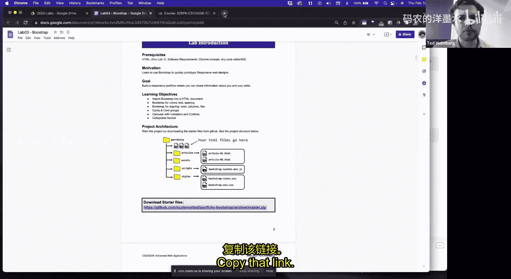

I'll go over here， paste it and， okay， I now have that。

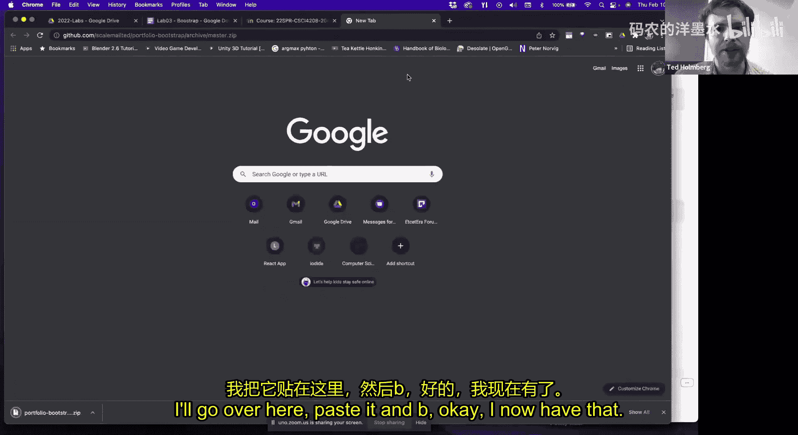

Okay， and so now I'm moving forward。So bootstrap， what is it really it's a styling framework or a library you can use it to quickly design and customize responsive mobile first sites with。

It's the most popular fun end open source toolkit。It gives us what's called a responsive grid system so we talk about responsiveness here。

 but really what we'll be able to do with it is apply colors。

 it has icons that are free components which we're going to learn are about in just a moment when we start building out our thing we're going to be able to align our elements look across a grid so we want to think about laying out our web content。

In a grid based approach。And let's see and when we talk about something that's responsive。

 just understand that our web pages are usually viewed on two different device title display reports。

 one is typically in landscape mode， the other is in portrait mode。

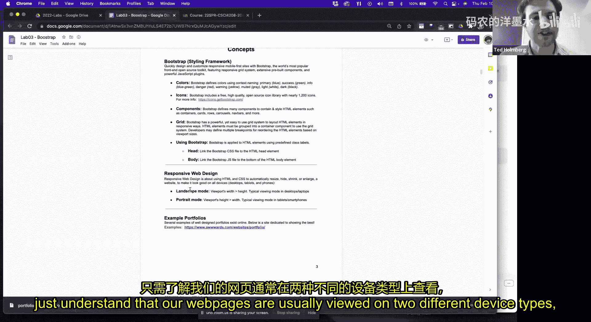

Just make sure。If you're not。Muted， please mutmute yourself。等会我想听。

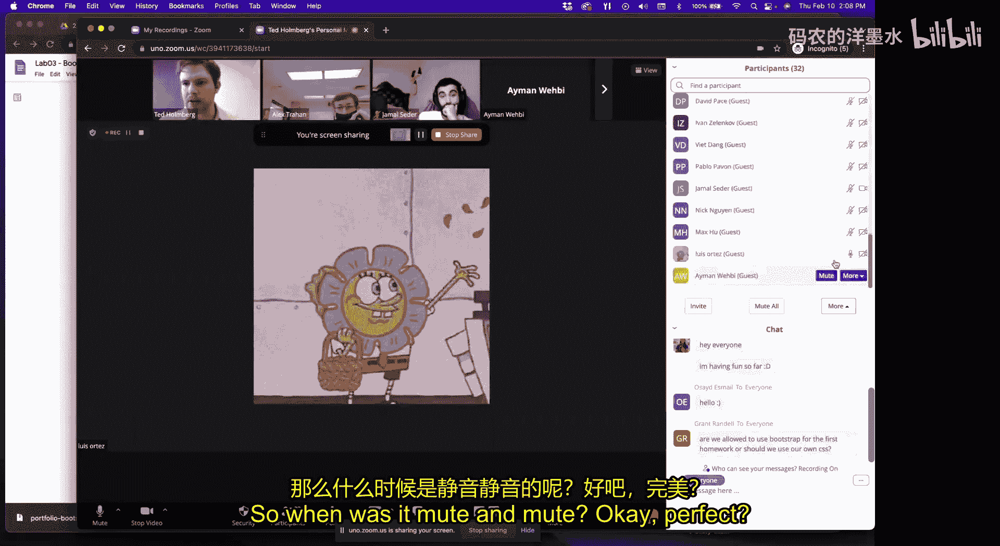

Mute and mut， okay， perfect。So let me grab this so I can easily see。小去。Don't you participants， okay。

 perfect。Okay。So the big thing about responsive web design is like we're all looking at my display right now。

 which is on a laptop， so it's in a landscape mode。

 right which means that my width is greater than my height。

If you're using your phone to view a web page it's probably going to be in a portrait mode it means that the height is going to be greater than the width when you design a web page you want to be responsive so it looks professional。

 it looks good whether it's in a landscape mode or portrait mode that's a nontrivial thing to ask that was a big complication when phones were really becoming much more popular with internet with internet access in 2006 and so bootstrap helps provide these responsive sis for us。

If you want some good examples of what a portfolio page looks like， I provide some here。

 we might look at some of these after the lab if we have time。Okay， let's move to goal zero。

 let's talk about what it takes to design an online portfolio。So again。

 our motivation is to build a portfolio and the goal of a portfolio is to share any information about yourself and your skills with the general public。

 you can think of it as your domain。On the Internet。Like your internet has。

So anything and everything that you create。You should share on your portfolio。And that's。

And that can include things that are non technical so if you do creative writing。

 if you do any kind of musical compositions， if you do art illustrations， again。

 since we're all computer science students here or。Interested in computer science。

 we should share all of our coding projects， but you know you should consider also doing like some articles and they could be blog articles like tech articles or they could again。

 if you write music， maybe it could be about creating music。

But it just gives you an insight into who you are。So。With that said。

The first thing we want to do is determine the categories or sections of the content of our portfolio in this lab we're going to create a landing section which is going to serve as the introduction of your portfolio and to draw a visitor's attention and highlight any important information or news。

So that's going to be the goal of the landing page， each of your section should have a goal。

 the goal of the projects page is to contain information relates to all of your coding projects with links to the source code to either GitHub or links to online demos。

Inside of the blog section it should contain articles that are written by you regarding topics you're interested in ideally your projects for your project section should all have a companion article discussing your motivation and approaches for their design and implementation。

In other words， we call that a developer diary。The about section。

So contain personal information about you and your skills and then a contact page that allows an interested party to be able to reach out and get in touch with you。

 So again， the role of a portfolio page is potentially share what you do so that you can find other people interested in it。

 either as partners or as employers。So。Now that we know kind of the basic layout why don't we start building so goal one let's build the initial landing page so our portfolio needs a place for users to initially go to we'll create an HTML file。

 we'll name an index on HTML and we will go ahead and put that in our portfolio folder so the first thing I need to do is get that portfolio to folder let me get that zip file that I have。

Paste it in here。Let me unzip。Okay， and let me change the name of this。The portfolio， perfect。不搞。

So here again， I have articles， I already have two articles that are prem。I have some assets。

 I have my script， and I have my style。 So now all I need to do is okay。

 where am I inside my terminal。 Okay， so let me go into。Portfolio。Excellent， and let me create a。

Index ID page。Excellent。So now I'll grab that， I'll bring it into wait a second。

I need my text editor， I'll grab that， bring it in here， but you know what， what's also。

Draragon in here too。 Okay， so I have it opened in my browser and I have it opened up in my text avatar。

 So the first thing I'm going to do is let's go ahead and define our。Let's see this。Okay。

 let's create some ACM。And then we're going to grab the head。So let's paste the oh。

 not quite what I want there， but we will just go ahead and delete excellent。Let's tap that over。

 Okay， so。So here。We're going to have a link that gives us a favvoon and that's going to insert the favvoon。

pNG， so we've seen that before， we're going to create a title that will appear in our tab。

And then what we're going to do here is we're going to set some metadata。In our head。

 for our browser， we'll make sure that the character set that we use。And so the HTML will be UTF 8。

And we will also go ahead and set some metadata that will effectively be able to set the viewport behaviors。

 so for the viewport we'll go ahead and set the width to be the device with and have an initial scale value of one。

And then after that i'm just going to link these CSS files and notice we're linking them as style sheets and this looks no different than if we were to link our own CSS files only these are preauored for us so at this stage if I go and refresh。

I'll see I get that fabcon， I get this。Your name， which is the title。

Wwhichch is of course right there and then the rest of the stuff is just preloaded。

 but it's not doing anything yet it's not part of the body so now that we have that let's go to step two where we actually set up our HTMLML body with all its elements and link our bootsottrap JS file so we can do we link our CSS files。

Inside of the head， but we're going to link our JS files。After all of our HTML elements。

 because the JS files potentially need to be able to reference the HTML elements to modify them。

 so they therefore have to come after so that the HTML elements actually exist so they can be modified if necessary。

So what are we doing here on our landing page， let's take a look so on our body tags。

 we're going to have an image。That's going to have the source of a background image and then we're going to do a div tag so that is a block level element so the div goes from here to here inside of there I'll have a heading element that says hellello world I'll have a paragraph element that will give me some some text about what this page is I'll have a nest div tag here that will then group up some buttons I have a button that will link to projects。

 HTMLml a button that will link to blog。 HTMLml a button that will link to about HTMLml and a button that will link to contact HTMLm and notice what we're doing here is we're just setting up an oncl event that then just brings us to document location and then。

Essentially changes our location addressing our hyper。Inside of our address bar， URL bar。

And again the button will say code blog about and contact right that's between the head and closing tags of our button and then after that after we've essentially made the contents of the page we will link with a script tag。

This external J file that is inside this scripts right here。Perfect。😊。

So if there's no questions there， let's see what we currently have， so if I refresh。

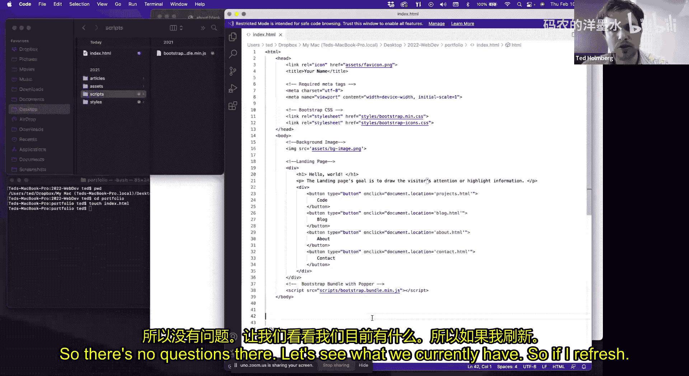

There it is so that's my image and then underneath my image will be hello world and then the paragraph and then all these buttons and if I click on the button that doesn't exist yet so it's just it's going to take me to a new page so right like blog blog H perfect。

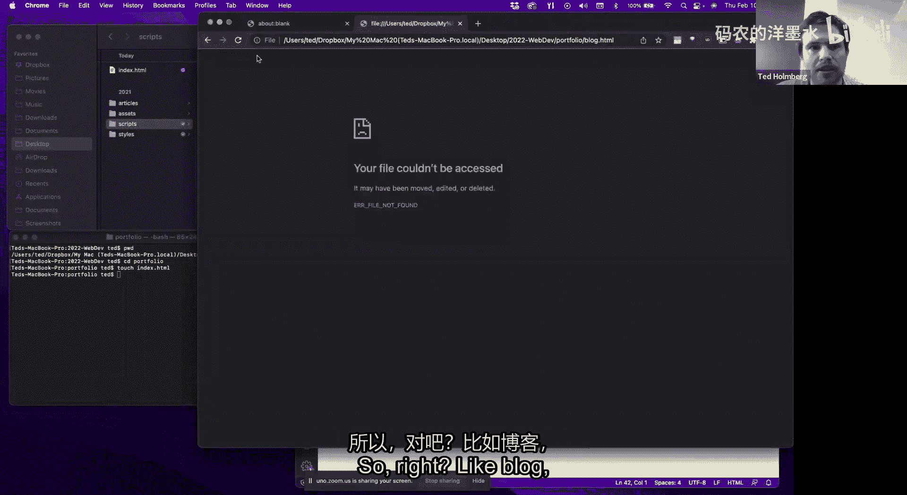

Okay， so let's start applying some bootstraps so that we can actually get some styles going on here。

So the next thing we want to do is we want to use some bootstrap classes。

So that we can get a full size background image and some white text on the foreground。

So here I'm going to start modifying the code that's already there what's highlighted yellow is what I'm going to add into my landing page to actually get some of these styles applied so the first thing I want to do is I want to go into the image。

😡，Tag here and apply some class names Let's find that here。

 So that's our image here that's applied this class。

 So here I'm going to apply the class of position absolute。

And I'm going to do a width of 100 and height 100。 So let's start by just doing the width00 and height 100。

 what you're probably going to see what you can guess is it's going to stretch the image out it's going to so that it covers the entire width and the entire height of our viewport。

 So now underneath that is going to be our text。Okay。

 so just as easy so just by class names and our HTML we're starting to get CSS sts that's the power of bootsrap now we're going to apply this position dash absolute let's see what happens when I go ahead and apply that。

Okay， so now it。Let me go back。So now that I have the position absolute， I can't scroll down anymore。

We'll talk about what's actually happening there in just a moment。And right here。

 so your position absolute so your default behavior for your position of HTML elements is a relative。

 so it's relative to other HTML elements and everything with a relative position essentially has a Z index inside of our viewport。

😡，And so relative position HTMLl will allow you to。

They take into account each other and they'll evaluate the C index so even if you don't give a Z index manually to an HTML element。

 it gets one automatically unless it's defined with an absolute position。

 absolute position removes an element from the flow of elements on a page and now that element will be unaffected by other HTML elements and it doesn't affect other elements so it like turns it into a ghost of sorts。

😡，I don't know if there's another better way to explain that so if we want to get our other elements back right so if we want to treat this background image in a way that it doesn't affect our div tag here。

So if we want to treat this as a background and remove it from the flow of HTML elements。

 we could set that to absolute， and then we predeefine all the other things inside the SI as being relative。

So let's see that so that it's given a Z index and by giving a Z index it will now render on top and not interact with our background and so now notice that the very hop here where you would normally be rendering the image we instead rendering our text。

So again， by having a position of absolute， it was removed from essentially the flow of elements that get rendered to the viewport。

 so it's put in the background， but still there。And then at the very top we'll have now our heading and this paragraph in this collection and notice let's see what else we did here。

In addition to setting our class to position relative。

 we also gave another class name Tex White and that cascaded down to everything inside the div。

 so heading the paragraph。Everything now has the color of white。

Perfect and y that's what we look like there and so the next thing I want to do here from my landing page is I want to use the bootsshop class to go ahead and get some horizontal centering。

So in order to center anything it has to be in a container so everything should be contained should be defined inside of a container on bootsottrap that's why I have this div class that div class will be my container that contains only other HTML documents。

So let's go back here， so in addition to establishing that all these HTML documents will have a relative position and it will have white text。

 I will also use the name container so that it will be defined I won't be rendering directly like right on the side of my viewport。

And now I could also apply text centering so I center everything。And just like that， perfect。

 so now everything is centered。And then the last thing I want to do is I want to also go ahead and use bootstrap classes to be able to achieve a vertical centering。

 so again what I'll do is I'll highlight these the C text here and I'll add that into this dev class。

Which contains all of my styles so again white text。

 this is a container which now allows us to center our text and we also will set our height to 100 just like what we did with our image so we know what that does we're going to use the display flex we saw what flex with a flex display was last lecture or last lab。

We want to flex as a column and we want to justify the content to the center。But save this。

And there we go， so now our landing page has horizontally and vertically aligned our content and here。

 if I go and change the viewport， you'll see it maintains the sts so it's very responsive。Okay。

 perfect，70。Make it a little bit easier on myself that I get back to the code。Okay。

 so what does some of this stuff mean while try to go ahead and inside the lab give explainers for each of these things as you walk through it。

 so again H 100 just sets the elementss height to 100% D flex sets the flex block container flex column sets the flex direction into columns i。

e vertically。As opposed to rose， which would be。horizontalorizontal。For our flex space。

 and then we're going to justify the content so that it's centered。

And that just vertically centers the content in our container， perfect。

And then the last thing we kind of want to do here， so the last thing no， I want to add icons to。

 but the next thing I want to do is I want to go ahead and I want to adjust our heading font。

And I want to adjust our button styles， So the first thing I'm going to do to adjust our font is I'm going to add a class to my heading。

 so let's go back here。Let's go and find our heading one element that says hellello world。

And I'm going to apply a class name of display dash4， so that's a different type of font。

And there it is。 Okay， so that's a nicer kind of。Faunt that really draws the attention of the eye。

That's built into bootsottrap。And then the next thing I want to do is I want to go ahead and get a different styling for our buttons。

 so let's go to each one of our buttons here。And I'll apply this so the first thing I'm going to do is let me just do BTN so that will style the button。

 so right now we have the default style of the button。This first one now has now been styled。

 but notice it doesn't have a color we'd have to apply a color to it The color I want to apply to it is going to be outline color that's liked and so thatll be a white outline around the button so I'll do a second class name so I can go ahead and get my button to look like that Yeah that way if I can still see the background image I want to hover over it。

 it has an on hover effect very nice。So then I'll just copy this。

And I will paste that for each of my buttons， so all of my button elements will have。That style。

 so now I want to come back over here。Oh yeah， I think that looks much， much nicer now。

And now when we hover over each one of those。You get that on a hover event。Perfect， and then it。

The next thing that I want to do is add an icon into my buttons， so where I have， for instance code。

 I might have an icon that represents coding， an icon that represents blogging。

 a icon that represents hey， this is the thing that talks about me and then finally icon that represents getting in contact with me I'm add the icon so that you can see how we can add icons into our。

Inter our document using just pure bootstrap。So here inside of the button。Where I have the text code。

 for instance， I'm going to go ahead and create a new HTML element。Of type I。😡。

You can think of I for icon we're going to give it the class of B for bootstrap icon and then we're going to give it the name of the icon we want so it's a bootstrap icon dash code dash slash and inside the lecture I give a reference so if inside the PowerPoint slides I give a reference of all the different icons you could potentially use so I would advocate you go look at the PowerPoint slides to see what your options are so just looking at this one。

Let's see what we got here， let's refresh， yep， and so now we have that icon looks beautiful。

Let's also go ahead and grab this one。Actually， let me just do this。We will add this one。Here。

 so I can reference it。야当。Okayello。Okay， so let's say what was this， this was chat dot。

So here we'll make this。At thoughts， okay， let's go into our about section and let's make this one here。

A person。And then finally， for our contact。Let us make that。An envelope。

Let's make sure all that is rendering the way we expect。 Okay， yep， we have chat box。

 we have a person。 we have an envelope。 Okay， so now we have all these little icons that are also inside of our button and all of that from bootsottrap。

And yeah， so once I've done that， I'm pretty happy with this， it's super responsive。

 I can again pull and stretch it however I want and click on these links and they don't go anywhere yet。

 but I think this is a nice looking attractive landing page。

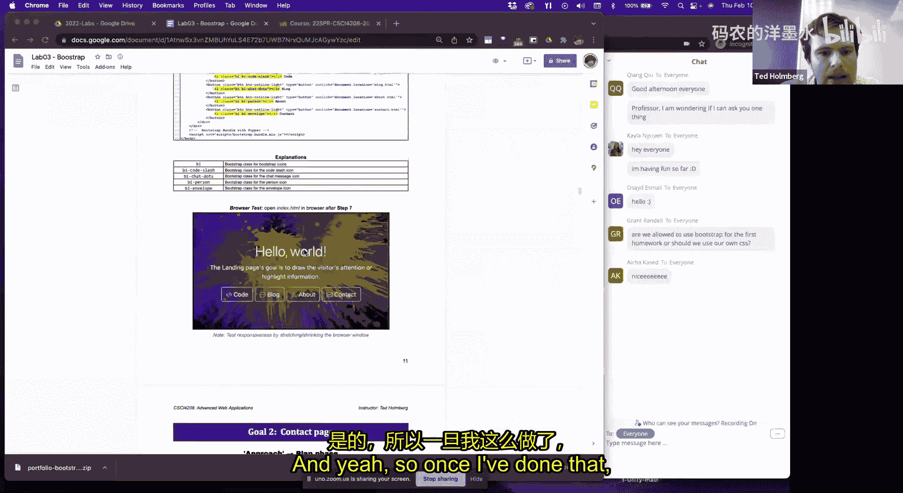

So then let's move on to the next goal now that we've built out our landing page。

 the next thing we want to do is。We want to go ahead and build out a contact page our contact page again is going to be the page that we are going to send a user to be able to send us information so it should be able to ask the user for their name their email address a subject of why they're contacting you and maybe a message that can be sent to you so here's a general mockup of what we're looking to build。

So let's actually do it， the first thing we should do is well。

 let's create something that's called contact on HTML。So let me go over here and create that。Contact。

htm。Okay。Now let me go over here。And drag that in here and let me start by no， I don't do that。Okay。

 let me focus into here HTML and HTML， okay， we'll start five。One of my HTML elements。

 and then the next thing I want to do is I want to go ahead and define the head。Of my HTML document。

Right here， perfect。 Okay， so what's happening inside the head again。

 we're going to use that same fvacon we're going to create a title that's going to have your name。

We're going to set the character set to UTF8 and we're going to set the viewport。So。

 so just out of curiosity。If we were to remove these， let's go back。

Save that one of the nice things about web development。

 you can always remove things and see how it affects notice some of this stuff is default and it doesn't actually affect anything right like we could still keep everything we use and omit that However。

 these are some default settings and we're getting we're adding little layers of complexity so we can enforce these into our。

viewport parsing so some of this stuff you technically could do without because it's default settings。

 but I think it's valuable for you to actually see。Some of these declarations。

Solowly kind of expand the complexity of what we're adding in here。

And then what we're going to do here is we're also going to link our CSSS files。

 our bootst files that's going to give us our styling based off of just using class names。And now。

 let me grab this body。 And this is， this body doesn't have any styling yet， right。

 we haven't added any bootstrappped names yet。 So let's just look at what the default values of our body。

 The last is always going to be a link of our script tags。 And then we're going have the div。

 which is going to represent our。Well at the very top we'll have a nav bar but we'll leave the nav bar empty for now we'll fill that out as our last goal in between our nav bar and the script tags that could potentially modify any HTMLs documents will have a dev tag that's going to be the container of all of the HTML element that we're looking to represent our contact form with so again the topmost part of our forms should be a heading element。

We're going to use a icon of the envelope that says contact。 Then we'll use a horizontal rule。

 Then we're going to create a form element。Inside of her form element。

 we're going to create a div tag that's going to cluster together remember div tag creates a block element。

 allows us to have some children ACL buts。That's brought together。

 it will have a label of a name and then an input type for text and we'll have a placeholder inside of there that says name will have another div that will have the label of email and then another input field of type email。

And we'll call that we'll give that a placeholder of email。

 we'll have another div tag that will have a label of subject and will be an input type of subject and each of these will also give ID so we can access those at some point name email and subject again we'll give it a placeholder and then finally we'll have a div that is going to be a message here this is going to be a text area that's going to be four rows。

Large and we'll give an idea of message and again a placeholder of message。If I go and。

Click on contact now， contact should exist and it should just have this ugly HTML that has no siing yet。

I noticed when I was doing placeholder， placeholder。Puts in name inside of the field here。

 email and subject， so that's what that placeholder Ashtro was doing。Okay。

And the next thing I want to do here is well， why don't we start to apply some stylings so inside the body。

Let me go。Inside of here so inside of my body of my HTMLl i'm going to set some class names i'm going to set the Bg dash dark so the background to dark and then the text to light so the moment I do that I can now see。

I've inverreted the colors。So是。Now let's go ahead and actually use bootsts styling for forms on each of our form containers。

So。Let me go here。And so inside this div so I have one， two， three。

 four different divs inside of this form so each one of those represents a form group。

 a form group is something that holds a label and an input type so I'm going to assign form group to be able to style that grouping and then I'm going to give a margin a bottom margin of three。

And actually， let me remove the margins for now so we could see what would happen and then we'll add those back up。

Thats。Always like to see what happens as we move or add elements。Okay。

 so we'll start with that by just applying the form group。Each of these， so now if I refresh。

Make sure class class， class， save， save， say。I should class group Oh， I need to actually also。

Update the form control as well to be able to get that Otherwise my inputs won't be styled so here for that input form control form control。

Okay， perfect， so for each of the divs I have to give it a form group because it contains a label and an input type。

 but then I also have to apply a class name with form control because that's the actual thing that's then going to get rendered let's see how that's going to look that's much better yeah。

Looks much， much sharper。 Now， let's go ahead。 and now I might not like how close these are to one another。

 right， because as soon as one ends， the next one renders。

 So that's why I might then go into each one of these divs and so， oh， let's do a margin。

Bottom M of three。And you can always， when you style， it's very much like an artistic process。

 you look at it， you decide if you're happy with it。

 and then you can decide whether you want to move things or not。Okay， so oh yeah。

 I like that spacing much better。

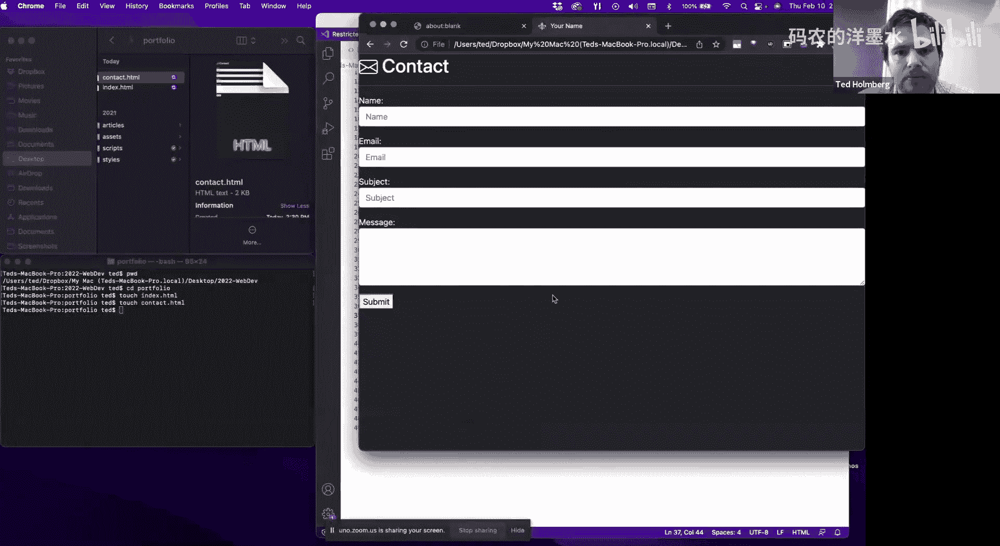

Excellent。The professor， there's also。One other one that pushes it from against the wall。Oh yeah。

 let's， I think I skipped yeah， having to actually add a container to everything， right。

 So let's go into our our。😊。

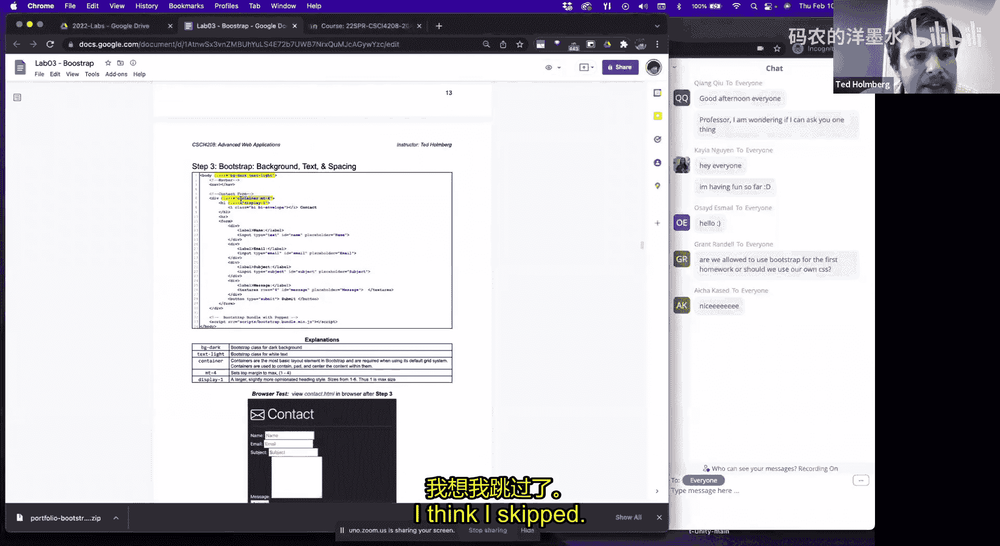

So again， one thing we should always do with bootsottrap is make sure that this div here is a container。

 let's see what happens when we actually apply container and so instead of viewing everything rendered in this way。

 as soon as it's been containerized it gives us those margins and it looks so much more professional。

And then what I can also do here was was this margin to them。Onces it to the top by four。

 I don't remember。Let me say let me go look at my notes margin to the top yeah so what I'm doing here is right now I'm still rendering everything at the very top of the viewport。

 so if I apply a top margin of four it's going to push all of my content down。

So now I get a little bit of spacing there too。Excellent okay， so now I've applied my margins here。

 I have applied my stylings to my input groups very nice but why don't we go ahead and actually adjust the text on our heading element as well。

There we go。And so that's going to use that display dash one。

 so what that's going to instead of using this thicker font is going to use like a thinner font that's bigger。

 much nicer so it really stands out。Okay， so let's see so we have a background right we've changed the color to light。

 we've containerized all of our elements， we gave a top margin of four。

 we changed the text of our heading element to use the display type we' we've updated the styles of our inputs。

And so let's also do let's also solve our button as well。

 so right now our button is still the default ugly button。

Right so let's go into our button and add some classes here again we're going to use the BTN so that we get the button style but then we're going to make our button primary so primary is an action color term for blue。

And actually，'s let's not do float and yet let's see what happens if we just do this。So if I do that。

 all of a sudden we get a nice style looking button now suppose I want the button to be on the right hand side instead of the left hand side。

Then I can apply this other term， it's called float dash end and it will float abundant to the right hand side on the inside side。

 perfect。And again， this is completely with it responsive so I can stretch it like in portrait mode。

 I can stretch it to be landscape mode and it's going to look nice。

ItCan give us a responsive styling。

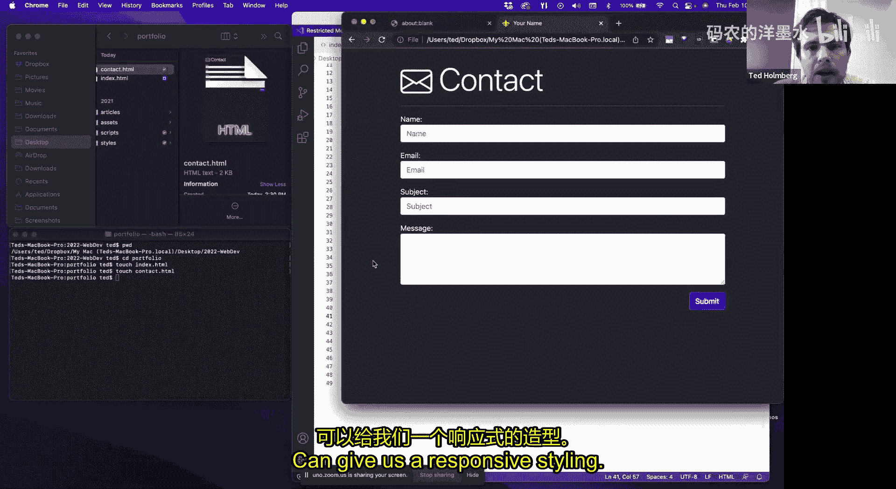

Excellent。So i'm happy with that， let's move on to define our projects page so the first thing we need for our projects page is to create a projects page so let me get back over here and do touchch。

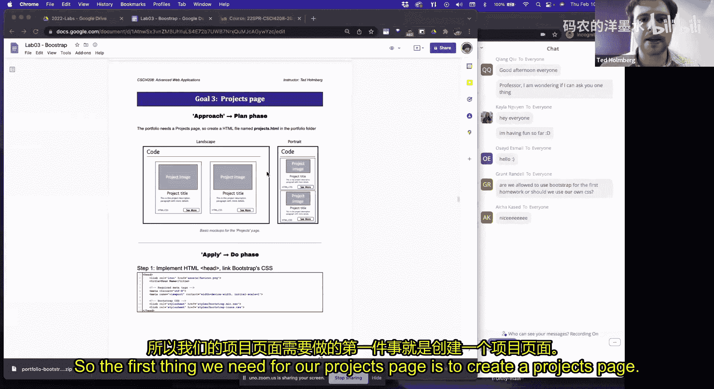

Projects。acL。Okay， perfect and let's。Go here。And let's start by。

Focusing in on that and type in HTML and HTML perfect， I got my HTML tags in there。One thing。

 if you ever forget to put ACL tags， the browser will go in and insert them for you afterwards。

 so this is something that we put in because it's a good programming practice。

 but it's not actually required。Okay， now just taking a quick view of the approach for our projects page now that we've designed it。

 we kind of want it to look like this and we're gonna to have a heading element that's his code and then a horizontal tab and then each of our project we want to represent as its own little card where inside of the card will have an image of the project or something that depicts the project。

 then whatever the title of our project is underneath it。

 then some text that describes the project and then maybe at the footer of this card we might have the technologies we use like HTML CSS。

 JavaScript Java， whatever and then a button that we can click to see more that might either either link to the GitHub account where the source code is or maybe links to where the project's deployed at if it's a web application and again since this is going to be responsive we want to our card to line up horizontally or。

Vertically if it's in portrait mode， so we do want to get that responsiveness to it， Okay。

 so now that we know what our goal is， why don't we start by defining the head element inside of our projects page。

Okay， and again we're just going to set the fvacon we're going to set the title to be your name so that's consistent we're going to set up this initial character sets and just have our viewport have an initial scale of one which are the default behaviors typically and then we're just going to make sure that we link our css files our bootst files so that we get。

All of those predefined class names so that we can style by just applying class names to our document。

 we don't have to write or author any CSS by hand。So with that said。

 let's go ahead and grab the body now none of this body applies any of the bootstrap class names yet。

 so it's going to be all unstyled， but it should look similar to。What we will have in our。

Our demo or in our prototype。From the approach section。So here we'll have a nav bar。

 and then we'll have our div that will be our container。

And so this div will go all the way down to here that's going to contain our heading element and then the horizontal rule our heading element will say this is a code section then here I can read this comment and say oh。

 this is going to be our card group so from here。All the way to here， right。

 where I end my card group will be my group of cards so every card would go in between this this dev here。

And then we're going to start a card at this div and it goes all the way until we end this first card。

And then inside this card， we would have a card header。Where we'll go ahead and give it an image。

 we'll have a card body， right， which will be this divb。

 which will be our heading element and then a paragraph about what's in the card and then we'll have a card footer。

Which will have the technologies reus to build this and then like a button to be able to see more and then after I have this first card if I wanted to build more cards I could kind of copy and paste this and then update the card project title and the image and all that other stuff。

Excellent， actually let's see what that looks like at this point， so let's go over here。

 let me hit back。And let me click on code， which should bring me here perfect。

 so this is what it looks like now。Without any stylings。Y， that's exactly。

 So now what we want to do is why don't we set the background color to be blue so to do that let's do Bg dash primary on my body。

 So let's go over here。Let's go to the body tag。Can apply。At blue。 So here， if I， I yeah， perfect。

 perfect。And then also， let's go ahead and set our primary div。To be our container。So let me go here。

St that to be a container so now when I render this what you'll see is it's going to style everything inside giving me this responsive spacing to the left and the right。

And then also， why don't we go ahead and set our heading element to be consistent within our other pages where。

We use the。Display dash one， and then we'll do a margin to the top of four so that we bam just like that。

 perfect， that looks great。

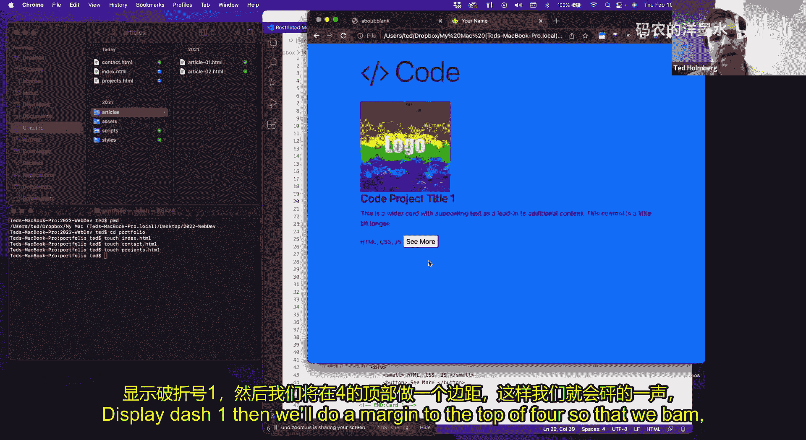

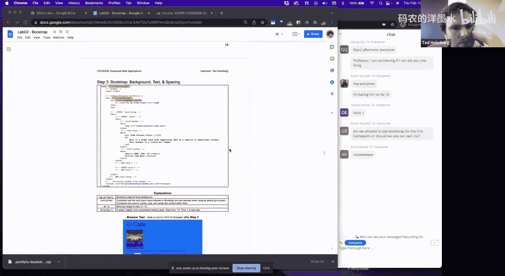

And so that's what that looks like。 And so yeah， we are currently where we want to be at visually。

 So the next thing we want to do is why don't we actually start using some bootstrap silines so that our cards start rendering properly So let's start by grabbing this。

So let's go into here， so this div that's supposed to represent a card， let's make that just a card。

Okay。Perrrfific， so now we have just a card that's rendering for us and now。

Our card is made of three different constituent parts， it's made of a card header。

A card body and a card footer， so the div that represents my card header let's go ahead and apply card header。

 the part the div that is my card body， let's give it the name card body。

 the class name card body and that div that represents a card footer。Let's give it the name。

Hard foot That's the wrong thing。Okay， so we have the head。

We have the body and we have the footer's looking good， what has just happened there。Okay。

And so the last thing I want to do here is I want to apply a card group。

Style for the collection that holds more than one card so the idea is that right now I just have the one card。

 but as I hold more cards this will allow my cards to be responsiveibly styled so that it decides how many can draw horizontally before it has to draw more if it has to draw more vertically so it handles that logic so now that shouldn't really do anything because we only have the one card perfect。

So let's say the next thing I want to do is why don't we affect like the text and the image and the spacing and stuff。

 just get everything。up。Thank you， thank you for pointing that out。Harrt footer。没有。yes。

 that's what we want， we wanted three discrete parts right a header。

 a body and a foottter much better， Thank you。啊噶。So let's start by getting our text white。😡。

So at this point， if I go back to the body。And I put。

Tex light now it'll make my black texts go white and。Of course。

 that's not going to be great for the car， but it looks much better up here， I think。Okay。

 so the next thing I want to do is let's go and actually get our。What do we want to do here。

Let's start， but with this one， let's add to our card background of dark and we'll center the text。

So we'll go into our card here。Okay， yeah， perfect。

 so now we can see the content now that it's all light， right？

We'll set it to be dark and we'll center it。Perfect。

 the next thing we want to do is let's style the image。

So that it's using a thumbnail style so right now， instead of rendering the full image。

 we want it to be responsive。So let's go to our image and give it the class of image dash thumbnail and let's see what effect that has so when I go and hit refresh bam。

I'm going to give it a nice outline around it。Now let's go into our heading element here。

And let's see， this is in our footer。 So inside our footer。We want to mute the text。😡，Of the skills。

 so that's going to change it to be gray， perfect。And then let's also do some things with the button。

 let's make that button go blue oh let's take a look。

 so let's apply some styles to the button so the button we're going to use a bootstrap style will make it blue and we're going to float it to the right。

So now our button's going to look like that perfect。So looking good。

 And then the last thing I want to do here is， let's apply。A gap of two between cards。

So notice this is being applied in the card group， so it let me know。😡。

How much spacing to put between more than one cards and so maybe what I need to do is add a card so we can see what that's going to start looking like。

But let's say so save that and so let's go here and yeah。

 so that doesn't really do anything so we'll have to add another card just to see how that's going to affect everything。

So here it says the test is try copying the HTML code from card one and then we're going to make a card two。

 so let's do that then at this point I'm going to take everything here going to copy it。

And then I'm going to paste it right in here。Perfect。😊，And actually。

 let me remove the gap two here so we can see what it looks like without that。

Now I have two cards to notice without the gap， it just draws one on top of the other。

 so let me add that gap to back and what's going to happen is it's going to give me the ability to have some separation there。

But now if I pull this out， you can see。I have。Make sure div div， I'm missing a div here。

So that's there。 Oh， whoops， I don't want。Let me grab。Yes， not the。Perfect， not the card group。

 I just want to add everything for a singular card。 So maybe undo what I did and。Okay。

 so starting with a card。Deev。And then the card header the card body and the card footer not all my cards are supposed to go into the card group I't want to reproduce that so let's refresh that that's what I want two cards that are equal sizes right and notice they're nice and responsive。

Oh yeah， that looks sick。Okay。Let's go to a blog page。没。So our blog page is going to be called blog。

ht， so let me make that。I'll start with making my HTML element。Excellent。Okay。

 and then the first thing we're going to do here is let's go ahead and define the head and so this head's going to look exactly the same as the others I'm not going to spend any time look reading over it。

We were importing all the same stuff， let's get the initial HTML built out。

 so let me grab this and I will go and define the body。

So this body and just looking at it so let's look at our prototype here。

 the general notion of what our our blog page is going to look like is we'll have a heading that says blog and then a horizontal rule and we're going to use a carousel that's going to give us the controls to go left or right and show us how many different things are this carousel and then we'll have like this image。

That will represent what this blog post is about and then put like a caption on top of the image。

That has like a blog post title and maybe a small summary and then the ability to click on the see more button that will then link us to that article。

Excellent， so now that we know what we're going for here， let's see what we initially have。

When we define our body， we're going to have the nav bar that we'll eventually implement。

 but then we're going to have this div。Here。That is actually going to predefine our container for us。

And it's going to have margin T dashboard to the top。Let's see here， yeah。

And so here inside of this div。I'm going to create what's going to be my carousel body。

So it's going to go from here to here， so this is my container this will be my carousel。

 my carousel can have slides， so I'm going to define the first slide here。

And I'm going to give an idea of slide dash1， then I'll create another slide here right with this div。

 I'll give an idea of slide dash two， each of these slides are going to have an image。

 then it'll have a div with some HTML elements that's going to be what's rendered on top of that image which is going to be the title of the blog post。

 a small summary paragraph and then a button that has them oncl event that's going to change the location to be inside of our articles directory to be articles1。

 HTML which is a preexisting HTML file and then we'll have another blog post that will bring us to the second。

So if I were just to look at this really quick。Let me go back。And from my landing page。

 let me click on blog。And so there I have my blog post。

And it's got a red background because it's already started applying some of the bootstrappped terms because we've seen this enough times where I'm not going to do individual steps for that。

 So Bg dangerger is red and then light tax。 and then we have this already in a container。

And march to the top with my blog post。 And then this is going to be the carousel。 So really。

 the big thing about this next step is how do we wire up this carousel。

 Start getting into work right now， if we look at everything。And let me just make sure here。Carousel。

 div。Yep， y， am I missing？I got this div， yeah， that div perfect， yeah， and that div perfect okay。

So if I scroll down， yeah， those are my two slides right there。Okay。

 so the next thing I want to do is I want to set up some data that will get a carousel to work。

 so let's go to here。And inside my carousel body。So here inside of my carousel， my blog carousel。

 where is that。Oh， nope， no， nope， not fair。I want it right here。Okay。

That's what i'm looking for so right inside my carousel on this div that has the ID of b carousel i'm going to apply these following classes these attributes to it i'm going to give it the class of carousel。

And slide and now I can set bootsottrap allows me to go ahead and set some data attributes that it manages for us so I can have this data bootstrap for ride and then give it the label carousel and then an interval time of a0 us in which is a millisecond so it's going to be a second so that goes fast you can adjust that so it goes slower。

Okay， so you still haven't affected anything yet。Okay。

 so now the next thing we need to do is we need to actually start affecting these slides。

I would slide is the motion that's going to take so it's going to slide from like left to right so the next thing we want to do is we want to go into the slide one。

 so we're going to look for the ID tag of slide one here。

And we're going to make this a carousel item so just like a list has list items right a carousel can have carousel items and we want to make the first one the active carousel items that's where we're going to start。

And then inside of there。Since we want this div here to render on top。

 since we want this to render on top of the image， we're going to set this as our carousel caption。😡。

So that blog post one and that send to the button will render on top of our image。

And then we're going to do all that same for our carousel slide number two。

 so just like what we had here for slide one， we will set slide two to be a carousel item。

 but it won't start at the active one and then here just like we have a caption for that first one we want to set this dip to be our carousel caption there so let's take a look if I refresh。

Okay。So now look， we have blog post one sentence describing topic for blog article one。

 read more perfect。And right now， the slide should transition every second， y， and there I did。

Perfect。Okay， let's say now the next thing that I want to do is let's go ahead and get those carousel indicators implemented。

Minute。So let me go to， let me find the ID of blog carousel， so inside of my blog carousel。Here。

I want to add in a。Ordered list。That's going to have the class carousel indicators。

 and I'm going to do a set of list items。I'm going to have a set of list items for each。

Slide that I have and here I'm going to have an attribute data dash BS dash target。

Which is going to target our blog car。 So remember the the。

The hashtag in front represents an ID so that's target for this。

 these list items are going to be for our carousel。

 the thing that has the idea of wall carousel and so our slide order is going to be slide to zero and then from there it'll be slide to one。

So these are our slide and then this will be our active so these bind what these are going to do is going to bind the index ordering on the blog carousel of our slide numbers。

So let's go ahead and。Refresh so now notice yep， that's where this is see so here's my indicator one。

 two， one， two and it knows which one to shift to because we've defined those attributes right here。

And again， we set the active one to be the first one and all the other ones would not have the active one there。

 and then let's go into the carousel body and actually go ahead and define。

Thet to be centered and to make this the inner carousel so we can get some styling here because the stline is kind of off So here now that'll allow us to go ahead and define find the inner carousel where we can then apply centering to it。

 And now I can， if I want manually toggle our carousel to bring us to one or the other。

 And then if I let it go there we go， we'll slide every second。 And of course。

 we can adjust that number to be longer than a second if we wanted to。

And then let's also go ahead and add some carousel controls。 So to add my carousel controls。

 we're going to add this as well。 Let's go to。Here， and so underneath。There it was。 So here。

 So after this dip here， So that's my inner carousel。 I want to add controls underneath that。

 That's all over the place。There we go。And okay perfect so here will be my carousel controls my carousel controls are essentially anchor tags and i'm going to have a control that allows me to control the previous slide and one that will control to the next slide i'm going to use a hyper reference that's again going to target the ID of blogdes carousel so the hyper reference of my anchor tag is actually targeting this ID this actual HTML element of blog carousel。

And it's essentially going to have a data attribute that's going to cause the carousels to slide to the previous state or to the next state。

And then inside of this， I'm going to use an icon that's going to be an arrow。

Backwards and an arrow forwards。Okay， so let me go here and see when I do a refresh here。

Notice I have an arrow here and an arrow here that's now rendered and when I click that arrow。

 it now brings me to the previous slide and this brings me to the next slide。And again。

 all of this wiring is happening based off of these。

Data attributes defined by bootsottrap and also these these class names so the siing done by the class names。

 but the reason why we're able to get these interactive components that bootstraps evaluating and using like data dash BS that slide is coming from the Js file that we included so that we can get like these really cool interactive elements Oh yeah。

 and when I click that it should bring me to blog post2 and when I click that it should bring me to blog post one。

Which would presumably be an article。Excellent okay for my fifth goal now that I've gone ahead and created a blog page is to actually create an about page and I want the about page to look the nicest I want to have this heading elements say about and then I want to have a horizontal rule and then I want to have like an image of me with some cool like icons and maybe what my education status is and then my name in here and a description another image of me and then underneath that I want to have a skills section that has like images of all the different skills I know to make it look as graphically pleasing and cool as possible and then when you collapse this I'm going want to set it up in such a way that it expands my image that's on the left here to be bigger it's going to show these little icons for contacting me it will still show what my education is and then it's gonna to show my name and my description all my skills here but then it'll o the second image of me。

So I want to have this really responsive way of rendering this to be super pretty in both desktop and portrait mode。

So first， let's start with an about page。Question。And let's start with HTML。Okay， perfect。Save that。

And then let's set up our head and so that we've done this， you know， four other times。

 so I'm not going to spend any more time explain what's happening there。Now here。

 let's go ahead and define our body。There we go。And then we'll take a quick look at what's happening in the body in the body I'm going to make the background success。

 which is going to be green， I'm going to make the text go to light I'm going to。

Have a nav bar which I'm going to implement in the next goal so that we actually get our nav bar installed。

 I'm going to have my div here， which is going to be my container inside of this container I will go ahead and use the display so be consistent with my about and then you know the icon of the person have a top margin of four have a horizontal rule then after that I'm going to have all of my about me my grid in flex box stuff。

In Botrap， I'm going to implement here， haven't done it yet。 and then again， I need that script tag。

 So at this point， what I should have is and let's go and take a look at this。Um that's about。

 I just have this。Perfect。So the next thing I want to do is， oh， wow， this is all。What。

Let's actually go ahead and implement。Our grid。So here。I'm going to paste all of this。

 So what's happening here， Well， I'm going to have a column one。

So my column one is going back to my proxy would be here， it's going to have an image of me。

 it's going to have my social， my different ways of contacting me like GitHub or maybe Twitter or Facebook or something and then this description。

 so that's going to be column one。So let's take a look at that。

 I'm going to center the text in there it's going to have like。My name。

 it'll have that image where I'm going to use a thumbnail and I'm going to use rounded circle and I'm going to set the width of 50。

Then I'm going to have a collection here， a div collection that's going to have a collection of hyper references。

 anchor tags。They are going to have a Twitter icon that will have a LinkedIn icon and have a GitHub icon。

Then I'll have a horizontal rule after that then I'm going to have a div that's going to be a collection of first of all。

 a spanm tag， which will be my education and then。Computer science and then University of New Orleans。

 and then I'll do a。Horizont rule after that， so that's going to be effectively what I want is my first column for my second column。

 I'm going to make that one go dark。So it's distinguishably different and then i'm going to have different rows in there I'm going to have a row that's going to be my name and then my statement about myself and then an image of me is also going to be in that row so I can have columns in that row and then i'm going to do a horizontal rule and then。

I'm going to do skills as a heading， and then my skills will be collected in a group itself as a div tag。

 which will be a collection of various images。Of like Java and JavaScript and HTML and CSS and react and whatnot。

So let me go over here。And actually do a quick refresh。And yep， okay， so my name。

 it's an image of me， those us media links。My education。

 and then this is going to be the next column right where it would be my name。

 a statement of purpose， the image that I want to as part of that rosea。

 this is supposed to be row one and this is supposed to be row two with my skills and then all these images of skills that I've recruited。

Okay。So then next thing I want to do is let's go and actually， let's start by applying。Some of these。

 so I'm going to go into。Tner fluid。 Okay， so here。I want to define this as a row。

Me about mis action。Container fluid text， and then column one， social links。Yep， okay， and so。

Inside of here。In column one， I'm going to see where it's column one here inside of here。

 I want to set this to be a column。That's going to take up two slots so on bootstrap whenever I have a row a row can be Detized into 12 column spaces on a on a horizontal size of medium display or larger so unless I'm on a phone it'll ignore this rule unless I'm on something that meets whatever the medium requirements is so you can look at the resolution that but ultimately on a phone we're not going to columnize this well essentially expand everything out。

So we'll only set this column to be two slots on displays that are medium or larger。And here。

 let me go over here。On our column two。And in column two， let me set that to be。A column。

Only on medium purposes though to be 10 so 10 plus two is 12。 so let me see what happens with that。

 So I have a row that has two columns a and there it is right so on medium view this is my smaller column and now this is my larger one this is 10 units by two units but。

As soon as I collapse this down， right， once it's no longer medium。

 then it ignores that rule to make it a column of two and 10 and it makes it it puts it each on its own row。

So that's what the MD does once it's smaller than a medium。Size resolution。Okay。Okay。

 so then let's go here。And。I did that。 I did that。 So let's see what happens when we apply these styles here。

To under our portfolio circle。 So here on this div， So this div。

 what I'm going to do is I'm going to do a flex box。 Remember a flex box allows me to line things up。

 So right now this is my what I want to go ahead and use a flex box for。

And here I'm going to justify the content to the center。

 I want to put a gap of four between those and a margin on all sides of four。

 so what that's going to allow me to do is when I look at this， it's going to allow me to do that。

I'm able to flex these spaces out to essentially put a gap between them and then to put margins around them。

 make it just look a little bit more professional。And again。

 allows me to justify the content of the center， so the flex box allows me to talk about the alignment of these images inside this space。

Excellent okay， so now let's go into our education section and actually do something similar there。

 so here I want to go ahead and also use a flex a flex box。

 but I want to do it based off of rows and do a row columns of woman。

So here what that's going to do is。嗯。Yeah， there we go。And so now instead of all this overflowing。

 it's actually going to， it should set that in such a way that we can then control that。Sa class。

DF row row columns one。啊哈。And that's my span perfect。 And then once I do that， I have that and then。

One last thing I want to do here is inside of my skills section on my skills。

 so here this thing holding my skills， I also want to apply a flex to that。

 I'm want to flex it based off a rows， but I want to have it based off of five columns。

So for each row it will have five columns， let's refresh that and yep there we go so here。

We're using the flexax to order the elements， so now one， two， three， four， five。Excellent。Oh no。

 I didn't want to do that。And refresh， excellent， excellent， excellent。I got。

And then the last thing I want to do here is I want to go ahead and on my column。

 I want to set this up so I can go ahead and have nested rows and columns so I can nest those so inside of here where I have the column that's of size 10。

 I can actually make this itself a row。And now that that's a row。 it can have multiple columns。

 let's go ahead and do the following。 I want two different columns inside here， one that has my name。

And if it's a medium size viewport， then I want to consume eight spaces。

 otherwise if it's small or extra small， I want it to consume 12 I want to be the entire slot。

And on the second row， I mean， I'm sorry， the second column。 So here on this second column here。

I want it to be on a medium size four so again8 plus four is 12 that's how many columns I have in any given row。

 so this will take up。😡，Four of my slots versus eight of my slots， however。However， if。

It's smaller than than。If it's smaller than four， I'm sorry， medium， if it's smaller than medium。

 so if it's small， extra small， I want to display nothing so D dash none will be a display of nothing。

😡，If it's medium or larger than I want to display as a block element so D allows me to set the display mode MD allows me to say what sizes the viewport for this action to occur block will allow me to make this a block element and actually render the image if it's small or extra small it will ignore it so what that's going allow me to do is when I click on this now all of a sudden I have this nested row that has two columns where I have an image on one in my name and the text on the other and if it's small。

😡，Then the display of that image。😡，Goes to none， and it disappears。 And then this goes to 12。

 So it consumes the entire space。 So now I have this really cool。😊。

About page that allows me to have like two columns unless it's on a mobile phone and so it looks beautiful in port in in landscape mode and it looks beautiful in a。

In a portrait mode。And so I just want to finish this lab out So for any reason you can't stay a little bit longer。

 I will record this and make it available， but there's only one step left left in this lab and that's to set up the nap bar so I want to go ahead and do that before I leave for today so that we have this all in。

One video so the last and final goal is to set up a navigation bar using bootstrap and so here what we'll do is we'll go in the nav bar in all of the pages that we've had so projects blog about and contact and we'll actually go ahead and implement the contents of the nav bar there so let me go to each of those so let me go to contact for instance and where I had a nav bar I will actually now implement so here I will use the class names navbar so that it gets the nav bar implementation and then the color of the nav bar I want it to be light。

嗯。And then I want the background color to be light and I want it to be set up as a fluid container。

 so again our nav bar is its own container， a fluid container will go all the way to the ends without the spacing on the horizontal right。

And left， then inside， I'm going to create an anchor tag。

That's going to have the Nvbar brand it's going to give us the icon。

 the hamburger icon we want and it's going to hyper front to index。 Hl。

Which is our our odd base page。 And then we'll have this look like a house。

 So let's see what this looks like。 And actually， let me go ahead and。What page。

 this is the content page， let me go to the contact page。

So we'll go to the contact page and now here you see this is a nap bar that goes all the way across the top and then I have this thing that looks like a house and says our Na bar when I click on it。

 it brings me there。

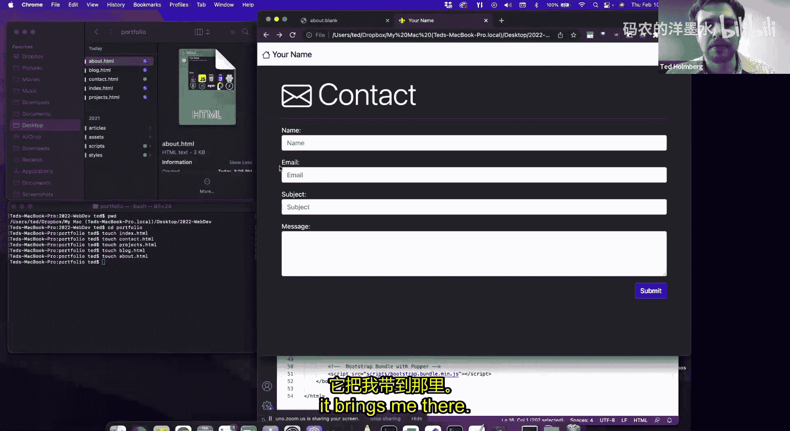

Okay。Now the next thing I want is to also have some options in my Na bar。

So let's go ahead and inside of our nav bar。We're going to create an unordered list that's going to have all the options of where we can navigate to so I have a list item。

That will have a hyperlink。That goes to projects and then we'll have a list item that will have a hyperlink that will go to the blog page we'll have a list item with a hyperlink and anchor tag that goes to about and a list item with an。

Anchor tag that goes to contact and for each one of those so I'll have an icon that represents the envelope and then it'll have the term contact and then this is the icon of a person and this is going to say about this is going to have the icon of chat dots and that'll say blog this will have an icon that renders our coding icon and that'll say code and I'm going to apply some class name so since we're inside of the nav bar container here I'm going to say this is actually my nav bar navigation so nav。

And then each one of these list items inside of my unordered list。

 I will classify as a nab item so that it renders appropriately。

 so let's see what thats going to look like。When I go back over here。And there we go。

 so now my nav bar actually contains these nav bar items that I can now navigate to。Blog perfect。

 about perfect， and then contact， which is what I'm already on。Okay。

And then the next thing that I want to do is I actually want to make my nav bar collapsible。

So what I'm going to do here is I'm going to nest that unordered list that's currently。

 so I want this。

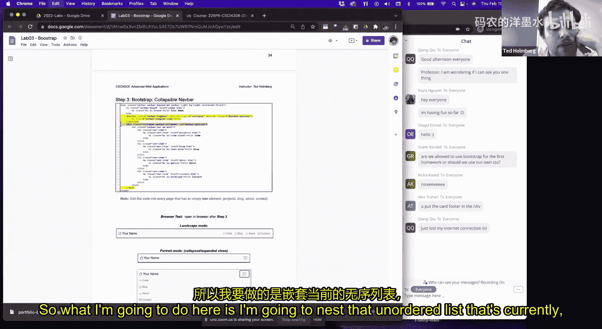

I want this to collapse。So that I only see it when I click a button。

So I'm going to go to where this unordered bs is。Define that I'm going to tap it over and I'm going to put I'm going to wrap it into a div class and I'm going to give it the class names of collapse so it's collapsible and then navbar collapse so this is a description so this starts it in a collapsell state and this gives it the ability to be a naBbar collapsible item and I'm going to give it just an ID so I can target it。

With navbar options。And then above that， I'm going to put a hamburger button。 So let me grab that。

 So above this。I'm going to create a button that interfaces with it。

So this is going to be my nav bar toggler。And again。

 I'm going to be able to create a toggle attribute。

 a data toggle attribute that's controlled by the JavaScript that's going to have a collapse action and the target is going to be to target the ACML element that has the ID nabbar option。

 so it's going to be this div here that I can target。

And then what it's going to render inside here is going to be the icon of a navabar toggr icon。

 which is commonly referred to as a hamburger icon。There we go。

 So if I toggle that now notice I can hide and display it。 so it only shows me my options。

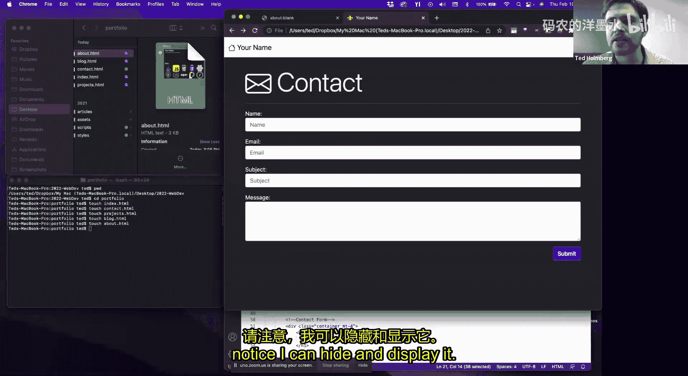

When I toggle it and then it'll untoggle it。

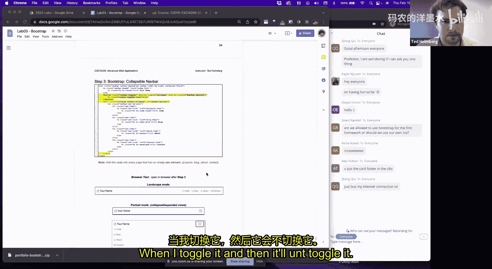

Perfect， and now in order for this to work on all my pages， I will now take my nav bar code。

I will copy it and I will paste it into my projects。Html page。

 so I'll save that and I'll go into my blog page， I'll find the empty nav bar。Oh no， yeah。

 did I have， yeah， here it is。Paace up there。And I'll go to my about page。

 find the empty nav bar here it is， and paste up there， save that and now let me take a look here。

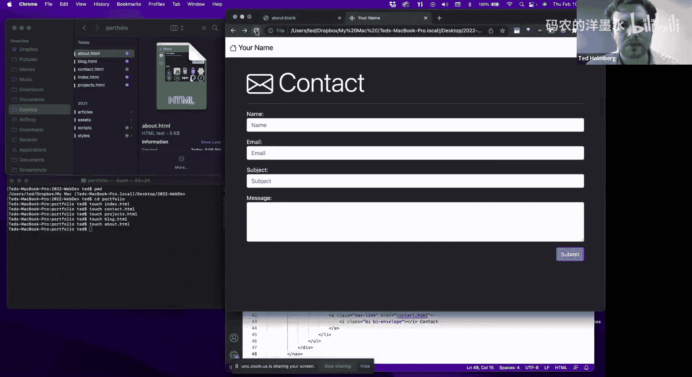

So now if I click on this I should be able to go to code yep。

 I should be able to go to the v yep I should be able to go to about yep and I should be able to go to contact yep and then at any time I should be able to click on this and it brings me back to the main page and now I have a pretty responsive and I should be able to see what all this stuff looks like in a portrait mode looks great looks great。

Looks great。And looks great。Excellent， and just like that。

 that's how easy it is to create a responsive professional looking web page without having to write any of your own CSS using bootsottrap and just class names in your HTML document so that is that's going to be lab three for bootstrap if you haven't watched the lecture and taking the quiz。

 please do that but this will lead us to also the ability for you to do your next homework which is going to which I'll go ahead publish a Moodle but what it will be is for you to actually design using bootsottrap or and CSS your very own portfolio page that would have all these own sections and your challenge is to make a page that looks better than the page that we just designed today。

Something that is represents you and your brand。For you to be able to sell yourself and your talents。

To the general pop the link that you can put and use on your resume。

And so as we start to share projects， I would like for you to maintain and update your portfolio a page as the semester goes along and add things like blog article post about the projects you've worked on。

 add the projects you' work on and generally just bring this up to date so that you can use it after you're done with this class excellent is there any questions。

Well。Yeah， yeah， if did I say Gitlab， I then GitHub？Excellent， well， if you have any issues。

 just go ahead and send me a question on Discord， but other than that， everyone have a great。

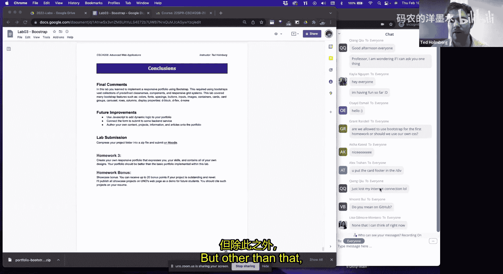

Have a great day。