# 【全集】加州理工学院 高级Web应用 中英字幕 1080P p05 Lecture 5 - JavaScript 面向对象编程 part1 -BV192zTBrEmu_p5-

And a。

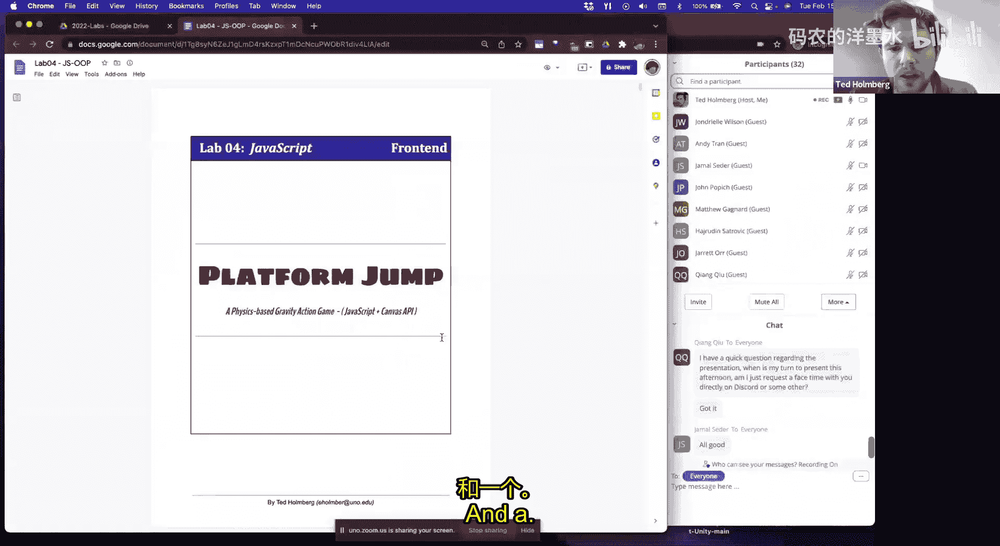

Maximize the chat Okay so in today's lab we are finally going to start doing JavaScriptscript and so what I opted to do with this lab since this is our introduction to JavaScript and since this is effectively a senior level computer science class and I'm going to take the assumption that everyone knows how to program in another programming language pretty well and I'm assuming the language that everyone knows pretty well is Java because everyone should have taken Java in 1583 and 2120 so。

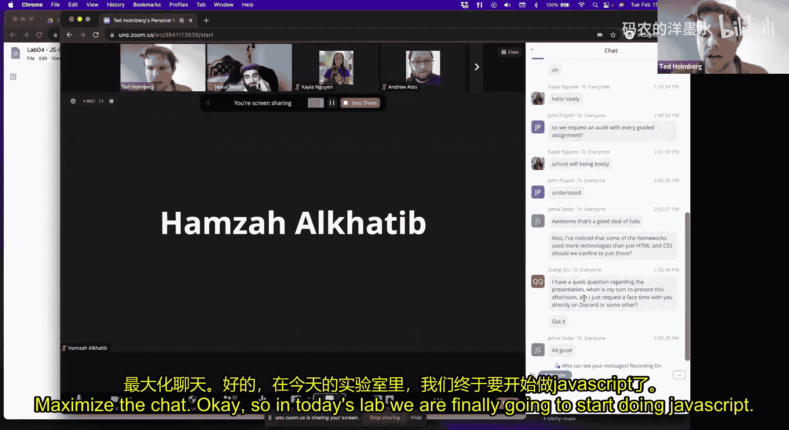

I'm not sure if anyone here has gone through this project。

 but one of the things we're now doing at the tail end of 1583 is we're building a full。

Graphics based platform or video game for 1583 just to show how object oriented programming can be used with polymorphism and with inheritance and all the other great things that we learned how to do in Java。

 well I decided to convert that project that we do at the very end of 1583 into a JavaScript project and use it as a lab。

So effectively， this lab should be able to cover all the remedial concepts of basic JavaScript。

It should show us all of the built in Java script data structures that will have available accessible to us。

 and it will show us how we can use JavaScript in a very Javalike way。

 how we can use JavaScript to actually define class hierarchy and use inheritance to build a sophisticated application。

So whereas the other applications were a little bit slimmer in scale。

 this will be a full application will likely take a couple of different lecture labs。

 a lot of these video labs to be able to work through it。

 but by the completion of this we shall have a very strong understanding of JavaScript from the very basics to the very object orientedness that has been added to it。

So I'm going to come back to this table of contents。

A little pre warningning this is by far the biggest lab we're going to cover and it's meant to be the capstone object oriented project from 1583 so the goal here is by the time we're done this lab you will know JavaScript as well as you know Java that's my goal。

😡，And again， if you have any questions while i'm going through the lab。

 please just go ahead and put it in the chat because I over the chat while we're go through these stages so I'm going to go through the goals in a moment but I to I want to to get more through just the lab introductions so I'm going to come back up to this page so the preres for this lab well clearly you have to have a little bit of knowledge of objectoriented programming because I take it for granted you understand what the concepts of classes and inheritance and polymorphism and instance variables and instance methods and things like that are。

Our software requirements are going to remain the same， we just need a Chrome browser or any browser。

 but I'm going to use Chrome and I'll only answer questions related to Chrome browsers if you have any technical issues while you're developing this。

And of course， any code editor or IDE to actually author up your HTML and JavaScript code。

The motivation behind this particular lab is we want to learn to use modern JavaScript to design a browser app using an object oriented architecture。

And then our goal， the actual thing we're building is going to be a platform or game that runs in the browser and it's going to use JavaScript。

 pure JavaScript and it's going to use the Canvas API。

So what is the Canva API Well if you ever have any questions， we can always go， oh， no。

 that's not quite right Can。

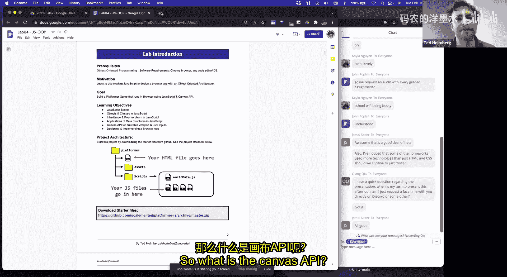

VPI and VM， the Mooola Develop Network。

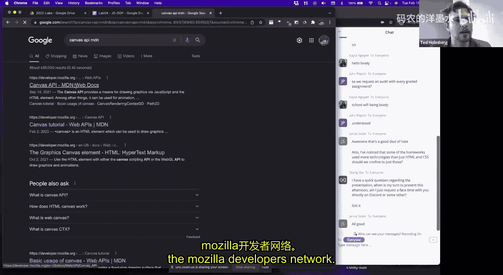

We can see here the Canvas API provides a means for drawing graphics via JavaScript。And HTML。

 so it essentially gives us a canvas that we can send data to and produce game graphics or animations or data visualizations or photo manipulations or any kind of real time video processing。

Okay。So the learning objectives we're going to have for this lab。

 we want to learn our JavaScript basics， we're going to learn how to do objects and classes in JavaScript。

 we're going to learn about inheritance and polymorphism in JavaScript。

 we're going to learn how to apply the various data structures that are existed and defined in JavaScript to build out。

The specifications of our application will look at the canvasvas API for。Having a drawable viewport。

And user inputs， and then we'll also learn the basics of how to design and implement a browser app from the initial planning stages to the complete deployment phase。

😡，So we'll walk through every facet of developing a platform game a real application。

So our project architecture for this lab， we're going to start by downloading our starter files from GitHub just like we have before。

 but the general idea is we'll have this platformer。Diirectctory。

Inside the platform or director we'll have our HTML file that'll be our initial launch point of our JavaScript application。

 so recall we can't。We can't open up a JS file directly from the browser。

 it always has to be imported by an HTML file， so this will be effectively our main method of source our launchpoint。

We'll have our assets directory that's going to have all of our images and everything else that we need。

 and then we'll have a scripts directory， which is where we're going to put all of our GS files。

 so all of our external JavaScript files that we'll make will go in here。

So let's start by actually downloading this。Iss I could just do it here。Excellent， okay。

So let's go ahead and。Get this pulled into there。 Let's unsip it。Okay， that's unzpped。Dete that。

 don't need that anymore and I'm get to rename this for consistency Plaer。诶。And as I can see。

 I initially have all of my assets， it looks like background images and artwork that's clearly like not mine。

And some other tiles that we'll use in the course of building up this game。Scrips。

 there's only one thing in the scripts， it's scripts。

js and we'll take a look at what this is in a moment。But I'll open it here。So no， actually that's。

Let's do that again。There we go， okay， we'll look at that in a moment。And that's it， Okay， perfect。即。

So let's go through some concepts now。First， the JavaScript programming language。

 so what we've seen before。😡，This class was HTML， which is a markup language。

 it's a declarative language， we've seen CSS， that's a styling language。

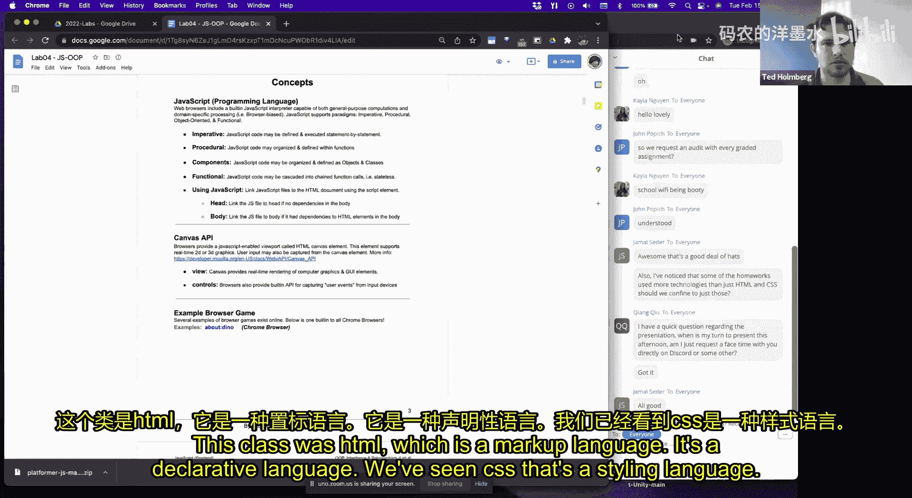

So here， JavaScript is a programming language and we've used a little bit of JavaScript previously。嗯。

See here， okay， perfect。

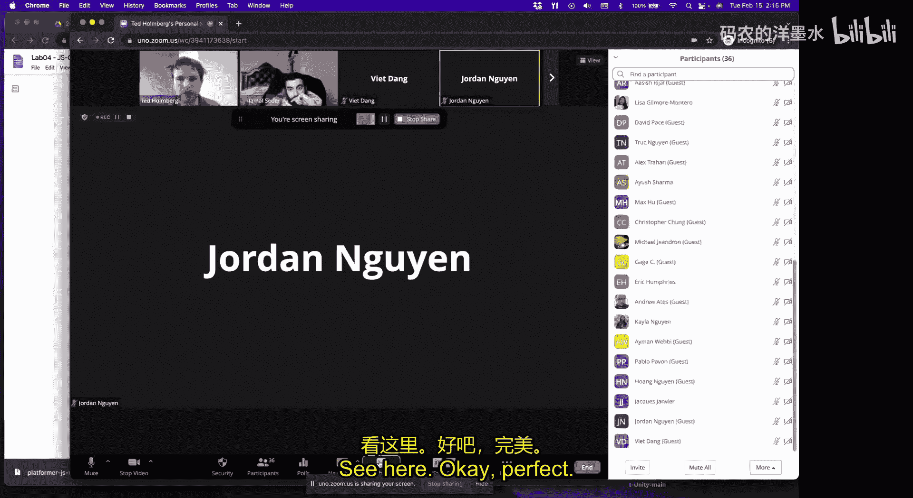

Nope， we don't want that。Okay。Okay， so we've we've seen JavaScript previously with some embedded JavaScript for our first homework and first lab。

 but here we're going to start removing it from the script tags from HTML and putting it in its own GS file where it belongs。

So what are some facts about JavaScript well first of all， web browsers。

 all web browsers include a built in JavaScript interpreter capable of both general purpose computations and domain specific processing so by general purpose computations I mean we can use JavaScript now to build any kind of application similar to what you can do with Java or Python。

 but not just that you have to understand JavaScript started out as a domain specific programming language。

For managing HTML elements， so a lot of view based stuff is handled by JavaScript in fact that's what it's really good at so JavaScript actually supports a multitude of paradigms。

Iperative。Procedural， object oriented and functional。

 so just to give you an idea of what that means and again these concepts。

The value these concepts have to us is how can we author jascript code。

 So imperative just means that jascript code may be defined and executed a statement by statement。

 That means I don't have to put my code in classes or in methods or in。

Or in functions or in anything for to actually execute， I could just put console。log hellello world。

 and it'll work。And so languages that support that capability， oh my， it's really cool。

Uttered in here。 So， for instance， I can do console log。

Hello world and I can just do that I don't have to have any kind of boilerplate structures to manage that for me。

So procedural means that I can also have my JavaScript code organize and find within functions。😡。

Object orientedness， which。It says components， but that should say object oriented means I can define my JavaScript in terms of objects and classes。

And then functional means that I can have my JavaScript code。

Organized as a set of cascading function calls， and here the distinction between functional programming is that I aim for as much of a stateless system as possible。

So with objects and classes， we manage at state。Encapsulated inside of the instance themselves in a functional programming paradigm。

 I try to limit that。So if you haven't seen all these different paradigms。

 you will see these in programming language structures。

 so this class will actually give you an opportunity to play around using one language with four different paradigms。

Now addition to that， when using JavaScript we are going to link all of our JavaScript files into the HTML document using a script element we've seen that before a little bit in the first lab。

 so in our head we can link the JS file to the head if it has no dependencies in the body so we preference using the head but recall。

If your JavaScript is trying to access something that's defined in the body of the HTML。

 then we also have to put it in the HTML。Because now there's a dependency。

 an HTML element dependency that exists where it's going to have to access it。Now the Canvas API。

 I just showed you this on the web page， not too long ago。

 browsers provide a JavaScript enabled viewport called the HTML Canvas element。

 and this element supports real time 2D or 3D graphics。

It also allows you to capture user input on that canvas and and update the canvas as necessary so when we think about this and you've probably covered this。

😡，As a design pattern， probably in 2120。When you start building out event-dven graphicspace applications。

 you can think of it as a model view controller layout where the model is going to be where all of your data resides and all of your logic resides。

 the view is going to be the canvas that provides a realtime rendering of our computer graphics and GuUI elements and then our controls are going to be provided by some kind of built in API for capturing user events from the input。

 either the keyboard or the mouse or whatnot， and then importing that into a model that's going to respond to those controls and then it's going to output some results into the view or the canvas where the user can then see it。

So we will be adhering to a model view controller design pattern when we build out this application。

Okay， so examples of our browser based game well there's several examples of browser games that exist online。

 but you know there's one that's built right in the Chrome Bowser it's the Dno game so actually if I oh let me see if I can just open up this link。

Or what I'll do here， if I just do about Col Dino。 I'm sure everyone has seen this before， right。

 The Dino game， this whenever you don't have Internet， you can just hit like the space key and。

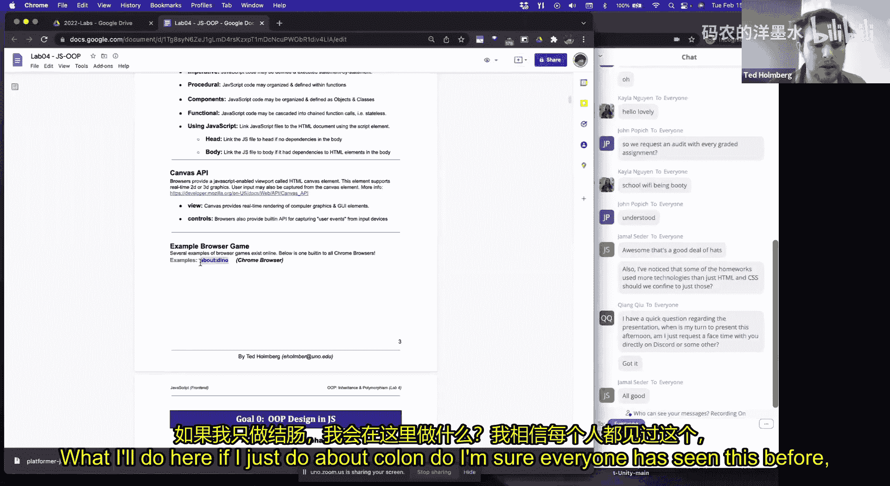

Oh yeah， I'm not very good at this game。Okay， enough for this though。

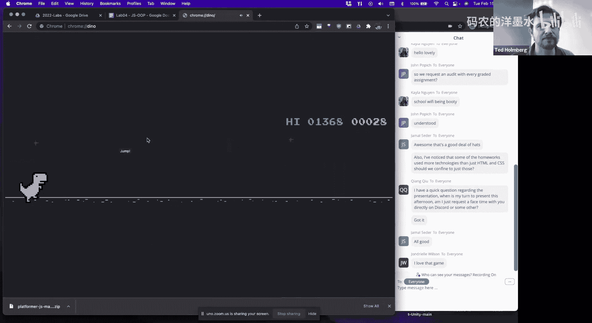

So this is an example of a simple canvasva game。Okay， so。Let's go to goal zero。

which is really going to focus in on the design of our application as a whole， so again。

 the purpose of this lab is for an object oriented programming。😡，Designed in JavaScript。

So our first approach is to figure out our game objective in this lab we'll build a platform or game。

 the player must jump on blocks to navigate the exit。

 the player must avoid floors and ceiling hazards to prevent a game over state and if the player gets to the exit。

Then another stage will load until the player exits the last stage and wins the player is affected by gravity and friction the game is designed using inheritance and polymorphism to store common data for each type of related object Okay。

 so everything you would traditionally think of in a platform or game that's our game objective and I don't know if I actually have。

I'm not even going to bother showing you a demo of this game I don't want to waste the time for that we'll just see this game evolve as we develop it。

So our application are due phase for the planning portion， the design portion of this application。

 Well， the first thing we need to do is we have to define our game objects right whenever we start planning out an object oriented program。

 we know it's going to be so complex that we're going to have to have multiple。

In a tea that exist in our application， multiple objects and we want to start planning those ahead of time we want to start thinking about well what is a platform or game going to need before I start doing any coding。

 even if I'm doing iterative design it's a good idea to start thinking well what are the game objects I need So from the player's perspective the game objects that we need is a player character And so some of the roles of the player character is going to have to do in our application as well it's going to have to be able to move left it's going to have to be able to move right it's going have to be able to jump up。

And other things that the player character we should be aware of is the fact that it's going to be affected by physics and gravity。

As well as friction， so we'll define physics in our world。

 in our game world as just having something to do with gravity and friction。

Then we'll also have brick blocks， so this game object is one that the player can collide with。

And cannot move through and these top up blocks we can then use to build our floors， our walls。

 our ceilings， and whatever platforms we want。Then we can have hazards。

 we might have two types of hazards， and when we think of a hazard。

 we can think of it as a special type of block。So a ceiling hazard， for instance。

 the player might die if they collide with a spike that if they jump on top of from underneath it。

And we might have another type of hazard， which is a floor hazard that if the player lands on top of it。

 they might die。And then we'll have an exit， which is also a different type of block。

 but it's one that will allow us the player to advance to the next stage。Okay。

 so let's take a quick overview of some of the classes then。

 so now that we know some of the game objects that we all have to consider from the players perspective。

 let's look at some of the classes we might need from a game management。

 from an application perspective。So we'll have a game class and the game classes' role will be to manage the game data and game methods。

 we'll have a world class and the world class will manage all level setup data。

 we'll have a scene class and the scene class will manage scene data and scene methods so a world might be defined as being a collection of scenes and a scene is something that you actually contains all of the game objects。

We'll have a block class which will extend a game object to define a block。

 so let's jump over here or game object what's a game object and manages all common data for game objects。

😡，So a block will extend a game object， so a more specific game object will have an exit which will extend a block。

We'll have a ceiling hazard which will extend a block。

 we'll have a floor hazard which will extend a block。朋友。然 better。

Let's say we know the game object will probably be kind of the the parent class of all entities that exist in our game willll have a player。

 which will be a specific type of game object will have。Besides， okay。

 so these between player floor floor hazard ceiling hazard exit and block that probably defines most of our game objects we also have to have a controller class which will manage the player inputs to move a player will have a。

Standard draw class， which will essentially be our library class for drawing graphics so I don I don't think we'll have that here。

 I think we'll use the canvas element but we'll see。

That might be a remnant of the Java use case of this， so that might have to get next。

 we'll have a physics class which is going to manage the physics。

 the gravity the friction and the velocity， so all of the interactions of the player in our real worldlike environment。

Then we'll have an animation class which will manage which image is to be displayed at any given time during our game loop。

 and then we'll have a pose class which will contain all possible animated poses。So。

When we kind of sit down and break apart what we might。

Have to define responsibilities across a platform we gain。

 this is probably going to be the list we come up up with our standard draw might be just the Canva API here if it's not called standard draw。

😡，So it's still a responsibility of our OOP application。

And then we're going to have this configuration file here， the worldldata。js and we get this。

 this is given to us as part of this assignment， so what we're going to see。

 the data that's going to be contained in here and let's take a look at it here。😡。

Let's actually look at this so we're going to have。World。

 this is a essentially what's happening here is we're declaring a global variable because we haven't given it a context of varlet or const。

 so we have a global variable here and we're assign it a empty array。And in JavaScript， array。

A dynamic so they can grow in size as we assign things into them so they operate very similar to Python style arrays and less similar to Java script I mean Java style arrays that are static and set inside size so once we have our array declared here we can say well at index0 of array I will then assign I do an assignment operator and then I'm using if you see this this is a tick so this is like the tillday key that that's been shifted so that creates a string template and I go into much more detail about what string templates are if you watch the lecture video but one special thing that string templates allow me to do that I can't necessarily do with traditional strings that use either the double quotation or the single quotation is that I can actually define it。

On。It's on a separate line right like so I have this and usually what I can also do is wrap it in parentheses just to make sure that works。

But what this allows me to do is kind of just define my world data so that it lines up。

So I start the string here， I ended the string here and each one of these characters is going to represent a tile。

 so say for instance， the hashtag is going to represent the standard block tile。😡。

The V is going to represent a ceiling hazard and a is going to represent a floor hazard。

A a symbol is going to represent the starting location of our player and the exclamation mark is going to represent where the exit point is and so since this is going to be a multilevel of platform or game this will represent our first level and then this inside of index one of our world right。

 we will then have a string that will be able to parse that represents our second level and then at index two we'll have a string that represents our third level so we have three different levels that have essentially been predesigned for us to go ahead and implement on top of。

Excellent。And so going back up to here， so I think that's going to finish up the kind of explanation of what we're building。

 let's go back up to the table of content。Where we can kind of get a strong understanding of how we're going to step through this。

Starting forward， we went through the learning objectives where we talked about what is JavaScript Canvas API S。

 so an S is also what's referred to as a single page app up until this particular lab。

 we have worked on multiple page apps。And many years ago。

 that was the traditional model for building a website is that you'd have an HTML document for each individual page。

 but one thing you might have realized working on the first homework was that every time you load from one HTML document to another HTML document。

 you lose whatever state was being maintained in your JavaScript runtime environment。

 and since JavaScript has access to the HTML DOm elements and memory and it can actually update the browser's viewport。

It has become。Shifted in terms of the architecture style of building up an app to be what's called single page。

 so instead of having multiple HTML pages you have the one HTML page and every time you need to update with new information。

 we can do it via JavaScript and that allows us to maintain a singular JavaScript runtime environment and have a consistent data state there so we don't have to do hacky things like using the search parameters to migrate state from one page to the other。

😡，Okay， and then in our goal zero， we talked about what is going to be the overall design of our application。

 we're going heavy， heavy， heavy in the object orient design。

 so the same metaphors and practices you should be very comfortable with coming from Java。

 we will immediately be able to adhere to and build and structure applications very similar to that in JavaScript。

Okay， so the actual application when it comes to actually building it。

 we're going to do it iteratively。I feel like every application that one designs should be done in an iterative approach it's a great way to start with very little and build up the complexity to get something that is complete and finished in a manageable way and so in order to get this game built we can break it down into effectively 20 different iterations or 20 different little goals that will build into each other。

Until we're done and so our first goal will be to make the HTML page。

That's going to effectively go ahead and import all of our JavaScript code and allow us to actually start running our JavaScript application and then the next thing we're going to do will be define each of our classes and we'll start with the view class so we can start drawing things and then we'll start with the game class because the game class is going to manage all the rules。

That's going to manage all the main game logic we have。

 then we're going to create a world class and again that's going to be responsible for loading and managing all of the level data。

Then we're going to build a scene class。 And that's going to be the class that's responsible for managing all the all the playable game objects in a particular scene。

 Then we're going to find a game object so that we can contain it within a game scene， right。

 And so we want to make a game object such that it not only exist inside of our data model。

 but we can also draw it and view it。😊，Then the next goal will actually build a block which will inherit from this generic game object。

😡，And we want to try to define so all of our blocks。

Will be managed by the block class and we'll try to draw all the blocks from the level data that we have。

Then we'll create the player class and that's going to be the class that manages all the player data and draws the player then we'll create a physics class and that's going to be the class that manages all of our physics rules where we can add gravity and friction and things like that then we're going to create a controller class and that's going to define that's going to be the class that manages all the player controls where we can move left right and add a jump。

And then we'll keep adding things to that so initially when we create like the controller class it might just have the jump option。

 but then we'll add the ability to go left and right and we'll add that implementation in a preexisting class there controller and the same thing with physics we'll start adding collision detection for floor collisions and ceiling collisions and left right collisions。

Then we'll add friction。And then what we'll start doing is we'll start adding new things into our game like the hazards so that we can get a de condition into our game。

😡，And then we'll add exits into our game so we can start defining wing conditions in our game and then after we get our game working in kind of like this static nonanimated approach we're looking into creating an animation class that can update our sprite so it actually is animated。

And then once we're done that， we'll see that from scratch using almost no external modules of code。

 we will have built a complete game system。And then that'll lead us when this lab is complete。

 that'll lead us to the next homework that would be homework three。

Which will be to build your own JavaScript application。Okay， so let's go to goal one。

With goal one we just need to make the HTML so again every one of my goals I always like to break it down into a three stage process what is our approach what is our application and what is our assessment so the approach you could always think of the plan for this goal the applied you could think of as the do phase of the goal the actual applications and the assess the testing to make sure that our goal is working the way we expect I like to call this the tripleA approach to software development。

😡，Okay。So here what。Canvas is going to be the tool is going to be the HTML element that we're going to use that allows us to use JavaScript code to draw graphics directly into the browser's viewport so we're going to have to create an HTML document。

 we're going to call it platformer dot HTML so let's do that let's go jump over here and let's do touch。

😡，No。And。Potformer dot H， perfect。Where am I？Oh。There it is。So let's drag that into here， okay。Okay。

 perfect， and let's actually go into my platform or so。

The rest of the lab I'll be in the appropriate directory。 Okay， so now let me。

Pull this into my editor。What's going on with my trackpad。Okay， there we go。 And also。

 let's pull this into。Our。There we go into our browser so that we can go ahead and monitor what we update over time。

Okay， so now that we've created an HTML document， what I'm going to do first is I'm going to grab this HTML code。

 but then I'm going to step through what's happening with it。So I have our HTML document here。Okay。

 so let's get rid of， I don't need all this stuff here。

 I'm going to clear on some of this stuff so we have already seen document。

And then I'm going to have here the head， and I'm going to have the body， and I'm just just going to。

I'm going to put some data like we started to do， I think in our prior lab。

 some metadata that the character set that I'm going to use is just UTF8 not necessary but it's good to have if we don't if we don't specify this directly it'll be embedded there for us' also go ahead and add a title that says platformer and then inside of the body tag here I'm going to create that Canva HTML element。

 I'm going to give it a couple attributes， I'm going to give it an ID of viewport so I can access it from my JavaScript runtime environment。

I'm going to set the width of this canvas element to be 500 pixels and the height will be 500 pixels and then I'm going to set the style of this canvas element to go ahead and just have a border of one pixel solid and black so that we can actually see it since we're not drawing anything in it。

 I'm want to be able to actually see it。So after I go ahead and add this HTML code I should now be done this step I should be able to test so all I should have to do to test this is open that platform or HTML in the browser and we should see an outline around our viewcor so let me update this and yeah there it is so here is our canvas element I've drawn the outline around and yep I have platformer is in my title right there as well perfect。

Okay， well with that said I can go ahead and move to the next goal the next goal is well now we're going to start making some JS code everything else from here on I is going to be JS code so the first JS code that I want to make is going to be a class that's going to be called the view。

And so the JS class is going to be responsible for calling the browser's Canvas API to render images into the HTML canvasva。

So to define a view class that represents the game's renderer。

We can just go ahead and then draw that so let me see here so let me go and make a Js file called view。

js and notice for instance here I'm actually going to use an upper case for this script name now sometimes I'll use upper cases sometimes I'll use lower cases。

If it's going to be a class i'm going to use an upper case if it does not contain a class。

 then the Js file name should be lowercase now none of this is enforced it's just。😡。

A programming practice。Okay， let me go into my scripts， so change into my scripts。

And let me touch into here。What was this view dot JS in here because this is going to be modeled as a class。

 I'm going to use an uppercase on that， whereas world data is not。So it's modeled using。Lowercase。

Okay。Let me copy this and then we will explain everything that's happening inside here。

So in order to declare a class， well， you'll see a lot of this syntax。Is very similar to Java。

 so classes are defined using the keyword class， and then we give the class a name。😡。

And so to be consistent with Java light notation， we'll use a upper case。Letter for our class names。

 and then our classes have to have a scope， we use curly braces for the scope。

Then inside of our class we can define our instance variables。

 we want to have our instance variables be private to define instance variables based on the class scope。

 we can go ahead and just define them inside of the scope。

 but we also put a hashtag in front by putting in a hashtag。

 this is a symbol that JavaScript uses to enforce。😡，Private， the private label。

The private access type onto these data attributes。

So this means that external code will not be able to access either of these properties。

 canvas or context， and again， we can enforce that by putting the hashtag in front of that。😡。

So our class scope ends here now what we'll also do for our game is we're going to actually use our view almost as a singleton type object。

 so in order to do that we're going to create a constant variable that'll be managed inside of our view and we're going to assign it a new instance。

😡，So we'll invoke the constructor here and then we'll bind an instance of a view object into this view variable。

 which is now， since it's outside of a function， since it's outside of a class。

 it will be a globally scoped variable that we can then use inside of our application。😡，对。Okay。

 now the next thing that we're going to want to do now that we've essentially stubbed out of U class is to define a constructor for it and so our constructor should do a similar role as to what a constructor inside of a Java application would do so I should go into here into my class scope。

And。I will define a special I will define a method called constructor so just like in Java your constructor has to have the same name as the class in JavaScript your constructor uses the name constructor I actually like that better because it's more evident as to what that method is doing his role is to set up all of the instance variables and to set up an instance of the class。

😡，So the method that gets invoked whenever you say new and then invoke the constructor will be the constructor method。

And then our construct method， what we're going to do is we're going to go， hey。

We're going to invoke from the document， hey， document， we want to get an element by its ID。

And we want to get the element。That has the ID of viewport so this canvas element here has that ID viewport well I can use the where to go I can use here。

The document API to get that element into my JavaScript。嗯。Now。

 I could have just as easily just used viewport as well because that would have worked。

 but this is the。More robust way of doing that。And again， I explained this concept in the lectures。

 so when you watch the lectures the general reason why we prefer this over just using viewport is that I can override the value of viewport。

In the JavaScript runtime environment， and then I lose value of it inside my application。

 whereas if I grab it using this API call， I could never accidentally override it。

And then I'm just going to use the constructor to set the canvas attribute and to set the context attribute so here I'm going to get that HTML element and I'm going to bind it here so I have reference to it and then one of the values that a canvas has is its context and the context of a canvas element that can either be for 2D for the 2D API so that we can render 2D graphics or the 3D context that has a 3D API where it can render 3D graphics well this is going to be 2D game so I just want to manage the context because we're going to have to use that for actually being able to draw graphics into it so there's obviously a different set of API calls whether we're using a canvas for 2D or 3D graphics。

And again， if at any time I don't fully explain what's happening with this code。

 just go ahead and ask a question in the chat。 So the third thing I want to do is to find inside my class a picture method and the picture method is going to be a method we're going create that's going allow us to draw an image into our HTML canvas。

 So now let me go into my view class here。 And I'm going to go ahead and create a picture method and the picture method is going have a number of parameters it's going to have a image file path。

 It'll have an X and Y coordinate of where I want to draw that image inside of my canvas element。

 and then it'll have a width and height of how large we want。

That image to be and so in order for this picture to actually get drawn because again。

 it's the role of the view class to do all of our graphics drawing will understand that Can has its underlining API on how we could set images inside of it。

 we access canvas's API based off of its context。 So remember one of the first thing I did in the constructor was access its context and saved it into a JavaScript variable into actually an instance variable。

And so I'm going to access every time I want to set a picture into our canvas element I'm going to access the context that has the API and one of the API calls that's built into it is a draw image method and a draw image method requires up to five different parameters which is going to be the image path file name the X and Y coordinate that the image is going to go to and the width and the height so notice this is kind of like just a wrappper method that's going to send the data from that's passed into the picture method and then send it to the appropriate API call so that we can actually draw that image and again if at any time you wanted to see what you can do with a canvasvas element you can go to the MDN。

And in fact， see all the different kinds of calls you have available there。I go back here。

 what was it， what was that call， It was draw image， so for instance， we could do draw image。

And we could see all the different。Documentation for how we can update the canvas and then all the other different methods that you can use for data visualizations besides adding an image like drawing rectangles and circles or arcs or polygons or all sorts of other things。

Yeah， so this step， we're eventually going to get to the point where we want to go ahead and effectively draw our map。

But we're going to do that in a piecemeal way we'll find out actually what we want to accomplish in the assessment phase。

 so in the assessment phase here we'll want to be able to just test to make sure that we can draw things。

So the next thing I'm going to do is inside of our body now that we have this view。

js file and this view。js file will actually instantiate an instance of view inside of the view variable。

 which we will now have available to us a global scope。Let's actually。Now that we have this。

 let's go into our platform or。httm and we actually have to go ahead and add this and since our script here is accessing something that's defined in the body。

 then I have to put the script that imports this JS file in the body at the very end because this has to exist before this can do its thing。

Excellent， so now to actually assess this。What we can do is we can open the platform or do HTML and we can try typing some code and getting our viewport to do something。

So let's see here。So here I have some code that it says I can play around with。

 so let's try to do that let's go。I'll turn out here， so I don't have to jump back and forth。Okay。

So here， if I refresh。I'm still not drawing anything because all I have is that view class。

 but one cool thing about JavaScript。Let me stretch this out a little bit。

 One cool thing about JavaScript is I can interact with the JavaScript that's preloaded in real time So if if I just type in view for instance。

 you'll say oh look that's that variable that holds that view instance so let's see if I can start sending it some code so say for instance let me make a background variable and I want that background variable to be essentially a new image an HTML image object So look at that I was able to create an HTML image object on that and we'll go much more into this ability to dynamically create HTML elements from JavaScript we get into our lectures about Dom and that'll be I think in the next lab after this one。

And then so I'll take my background right and so now since that's an HTML element that's in our drama runtime environment I can define a source attribute and say for instance。

 the source attribute is going to be inside of my assets directory， I have the background of a PNG。

So background do p andG okay， so now let me go ahead and set that and now let's see if I can't say from my that view。

Variable， let's access that picture instance method and remember the picture instance method required a。

Image。So we'll pass it this background image we made coordinate and so the graphics most graphics applications use the top left most coordinates that you want to draw on so if this is going to be the background image we wanted to start at the zero zero coordinate。

 the upper left coordinate and then our。With in height we want the background to fill the entire thing to 500 width 500 height。

 and if I go ahead and do that notice baM， I just interacted with that class instance and we set that image into our canvas。

Excellent， so suppose I wanted to draw something else， so let's make say， for instance。

s a hero image， so let's do a new hero image。Right and let's say that the hero。

 let's set the source attribute for our hero to be inside of our assets directory， we will have。

Let's use a spaceman， P&G。So we'll at that as a source。The file path there， and then I'll do。

I'll invoke that there's only the one method inside of our viewport right it's the picture method so let's send it our hero image and here we're not going to draw this across the entire canvas we want to make something smaller so let's say we want to put our hero at the 250 250 coordinates so at x coordinate 250 y coordinates 250 and let's say we want our spaceman to only be 32 pixels by 32 pixels。

And then if I do that you can see I can draw the space man right on top。

 so here you can see our viewport with our picture method seems to be working just fine when we interact with it directly for our console for our terminal。

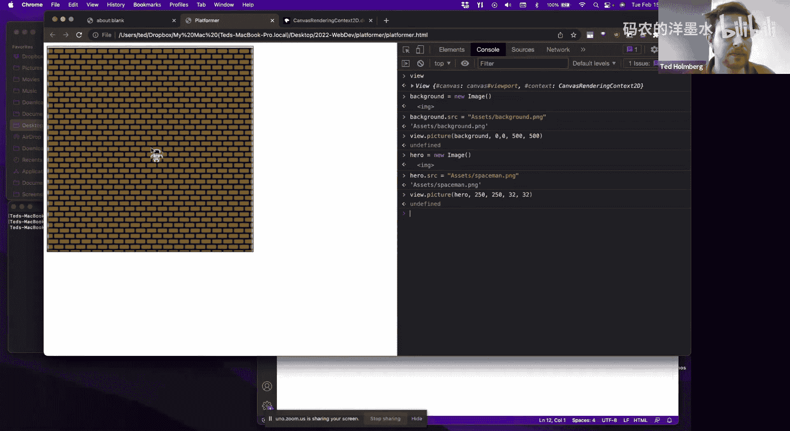

I got perfect。Let me get this back here and I'll collapse that。Okay， so I'm happy with that goal。

 our view。Our viewport， our view class seems to be working the way I expected to。

 so let's move on to the next goal where we're going to design。

Our game class and start defining our game class so again let's break this down to the approach。

 the apply and the assess so in the planning phase for our game class let's just stipulate that the game class is responsible for managing all of the game data and the game rules。

So again， whenever you start finding a class， start by saying。

 what are the properties it has in it and what methods is it going to have to support and who's going to be the client to this class and who is this class going to be a server to？

唉。So these are when design an object oriented application。

 these are always the things you should be asking yourself。Okay， so let's go into our do phase。

 we're going to create a game class and we're going to stub out all the necessary methods and attributes that's going to allow us to define a game loop and start executing that game loop。

So let me start by creating the JS file， so let me see here。

 so I should be in my script director I am so here I'm going to create。

And since this is going to be a class in itself， I'm going to use a capital or upper case letter。

 so gain。t Js。There we go。 So now next thing I'm going to do is let's go over here。And drag。

That is my editor。So I can start updating it and then here I'm going to。车埋。

Take the steps and initially define my class so I'm going to define a new class using the keyword class and then I'm going to give this class a name of game using uppercase letter and then I'm going to give this class scope using curly braces so so far very similar to Java then I'm going to give all my class properties or what you might refer to as instance variables so one class property I'm going give is the is over so it's gonna to be a Boolean variable now there's a ja is not a strongly typed language so it's more important than ever that you use good variable naming to give it be an indicator of what each variable is supposed to model or represent and again we're going to put hashtags in front of our names because the JavaScript interpreter will treat those as private data and won't allow those to get mutated outside of a class outside of an instance method。

And then underneath the class， in order for me to just to be able to play around with our source code and whatnot and be able to access it from our HTML document。

 from our general Office group ontime environment， I'm going to create an instance of our game and then bind it to a constant variable。

😡，Called game and effectively this allows me to treat it as if it's a singleton object。😡。

So I won't have to instantiate it again。Okay， so let me save that up to this point。

And so the next thing， the next step after I've initially defined my game class and the properties inside。

 I'm going to define the constructor and the constructor's role is effectively to set up the state of an instance so after my instance。

Variables， let's go here and define a constructor method。And again。

Every time I don't know if I mentioned this on the view class。

 but let me highlight this here every time I want to de referenceence。😡。

One of these instance variables that's defined on the inside of the scope of game。

 I have to use the this keyword so that this keyword has to be used and that's because since JavaScript。

😡，He supportups more than an object oriented paradigm。

 it's possible that I can have variables that are scoped。😡。

inside of a function or inside of even the global scope that might also have the name is over so to ensure that I'm always referring to a instant scoped variable I'm in force I'm forced to be explicit with the this keyword so whereas Java is more la in this regard and you can dereference instance variables without the this keyword you cannot do that in JavaScript。

😡，Anyway， so I'm going to dereference the is over property and I'm going to initialize it to false。

Because the game is going to start as not being over。

Yeah that's right so but that means that this is more consistent with the C family of paradigm or languages。

 so just like C+ plus C sharpp and Java all use this keyword as a reference pointer to the the object in memory of itself。

So does JavaScript， but JavaScript can be kind of hairy with this keyword and we're going to see that when we talk about more object oriented things in fact the object oriented lecture is really going to show you some of the interesting happenss that can occur with the this keyword。

😡，Okay。The next thing I'm going to do is our game class is going to manage the state of our game。

 which means that the state of a game typically the main game loop has an update phase and it has a render phase。

So we're going to create an update method。That's going to be responsible for updating our game model between each。

Turn or each round or each tick of the second。Of the cycle of the game cycle so our insider update here will just initially have a console log that just says game update and again this is just for testing purposes it will delete this line after we're finished this goal。

But to give us just a behavior we can observe。😡，And then what we also want is a render method because again。

 this the game class will be responsible for updating and rendering so for initial purposes i'm just going to stub out this method。

With a console do log， so console do log is。If it's not apparent already whenever I go into the developer tools。

😡，It's what serves as like a system outgot print statement in JavaScript， so if I do console。

log hello。It's going to print out hello。So this is one way I can send test messages or console log messages to my terminal for testing purposes。

Now clearly these aren't displayed in the viewport。

 so this is designed as developer messages and not end user messages。

 so you would normally do a full application with console。

 log messages just like you wouldn't make a real application with system。 print messages and Java。

Okay， so now that we have our update and render methods。

 the next thing we want to do is actually build our main method。

Which is going to be the actual launch point of our game application。And so here。

 if I want a method to be static to the class itself。And not an instance。Method。

 I can use the keyword static in front of it again。

 all the same paradigms you learned in 1583 and 2120 you can use to design true object oriented software in JavaScript。

😡，So inside of our main method， we're going to open close scope， we're going to do the following。

 we're going to check if。Inside of game is over， so since we're inside the game class we can access this attribute right because we're inside the class scope notice game。

😡，Is an exist object it's this variable here that we've declared。

 so if inside of game is over is equal to false， then we will tell the we will invoke the games update method。

😡，And then we will invoke the games render method and then from the window object。😡。

That is the global object that is available to us in our JavaScript runtime environment there is a built in method in the API that's called request animation frame this means you can render you can register a method to the window and itll get repeatedly called again and again and again so here we will go ahead and repeatedly call this。

😡，Main method。 So if you think about this is kind of a recursive call because we're sending from the main method。

 the method itself， however， it will stop。Registering this to keep repeatedly invoking the main method once。

This is over variable is false。So if game over is false， then instead of doing this if statement。

 we will instead do the L statement and we will print to the console game over。Okay。

 so now once we've done that， why don't we go ahead and actually launch our game using the H document。

 So here let's go into our HTML every time we add a new class， we have to import that class into。

R email document because that's how we get our JavaScriptscript files into our JavaScriptscript runtime environment。

 So here i'm going to。Import the game JS file。After the view JS file。

And then I'm going to create a script tag where I'm going to tell the window object。😡。

To add an event listener and when we add an event listener， we can pass it the name of the event。

That we're going to listen for and then the action。

 the callback function that triggers in response to that event。

 Well the event we want to listen for inside of our HTML document is when the document loads。

 So every time a document loads， it actually fires a load event。

Inside the browser and we can tether the callback function to from our game class。😡。

To go ahead and invoke that main method。So again we're not invoking the main method here right to invoke a method。

 we put the parentheses， we're not doing that， we're passing it a reference to the method itself。

 and since methods， since functions， since methods are all objects in themselves as JavaScript。

 we can pass them along and save them in memory。😡，So if we're going to pass this callback function as a reference。

 and when the game finishes loading， then we're going to fire this name function。

So now let's test this for testing purposes， what we can do is we can open up this platform。

 HTML file on our browser， and then from the dev tools we'll be able to access the JavaScript console and we should be able to see it repeatedly show game update and game render。

 game render， game update game render。And we should get an infinite number of console logs until we decide to kind of stop that。

So let's refresh this page and yep， there it is and look， it's just going on forever and ever。

Excellent。Okay， let me。Oh refresh that， oh no， yeah that's。Okay， well let's fix that。

 that's probably not ideal。嗯。To have that just going on forever。But we got what we wanted。

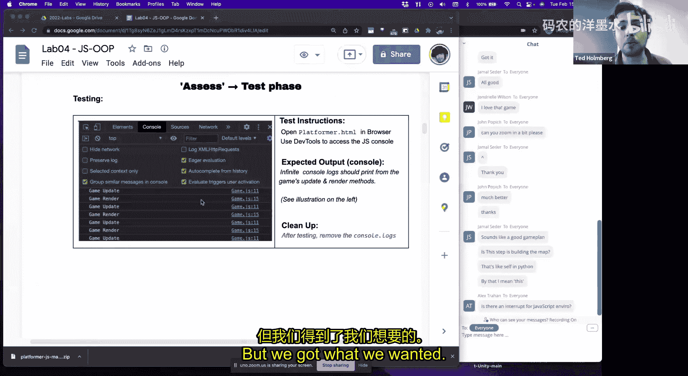

Is there an interrupt， oh let's see， can I control state， nope， there's no。

 I I don't think that there is an interrupt。If there is one， I'm not aware of it。

 I usually just end the terminal， I mean， close the tab when that happens。And maybe I'll do that now。

Okay。Yeah。Okay， so that allows me to move on to my next goal now that I've successfully created a game class and I know my game class is actually launching when I launched my when I initially open or load my email document and it's triggering my main game loop and my main game loop is firing the update and render methods back to back to back to back。

 let's talk about starting to build a world class。To be able to start managing the world data so again the approach here is to recognize okay we have to define all of the properties that the world class is going to be defined as and all the behaviors。

 all the methods it's going to be asked to go ahead and fulfill。😡。

And so once I've been able to label those things out， let's actually start building our world。

gs file， so the first thing I'm going to do here is I'm going to go to build world instance this is going to be modeled as a class itself I'm going to use an uppercase letter。

 world。 Js。And then I'm going to go here。And I'm going to drag this into my IDE。

 and so I'm going to create a class with a class scope called World and the properties my world is going to require。

So just like what I did with UN and game， I'm going to do the same thing here and here the property that my world is going to have is going to be a collection of levels right the array of levels。

 and again I'm going to use a hashtag to ensure that that is set as private data so we can get all the same metaphors that we use in Java inside of JavaScript。

Once I've created a class and the properties that define my class。

 I'm going to create a constructor so I can actually instantiate an instance of the world class。

And so the constructor inside of my world is going to parse all the map data and save it for later。😡。

I'm going to use some traversal I'm going to use some higher order functions to traverse。My。

Worlds from the data structure that I get。From world data， so recall that world data is an array。

And so arrays have built in。Methods that allow me to do what are called high order functions。

 a high order function as opposed to a first class function。

 a first class function is a function that you invoke directly and you pass in data into。

So for instance。Main let me find something else is that oh， let me go to view， for instance。

 picture here is a first order a first class function because it takes data directly and we treat it as a function that gets called directly。

Map that we're about to see is what's called a high order function we pass it another function so again if this looks odd to you。

 if this method looks odd if this line of code looks odd to you you're going to have to watch the data structures lecture because I go into much greater detail about what's happening here but effectively world is an array so let me go here world is an array that we get from world data do A。

😡，So inside of my levels property here， so I'm going to dereference the levels property now I'm going to assign to it。

😡，By accessing this to right i'm going to map a function on top of it so this is a arrow function。

 so you can think of this as an anonymous function for an anonymous function。

 this would be the parameters。😡，So for each level that gets passed into here and it's mapping for every level inside of a array is going to take the level。

 it's going to split that level。😡，By its new line。By by his new line character， so at the end。

 so let's go back over here into our rural data so each time。Since this is a string literal。

 it maintains all of the。It maintains all of the。啊。Syntax the new line， the spaces the tabs。

 all of those kinds of meta formatting and instructions that are embedded in the string it preserves those so there would be a new line character here there would be a new line character here there'd be a new line character here here here here here here here here here here so this anonymous function oh let me go。

This anonymous function is going to iterate over each index inside of the world array。

 so again the world array has an index of zero， which would be this string that be at index zero。

 this would be at index1 and at index2。So for each one of those indexes it's going to split that entire index based off of its new line characters to get just each row and then since each row itself is a collection of characters I can then map another function on top of that where it's going to look at each row inside the string and it's going to split it based off of an empty string so it'll split it into just a set of characters so this is just a single line instruction that allows us to parse this one string into a twodisional array of characters。

😡，And again， if this looks confusing， you'll get much better indications of how that works inside the lecture。

 so please go back and look at the data structure lecture after this after today if you haven't done so So now that we've created this constructor that can parse our data using the built in traveral tools the traversal tools that it's built into ja let's go ahead and update our game class so it can actually have a new property。

 the world property so let's go to our game so our game is not just going to have an is over property we're also going to give it this world property inside of the top here where the instance variables are and then in our constructor let's go ahead and set that up to where what we're going to do inside our constructor is we're going to。

Of game， we're going to go ahead。Yeah。We're going to go ahead and。

We reference the world attribute and we're going to assign in a new instance of worlds invoke that rural constructor。

 that world constructor is effectively going to take the world data and parse it into a two dimensional array。

But what we'll do here then is we'll do a console log of our world once we do that of。

Of what we have here。And then the last thing we have to do is again。

 every time we create a new JavaScript file， we need to go ahead and import it into our HTML document。

 otherwise it's invisible to all of our other JS scripts so here。😡。

I want to import the world data before。Any of my other actions in my HTML。

 let me put this here towards the front。So here I'm going to go ahead of it directly under my canvasvas element and。

I'll just go ahead and import。The worldl data。js and the world。Okay。

 so all of my scripts that I've made so far are importanted and this was the one that was initially given to me。

 but now I'm going to start using it。And I have to test this out to see if it works。

I'm going to open up my platform do htm in my browser again。

 I'm going to use dev tools just to access。😡，The Javascript console to see if I'm getting this console log out that's going to produce like this two dimensional array of characters。

So I want to see if I can effectively import and parse my world data。

 so let's go back over here to my browser and let me open up the dev tools here。Well， and then here。

 let me go here to my platform or。js。I'll just drag this into here up。Go trying to have tools。And。Oh。

Lets make sure everything is saved。Saaved。Saaved， saved。Saaved。Okay， let's see here。

The ordering can matter because the JavaScript instructions will load in the order that you import them in so for instance。

 if my game class required a class if it went to instantiate a class that wasn't defined yet it would fail。

So I do keep that in mind and that's going to be true for anything that's not essentially packaged into modules Okay let me see make sure I to't miss anything so this thought world inside my constructor。

Oh you know what I need to do here I know what I needed to delete those console logs the console logs that we're moving so sometimes what I'll do in a previous step here is I have a cleanup step after testing remove the console logs otherwise it's just gonna to keep giving me those those infinite console messages and that's going to be difficult for me to troubleshoot so here I even had a comment delete after finishing that goal and I didn't do it。

So that was me being bad not following my own directions。

 so let me delete that and that and we save that。And now let me refresh。Okay。

 perfect so now now I've printed out so。Just like in Java jascript has a default two string method。

 So what's happening here when I'm doing this console do log in the constructor of my game class is I'm going to print out world and then I'm going to print out an instance of what's in world。

 And since I didn't define a two string method is just going to define one for me and it actually makes it interactive。

 So it shows me。Here that I have this levels attribute this property。😡，And inside there is a array。

A three item array right for level zero level one and level two。

 and then I can unpack that and I can say this array has 14。

Elements and each of these elements has 12 elements。

 which is the set of characters Now if I collapse it here。

 I can actually see that it actually with the way that the console is displaying it i'm actually grabbing the tiles that I can then parse and use to instantiate to build my game objects。

 So like here when I see this I should build a。A block tile in response to that coordinate。

 whereas this would be an empty tile。 This would effectively be a hazard tile。

 This would be a hazard tile。 This would be where my game character starts at。

 This would be where the exit is at。 So now I'm starting to be able to start parsing。My。

My game data in a way that I can start processing it。😡。

Into my model data and starting to build a game around it。

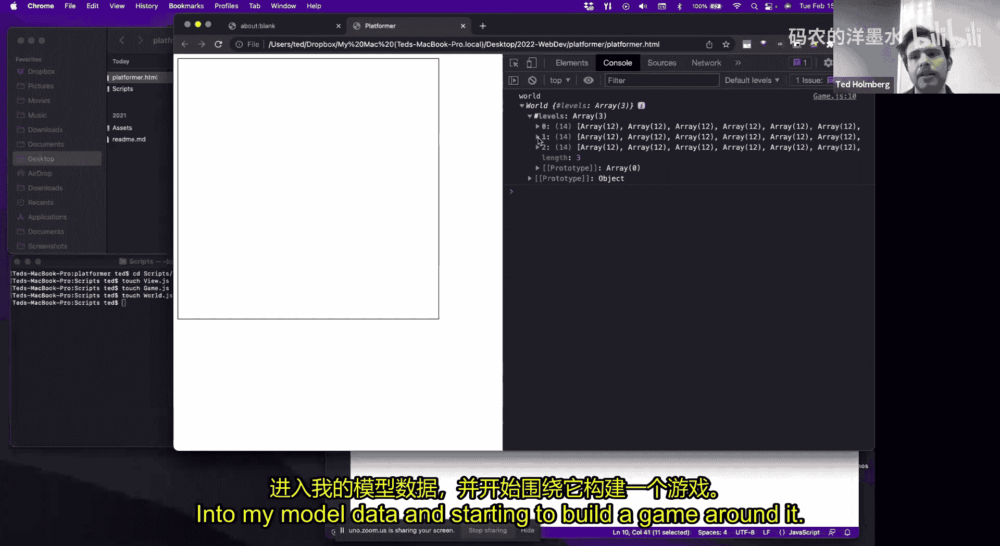

And so at this point， I think I'm where I need to be with getting my game at this assessment right after goal four and I say that I'm out of time。

 so we're going to stop on goal four for today and we're going to pick back up。On the next class。

 or next time on goal five， we're going to continue this project until we're done building this complete application。

 using a strong object oriented approach in defining our JavaScript application。So that said。

 is there any questions up to this point and what I would recommend everyone doing if you haven't done so is go and watch the JavaScript basics lecture。

😡，Watch the JavaScript data structures lectures you know at your earliest convenience and it would also behoove you to start watching the JavaScript object oriented lectures as well and while you watch those lectures we'll just continue this process until we're complete。

Oh， thank you， I'll have to correct that。I to correct that book。That is。Is over。Or maybe I'm。

I might have that corrected in this version of that we'll say anyway。

 I will bid everyone farewell and I will see you all on Thursday。

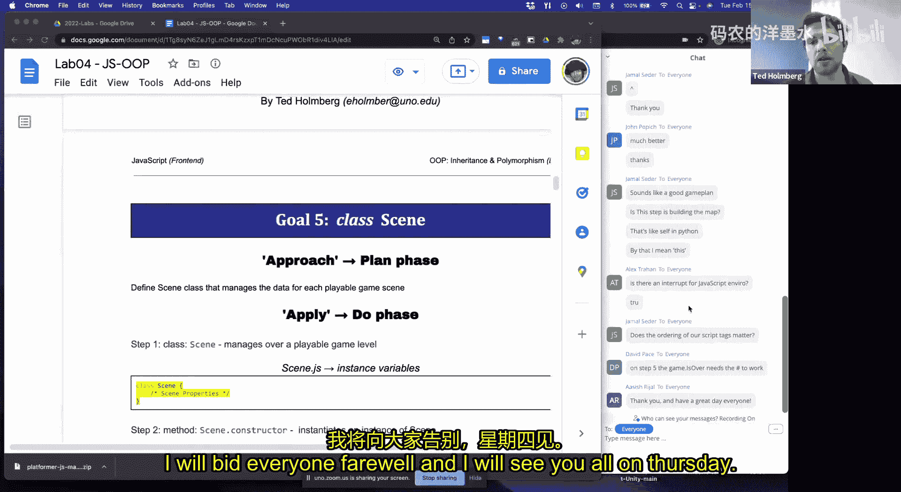

And if for any reason， you have any questions。Please let me know and Discord。

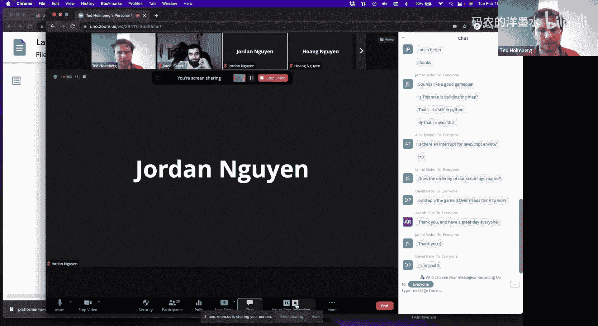

嗯。